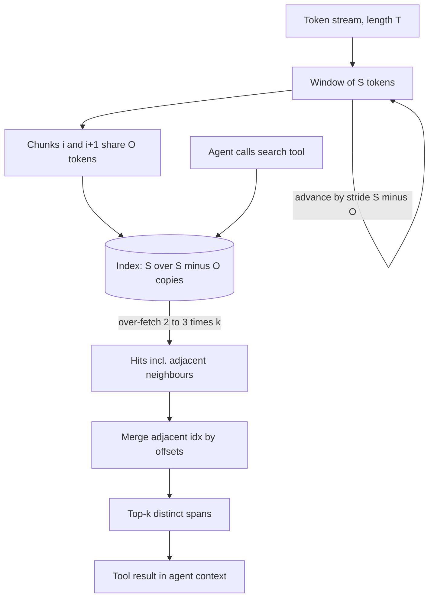

## TL;DR
Overlap makes neighbouring chunks share boundary tokens, so a straddling sentence is whole somewhere your
agent's search tool can find it. The cheap hedge inflates the index and returns near-duplicate hits
that waste agent context unless the tool collapses them.

## For agent builders
- **Why it matters for agents.** Every duplicate hit a search tool returns is context the agent pays for
  and reasons over twice. Without collapsing, three copies of one passage fill a top-5 and the agent
  searches again for evidence it never saw.
- **Where it shows up in your stack.** `chunk_overlap` on LangChain text splitters and LlamaIndex
  `SentenceSplitter`, `add_start_index=True` for offsets, and the dedup step inside your retrieval tool
  or LangGraph retrieve node.
- **What you control.** The overlap amount (often 10–20% or zero), whether it snaps to sentences, and the
  over-fetch, merge and cut-to-k logic in the tool.
- **What you can skip.** Weeks of tuning the number. With structure-following splits or parent
  sections, zero overlap usually does as well.

## Why it exists
- **Every chunker sometimes cuts in the wrong place.** A fixed-size splitter does it constantly; even a
  recursive splitter that respects paragraphs splits a long paragraph mid-argument.
- **The damage is specific.** "This limit does not apply to enterprise plans" lands in chunk 8, while the
  definition of "this limit" ends chunk 7. A query about enterprise limits matches chunk 8 and the
  agent cannot resolve "this limit". Chunk 8's embedding is weaker too, because it opens with a
  dangling pronoun.
- **Bigger chunks only move the problem.** Rarer boundaries trade a boundary problem for a dilution
  problem (see chunking strategies), and boundaries still exist.
- **Returning neighbours at query time helps only the generator.** At the retrieval step the damaged
  chunk still scores low, so the agent may never see it.
- **Overlap attacks retrieval directly.** If chunk 8 repeats the last 50 tokens of chunk 7, the
  antecedent travels with the pronoun and the vector is more specific. It is a sliding window with a
  stride smaller than the window, and every cost follows from that choice.

## How it works
### The sliding window
```
stride            = S − O
chunk i covers      [i·(S−O), i·(S−O) + S)
copies per token  ≈ S / (S − O)          (the index inflation factor)
chunks for T      ≈ (T − O) / (S − O)    instead of T / S
```

| Chunk size `S = 400` | Stride | Copies per token |
|---|---|---|
| overlap `O = 100` | 300 | about 1.33 |
| `O = 200` | 200 | every token indexed twice |

Tokens near the document's ends appear in fewer chunks, so the ratio is an average.

### Why the last tokens, not random ones
Overlap repeats the *tail* of the previous chunk at the *head* of the next, because the damage is local:
an antecedent is normally a sentence or two from its pronoun, a table header right above its rows.

### Aligning to boundaries
- **Raw-token overlap can itself cut mid-sentence**, giving the next chunk a half-sentence preamble.
- **Better splitters snap to sentences:** "repeat the last one or two complete sentences" rather than
  "repeat the last 64 tokens". Recursive splitters do this by choosing which trailing pieces to carry
  forward into the new chunk.
- **So overlap is a *ceiling*, not a guarantee.** LangChain's recursive splitter carries forward only
  whole trailing pieces whose combined length fits within `chunk_overlap`. If the last piece is a
  150-token paragraph and the overlap is 100, nothing is carried and that boundary has zero overlap.

### Choosing the amount
- **Common practice:** roughly 10–20% of the chunk size (illustrative, not a benchmark).
- **Below that,** the overlap often fails to carry a whole sentence.
- **Above it,** index inflation and duplicate hits grow faster than retrieval improves.
- **Measure it:** run recall@k on a golden set at 0, 10% and 20%, and keep the smallest value that stops
  boundary failures. If zero already works because the splitter respects structure, keep zero.

### Deduplication inside the retrieval tool
Adjacent chunks share text, so a query matching the shared region returns both with nearly identical
scores. Without handling, the top-5 can hold three copies of one passage, all landing in the agent's
context.
1. Group hits by document.
2. Merge chunks whose indices are adjacent into one span, keeping the max score.
3. Only then take the top-k.

- **Merge by stored offsets, not concatenation**, because two neighbours joined naively repeat the
  shared `O` tokens in the middle of the merged span.
- This is the first step toward parent-document retrieval, where the index unit and the returned unit
  are deliberately different.

### What overlap does not fix
Overlap patches *local* damage. It cannot restore a heading three pages up, a definition in another
section, or the document title. Those need:
- **structure-aware chunking** (carry the heading path);
- **contextual retrieval** (prepend a generated summary of where the chunk sits);
- **parent retrieval**.

## Diagram
Overlap acts at two points: at index time the window repeats the previous chunk's tail, and at query
time the agent's search tool must collapse the neighbours that overlap makes rank together.



## Examples
### A token sliding window and its inflation
A token-based sliding window with tiktoken. It windows over token ids and decodes each window back to
text; production splitters also snap the overlap to sentence boundaries so a chunk never begins mid-word
or mid-sentence.

```python
import tiktoken
enc = tiktoken.get_encoding("cl100k_base")

def sliding_chunks(text: str, size: int = 400, overlap: int = 100) -> list[str]:
    assert 0 <= overlap < size, "overlap must be smaller than the chunk size"
    ids = enc.encode(text)
    stride = size - overlap
    chunks = []
    for start in range(0, len(ids), stride):
        chunks.append(enc.decode(ids[start:start + size]))
        if start + size >= len(ids):        # last window reached the end
            break
    return chunks

text = "Limits apply per project. This limit does not apply to enterprise plans. " * 150
for overlap in (0, 100, 200):
    n = len(sliding_chunks(text, 400, overlap))
    print(f"overlap={overlap:3d}  chunks={n:3d}  inflation={n / len(sliding_chunks(text, 400, 0)):.2f}x")
# This text is ~2,100 cl100k tokens: 6 chunks at overlap 0, 7 at 100 and 10 at 200 (1.17x, 1.67x).
# On a short text the partial last window hides some of the cost; on long documents the ratio
# approaches S / (S - O), i.e. 1.33x and 2x, as the worked numbers below show.
```

### Worked numbers: a 100,000-token manual
| Setting | Stride | Chunks | vs no overlap |
|---|---|---|---|
| `S = 400`, `O = 0` | 400 | 250 | baseline |
| `O = 100` | 300 | `(100,000 − 100) / 300 ≈ 333` | 33% larger index and embedding bill |
| `O = 200` | 200 | about 499 | double the original |

The retrieval gain from 100 to 200 is usually small while the cost doubles, which is why moderate
overlap is the norm.

### Agent scenario: a search tool that collapses neighbours
Store each chunk's start and end offsets at index time, then merge neighbours before the agent sees
anything. The tool over-fetches, collapses and cuts to k.

```python
def collapse(hits, k=5):
    """Merge hits on adjacent chunks of the same document into one span, keep the max score."""
    spans = []
    for h in sorted(hits, key=lambda h: (h["doc"], h["idx"])):
        last = spans[-1] if spans else None
        if last and last["doc"] == h["doc"] and h["idx"] == last["last_idx"] + 1:
            last["end"], last["last_idx"] = h["end"], h["idx"]       # extend by offsets, no repeat
            last["score"] = max(last["score"], h["score"])
        else:
            spans.append({**h, "last_idx": h["idx"]})
    return sorted(spans, key=lambda s: -s["score"])[:k]

# 400-token chunks, overlap 100, so stride 300: chunk i covers [300*i, 300*i + 400)
hits = [
    {"doc": "manual", "idx": 7, "start": 2100, "end": 2500, "score": 0.82},
    {"doc": "manual", "idx": 8, "start": 2400, "end": 2800, "score": 0.84},
    {"doc": "manual", "idx": 9, "start": 2700, "end": 3100, "score": 0.79},
    {"doc": "faq", "idx": 3, "start": 900, "end": 1300, "score": 0.71},
]
for s in collapse(hits):
    print(s["doc"], s["start"], s["end"], s["score"])
# manual 2100 3100 0.84   <- three overlapping hits become one span; slice text[2100:3100]
# faq 900 1300 0.71
```

- **What the agent gains:** the three manual hits were 1,200 tokens of tool output; the merged span is
  1,000 tokens (2100 to 3100) with no repeated text, and two of five slots are freed for distinct evidence.

### Worked scenario: duplicates across an agent run
A research agent makes four searches per task, k = 5, 400-token chunks, overlap 100 (illustrative).

| Tool behaviour | Distinct passages seen | Tool tokens per task |
|---|---|---|
| Raw top-5, about 2 duplicates per search | about 12 | about 8,000 |
| Over-fetch 15, collapse, cut to 5 | about 20 | about 8,000 or less |

Same budget, roughly two-thirds more distinct evidence, and fewer "search again" steps in the trace.

## Production patterns
- **Sentence-aligned overlap** — on prose, use a splitter that carries whole sentences, such as
  LlamaIndex `SentenceSplitter(chunk_size=..., chunk_overlap=...)` or a token-counted LangChain
  recursive splitter. Monitor the share of chunks that open mid-sentence on a sample.
- **Store offsets at split time** — set `add_start_index=True` on LangChain text splitters (it writes
  `start_index` into metadata; checked against langchain-text-splitters 1.1.3), or record
  start and end offsets yourself) so merges slice the source instead of concatenating. Monitor merged
  spans for repeated text.
- **Over-fetch, collapse, then cut to k inside the tool** — retrieve two to three times k, merge adjacent
  chunks per document, then return the top k spans to the agent. Monitor the duplicate rate in tool
  results, read from agent traces (LangSmith or your own tracing).
- **Audit real overlap, not config** — on a sample of neighbours, measure the actual shared text and
  count boundaries with zero overlap. Alert when that count rises after a parser or splitter change.
- **Budget the inflation factor** — forecast chunk count as `(T − O) / (S − O)` in vector-store sizing
  and embedding budgets. Monitor actual chunks per corpus token against the forecast.

## Trade-offs
- **Free repair vs repeated cost.** Overlap repairs boundary cuts at the splitting step, but every token
  of overlap is paid again in storage, embedding cost and index size, in proportion to `S / (S − O)`.
- **Whole sentences vs duplicate hits.** More overlap raises the chance a straddling sentence is whole
  somewhere, and also the chance the agent's top-k holds near-duplicates, so dedup becomes mandatory.
- **Token-measured vs sentence-aligned.** Token overlap is simple and deterministic; sentence alignment
  costs a sentence splitter but avoids chunks that open with a fragment. Prefer it on prose.
- **Overlap vs good boundaries.** Zero overlap with a structure-aware splitter is often as good as
  moderate overlap with a fixed one; if boundaries already fall on paragraphs, overlap mostly buys
  inflation.

## Pitfalls
- **Returning raw top-k without collapsing neighbours.** The same passage appears two or three times in
  the agent's context, and the answer misses information that ranked sixth. Diagnose: count hits per
  result that share a document and have adjacent indices. Fix: over-fetch, merge by offsets, cut to k.
- **Overlap as a fraction of a tiny chunk.** 20 tokens on a 128-token chunk rarely holds a complete
  sentence, so boundary failures persist unchanged.
- **Trusting the configured overlap.** Failures persist exactly where a long paragraph or sentence ended
  the previous chunk, because piece-based recursive splitters carry nothing when no whole piece fits.
  Diagnose: measure actual shared text between neighbours on a sample and count zero-overlap
  boundaries. Fix: sentence-aligned overlap or smaller pieces.
- **Overlap above half the chunk size.** The index grows two or three times larger than the corpus with
  no measurable recall gain, and queries slow. Diagnose: chunks per corpus token against `S / (S − O)`,
  and recall@k at lower overlap. Fix: drop back to 10–20%.
- **Expecting overlap to supply far-away context.** Chunks still lack headings or definitions far from
  the boundary. Diagnose: on failing questions, check the missing fact's distance from the cut. Fix:
  heading paths, contextual prefixes or parent retrieval.
- **Forecasting chunks as tokens ÷ size.** Capacity and cost forecasts undershoot; the store fills up
  well before the projected corpus size. Fix: forecast with the stride.

## When to use
- **Use when:** your splitter can cut inside a sentence or argument, which is any fixed-size splitter and
  most recursive splitters on long paragraphs. Use moderate overlap.
- **Skip when:** boundaries already follow structure (one chunk per section, per function, per FAQ
  entry), or you use small-to-big retrieval, where the parent supplies the context overlap preserved.
  Keep zero only if recall@k at 0 matches 10% and 20% on the golden set.
- **Always:** pair overlap with deduplication of adjacent chunks inside the agent's retrieval tool.
- **Measure:** recall@k at a few overlap settings, plus index size and duplicate rate in the top-k.

## Exercise
**Goal:** implement sentence-aligned overlap and an offset-based collapse step, then prove on boundary
questions that they help. No solution is given.
- **Inputs:** 10+ long documents, 15 questions whose answer straddles a chunk boundary at zero overlap,
  and a tokenizer close to your embedder's.
- **Deliver:** a splitter that carries whole trailing sentences up to an overlap budget and records start
  and end offsets; a `collapse(hits, k)` step; a table of recall@5, duplicates per top-5 and chunk count
  at 0, 10% and 20% overlap.
- **Acceptance:** no chunk begins mid-sentence; merged spans sliced from the source never repeat text;
  chunk counts match `(T − O) / (S − O)` within a few percent; you name the overlap you would ship.

## Role lens
- **Engineer:** Sets size and overlap in the splitter, writes the adjacent-chunk collapse step in the
  retriever, and checks duplicate rate in top-k on the eval set.
- **Architect:** Accounts for the inflation factor in vector-store sizing and embedding budgets, and
  decides whether parent retrieval should replace overlap for the main corpus.
- **FDE:** Shows a customer a boundary failure from their own documents to justify overlap or
  structure-aware splitting, and tunes the amount against their questions rather than defaults.

## Check yourself
**Q:** A colleague proposes raising overlap from 50 to 300 tokens on 512-token chunks because "more
context is always better". What are the consequences, and what would you propose instead?
**A:** The stride drops from 462 to 212 tokens, so the chunk count and the embedding and storage bill
rise by about 2.2×, and every query now returns clusters of near-identical chunks that crowd out
diverse evidence unless adjacent hits are merged. The recall gain is likely small because overlap only
repairs damage within a sentence or two of each boundary; most of the extra 250 tokens duplicate
content that was already whole. I would keep overlap moderate, align it to sentence boundaries so the
repeated tail is complete sentences, add adjacent-chunk collapsing in the retriever, and if the real
problem is missing context, switch to structure-aware chunking with heading paths or small-to-big
retrieval, then confirm on a golden set with recall@k rather than on the intuition that more is better.

## Interview questions
### Estimate the index size for a 10-million-token corpus at 512-token chunks with 64 tokens of overlap.
- **Stride** is 512 − 64 = 448 tokens, so chunks ≈ (10,000,000 − 64) / 448, about 22,300.
- **Without overlap** it would be 10,000,000 / 512, about 19,500, so overlap adds roughly 14%.
- **Multiply** by vector size and per-vector index overhead for storage, and by tokens per chunk for the
  one-time embedding bill.

### Users of your agent see the same paragraph cited three times. What happened and how do you fix it?
- **Cause:** a query matched the shared region of overlapping neighbours, so adjacent chunks ranked
  together and filled the top-k the search tool returned.
- **Fix:** over-fetch, group by document, merge adjacent chunk indices into one span by stored offsets
  (not concatenation, which repeats the overlap), then cut to k before the agent sees the result.
- **Monitor:** the duplicate rate in tool results on the eval set and in production traces.

### You configured 100 tokens of overlap but boundary failures persist. Why?
- **Piece-based splitters treat overlap as a ceiling:** they carry forward only whole trailing pieces that
  fit within the budget.
- **So** a boundary after a 150-token paragraph gets zero overlap, exactly where long paragraphs end.
- **Audit** the real shared text between neighbours on a sample, and switch to sentence-aligned overlap or
  smaller pieces if many boundaries have none.

### Your agent issues a second search right after the first, with a nearly identical query. How could overlap be involved?
- **Duplicate-filled results:** the first search returned neighbours of one passage, so the agent saw too
  little distinct evidence and retried.
- **Check the trace:** compare tool outputs for repeated text and count distinct documents per result.
- **Fix:** collapse adjacent hits in the tool, raise over-fetch, and track searches per task before and
  after; it should drop if duplicates were the cause.

## Quiz
### Q: With 400-token chunks and a 100-token overlap, roughly how many chunks does a 100,000-token document produce?
- [ ] About 250, because overlap does not change the chunk count
- [x] About 333, because the stride between chunk starts is 300 tokens
- [ ] About 400, because each chunk effectively holds 300 unique tokens plus padding
- [ ] About 500, because every token is indexed twice
> Chunk starts advance by the stride, size minus overlap, which is 300 here, so the count is close to
> 100,000 / 300. Doubling (about 500) would need an overlap of 200, half the chunk size.

### Q: Why must a retriever over overlapping chunks deduplicate adjacent hits?
- [ ] Because the vector database rejects vectors with near-identical values
- [ ] Because overlapping chunks share the same id and overwrite each other
- [x] Because a query matching the shared region returns both neighbours, wasting context slots on duplicates
- [ ] Because overlapping chunks always have exactly equal cosine scores
> Shared text gives neighbouring chunks similar vectors, so both rank high for the same query. Without
> collapsing them, the prompt carries repeated text and loses lower-ranked but distinct evidence. Ids
> and the database are unaffected.

### Q: Which problem does chunk overlap NOT solve?
- [ ] A sentence cut in half at a chunk boundary
- [ ] A pronoun at the start of a chunk whose antecedent is in the previous chunk
- [x] A chunk that lacks the section heading three pages above it
- [ ] A table row separated from the header row immediately above it
> Overlap repeats only the tail of the previous chunk, so it repairs local damage near the boundary.
> Context far away, like a heading pages earlier, needs structure-aware chunking, contextual prefixes
> or parent retrieval.

## Mastery test
**Problem:** a legal agent indexes contracts as 256-token fixed chunks with 128 tokens of overlap. The
vector bill doubled versus plan, citations often list the same clause twice, and it still misses
exceptions defined in a "Definitions" section pages earlier. Diagnose each symptom and redesign.

**A strong answer:**
- computes stride 128, so every token is indexed about twice, explaining the bill;
- traces duplicate citations to adjacent neighbours ranking together, fixed by over-fetch and
  collapse by offsets;
- recognises that overlap cannot reach a distant Definitions section, so it needs heading paths,
  contextual prefixes, parent retrieval or a definitions lookup tool;
- cuts overlap to sentence-aligned 10–20% (or zero with clause-aware splitting) and checks recall@k
  and duplicate rate on boundary questions.

## Use cases & projects
### Use cases
- **Policy and contract agents.** Qualifiers such as "this limit does not apply" often straddle a boundary;
  overlap keeps the sentence and its subject together in at least one hit.
- **Search tools with a small top-k.** Collapsing overlapping neighbours before returning results stops
  three copies of one passage filling a top-5 and pushing out the evidence the agent needed.
- **Citation-heavy agents.** Start offsets (`add_start_index=True`) let the tool merge overlapping hits
  into one span and cite it once.
- **Fixed-size splitting on messy text.** Where structure-aware splitting is not possible, a 10–20%
  overlap is the cheap hedge teams reach for first.

### Mini project
**Measure overlap and dedup in an agent retrieval tool (1-2 hours).**
- **Goal:** show what overlap buys in recall and what it costs in duplicate context.
- **Steps:** index one document set with zero overlap and with about 15% overlap; write 15 questions whose
  answers sit near a chunk boundary; run a `search_docs` tool with and without an over-fetch, merge-by-offset
  and cut-to-k step; log hits, duplicates and tokens returned per call.
- **Done when:** a table shows recall, duplicates per top-5 and tokens for all four combinations, with a
  recommendation for your corpus.
