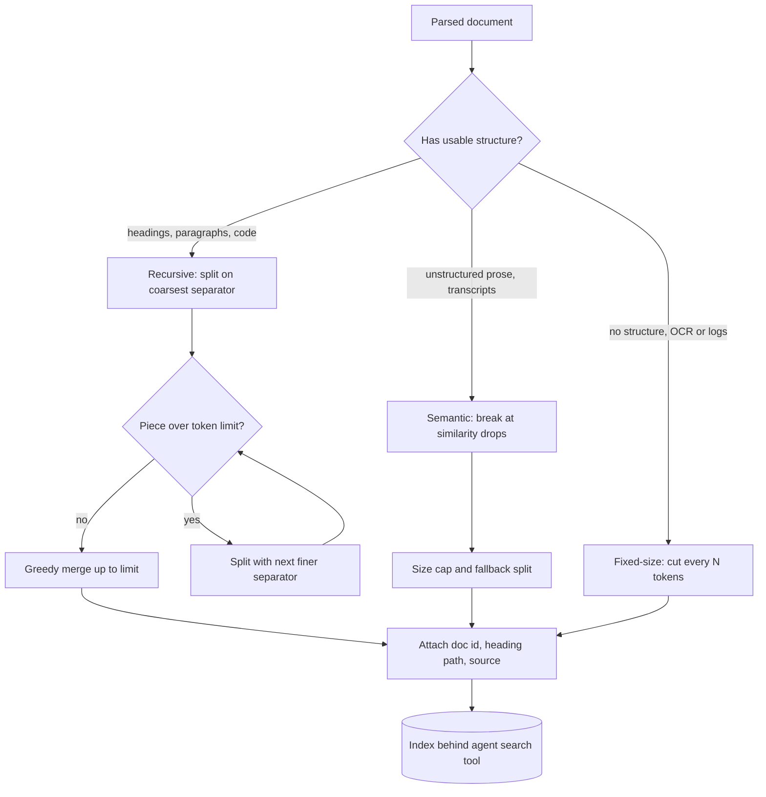

## TL;DR
When your agent calls a search tool, each result it reads is a chunk. Chunking (fixed, recursive or
semantic) decides what one hit contains, so it sets how often the agent finds the right passage and how
many tokens every tool call costs.

## For agent builders
- **Why it matters for agents.** A retrieval tool returns top-k chunks straight into the agent's context.
  Chunks that lose their subject make the agent act on the wrong component; oversized chunks burn the
  context budget on every call and crowd out tool results from later steps.
- **Where it shows up in your stack.** LangChain text splitters (`RecursiveCharacterTextSplitter`,
  `MarkdownHeaderTextSplitter`), LlamaIndex node parsers, the ingestion job behind a LangGraph or
  LlamaIndex retrieval tool, and managed "file search" features that chunk for you with their own defaults.
- **What you control.** Splitter per document type, chunk size in tokens, the metadata every chunk
  carries (heading path, source, position for citations), and how many chunks the tool returns per call.
- **What you can skip.** Exotic splitter research. A token-counted recursive splitter with heading paths,
  measured on your agent's own questions, covers most corpora.

## Why it exists
- **Encoders have a hard input limit.** Typically 512 tokens for BERT-derived encoders and around 8,000
  for many newer long-context ones. Local libraries such as sentence-transformers truncate silently
  (some hosted APIs return an error instead), so the second half of a long document never reaches the
  vector and no agent query can retrieve it.
- **The generator has a budget too.** Stuffing ten full documents into every prompt is slow, expensive
  and, past a point, hurts answer quality because the model has to find the needle itself. In an agent
  that cost repeats on every search step.
- **Dilution decides retrieval quality.** Pooling a 30-page contract into one vector gives "a contract",
  not "the indemnification cap in clause 14.3". A query about that cap scores middling against the whole
  document and loses to a shorter one that mentions caps; a chunk holding only clause 14 scores high.
- **Cutting every N characters trades one failure for another.** It splits sentences, table rows and
  function bodies in half, and separates headings from their paragraphs, so a chunk says "set this to 30
  seconds" with no indication of what.
- **So chunking is a design decision.** It chooses what unit of meaning gets its own address in the
  index, which is exactly what your agent's search tool can hand back.

## How it works
### The common skeleton
Every splitter answers three questions:
1. **Where may a boundary fall?** (any token, a separator, a topic shift)
2. **How large may a piece be?** Measured in tokens, not characters, because both the embedder's limit
   and the agent's context budget are in tokens.
3. **What metadata travels with each piece?** The agent needs it to cite, filter and fetch neighbours.

- **Why tokens:** the characters-per-token ratio varies (English prose is roughly four characters per
  token; code, CJK text and tables differ).
- **How to count:** use the embedding model's own tokenizer when you can, or a close proxy such as
  tiktoken, and leave headroom under the model limit.

### The three strategies
| Strategy | Boundary rule | Strength | Failure |
|---|---|---|---|
| Fixed-size | every N tokens, optional overlap | trivial, uniform sizes, predictable index size and cost | mid-sentence cuts, headings split from bodies |
| Recursive | coarsest separator that fits, then finer | follows paragraphs cheaply, never exceeds limit | degenerates to fixed-size on structureless text |
| Semantic | where adjacent-sentence similarity drops | topically coherent chunks in unstructured prose | one embedding per sentence, tuned threshold, variable sizes |

### Fixed-size
- **How:** walk the token stream and cut every N tokens, optionally with overlap.
- **Works on:** text with no structure at all, such as OCR output or log files, because it ignores
  content.
- **Fails where content has structure:** a code function split between signature and body, a table
  split between header row and data rows. A coding agent that retrieves half a function will guess the rest.

### Recursive (separator hierarchy)
1. Take an ordered list of separators from coarse to fine, for example `["\n\n", "\n", ". ", " ", ""]`.
2. Split on the coarsest separator first.
3. Any piece still over the limit is split again with the next separator, recursively.
4. Pieces under the limit are merged greedily with neighbours up to the limit.

- **Why this design:** paragraphs are semantic units, so most chunks end on paragraph boundaries; the
  fallback chain guarantees no piece exceeds the limit; the greedy merge keeps chunks from being tiny.
- **Structure-aware splitters are the same algorithm** with format-specific separators: Markdown
  headings (carrying the heading path into each chunk's metadata or text), HTML block tags, or
  language-aware separators for code (class and function boundaries).
- **Implementations:** LangChain's `RecursiveCharacterTextSplitter` and the LlamaIndex sentence and
  Markdown parsers. The separator order is the main knob.

### Semantic
1. Split the text into sentences and embed each one.
2. Compute cosine similarity between consecutive sentences (or each sentence and a small window of
   neighbours).
3. Mark a breakpoint where similarity drops below a threshold: absolute, a percentile of all drops, or a
   number of standard deviations below the mean.
4. Sentences between breakpoints form a chunk, with a size cap and a fallback split for long runs.

- **Illustrative run, six transcript sentences:** consecutive similarities 0.81, 0.78, 0.34, 0.80, 0.76.
  With distance `1 - s` (the `sims` list comes from sentence embeddings) the gaps are 0.19, 0.22, 0.66,
  0.20, 0.24; a 95th-percentile cut lands on 0.66, so the only boundary falls before sentence 4, giving
  two chunks of three sentences.
- **The rule is relative on purpose.** Absolute cosine levels differ by embedding model, so a fixed
  threshold such as 0.5 that works under one model splits everywhere or nowhere under another. A
  percentile of the document's own distances still cuts at the largest drop after a model swap, as long
  as that drop stays the largest.
- **But a pure percentile rule always cuts somewhere,** even inside a single-topic document, so pair it
  with a minimum chunk size as well as the hard cap.
- **Payoff:** boundaries follow topic shifts rather than formatting, so meeting transcripts and long
  narrative get coherent chunks, useful for a meeting-notes or call-review agent.
- **Costs:** one embedding call per sentence before you embed the chunks, a per-corpus threshold, highly
  variable chunk sizes, and little gain over recursive splitting on text with paragraphs and headings.

### Choosing the size for an agent
- **Small chunks:** sharper matches, less context per hit. Factoid lookups and agents that search many
  times per task prefer them, because each call stays cheap.
- **Large chunks:** more context, blurrier vectors, fewer fit in the prompt. "Summarise the section"
  prefers them.
- **Starting range:** somewhere between a couple of hundred and a thousand tokens (illustrative, not a
  benchmark), then measure recall@k and answer quality on a golden set across several sizes.
- **Budget per call:** chunk size × k is the token cost of one search result; multiply by searches per
  run to see what retrieval does to the agent's context.
- **Decouple the tension:** index small spans and return their larger parent (see retrieval granularity
  and parent-document retrieval).

### Metadata
Every chunk carries its document id, position index, section or heading path, and source location (page,
URL, line range). That makes deduplication, reassembly, citations, metadata filtering and incremental
re-indexing possible later, and lets an agent cite a source or call a follow-up tool to read the
neighbouring chunk.

## Diagram
Read it as the choice of strategy per document, then the recursive fallback loop that guarantees every
piece fits the token limit before metadata is attached and the agent's search tool can return it.



## Examples
### A minimal recursive splitter
It measures in characters to stay short; in production, replace `len` with a token count from the
embedding model's tokenizer. An oversized paragraph falls through to the next separator, while small
pieces are merged up to the limit.

```python
SEPARATORS = ["\n\n", "\n", ". ", " ", ""]

def recursive_split(text: str, max_len: int, seps=SEPARATORS) -> list[str]:
    sep = seps[0]
    parts = text.split(sep) if sep else list(text)
    chunks, buf = [], ""
    for i, p in enumerate(parts):
        piece = p + (sep if sep and i < len(parts) - 1 else "")   # keep the separator attached
        if len(piece) > max_len and len(seps) > 1:
            if buf:
                chunks.append(buf); buf = ""
            chunks.extend(recursive_split(piece, max_len, seps[1:]))  # fall through to finer split
        elif len(buf) + len(piece) <= max_len:
            buf += piece                                              # greedy merge
        else:
            chunks.append(buf); buf = piece
    if buf:
        chunks.append(buf)
    return [c.strip() for c in chunks if c.strip()]

doc = ("# Timeouts\n\n" + "Set the connect timeout to 5 seconds. " * 6 + "\n\n"
       "# Retries\n\n" + "Retry idempotent calls at most three times with jitter. " * 4)
for c in recursive_split(doc, max_len=200):
    print(len(c), repr(c[:60]))
# Six chunks: 10, 189, 37, 9, 167, 55 chars, all <= 200 and ending on a paragraph or sentence.
# Note "# Timeouts" and "# Retries" come out as orphan chunks: the oversized paragraph after each
# heading forces a flush, so the body chunks lose their subject. That is exactly why structure-aware
# splitters copy the heading path into every chunk instead of treating it as ordinary text.
```

### Agent scenario: a search tool that returns cite-able chunks
The tool the agent calls formats each chunk with its heading path and source, and stops at a token
budget so one search cannot flood the context. `store.search` stands for your vector store client.

```python
def search_docs(query: str, k: int = 5, budget_tokens: int = 2000) -> str:
    """Tool exposed to the agent: search the engineering handbook."""
    hits = store.search(query, k=k)            # each hit: text, metadata, score
    out, used = [], 0
    for h in hits:
        m = h.metadata
        block = f"[{m['doc_id']}#{m['position']}] {m['heading_path']}\n{h.text}"
        cost = count_tokens(block)             # same tokenizer family as the agent model
        if out and used + cost > budget_tokens:
            break                              # always return the top hit, then stop at the budget
        out.append(block); used += cost
    if not out:
        return "No matching passages. Try a more specific query or another tool."
    return "\n\n".join(out)
```

- **Why the heading path is in the tool output:** the agent model, not just the embedder, needs to know
  which subsystem "set this to 30 seconds" belongs to.
- **Why the id and position:** the agent can cite them, or call a `read_chunk` style tool for neighbours.

### Worked scenario: chunk size times search steps
A support agent calls the search tool about six times per task with k = 5 (illustrative numbers).

| Chunk size | Tokens per search (k = 5) | Retrieval tokens per task (6 searches) |
|---|---|---|
| 300 tokens | 1,500 | 9,000 |
| 800 tokens | 4,000 | 24,000 |

With 800-token chunks, retrieval alone takes 24k tokens of a task's context, before tool schemas and
reasoning. Smaller chunks plus parent expansion only on the hits the agent actually uses cut that sharply.

## Production patterns
- **Token-counted recursive default** — for most agent knowledge bases, build the splitter from the
  embedder's tokenizer, for example LangChain's `RecursiveCharacterTextSplitter.from_tiktoken_encoder(...)`
  or `from_huggingface_tokenizer(...)` (checked against langchain-text-splitters 1.1.3), with
  `chunk_size` well under the model limit. Monitor the chunk
  token-count histogram and the count of chunks at the cap.
- **Per-format splitters** — route by document type: `MarkdownHeaderTextSplitter` for docs (heading path
  into metadata), `RecursiveCharacterTextSplitter.from_language(Language.PYTHON, ...)` for code a coding
  agent searches, plain recursive for prose. Monitor recall@k per source type, not just overall.
- **Budgeted tool output** — cap the search tool's result in tokens, not just in k, and include source ids
  so the agent can cite and fetch neighbours. Monitor retrieval tokens per agent step in your traces
  (LangSmith or any tracing tool) and the share of runs that hit the context limit.
- **Versioned chunk config** — store splitter name, separators, size and tokenizer in each chunk's
  metadata (or a config hash), and re-index into a new index when it changes. Monitor that every live
  chunk carries the current version.
- **Chunk-size sweep in CI** — re-run a golden question set (ideally real agent queries pulled from
  traces) at two or three sizes whenever parsing or chunking changes, and gate the merge on recall@k and
  task success. Monitor regressions per release.
- **Semantic splitting only where structure is absent** — for transcripts, use a percentile breakpoint
  (LlamaIndex `SemanticSplitterNodeParser` or LangChain's experimental `SemanticChunker` both offer
  one) plus a hard size cap. Monitor chunk-size variance and embedding cost per document.

## Trade-offs
- **Fixed-size predictability vs broken structure.** Zero tuning, but it breaks sentences, tables and
  code; once the corpus has real structure, recursive splitting wins at the same cost.
- **Recursive cheapness vs reliance on separators.** It respects structure cheaply, yet assumes the
  separators mean something; on OCR text or transcripts with no paragraph breaks it degenerates into
  fixed-size splitting.
- **Semantic coherence vs cost.** Coherent chunks from unstructured prose, at the price of embedding
  every sentence and tuning a corpus-specific threshold; on already-structured text the gain rarely pays.
- **Small chunks vs generator context.** Small chunks sharpen matching and keep each agent search cheap
  but starve the generator; the trade disappears once you index small spans and return their parent.
- **Heading path in text vs token spend.** Prepending it improves matching and disambiguation, but costs
  tokens on every chunk, on every search the agent makes, and can over-weight heading words for very
  short chunks.

## Pitfalls
- **Counting characters instead of tokens.** Queries about the tail of long chunks never retrieve
  anything, because chunks exceed the embedder's limit and are truncated silently. Diagnose: histogram
  chunk lengths with the embedder's own tokenizer and count chunks over its max input. Fix: a
  token-counted splitter with headroom.
- **Splitting tables or code mid-structure.** Chunks show column headers with no rows, or a function body
  with no signature, and the model guesses the rest. Diagnose: sample chunks that start or end inside a
  table or code fence. Fix: keep them atomic and repeat the header row.
- **Dropping heading context.** A chunk reads "set this to 30 seconds" with no subject, so plausible
  retrievals lead the agent to act on the wrong component. Diagnose: in traces, check whether each
  returned chunk names its subsystem. Fix: prepend the heading path to chunk text.
- **Unbounded tool output.** k large chunks per search, repeated across steps, fill the window and older
  tool results get truncated. Diagnose: log retrieval tokens per step and runs that hit the context
  limit. Fix: a token budget in the tool and smaller chunks.
- **Tuning chunk size by intuition.** Silent regressions after every "improvement" and an argument nobody
  can settle. Fix: a golden-set sweep before any change.
- **Leaving tiny trailing chunks.** A 12-token final paragraph's unspecific vector crowds the top-k for
  generic queries. Diagnose: count how often the shortest chunks appear in top-k. Fix: merge or drop them.
- **Copying an absolute semantic threshold.** After an embedding-model swap you get one giant chunk per
  document or one per sentence. Diagnose: compare chunks per document before and after. Fix: a relative rule.
- **Semantic chunking short, single-topic documents.** One chunk per document: whole-document embedding
  with extra cost.

## When to use
- **Default:** recursive, token-counted, structure-aware splitting with a few hundred tokens per chunk
  and full metadata on every chunk; it is cheap and handles most agent knowledge bases.
- **Semantic chunking:** only for unstructured prose where evaluation shows boundary problems, because
  its sentence-embedding cost and threshold tuning only pay when structure is absent.
- **Fixed-size:** the fallback for structureless text, or the inner step of a recursive chain.
- **Measure, do not guess:** hold chunking constant while you tune anything else, and compare strategies
  on recall@k, end-task answer quality and retrieval tokens per agent run.

## Exercise
**Goal:** implement a token-counted, heading-aware chunker and show it beats fixed-size splitting on
your agent's questions. No solution is given.
- **Inputs:** 30+ Markdown documents (your own or a public project's docs), 25 questions each labelled
  with the heading that answers it, and an embedder whose max input you know.
- **Deliver:** a `chunk(doc) -> list[Chunk]` function whose chunks carry doc id, position and heading
  path; a token-count histogram; recall@5 for fixed 512-token chunks versus your chunker at two sizes.
- **Acceptance:** no chunk exceeds the embedder limit by its own tokenizer; every chunk has a non-empty
  heading path; a unit test proves a table is never split from its header row; your chunker wins on
  recall@5, or you explain why from the failing questions.

## Role lens
- **Engineer:** Picks separators and chunk size per document type, counts tokens with the embedder's
  tokenizer, attaches metadata, and re-runs the retrieval eval after every chunking change.
- **Architect:** Owns the decision that chunk configuration is a versioned artifact, so changing it
  triggers a controlled re-index instead of silently mixing two chunkings in one index.
- **FDE:** Inspects a customer's real documents (scanned PDFs, wikis, code) to choose per-source
  strategies, and shows them failing chunks to justify parsing and chunking work.

## Check yourself
**Q:** A team runs RAG over a 2,000-page engineering handbook split into 512-token fixed chunks.
Retrieved chunks look relevant, but the model keeps answering for the wrong subsystem. What is going
wrong and what would you change first?
**A:** Fixed-size cuts have separated headings from bodies, so many chunks are instructions with no
subject ("set the timeout to 30 s") and the embedder cannot tell which subsystem they belong to; the
retriever returns the right-looking text for the wrong section. First switch to a structure-aware
recursive splitter on the handbook's heading hierarchy, prepend the heading path to each chunk's text
and store it as metadata, so both the vector and the generator see the subject. Then consider indexing
smaller spans and returning the parent section, add metadata filtering by subsystem where the question
makes it explicit, and verify the change with a golden set of questions whose expected section is
known, measuring recall@k before and after rather than eyeballing results.

## Interview questions
### Walk me through how a recursive character splitter decides where to cut.
- **Ordered separators, coarse to fine,** such as paragraph break, newline, sentence end, space, then
  single characters.
- **Split on the coarsest first;** any piece still over the limit is split with the next separator, so no
  chunk can exceed the limit.
- **Greedy merge** packs small neighbouring pieces back up to the limit, so most chunks end on paragraph
  boundaries and few are tiny.

### When would you choose semantic chunking, and when would you refuse it?
- **Choose it** for unstructured prose such as meeting transcripts, where there are no headings or
  paragraph breaks and an eval shows boundary failures.
- **Refuse it** on structured docs or short single-topic documents, because recursive splitting is as good
  for less cost, and short documents collapse to one chunk anyway.
- **If used,** break on a relative rule (a percentile of distances) with a hard size cap, because absolute
  cosine levels change with the embedding model.

### Retrieval quality dropped after someone changed chunk size from 500 to 1,000 tokens. How do you debug it?
- **Confirm with the golden set:** compare recall@k and answer quality at both sizes on the same questions,
  holding the embedder and retriever constant.
- **Check the encoder limit first:** if the embedder caps input at 512 tokens, 1,000-token chunks are
  truncated silently and their second halves are unretrievable; the token-count histogram shows it.
- **Inspect misses:** a larger chunk mixes the answer with other topics, so its blurrier vector ranks
  below shorter, more specific chunks for factoid queries.
- **Fix options:** revert, route by query type, or index small spans and return the parent section so match
  size and context size are decoupled.

### Your agent's traces show it calling the search tool four or five times for one question and still answering vaguely. What do you look at in chunking?
- **Read the returned chunks in the trace.** If they lack subject words (headings stripped, mid-table
  cuts), the agent cannot tell a hit is relevant and keeps re-querying.
- **Check chunk size against k.** Huge chunks bury the answer; tiny ones lack context, so the agent
  searches again for the surrounding text.
- **Fix and measure:** heading paths in chunk text, parent expansion or a neighbour-fetch tool, then
  compare searches per task and task success on a golden set.

### How do you make chunking safe to change in a production index that agents depend on?
- **Version the config:** store splitter, separators, size and tokenizer (or a config hash) on every chunk.
- **Re-index into a new index** when the config changes, then switch the agent's tool over, instead of
  mixing two chunkings in one index.
- **Gate the change in CI** on a golden-set recall@k and agent task-success run, and watch the chunk
  token-count histogram after rollout.

## Quiz
### Q: Why are documents chunked before embedding rather than embedded whole?
- [ ] Vector databases cap the size of a record's payload
- [x] A single vector averages away specific passages, and encoders cannot take input past their limit
- [ ] Chunking is required to compute cosine similarity between texts of different lengths
- [ ] Each vector's dimensionality grows with input length, so long documents must be split to fit
> Pooling a long document into one vector dilutes the specific passage a query needs, and inputs
> beyond the encoder's limit are truncated or rejected. Cosine similarity works at any length, and an
> encoder emits the same fixed dimension whatever the input length, so neither is the reason.

### Q: In a recursive splitter, what happens to a paragraph that is larger than the chunk limit?
- [ ] It is truncated to the limit and the remainder is discarded
- [ ] It is kept intact as a single oversized chunk because paragraphs are atomic
- [x] It is split again using the next, finer separator in the list, recursively
- [ ] It is embedded as two overlapping halves of equal size
> The whole point of the separator hierarchy is the fallback: an oversized piece drops to the next
> separator (newline, then sentence, then word) until every piece fits. Nothing is discarded and no
> chunk may exceed the limit.

### Q: When does semantic chunking justify its cost over recursive splitting?
- [ ] Always, because embedding-based boundaries are strictly more accurate
- [ ] When documents are short and cover a single topic
- [x] When the text is unstructured prose with no paragraph or heading boundaries to exploit
- [ ] When the embedding model has a short maximum input length
> Semantic chunking embeds every sentence and needs a tuned threshold; that is worth it only when
> formatting gives no usable boundaries, such as transcripts. On structured text recursive splitting is
> cheaper and about as good, and on short single-topic documents it yields one chunk.

## Mastery test
**Problem:** a coding agent searches a monorepo indexed with a 1,000-character recursive splitter using
prose separators; the embedder takes 512 tokens. Traces show it finds call sites but edits functions
whose signature it never saw, and questions about parameter defaults fail. What do you change, and how
do you prove it worked?

**A strong answer:**
- sees that prose separators cut functions mid-body, splitting signatures and docstrings from bodies,
  and that characters understate tokens for code, so some chunks may be truncated;
- switches to language-aware separators on class and function boundaries, counted in embedder tokens,
  with file path and symbol name in each chunk, repeating the signature when a long function splits;
- adds a fetch-by-symbol or neighbour tool rather than simply making chunks bigger;
- measures recall@k on code questions, the share of chunks over the limit, and edit success before and after.

## Use cases & projects
### Use cases
- **Support agents over product docs.** Heading-aware recursive chunks let the agent's search tool return
  a passage that still names the product and section it is about, so the answer cites the right page.
- **Coding agents over a repository.** Splitting on functions and classes instead of fixed characters keeps
  a whole definition in one hit, so the agent edits code it has actually read.
- **Agents over meeting transcripts.** Formatting gives no boundaries, which is the case where semantic
  chunking earns its extra embedding cost.
- **Context-budgeted multi-step agents.** Chunk size times top-k is the token bill of every search call, so
  chunking is where teams cap retrieval cost per agent step.

### Mini project
**Compare three chunkers behind one agent search tool (2-3 hours).**
- **Goal:** show how the chunker changes what a tool-calling agent finds and how many tokens each search
  costs.
- **Steps:** take 20-50 of your own documents and write 20 questions with the passage that answers each;
  index them three ways (fixed-size, token-counted recursive with heading paths, semantic); expose each
  index as a `search_docs` tool to the same small agent; log hit rate at top-5 and tokens returned per call.
- **Done when:** you have a table of hit rate and tokens per search for each chunker, and a short note on
  which one you would ship and why.
