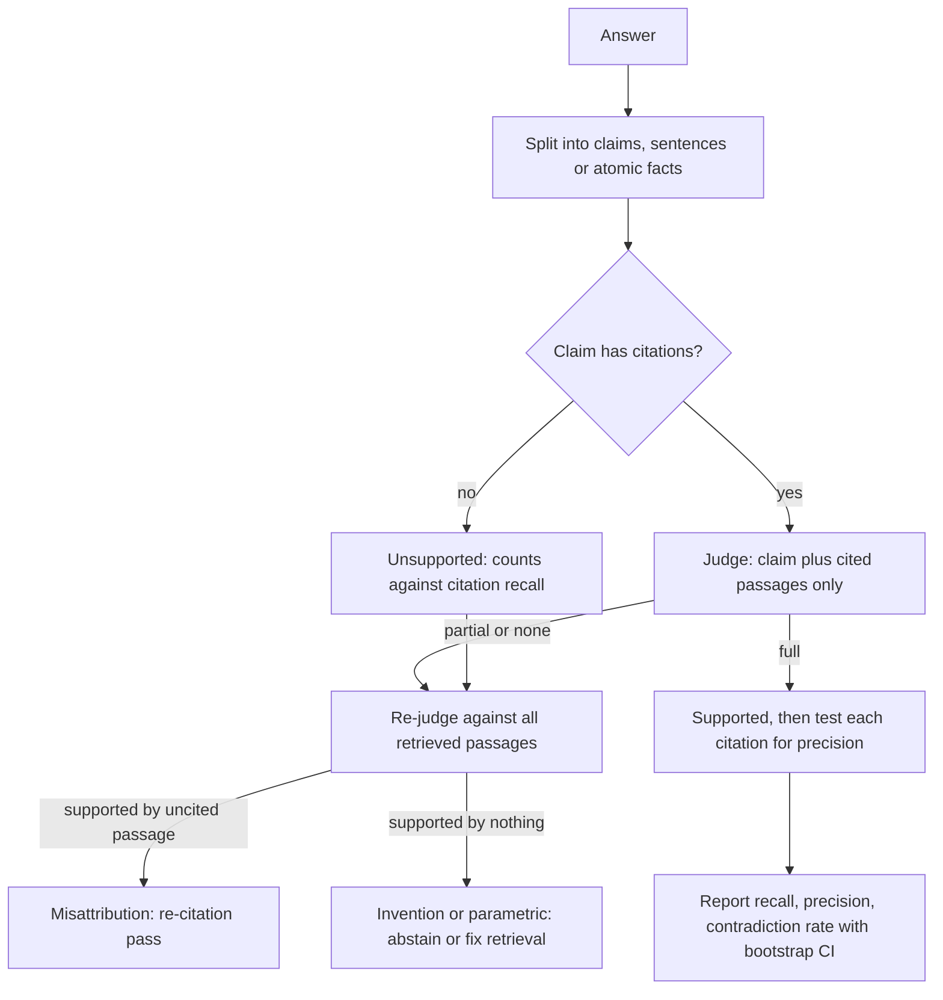

## TL;DR
Citation correctness asks whether each citation actually supports its claim, not whether citations exist.
It splits into citation recall (claims fully supported) and precision (citations necessary), measured with
an entailment model or calibrated judge on labelled samples.

## Why it exists
- **A cited but unsupported sentence is worse than an uncited one:** it borrows the source's authority.
  Once a RAG system emits citations, teams need to know whether they can be trusted.
- **Citation rate is easy and nearly useless.** The share of sentences with a citation says nothing about
  support: a model can cite every sentence while the cited text says something different. Studies of
  generative search engines found exactly this gap: fluent, heavily cited answers in which a substantial
  share of citations did not support their sentences.
- **Answer correctness does not cover it.** An answer can be correct while citing the wrong source (the
  model knew the fact from pre-training and attached a nearby chunk), or faithfully cited while wrong
  because the source itself is outdated.
- **Three different properties:** *answer correctness* (is it true), *faithfulness* (is it derived from the
  provided context), *citation correctness* (does this pointer back this claim). Users clicking a citation
  test the third, and every failed click erodes trust in the others.
- **So it needs its own metric**, defined per claim and per citation, with a judge whose agreement with
  humans you have measured.

## How it works
### Unit of evaluation
1. Split the answer into claims: usually sentences, or atomic facts if sentences are compound.
2. Each claim *c* has a set of cited passages *P(c)*.
3. Ask the attribution question: would a reasonable reader, given only *P(c)*, agree that *c* is true? This
   is the "attributable to identified sources" framing used in attribution research.

### Citation recall (support)
A claim has full support if the concatenation of its cited passages entails it. Citation recall is the
fraction of claims with full support:

```
citation_recall = |{c : entails(concat(P(c)), c)}| / |claims requiring citation|
```

- **Uncited factual claims count as unsupported.**
- **The denominator matters.** Decide whether hedges, transitions and restatements of the question require
  citations, and keep that rule fixed across runs.

### Citation precision (relevance)
- **Irrelevant citation:** it does not support the claim alone *and* removing it leaves the claim's support
  unchanged.
- **Precision** is the fraction of citations that are not irrelevant.
- **Why:** it penalises the "cite everything" strategy, where a model attaches five sources to each
  sentence to game recall.
- **Provenance:** the definition popularised by the ALCE benchmark; variants exist, so state which you use.

### Who decides "entails"
| Judge | Strength | Weakness |
|---|---|---|
| Exact-quote check (verbatim quote is a substring of the cited chunk) | cheap, deterministic | proves only that the quote exists, not that it supports the claim |
| NLI model (premise = cited text, hypothesis = claim) | fast, consistent | weaker on long premises, numbers and multi-step reasoning |
| LLM judge ("does this passage fully support this claim: yes / partial / no") | more capable | has biases; must be calibrated against human labels |
| Humans | the reference | expensive |

- **Give the LLM judge the passage and claim only**, never the full answer, so it cannot be swayed by
  fluency.
- **Calibrate:** label a few hundred claim-citation pairs, then measure the automated judge's agreement
  before trusting its numbers.
- **Report agreement per label, not only overall.** The costly error is calling a partial or unsupported
  pair "full", so the precision of the judge's "full" verdict matters more than accuracy on easy cases;
  judges tend to err in the lenient direction.

### Partial support
- **Real claims are often partly supported:** the passage gives the 30-day window but not the "annual plans
  only" qualifier.
- **Use a three-way label** (full / partial / none) and report partial separately, because partial support
  is where subtle errors such as a wrong number or a dropped condition hide.

### Reading the result
| Signal | Meaning | Fix |
|---|---|---|
| Low citation recall, high retrieval recall | generation problem: evidence was in context but the model drifted or cited the wrong chunk | prompt, schema, re-citation |
| Low citation recall, low retrieval recall | the model answers without evidence | fix retrieval or enforce abstention |
| Low precision | citation spraying | tighten the instruction or schema to one or two citations per claim |

**One extra judge call per unsupported claim sharpens the diagnosis.** Check the claim against *all*
retrieved passages, not just the cited ones:
- **Supported by an uncited passage → misattribution.** The answer is grounded but points at the wrong
  chunk; a post-hoc re-citation pass can repair it.
- **Supported by nothing in context → parametric knowledge or invention.** Only abstention or better
  retrieval fixes it.
- The two look identical in citation recall and need opposite remedies.

## Diagram
How one claim is scored: judge it against its cited passages only, then, if unsupported, re-judge against
everything retrieved to separate misattribution from invention.



## Examples
### Worked scoring of one answer
"What are the rules for refunding annual plans?" with sources S1 to S4.

| Claim | Cited | Judge on cited text | Notes |
|---|---|---|---|
| C1 Annual plans can be refunded within 30 days. | S2 | full | S2 states it |
| C2 Refunds go to the original payment method. | S2, S4 | full | S4 alone supports; S2 is silent |
| C3 Refunds after 30 days are prorated. | S3 | none | S3 says no refunds after 30 days |
| C4 Enterprise contracts are excluded. | (none) | none | uncited factual claim |
| C5 Contact billing to start a refund. | S1 | full | S1 supports |

| Metric | Calculation | Value |
|---|---|---|
| Citation recall | fully supported / requiring citation = 3 / 5 (C3 contradicted, C4 uncited) | 0.60 |
| Citation precision | 5 citations (S2, S2, S4, S3, S1); S2 on C2 is irrelevant (does not support alone, removal leaves support unchanged); S3 on C3 supports nothing; 3 / 5 | 0.60 |
| Citation rate | 4 / 5 | 0.80, which would have looked healthy |

- **C3 is a contradiction, the worst case:** a user who clicks S3 sees the opposite claim.
- **C4 may well be true** (parametric knowledge) but is unverifiable.
- **At scale:** across a 300-question eval set, aggregate per claim, report the contradiction rate
  separately, and slice by question type to find where the generator drifts.

### Runnable scorer for the same answer
The judge is a lookup table here; in production it is an NLI model or calibrated LLM judge called with
one claim and the given passages only.

```python
SUPPORT = {  # judge(claim, passages) -> "full" | "partial" | "none"
    ("C1", frozenset({"S2"})): "full",
    ("C2", frozenset({"S2", "S4"})): "full", ("C2", frozenset({"S4"})): "full",
    ("C5", frozenset({"S1"})): "full",
}
def judge(claim, passages):
    return SUPPORT.get((claim, frozenset(passages)), "none")

answer = {"C1": ["S2"], "C2": ["S2", "S4"], "C3": ["S3"], "C4": [], "C5": ["S1"]}

def score(answer):
    supported = sum(judge(c, p) == "full" for c, p in answer.items())
    relevant = total = 0
    for c, cited in answer.items():
        full = judge(c, cited)
        for s in cited:
            total += 1
            alone = judge(c, [s]) == "full"
            needed = judge(c, [x for x in cited if x != s]) != full   # removal changes support
            relevant += alone or needed
    return {"recall": supported / len(answer), "precision": relevant / total,
            "rate": sum(bool(p) for p in answer.values()) / len(answer)}

print(score(answer))   # {'recall': 0.6, 'precision': 0.6, 'rate': 0.8}
```

### Putting an interval on the number
Claims within one answer are correlated, so resample questions, not claims. Synthetic data, illustrative.

```python
import random

def bootstrap_ci(per_question, iters=2000, seed=0):
    """per_question: (supported, needing_citation) claim counts per question. Resample questions."""
    rng = random.Random(seed)
    stats = []
    for _ in range(iters):
        sample = [rng.choice(per_question) for _ in per_question]
        stats.append(sum(s for s, _ in sample) / sum(n for _, n in sample))
    stats.sort()
    return stats[int(0.025 * iters)], stats[int(0.975 * iters)]

rng = random.Random(1)
data = []
for _ in range(300):                       # 300 questions, 2-6 claims each, ~80% supported
    n = rng.randint(2, 6)
    good = rng.random() < 0.8              # claims in one answer tend to fail together
    data.append((sum(rng.random() < (0.95 if good else 0.4) for _ in range(n)), n))
point = sum(s for s, _ in data) / sum(n for _, n in data)
lo, hi = bootstrap_ci(data)
print(f"citation recall {point:.3f}, 95% CI [{lo:.3f}, {hi:.3f}]")
# Prints 0.804, CI [0.770, 0.838]: about +/-3 points, so a two-point change is within noise.
```

## Production patterns
- **Release gate on contradictions.** Run the scorer on a golden set for every prompt, model or retrieval
  change and block the release if contradiction rate rises or citation recall drops beyond its bootstrap
  interval. Monitor recall, precision and contradiction rate per release.
- **Claim-scoped judge calls.** Send the judge one claim plus only its cited passages, ask for full /
  partial / none, and store the label with the chunk version. Monitor the judge's agreement with a
  human-labelled set whenever the judge prompt or model changes.
- **Version-pinned evaluation.** Score against the chunk text the generator saw (logged with the trace),
  not the document fetched at eval time. Monitor the share of pairs whose chunk version no longer exists.
- **Sampled online scoring.** Score a small daily slice of production answers with the same judge and
  slice by question type. Alert on contradiction-rate jumps rather than on the overall average.
- **Misattribution vs invention split.** For each unsupported claim, re-judge against all retrieved
  passages and route misattributions to a re-citation pass. Track the two rates separately, since they
  need opposite fixes.

## Trade-offs
- **NLI scorer vs LLM judge.** NLI is cheap enough to run on every production answer but misses numeric
  and multi-hop subtleties. When answers are dense with figures, a calibrated LLM judge on a sample is the
  better buy.
- **Sentence-level vs atomic claims.** Sentences are simple to split and label, but compound sentences hide
  partial support. When partial errors matter (regulated domains), decompose into atomic facts despite the
  extra judge calls.
- **Strict precision penalties vs synthesis.** They discourage citation spraying but can punish legitimate
  multi-source synthesis. For summary-style answers, weight recall more and accept redundant citations.
- **Passage-only judging vs truth.** It isolates citation quality but ignores whether the claim is actually
  true; pair it with answer-correctness evals when sources themselves may be stale or wrong.

## Pitfalls
- **Reporting citation rate as citation quality.** Symptom: a dashboard near 100% while user feedback
  reports "the link doesn't say that".
- **Showing the judge the whole answer and all sources.** Rather than one claim and its cited passages;
  the judge is persuaded by fluency and scores support far higher than humans do.
- **Never measuring judge agreement with human labels.** Judge scores drift with prompt or model changes,
  and a regression in citation quality goes unnoticed.
- **Ignoring version skew** between the chunk the model saw and the document fetched at eval time. Correct
  citations score as unsupported after edits, or wrong ones score as fine.
- **Collapsing "partial" into "full".** Dropped qualifiers and wrong numbers, the errors that cause real
  harm, disappear from the metric.

## When to use
- **Use when** your product shows citations to users or relies on them for audit. If you show no
  citations, measure faithfulness instead.
- **Run** offline on a golden set for every prompt, model or retrieval change, and online on a sampled
  slice of production traffic.
- **Report** recall, precision and contradiction rate separately, alongside retrieval recall, so you can
  tell generation failures from retrieval failures.
- **Put an interval on every number** before acting on a change: claims within one answer are correlated,
  so bootstrap over questions rather than claims, and expect a two-point movement on a few hundred
  questions to be within noise.
- **Interviews:** distinguish citation correctness from faithfulness and answer correctness, and explain
  how you would validate the judge itself.

## Role lens
- **Engineer:** Builds the claim splitter, the per-claim judge call with only cited passages, and the eval
  job that reports recall, precision and contradictions per release.
- **Architect:** Sets the quality gate, for example no release if contradiction rate rises, and decides
  where judges run, what is sampled, and how chunk versions are pinned for evaluation.
- **FDE:** Labels a sample of the customer's own questions with their domain experts, giving a trusted
  baseline and the judge-agreement figure that the customer's risk team will ask for.

## Check yourself
**Q:** After switching to a stronger generator, answer accuracy on your eval set rises but citation recall
falls. How can both be true, and what do you do?
**A:** The stronger model knows more from pre-training, so it answers correctly even when retrieved
context is thin, then attaches a nearby citation that does not actually contain the fact. Accuracy rises
because the claims are true; citation recall falls because they are not supported by what is cited. For a
product sold as "answers from your documents" that is a regression: claims are unverifiable and may be
stale for this customer. Fix by enforcing abstention or flagging uncited knowledge, checking retrieval
recall for the failing questions, and gating releases on citation recall and contradiction rate, not only
accuracy.

## Interview questions
### How do citation correctness, faithfulness and answer correctness differ?
- **Answer correctness** asks whether the claim is true; **faithfulness** asks whether it is derived from
  the provided context; **citation correctness** asks whether this specific pointer backs this claim.
- **They diverge in practice:** a correct answer can cite the wrong chunk (the fact came from
  pre-training), and a faithfully cited answer can be wrong because the source is outdated.

### Define citation recall and citation precision, and say why you need both.
- **Recall:** the fraction of claims requiring citation whose concatenated cited passages entail them;
  uncited factual claims count as unsupported.
- **Precision:** the fraction of citations that are not irrelevant, where irrelevant means it does not
  support the claim alone and removing it leaves support unchanged.
- **Why both:** recall alone rewards citation spraying (five sources per sentence); precision penalises
  it. State which variant of the definition you use.

### You want an LLM judge to score support. How do you make its numbers trustworthy?
- **Scope the input:** one claim and only its cited passages, never the whole answer, so fluency and other
  sources cannot inflate support.
- **Calibrate:** label a few hundred claim-citation pairs with humans and measure agreement per label,
  above all the precision of the judge's "full" verdict, since judges tend to err lenient.
- **Re-check** agreement whenever the judge prompt or model changes.

### Citation recall moved from 0.80 to 0.82 on 300 questions. Do you ship the change?
- **Not on that evidence alone.** Claims within one answer are correlated, so bootstrap over questions;
  at this size the 95% interval is about plus or minus 3 points, so two points is within noise.
- **Look at the contradiction rate** and the partial-support share separately, since those carry the
  real harm and can move while the average stays flat.

### When would you use an NLI model rather than an LLM judge?
- **NLI** when you need to score every production answer cheaply and consistently, accepting that it is
  weaker on long premises, numbers and multi-step reasoning.
- **LLM judge on a sample** when answers are dense with figures or multi-hop synthesis, because those are
  exactly the cases NLI misses; calibrate it against human labels first.

## Quiz
### Q: An answer cites a source on every sentence, but half the cited passages do not state the claim. Which metric exposes this?
- [ ] Citation rate
- [x] Citation recall, measured by entailment between cited passages and each claim
- [ ] Retrieval recall at k
- [ ] Answer exact-match accuracy
> Citation rate only counts presence, so it reads 100%. Citation recall checks whether the cited text
> entails the claim, which is precisely the failure here; retrieval recall measures a different stage.

### Q: What does citation precision penalise?
- [ ] Claims that have no citation at all
- [ ] Answers that are factually wrong
- [x] Citations that neither support the claim alone nor contribute to its support, such as citation spraying
- [ ] Sources that were retrieved but not cited
> Precision asks whether each citation earns its place. Attaching many sources to a sentence can raise
> recall cheaply; precision counts the irrelevant ones so that strategy does not look good.

### Q: Why should an LLM judge for citation support see only the claim and its cited passages?
- [ ] It reduces the cost of the judge call to nearly zero
- [ ] Judges cannot read more than one passage at once
- [x] Context from the full answer and other sources lets the judge infer support that the cited text alone does not provide
- [ ] It makes the judge agree with the generator more often
> Citation correctness is about the specific pointer. Given the whole answer, a judge fills gaps from
> other sentences or sources and over-credits support, inflating scores relative to human labels.
