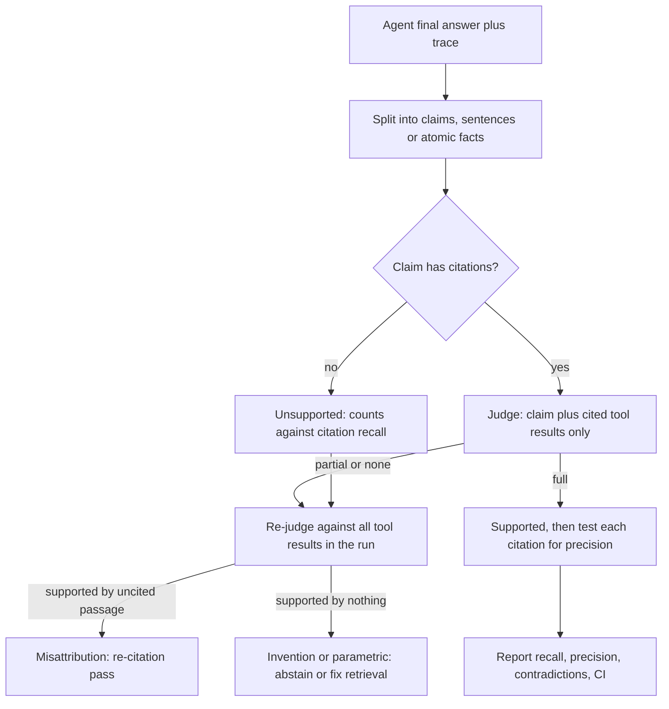

## TL;DR
Citation correctness is the eval that asks whether each citation in your agent's answer actually
supports its claim. It splits into citation recall (claims fully supported) and precision (citations
necessary), scored per claim by an entailment model or calibrated judge.

## For agent builders
- **Why it matters for agents.** Once your agent cites tool results, users and downstream actions trust
  those pointers. Citation rate tells you nothing; this metric tells you whether a clicked citation, or a
  citation-gated action, rests on real evidence.
- **Where it shows up in your stack.** Your offline eval harness on a golden set, online scoring of
  sampled production traces in your tracing or eval tool, and the release gate for prompt, model and
  retriever changes.
- **What you control.** How answers are split into claims, which passages the judge sees (only the cited
  tool results, at the version the agent saw), the judge's calibration against human labels, and the
  thresholds that block a release.
- **What you can skip.** Training your own attribution model; NLI plus a calibrated judge covers most products.

## Why it exists
- **A cited but unsupported sentence is worse than an uncited one:** it borrows the source's authority.
  Once a RAG system or agent emits citations, teams need to know whether they can be trusted.
- **Citation rate is easy and nearly useless.** A model can cite every sentence while the cited text says
  something different. Studies of generative search engines found exactly this: fluent, heavily cited
  answers in which a substantial share of citations did not support their sentences.
- **Answer correctness does not cover it.** An answer can be correct while citing the wrong source (the
  model knew the fact from pre-training and attached a nearby chunk), or faithfully cited while wrong
  because the source itself is outdated.
- **Three different properties:** *answer correctness* (is it true), *faithfulness* (is it derived from the
  provided context), *citation correctness* (does this pointer back this claim). Users clicking a citation
  test the third.

## How it works
### Unit of evaluation
1. Split the answer into claims: usually sentences, or atomic facts if sentences are compound.
2. Each claim *c* has a set of cited passages *P(c)*. In an agent, these are the tool results the citation
   IDs point to, read from the run's trace.
3. Ask the attribution question: would a reasonable reader, given only *P(c)*, agree that *c* is true? This
   is the "attributable to identified sources" framing used in attribution research.

### Citation recall (support)
A claim has full support if the concatenation of its cited passages entails it. Citation recall is the
fraction of claims with full support:

```
citation_recall = |{c : entails(concat(P(c)), c)}| / |claims requiring citation|
```

- **Uncited factual claims count as unsupported.**
- **The denominator matters.** Decide whether hedges, transitions and restatements of the question require
  citations, and keep that rule fixed across runs.

### Citation precision (relevance)
- **Irrelevant citation:** it does not support the claim alone *and* removing it leaves the claim's support
  unchanged.
- **Precision** is the fraction of citations that are not irrelevant.
- **Why:** it penalises the "cite everything" strategy, where a model attaches five sources to each
  sentence to game recall.
- **Provenance:** the definition popularised by the ALCE benchmark; variants exist, so state which you use.

### Who decides "entails"
| Judge | Strength | Weakness |
|---|---|---|
| Exact-quote check (verbatim quote is a substring of the cited chunk) | cheap, deterministic | proves only that the quote exists, not that it supports the claim |
| NLI model (premise = cited text, hypothesis = claim) | fast, consistent | weaker on long premises, numbers and multi-step reasoning |
| LLM judge ("does this passage fully support this claim: yes / partial / no") | more capable | has biases; must be calibrated against human labels |
| Humans | the reference | expensive |

- **Give the LLM judge the passage and claim only**, never the full answer or the whole agent trace, so it
  cannot be swayed by fluency.
- **Calibrate:** label a few hundred claim-citation pairs, then measure the automated judge's agreement
  before trusting its numbers.
- **Report agreement per label, not only overall.** The costly error is calling a partial or unsupported
  pair "full", so the precision of the judge's "full" verdict matters more than accuracy on easy cases;
  judges tend to err in the lenient direction.

### Partial support
- **Real claims are often partly supported:** the passage gives the 30-day window but not the "annual plans
  only" qualifier.
- **Use a three-way label** (full / partial / none) and report partial separately, because partial support
  is where subtle errors such as a wrong number or a dropped condition hide.

### Reading the result
| Signal | Meaning | Fix |
|---|---|---|
| Low citation recall, high retrieval recall | generation problem: evidence was in context but the model drifted or cited the wrong chunk | prompt, schema, re-citation |
| Low citation recall, low retrieval recall | the model answers without evidence | fix retrieval or enforce abstention |
| Low precision | citation spraying | tighten the instruction or schema to one or two citations per claim |

**One extra judge call per unsupported claim sharpens the diagnosis.** Check the claim against *all*
retrieved passages (every tool result in the run), not just the cited ones:
- **Supported by an uncited passage → misattribution.** The answer is grounded but points at the wrong
  chunk; a post-hoc re-citation pass can repair it.
- **Supported by nothing in context → parametric knowledge or invention.** Only abstention or better
  retrieval fixes it.
- The two look identical in citation recall and need opposite remedies.

## Diagram
How one claim from an agent answer is scored: judge it against its cited tool results only, then, if
unsupported, re-judge against everything the run retrieved to separate misattribution from invention.



## Misconceptions
- **"Citation rate tells you citation quality."** It counts presence, not support. In the worked answer
  below the rate is 0.80 while citation recall is 0.60, and one citation contradicts its claim.
- **"If the answer is correct, its citations must be fine."** A strong model can state a true fact from
  pre-training and attach a nearby chunk that does not contain it. Answer correctness, faithfulness and
  citation correctness are separate measurements.
- **"More citations per claim can only help."** Attaching extra sources raises recall cheaply while
  pointing users at passages that add nothing. Citation precision exists to penalise this spraying.
- **"Give the judge the whole answer and all sources so it has full context."** Extra context lets the
  judge infer support the cited text does not give, inflating scores against human labels. Send one
  claim plus only its cited passages, and calibrate the judge per label.
- **"Partial support is close enough to count as supported."** Partial is where a dropped qualifier or a
  wrong number hides. Keep a three-way label and report partial separately.
- **"A two-point gain on 300 questions is a real improvement."** Claims in one answer fail together, so
  the bootstrap must resample questions, not claims. In the synthetic example below that interval is
  about plus or minus 3 points, so a two-point move is within noise.

## Examples
### Worked scoring of one answer
"What are the rules for refunding annual plans?" with sources S1 to S4.

| Claim | Cited | Judge on cited text | Notes |
|---|---|---|---|
| C1 Annual plans can be refunded within 30 days. | S2 | full | S2 states it |
| C2 Refunds go to the original payment method. | S2, S4 | full | S4 alone supports; S2 is silent |
| C3 Refunds after 30 days are prorated. | S3 | none | S3 says no refunds after 30 days |
| C4 Enterprise contracts are excluded. | (none) | none | uncited factual claim |
| C5 Contact billing to start a refund. | S1 | full | S1 supports |

| Metric | Calculation | Value |
|---|---|---|
| Citation recall | fully supported / requiring citation = 3 / 5 (C3 contradicted, C4 uncited) | 0.60 |
| Citation precision | 5 citations (S2, S2, S4, S3, S1); S2 on C2 is irrelevant (does not support alone, removal leaves support unchanged); S3 on C3 supports nothing; 3 / 5 | 0.60 |
| Citation rate | 4 / 5 | 0.80, which would have looked healthy |

- **C3 is a contradiction, the worst case:** a user who clicks S3 sees the opposite claim.
- **C4 may well be true** (parametric knowledge) but is unverifiable.
- **At scale:** across a 300-question eval set, aggregate per claim, report the contradiction rate
  separately, and slice by question type to find where the generator drifts.

### Runnable scorer for the same answer
The judge is a lookup table here; in production it is an NLI model or calibrated LLM judge called with
one claim and the given passages only.

```python
SUPPORT = {  # judge(claim, passages) -> "full" | "partial" | "none"
    ("C1", frozenset({"S2"})): "full",
    ("C2", frozenset({"S2", "S4"})): "full", ("C2", frozenset({"S4"})): "full",
    ("C5", frozenset({"S1"})): "full",
}
def judge(claim, passages):
    return SUPPORT.get((claim, frozenset(passages)), "none")

answer = {"C1": ["S2"], "C2": ["S2", "S4"], "C3": ["S3"], "C4": [], "C5": ["S1"]}

def score(answer):
    supported = sum(judge(c, p) == "full" for c, p in answer.items())
    relevant = total = 0
    for c, cited in answer.items():
        full = judge(c, cited)
        for s in cited:
            total += 1
            alone = judge(c, [s]) == "full"
            needed = judge(c, [x for x in cited if x != s]) != full   # removal changes support
            relevant += alone or needed
    return {"recall": supported / len(answer), "precision": relevant / total,
            "rate": sum(bool(p) for p in answer.values()) / len(answer)}

print(score(answer))   # {'recall': 0.6, 'precision': 0.6, 'rate': 0.8}
```

### Scoring an agent trace: passages come from the run's tool results
In an agent, cited IDs resolve to tool results logged in the trace, at the version the agent saw. The
same judge then splits failures into misattribution and invention. The trace shape is illustrative;
adapt it to your tracing tool's export.

```python
def score_trace(trace, judge):
    """trace: {"tool_results": {"S1": text, ...}, "claims": [{"text": ..., "source_ids": [...]}]}"""
    pool = trace["tool_results"]                       # everything the agent retrieved in this run
    out = {"full": 0, "misattributed": 0, "invented": 0, "n": len(trace["claims"])}
    for cl in trace["claims"]:
        cited = [pool[s] for s in cl["source_ids"] if s in pool]
        if cited and judge(cl["text"], cited) == "full":
            out["full"] += 1
        elif judge(cl["text"], list(pool.values())) == "full":
            out["misattributed"] += 1                  # grounded somewhere in the run: re-cite
        else:
            out["invented"] += 1                       # nothing in the run supports it
    out["citation_recall"] = out["full"] / max(out["n"], 1)
    return out

def keyword_judge(claim, passages):                    # stand-in for an NLI model or LLM judge
    return "full" if any(claim.lower() in p.lower() for p in passages) else "none"

trace = {"tool_results": {"S1": "Annual plans: refunds within 30 days.", "S2": "Billing runs monthly."},
         "claims": [{"text": "refunds within 30 days", "source_ids": ["S1"]},
                    {"text": "billing runs monthly", "source_ids": ["S1"]},     # right fact, wrong ID
                    {"text": "refunds are prorated", "source_ids": ["S2"]}]}
print(score_trace(trace, keyword_judge))   # 1 full, 1 misattributed, 1 invented
```

| Run slice (illustrative) | Claims | Full | Misattributed | Invented |
|---|---|---|---|---|
| Runs with 1 search call | 400 | 352 | 20 | 28 |
| Runs with 4+ search calls | 400 | 300 | 76 | 24 |

- **Long runs misattribute more:** the evidence is in the trace but the wrong tool result is cited, an ID
  problem, not a retrieval one.

### Putting an interval on the number
Claims within one answer are correlated, so resample questions, not claims. Synthetic data, illustrative.

```python
import random

def bootstrap_ci(per_question, iters=2000, seed=0):
    """per_question: (supported, needing_citation) claim counts per question. Resample questions."""
    rng = random.Random(seed)
    stats = []
    for _ in range(iters):
        sample = [rng.choice(per_question) for _ in per_question]
        stats.append(sum(s for s, _ in sample) / sum(n for _, n in sample))
    stats.sort()
    return stats[int(0.025 * iters)], stats[int(0.975 * iters)]

rng = random.Random(1)
data = []
for _ in range(300):                       # 300 questions, 2-6 claims each, ~80% supported
    n = rng.randint(2, 6)
    good = rng.random() < 0.8              # claims in one answer tend to fail together
    data.append((sum(rng.random() < (0.95 if good else 0.4) for _ in range(n)), n))
point = sum(s for s, _ in data) / sum(n for _, n in data)
lo, hi = bootstrap_ci(data)
print(f"citation recall {point:.3f}, 95% CI [{lo:.3f}, {hi:.3f}]")
# Prints 0.804, CI [0.770, 0.838]: about +/-3 points, so a two-point change is within noise.
```

## Production patterns
- **Release gate on contradictions.** Run the scorer on a golden set of agent tasks for every prompt,
  model, tool or retrieval change and block the release if contradiction rate rises or citation recall
  drops beyond its bootstrap interval. Monitor recall, precision and contradiction rate per release.
- **Claim-scoped judge calls.** Send the judge one claim plus only its cited passages, ask for full /
  partial / none, and store the label with the chunk version. Monitor the judge's agreement with a
  human-labelled set whenever the judge prompt or model changes.
- **Version-pinned evaluation from traces.** Score against the tool-result text the agent saw (logged with
  the trace), not the document fetched at eval time. Monitor the share of pairs whose chunk version no
  longer exists.
- **Sampled online scoring of agent runs.** Score a daily slice of production traces with the same judge,
  sliced by question type and tool-call count. Alert on contradiction-rate jumps, not the average.
- **Misattribution vs invention split.** For each unsupported claim, re-judge against all retrieved
  passages and route misattributions to a re-citation pass. Track the two rates separately, since they
  need opposite fixes.

## Trade-offs
- **NLI scorer vs LLM judge.** NLI is cheap enough to run on every production answer but misses numeric
  and multi-hop subtleties. When answers are dense with figures, a calibrated LLM judge on a sample is the
  better buy.
- **Sentence-level vs atomic claims.** Sentences are simple to split and label, but compound sentences hide
  partial support. When partial errors matter (regulated domains), decompose into atomic facts despite the
  extra judge calls.
- **Strict precision penalties vs synthesis.** They discourage citation spraying but can punish legitimate
  multi-source synthesis. For summary-style answers, weight recall more and accept redundant citations.
- **Passage-only judging vs truth.** It isolates citation quality but ignores whether the claim is actually
  true; pair it with answer-correctness evals when sources themselves may be stale or wrong.
- **Scoring final answers vs every step.** Scoring only the final answer is cheap, but agents also act on
  intermediate claims; score citations on side-effecting tool calls too when actions matter.

## Pitfalls
- **Reporting citation rate as citation quality.** Symptom: a dashboard near 100% while user feedback
  reports "the link doesn't say that". Diagnose: hand-check 50 cited claims. Fix: score support per claim.
- **Showing the judge the whole answer and all sources** rather than one claim and its cited passages.
  Symptom: the judge is persuaded by fluency and scores support far higher than humans do. Diagnose:
  inspect the judge prompt payload. Fix: one claim plus its cited passages per call.
- **Never measuring judge agreement with human labels.** Judge scores drift with prompt or model changes,
  and a regression in citation quality goes unnoticed. Fix: a human-labelled calibration set.
- **Ignoring version skew** between the chunk the model saw and the document fetched at eval time. Correct
  citations score as unsupported after edits, or wrong ones score as fine. Diagnose: compare chunk hashes.
- **Collapsing "partial" into "full".** Dropped qualifiers and wrong numbers, the errors that cause real
  harm, disappear from the metric. Diagnose: judge "full" precision against humans. Fix: three labels.
- **Not logging tool results in agent traces.** Symptom: citation IDs in the answer cannot be resolved at
  eval time, so the metric is computed on re-fetched documents or skipped. Fix: persist each tool result
  with its ID.

## When to use
- **Use when** your product or agent shows citations to users or relies on them for audit. If you show no
  citations, measure faithfulness instead.
- **Run** offline on a golden set for every prompt, model or retrieval change, and online on a sampled
  slice of production traffic.
- **Report** recall, precision and contradiction rate separately, alongside retrieval recall, to tell
  generation from retrieval failures.
- **Put an interval on every number** before acting: bootstrap over questions, since claims within one
  answer are correlated; a two-point move on a few hundred questions is within noise.
- **Interviews:** separate it from faithfulness and answer correctness, and explain how you validate the
  judge.

## Exercise
**Goal:** build a citation-correctness eval for an agent you run and validate its judge. No solution is
given.
- **Inputs:** 50 cited agent answers with their logged tool results, and any LLM or NLI model as judge.
- **Deliver:** a claim splitter, a per-claim judge call with only the cited passages, recall, precision
  and contradiction rate with bootstrap intervals over questions, and the misattribution versus invention
  split.
- **Acceptance:** 60 claim-citation pairs hand-labelled full / partial / none; judge agreement reported
  per label, including the precision of its "full" verdict; intervals resampled by question, not claim.

## Role lens
- **Engineer:** Builds the claim splitter, the per-claim judge call with only cited passages, and the eval
  job that reports recall, precision and contradictions per release.
- **Architect:** Sets the quality gate, for example no release if contradiction rate rises, and decides
  where judges run, what is sampled, and how chunk versions are pinned for evaluation.
- **FDE:** Labels a sample of the customer's own questions with their domain experts, giving a trusted
  baseline and the judge-agreement figure that the customer's risk team will ask for.

## Check yourself
**Q:** After switching to a stronger generator, answer accuracy on your eval set rises but citation recall
falls. How can both be true, and what do you do?
**A:** The stronger model knows more from pre-training, so it answers correctly even when retrieved
context is thin, then attaches a nearby citation that does not actually contain the fact. Accuracy rises
because the claims are true; citation recall falls because they are not supported by what is cited. For a
product sold as "answers from your documents" that is a regression: claims are unverifiable and may be
stale for this customer. Fix by enforcing abstention or flagging uncited knowledge, checking retrieval
recall for the failing questions, and gating releases on citation recall and contradiction rate, not only
accuracy.

## Interview questions
### How do citation correctness, faithfulness and answer correctness differ?
- **Answer correctness** asks whether the claim is true; **faithfulness** asks whether it is derived from
  the provided context; **citation correctness** asks whether this specific pointer backs this claim.
- **They diverge in practice:** a correct answer can cite the wrong chunk (the fact came from
  pre-training), and a faithfully cited answer can be wrong because the source is outdated.

### Define citation recall and citation precision, and say why you need both.
- **Recall:** the fraction of claims requiring citation whose concatenated cited passages entail them;
  uncited factual claims count as unsupported.
- **Precision:** the fraction of citations that are not irrelevant, where irrelevant means it does not
  support the claim alone and removing it leaves support unchanged.
- **Why both:** recall alone rewards citation spraying (five sources per sentence); precision penalises
  it. State which variant of the definition you use.

### How would you evaluate citation correctness for a multi-step research agent in production?
- **Log every tool result with its citation ID** in the trace, so cited passages can be resolved to the
  exact text the agent saw.
- **Score sampled traces per claim** against cited tool results only, then re-judge failures against all
  results in the run to split misattribution from invention.
- **Slice by run shape** (number of tool calls, question type); long runs often misattribute more, which
  points at ID handling rather than retrieval.

### You want an LLM judge to score support. How do you make its numbers trustworthy?
- **Scope the input:** one claim and only its cited passages, never the whole answer, so fluency and other
  sources cannot inflate support.
- **Calibrate:** label a few hundred claim-citation pairs with humans and measure agreement per label,
  above all the precision of the judge's "full" verdict, since judges tend to err lenient.
- **Re-check** agreement whenever the judge prompt or model changes.

### Citation recall moved from 0.80 to 0.82 on 300 questions after an agent prompt change. Do you ship it?
- **Not on that evidence alone.** Claims within one answer are correlated, so bootstrap over questions,
  not claims. On a few hundred questions the 95% interval is typically a few points wide (about plus or
  minus 3 in the synthetic example above), so a two-point move is within noise.
- **Look at the contradiction rate** and the partial-support share separately, since those carry the
  real harm and can move while the average stays flat.

### When would you use an NLI model rather than an LLM judge?
- **NLI** when you need to score every production answer cheaply and consistently, accepting that it is
  weaker on long premises, numbers and multi-step reasoning.
- **LLM judge on a sample** when answers are dense with figures or multi-hop synthesis, because those are
  exactly the cases NLI misses; calibrate it against human labels first.

## Quiz
### Q: An answer cites a source on every sentence, but half the cited passages do not state the claim. Which metric exposes this?
- [ ] Citation rate
- [x] Citation recall, measured by entailment between cited passages and each claim
- [ ] Retrieval recall at k
- [ ] Answer exact-match accuracy
> Citation rate only counts presence, so it reads 100%. Citation recall checks whether the cited text
> entails the claim, which is precisely the failure here; retrieval recall measures a different stage.

### Q: What does citation precision penalise?
- [ ] Claims that have no citation at all
- [ ] Answers that are factually wrong
- [x] Citations that neither support the claim alone nor contribute to its support, such as citation spraying
- [ ] Sources that were retrieved but not cited
> Precision asks whether each citation earns its place. Attaching many sources to a sentence can raise
> recall cheaply; precision counts the irrelevant ones so that strategy does not look good.

### Q: Why should an LLM judge for citation support see only the claim and its cited passages?
- [ ] It reduces the cost of the judge call to nearly zero
- [ ] Judges cannot read more than one passage at once
- [x] Context from the full answer and other sources lets the judge infer support that the cited text alone does not provide
- [ ] It makes the judge agree with the generator more often
> Citation correctness is about the specific pointer. Given the whole answer, a judge fills gaps from
> other sentences or sources and over-credits support, inflating scores relative to human labels.

## Mastery test
**Problem:** your LLM judge reports citation recall 0.91. A human audit of 100 claims finds 0.78, and most
disagreements are claims citing a pricing table where the passage gives the price but not the "per seat"
unit the claim adds. What is wrong with the eval, and what do you change?

**A strong answer:**
- identifies a lenient judge collapsing partial into full, which hides dropped or added qualifiers;
- checks the judge's input (claim plus cited passages only) and its "full" precision on the human set;
- switches to a three-way label, decomposes compound claims into atomic facts, re-calibrates, and gates
  on recall with partial reported separately.

## Use cases & projects
### Use cases
- **Release gates for agent changes.** A prompt, model or retriever change ships only if citation recall
  and precision on the golden set stay above the thresholds.
- **Production monitoring.** Scoring a sample of live traces catches citation drift after a corpus update
  or provider model change.
- **Choosing a generator model.** Two models with the same answer accuracy can differ sharply in whether
  their citations actually support their claims.
- **Judge calibration.** Comparing judge verdicts with human labels on a small set tells you how far to
  trust automated scores.

### Mini project
**Score citation recall and precision for your agent (2-3 hours).**
- **Goal:** build a per-claim citation eval and run it on your agent's answers.
- **Steps:** collect 30 agent answers with citations and the tool results they cite; split each answer
  into claims; ask an LLM judge whether each claim is supported by its cited passages alone, and whether
  each citation is needed; hand-label 30 claims and compare with the judge.
- **Done when:** you report citation recall, citation precision and judge-human agreement, list the three
  most common failure types, and set a threshold you would use as a release gate.
