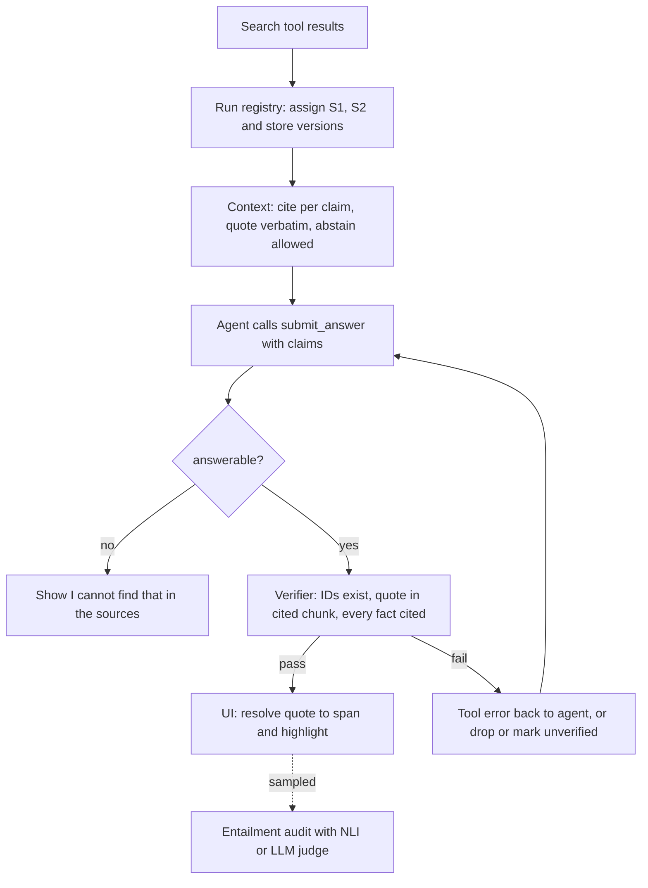

## TL;DR
Grounding means an agent's answer comes only from what its tools returned; citations are checkable
pointers from each claim to a supporting span. Give every tool result a stable ID, require a citation per
claim, allow abstention, and verify in code.

## For agent builders
- **Why it matters for agents.** An agent gathers evidence over many tool calls, then writes an answer or
  takes an action. Without citations you cannot tell which sentence came from a search result and which
  came from the model's memory, and you cannot audit why the agent acted.
- **Where it shows up in your stack.** Provider citation features (Anthropic's Messages API can return
  cited spans for documents you pass), structured-output schemas for claims, the result formatter of each
  retrieval tool, and the final-answer validator in your agent loop.
- **What you control.** A run-level source registry so IDs stay stable across tool calls, the claims
  schema, the abstention path, and what the loop does when verification fails (repair, drop, or flag).
- **What you can skip.** Building your own span-attribution model. Quote checks in code plus a sampled
  entailment audit cover most products.

## Why it exists
- **Retrieval does not oblige the model to use the text.** It has parametric knowledge from
  pre-training, fluently fills gaps, and happily answers questions the sources do not cover. Retrieval
  alone does not stop it mixing in memorised or invented facts.
- **The result is the most dangerous error:** a confident answer that looks like it came from the
  company's documents but did not. In regulated or contractual settings (policy, legal, medical, finance,
  support for a paid product) an unbacked sentence is a liability, not a quality nit.
- **"Only use the context" is not enough.** The model follows it probabilistically and it leaves no
  evidence trail to show a disputing user or to check a thousand answers automatically.
- **A "sources" list under the answer is decoration.** It says what was retrieved, not what supports which
  sentence, and users quickly learn the list is not trustworthy.
- **Citations turn grounding from a hope into an inspectable contract.** The UI shows evidence, a
  validator rejects unknown sources, and an evaluator checks entailment (the subject of citation
  correctness).

## How it works
### 1. Make sources addressable
- **Short, stable IDs in the prompt:** `[S1]`, `[S2]`, or a document ID plus chunk offset, with title,
  date and any metadata that helps the model disambiguate.
- **Short because the model must reproduce them exactly;** long UUIDs get mangled.
- **Server-side map** from short ID to real document, version and character range, because the citation
  shown to the user must resolve to the exact text the model saw, not the current version of the file.
- **In an agent, the map lives for the whole run.** Each tool result gets the next free ID (S1 to S5 from
  the first search, S6 to S10 from the second), so step 7 can still cite what step 2 found.

### 2. Choose the citation granularity
| Pointer | Gain | Cost |
|---|---|---|
| Document | easy to produce, nearly always "correct" | weak: a 40-page PDF supports almost any claim on its topic; the user still hunts and a verifier cannot check anything |
| Chunk | easy, checkable | chunk boundaries can split the fact |
| Sentence or character span | precise verification and UI highlight | the model must locate the exact text, and cannot count offsets reliably |
| **Chunk ID + short verbatim quote** (usual operating point) | span precision without model-emitted offsets | the server resolves the quote to offsets afterwards |

### 3. Instruct the citation contract
- Cite after every sentence that states a fact.
- Cite only IDs that appear above (or that any tool returned in this run).
- Prefer quoting the supporting phrase.
- If the sources do not contain the answer, say so instead of answering.

The abstention clause is the grounding mechanism. Without a legitimate "I don't know" path, the model
reaches for parametric knowledge and attaches the nearest-looking citation to it. For agents, abstention
can also be "search again with a different query" before giving up.

### 4. Constrain the output shape
- **Free-text `[S2]` markers** are easy to read but hard to verify.
- **Structured output is sturdier:** a list of claims, each with `source_ids` and a short verbatim `quote`.
  Because the quote must appear in the cited chunk, a string check in code catches fabricated or
  misattributed citations cheaply.
- **Provider-native citation modes:** you pass documents and the response returns the cited text with its
  location (character ranges for plain text, page numbers for PDFs; the exact shape varies by vendor).
  They remove the parsing burden but tie you to that provider's format.
- **A final-answer tool** is a natural fit in an agent: the loop ends when the model calls
  `submit_answer` with the claims schema, so the validator runs on structured arguments.

### 5. Generation-time vs post-hoc attribution
| | Generation-time | Post-hoc |
|---|---|---|
| How | the model cites while writing | answer first, then per sentence search the sources for a supporting span (embedding search plus an entailment check), attach or flag |
| Cost | cheap | slower |
| Strength | usually accurate when retrieval is good | works with any model; finds unsupported sentences the generator never cited |

Mature systems often do generation-time citation, then a post-hoc verification pass.

### 6. Verify and act
Code checks after generation:
1. Every cited ID exists in this request's (or this run's) source set.
2. Every quote is a substring (after whitespace normalisation) of its cited chunk.
3. Every factual sentence has at least one citation.

- **On failure:** a repair retry, removal of the unsupported sentence, or a visible "unverified" marker,
  depending on the product's risk tolerance. In an agent loop, the repair is a tool error returned to the
  model listing the failing claims.
- **The strongest check**, whether the cited text actually entails the claim, needs an NLI model or an LLM
  judge and usually runs on a sample or in offline evals.

### Where grounding fails upstream
- **Citations cannot fix retrieval.** If the right chunk was never retrieved, a well-behaved model
  abstains and a badly-behaved one cites something adjacent.
- **Chunking and layout matter too.** Split facts and evidence buried mid-context degrade citations, so
  grounding is a property of the whole pipeline.

## Diagram
The citation contract inside an agent run: tool results get run-level IDs, the agent submits claims with
quotes, and code checks each claim before the answer reaches the UI.



## Examples
### Agent loop: run-level source registry and a verified final answer
Every retrieval tool registers its results, so IDs are stable for the whole run. The agent ends by
calling `submit_answer`; failed claims go back as a tool error for one repair attempt.

```python
import re

class SourceRegistry:
    def __init__(self):
        self.by_id = {}                                  # "S3" -> {"doc_id", "version", "text"}
    def add(self, chunk):
        sid = f"S{len(self.by_id) + 1}"
        self.by_id[sid] = chunk
        return sid

def format_results(registry, chunks):                    # what the search tool returns to the model
    return "\n\n".join(f"[{registry.add(c)}] ({c['title']}, {c['date']})\n{c['text']}" for c in chunks)

def norm(s):
    return re.sub(r"\s+", " ", s).strip().lower()

def verify(answer, registry):                            # answer = submit_answer tool arguments
    problems = []
    if answer.get("answerable") and not answer["claims"]:
        problems.append((None, "marked answerable but made no claims"))
    for n, cl in enumerate(answer["claims"]):
        if not cl.get("source_ids"):
            problems.append((n, "uncited claim"))
            continue
        bad = [s for s in cl["source_ids"] if s not in registry.by_id]
        if bad:
            problems.append((n, f"unknown source {bad}"))
            continue
        quote = norm(cl.get("quote") or "")              # an empty quote would match any chunk
        if not quote or not any(quote in norm(registry.by_id[s]["text"]) for s in cl["source_ids"]):
            problems.append((n, "quote missing or not found in cited sources"))
    return problems

def on_submit_answer(answer, registry, attempts):
    problems = verify(answer, registry)
    if not problems:
        return {"done": True, "answer": answer}
    if attempts == 0:                                    # one repair turn, then drop failing claims
        return {"done": False, "tool_error": f"Fix or remove these claims: {problems}"}
    bad = {n for n, _ in problems if n is not None}
    answer["claims"] = [c for i, c in enumerate(answer["claims"]) if i not in bad]
    answer["answerable"] = bool(answer["claims"])        # nothing verified left: abstain, never ship empty
    return {"done": True, "answer": answer, "dropped": sorted(bad)}

reg = SourceRegistry()                                   # replay the refund-window scenario below
print(format_results(reg, [{"title": t, "date": "2025-01", "text": x} for t, x in [
    ("Billing FAQ", "Monthly plans renew automatically."),
    ("Refund policy", "Annual plans may be refunded within 30 days of purchase."),
    ("Plans", "Annual plans are billed once a year.")]])[:40])
ans = {"answerable": True, "claims": [
    {"text": "Annual plans are refundable within 30 days.", "source_ids": ["S2"],
     "quote": "Annual plans may be  refunded within 30 days"},
    {"text": "Partial refunds are prorated.", "source_ids": ["S3"], "quote": "refunds are prorated"}]}
print(on_submit_answer(ans, reg, attempts=0))   # tool_error naming claim 1
print(on_submit_answer(ans, reg, attempts=1))   # claim 1 dropped, claim 0 kept
```

### Worked scenario: catching a fabricated quote
Three chunks are retrieved for "What is the refund window for annual plans?"; the model returns two claims.

| Claim | Cites | Quote | Verifier |
|---|---|---|---|
| 0: annual plans refundable within 30 days | S2 | "Annual plans may be refunded within 30 days" (present in S2) | passes |
| 1: partial refunds are prorated | S3 | appears nowhere | flagged (index 1 in `problems`) |

The product regenerates, or drops claim 1. No model call was needed to catch the fabricated quote.

### Worked scenario: a support agent that acts on a citation
A refund agent may call `issue_refund` only when a verified claim supports eligibility. Illustrative run:

| Step | Event | Gate |
|---|---|---|
| 1 | `search_policy` returns S1 to S5 | registry holds 5 sources |
| 2 | `get_order` returns S6 (purchase 12 days ago) | registry holds 6 |
| 3 | agent claims "eligible: within 30 days" citing S2 and S6 with quotes | both quotes found, passes |
| 4 | `issue_refund` is allowed, and the citations are stored on the action log | auditable |

Had the quote in step 3 failed, the action tool would have refused and the agent would have escalated to
a human.

### Resolving a quote to character offsets for the UI highlight
The model emits a quote, not offsets; the server finds the span in the exact chunk version it sent.

```python
import re

def resolve_span(quote, text):
    """Return (start, end) of the quote in the original chunk text, tolerant of whitespace and case."""
    words = quote.split()
    if not words:
        return None
    m = re.search(r"\s+".join(re.escape(w) for w in words), text, flags=re.I)
    return (m.start(), m.end()) if m else None

chunk = "Refund policy.\nAnnual plans may be\nrefunded within 30 days of purchase."
print(resolve_span("annual plans may be refunded within 30 days", chunk))   # (15, 58)
print(resolve_span("partial refunds are prorated", chunk))                  # None -> flag the claim
```

## Production patterns
- **Run-level source registry.** Assign IDs as tool results arrive and keep them for the whole agent run,
  persisted with the trace. Monitor citations to IDs that never existed; a rise means the model is
  inventing or mangling IDs.
- **Claims-with-quotes schema on a final-answer tool.** Enforce the claims, `source_ids` and `quote` shape
  with structured-output or tool-schema mode, rejecting non-conforming responses. Monitor parse-failure
  rate per model version.
- **Version-pinned source map.** Persist short ID → (doc_id, version, char range) per request so a click
  opens the text the model saw. Monitor citations that fail to resolve.
- **Provider-native citations where you use one vendor.** Anthropic's Messages API, for example, accepts
  documents with citations enabled and returns cited text with character or page locations; map them into
  your own claim schema. Monitor the share of answers with no citations.
- **Citation-gated actions.** Tools with side effects (refunds, account changes, emails) require a
  verified claim as an argument and log it with the action. Monitor actions blocked by the gate and
  escalations to humans.
- **Risk-tiered failure policy plus audits.** High-risk surfaces drop unverified sentences or abstain;
  low-risk ones mark them "unverified". Judge a daily sample of claim and quote pairs (NLI or LLM, humans on
  disagreements), alert when abstention on an unanswerable probe set drops, and track support rate, not
  citation rate.

## Trade-offs
- **Per-claim citations: trust vs friction.** Trust and auditability, but choppier prose, more output
  tokens and a pull toward quotable claims. Not worth it for casual or creative use; it flips the moment
  an answer can be acted on or disputed.
- **Strict abstention: fewer hallucinations vs more "I can't find that".** If retrieval recall is weak,
  users experience it as a broken product, so fix recall first.
- **Verbatim quotes: cheap checks vs paraphrase.** Verification becomes a string check, but
  paraphrase-heavy answers (summaries across many sources) fit poorly; there, an entailment check per
  claim is the better verifier.
- **Provider-native citations: precise spans vs lock-in.** They save parsing and return precise spans but
  lock the output format to one vendor; a portable JSON contract is preferable when you route across
  models.
- **Post-hoc attribution: coverage vs latency.** It catches sentences the generator never cited, at an
  extra retrieval and entailment pass per sentence.
- **Repair turns: fewer dropped claims vs extra steps.** Sending failures back to the agent often fixes
  them, but each repair is another model call; cap it at one or two.

## Pitfalls
- **Calling a list of retrieved documents "citations".** Symptom: users click a source, find nothing
  relevant, then ignore sources entirely. Fix: per-claim pointers with quotes.
- **IDs that resolve to the latest version, not the chunk version the model saw.** Symptom: citations that
  "used to" support the claim after a document edit. Diagnose: compare the stored chunk version with the
  current one for failing clicks. Fix: a version-pinned map.
- **Per-call IDs in a multi-step agent.** Every search restarts at S1, so "S2" means different chunks at
  different steps. Symptom: citations that point at the wrong document. Diagnose: look for an ID assigned
  twice in one trace. Fix: a run-level registry.
- **No abstention path.** The model attaches the nearest citation to parametric knowledge; symptom:
  citations that are topically related but do not state the claimed fact. Diagnose: abstention rate on an
  unanswerable probe set. Fix: an explicit abstain clause.
- **Checking only that citation IDs exist, not that the cited text supports the claim.** Symptom: evals
  show high "citation rate" while human reviewers still find many unsupported sentences. Fix: quote
  checks in code plus a sampled entailment audit.
- **Long, numerous chunks burying the evidence mid-context.** Symptom: citation accuracy drops as top-k
  grows even though retrieval recall goes up. Diagnose: plot verifier pass rate against k. Fix: rerank
  and cut.
- **Citing whole documents rather than chunks or spans.** Symptom: a near-perfect automated citation score
  alongside users who say the cited PDF is 40 pages and they could not find the sentence.

## When to use
- **Use when** an answer could be acted on, disputed or audited: internal knowledge assistants, customer
  support, policy and legal Q&A, anything sold as "answers from your documents", and any agent whose
  actions depend on retrieved facts.
- **Skip or soften** for brainstorming, drafting and conversational tasks where sources are not the point.
- **Measure:** the fraction of factual sentences carrying a citation, the fraction of citations that pass
  verification, and abstention rate on questions you know are unanswerable.
- **Interviews:** why "just use the context" is insufficient, and how to verify citations automatically.

## Exercise
**Goal:** add a verified citation contract to a small RAG agent and measure what it catches. No solution
is given.
- **Inputs:** 30 questions over a help-centre corpus (20 answerable, 10 not), a search tool and any
  tool-calling model.
- **Deliver:** a run-level registry, a `submit_answer` claims schema with quotes, a verifier with one
  repair turn, and a per-question log of claims, failures and repairs.
- **Acceptance:** every shipped claim passes the quote check; at least 9 of 10 unanswerable questions
  abstain; you hand-label 30 claims for support and report support rate next to citation rate.

## Role lens
- **Engineer:** Assigns stable source IDs, enforces a claims-with-quotes schema, and writes the verifier
  that rejects unknown IDs and missing quotes before the answer reaches the UI.
- **Architect:** Decides the grounding policy per surface (strict abstain vs best effort), where
  verification runs, and how chunk versions are stored so citations resolve to what the model saw.
- **FDE:** Shows a sceptical customer clickable evidence for each sentence during a pilot, which is often
  what turns a demo into an approved rollout in compliance-heavy teams.

## Check yourself
**Q:** Your assistant cites a source on 98% of sentences, yet reviewers say one answer in six contains a
claim the cited source does not support. What is going on and what do you change?
**A:** Citation *rate* measures formatting, not support. The model is attaching IDs to sentences, often
the nearest topically related chunk, including sentences derived from parametric knowledge or from
merging two chunks. Fixes: require a verbatim quote per claim and verify it in code; add an explicit
abstention path so the model is not forced to answer; reduce top-k or rerank so evidence is not buried;
and measure citation correctness with an entailment check or judge on a labelled sample, tracking support
rather than presence. Also check retrieval recall, since missing evidence produces exactly this pattern.

## Interview questions
### What is the difference between grounding and citations?
- **Grounding** is the property that the answer comes only from the retrieved sources, not from the
  model's parametric knowledge or invention.
- **Citations** are machine-checkable pointers from each claim to its supporting chunk or span. They make
  grounding inspectable: the UI can show evidence and code can verify it, which an "only use the context"
  instruction never can.

### Your research agent calls search five times before answering. How do you make its citations reliable?
- **One registry per run.** Each tool result gets a fresh, never-reused ID mapped to document and
  version, so an ID means the same chunk at every step.
- **Structured final answer.** The agent ends with a `submit_answer` tool call carrying claims,
  `source_ids` and verbatim quotes, which code verifies against the registry.
- **Bounded repair.** Failing claims go back as a tool error once; after that they are dropped or marked
  unverified, and the run is logged for review.

### Why is a "sources" list under the answer not enough?
- **It says what was retrieved, not what supports which sentence.** Users click, find nothing relevant,
  and learn to ignore it.
- **Nothing can be verified.** Without a per-claim pointer and quote, you cannot automatically check a
  thousand answers or show a disputing user where a sentence came from.

### Design the citation format for a contracts Q&A product that may later route across several model vendors.
- **Short stable IDs** (`[S1]`) in the prompt, mapped server-side to document, version and character
  range, so citations resolve to the exact text the model saw.
- **A portable claims schema:** each claim with `source_ids` and a short verbatim `quote`, enforced with
  structured output; the server resolves quotes to offsets for highlighting.
- **Why not provider-native citations alone:** they return precise spans but lock the format to one
  vendor; map them into your own schema if you use them.

### When would you pick post-hoc attribution over generation-time citation?
- **When the generator cites poorly or not at all**, or you need to find unsupported sentences it never
  cited, because post-hoc search checks every sentence regardless of the model.
- **Not when latency is tight:** it adds a retrieval and entailment pass per sentence. Mature systems
  often cite at generation time and run post-hoc verification on top.

### Which metrics would you put on a grounding dashboard for an agent, and which one would you not headline?
- **Headline support rate:** the share of claims whose cited text entails them, from a sampled NLI or LLM
  judge audit with human review of disagreements.
- **Also track** verifier pass rate, repair turns per run, actions blocked by the citation gate, and
  abstention on a probe set of known unanswerable questions.
- **Do not headline citation rate.** 98% of sentences can carry a citation while one answer in six is
  unsupported, because rate measures formatting.

## Quiz
### Q: Why is an explicit "say you don't know" instruction central to grounding?
- [ ] It reduces token usage on hard questions
- [x] Without a legitimate abstention path the model fills gaps from parametric knowledge and attaches a nearby citation
- [ ] It prevents prompt injection from retrieved documents
- [ ] It forces the retriever to return more chunks
> Grounding fails mostly on questions the sources do not answer. If the only allowed output is an answer,
> the model invents one and decorates it with a plausible citation; abstention gives it a correct exit.

### Q: What does requiring a verbatim quote with each citation buy you?
- [ ] It guarantees the answer is factually correct
- [ ] It removes the need for retrieval evaluation
- [x] A cheap string check can catch fabricated or misattributed citations without another model call
- [ ] It lets the model cite sources it was not given
> If the quote is not in the cited chunk, the citation is wrong by construction. This catches a class of
> errors for free, though a real quote can still fail to entail the claim, which needs an entailment check.

### Q: When is post-hoc attribution preferable to generation-time citation?
- [ ] When latency must be as low as possible
- [x] When you need to find unsupported sentences the generator never cited, or use a model that cites poorly
- [ ] When the sources are very short
- [ ] When the product has no UI for showing sources
> Post-hoc attribution searches the sources for support for every sentence after generation, so it can
> flag uncited or unsupported claims regardless of the generator, at the cost of extra latency.

## Mastery test
**Problem:** a benefits agent answers "Is IVF covered?" with "Yes, up to $15,000 [S4]". S4's quote
"fertility treatment up to $15,000" passes your verifier, but S4 is the 2023 plan; the 2025 plan, never
retrieved, drops coverage. Users saw a verified citation. What failed, and what do you add?

**A strong answer:**
- separates the layers: the citation was faithful to S4 but the answer was not grounded in the right
  source, so quote checks cannot catch it;
- fixes upstream: version or date metadata in the registry and prompt, filtering to current plans, and
  abstaining when only superseded sources exist;
- adds probe questions whose current answer differs from an older document.

## Use cases & projects
### Use cases
- **Customer-support agents.** Each answer links to the help article or policy span it came from, so
  agents and users can check it in one click.
- **Research and analyst agents.** A report built from many searches cites every claim to a tool result,
  making it auditable after the run.
- **Agents that take actions.** A refund or account change records the policy passage that justified it,
  giving reviewers an audit trail.
- **Regulated domains.** Legal, medical and financial assistants abstain when no source supports a claim
  rather than answering from model memory.

### Mini project
**Add verified citations to a RAG agent (2-3 hours).**
- **Goal:** make an agent cite a stable source ID and quote for every claim, and reject answers that fail
  verification.
- **Steps:** give each search result a run-level ID in a source registry; define a structured output with
  claims, source IDs and quoted spans; check in code that every ID exists and every quote appears in its
  source; on failure, ask the model to repair once, then drop the claim or abstain.
- **Done when:** on 20 test questions, every returned claim passes the quote check, out-of-scope questions
  get an abstention, and your logs show how many answers needed repair.
