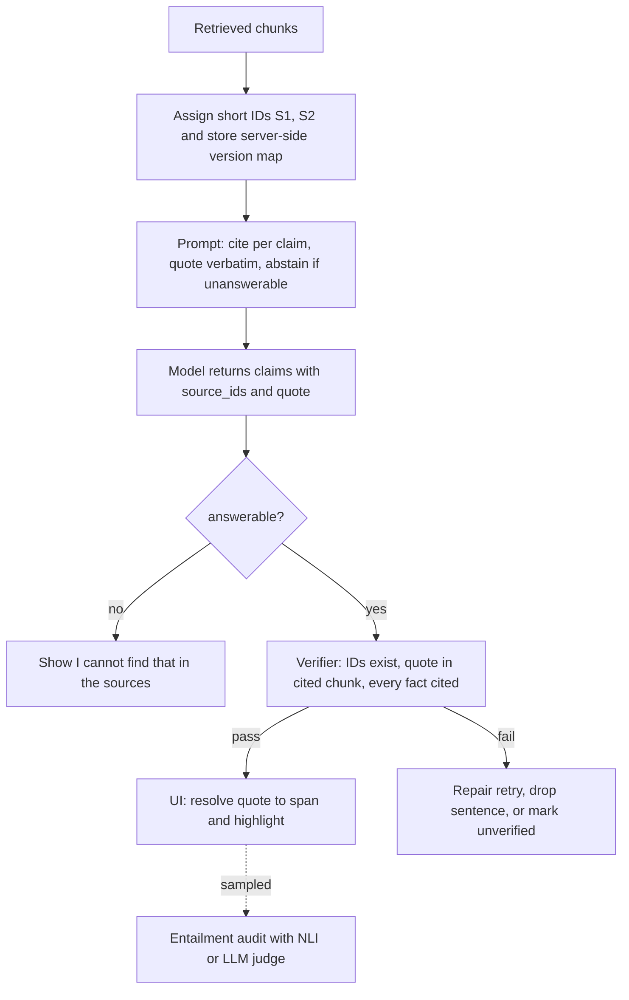

## TL;DR
Grounding means the answer comes only from the retrieved sources; citations are machine-checkable
pointers from each claim to its supporting span. Give sources stable IDs, require a citation per claim,
allow abstention, and verify citations in code.

## Why it exists
- **Retrieval does not oblige the model to use the text.** It has parametric knowledge from
  pre-training, fluently fills gaps, and happily answers questions the sources do not cover. Retrieval
  alone does not stop it mixing in memorised or invented facts.
- **The result is the most dangerous error:** a confident answer that looks like it came from the
  company's documents but did not. In regulated or contractual settings (policy, legal, medical, finance,
  support for a paid product) an unbacked sentence is a liability, not a quality nit.
- **"Only use the context" is not enough.** The model follows it probabilistically and it leaves no
  evidence trail: when a user disputes an answer you cannot show where it came from, and you cannot
  automatically check a thousand answers.
- **A "sources" list under the answer is decoration.** It says what was retrieved, not what supports which
  sentence, and users quickly learn the list is not trustworthy.
- **Citations turn grounding from a hope into an inspectable contract.** Each claim points to a chunk or
  span, so the UI shows evidence, a validator rejects citations to sources never provided, and an
  evaluator checks whether the cited text entails the claim (the subject of citation correctness).

## How it works
### 1. Make sources addressable
- **Short, stable IDs in the prompt:** `[S1]`, `[S2]`, or a document ID plus chunk offset, with title,
  date and any metadata that helps the model disambiguate.
- **Short because the model must reproduce them exactly;** long UUIDs get mangled.
- **Server-side map** from short ID to real document, version and character range, because the citation
  shown to the user must resolve to the exact text the model saw, not the current version of the file.

### 2. Choose the citation granularity
| Pointer | Gain | Cost |
|---|---|---|
| Document | easy to produce, nearly always "correct" | weak: a 40-page PDF supports almost any claim on its topic; the user still hunts and a verifier cannot check anything |
| Chunk | easy, checkable | chunk boundaries can split the fact |
| Sentence or character span | precise verification and UI highlight | the model must locate the exact text, and cannot count offsets reliably |
| **Chunk ID + short verbatim quote** (usual operating point) | span precision without model-emitted offsets | the server resolves the quote to offsets afterwards |

### 3. Instruct the citation contract
- Cite after every sentence that states a fact.
- Cite only IDs that appear above.
- Prefer quoting the supporting phrase.
- If the sources do not contain the answer, say so instead of answering.

The abstention clause is the grounding mechanism. Without a legitimate "I don't know" path, the model
reaches for parametric knowledge and attaches the nearest-looking citation to it.

### 4. Constrain the output shape
- **Free-text `[S2]` markers** are easy to read but hard to verify.
- **Structured output is sturdier:** a list of claims, each with `source_ids` and a short verbatim `quote`.
  Because the quote must appear in the cited chunk, a string check in code catches fabricated or
  misattributed citations cheaply.
- **Provider-native citation modes:** you pass documents and the response returns the cited text with its
  location (character ranges for plain text, page numbers for PDFs; the exact shape varies by vendor).
  They remove the parsing burden but tie you to that provider's format.

### 5. Generation-time vs post-hoc attribution
| | Generation-time | Post-hoc |
|---|---|---|
| How | the model cites while writing | answer first, then per sentence search the sources for a supporting span (embedding search plus an entailment check), attach or flag |
| Cost | cheap | slower |
| Strength | usually accurate when retrieval is good | works with any model; finds unsupported sentences the generator never cited |

Mature systems often do generation-time citation, then a post-hoc verification pass.

### 6. Verify and act
Code checks after generation:
1. Every cited ID exists in this request's source set.
2. Every quote is a substring (after whitespace normalisation) of its cited chunk.
3. Every factual sentence has at least one citation.

- **On failure:** a repair retry, removal of the unsupported sentence, or a visible "unverified" marker,
  depending on the product's risk tolerance.
- **The strongest check**, whether the cited text actually entails the claim, needs an NLI model or an LLM
  judge and usually runs on a sample or in offline evals.

### Where grounding fails upstream
- **Citations cannot fix retrieval.** If the right chunk was never retrieved, a well-behaved model
  abstains and a badly-behaved one cites something adjacent.
- **Chunking and layout matter too.** Chunks that cut a fact in half, or evidence buried in the middle of a
  long context, both degrade citation quality, so grounding is a property of the whole pipeline.

## Diagram
The citation contract end to end: addressable sources go in, structured claims with quotes come out, and
code checks each claim before the answer reaches the UI.



## Examples
### Quote-backed citation contract plus a cheap verifier
Generation with a quote-backed citation contract, then a cheap verification pass.

```python
import json, re

def build_prompt(question, chunks):
    src = "\n\n".join(f"[S{i+1}] ({c['title']}, {c['date']})\n{c['text']}"
                      for i, c in enumerate(chunks))
    return (f"Sources:\n{src}\n\n"
            "Answer using ONLY the sources. Return JSON: "
            '{"claims":[{"text":...,"source_ids":["S1"],"quote":...}], "answerable":true}. '
            "quote must be copied verbatim from a cited source. "
            'If the sources do not answer the question, return {"claims":[],"answerable":false}.\n\n'
            f"Question: {question}")

def norm(s):
    return re.sub(r"\s+", " ", s).strip().lower()

def verify(raw, chunks):
    out = json.loads(raw)
    ids = {f"S{i+1}": c for i, c in enumerate(chunks)}
    problems = []
    if out.get("answerable") and not out["claims"]:
        problems.append((None, "marked answerable but made no claims"))
    for n, cl in enumerate(out["claims"]):
        if not cl.get("source_ids"):
            problems.append((n, "uncited claim"))
            continue
        bad = [s for s in cl["source_ids"] if s not in ids]
        if bad:
            problems.append((n, f"unknown source {bad}"))
            continue
        quote = norm(cl.get("quote") or "")          # an empty quote would match any chunk
        if not quote or not any(quote in norm(ids[s]["text"]) for s in cl["source_ids"]):
            problems.append((n, "quote missing or not found in cited sources"))
    return out, problems   # caller repairs, drops, or flags the claims listed in problems
```

### Worked scenario: catching a fabricated quote
Three chunks are retrieved for "What is the refund window for annual plans?"; the model returns two claims.

| Claim | Cites | Quote | Verifier |
|---|---|---|---|
| 0: annual plans refundable within 30 days | S2 | "Annual plans may be refunded within 30 days" (present in S2) | passes |
| 1: partial refunds are prorated | S3 | appears nowhere | flagged (index 1 in `problems`) |

The product regenerates, or drops claim 1 and shows only the supported sentence. No model call was needed
to catch the fabricated quote.

### Resolving a quote to character offsets for the UI highlight
The model emits a quote, not offsets; the server finds the span in the exact chunk version it sent.

```python
import re

def resolve_span(quote, text):
    """Return (start, end) of the quote in the original chunk text, tolerant of whitespace and case."""
    words = quote.split()
    if not words:
        return None
    m = re.search(r"\s+".join(re.escape(w) for w in words), text, flags=re.I)
    return (m.start(), m.end()) if m else None

chunk = "Refund policy.\nAnnual plans may be\nrefunded within 30 days of purchase."
print(resolve_span("annual plans may be refunded within 30 days", chunk))   # (15, 58)
print(resolve_span("partial refunds are prorated", chunk))                  # None -> flag the claim
```

## Production patterns
- **Claims-with-quotes schema.** Enforce the claims, `source_ids` and `quote` shape with your provider's
  structured-output or JSON-schema mode, and reject non-conforming responses before verification. Monitor
  parse-failure rate per model version.
- **Version-pinned source map.** Persist, per request, short ID → (doc_id, version, char range) so a
  clicked citation opens the text the model saw even after the file changes. Monitor citations that fail
  to resolve.
- **Provider-native citations where you use one vendor.** For example, Anthropic's Messages API accepts
  documents with citations enabled and returns cited text with character or page locations. Map them into
  your own claim schema so the UI does not depend on one format. Monitor the share of answers with no
  citations.
- **Risk-tiered failure policy.** High-risk surfaces (legal, policy) drop unverified sentences or abstain;
  low-risk ones show an "unverified" marker; both log the failure. Monitor verifier pass rate and repair
  retries per answer.
- **Sampled entailment audit.** Run an NLI model or LLM judge on a daily sample of claim and quote pairs,
  with human review of disagreements. Track support rate, not citation rate, as the headline metric.
- **Unanswerable probe set.** Keep questions you know the corpus cannot answer in the eval suite and
  require abstention. Alert when abstention on them drops.

## Trade-offs
- **Per-claim citations: trust vs friction.** They raise trust and auditability but make prose choppier,
  add output tokens and push the model toward claims it can quote. For casual or creative use the friction
  is not worth it; it flips back the moment an answer can be acted on or disputed.
- **Strict abstention: fewer hallucinations vs more "I can't find that".** If retrieval recall is weak,
  users experience it as a broken product, so fix recall first.
- **Verbatim quotes: cheap checks vs paraphrase.** Verification becomes a string check, but
  paraphrase-heavy answers (summaries across many sources) fit poorly; there, an entailment check per
  claim is the better verifier.
- **Provider-native citations: precise spans vs lock-in.** They save parsing and return precise spans but
  lock the output format to one vendor; a portable JSON contract is preferable when you route across
  models.
- **Post-hoc attribution: coverage vs latency.** It catches sentences the generator never cited, at the
  cost of an extra retrieval and entailment pass per sentence, which matters when latency budgets are
  tight.

## Pitfalls
- **Calling a list of retrieved documents "citations".** Symptom: users click a source, find nothing
  relevant, then ignore sources entirely.
- **IDs that resolve to the latest version, not the chunk version the model saw.** Symptom: citations that
  "used to" support the claim after a document edit.
- **No abstention path.** The model attaches the nearest citation to parametric knowledge; symptom:
  citations that are topically related but do not state the claimed fact.
- **Checking only that citation IDs exist.** Symptom: evals show high "citation rate" while human
  reviewers still find many unsupported sentences.
- **Long, numerous chunks burying the evidence mid-context.** Symptom: citation accuracy drops as top-k
  grows even though retrieval recall goes up.
- **Citing whole documents rather than chunks or spans.** Symptom: a near-perfect automated citation score
  alongside users who say the cited PDF is 40 pages and they could not find the sentence.

## When to use
- **Use when** an answer could be acted on, disputed or audited: internal knowledge assistants, customer
  support, policy and legal Q&A, anything sold as "answers from your documents".
- **Skip or soften** for brainstorming, drafting and conversational tasks where sources are not the point.
- **Measure:** the fraction of factual sentences carrying a citation, the fraction of citations that pass
  verification, and abstention rate on questions you know are unanswerable.
- **Interviews:** explain why "just tell it to use the context" is insufficient and how you would verify
  citations automatically.

## Role lens
- **Engineer:** Assigns stable source IDs, enforces a claims-with-quotes schema, and writes the verifier
  that rejects unknown IDs and missing quotes before the answer reaches the UI.
- **Architect:** Decides the grounding policy per surface (strict abstain vs best effort), where
  verification runs, and how chunk versions are stored so citations resolve to what the model saw.
- **FDE:** Shows a sceptical customer clickable evidence for each sentence during a pilot, which is often
  what turns a demo into an approved rollout in compliance-heavy teams.

## Check yourself
**Q:** Your assistant cites a source on 98% of sentences, yet reviewers say one answer in six contains a
claim the cited source does not support. What is going on and what do you change?
**A:** Citation *rate* measures formatting, not support. The model is attaching IDs to sentences, often
the nearest topically related chunk, including sentences derived from parametric knowledge or from
merging two chunks. Fixes: require a verbatim quote per claim and verify it in code; add an explicit
abstention path so the model is not forced to answer; reduce top-k or rerank so evidence is not buried;
and measure citation correctness with an entailment check or judge on a labelled sample, tracking support
rather than presence. Also check retrieval recall, since missing evidence produces exactly this pattern.

## Interview questions
### What is the difference between grounding and citations?
- **Grounding** is the property that the answer comes only from the retrieved sources, not from the
  model's parametric knowledge or invention.
- **Citations** are machine-checkable pointers from each claim to its supporting chunk or span. They make
  grounding inspectable: the UI can show evidence and code can verify it, which an "only use the context"
  instruction never can.

### Why is a "sources" list under the answer not enough?
- **It says what was retrieved, not what supports which sentence.** Users click, find nothing relevant,
  and learn to ignore it.
- **Nothing can be verified.** Without a per-claim pointer and quote, you cannot automatically check a
  thousand answers or show a disputing user where a sentence came from.

### Design the citation format for a contracts Q&A product that may later route across several model vendors.
- **Short stable IDs** (`[S1]`) in the prompt, mapped server-side to document, version and character
  range, so citations resolve to the exact text the model saw.
- **A portable claims schema:** each claim with `source_ids` and a short verbatim `quote`, enforced with
  structured output; the server resolves quotes to offsets for highlighting.
- **Why not provider-native citations alone:** they return precise spans but lock the format to one
  vendor; map them into your own schema if you use them.

### When would you pick post-hoc attribution over generation-time citation?
- **When the generator cites poorly or not at all**, or you need to find unsupported sentences it never
  cited, because post-hoc search checks every sentence regardless of the model.
- **Not when latency is tight:** it adds a retrieval and entailment pass per sentence. Mature systems
  often cite at generation time and run post-hoc verification on top.

### Which metrics would you put on a grounding dashboard, and which one would you not headline?
- **Headline support rate:** the share of claims whose cited text entails them, from a sampled NLI or LLM
  judge audit with human review of disagreements.
- **Also track** verifier pass rate, uncited factual sentences, and abstention on a probe set of known
  unanswerable questions.
- **Do not headline citation rate.** 98% of sentences can carry a citation while one answer in six is
  unsupported, because rate measures formatting.

## Quiz
### Q: Why is an explicit "say you don't know" instruction central to grounding?
- [ ] It reduces token usage on hard questions
- [x] Without a legitimate abstention path the model fills gaps from parametric knowledge and attaches a nearby citation
- [ ] It prevents prompt injection from retrieved documents
- [ ] It forces the retriever to return more chunks
> Grounding fails mostly on questions the sources do not answer. If the only allowed output is an answer,
> the model invents one and decorates it with a plausible citation; abstention gives it a correct exit.

### Q: What does requiring a verbatim quote with each citation buy you?
- [ ] It guarantees the answer is factually correct
- [ ] It removes the need for retrieval evaluation
- [x] A cheap string check can catch fabricated or misattributed citations without another model call
- [ ] It lets the model cite sources it was not given
> If the quote is not in the cited chunk, the citation is wrong by construction. This catches a class of
> errors for free, though a real quote can still fail to entail the claim, which needs an entailment check.

### Q: When is post-hoc attribution preferable to generation-time citation?
- [ ] When latency must be as low as possible
- [x] When you need to find unsupported sentences the generator never cited, or use a model that cites poorly
- [ ] When the sources are very short
- [ ] When the product has no UI for showing sources
> Post-hoc attribution searches the sources for support for every sentence after generation, so it can
> flag uncited or unsupported claims regardless of the generator, at the cost of extra latency.
