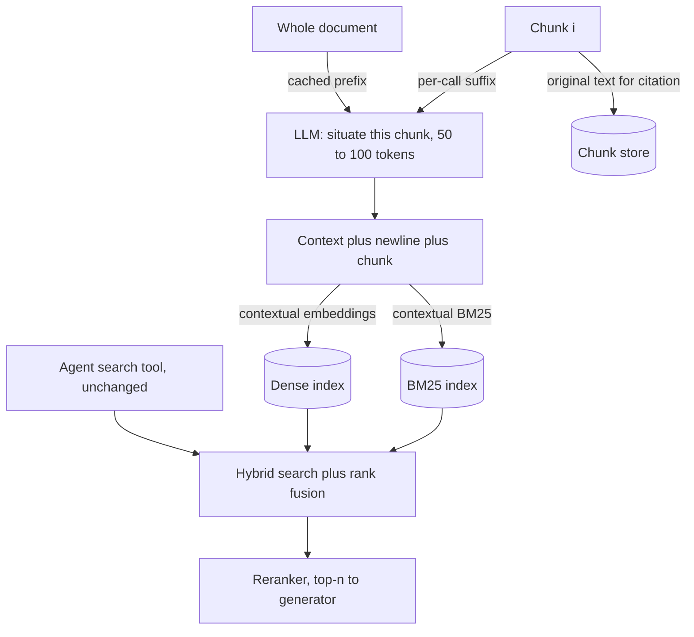

## TL;DR
Chunks lose their subject when cut from a document. Contextual retrieval has an LLM write a short
per-chunk context at ingestion, prepended before embedding and BM25 indexing, so the agent's search tool
finds them with zero added latency per step.

## For agent builders
- **Why it matters for agents.** An agent searches several times per task, so query-side fixes are paid
  on every step; this one is paid once, at ingestion. It also applies to agent memory: a note saved as
  "she prefers the annual plan" is unfindable later without who and when.
- **Where it shows up in your stack.** Your knowledge-base ingestion job (often a LangChain or LlamaIndex
  pipeline or a plain batch script), provider prompt caching for the document prefix, the dense and BM25
  indexes behind the search tool, and the memory-write path.
- **What you control.** The context prompt, its length, whether both index legs get it, caching and
  fan-out order, re-contextualisation triggers, and validation of generated contexts.
- **What you can skip.** Comparing this with late chunking unless you run long-context encoders yourself.
  Try title and heading prefixes first, then this.

## Why it exists
- **Chunks are written to be read in place.** Authors rely on surrounding pages to supply the subject: "the
  company", "this method", "Table 3", "the previous quarter", "it". Cut out, those references dangle.
- **Both retrieval legs miss.** "ACME Corp revenue growth Q2 2023" shares no terms with "The company's
  revenue grew by 3% over the previous quarter", so BM25 scores it near zero; its embedding lands in a
  generic "revenue growth" region that hundreds of other companies' chunks also occupy. The evidence is in
  the index and still cannot be retrieved.
- **It is a recall failure caused by the indexing unit,** worst in corpora of many similar documents:
  quarterly filings, per-customer contracts, per-service runbooks.
- **The cheaper fixes fall short.**
  - **Title and heading-path prefixes** recover a lot and should always be tried first, but fail when the
    title lacks what the chunk needs (the quarter, the product variant, the entity three paragraphs up).
  - **Bigger chunks** blur every embedding.
  - **Parent-document retrieval** gives the generator context but does nothing for matching, because the
    child is still what gets embedded.
  - **Document-level summaries** are not specific to each chunk.
- **What is needed:** a chunk-specific, document-grounded sentence saying what this chunk is about in terms
  a query would use. An LLM reading the whole document can write exactly that.

## How it works
### The ingestion pipeline
For each document, for each chunk:

1. **Generate a context.** Prompt an LLM with the entire document and the chunk, asking for a short
   context that situates the chunk within the document to improve search retrieval, and nothing else.
   Typically a sentence or two (the post suggests on the order of 50–100 tokens).
2. **Prepend:** `contextualised = context + "\n" + chunk`.
3. **Embed the contextualised chunk** for the dense index ("contextual embeddings").
4. **Index the contextualised chunk in BM25** ("contextual BM25").
5. **Store the original chunk** (and, separately, the context) for display and citation.

Why each choice:

| Choice | Because |
|---|---|
| Whole document in the prompt | only it can supply the entity, date and section the chunk omits |
| Context kept short | the chunk's own content must still dominate the embedding; a long context makes every chunk of a document look alike |
| Prepended to both legs | dense and sparse retrieval fail on the same missing terms, and reported gains were larger when both were fixed |
| Original chunk kept | the generated sentence is not source text and must not be quoted as if it were |

### The cost model, and why prompt caching makes it viable
- **Naive cost is about c × d input tokens** for c chunks and d document tokens, since each call carries the
  full document: a 100-chunk document is read 100 times.
- **Prompt caching** places the document as a fixed prefix, varies the chunk and instruction, and serves the
  prefix from cache after the first call at a much lower rate (on Anthropic's API at the time, cache reads
  were billed at about a tenth of the base input price).
- **Still proportional to c × d,** but with a constant roughly an order of magnitude smaller, so per-chunk
  output and the chunk itself become a large share of the bill.
- **Caches expire after minutes,** so process one document's chunks back to back.

Worked illustration with Anthropic's ratios at the time (cache write about 1.25× base input price, cache
read about 0.1×): a 20,000-token document, 50 chunks, a variable suffix (chunk plus instruction) of about
500 tokens per call.

```
uncached: 50 × (20,000 + 500)                         ≈ 1,025,000 full-price input tokens
cached:   1 write × 20,000 × 1.25                     =    25,000
          49 reads × 20,000 × 0.1                     =    98,000
          50 suffixes × 500 × 1.0                     =    25,000
          total                                       ≈   148,000 full-price equivalents (~7× less)
```

- **Output is identical in both cases** (50 contexts of under 100 tokens).
- **Cached reads are still the largest term,** which is why cost grows with chunks × document length, and
  why splitting very long documents into sections before contextualising cuts cost as well as fitting the
  window.
- **Minimum cacheable prefix.** Providers set one, so very short documents are billed uncached; their naive
  cost is small anyway.
- **The post's own estimate** was roughly one dollar per million document tokens with caching. Treat the
  exact figure as model- and pricing-dependent; the order of magnitude is what makes "an LLM call per
  chunk" acceptable.

### What was reported
Reductions in the top-20 retrieval failure rate on the post's evaluation set:

| Layer | Failure-rate reduction |
|---|---|
| Contextual embeddings alone | around 35% |
| + contextual BM25 | around 49% |
| + reranker on top | around 67% |

These are the authors' numbers on their corpora and embedding models. The transferable lesson is the
shape (each layer helps, and they stack), not the exact percentages.

### The serving path is unchanged
- **Query time is the same:** hybrid search over the contextualised chunks, rank fusion, reranking, top-n
  to the generator.
- **That is the main attraction** versus query-side techniques: all the cost is paid at ingestion, and query
  latency does not move.
- **For agents the saving multiplies.** Query rewriting, HyDE or extra retries add a cost to each search
  call, and an agent makes several per task; an index-side fix costs nothing per call.

### The same idea for agent memory
- **Memory notes are chunks cut from a conversation.** "Prefers the annual plan; renewal is next month"
  has no user, account or date once the conversation is gone.
- **Contextualise at write time.** When the agent saves a note, a small LLM call reads the recent
  conversation and writes one sentence naming who, what and when, with relative dates resolved.
- **Index both legs and keep the bare note,** exactly as for documents, and scope every memory search by
  the user or tenant id from the session.

### Variants and neighbours
- **Structural context by rule** (title, heading path, metadata): zero LLM cost, often enough.
- **Documents longer than the model's context:** pass the enclosing section or a window around the chunk
  instead of the whole document, accepting weaker context.
- **Corpus-specific prompts:** for code, ask for file, class and function; for contracts, the parties and
  the clause.
- **Late chunking** (embed the whole document with a long-context encoder, pool per chunk) attacks the same
  problem at the embedding level without an LLM; a different trade, worth comparing.
- **Small corpora:** the post's own advice applies below a certain size: if everything fits in the context
  window, put it in the prompt with caching and skip retrieval.

## Diagram
All the work is on the ingestion side: one cached LLM call per chunk writes a context that feeds both
index legs, while the agent's search-tool path stays exactly as it was.



## Misconceptions
- **"Parent-document retrieval already solves missing context."** It gives the generator the section but
  still embeds the bare child, so "The company's revenue grew by 3%" stays unfindable for "ACME Q2 2023
  revenue growth". Contextual retrieval fixes matching, parents fix reading, and they compose.
- **"Contextual embeddings are enough; BM25 can stay as it was."** Both legs miss on the same absent terms
  (ACME, Q2, 2023). The reported failure-rate reduction grew from around 35% to around 49% when the
  context was also indexed in BM25.
- **"A richer, longer context is better."** A long context dominates the vector and makes every chunk of a
  document look alike, so the specific passage ranks no higher than its neighbours. Keep it to a sentence
  or two (about 50–100 tokens).
- **"Prompt caching makes the job nearly free."** It cuts the constant (about 7× for a 20,000-token, 50-chunk
  document), but cost still grows with chunks × document length, and caches expire after minutes. Process
  one document's chunks back to back and split very long documents into sections.
- **"The generated context is part of the source."** It is model-written and can be wrong. Store the
  original chunk separately and cite only that, never the context sentence.
- **"This is a query-time technique like HyDE."** All its cost is paid once at ingestion; an agent's
  search calls add zero latency, which is why it suits agents that search several times per task.

## Examples
### A contextualisation step for both index legs
`llm` accepts a cached prefix (the document) and a per-call suffix; `embed`, `dense.add` and `bm25.add`
are stubs for your encoder and indexes.

```python
CONTEXT_INSTRUCTION = """Here is the chunk we want to situate within the whole document:
<chunk>
{chunk}
</chunk>
Give a short, succinct context that situates this chunk within the overall document for the
purpose of improving search retrieval of the chunk. Answer only with the context."""

def contextualise_document(doc_id, document, chunks):
    prefix = f"<document>\n{document}\n</document>\n"          # fixed across calls: cache it
    for i, chunk in enumerate(chunks):
        context = llm(prefix=prefix, suffix=CONTEXT_INSTRUCTION.format(chunk=chunk),
                      cache_prefix=True, max_tokens=120).strip()
        contextualised = f"{context}\n{chunk}"
        cid = f"{doc_id}#{i}"
        dense.add(cid, embed(contextualised, kind="passage"))  # contextual embeddings
        bm25.add(cid, contextualised)                          # contextual BM25
        store[cid] = {"chunk": chunk, "context": context, "doc": doc_id}

chunk = "The company's revenue grew by 3% over the previous quarter."
# Illustrative generated context: "This chunk is from ACME Corp's Q2 2023 SEC filing, in the
# section on quarterly financial performance; the previous quarter is Q1 2023."
# After prepending, a query for "ACME Q2 2023 revenue growth" matches on both the BM25 terms
# (ACME, Q2, 2023, revenue) and the embedding, which the bare chunk could never do.
```

### Runnable: ingestion cost calculator
Pure Python, reproducing the worked illustration and showing how cost grows when documents get longer.
The 1.25 and 0.1 ratios are the ones quoted above; substitute your provider's current prices.

```python
def ingest_cost(doc_tokens, n_chunks, suffix_tokens, write=1.25, read=0.1, cached=True):
    """Input cost in full-price-token equivalents for contextualising one document."""
    if not cached:
        return n_chunks * (doc_tokens + suffix_tokens)
    return doc_tokens * write + (n_chunks - 1) * doc_tokens * read + n_chunks * suffix_tokens

for doc, chunks in ((20_000, 50), (40_000, 100), (80_000, 200)):
    u = ingest_cost(doc, chunks, 500, cached=False)
    c = ingest_cost(doc, chunks, 500)
    print(f"{doc:>6} tokens, {chunks:>3} chunks: uncached {u:>10,.0f}  cached {c:>9,.0f}  ({u / c:.1f}x less)")
#  20000 tokens,  50 chunks: uncached  1,025,000  cached   148,000  (6.9x less)
#  40000 tokens, 100 chunks: uncached  4,050,000  cached   496,000  (8.2x less)
#  80000 tokens, 200 chunks: uncached 16,100,000  cached 1,792,000  (9.0x less)
```

- **Doubling the document more than triples the cost** (148,000 → 496,000 → 1,792,000, about 3.4× then
  3.6×), because chunks and document length both double; the ratio approaches 4× as the cached-read term
  dominates, the "roughly document length squared" growth.
- **So split long documents into sections** and contextualise each against its section.

### Agent scenario: contextualised memory writes
The agent's `save_memory` tool stores a note so a later session can find it. `llm`, `embed`, `new_id` and
the two memory indexes are stubs; `user_id` comes from the session, never from the model.

```python
NOTE_CONTEXT = """Recent conversation (most recent last):
{conversation}
The assistant is saving this memory note:
{note}
Today is {today}. Write one sentence naming who and what the note is about (user, account, project)
and turn relative dates into absolute ones. Answer only with that sentence."""

def save_memory(user_id, conversation, note, today):
    context = llm(NOTE_CONTEXT.format(conversation=conversation[-6000:], note=note, today=today),
                  max_tokens=60).strip()
    contextualised = f"{context}\n{note}"
    mid = new_id()
    memory_dense.add(mid, embed(contextualised, kind="passage"), meta={"user_id": user_id})
    memory_bm25.add(mid, contextualised, meta={"user_id": user_id})
    memory_store[mid] = {"note": note, "context": context, "user_id": user_id}   # bare note for display
    return {"status": "saved", "id": mid}

# note:    "Prefers the annual plan; renewal is next month."    (saved with today = 2026-10-22)
# context, illustrative: "Memory about Dana Lee (account acme-ops) from a billing conversation; the
#          renewal date mentioned is in November 2026."
# A later search for "acme-ops renewal annual plan" now matches on both legs.
```

### Worked scenario: sizing the knowledge-base job for an agent
Illustrative: 2,000 documents of 20,000 tokens with 50 chunks each, using the ratios above.

| Quantity | Value |
|---|---|
| Document tokens | 2,000 × 20,000 = 40 million |
| Cached cost per document | ~148,000 full-price equivalents |
| Whole corpus, cached | ~296 million full-price equivalents |
| Whole corpus, uncached | 2,000 × 1,025,000 ≈ 2,050 million |
| The post's rough rule (about one dollar per million document tokens, cached) | on the order of $40 |
| Added latency per agent search call | 0 |

## Production patterns
- **Cache the document block explicitly.** On Anthropic's Messages API, put the document in its own content
  block marked with `cache_control` of type `"ephemeral"` and the chunk plus instruction after it. Monitor
  the usage fields `cache_creation_input_tokens` and `cache_read_input_tokens`: reads should dominate after
  the first call per document (field names checked against the `anthropic` Python SDK 0.125.0).
- **Warm, then fan out.** Send one chunk's call first so it writes the cache, then run the remaining chunks
  of that document concurrently, inside the cache lifetime. Monitor the cache-read share per document; a
  share near zero means the fan-out raced the write.
- **Contexts as versioned data.** Store each context with the document hash, prompt version and model id,
  and re-contextualise a document only when its hash or the prompt version changes. Monitor ingestion
  tokens per day against corpus churn.
- **Structural baseline in the same eval.** Run title-plus-heading prefixes, contextual embeddings, and
  contextual embeddings plus contextual BM25 as separate arms on the golden set, adding the reranker as its
  own step. Track recall@20 or failure rate per arm so each layer's gain is attributable.
- **Validate generated contexts.** Cheaply check that entities and dates in each context appear somewhere
  in the source document, and fall back to the structural prefix when they do not. Monitor the fallback
  rate, which spikes on scanned or messy documents.
- **Contextualise agent memory on write.** When an agent saves a note, add one short context sentence
  (who, what, absolute date) from the recent conversation, index both legs and scope by user id from the
  session. Monitor memory-recall on a golden set of "what did I tell you about X" questions.

## Trade-offs
- **Query-free quality gain vs ingestion cost.** Retrieval quality rises with zero added query latency, but
  ingestion now includes an LLM call per chunk; for a corpus that churns daily the recurring cost can
  outweigh the gain.
- **Better keys vs re-index granularity.** Each context depends on the whole document, so any edit can
  change every chunk's context, and re-indexing granularity becomes the document rather than the chunk.
- **Disambiguation vs generated errors.** A wrong context (a misread date or entity) actively misleads
  retrieval; documents with clear metadata produce reliable contexts, scanned or messy ones do not.
- **Matching vs generation context.** Versus parent-document retrieval it fixes matching rather than
  generation context; the two compose, and using only one leaves the other failure mode in place.
- **Index-side fix vs per-call fixes in an agent.** Contextual retrieval adds nothing to each of the
  agent's search calls, whereas rewriting or HyDE add to every call; it flips to worse when corpus churn
  makes re-contextualising cost more than the per-call fixes would, or when the failure is on the query
  side (vague or follow-up queries), which no index change repairs.

## Pitfalls
- **Embedding only the context or only the chunk** instead of the concatenation. Symptom: no measurable
  improvement after a costly ingestion run. Diagnose: print the exact text sent to `embed` for a few chunks.
- **Contexts in the dense index but not BM25.** Symptom: exact-term queries naming the entity still miss,
  and part of the reported gain is absent (a 35% versus 49% failure reduction in the post). Diagnose: query
  BM25 alone for the entity. Fix: index the concatenation in both legs.
- **Contexts that are too long.** Symptom: every chunk of a document looks alike, and retrieval returns
  clusters of same-document neighbours instead of the specific passage. Diagnose: context length
  distribution and same-document share of the top-k. Fix: cap the context.
- **Ingesting without prompt caching.** Symptom: a bill several times to an order of magnitude above the
  cached estimate, growing with chunks × document length, roughly document length squared. Diagnose: the
  usage fields per call.
- **Firing all chunk calls in parallel before the first has written the cache.** Symptom: write or miss
  charges on every call and a bill near the uncached estimate. Diagnose: a cache-read share near zero per
  document. Fix: one call first, then fan out.
- **Silently truncating documents longer than the model's context.** Symptom: late chunks' contexts name
  the wrong section or entity. Fix: contextualise against the section.
- **Displaying the contextualised text as a quotation.** Symptom: "cited" sentences absent from the source.
  Fix: display the stored original chunk.
- **Shipping contexts and a reranker in one release without a golden set.** Symptom: not knowing which
  change produced the gain or the regression. Fix: one eval arm per layer.
- **Saving agent memory notes bare.** Symptom: a later session cannot find "the annual plan note" because
  it never named the account or the date. Fix: contextualise at write time.

## When to use
- **Use when** failure analysis shows chunks that cannot be matched because they lost their subject: many
  similar documents, heavy pronouns and references, tables and figures whose rows are meaningless without
  headers.
- **Try structural prefixes first;** they are free.
- **Prefer it to a query-side fix for agents** that search many times per task, when failure analysis
  shows either would close the gap, since the cost is paid once per chunk instead of on every search call.
- **Avoid for** corpora that fit in the context window, corpora that change faster than you can afford to
  re-contextualise, and collections of short self-contained records that never lost context.
- **Measure:** retrieval failure rate or recall@20 on a golden set before and after, with and without
  contextual BM25, plus ingestion cost per million tokens.

## Exercise
**Goal:** measure what each contextualisation layer buys on a look-alike corpus, and what it costs. No
solution is given.
- **Inputs:** 10-20 similar long documents (filings, per-customer contracts or per-service runbooks), 30
  golden questions naming an entity or period with labelled chunks, BM25, any embedder and an LLM with
  prompt caching.
- **Deliver:** arms for plain chunks, title-plus-heading prefixes, contextual embeddings, and contextual
  embeddings plus BM25; recall@20 per arm; ingestion input tokens with the cache-read share.
- **Acceptance:** cache reads dominate after the first call per document; your measured cost is within 20%
  of `ingest_cost`; each layer's gain is attributable; 10 contexts checked by hand against the source.

## Role lens
- **Engineer:** Adds the contextualisation step to the ingestion pipeline with prompt caching, indexes the
  concatenation in both legs, and keeps original text separate for citations.
- **Architect:** Owns the cost model (tokens per document, re-index triggers on edits) and decides where
  contextual retrieval sits relative to structural prefixes, parent retrieval and reranking.
- **FDE:** Identifies customer corpora with many look-alike documents (filings, contracts, runbooks) where
  this pays off, and runs the before and after retrieval measurement on their data.

## Check yourself
**Q:** A RAG system over thousands of quarterly reports cannot answer "what was ACME's Q2 2023 revenue
growth" even though the sentence exists in the index. Explain the failure and design a fix with its
costs.
**A:** The chunk says "the company's revenue grew by 3% over the previous quarter": the entity and the
quarter live elsewhere in the document, so BM25 has no matching terms and the embedding is a generic
revenue-growth vector shared with every other filing. Fix at ingestion: for each chunk, have an LLM read
the whole filing and write a one- or two-sentence context naming the company, period and section;
prepend it to the chunk; embed and BM25-index the concatenation; keep the original chunk for citations.
Use prompt caching with the document as the fixed prefix, so the repeated document reads are billed at
a fraction of the normal input rate (still proportional to chunks × document length, but roughly an
order of magnitude cheaper).
Costs: an LLM call per chunk at ingestion, document-level re-indexing on edits, and the risk of a wrong
generated context, so validate on a golden set and try title-plus-heading prefixes first as the cheap
baseline.

## Interview questions
### What is contextual retrieval, and how is it different from adding a title prefix?
- **Definition:** at ingestion an LLM reads the whole document and writes a short, chunk-specific context,
  which is prepended to the chunk before both embedding and BM25 indexing.
- **Versus a title prefix:** a rule-based prefix is free and often enough, but cannot supply what the title
  lacks, such as the quarter, the product variant or the entity three paragraphs up.
- **Why it matters:** it fixes a recall failure caused by the indexing unit, with no added query latency.

### Contextual embeddings shipped, but your agent's search calls with exact names still miss. What do you check?
- **Both legs:** the contexts must be in the BM25 index too; the post reported around 35% failure reduction
  for embeddings alone versus around 49% with contextual BM25.
- **The concatenation:** embedding only the context or only the chunk gives no measurable gain.
- **Context quality:** check that entities and dates in the generated context appear in the source, and
  that long documents were not silently truncated before late chunks were contextualised.

### Your agent saves memory notes but cannot find them in later sessions. What do you change?
- **Diagnose:** the notes lost their subject; "prefers the annual plan; renewal is next month" names no
  account and a relative date, so neither leg matches a later query.
- **Contextualise on write:** one short LLM call writes who, what and the absolute date from the recent
  conversation, prepended for both indexes, with the bare note kept for display.
- **Scope and measure:** filter by the session's user id and track recall on a golden set of memory
  questions.

### Estimate the ingestion cost for a 20,000-token document with 50 chunks, with and without caching.
- **Uncached:** 50 × (20,000 + 500) ≈ 1,025,000 full-price input tokens.
- **Cached, using the quoted ratios** (write about 1.25×, read about 0.1×): about 148,000 full-price
  equivalents, roughly 7× less.
- **Growth:** doubling the document and its chunks more than triples cost (148,000 → 496,000, heading
  toward 4× as reads dominate), so split long documents into sections and contextualise against the
  section.

### Your ingestion bill came in close to the uncached estimate even with caching on. Why?
- **The fan-out raced the cache write:** firing all chunk calls in parallel before the first call wrote
  the cache makes each one pay write or miss charges.
- **Fix:** send one chunk's call first, then fan out the rest within the cache lifetime, processing one
  document's chunks back to back.
- **Monitor** `cache_creation_input_tokens` and `cache_read_input_tokens`; reads should dominate after the
  first call per document.

## Quiz
### Q: Why is the generated context prepended before BM25 indexing as well as before embedding?
- [ ] BM25 cannot index chunks shorter than a paragraph
- [x] Sparse and dense retrieval fail on the same missing terms, and the reported gain was larger when both legs were fixed
- [ ] The embedding model requires the BM25 tokens as input
- [ ] Reranking only works on BM25 candidates
> A query naming the entity and quarter needs those exact tokens present for BM25 and their meaning
> present for the embedding; fixing only one leg leaves exact-term queries failing.

### Q: What makes "one LLM call per chunk with the whole document attached" affordable?
- [ ] Using a smaller chunk size so there are fewer calls
- [ ] Sending only the chunk and asking the model to infer the document
- [x] Prompt caching the document as a fixed prefix so each call pays mainly for the chunk and the output
- [ ] Batching all chunks into a single call per document
> Without caching, cost scales with chunks × document length at the full input price; with the document
> cached as a prefix, each call re-reads it at a fraction of that price, cutting the dominant term by
> roughly an order of magnitude. Batching all chunks into one call risks dropped or misaligned outputs.

### Q: Every chunk from a given document is now retrieved together and the specific passage ranks no higher than its neighbours. What most likely went wrong?
- [ ] The reranker was trained on a different domain
- [x] The generated contexts are too long and dominate the embeddings, making the document's chunks look alike
- [ ] BM25 was not updated with the contexts
- [ ] Chunk overlap was set too high
> The context is meant to add a few disambiguating facts, not to replace the chunk's own content; when it
> dominates, all chunks of a document collapse toward one vector and intra-document discrimination is lost.

## Mastery test
**Problem:** a support agent searches 8,000 per-customer runbooks (about 30,000 tokens and 75 chunks each,
5% edited daily). Queries like "Globex failover steps" miss because chunks say "the primary cluster". Heading
prefixes did not help: runbooks share one template. Should you contextualise, and how do you keep it
affordable?

**A strong answer:**
- confirms the failure is lost subject, so contextual embeddings plus contextual BM25 fit, query side
  unchanged;
- prices it with `ingest_cost` (~297,000 full-price equivalents per runbook), then splits runbooks into
  sections to tame the squared term;
- re-contextualises only edited documents by hash (about 400 a day, ~119 million equivalents unsplit),
  warming the cache before fan-out;
- validates contexts against the source and measures recall@20 per arm.

## Use cases & projects
### Use cases
- **Knowledge bases full of ambiguous chunks.** "Revenue grew 3% over the prior quarter" is unfindable
  without the company and period, which the generated context adds.
- **Agent memory writes.** Saving a note with who, when and which task it came from makes it retrievable
  in later sessions.
- **Hybrid search behind an agent tool.** Adding the context to both the dense and BM25 legs helps
  keyword-style queries find chunks whose own text lacks the entity name.
- **Cheap retrieval wins for multi-search agents.** The cost is paid once at ingestion instead of on every
  agent search call.

### Mini project
**Contextualise chunks and measure the agent's retrieval (2-3 hours).**
- **Goal:** show whether generated chunk contexts improve retrieval for an agent's search tool on your
  documents.
- **Steps:** pick a few long documents whose chunks lose meaning out of context and write about 30
  questions with labelled chunks; build three indexes: plain chunks, title and heading prefix, and an
  LLM-generated short context per chunk with the document as a cached prefix; index each into dense and
  BM25; compare recall@k and record ingestion tokens and time.
- **Done when:** you have a recall table for the three variants, the ingestion cost of each, and three
  generated contexts you checked by hand for accuracy.
