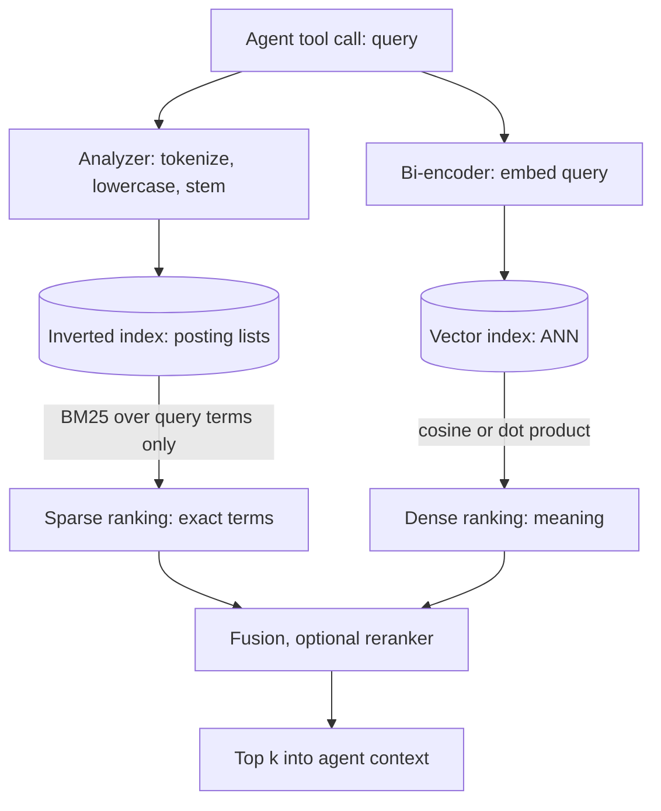

## TL;DR
An agent's search tool is either sparse (BM25: exact about terms, blind to meaning), dense (embeddings:
fluent about meaning, unreliable on exact terms), or both. Agents search for IDs and paraphrases alike, so
production agents usually run both and fuse.

## For agent builders
- **Why it matters for agents.** Agents write their own queries. Some are exact identifiers copied from a
  tool result (ticket ids, error codes, function names); others are paraphrased questions. Each family
  fails on one of those, and the agent cannot tell a retrieval miss from "the answer does not exist".
- **Where it shows up in your stack.** Vector stores for the dense arm; Elasticsearch, OpenSearch or
  LangChain's `BM25Retriever` for the sparse arm; `EnsembleRetriever` or a store's built-in hybrid mode
  to combine them; a LangGraph retrieval node or tool that wraps the result.
- **What you control.** Whether the agent gets one fused search tool or separate keyword and semantic
  tools, the analyzer that tokenizes identifiers, the embedding model, and the eval slices you track.
- **What you can skip.** The training details of SPLADE and ColBERT. Know what each adds and when it is
  worth an extra index.

## Why it exists
- **Term matching set the baseline for decades.** A query word appears in a document or not, and ranking
  functions like BM25 weigh those appearances. It works astonishingly well and is still the baseline.
- **Its hard ceiling is vocabulary mismatch.** "stop billing me" never reaches "cancel your
  subscription"; no term weighting bridges words that do not overlap. Synonym lists and query expansion
  patch cases, not the class.
- **Dense retrieval attacks mismatch directly.** An encoder trained contrastively on question–passage
  pairs maps a query near the passage that answers it regardless of shared words, even across languages.
- **"Embeddings make keywords obsolete" fails, reason 1.** A fixed vector loses rare, high-information
  tokens (part numbers, error codes, clause ids, names), because the model saw them rarely and its
  tokenizer splits them into meaningless pieces. Agents pass exactly these tokens between tools.
- **Reason 2: domain shift.** Dense models degrade when the corpus looks unlike their training data;
  zero-shot benchmarks across heterogeneous domains have repeatedly shown BM25 beating many dense
  retrievers out of domain. Knowing each family's failure mode is what makes the combination work.

## How it works
### Sparse: a vocabulary-dimensional vector
1. Take a vocabulary of V terms (tens of thousands to millions after tokenization and stemming).
2. A document becomes a vector in ℝ^V: entry t is a weight such as its BM25 contribution, zero for the
   vast majority of terms. A query becomes the same kind of vector.
3. The score is their dot product, but nobody materializes the vectors: because they are sparse, it only
   touches terms present in the query.
4. An inverted index maps each term to the documents containing it, so a five-term query reads five
   posting lists, no matter how large the vocabulary.

That is why sparse retrieval runs comfortably on CPU with millisecond latency over tens of millions of
documents. Three properties follow:
- **Exact:** a term matches or not, so "ERR-4012" finds "ERR-4012".
- **Interpretable:** you can read off why a document scored, which helps when debugging an agent trace.
- **Static:** weights depend only on counts (tf, df, length), never on order or meaning, so "bank
  account" and "river bank" share the term "bank".

### Dense: a learned low-dimensional vector
- **Bi-encoder.** Two transformer towers (or one shared tower) map query and passage independently into
  ℝ^d, d typically a few hundred to a few thousand.
- **Training.** Each query is pulled toward its labeled positive passage and pushed from negatives
  (in-batch and hard-mined), with cosine or dot product as the similarity.
- **Result.** The geometry encodes meaning: same-topic passages cluster, and queries land near their
  answers even with zero lexical overlap.

The properties invert:
- **Fuzzy:** matches "stop billing me" to "cancel your subscription".
- **Opaque:** a score of 0.71 has no term-level explanation.
- **Learned:** only as good as its training distribution, and every model change means re-embedding the
  corpus.

### Where each one fails
| Dense failure mode | Why |
|---|---|
| Exact identifiers and rare terms | the tokenizer splits "PX-200" into subword pieces shared with unrelated strings, so a passage about "PX-210" may rank equally |
| Domain shift | a web-QA model sees medical, legal or internal jargon as noise; recall can fall below BM25 without fine-tuning |
| Negation and precise constraints | "flights not via Frankfurt" averages out in a single vector |
| Long passages | one vector per chunk is a blend; one answering sentence among twenty gets diluted |

| Sparse failure mode | Why |
|---|---|
| Vocabulary mismatch | morphology the stemmer misses, synonyms, cross-language queries |
| Short, abstract queries | "why is this slow" shares only stopwords with relevant documents |
| No relevance beyond term statistics | a document mentioning all query words in passing can outrank the one that answers |

### What changes when an agent writes the query
- **Agent queries are often keyword-dense.** Models tend to compress a goal into a few nouns and any ids
  they saw in earlier tool results, which suits the sparse arm.
- **They also paraphrase.** A planning step rewrites the user's words, so the document's wording rarely
  survives, which suits the dense arm.
- **Retries need a different arm.** If the agent re-queries after a miss with near-identical words, the
  same arm misses again; a second arm or a reformulation gives the retry a real chance.

### The same score, different dimensions
Both rank by an inner product between query and document vectors. What differs is who defines the
dimensions:

| | Sparse | Dense |
|---|---|---|
| Dimensions | vocabulary terms fixed in advance by the analyzer | d latent features invented in training |
| Weights | count statistics | learned |
| Nonzeros | only the terms present | every text is nonzero on all of them |
| Which texts interact | only through dimensions they literally share | any two texts |
| Serving | read only the query terms' posting lists | vector index, because every document is a candidate |
| Matching | exact, because a term is a dimension or not | fuzzy, because meaning is smeared across shared dimensions |

### Learned sparse: a middle ground
- **What:** SPLADE (the reference) uses a transformer to predict a weight for every vocabulary term,
  including terms absent from the text (expansion), with a sparsity penalty so most weights stay zero.
- **Keeps:** a sparse vector served from an inverted index, so exact matching and CPU serving.
- **Adds:** learned semantics and synonyms in the weights.
- **Use when** you want one index and cannot run a vector database, at the cost of a neural encoder at
  index and query time.

### Multi-vector dense: another middle ground
- **What:** late-interaction models such as ColBERT keep one dense vector per token and match each query
  token to its most similar passage token.
- **Why it helps:** a rare token keeps its own vector instead of being averaged away, so exact-term
  behavior improves while paraphrase matching survives.
- **Price:** an index many times larger than single-vector dense, which is why it appears more often as a
  reranking stage than as first-stage retrieval (see the reranking lesson).

### Operational differences that decide the choice
| Concern | Sparse (BM25) | Dense (bi-encoder) |
|---|---|---|
| Index cost | CPU, tokenization only | GPU or API call to embed every chunk |
| Query cost | Sub-millisecond to milliseconds on CPU | Embed the query (model call) plus ANN search |
| Index update | Append postings; near-real-time (seconds) | Embed then insert; model change forces full re-index |
| Explainability | Term-level | None without extra tooling |
| Tuning | Analyzer, k1, b, field boosts | Model choice, fine-tuning, chunking |
| Exact tokens | Strong | Weak |
| Paraphrase | Weak | Strong |

- **Freshness matters more for agents.** An agent that writes a document or ticket and then searches for
  it in the next step needs the write visible; sparse indexes refresh in seconds, while the dense arm
  waits on an embedding call.

## Diagram
Trace one agent tool query down both paths: the sparse arm reads only the query terms' posting lists, the
dense arm embeds the query and searches a vector index, and the two ranked lists meet at fusion before
the results go back into the agent's context.



## Examples
### One fused search tool vs two tools for the agent
Two ways to expose retrieval. Separate tools let the model pick, but it will misroute some queries
(an id sent to semantic search); a single tool that runs both arms and fuses is the safer default. The routing regex mirrors the
identifier detector below.

```python
import re

ID = re.compile(r"\b(?:[A-Za-z]{1,5}-?\d{2,}|\d{4,})\b")   # identifier-style tokens

# Option A: two tools, the model chooses (descriptions carry the routing rule)
TOOLS = [
    {"name": "keyword_search",
     "description": "Exact-term search. Use for error codes, ticket ids, SKUs, names.",
     "input_schema": {"type": "object", "properties": {"query": {"type": "string"}},
                      "required": ["query"]}},
    {"name": "semantic_search",
     "description": "Meaning-based search. Use for natural-language questions.",
     "input_schema": {"type": "object", "properties": {"query": {"type": "string"}},
                      "required": ["query"]}},
]

# Option B: one tool, both arms always run, fused by reciprocal rank
def search(query, bm25_search, dense_search, k=5, rrf_k=60):
    sparse, dense = bm25_search(query, 50), dense_search(query, 50)   # lists of doc ids
    w_sparse = 2.0 if ID.search(query) else 1.0                       # lean on exact terms for ids
    scores = {}
    for w, ranked in ((w_sparse, sparse), (1.0, dense)):
        for rank, doc in enumerate(ranked, start=1):
            scores[doc] = scores.get(doc, 0.0) + w / (rrf_k + rank)
    return sorted(scores, key=scores.get, reverse=True)[:k]
```

- **Log which arm contributed** each returned chunk; the trace is how you later see that a wrong answer
  came from a dense-only miss on an identifier.

### BM25 vs a bi-encoder on two query types
Five support passages, two queries: an exact error code that dense retrieval tends to blur, and a
paraphrase that BM25 cannot bridge.

```python
import numpy as np
from rank_bm25 import BM25Okapi
from sentence_transformers import SentenceTransformer

docs = [
    "Error E4012 on the PX-200 means the fuser is overheating; power-cycle the unit.",
    "Error E4021 on the PX-210 indicates a paper jam in tray 2.",
    "To cancel your subscription, open Billing and choose End plan.",
    "Wireless setup: hold the Wi-Fi button for five seconds until the light blinks.",
    "Replacing the toner cartridge on PX-series printers.",
]
queries = ["E4012 PX-200", "how do I stop being billed"]

tok = lambda s: s.lower().replace("-", " ").split()   # the analyzer, shared by index and query
bm25 = BM25Okapi([tok(d) for d in docs])
model = SentenceTransformer("sentence-transformers/all-MiniLM-L6-v2")
D = model.encode(docs, normalize_embeddings=True)

for q in queries:
    sparse = bm25.get_scores(tok(q))
    dense = D @ model.encode(q, normalize_embeddings=True)
    print(f"\nQ: {q}")
    print("  BM25  ->", docs[int(np.argmax(sparse))][:60], np.round(sparse.max(), 2))
    print("  dense ->", docs[int(np.argmax(dense))][:60], np.round(dense.max(), 2))
```

- **Error-code query:** BM25 nails it, because "e4012", "px" and "200" are exact tokens. The dense model
  may confuse the PX-200 and PX-210 passages, whose vectors are nearly identical in shape.
- **Billing paraphrase:** BM25 scores every document at zero (no shared tokens; "billed" is not
  "billing" without a stemmer), so `argmax` just returns the first passage with a score of 0.0. The dense
  model ranks the cancellation passage first.
- **Margins depend on the model,** which is the point: the behavior is structural, the numbers are not.

### Per-retriever ablation: which queries does each arm win?
The decision number is the overlap. Record each retriever's top-k per labeled query (for an agent, the
queries the agent actually issued, pulled from traces), then compare the sets each one gets right (toy
data; plug in your own runs).

```python
import re
# For each labeled query: the gold chunk id and each retriever's top-k ids.
runs = {
    "E4012 PX-200":            {"gold": "d1", "bm25": ["d1", "d5"], "dense": ["d2", "d1"]},
    "PX-210 tray 2 jam":       {"gold": "d2", "bm25": ["d2", "d5"], "dense": ["d1", "d5"]},
    "how do I stop being billed": {"gold": "d3", "bm25": ["d1", "d2"], "dense": ["d3", "d4"]},
    "printer will not join wifi": {"gold": "d4", "bm25": ["d4", "d1"], "dense": ["d4", "d3"]},
}
ID = re.compile(r"\b(?:[A-Za-z]{1,5}-?\d{2,}|\d{4,})\b")   # crude "identifier-style" detector

def hits(arm, k=1):
    return {q for q, r in runs.items() if r["gold"] in r[arm][:k]}

for k in (1, 2):
    b, d = hits("bm25", k), hits("dense", k)
    n = len(runs)
    print(f"k={k} recall bm25={len(b)/n:.2f} dense={len(d)/n:.2f} union={len(b | d)/n:.2f}")
    print("   only bm25 :", sorted(b - d))
    print("   only dense:", sorted(d - b))
print("identifier-style:", [q for q in runs if ID.search(q)])
```

| k | BM25 recall | Dense recall | Union (hybrid ceiling) |
|---|---|---|---|
| 1 | 0.75 | 0.50 | 1.00 |
| 2 | 0.75 | 0.75 | 1.00 |

Each arm wins queries the other loses (BM25 the identifier queries, dense the paraphrase), so a second
arm is worth its cost here; if one set were a subset of the other, it would not be.

## Production patterns
- **Run the ablation on every model or analyzer change.** Keep a labeled query set tagged by slice
  (identifier-style vs natural language), seeded from real agent tool calls, and report recall@k for
  sparse, dense and their union per slice. Monitor the "only BM25" and "only dense" lists; a shrinking
  union gain means the second arm is cost without benefit.
- **Classify agent query traffic from traces.** Tag tool queries that look like identifiers (a regex like
  the one above, tuned to your SKU and ticket formats) and track their share in LangSmith or your own
  tracing. Use it to weight the sparse arm or route those queries; monitor zero-result and re-query rate
  per class.
- **Make the analyzer preserve identifiers.** Index hyphenated codes both whole and split (in
  Elasticsearch, a `word_delimiter_graph` filter with `preserve_original` enabled) and use the same
  analyzer at query time. Monitor exact-identifier queries whose top result does not contain the identifier.
- **Refresh both indexes from one change stream.** Write each document update to sparse and dense indexes
  from the same event, carrying a version or timestamp, so an agent that just wrote a record can find it.
  Monitor the lag between the two; alert when a document is visible in one but not the other beyond your
  freshness target.
- **Pin and version the embedding model.** Store the model name with the dense index and re-embed into a
  new index on any change, switching the agent's tool only after the ablation passes. Monitor recall on
  in-domain jargon slices, where off-the-shelf models fail first.

## Trade-offs
- **Sparse: cheap, incremental, exact on identifiers.** It stalls on paraphrase; the balance flips toward
  dense as soon as users or the agent's planner phrase questions differently from how documents are
  written.
- **Dense: generalizes across wording and languages.** It costs an embedding pass per chunk and per query
  and a full re-index on every model change; it flips back toward sparse when the corpus is huge, churns
  constantly, or the GPU budget is tight.
- **Learned sparse: one CPU-served inverted index with semantics.** It costs a neural encoder at index
  time (and, for most variants, at query time) and some loss versus a strong dense model on pure
  paraphrase tasks.
- **In-domain dense fine-tuning: can overtake BM25 decisively.** It needs labeled query–passage pairs;
  without them an off-the-shelf model on jargon-heavy text may lose to BM25, which needs no labels at all.
- **Two tools vs one fused tool.** Separate tools give the model control and cheaper calls, but the model
  misroutes some queries; one fused tool costs both arms on every call and removes that failure.

## Pitfalls
- **Shipping dense-only because the demo paraphrases worked.** Symptom: tickets like "I searched the
  exact ticket number and got unrelated results", or an agent that cannot find a record by the id another
  tool just returned. Fix: add a sparse arm.
- **Shipping sparse-only with the default analyzer.** Symptom: zero-result or wrong-result queries
  whenever users use synonyms, plurals the stemmer misses, or another language.
- **Evaluating a dense model on the vendor's benchmark, not your corpus.** Symptom: recall collapses on
  internal jargon, acronyms and tables that look nothing like web text.
- **Large chunks for dense retrieval.** Symptom: relevant passages rank below shorter, vaguely related
  chunks, because the long chunk's vector is an average of many topics.
- **Refreshing sparse and dense indexes separately.** Symptom: a document appears in keyword results but
  not semantic results (or vice versa) for hours after an update.

## When to use
Start from the queries, including the ones the agent writes.
- **Sparse as backbone** when users or agents search by identifiers, codes, names and exact phrases, or
  the corpus is technical and churns fast; dense is an add-on.
- **Dense as backbone** when users ask natural-language questions against prose and wording varies;
  sparse protects the exact-match cases.
- **Default to hybrid** with fusion, because most real workloads contain both kinds of queries (covered in
  its own lesson).
- **Decide with data.** Build a labeled query set, measure recall@k for each retriever alone and combined,
  and look at which queries each loses. If BM25's wins are a subset of dense's, a second arm adds cost and
  nothing else; if each wins queries the other loses, the union bounds what hybrid can reach.
- **Interviews:** name each family's structural failure modes, explain why BM25 remains a strong
  baseline, and say what learned sparse models add.

## Role lens
- **Engineer:** Builds both retrievers behind one interface, keeps tokenization consistent between index
  and query, and runs the per-retriever recall ablation on every model or analyzer change.
- **Architect:** Decides which index is the system of record, how both stay consistent on updates, and
  whether GPU embedding cost is justified by measured recall gains over BM25.
- **FDE:** Audits a customer's query logs to classify identifier-style versus natural-language queries,
  then sets expectations for which retriever carries which traffic.

## Check yourself
**Q:** A customer replaced their Elasticsearch keyword search with a vector database and reports that
overall satisfaction rose but a vocal group of power users says search "got dumber". What is happening,
and what would you do before adding anything back?
**A:** The power users are almost certainly issuing identifier-style queries, such as SKUs, error codes,
ticket ids and exact phrases, which dense encoders blur into similar-looking neighbors, while the
majority issue natural-language questions that benefited from semantic matching. I would pull a sample
of queries from both groups and label them, measure recall@k for the dense retriever and a BM25 baseline
on each slice, and expect to see dense winning on paraphrase and losing on exact tokens. The fix is not
to revert but to run both retrievers and fuse their rankings, possibly with a reranker, and to keep the
two indexes refreshed in lockstep so a document is never visible in one and missing from the other. I
would also check tokenization of identifiers in both systems, since hyphen handling alone can decide
those queries.

## Interview questions
### What is the core difference between dense and sparse retrieval?
- **Both score with an inner product;** what differs is who defines the dimensions. Sparse uses vocabulary
  terms fixed by the analyzer with count-based weights; dense uses d latent features learned in training.
- **So sparse is exact and interpretable** but blind to synonyms, while dense matches paraphrases but blurs
  rare tokens and needs re-embedding on every model change.

### Would you give your agent one search tool or separate keyword and semantic tools?
- **Default to one fused tool:** both arms run on every call and fusion handles the mix, so the model
  cannot misroute an identifier query to the dense arm.
- **Split them when evals justify it:** separate tools are cheaper per call and let a capable model choose,
  but measure misrouting on traced agent queries before trusting the tool descriptions to do the routing.

### Why does BM25 still beat many dense retrievers out of domain?
- **Dense models only know their training distribution.** Medical, legal or internal jargon looks like
  noise to a web-QA encoder, so recall can fall below BM25 without fine-tuning.
- **BM25 needs no labels or training,** and exact term matching transfers to any corpus; zero-shot
  benchmarks such as BEIR have repeatedly shown this.

### Your agent cannot find a ticket by the id another tool just returned. Walk through the diagnosis.
- **Classify the failing queries:** identifier-style queries (codes, SKUs, ticket ids) are the classic
  dense failure, because the tokenizer splits them into subword pieces shared with unrelated strings.
- **Check freshness:** if the ticket was just created, the dense arm may not have embedded it yet.
- **Measure per slice and fix:** recall@k for dense, BM25 and their union on labeled identifier and
  natural-language queries; then add a sparse arm with an analyzer that keeps codes whole, fuse, and
  refresh both indexes from one change stream.

### When would you skip the dense arm entirely?
- **When queries are mostly identifiers, codes and exact phrases**, the corpus churns fast, and there is
  no GPU or embedding budget, because BM25 updates in seconds on CPU.
- **Check with the ablation:** if dense's wins on your labeled set are a subset of BM25's, the second arm
  adds cost and nothing else.

### Where do SPLADE and ColBERT sit between the two families?
- **SPLADE (learned sparse)** predicts weights for vocabulary terms, including absent ones, and still serves
  from an inverted index on CPU, at the cost of a neural encoder at index and usually query time.
- **ColBERT (multi-vector dense)** keeps one vector per token so rare tokens are not averaged away, but its
  index is many times larger, so it is often used as a reranking stage.

## Quiz
### Q: Why does a dense bi-encoder often fail on queries containing a rare product code such as "PX-200"?
- [ ] Because vector databases cannot index strings containing digits
- [x] Because the tokenizer splits the code into subword pieces the model saw rarely and in unrelated contexts, so the embedding carries little stable information about it
- [ ] Because cosine similarity ignores numeric tokens by design
- [ ] Because dense models are trained only on lowercase text and codes are uppercase
> A bi-encoder has no entry for "PX-200"; it sees fragments like "px", "-", "200" whose learned meanings
> are diffuse, so passages about PX-200 and PX-210 end up nearly indistinguishable. Sparse retrieval
> matches the literal token and does not have this problem.

### Q: Which statement about BM25 as a baseline is best supported?
- [ ] BM25 is obsolete once any pretrained embedding model is available
- [ ] BM25 beats dense retrieval on paraphrased natural-language questions
- [x] On out-of-domain corpora, off-the-shelf dense retrievers frequently fall below BM25, which needs no training data and matches exact terms
- [ ] BM25 and dense retrieval always return the same top result when both are tuned
> Zero-shot evaluations across heterogeneous domains show BM25 remaining competitive with or ahead of
> many dense models that were trained elsewhere. On paraphrase BM25 is weak, and the two retrievers
> disagree often enough that fusing them improves recall.

### Q: What does a learned sparse model like SPLADE change compared with BM25?
- [ ] It replaces the inverted index with an HNSW graph over sparse vectors
- [x] It uses a transformer to assign learned weights to vocabulary terms, including terms absent from the text, while still producing a sparse vector served from an inverted index
- [ ] It removes the need for a tokenizer by operating on raw characters
- [ ] It converts BM25 scores into probabilities calibrated across queries
> SPLADE keeps the sparse, vocabulary-dimensional representation and inverted-index serving, but learns
> the weights and expands documents with related terms, which addresses vocabulary mismatch without a
> vector database. The index structure is unchanged.

## Use cases & projects
### Use cases
- **Coding and DevOps agents.** Queries copied from tool output (error codes, function names, ticket ids)
  need the sparse arm; "why does login time out" needs the dense one.
- **Customer-support agents.** Paraphrased customer questions favor dense retrieval, while order numbers
  and product SKUs favor exact term matching.
- **Tool design decisions.** Teams decide whether the agent gets one fused search tool or separate
  keyword and semantic tools, based on which query types dominate their traces.
- **Out-of-domain corpora.** Legal, medical or internal jargon where an off-the-shelf embedding model
  underperforms is where a BM25 baseline earns its place.

### Mini project
**Slice an agent's queries by retrieval family (1-2 hours).**
- **Goal:** find which agent query types each retrieval family misses on your own corpus.
- **Steps:** index 1k-5k docs in both a BM25 retriever and a vector store; write 30 queries split into
  identifier lookups, paraphrased questions and mixed queries, each with one labeled relevant doc;
  measure recall@5 per family per slice; expose the better setup as tools to a small agent and run the
  mixed slice through it.
- **Done when:** you have a recall table per slice showing where each family fails, and a decision on
  one fused tool versus two separate tools backed by those numbers.
