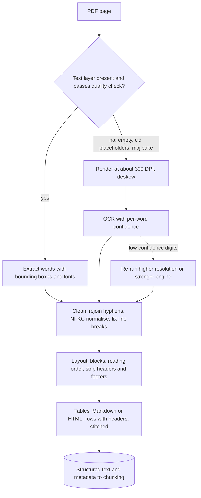

## TL;DR
Everything an agent's search or read tool returns from a PDF, scan or office file was produced by a
parser: OCR, reading order, header removal and tables tied to their headers. The agent cannot find or
read text the parser garbled, reordered or flattened.

## For agent builders
- **Why it matters for agents.** Agents act on numbers they read: a refund window, a price, a limit. A
  table flattened or a digit misread by OCR becomes a wrong tool call or a wrong commitment to a customer,
  and the agent's trace shows the "right" document cited, so nobody suspects the parser.
- **Where it shows up in your stack.** Ingestion for the agent's knowledge base (LangChain document loaders
  such as `PyPDFLoader`, LlamaIndex readers, Unstructured, Docling, LlamaParse or a managed service), and
  at runtime when a user uploads a file and the agent calls a `read_document`-style tool on it.
- **What you control.** Per-page OCR routing, table serialisation, which metadata (page, `source`, OCR
  confidence) travels into chunks and tool results, and a parser golden set in CI.
- **What you can skip.** OCR model internals and layout-model training. Pick tools by measuring them on
  your ugliest pages.

## Why it exists
- **A PDF is drawing instructions, not text.** Place these glyphs at these coordinates, draw this line.
  There is no "paragraph", "column" or "table cell", sometimes not even words: characters may be placed
  one by one with spaces inferred from gaps. A scanned PDF is a photograph per page with no text layer.
- **Naive `extract_text()` then chunking fails predictably.** Two-column papers interleave lines across
  columns. A running header ("ACME Corp Confidential, Page 7") repeats hundreds of times and pollutes
  retrieval. Scanned pages yield empty strings, so whole documents silently vanish from the index.
- **Tables are the worst case.** "30 days" becomes a token in a stream of numbers, detached from the row
  label "Refund window" and the column header "Enterprise plan", so no query matches it meaningfully and
  the model cannot interpret it even if retrieved.
- **The failures are invisible downstream.** The embedding model embeds garbage, the vector store indexes
  it, and the symptom is a wrong answer that looks like a retrieval or model problem.
- **Fix it at the source.** Parsing errors are among the most common root causes in RAG failure analysis,
  and they are cheapest to fix where they happen.

## How it works
### 1. Triage each page
- **Decide per page, not per file**, *because* mixed PDFs (a digital contract with scanned signature
  pages) are common.
- **Text layer with a plausible character count:** extract it directly; it is exact and cheap.
- **Empty, tiny or garbage layer** (some scanners add a poor OCR layer): render the page to an image and OCR it.
- **"Plausible" needs a quality check, not a length check.** Fonts embedded without a proper
  character-to-Unicode mapping extract as placeholders such as `(cid:42)` or as mojibake, and an old
  scanner's OCR layer can be riddled with errors.
- **Cheap quality signals:** share of tokens that are dictionary words in the expected language; share of
  replacement or placeholder characters; whether the text contains words visible in a rendered thumbnail.
  Pages that fail go to OCR even though a text layer exists.

### 2. Extract with coordinates
- **Extract words or characters with bounding boxes and font information**, not just a string.
- **Coordinates make layout recovery possible**; font size and weight are the main signals for headings.

### 3. OCR for image pages
1. **Detection** finds text regions and lines.
2. **Recognition** converts each region to characters, with a confidence score.

- **Quality depends heavily on input:** render at a sufficient resolution (around 300 DPI is the commonly
  recommended setting for Tesseract), deskew, and set the correct language.
- **Keep per-word confidence**, *because* low-confidence regions are where numbers get corrupted ("0" vs
  "O", "1" vs "l"); flag them or route them to a stronger model.
- **Measure character error rate** against a hand transcription:
  `CER = (substitutions + deletions + insertions) / characters in the reference`, the edit distance
  normalised by length. Word error rate is the same at word level.
- **Measure numbers separately**, because a page can have a low overall CER and still corrupt the one
  digit in "30 days" that the answer depends on.

### 4. Clean the text stream
| Artifact | Fix |
|---|---|
| Words hyphenated at line ends ("refund-" / "able") | rejoin, or neither half matches a query |
| Ligature glyphs (fi, fl) as single unusual characters | Unicode normalisation |
| Hard line breaks inside paragraphs | turn into spaces |
| Visually identical but different characters | normalise Unicode (for example NFKC) |

- **Why normalise:** both BM25 and embeddings see the bytes, not the glyphs.

### 5. Layout analysis
- **Group words into labelled blocks:** title, heading, paragraph, list, table, figure, caption, header, footer.
- **Rule-based:** cluster by x-coordinates to find columns and recursively cut the page along whitespace
  (XY-cut). **Learned layout models** detect regions from the page image and handle irregular layouts better.
- **Order blocks for reading:** column by column, top to bottom.
- **Remove running headers and footers** by detecting text that repeats at the same position across pages.
- **Keep the heading hierarchy as metadata**, *because* chunking and retrieval both benefit from knowing
  "this paragraph is under 4.2 Refunds".

### 6. Tables
- **Two parts:** detect the table region, then recognise its structure (rows, columns, merged and spanning
  cells, multi-row headers).
- **Ruled tables** can be recovered from drawn lines; **borderless tables** need alignment heuristics or a
  learned structure model.
- **Output Markdown or HTML** so structure survives.
- **Also serialise each row with its headers** ("Plan: Enterprise; Refund window: 30 days"), *because* a
  row read in isolation must still be meaningful once chunked.
- **Large numeric tables** are often better loaded into a database and queried with SQL than embedded at all.
- **Stitch tables that continue across pages.** The continuation usually repeats or omits the header row;
  without stitching the second page's rows lose their column labels.

### 7. Figures and non-PDF formats
- **Figures:** charts and diagrams carry content no text extractor sees. At minimum keep the caption; where
  the figure matters, generate a description with a VLM and mark it as generated.
- **Office and web formats (DOCX, PPTX, HTML, XLSX)** are easier because headings, lists and table cells
  are explicit in the file. Parse their structure directly rather than converting to PDF and re-inferring it.
- **Spreadsheets** are tables already and usually belong in the SQL path.

### 8. Vision-language models as parsers
- **What it does well:** a VLM given a page image can transcribe it to Markdown, including tables and
  reading order, and often copes with layouts that break rule-based pipelines.
- **The costs:** per-page inference cost and latency.
- **The specific risk:** the model *generates* plausible text rather than transcribing, silently
  normalising a value or filling a smudged digit.
- **Use it where layouts are complex**, and validate numbers against the text layer or OCR output where possible.

### Tools
| Category | Examples |
|---|---|
| Text-layer libraries | pdfplumber, PyMuPDF, pdfminer.six |
| OCR engines | Tesseract and cloud OCR |
| Pipelines bundling layout and tables | Unstructured, Docling |
| Managed services | AWS Textract, Azure AI Document Intelligence, Google Document AI |

- **They differ mainly in layout and table quality on *your* documents**, so compare them on a sample of
  your hardest pages.
- **Agent frameworks wrap these, they do not replace them.** LangChain and LlamaIndex loaders call one of
  the libraries or services above; the default loader is often plain text-layer extraction, so check what
  yours does on scans and tables.

### 9. Parsing inside an agent
- **Runtime parsing is a tool.** When a user attaches a file mid-conversation, the agent calls a read tool
  that parses it on the spot, so parse latency and cost land inside the agent's step budget.
- **Return structure, not a blob.** Pages as Markdown with page numbers, tables as Markdown plus header-tagged
  rows, so the agent can cite "page 4" and read the right cell.
- **Pass parse quality to the model.** Mark OCR pages and low-confidence numeric tokens in the tool result,
  so the agent can say "the scan is unclear" or call a verification tool instead of stating a guess.
- **Bound the output.** A 300-page upload cannot be returned whole; return a page index and let the agent
  request page ranges, or index the file and expose it through the search tool.

## Diagram
Each page is triaged on its own, then text from either path goes through the same cleaning, layout and
table steps before anything is chunked.



## Examples
### Agent scenario: a read tool that flags shaky digits
The tool the agent calls on an uploaded PDF. It returns per-page text with `source`, and for OCR pages it
lists low-confidence words containing digits, so the agent can hedge or verify instead of quoting them.

```python
import pdfplumber, pytesseract
from pytesseract import Output

def read_document(path: str, pages: list[int] | None = None, min_conf: float = 80.0) -> dict:
    """Tool: read pages of an uploaded PDF. Returns text per page plus parse-quality flags."""
    out = []
    with pdfplumber.open(path) as pdf:
        total = len(pdf.pages)
        wanted = pages or list(range(1, min(total, 10) + 1))            # never dump 300 pages at once
        for n in (p for p in wanted if 1 <= p <= total):
            page = pdf.pages[n - 1]
            text, source, shaky = page.extract_text() or "", "text-layer", []
            if len(text.strip()) < 50:                                   # scanned page: OCR it
                img = page.to_image(resolution=300).original
                d = pytesseract.image_to_data(img, output_type=Output.DICT)
                words = [(w, float(c)) for w, c in zip(d["text"], d["conf"]) if w.strip()]
                text, source = " ".join(w for w, _ in words), "ocr"
                shaky = [w for w, c in words if c < min_conf and any(ch.isdigit() for ch in w)]
            out.append({"page": n, "source": source, "text": text[:4000],
                        "truncated": len(text) > 4000, "low_conf_numbers": shaky})
    return {"total_pages": total, "pages": out}                         # agent asks for more by range

# Tool description shown to the model (plain words):
# "Reads pages of the uploaded PDF. If low_conf_numbers is non-empty, do not state those values as
#  fact: say the scan is unclear or ask the user to confirm."
```

| Uploaded 12-page scanned lease (illustrative) | Without flags | With flags |
|---|---|---|
| OCR reads the deposit as "3,5O0" | agent quotes a garbled or guessed figure | `low_conf_numbers: ["3,5O0"]`, agent asks the user to confirm |
| Pages returned on first call | all 12, about 40k tokens | first 10, capped at 4,000 characters each |
| Citation | "the lease says" | "page 3 (scanned, unclear)" |

The threshold `min_conf=80.0` and the page cap are illustrative; tune them on pages you have labelled.

### Per-page parser with OCR fallback and row-wise tables
Use the text layer when present, fall back to OCR, and serialise tables row by row with their headers.

```python
import pdfplumber, pytesseract

def parse_pdf(path: str, min_chars: int = 50) -> list[dict]:
    out = []
    with pdfplumber.open(path) as pdf:
        for i, page in enumerate(pdf.pages, start=1):
            text = page.extract_text() or ""
            source = "text-layer"
            if len(text.strip()) < min_chars:                 # scanned or empty layer
                img = page.to_image(resolution=300).original  # PIL image
                text = pytesseract.image_to_string(img)
                source = "ocr"
            out.append({"page": i, "type": "text", "source": source, "text": text})
            for table in page.extract_tables():             # text layer only: [] on scans
                if not table:
                    continue
                header, *rows = table                         # cells may be None
                for row in rows:
                    cells = [f"{h or '?'}: {v}" for h, v in zip(header, row) if v]
                    out.append({"page": i, "type": "table_row", "source": "text-layer",
                                "text": "; ".join(cells)})
    return out

# A pricing table row becomes:
# {"page": 4, "type": "table_row", "source": "text-layer",
#  "text": "Plan: Enterprise; Refund window: 30 days; Seats: Unlimited"}
```

What this deliberately leaves out, to add once a sample of your real documents shows you need it:
- **No reordering** of multi-column pages, **no header stripping**, **no merged header cells**.
- **`extract_tables` only works on text-layer pages.**
- **Each table is indexed twice:** `extract_text()` already includes the table's cells as a flattened
  stream. A production version crops table regions out of the page (for example with `page.filter` or
  `outside_bbox`) before extracting the prose.

### Measuring OCR damage and text-layer quality
Runnable with the standard library. It shows why overall CER hides digit errors, and how to reject a
text layer full of `(cid:NN)` placeholders before it reaches the index.

```python
import re, unicodedata

def cer(ref: str, hyp: str) -> float:
    """(substitutions + deletions + insertions) / len(ref), via Levenshtein distance."""
    prev = list(range(len(hyp) + 1))
    for i, r in enumerate(ref, 1):
        cur = [i]
        for j, h in enumerate(hyp, 1):
            cur.append(min(prev[j] + 1, cur[j - 1] + 1, prev[j - 1] + (r != h)))
        prev = cur
    return prev[-1] / max(len(ref), 1)

def digits(s: str) -> str:
    return "".join(ch for ch in s if ch.isdigit())

ref = "Refund window: 30 days for the Enterprise plan, billed annually."
hyp = "Refund window: 3O days for the Enterprise plan, billed annually."   # OCR read 0 as O
print(f"CER {cer(ref, hyp):.3f}  digit CER {cer(digits(ref), digits(hyp)):.2f}")
# CER 0.016  digit CER 0.50  -> looks fine overall, but half the digits are wrong

def layer_is_usable(text: str, vocab: set, min_word_share: float = 0.6) -> bool:
    text = unicodedata.normalize("NFKC", text)        # ligature glyphs become plain letters
    if text.count("(cid:") > 3 or text.count(chr(0xFFFD)) > 3:   # U+FFFD replacement character
        return False                                  # broken font map: send the page to OCR
    words = re.findall(r"[a-z]+", text.lower())
    return bool(words) and sum(w in vocab for w in words) / len(words) >= min_word_share

vocab = {"refund", "window", "days", "for", "the", "enterprise", "plan", "billed", "annually"}
print(layer_is_usable(ref, vocab))                                    # True
print(layer_is_usable("(cid:42)(cid:17)(cid:9)(cid:3) x", vocab))     # False
```

| Measurement on the sample sentence | Value | Reading |
|---|---|---|
| Overall CER | 0.016 | one wrong character out of 64: "good OCR" |
| Digit CER | 0.50 | one of two digits wrong: the answer is wrong |

The thresholds (`min_word_share=0.6`, more than 3 placeholders) are illustrative; tune them on pages you
have labelled by eye.

## Production patterns
- **Per-page routing with a quality gate.** For every page, score the text layer (dictionary-word share,
  `(cid:` and replacement-character counts) and send failures to OCR, recording `source` per page as in
  the parser above. Monitor the OCR share per document type; a jump usually means a new scanner or broken
  font embedding upstream.
- **Keep OCR confidence and act on it.** With Tesseract, `pytesseract.image_to_data(...)` returns
  per-word confidences; flag pages whose low-confidence words include digits and re-run them at higher
  resolution or with a stronger engine. Monitor the share of low-confidence numeric tokens.
- **Crop tables out before extracting prose.** Locate tables with pdfplumber's `page.find_tables()`, take
  each table's bounding box, extract prose from `page.outside_bbox(...)`, and index rows separately with
  headers. Monitor duplicate-chunk rate between prose and table rows.
- **A parser golden set in CI.** Keep 20-50 of your ugliest pages (scans, two-column, borderless and
  multi-page tables) with hand transcriptions; compute CER, digit CER and table cell accuracy on every
  parser or library upgrade, and block the release on regressions.
- **Strip repeated headers and footers by position.** Compare the top and bottom bands of each page across
  the document and drop text that recurs at the same position on most pages, keeping the page number as
  metadata for citations. Monitor how many chunks match the company name or "Confidential".
- **Parse metadata into agent tool results.** Store `page`, `source` and an OCR-confidence flag on every
  chunk at ingestion and return them from the agent's search tool, so answers cite pages and the agent can
  hedge on scanned content. Monitor how often agents cite OCR-sourced chunks for numeric answers.

## Trade-offs
- **Text layer vs OCR.** Text-layer extraction is exact, fast and cheap when the font encoding is sound,
  but only for born-digital PDFs. On scans or broken layers it returns nothing, so per-page detection and
  OCR fallback are mandatory for mixed corpora.
- **Rule-based vs learned layout.** Column clustering and XY-cut are deterministic and cheap, yet fail on
  irregular layouts like brochures and forms, where learned layout models or VLMs pay for their cost.
- **VLM transcription vs exact numbers.** VLMs handle hard layouts and tables well, but cost per page and
  can hallucinate or normalise values. The trade flips toward OCR plus rules when exact numbers matter and
  layouts are simple.
- **Row-wise serialisation vs index size.** Rows become retrievable on their own, at the cost of more
  chunks and repetition. For large analytical tables, loading them into SQL is cheaper and more accurate
  than embedding, and an agent can then answer with a `sql_query` tool instead of reading cells.
- **Offline ingestion vs runtime parsing in the agent.** Parsing at ingestion can use slow, expensive
  pipelines and a golden set; parsing a user's upload at runtime must fit the step's latency budget. Flip
  to background indexing when uploads are large or reused across sessions.

## Pitfalls
- **Using one `extract_text()` call for everything.** Symptom: scanned documents produce empty chunks, so
  whole contracts are missing from search with no error raised.
- **Ignoring reading order.** Symptom: retrieved chunks whose sentences jump between two columns and that
  match queries poorly despite containing the right words.
- **Leaving running headers and footers in.** Symptom: many unrelated chunks score high for the company
  name or "Confidential" and crowd out real results.
- **Flattening tables to a stream of values.** Symptom: the model cites the right chunk but reads the wrong
  cell, such as quoting the Basic plan's price for the Enterprise plan.
- **Trusting a text layer because it is non-empty.** Symptom: chunks full of `(cid:NN)` placeholders or
  mojibake that embed to near-identical vectors and never match any query.
- **Not stitching tables that span pages.** Symptom: correct answers for rows on a table's first page and
  wrong or missing answers for rows that fall on its continuation.
- **Never evaluating the parser.** Problems surface only as downstream wrong answers, whereas a sample of
  pages compared against hand transcriptions would show them immediately.
- **Trusting the framework's default loader.** Symptom: an agent built on a tutorial loader says "the
  document does not mention it" for scanned uploads. Fix: check which library the loader uses, add per-page
  OCR routing, and test it on scans before launch.
- **Returning a whole parsed document as one tool result.** Symptom: one upload fills the context window,
  the agent loses earlier instructions, or the call fails. Fix: page ranges, a page index, or indexing the
  upload behind the search tool.

## When to use
- **Verify parsing first** on any new corpus, before choosing chunk sizes or embedding models.
- **Sample every document type** (digital, scanned, multi-column, table-heavy, forms) and inspect the
  output by eye.
- **Measure:** character error rate on OCR pages and cell accuracy on tables.
- **Use plain text-layer extraction** when documents are clean and born-digital; add OCR, layout models or
  VLMs only where the sample shows failures.
- **For agents that take uploads:** add a runtime read tool with page ranges and parse-quality flags, and
  include scanned and table-heavy uploads in the agent eval set.
- **Interviews:** "I would look at the parsed text first" often separates experienced RAG builders from
  tutorial-level ones.

## Role lens
- **Engineer:** Builds the per-page triage, OCR fallback, header stripping and table serialisation, and keeps
  page numbers and bounding boxes as metadata for citations.
- **Architect:** Chooses between in-house parsing, open-source pipelines and managed document services based
  on document mix, data residency, cost per page and the accuracy measured on representative samples.
- **FDE:** Collects the customer's ugliest real documents on day one (faxed forms, scanned annexes, nested
  tables) because they decide the parser and the timeline more than any model choice does.

## Check yourself
**Q:** A finance customer's RAG system answers questions from quarterly reports, and numeric answers are
wrong about a third of the time even when the cited page is correct. How do you diagnose and fix it?
**A:** The right page is retrieved, so the loss is in how the content was parsed or read. I would open the
parsed text for those pages: likely the tables were flattened so values lost their row and column headers,
or OCR corrupted digits on scanned pages. Fixes: detect tables and keep their structure as Markdown or
HTML, serialise rows with headers for retrieval, check OCR confidence and re-run low-confidence regions at
higher resolution or with a stronger engine, and possibly load financial tables into a database for SQL
lookups. I would build a small eval of numeric questions with known answers to confirm the fix, and avoid
VLM transcription for numbers unless outputs are cross-checked.

## Interview questions
### Why is document parsing a retrieval problem and not just a preprocessing detail?
- **A PDF is drawing instructions, not text:** glyphs at coordinates, with no paragraphs, columns or table
  cells, and a scanned page has no text layer at all.
- **Every later stage sees only the parser's output:** the embedding model embeds garbage, the vector store
  indexes it, and the symptom looks like a retrieval or model problem.
- **So fix it at the source:** parsing errors are among the most common root causes in RAG failure analysis
  and cheapest to fix where they happen.

### Your agent says a contract "does not mention" a clause that is in it, and ingestion logged no errors. How do you debug it?
- **Check the trace first:** did the search tool return chunks from that contract at all? If none exist,
  the loss is at parsing, not in the agent's query.
- **Suspect empty text layers:** scanned pages make `extract_text()` return empty strings, so documents
  silently vanish; check chunk counts and character counts per page for those files.
- **Suspect broken font maps:** a non-empty layer full of `(cid:42)` placeholders or mojibake embeds to
  near-identical vectors that never match a query.
- **Fix:** triage per page with a quality check (dictionary-word share, placeholder counts), route failures
  to OCR, and record `source` per page so the OCR share per document type is visible.

### When would you use a vision-language model as the parser, and when would you avoid it?
- **Use it for complex layouts:** brochures, forms and irregular tables that break rule-based column
  clustering and XY-cut.
- **Avoid it where exact numbers matter on simple layouts:** it generates rather than transcribes, so it can
  silently normalise a value or fill a smudged digit, and it costs per-page inference and latency.
- **If you use it,** validate numbers against the text layer or OCR output and mark generated figure
  descriptions as generated.

### OCR on a sample page scores a CER of 0.016. Is that good enough?
- **Not on its own:** in the sample sentence that is one wrong character out of 64, but the wrong character
  is the "0" in "30 days", so digit CER is 0.50 and the answer is wrong.
- **Measure numbers separately** and keep per-word confidence, because low-confidence regions are where "0"
  becomes "O" and "1" becomes "l".
- **Inputs matter:** render around 300 DPI for Tesseract, deskew and set the correct language before
  blaming the engine.

### How would you choose between an open-source stack and a managed document service?
- **Benchmark on your own ugliest pages:** tools such as pdfplumber plus Tesseract, Docling or Unstructured,
  and AWS Textract or Azure AI Document Intelligence differ mainly in layout and table quality on *your*
  documents, so compare them on a hand-transcribed golden set.
- **Score what breaks answers:** CER, digit CER and table cell accuracy, not a single overall score.
- **Then weigh the constraints:** cost per page, latency, and data residency, since a managed service sends
  pages outside your boundary; keep the golden set in CI to catch regressions on upgrades.

### Users upload PDFs mid-conversation and your agent must answer from them. How do you design the read tool?
- **Parse per page with OCR fallback** and return Markdown text, tables with headers, page numbers and
  `source`, so the agent can cite and read cells correctly.
- **Bound the output:** return a page index and let the agent request page ranges, or index large uploads
  in the background and expose them through the search tool, because one 300-page result would flood the context.
- **Surface parse quality:** flag OCR pages and low-confidence digits in the result and instruct the agent
  not to state flagged values as fact; add scanned uploads to the agent eval set.

## Quiz
### Q: Why should OCR fallback be decided per page rather than per file?
- [ ] OCR engines can only process one page at a time
- [x] Many PDFs mix born-digital pages with scanned ones, so a file-level check would miss image-only pages
- [ ] Text-layer extraction is slower than OCR on large files
- [ ] Per-page OCR improves the embedding model's accuracy
> A contract may be digital except for scanned signature pages or annexes. A file-level check sees text and
> skips OCR, so those pages silently produce empty chunks and vanish from retrieval.

### Q: What is the main reason to serialise each table row together with its column headers?
- [ ] It reduces the number of chunks in the index
- [ ] It lets the embedding model skip numeric tokens
- [x] A row retrieved on its own is only interpretable if it carries the labels that give its values meaning
- [ ] It is required for Markdown rendering in the UI
> After chunking, a row like "30 | 10 | Unlimited" is meaningless without "Refund window", "Seats" and the
> plan name. Repeating headers makes the row both matchable by queries and readable by the model.

### Q: Which is the most specific risk of using a vision-language model to transcribe document pages?
- [ ] It cannot handle multi-column layouts
- [ ] It ignores tables entirely
- [x] It may produce fluent text that differs from the page, such as an altered or invented number
- [ ] It always requires a text layer to be present
> VLMs often handle complex layouts better than rule-based tools, but they generate rather than copy, so a
> smudged or unusual value can be silently changed. Cross-checking against OCR or the text layer catches this.

## Use cases & projects
### Use cases
- **Agents answering from policy and pricing PDFs.** Tables parsed with their row and column headers let
  the agent quote "Refund window, Enterprise plan: 30 days" instead of a stray number.
- **User-uploaded files at runtime.** A `read_document`-style tool that triages pages and OCRs scans
  stops the agent from reading empty strings and claiming the file says nothing.
- **Scanned contracts and forms.** Per-page OCR routing and OCR confidence in tool results let the agent
  flag low-confidence values for a human instead of acting on them.
- **Knowledge-base ingestion.** Removing running headers and fixing reading order keeps two-column and
  templated documents retrievable by the agent's search tool.

### Mini project
**Build a parser golden set and a page-triage read tool (2-3 hours).**
- **Goal:** make an agent's `read_document` tool return correct text and tables from your ugliest 10 pages.
- **Steps:** collect 10 hard pages (two-column, scanned, a table, a running header, a mixed digital and
  scanned file); write the expected text or table for each; build a tool that checks each page's text
  layer, OCRs empty or garbage pages, strips repeated headers and serialises tables with their headers;
  return page number, `source` and an OCR flag in each result; ask an agent 10 questions whose answers
  sit in those pages.
- **Done when:** a CI-style script scores each page against its expected output, the agent answers the
  table questions with the right numbers, and you have one before-and-after example of a value that
  naive `extract_text()` got wrong.
