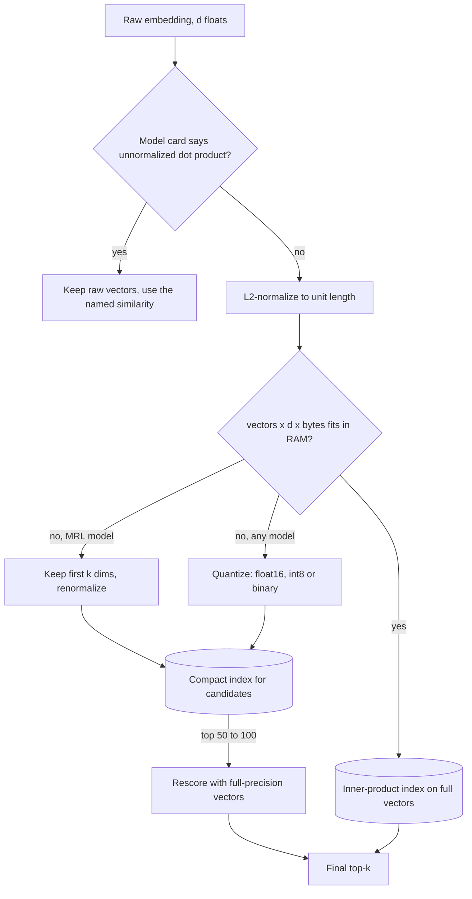

## TL;DR
Dimension is how many floats a vector holds; it sets storage and compare cost linearly.
Normalizing to unit length makes cosine, dot product and Euclidean rank identically and stops long
chunks winning on norm. Matryoshka truncation and quantization trade a little recall for much memory.

## Why it exists
- **Every vector costs `d × bytes_per_float`.** At float32 a 1536-dimensional embedding is 6,144 bytes,
  so ten million chunks are about 61 GB of raw vectors before index overhead, and HNSW wants them
  resident in RAM.
- **Query cost scales the same way.** Every candidate comparison is `d` multiply-adds. Dimension links
  the model choice to the infrastructure bill, and until Matryoshka-style training it was fixed the
  moment a model was chosen.
- **Raw norms carry noise.** They vary with input length, token frequency and how "sure" the network
  happens to be. A raw dot product mixes meaning with magnitude, so a long chunk can outscore a short,
  precisely relevant one on sheer norm.
- **Normalize once, then dot product everywhere.** Cosine divides magnitude out; normalizing at write time
  gets cosine through the plain dot product, the fastest operation an ANN index runs.
- **Skipping it is a subtle bug, not an error.** The index metric and the ranking you expected disagree,
  so the "nearest" neighbours are not the ones you wanted and thresholds mean nothing.

## How it works
### Three metrics, one ranking
For vectors **a** and **b**: dot product `a·b`; cosine `a·b / (‖a‖‖b‖)`; Euclidean distance `‖a−b‖`.
When both are unit length, cosine *is* the dot product, and

```
‖a−b‖² = ‖a‖² + ‖b‖² − 2a·b = 2 − 2a·b
```

- **So Euclidean distance is a monotone function of the dot product**, and all three give the same
  order. That is why many providers return normalized vectors, and why "which metric" is only a real
  question for unnormalized ones.
- **Practical rule:** normalize at write time, store unit vectors, and build the index on inner product.
  It saves a division per comparison, and pgvector's `<#>` (negative inner product), `<=>` (cosine
  distance) and `<->` (L2) then agree on order.
- **The exception:** a model trained to be scored with an *unnormalized* dot product (the original DPR
  is one; some sentence-transformers checkpoints say so on their model card). Its norm is part of the
  learned score, so normalizing changes the ranking. Use the similarity the model card names.

### Where the norm comes from and why to discard it
- **Encoders are not trained to make norms meaningful.**
- **Contextual embeddings are anisotropic:** they occupy a narrow cone, so the cosine between two
  unrelated sentences is well above zero and differs by model.
- **So absolute values are model-specific.** A score of 0.8 is "related" under one model and "noise
  floor" under another. Rankings are portable, thresholds are not; calibrate any threshold per model on
  labelled pairs.

### What dimension buys
- **Dimensions are capacity:** enough axes to separate the concepts the model was trained on.
- **Returns diminish quickly.** Doubling `d` does not double recall, while storage and compare time grow
  linearly and ANN graph memory grows with them.

| Size | Typical models |
|---|---|
| 384 | MiniLM-class |
| 768 | BERT-base-derived, such as E5-base and BGE-base |
| 1024 | large variants |
| 1536 and 3072 | OpenAI's text-embedding-3 small and large |

### Matryoshka representation learning
- **Standard training spreads information across all dimensions**, so truncating discards a random slice
  of meaning and recall collapses.
- **MRL applies the loss to nested prefixes** (the first 64, 128, 256, … dimensions), pushing the most
  important information to the front.

1. Keep the first `k` dimensions.
2. Renormalize, which is mandatory because a prefix of a unit vector is shorter than one.
3. Search, keeping full vectors on disk to rescore the top candidates.

OpenAI's text-embedding-3 models expose this as a `dimensions` request parameter, and several open
models (nomic-embed-text v1.5 among them) support it.

### Quantization: fewer bytes per dimension
Orthogonal to truncation.

| Scheme | Memory vs float32 | Recall note |
|---|---|---|
| float16 | half | essentially no change |
| int8 scalar | a quarter | small loss |
| binary (one bit, Hamming distance) | up to 32× smaller | surprisingly good on high-dimensional normalized vectors with full-precision rescoring |
| product quantization (IVF-PQ in FAISS and Milvus) | further, sub-vectors become codebook ids | needs rescoring for hard queries |

- **Normalization helps scalar quantization and PQ**, because unit vectors have bounded coordinates and
  the quantizer's range is predictable.
- **Binary keeps only the sign**, so for it the norm is irrelevant.

### PCA and friends
PCA fitted on your own corpus can drop dimensions for any model, Matryoshka-trained or not. It must be
fitted on representative data and applied identically to queries; it is a weaker, model-agnostic
version of the same idea.

## Diagram
The write path normalizes once so one inner-product index serves every metric; the branches show the
memory levers you pull when `vectors × d × bytes` does not fit.



## Examples
### Norm bias, the metric identity and truncation in numpy
A query genuinely closest to document 1, and a document 3 that is only weakly related but has an
eight-times larger norm. Raw dot product ranks document 3 first; cosine, and every metric after
normalization, rank document 1 first. The last block shows truncate-then-renormalize and the storage
arithmetic.

```python
import numpy as np

rng = np.random.default_rng(0)
d, n = 1536, 5
X = rng.normal(size=(n, d))                      # five "document" vectors
q = X[1] + 0.5 * rng.normal(size=d)              # a query genuinely closest to doc 1
X[3] = 8.0 * (0.2 * X[1] + rng.normal(size=d))   # doc 3: weakly related, 8x larger norm

dot = X @ q
cos = dot / (np.linalg.norm(X, axis=1) * np.linalg.norm(q))
print("raw dot ranking:", np.argsort(-dot))      # [3 1 4 2 0]  magnitude wins
print("raw cos ranking:", np.argsort(-cos))      # [1 3 4 2 0]  direction wins

Xn = X / np.linalg.norm(X, axis=1, keepdims=True)
qn = q / np.linalg.norm(q)
dot_n = Xn @ qn
l2 = np.linalg.norm(Xn - qn, axis=1)
assert np.allclose(l2**2, 2 - 2 * dot_n)        # unit vectors: ||a-b||^2 = 2 - 2 a.b
print(np.argsort(-dot_n), np.argsort(l2))        # identical orderings

k = 256                                          # Matryoshka-style truncation: keep a prefix, renormalize
Xk = Xn[:, :k] / np.linalg.norm(Xn[:, :k], axis=1, keepdims=True)
qk = qn[:k] / np.linalg.norm(qn[:k])
print("256-dim ranking:", np.argsort(-(Xk @ qk)), "storage ratio:", k / d)
print("10M x 1536 x 4 bytes =", 10_000_000 * 1536 * 4 / 1e9, "GB")   # 61.44 GB, before the index
```

With random vectors the truncation keeps the order only because the signal is spread evenly; for a real
model the prefix retains the order only if the model was trained Matryoshka-style.

### Worked sizing: ten million chunks at 1536 dimensions
Raw vector bytes only; HNSW links, payloads and chunk text come on top.

| Configuration | Bytes per vector | 10M vectors |
|---|---|---|
| float32, full | 6,144 | 61.44 GB |
| float16, full | 3,072 | 30.72 GB |
| int8, full | 1,536 | 15.36 GB |
| MRL prefix 512, float32 | 2,048 | 20.48 GB |
| binary, full | 192 | 1.92 GB |

Pick by measuring recall@10 of each row against the float32 baseline, then take the cheapest row that
meets the target.

### Binary search with full-precision rescoring in pgvector
Unit vectors in a `vector(1536)` column; a Hamming-distance index over the binary form picks 100
candidates, and the exact inner product reorders them.

```sql
CREATE TABLE chunks (id bigserial PRIMARY KEY, body text, embedding vector(1536));

-- unit vectors, so inner product ranks the same as cosine
CREATE INDEX ON chunks USING hnsw (embedding vector_ip_ops);

-- or a much smaller index over the sign bits
CREATE INDEX ON chunks USING hnsw ((binary_quantize(embedding)::bit(1536)) bit_hamming_ops);

SELECT id FROM (
  SELECT id, embedding FROM chunks
  ORDER BY binary_quantize(embedding)::bit(1536) <~> binary_quantize($1)
  LIMIT 100
) c
ORDER BY c.embedding <#> $1      -- negative inner product: ascending = most similar
LIMIT 10;
```

## Production patterns
- **Normalize inside the shared embed function** — apply L2 normalization (for sentence-transformers,
  `normalize_embeddings=True`) in the one function both index and query paths call. Add a test that a
  stored vector has norm 1 within tolerance, and monitor the norm of a sample of query vectors.
- **Inner-product index on unit vectors** — build the ANN index with the inner-product operator class
  (pgvector `vector_ip_ops`, or the dot-product metric in your store) once vectors are normalized. Monitor
  for scores above 1.0, which signal an unnormalized write.
- **Truncate via the provider, not by hand** — for OpenAI text-embedding-3, request a smaller vector with
  the `dimensions` parameter; for open MRL models, slice the prefix and renormalize. Record the
  dimension in index metadata and monitor recall@k against the full-dimension baseline.
- **Quantize with rescoring** — keep a compact index (binary or int8) for candidate generation and full
  vectors for reordering the top 50 to 100. Monitor recall@10 versus float32 and the extra rescoring
  latency.
- **Mind store dimension limits** — pgvector's HNSW and IVFFlat indexes accept `vector` columns up to
  2,000 dimensions, and `halfvec` raises that to 4,000, so a 3072-dimension model needs halfvec, a
  truncated prefix or another store. Check the limit before choosing the model.

## Trade-offs
- **Fewer dimensions vs capacity.** Memory and compare cost fall linearly, but capacity drops; the loss is
  small for an MRL model truncated to a quarter and severe for naive truncation of a standard model.
- **Normalize-and-inner-product vs the norm signal.** Fastest and simplest, but it discards the norm; in
  the rare setup where a model's norm is useful (some models correlate it with confidence or length),
  keep raw vectors and cosine at a small per-comparison cost.
- **Quantization memory vs a second lookup.** Binary or int8 gives large memory wins with small recall
  loss when top candidates are rescored, but needs full vectors somewhere; without rescoring, recall on
  hard queries drops noticeably.
- **Bigger model vs saturation.** More dimensions improve quality until the corpus is small enough that
  recall is already saturated; past that point the extra dimensions only cost money.

## Pitfalls
- **Inner-product index over unnormalized vectors from a cosine-trained model.** Long, verbose chunks
  dominate the top-k regardless of relevance.
- **Normalizing at index time but not at query time.** Rankings look fine, but scores above 1.0 appear
  and any similarity threshold silently stops working.
- **Truncating a model that was not Matryoshka-trained.** Recall collapses far more than the dimension
  ratio would suggest.
- **Forgetting to renormalize after truncation.** A cosine index returns different scores from a
  dot-product index on the same data, and thresholds drift.
- **Copying a cosine threshold such as 0.75.** Taken from another model or a blog post, it lets nothing
  or everything through after a model swap.
- **Sizing storage from raw vectors alone.** Out-of-memory during index build, because HNSW links,
  payloads and copies of chunk text add to the vector bytes. Links alone are small for high-dimensional
  vectors, but stored text and payload indexes can add a large fraction.
- **Mixed dimensions in one collection.** Insert errors where the store enforces the column dimension
  (pgvector does), or silently wrong scores where it does not.

## When to use
- **Size every vector store with it:** `vectors × d × bytes` tells you whether the index fits in RAM, and
  whether you need truncation, quantization, disk-based indexes or sharding.
- **Always store normalized vectors** unless the model card specifies an unnormalized dot product, and
  make normalization part of the shared embed function so index and query paths agree.
- **Matryoshka truncation:** when the model supports it and memory or latency binds.
- **Binary or int8 with rescoring:** when the corpus is tens of millions of vectors or more.
- **Measure:** recall@k against the full-precision baseline before and after any reduction.
- **Interviews:** derive the cosine-equals-dot-product identity and size a 100-million-vector index from
  scratch.

## Role lens
- **Engineer:** Normalizes inside the embed function, picks the index metric to match, and writes a test
  that asserts a stored vector has unit norm before it reaches the database.
- **Architect:** Owns the memory budget: chooses dimension, quantization and rescoring strategy from the
  vector count and recall target, and documents which threshold calibrations belong to which model.
- **FDE:** Explains to a customer why their 3072-dimensional index does not fit the box they bought, and
  demonstrates truncation plus rescoring as the fix with a recall measurement on their data.

## Check yourself
**Q:** You have 50 million chunks embedded at 3072 dimensions in float32, and the search node has 256 GB
of RAM. What are your options, and how do you decide between them?
**A:** Raw vectors alone are 50M × 3072 × 4 bytes ≈ 614 GB, so nothing fits as is. Options, cheapest
first: if the model is Matryoshka-trained, truncate to 1024 dimensions (≈ 205 GB) or 768 (≈ 154 GB),
renormalize, and rescore the top candidates with full vectors read from disk; quantize to int8 (≈ 154
GB at full dimension) or binary (≈ 19 GB) with full-precision rescoring; combine truncation and
quantization; or move to a disk-based index and accept higher latency; or shard across nodes. HNSW graph
overhead and payloads must be added on top, so the target is well under 256 GB. The decision is made by
measuring recall@10 against the full-precision baseline for each variant on labelled queries, then
picking the cheapest configuration that meets the recall target.

## Interview questions
### Why do teams normalize embeddings, and when should they not?
- **Why:** for unit vectors cosine equals the dot product and `‖a−b‖² = 2 − 2a·b`, so all three metrics
  rank identically and the index can use the cheapest operation, inner product.
- **It also removes norm bias,** so a long chunk cannot outscore a short relevant one on magnitude alone.
- **Do not normalize** when the model card says the model was trained for an unnormalized dot product,
  as the original DPR was, because its norm is part of the learned score.

### Size a 100-million-vector index at 1024 dimensions.
- **float32:** 100M × 1024 × 4 bytes = 409.6 GB of raw vectors.
- **int8:** a quarter, 102.4 GB; **binary:** 128 bytes per vector, 12.8 GB.
- **Then add** ANN graph links, payloads and stored text, and pick the cheapest option whose recall@10
  with rescoring meets the target.

### Similarity scores above 1.0 started appearing after a release. What is your first hypothesis?
- **An unnormalized write or query:** cosine and inner product of unit vectors cannot exceed 1, so one
  path skipped normalization.
- **Check** the norm of a sample of stored and query vectors, and whether truncation was added without
  renormalizing.
- **Fix** by normalizing inside the shared embed function and adding a unit-norm test before writes.

### When does Matryoshka truncation beat quantization, and when would you combine them?
- **Truncation** fits when the model is MRL-trained, because the leading dimensions hold the most
  information; on an ordinary model it collapses recall.
- **Quantization** works for any model and is orthogonal: it shrinks bytes per dimension instead of
  dimensions.
- **Combine** them at very large scale, keeping full vectors on disk to rescore the top candidates.

### Why can you not reuse a similarity threshold such as 0.75 across models?
- **Contextual embeddings are anisotropic,** so unrelated pairs already score well above zero, at a noise
  floor that differs by model.
- **Rankings are portable, thresholds are not:** calibrate any cut-off per model on labelled pairs.

## Quiz
### Q: Why does L2-normalizing all vectors make the choice between cosine, dot product and Euclidean distance irrelevant for ranking?
- [ ] Normalization removes the dimensions that carry noise
- [x] For unit vectors cosine equals the dot product and squared Euclidean distance equals 2 minus twice the dot product, so all three order candidates identically
- [ ] Vector databases only support one metric for normalized data
- [ ] Normalization makes all similarities fall between 0 and 1
> The identity ‖a−b‖² = 2 − 2a·b holds only when both vectors have unit length; it makes Euclidean
> distance a decreasing function of the dot product, and cosine is the dot product by definition. The
> scores still differ in value, which is why thresholds need calibrating, but the order does not.

### Q: What property of a Matryoshka-trained model makes truncating its vectors safe when truncating an ordinary model's vectors is not?
- [ ] Its vectors are already binary-quantized
- [ ] It produces fewer dimensions to begin with
- [x] The training loss was applied to nested prefixes of the vector, so the most important information is concentrated in the leading dimensions
- [ ] Its output norms are guaranteed to be one
> An ordinary model spreads information evenly, so dropping dimensions discards meaning at random. MRL
> optimizes the first 64, 128, 256 and so on dimensions as embeddings in their own right, so a prefix is a
> good lower-resolution version of the full vector.

### Q: Two clearly unrelated sentences score a cosine similarity of 0.82 under a new embedding model. What is the most likely explanation?
- [ ] The model is broken and should be replaced
- [ ] The sentences share a rare token the model over-weights
- [x] The model's embeddings are anisotropic, so its noise floor is high and absolute scores are not comparable with other models
- [ ] The vectors were accidentally stored without normalization
> Contextual encoders map text into a narrow cone, so even unrelated pairs have high cosine. That is
> normal and model-specific; rankings remain meaningful but any threshold has to be calibrated for this
> model on labelled pairs rather than carried over from another one.
