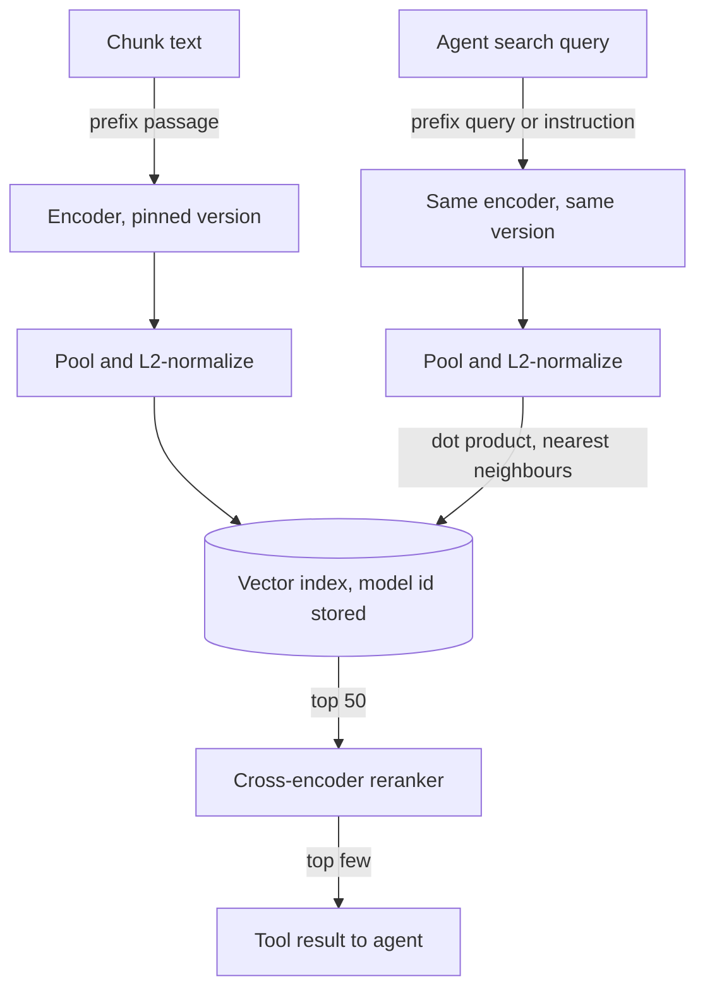

## TL;DR
An embedding model turns text into a vector so similar meanings sit close together. It powers your
agent's search tool, its long-term memory and even tool selection. Model, prefixes and version must
match on both sides, or retrieval breaks silently.

## For agent builders
- **Why it matters for agents.** Every semantic lookup an agent makes (knowledge search, recalling past
  conversations, picking the few relevant tools out of hundreds) is a nearest-neighbour query over
  embeddings. A wrong model or missing prefix degrades all of them without a single error.
- **Where it shows up in your stack.** The `embeddings` object you pass to a LangChain or LlamaIndex
  vector store, hosted embedding APIs (OpenAI, Cohere, Voyage, Google), open models via
  sentence-transformers, and the memory store behind a LangGraph agent.
- **What you control.** Which model, its query and passage prefixes, its pinned version, the reranker
  after it, and the eval set that proves the choice on your agent's real queries.
- **What you can skip.** Training your own embedder. Know how contrastive training works well enough to
  read a model card; spend the effort on a bake-off and a reranker instead.

## Why it exists
- **Keyword search misses different wording.** BM25 matches tokens, so it fails on "cancel my plan"
  against "terminate the subscription", or a German question against English documentation. Vocabulary
  mismatch is the most common reason a keyword system returns nothing useful.
- **Averaged word vectors lose order.** word2vec or GloVe averages capture some synonymy, but "the dog
  bit the man" equals "the man bit the dog", and frequent, meaningless words dominate.
- **Raw BERT is bad at similarity.** It was trained to predict masked tokens, not to make sentence vectors
  comparable, so its [CLS] or mean outputs sit in a narrow cone where everything is cosine-similar to
  everything. Sentence-BERT fixed this with contrastive fine-tuning on sentence pairs; every modern
  embedding model descends from that recipe.
- **Cross-encoders are too slow for the first stage.** Reading query and passage together is the most
  accurate matcher, but a million passages means a million forward passes per query. The bi-encoder
  gives up a little accuracy to precompute the document side once and reuse it for every query.

## How it works
### Architecture: the bi-encoder
1. **Encoder:** a transformer encoder (BERT, RoBERTa or XLM-R style) or, increasingly, a decoder-only
   LLM repurposed as an encoder.
2. **Tokenize and run** the text through the network.
3. **Pool** per-token outputs into one vector: mean pooling, the [CLS] token, or the last token for
   decoder-based models.
4. **Optionally** apply a linear projection and L2 normalization.

- **Pooling is part of the trained model, not a free option.** Training taught the network to put its
  summary where the pooling reads it, so mean-pooling a [CLS]-trained model (or the reverse) returns
  vectors, just worse ones. Loading through the model's own configuration, as sentence-transformers
  does, keeps this right.
- **Query and document pass through the same network independently.** That is the whole point: a
  document's vector never depends on the query, so it is computed once, stored and compared with a dot
  product. An agent's search call therefore costs one query embedding plus a lookup.

### Background: contrastive training
Training data is (query, positive passage) pairs. The loss (InfoNCE and relatives) pulls the positive
toward the query and pushes negatives away. For query `q`, positive `p⁺` and candidates `p_j` that
include `p⁺`:

```
L = −log( exp(s(q, p⁺)/τ) / Σ_j exp(s(q, p_j)/τ) )      s = cosine similarity, τ = temperature
```

- **It is softmax cross-entropy over passages.** The "class" is the correct passage among the
  candidates, so it trains exactly what retrieval does: rank the right passage above the others.
- **The temperature `τ` is small** (a few hundredths is common), because cosine lives in [−1, 1].
  Dividing by a small number sharpens the softmax so the gradient concentrates on negatives scoring
  closest to the positive.
- **Worked case:** one positive at cosine 0.80, one hard negative at 0.75 and two easy negatives.

| τ | What the softmax sees | Where the gradient goes |
|---|---|---|
| 1.0 | near-uniform; cosine gaps are tiny | spread over all negatives, including easy ones |
| 0.05 | easy negatives vanish | almost entirely on the hard negative at 0.75 |

- **In-batch negatives are free.** With a batch of B pairs, every query gets B − 1 negatives. More
  negatives make the task harder and the space finer, which is why models train with very large batches.
- **Hard negatives matter more.** Passages sharing topic and vocabulary with the query but not answering
  it, mined from BM25 or an earlier model version, teach "about the same thing" versus "answers the
  question". DPR made this explicit.
- **Modern recipes (E5, BGE):** pretrain on hundreds of millions of weakly supervised pairs (titles and
  bodies, questions and accepted answers, near-duplicates), then fine-tune on curated retrieval datasets
  with hard negatives.
- **Why an agent builder cares:** it explains why embeddings find "about the same topic" easily but may
  rank a near-miss above the answer, which is the job a reranker does.

### Asymmetric models and prefixes
- **Queries are short and question-shaped; passages are long and declarative.** Many models train with a
  marker to treat the two sides differently.
- **E5 expects `query: ` and `passage: ` prefixes**; BGE and instruction-tuned models accept a task
  instruction prepended to the query.
- **Omit the prefix and nothing errors.** The model still returns vectors, just worse ones: a quiet
  recall drop.
- **Agent-written queries are a third shape.** An agent often searches with terse, keyword-like strings
  it composed itself, not the user's sentence. Evaluate on queries pulled from agent traces, not only on
  user questions.

### Capacity limits
- **Maximum input length:** typically 512 tokens for BERT-derived models and around 8,000 for many newer
  long-context ones.
- **Longer inputs are truncated silently** by most local libraries (some hosted APIs reject them with an
  error instead), one reason chunking exists.
- **Bigger models** generally give better vectors but embed more slowly and emit more dimensions, which
  cost storage and comparison time for every chunk forever (see the dimension lesson). Query-side
  embedding latency also lands on every agent search step.

### Where it sits against the alternatives
| Approach | How it scores | Role |
|---|---|---|
| Bi-encoder | one vector each side, dot product | first-stage retrieval over millions of chunks |
| Cross-encoder | attention across query and passage tokens together, most accurate | reranker over the top few dozen |
| Late interaction (ColBERT) | one vector per document token, max-similarity sum | middle ground in accuracy and storage |
| Sparse (BM25, learned sparse) | token weights | complementary, which is why hybrid search exists |

### Choosing a model
- **Start from MTEB**, which ranks models across retrieval, clustering and classification, with two
  caveats: the rank averages tasks that may not resemble yours, and popular models are increasingly
  trained on data close to the benchmark.
- **What decides in practice:** domain (legal, medical, code and non-English text all reshuffle the
  ranking), input length, multilingual needs, embedding latency and cost, and whether chunk text may
  leave your environment (hosted API versus self-hosted open weights).
- **Measure before committing:** recall@k on a few hundred labelled query–passage pairs from your own
  corpus, because changing the model later means re-embedding everything, including agent memories.

## Diagram
The document side runs once at index time; the agent's query side runs per search call through the
same model, prefix rules and pooling, and only then meets the stored vectors.



## Examples
### Synonym matching with an asymmetric model
Neither query shares a content word with its correct passage ("money back" versus "refunds", "end my
membership" versus "cancel a subscription"), the case BM25 cannot solve. The prefixes are part of the
model's contract, and `normalize_embeddings=True` makes the matrix product a cosine similarity.

```python
from sentence_transformers import SentenceTransformer
import numpy as np

model = SentenceTransformer("intfloat/e5-base-v2")   # asymmetric: needs "query: " / "passage: "
docs = [
    "passage: Refunds are issued to the original payment method within 5-7 business days.",
    "passage: Our office is closed on public holidays.",
    "passage: To cancel a subscription, open Billing and click Cancel plan.",
]
queries = ["query: how long does it take to get my money back?",
           "query: end my monthly membership"]

D = model.encode(docs, normalize_embeddings=True)     # shape (3, 768), unit length rows
Q = model.encode(queries, normalize_embeddings=True)  # shape (2, 768)
scores = Q @ D.T                                      # cosine similarity because both sides are unit vectors

for q, row in zip(queries, scores):
    best = int(np.argmax(row))
    print(f"{q!r} -> doc {best}  scores={np.round(row, 3)}")
# Expected: query 0 -> doc 0, query 1 -> doc 2. Dropping the prefixes usually does not flip a
# three-passage toy; their cost shows up as lost recall@k over a real corpus, so measure it there.
```

### Agent scenario: embedding tool descriptions to pick tools
An agent platform has many tools; sending every schema on every step wastes context and confuses the
model. Embed each tool's description once, then expose only the closest few for the current request.

```python
from sentence_transformers import SentenceTransformer

model = SentenceTransformer("intfloat/e5-base-v2")
TOOLS = {   # name -> description; in practice, hundreds of entries
    "issue_refund": "Refund a customer's payment for an order.",
    "cancel_subscription": "Cancel a customer's recurring plan.",
    "lookup_order": "Get status and items of an order by id.",
    "reset_password": "Send a password reset link to a user.",
}
names = list(TOOLS)
T = model.encode([f"passage: {TOOLS[n]}" for n in names], normalize_embeddings=True)

def select_tools(user_msg: str, k: int = 2) -> list[str]:
    q = model.encode([f"query: {user_msg}"], normalize_embeddings=True)[0]
    order = (T @ q).argsort()[::-1][:k]
    return [names[i] for i in order]

print(select_tools("I want my money back for order 1182"))
# Expect issue_refund and lookup_order: only their schemas go into this step's tool list.
```

| Setup (illustrative) | Schema tokens per step |
|---|---|
| 200 tools at ~150 tokens each, all sent | ~30,000 |
| Top 8 selected by embedding | ~1,200 |

- **The catch:** a missed tool is a capability the agent does not have this step. Measure tool-selection
  recall on logged requests, and always include a small fixed core set.

## Production patterns
- **One `embed()` with everything pinned** — wrap the model behind a single function that applies the
  prefix, normalization and a pinned version (for sentence-transformers, pass `revision=` a commit hash;
  for APIs, a dated model id). Store the model id with every vector and assert it matches at query time,
  in the search tool and in the memory store alike.
- **Bake-off on your agent's own queries** — before choosing, score two or three candidates on a few
  hundred labelled pairs from your corpus, including queries the agent itself wrote in traces, with
  recall@k and MRR. Monitor the same numbers on a schedule, since the corpus drifts.
- **Retrieve wide, rerank narrow** — bi-encoder top 50, then a cross-encoder (for example
  sentence-transformers `CrossEncoder`) reorders to the final few the tool returns. Monitor rerank
  latency p95 and recall@50 of the first stage, which caps what reranking can recover.
- **Truncation guard at index time** — count tokens with the model's tokenizer against its
  `max_seq_length` (or the API's documented limit) and re-chunk anything over. Monitor the count of
  truncated or rejected chunks per ingestion run.
- **Blue/green model upgrades** — embed the corpus (and stored agent memories) with the new model into a
  new index, run both on the eval set, then switch reads atomically. Never mix two models in one index;
  monitor recall on both until the old one is retired.

## Trade-offs
- **Precomputed lookup vs token interaction.** A bi-encoder makes retrieval a nearest-neighbour lookup
  but loses the query–document interaction a cross-encoder has; once you can afford to rerank the top
  50, most of that gap closes.
- **Larger models vs speed and size.** Better vectors, but slower embedding and bigger vectors; it flips
  to a cost when the corpus is small, the workload is latency-bound (an agent searching many times per
  task), or a reranker already corrects first-stage mistakes.
- **Hosted vs self-hosted.** Hosted API models (OpenAI, Cohere, Voyage, Google) remove serving work and
  are often strong, but every chunk's text leaves your network and a vendor deprecation forces a full
  re-embed; self-hosted open models (BGE, E5, GTE, Nomic) reverse both sides.
- **Multilingual vs English-specialised.** Multilingual models handle cross-language queries but tend to
  be a little weaker on English-only tasks than an English model of the same size; the corpus decides.
- **Long-context embeddings vs precision.** They reduce the need for chunking, but each vector becomes a
  blurrier average of more content, lowering precision for specific questions.

## Pitfalls
- **Different models (or versions) for index and queries.** Every similarity is mediocre and the top
  results look random. Vectors from two models are not comparable even when their dimensions match.
- **Dropping the `query:`/`passage:` prefix or the instruction.** A measurable recall drop on an
  asymmetric model, with no error anywhere in the logs.
- **Wrong pooling or normalization on an open model.** For example a raw `AutoModel` with mean pooling on
  a [CLS]-pooled model: recall noticeably below the model card's reported quality, no error raised.
- **Silent truncation of long chunks.** Questions about the tail of long documents never retrieve, while
  the same content pasted as a short chunk works.
- **Choosing by leaderboard rank alone.** The model a point higher on MTEB underperforms the old one on
  your own labelled queries.
- **Treating cosine as absolute confidence.** A threshold copied from a blog post lets nothing or
  everything through after a model swap, so an agent's "no relevant results" branch fires always or
  never. Scores are model-specific.
- **Upgrading the model in place without a re-embed plan.** Old and new vectors mix in one index, and
  quality degrades as new content arrives.

## When to use
- **Use when:** users describe what they want in their own words and the corpus says it differently:
  support search, document QA, code search, deduplication, clustering and recommendations, plus agent
  memory recall and tool selection.
- **Do not expect it to replace lexical search** for exact identifiers, part numbers, error codes or rare
  names; pair the two, or give the agent a separate exact-match tool.
- **Measure:** recall@k and MRR on labelled pairs from your data, embedding time per thousand chunks, and
  vector bytes per chunk.
- **Day to day:** pick a model, pin its version, apply its prefixes, and re-evaluate whenever the corpus
  or model changes.
- **Interviews:** bi-encoder versus cross-encoder, contrastive training with hard negatives, and why two
  models can never share one index.

## Role lens
- **Engineer:** Wraps the model behind one `embed(texts)` function with the prefix, normalization and
  version baked in, so the index path and the query path cannot drift apart.
- **Architect:** Owns the model choice and its exit cost: domain fit, the hosted-versus-self-hosted data
  boundary, and the re-embedding budget a future upgrade will require.
- **FDE:** Runs a quick recall@k bake-off on the customer's own documents and queries, because their
  domain terminology decides which model wins, not the public leaderboard.

## Check yourself
**Q:** A customer's support search returns good results for English queries but poor ones for the same
questions in Spanish, although half the knowledge base is in Spanish. You suspect the embedding model.
How do you diagnose it, and what do you change?
**A:** First rule out the pipeline: embed a Spanish query and its known-correct Spanish passage directly
and compare the similarity against unrelated passages, and confirm the same model, prefixes and
normalization are used at index time and query time. If the model is English-centric, Spanish texts
cluster poorly and cross-language pairs worse still, which shows up as low recall@k on a small labelled
Spanish set. The fix is a multilingual model (multilingual E5, BGE-M3 or a multilingual API model),
which means re-embedding the whole corpus, so plan it as a versioned re-index rather than an in-place
swap. Validate with recall@k in both languages, and keep BM25 in a hybrid setup for product names and
error codes, which embeddings handle badly in any language.

## Interview questions
### What is the difference between a bi-encoder and a cross-encoder, and where does each go in a pipeline?
- **Bi-encoder:** query and document are encoded independently into one vector each, so document
  vectors are precomputed and retrieval is a nearest-neighbour lookup.
- **Cross-encoder:** reads query and passage together with full attention, more accurate but one forward
  pass per pair.
- **So** the bi-encoder does first-stage retrieval over millions of chunks and the cross-encoder reranks
  the top few dozen.

### Explain contrastive training with InfoNCE. Why a small temperature and why hard negatives?
- **InfoNCE** is softmax cross-entropy over candidate passages where the correct class is the positive,
  so it trains exactly the ranking retrieval needs.
- **Small τ** (a few hundredths) sharpens the softmax because cosine only spans [−1, 1], concentrating
  the gradient on negatives scoring near the positive.
- **Hard negatives** share topic and vocabulary but do not answer, teaching "answers the question" rather
  than "about the same thing".

### After a deploy, your agent's search tool keeps returning off-topic hits with no errors in the logs. What do you check?
- **Model and version parity:** index and query paths must use the same model id and revision.
- **Prefixes:** an asymmetric model such as E5 silently degrades without `query: ` and `passage: `.
- **Pooling and normalization:** loading a raw encoder with the wrong pooling still returns vectors, just
  worse ones.
- **Truncation:** count tokens against the model's maximum input length on the new chunks.

### Your agent has 300 tools. How would you use embeddings to choose which ones it sees, and what can go wrong?
- **Embed each tool description once,** embed the request (or current step) as a query, and expose the
  top few plus a fixed core set, which cuts schema tokens per step sharply.
- **Risk:** a missed tool silently removes a capability, and vague descriptions embed poorly.
- **Operate it:** log selected tools per step, measure selection recall against tools actually needed on
  labelled requests, and improve descriptions where recall is low.

### When would you choose a hosted embedding API over a self-hosted open model?
- **Hosted wins** when the team cannot run GPU serving and the data may leave the network.
- **Self-hosted wins** when chunk text must stay inside your environment or you need control over
  version lifetime, because a vendor deprecation forces a full re-embed.
- **Decide with a bake-off:** recall@k and MRR on a few hundred labelled pairs from your corpus, plus
  embedding cost and latency.

### How do you upgrade the embedding model behind a production agent without breaking retrieval or memory?
- **Never mix models in one index:** vectors from two models are unrelated even at equal dimension.
- **Blue/green:** embed the corpus and stored memories into a new index with the new model, compare both
  on the eval set, then switch reads atomically.
- **Budget it:** the re-embed is a full pass over every chunk, so plan time and cost before committing.

## Quiz
### Q: Why are documents embedded independently of the query in a bi-encoder, even though a cross-encoder reading both together is more accurate?
- [ ] Cross-encoders cannot process inputs longer than a short query
- [x] Independence lets document vectors be computed once and indexed, so a query costs one encoder pass plus a nearest-neighbour lookup instead of one pass per document
- [ ] Contrastive training only converges when the two inputs are encoded separately
- [ ] Cross-encoders produce vectors that cannot be normalized
> The cross-encoder is more accurate precisely because it conditions on both texts, but that means every
> query–document pair needs its own forward pass. Precomputing document vectors is what makes retrieval
> over millions of chunks affordable, which is why cross-encoders are used only to rerank a short list.

### Q: A team switches from one vendor's 768-dimensional model to another vendor's 768-dimensional model and re-embeds only new documents. What happens?
- [ ] Nothing, because matching dimensions make the vectors compatible
- [ ] Old documents become slightly less accurate but remain searchable
- [x] Old and new vectors live in unrelated spaces, so similarities between them are meaningless and results degrade as the mix grows
- [ ] The vector database rejects the new vectors as malformed
> Dimension is just the length of the array; the meaning of each axis is specific to the model that
> produced it. A query embedded with the new model has no principled relationship to old vectors, so a
> mixed index returns essentially random matches for old content.

### Q: What do hard negatives add to contrastive training that in-batch negatives do not?
- [ ] They increase the effective batch size without extra memory
- [ ] They let the model handle inputs longer than its context limit
- [x] They force the model to separate passages that are topically similar but do not answer the query, rather than just separating unrelated texts
- [ ] They remove the need for labelled positive pairs
> In-batch negatives are mostly random, unrelated passages and are easy to push away. Hard negatives
> share vocabulary and topic with the query, so the model must learn finer distinctions, which is what
> separates a retriever from a topic classifier.
