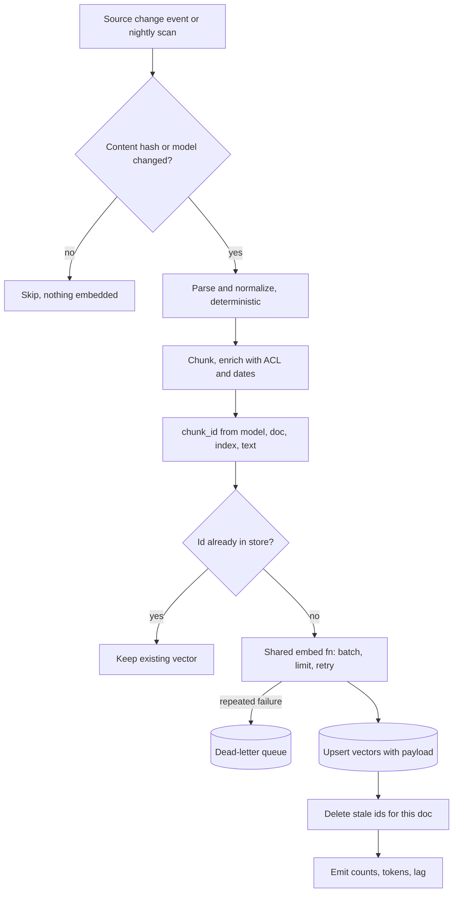

## TL;DR
An embedding pipeline keeps the index your agent searches in sync with its sources: parse, chunk,
enrich, embed, upsert, update, delete. It needs idempotent chunk ids, incremental updates, and identical
embedding at index time and query time.

## For agent builders
- **Why it matters for agents.** An agent acts on what its search returns: a stale chunk becomes a wrong
  refund amount, an undeleted page a cited policy that no longer exists, a missing ACL field a data leak.
- **Where it shows up in your stack.** LangChain's indexing API (`index(...)` with a record manager),
  LlamaIndex `IngestionPipeline`, a queue worker behind your agent backend, and any `remember` or
  `save_note` tool that writes agent memory, which is a small embedding pipeline of its own.
- **What you control.** Chunk ids, change detection, the shared embed function, rate limiting, deletion
  propagation, the metadata (tenant, ACL, dates) the agent's search later filters on, and freshness SLA.
- **What you can skip.** A general data platform: one idempotent per-document function, a golden-vector
  test and deletion handling cover most agent knowledge bases.

## Why it exists
- **The demo works once.** Read every file, split, embed, insert: three things break it.
- **Change.** Documents are edited, re-uploaded and deleted; re-running the script duplicates every
  chunk or leaves ghosts of removed content that keep showing up in answers.
- **Scale and failure.** Two million chunks through a rate-limited API takes hours. One timeout halfway
  leaves the index half-built with no record of which half; "run it again" doubles cost and duplicates.
- **Drift.** The query service must embed exactly as the indexer did (same model version, prefix,
  normalization, text cleaning), or searches compare vectors from two spaces. This is retrieval's
  training/serving skew: no error, recall simply decays.
- **A pipeline makes these explicit:** deterministic chunk identity, knowledge of what exists, one shared
  embedding call, per-batch retries. Without it you get the most common RAG incident: "search got worse
  and nobody changed anything".

## How it works
### The stages
1. **Ingest.** Pull from sources (object storage, a CMS, a wiki, a database) and record `doc_id`, source
   URI, last-modified time and access-control metadata. Detect change by content hash or
   change-data-capture events, so unchanged documents cost nothing.
2. **Parse and normalize.** Convert to text plus structure (headings, tables, page numbers).
   Deterministic, because the same bytes must always produce the same text and chunk ids depend on it.
3. **Chunk.** Apply the chunking strategy; attach `chunk_index`, heading path and character offsets.
4. **Enrich.** Add filter metadata (tenant, ACL groups, document date, section title) and any contextual
   prefix; the agent's search can only filter on what is stored here.
5. **Embed.** Batch, apply the model's prefix, call with a concurrency limit, retry rate limits and
   transient errors with backoff, normalize, and record model name and version.
6. **Upsert.** Write vector, payload and text (or a pointer to it) under the deterministic id.
7. **Reconcile.** Delete the previous version's chunks, then verify counts match what the chunker
   produced.
8. **Observe.** Emit documents processed, chunks embedded, tokens spent, failures, and the lag from
   source change to visibility in search.

### Idempotency through content-addressed ids
```
chunk_id = hash(model_version, doc_id, chunk_index, chunk_text)
```
| Event | Effect |
|---|---|
| Re-run on unchanged document | every id already present; nothing embedded |
| Edit changes one or two chunks, same count before them | only those get new ids and embeddings; old ids deleted as stale |
| Edit inserts or removes a chunk | every later `chunk_index` shifts, so all later chunks re-embed |
| Model upgrade | complete new id set, so migration is a normal run, not a special case, provided the document-level change check also keys on model version |

- **If inserts are common:** keep an embedding cache keyed by `hash(model_version, chunk_text)` so
  moved-but-unchanged text is not re-sent, or drop the index from the id and store it as a field (then
  disambiguate identical chunks within one document, such as repeated boilerplate).
- **Watch the early exit:** a document whose content hash is unchanged is skipped before ids are
  computed, so on a model upgrade either include the model version in that check or run against a fresh
  record namespace for the new collection; otherwise the upgrade run skips every document.
- **Frameworks do the same:** LangChain's indexing API and LlamaIndex's ingestion pipeline map document
  ids to content hashes via a record manager or docstore.

### Agent memory is the same pipeline, written by the agent
- **A memory tool is a writer.** When the agent saves "user prefers invoices in EUR", that text is
  embedded and upserted like any chunk, from inside the agent loop.
- **Same rules:** a content-addressed id stops the agent saving one fact twenty times, the shared embed
  function keeps memory and query vectors in one space, and user id metadata scopes recall.
- **Difference:** writes are tiny and synchronous, so latency matters more than throughput; embed one item
  or queue it and answer "saved".

### Write new before deleting old
- **Upsert the new chunks first, then delete the stale ones.** A crash in between leaves both versions
  for a while, a mild duplicate problem; the reverse leaves the document unsearchable.
- **Stricter atomicity:** index into a new collection and switch an alias.

### Model versioning and re-indexing
| Strategy | How | Cost and risk |
|---|---|---|
| Blue/green | embed the corpus into a second collection, evaluate side by side, flip the query service, drop the old | doubles storage during migration; clean and reversible |
| In place | store `model` on every record and filter on it at query time while the backfill runs | cheaper, easy to get wrong |

Estimate the backfill before choosing (illustrative orders of magnitude):
- **Tokens:** chunks × average tokens. A million 300-token chunks is 300 million tokens.
- **Bill:** at hosted prices of cents per million tokens (vendor- and time-dependent), on the order of
  dollars to tens of dollars.
- **Duration, the real constraint:** `total tokens ÷ tokens per minute you are allowed (or can serve)`.
  Against an illustrative quota of one million tokens per minute, 300 minutes: five hours before retries.
  For self-hosted models, GPU throughput sets the rate.
- **Concurrency cap:** workers × tokens per request × requests per worker per minute must stay under the
  quota, or extra workers only buy 429s. If agents share that quota for query embeddings, reserve part
  of it so a backfill cannot starve live searches.

### Batch versus streaming
- **Nightly batch** is enough for slowly changing corpora.
- **Queue consumer on change events** when users notice staleness, for example an agent quoting prices
  or stock levels.
- **One shared per-document function for both modes** keeps the two paths identical.

### Query-time parity
- **One module** holds the embedding call, prefix logic and normalization; indexer, agent search tool
  and memory tool all import it.
- **Golden-vector test:** embed a fixed sentence and compare cosine with a stored vector within a tight
  tolerance (not exact equality, because some hosted endpoints show tiny run-to-run noise). A silent
  model change or dependency bump then fails CI instead of degrading production.

## Diagram
Follow one document through the per-document step: unchanged documents exit early, only new ids are
embedded, and stale ids are deleted only after their replacements are live.



## Examples
### An idempotent per-document indexing step
The store is any vector database with upsert, delete and ids by document; `embed_fn` is the shared
function the query service also imports. Only changed chunks are embedded, stale ones are removed after
the new ones are live, and the model version is part of every id.

```python
import hashlib, random, time
from itertools import islice

MODEL = "text-embedding-3-small/v1"           # our own pinned label; part of every chunk's identity
class RateLimited(Exception): ...             # raised by embed_fn on HTTP 429

def chunk_id(doc_id, idx, text):
    return hashlib.sha256(f"{MODEL}\x00{doc_id}\x00{idx}\x00{text}".encode()).hexdigest()[:32]

def batched(items, n):
    it = iter(items)
    while batch := list(islice(it, n)):
        yield batch

def embed_with_retry(embed_fn, texts, tries=5):
    for attempt in range(tries):
        try:
            return embed_fn(texts)                # returns unit-norm vectors, prefix already applied
        except RateLimited:
            time.sleep(min(2 ** attempt, 30) * random.uniform(0.5, 1.0))  # capped backoff + jitter
    raise RuntimeError("embedding failed after retries")

def index_document(doc_id, chunks, store, embed_fn, batch_size=64):
    wanted = {chunk_id(doc_id, i, c["text"]): (i, c) for i, c in enumerate(chunks)}
    existing = set(store.ids_for_doc(doc_id))
    todo = [(cid, i, c) for cid, (i, c) in wanted.items() if cid not in existing]
    for batch in batched(todo, batch_size):
        vecs = embed_with_retry(embed_fn, [c["text"] for _, _, c in batch])
        store.upsert([{"id": cid, "vector": v, "doc_id": doc_id, "chunk_index": i,
                       "model": MODEL, "text": c["text"], **c.get("meta", {})}
                      for (cid, i, c), v in zip(batch, vecs)])
    stale = existing - wanted.keys()
    if stale:
        store.delete(list(stale))                 # only after the replacements are live
    return {"embedded": len(todo), "deleted": len(stale), "unchanged": len(existing & wanted.keys())}

class DictStore:                                  # in-memory stand-in to run the step end to end
    def __init__(self): self.rows = {}
    def ids_for_doc(self, d): return [k for k, r in self.rows.items() if r["doc_id"] == d]
    def upsert(self, rows): self.rows.update({r["id"]: r for r in rows})
    def delete(self, ids): [self.rows.pop(i) for i in ids]
    def exists(self, i): return i in self.rows

fake_embed = lambda texts: [[1.0, 0.0] for _ in texts]   # swap for the real shared embed function
store, doc = DictStore(), [{"text": "Refunds take 5-7 days."}, {"text": "Cancel under Billing."}]
print(index_document("faq", doc, store, fake_embed))      # {'embedded': 2, 'deleted': 0, 'unchanged': 0}
print(index_document("faq", doc, store, fake_embed))      # {'embedded': 0, 'deleted': 0, 'unchanged': 2}
doc[1] = {"text": "Cancel under Settings > Billing."}
print(index_document("faq", doc, store, fake_embed))      # {'embedded': 1, 'deleted': 1, 'unchanged': 1}
```

### Agent scenario: an idempotent memory tool
The agent's `save_memory` tool reuses the same id scheme and embed function, so repeated saves of one
fact are no-ops and memories are scoped to a user.

```python
def save_memory(user_id: str, fact: str, store, embed_fn) -> str:
    """Tool exposed to the agent: remember a durable fact about this user."""
    text = " ".join(fact.split())                     # deterministic cleanup before hashing
    mid = hashlib.sha256(f"{MODEL}\x00{user_id}\x00{text.lower()}".encode()).hexdigest()[:32]
    if store.exists(mid):
        return "Already remembered."                  # agent re-saving the same fact costs nothing
    vec = embed_with_retry(embed_fn, [text])[0]       # same shared function as the search tool
    store.upsert([{"id": mid, "vector": vec, "user_id": user_id, "model": MODEL,
                   "text": text, "kind": "memory", "saved_at": time.time()}])
    return "Saved."
```

- **Why `user_id` in the id and payload:** recall filters by user, and two users' identical facts do not
  collide.
- **What it does not handle:** contradictions ("prefers EUR" then "prefers USD"). That needs an update
  policy, such as replacing memories on the same topic, decided in your memory design.

### A golden-vector test in CI
`embedder.embed` is the shared function; `tests/golden_vector.json` was written once from a known-good
run. The 0.999 tolerance is illustrative: set it just below the noise you observe from your endpoint.

```python
import json, math
from embedder import embed, MODEL      # the module the indexer and query service both import

GOLDEN = "Refunds are issued to the original payment method within 5-7 business days."

def cosine(a, b):
    dot = sum(x * y for x, y in zip(a, b))
    return dot / (math.sqrt(sum(x * x for x in a)) * math.sqrt(sum(y * y for y in b)))

def test_embedding_output_unchanged():
    with open("tests/golden_vector.json") as f:
        stored = json.load(f)
    assert stored["model"] == MODEL, "model label changed: run a re-index, then refresh the golden file"
    v = embed([GOLDEN])[0]
    assert len(v) == len(stored["vector"]), "dimension changed"
    assert cosine(v, stored["vector"]) > 0.999, "embedding output drifted: treat as a model upgrade"
```

### Worked scenario: planning a model-upgrade backfill
Illustrative quota and latency; plug in your own.

| Quantity | Value |
|---|---|
| Corpus | 1,000,000 chunks × 300 tokens = 300M tokens |
| Quota | 1M tokens per minute |
| Minimum duration | 300M ÷ 1M = 300 minutes (five hours) before retries |
| Tokens per request (batch of 64) | 64 × 300 = 19,200 |
| Requests per minute the quota allows | 1,000,000 ÷ 19,200 ≈ 52 |
| Worker doing one 2-second request at a time | 30 requests per minute |
| Useful workers | 52 ÷ 30 ≈ 1.7: run 2 behind a shared limiter capped near 52 requests per minute; a third worker only adds 429s and backoff |

Run blue/green: the old collection serves the agent for the five hours, so the window, not the bill,
decides.

## Production patterns
- **Record-manager incremental indexing** — when you use LangChain, call its `index(...)` function with
  a `SQLRecordManager`, a `source_id_key` and `cleanup="incremental"`, so re-runs skip unchanged
  documents and delete stale chunks. Monitor skipped versus embedded counts per run; a re-run on an
  unchanged corpus should embed close to zero.
- **Docstore-backed ingestion pipeline** — in LlamaIndex, give `IngestionPipeline` a docstore and a
  vector store so unchanged documents are skipped and changed ones upserted. Monitor source-to-searchable
  lag.
- **ACL and tenant metadata at write time** — copy access-control groups and tenant id onto every chunk
  and memory, so the agent's search tool filters by the calling user. Monitor with a test that a user's
  agent cannot retrieve another tenant's seeded document.
- **Shared rate limiter sized to the quota** — one token-bucket limiter (in Redis or the queue) for all
  workers, set below the vendor's tokens- and requests-per-minute limits, with headroom for live agent
  queries. A 429 rate above a few percent means it is set too high.
- **Validate, then dead-letter** — count tokens per chunk before the call, re-chunk anything over the
  model limit, and send repeated failures to a dead-letter queue with the document id. Alert on queue
  depth so one poison pill cannot stall the run.
- **Golden-vector check on a schedule** — run the test above in CI and hourly against production
  credentials. Page when it fails, because a hosted model change silently splits index and query spaces.

## Trade-offs
- **Free re-runs vs surprise re-embeds.** Content-hashed ids make re-runs free and safe, but any change
  to chunker config, parser or model version re-embeds the whole corpus by design; wanted for a model
  upgrade, a surprise when a parser whitespace change triggers it.
- **Large vs small batches.** Larger batches mean fewer calls and higher throughput, but one bad input
  fails more work and per-request token limits cap size; smaller batches isolate failures.
- **Streaming vs nightly batch.** Streaming gives minutes-level freshness at the cost of queues, ordering
  and dedup logic; a nightly batch is far simpler until users notice stale answers.
- **Synchronous vs queued memory writes.** Embedding in the tool call makes a memory searchable next
  step but adds loop latency; queueing returns faster but the memory may be missing briefly.
- **Text in the vector store vs a pointer.** Stored chunk text makes retrieval one hop but duplicates
  data and inflates memory; a pointer saves memory and adds a lookup per result.
- **Blue/green vs in-place re-indexing.** Blue/green is clean and allows side-by-side evaluation but
  doubles storage during migration; in-place is cheaper and riskier.

## Pitfalls
- **Non-deterministic chunking.** A splitter whose boundaries depend on library version or randomness
  re-embeds everything every run, so re-run cost never drops toward zero (and, if reconciliation fails,
  the index grows with no new documents). Diagnose: run twice on an unchanged corpus and diff the chunk
  ids. Fix: pin the splitter and parser.
- **Query service embeds differently from the indexer.** A different model, version or prefix makes
  recall collapse after a deploy that "only touched the API". Diagnose: the golden-vector test, plus the
  `model` field of top hits against the query path's label. Fix: one shared module.
- **Deletions never propagated.** Answers cite documents that were removed weeks ago, and the agent acts
  on them. Diagnose: diff source doc ids against `doc_id` values in the store. Fix: delete on source events.
- **No model version on the record.** After an upgrade nobody can tell which chunks still need
  re-embedding.
- **A poison-pill input.** One chunk over the model's token limit fails the whole batch on every retry,
  and the pipeline stalls at the same document forever. Diagnose: log the doc id of each failed batch.
  Fix: validate token counts before the call and route failures to a dead-letter queue.
- **Unbounded concurrency against a rate-limited API.** Adding workers lowers throughput, because most
  calls return 429 and retry. Diagnose: plot 429 rate against worker count. Fix: a shared limiter.
- **Random ids in the memory tool.** The agent saves the same preference on every turn and recall
  returns ten copies of it. Use content-addressed ids per user.
- **Embedding repeated boilerplate.** Navigation, headers and legal footers across thousands of pages
  fill top-k with near-duplicate boilerplate chunks. Fix: strip it at parse time.
## When to use
- **Build a real pipeline** once the corpus will be updated more than once; a single script suits only a
  throwaway prototype on a static dump.
- **Decide** batch vs streaming from how fast users need to see changes, and blue/green vs in-place from
  how often you expect to change models.
- **Measure:** index lag (source change to searchable), re-run cost on an unchanged corpus (near zero),
  duplicate rate, and the golden-vector test in CI.
- **Interviews:** "how do you keep the index in sync" is answered by content-hashed ids, incremental
  upserts and versioned re-indexing; most RAG engineering time goes here.

## Exercise
**Goal:** build an incremental indexer whose second run on an unchanged corpus embeds nothing.
- **Inputs:** 50-200 text files, any embed function (a hashing stub is fine while building), and a store
  with upsert, delete and ids-by-document (SQLite, Qdrant, pgvector or a dict).
- **Deliver:** a CLI that indexes the folder, handles edits, additions and deletions, and prints
  embedded, deleted and unchanged counts.
- **Acceptance:** run 2 embeds 0 chunks; editing one paragraph re-embeds only chunks from it onward;
  deleting a file removes all its ids; killing the run halfway and re-running ends with the same id set
  as a clean run; changing the model label re-embeds everything.

## Role lens
- **Engineer:** Implements the per-document idempotent step, the batching and backoff around the model
  call, and the golden-vector test that catches silent model changes.
- **Architect:** Decides the freshness SLA, the batch-versus-streaming topology, the re-indexing strategy
  for model upgrades, and where the source of truth for documents lives.
- **FDE:** Wires the pipeline to the customer's actual sources and change events, and budgets the backfill
  in tokens, hours and dollars before the first full run.

## Check yourself
**Q:** A hosted embedding vendor silently changes the model behind an endpoint name you have pinned. How
would your pipeline detect this, and what would you do once it did?
**A:** Detection comes from the golden-vector test: embedding a fixed sentence in CI and on a schedule and
comparing against the stored vector within a tight tolerance flags any change in the model's output,
whether from the vendor, a dependency bump or a prefix change. Once detected, the index built with the
old behaviour and new queries no longer share a space, so recall is at risk. Treat it as a model upgrade:
bump the version string that is part of every chunk id, run a blue/green re-index into a new collection,
compare recall@k on labelled queries between old and new, and flip the query service only when the new
collection passes. Pin to a dated model identifier where the vendor offers one, and keep the old
collection until the comparison is done.

## Interview questions
### How do you make an embedding pipeline idempotent?
- **Deterministic ids:** derive each chunk id from model version, document id, chunk index and chunk text,
  so a re-run on unchanged content finds every id present and embeds nothing.
- **Deterministic parsing and chunking:** the same bytes must always yield the same text, or ids churn.
- **Reconcile per document:** upsert new ids, then delete the document's ids that are no longer wanted.

### Your support agent keeps citing a policy page that was deleted last month. How do you debug and fix it?
- **Confirm:** list the vector store's ids for that `doc_id`; surviving chunks mean deletions never
  propagated.
- **Cause:** the pipeline only processes documents it sees, so a removed source document never triggers
  its own cleanup.
- **Fix:** consume delete events or diff source document ids against the store on each run, delete
  orphaned chunks, and track an orphan count as a metric.

### How would you design the write path for an agent's long-term memory?
- **Treat it as a pipeline:** a tool that cleans the text, derives a content-addressed id scoped by user,
  embeds with the shared function and upserts with user id and timestamp metadata.
- **Decide sync versus queued** from whether the memory must be searchable on the very next step.
- **Operate it:** monitor duplicate memories per user, recall filtered by user in tests, and an update
  policy for contradicting facts.

### Batch or streaming ingestion: how do you choose?
- **Nightly batch** is far simpler and fine for slowly changing corpora.
- **Streaming on change events** gives minutes-level freshness, at the cost of queues, ordering and dedup
  logic.
- **Decide from the freshness SLA,** and share one per-document function across both modes so the paths
  never diverge.

### Plan the backfill for re-embedding two million 300-token chunks under a one-million-tokens-per-minute quota.
- **Tokens:** 2,000,000 × 300 = 600M tokens.
- **Minimum duration:** 600M ÷ 1M = 600 minutes, ten hours before retries, so the time window, not the
  bill, is the constraint.
- **Concurrency:** batches of 64 × 300 tokens allow about 52 requests per minute, so size workers to stay
  under the quota and run blue/green so the old collection serves meanwhile.

### Why would one oversized chunk stall the whole ingestion run, and how do you prevent it?
- **Cause:** a chunk over the model's token limit fails its batch on every retry, so the pipeline loops on
  the same document.
- **Prevent:** count tokens with the model's tokenizer before the call and re-chunk anything over.
- **Contain:** route repeated failures to a dead-letter queue with the document id and alert on its depth.

## Quiz
### Q: Why include the embedding model version in the hash that forms each chunk id?
- [ ] It makes the ids shorter and faster to look up
- [x] A model change then produces entirely new ids, so re-embedding becomes an ordinary run and old and new vectors never share one id space
- [ ] Vector databases require the model name in the primary key
- [ ] It lets the query service skip the embedding step
> The id is how the pipeline decides what already exists. If the version is part of it, upgrading the
> model automatically invalidates every chunk, which is exactly the behaviour you want; without it, a
> re-run after an upgrade sees every chunk as present and silently keeps the stale vectors.

### Q: During reconciliation, why upsert the new chunks before deleting the stale ones?
- [ ] Deletes are slower than upserts in most vector databases
- [ ] Upserts can fail if the old ids still exist
- [x] A crash between the two steps then leaves temporary duplicates instead of a window where the document cannot be found
- [ ] The vector database needs the old vectors to build the index for the new ones
> Both orders are correct when nothing fails; the difference is the failure mode. Duplicates are a mild,
> self-healing problem on the next run, while a gap means users get no results from that document until
> someone notices.

### Q: An indexing job's throughput drops when you double the number of workers calling a hosted embedding API. What is the most likely cause?
- [ ] The vector database cannot accept concurrent upserts
- [x] The workers exceed the API rate limit, so most calls return rate-limit errors and spend their time in retries
- [ ] Larger batches are being sent automatically
- [ ] The chunker is producing more chunks per document
> Hosted embedding APIs enforce requests-per-minute and tokens-per-minute limits. Past that limit, extra
> workers only generate 429 responses and backoff sleeps; throughput is bounded by the quota, so the
> right fix is a shared concurrency limiter or a higher quota, not more workers.

## Mastery test
**Problem:** a support agent's index is rebuilt nightly. Each morning there are about 3% more vectors
than chunks the chunker produces, and users report the agent quoting an old refund window. The vendor
has not changed the model. Find the causes and fix them.

**A strong answer:**
- reads the growth as stale chunks never deleted: unstable ids or reconciliation failing after a crash;
- diagnoses by re-running on an unchanged corpus (should embed about zero) and counting ids per `doc_id`
  against the chunker;
- fixes with content-addressed ids, upsert-then-delete per document and source deletions propagated;
- adds monitoring: re-run cost, duplicate rate and vectors-versus-chunks drift.

## Use cases & projects
### Use cases
- **Support agents on changing policies.** Incremental re-embedding keeps the refund amount the agent quotes
  in step with the source page, within a stated freshness SLA.
- **Deletion and compliance.** Propagating deletes stops an agent citing a page that no longer exists or a
  document a user asked to remove.
- **Multi-tenant agent backends.** Tenant and ACL metadata written at ingest is what the agent's search tool
  filters on later, so the pipeline is where cross-user leaks are prevented.
- **Agent memory writes.** A `save_note` tool is a small pipeline of its own: chunk, embed with the shared
  function, upsert with a stable id.

### Mini project
**Build an idempotent ingest worker for an agent knowledge base (2-3 hours).**
- **Goal:** keep a vector index in sync with a folder of documents under edits and deletes.
- **Steps:** skip documents whose content hash is unchanged; give each chunk a content-addressed id
  from model version, document id, chunk index and text; embed only ids not yet in the store, through
  one shared function with a concurrency limit; upsert, then delete stale ids and the chunks of removed
  documents; point a small agent's search tool at the index.
- **Done when:** re-running the worker with no changes embeds nothing, an edited file updates only its chunks,
  a deleted file disappears from search results, and a golden-vector test passes.
