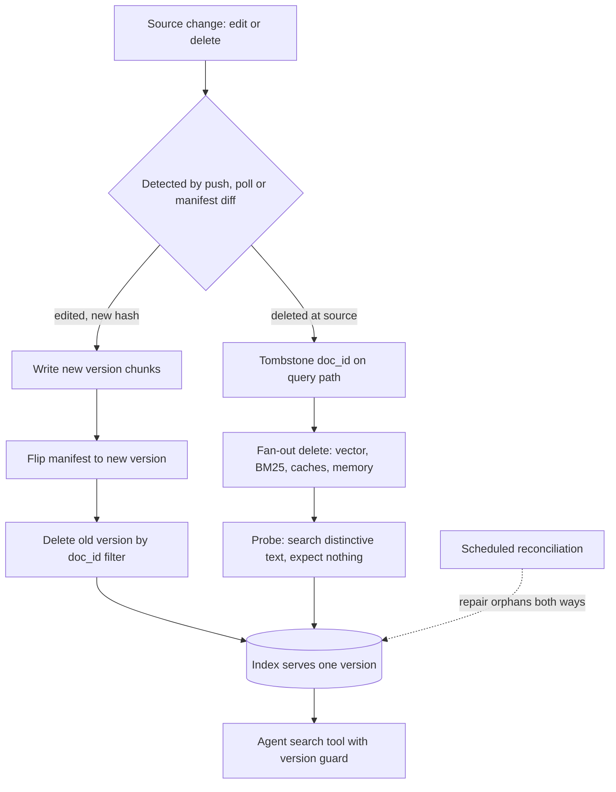

## TL;DR
An agent's search tool reads a derived index that goes stale the moment it is built, and an agent acts
on what it reads. Keep it fresh and deletable with stable document ids, versioned chunk ids,
write-new-then-delete-old, and reconciliation.

## For agent builders
- **Why it matters for agents.** A chatbot that cites a retired policy misleads one user; an agent that
  reads it may then *act*: quote the old price, approve a refund under last year's rules, email a
  customer. Stale or undeleted chunks become wrong tool calls, not just wrong sentences.
- **Where it shows up in your stack.** The ingestion pipeline behind every `search_docs`-style tool, the
  vector and BM25 stores it queries, semantic answer caches, agent long-term memory stores, and the
  traces your observability tool keeps of retrieved text.
- **What you control.** Deterministic chunk ids, the upsert order, the delete fan-out list, a read-time
  version guard inside the retrieval tool, and returning `version` and `modified_at` in tool results so
  the agent (and your evals) can see how fresh a passage is.
- **What you can skip.** Engine internals of lazy deletion and compaction. Know that a delete
  acknowledgement is not proof, and probe.

## Why it exists
- **Everything retrieved is a materialized view.** Chunks, embeddings, keyword postings, parent
  documents, generated chunk contexts, cached answers and agent memories were all computed from a past
  snapshot. None of it is the source of truth.
- **The source moves.** A pricing page is edited, an HR policy replaced, a contract terminated, an
  employee's files removed on offboarding, an erasure request received. A stale index answers with full
  confidence *and a citation*, which is worse than no answer because the user (or the agent) was given a
  reason to trust it.
- **Deletion raises the stakes.** An embedding of a chunk with personal data is still derived personal
  data; a keyword index still holds the words; a cached answer still quotes the paragraph. "We deleted the
  document" is only true when every derived artifact is gone, and a retrieval probe can prove it either way.
- **A full nightly rebuild fails four ways.** Freshness is capped at the rebuild interval (hours). Cost
  scales with the whole corpus even when a fraction of a percent changed. Delete-then-insert leaves the
  index partly empty; insert-then-delete duplicates every document. And a crawler only sees what exists
  *now*, so a deleted document never comes up again and its chunks live on forever.
- **"The model will ignore stale passages" is false.** It cannot tell which of two near-identical policy
  paragraphs is current; they look equally authoritative, and an agent will happily plan on either.

## How it works
### The three properties
| Property | Meaning | What it means for an agent |
|---|---|---|
| Freshness | how long a source change takes to become visible in retrieval | how long the agent acts on old facts |
| Deletion | removing every derived artifact of a document when the source goes away | whether the agent can still quote erased data |
| Consistency | never serving a mix of old and new versions of the same document | whether one tool call returns contradictory passages |

### Identity first: doc_id, version, chunk id
- **Every chunk carries four fields.** `doc_id` (stable source identity: a CMS id, a file path plus
  drive id, a ticket number), `version` (a content hash or the source's revision number), its position
  `chunk_index`, and `indexed_at`.
- **The primary key is deterministic:** `f"{doc_id}:{version}:{chunk_index}"`, because replacing,
  deleting or proving a document is gone all need *all* its chunks without knowing how many there are.
- **The content hash makes change detection cheap.** Hash the normalized text, compare with the stored
  version, and skip the embedding call when nothing changed.
- **The hash does not cover metadata.** Permissions can change while the text stays identical, so ACL
  refresh needs its own path. For agents acting on behalf of a user, a stale ACL is a data leak.

### Detecting change: push, pull, crawl
| Mechanism | Sees deletes? | Freshness ceiling | Cost |
|---|---|---|---|
| Push (webhooks, change-data-capture) | yes: creates, updates *and deletes* | seconds | needs source support; must tolerate missed events |
| Pull (poll a `modified_since` API) | usually not: most APIs do not list deletes | the poll interval | simple |
| Full crawl with hash comparison | only via a manifest | the crawl interval | lists the whole corpus; the only option for dumb sources |

- **Deletes are the universal weak point.** The only reliable way for a pull or crawl pipeline to notice
  one is a manifest of `doc_id → version` from the previous run, so `deleted = manifest.keys() − current_listing`.

### Updating: write new, flip, delete old
1. **Write** the new version's chunks under their new ids (embed first).
2. **Flip:** record the new version as current.
3. **Delete** chunks whose `doc_id` matches and whose `version` does not.

- **Why this order:** at no point is the document absent, and the old version is removed by filter rather
  than by an assumed chunk count. An agent mid-run never gets an empty search for a document that exists.
- **The classic bug is overwriting by `doc_id:chunk_index`.** A document that shrinks from nine chunks to
  seven leaves chunks seven and eight of the old text in the index indefinitely.
- **The both-versions window is normally short:** the gap between two writes plus any engine refresh
  delay. A crash between steps 1 and 3 can stretch it until reconciliation runs.
- **Belt and braces: filter after retrieval.** Per `doc_id`, drop chunks whose `version` is not the
  newest seen (or not the manifest's current version). It is cheap, hides reconciliation lag, and belongs
  inside the retrieval tool so no agent prompt has to remember it.

### Deleting: tombstone, fan-out, verify
- **A delete is a fan-out, not a single call.** Targets: the vector index, the keyword (BM25) index of a
  hybrid setup, the parent-document store, LLM-generated chunk contexts or summaries, semantic answer
  caches, agent long-term memory that copied the text, and traces or logs that stored retrieved text.
1. **Tombstone** the document so the query path filters it out immediately.
2. **Delete physically**, asynchronously with retries, in every target.
3. **Verify with a probe:** query distinctive text from the deleted document and assert nothing returns.

- **Why the probe matters:** many ANN engines delete lazily. HNSW-style graphs typically mark nodes
  deleted and skip them at query time until a compaction or optimization rebuilds the segment, and some
  engines acknowledge a write before it is searchable.
- **Some managed vector stores delete only by id or id prefix**, not by metadata filter, which is one
  more reason the ids must be deterministic.
- **Agent transcripts are a derived store too.** A tool result that quoted the document sits in saved
  conversation state and checkpoints; a resumed agent can re-read it. Include them in the fan-out or set
  a retention limit on them.

### Guarding the delete path
- **`deleted = manifest − listing` is only as trustworthy as the listing.** An API that times out, pages
  incorrectly or returns empty under a revoked token makes *every* document look deleted, and a naive
  reconciler wipes the index.
- **Require a complete listing:** every page fetched, no error.
- **Cap the blast radius:** refuse a deletion set larger than a threshold fraction of the corpus (for
  example a few percent) without a human or a second listing confirming it.
- **Deletes are the most cautious write**, because they are the only one re-running cannot repair. A
  wiped index shows up as every agent answering "I could not find anything".

### Consistency inside the index
- **One index, one embedding model.** Vectors from two models live in different spaces, so a partial
  re-embed after a model change silently breaks similarity for the un-migrated half (see embedding
  versioning / re-indexing).
- **Run a periodic reconciliation job.** Diff the source manifest against what the index actually holds
  and repair orphans in both directions, because incremental pipelines drift: a webhook is missed, a batch
  fails halfway, a delete fan-out times out on one of six targets.

### Superseded is not the same as deleted
- **Version ids only handle in-place edits.** The common enterprise case is a *different* replacement
  document: "Travel Policy 2025.pdf" next to "Travel Policy 2024.pdf", both live, near-identical text.
  Similarity cannot break the tie, and neither can the agent.
- **The fix is metadata, not embeddings.** Capture `effective_from` / `superseded_by` (or a
  `status: current | archived` field) at ingestion, filter archived documents out by default, and keep
  them reachable for explicitly historical questions ("what was the policy last year?"). Expose that as a
  tool parameter, such as an `include_archived` flag, so the agent can ask for history deliberately.
- **A softer alternative is a recency prior:** `score = similarity × exp(−age / τ)`. It prefers newer text
  without hiding older text: right for news-like corpora, wrong for reference material, where a
  ten-year-old standard can still be authoritative.
- **Recency must use the source's `modified_at` or `effective_from`**, never `indexed_at`.

### Measuring freshness
Lag has three terms, each with a different owner:

```
lag = detection delay (webhook latency or poll interval)
    + processing (parse, chunk, embed, write)
    + engine visibility (refresh interval, segment flush, replica sync)
```

- **Worked number:** a five-minute poll with a thirty-second pipeline gives a worst case near five and a
  half minutes. Shortening the poll is pointless if a batch embedding queue holds work for an hour.
- **Staleness lag in practice:** insert a canary document with a unique token, poll retrieval until it
  appears, record the delay; do the same for a canary delete.
- **Other signals:** orphan count from reconciliation, deleted-document leak probes on a schedule, and
  re-embedding cost per day as a proxy for how well change detection works.

## Diagram
Follow a source change from detection to a verified index that the agent's search tool reads: edits take
the write-new-then-delete-old path, deletes take the tombstone and fan-out path, and reconciliation
catches whatever the incremental path missed.



## Examples
### Agent scenario: a search tool that guards versions and reports freshness
The agent never sees raw index hits. The tool drops tombstoned and superseded chunks, then returns
`version` and `modified_at` with each passage so the agent can cite them and your evals can check them.

```python
import logging
log = logging.getLogger("tools.search_docs")

def search_docs(query: str, k: int = 5, include_archived: bool = False,
                *, index, manifest, tombstones, doc_meta) -> list[dict]:
    """Tool exposed to the agent. Over-fetch, then filter, so stale hits do not eat the k slots."""
    hits = index.search(query, k=k * 3)
    out, dropped = [], 0
    for h in hits:
        d, v = h.meta["doc_id"], h.meta["version"]
        if d in tombstones or manifest.get(d) != v:       # deleted, or an old version still lingering
            dropped += 1
            continue
        meta = doc_meta[d]
        if meta["status"] == "archived" and not include_archived:
            continue                                      # superseded policy: hidden unless asked for
        out.append({"doc_id": d, "version": v, "modified_at": meta["modified_at"],
                    "text": h.text, "superseded_by": meta.get("superseded_by")})
        if len(out) == k:
            break
    log.info("search_docs dropped_stale=%d", dropped)     # rising count = reconciliation lagging
    return out

# Tool schema description shown to the model (plain words, no hidden policy):
# "Searches current company documents. Results include modified_at. Set include_archived=true only
#  when the user asks about a past version of a policy."
```

### Versioned upsert, fan-out delete and reconciliation
Runs against a generic vector store and keyword index. Any engine that supports upsert by id and delete by
metadata filter (or by id prefix) fits this shape.

```python
import hashlib, time

def chunk_ids(doc_id, version, n):
    return [f"{doc_id}:{version}:{i}" for i in range(n)]

def index_document(store, bm25, embed, split, doc_id, text, manifest, tombstones):
    version = hashlib.sha256(text.encode()).hexdigest()[:16]
    if manifest.get(doc_id) == version and doc_id not in tombstones:
        return "unchanged"                                  # content hash: no embedding call needed
    tombstones.discard(doc_id)                              # a re-created document must become visible
    chunks = split(text)
    ids = chunk_ids(doc_id, version, len(chunks))
    meta = [{"doc_id": doc_id, "version": version, "chunk": i, "indexed_at": time.time()}
            for i in range(len(chunks))]
    store.upsert(ids, embed(chunks), meta)                  # 1. write the new version alongside the old
    bm25.upsert(ids, chunks, meta)
    old = manifest.get(doc_id)
    manifest[doc_id] = version                              # 2. flip the pointer
    if old and old != version:                              # 3. delete old chunks by filter, not by count
        store.delete(filter={"doc_id": doc_id, "version": old})
        bm25.delete(filter={"doc_id": doc_id, "version": old})
    return "updated"

def delete_document(store, bm25, caches, doc_id, manifest, tombstones):
    tombstones.add(doc_id)                                  # query path filters these ids out immediately
    for target in (store, bm25):
        target.delete(filter={"doc_id": doc_id})            # every version, every chunk
    for c in caches:                                        # answer cache, parent store, chunk contexts
        c.invalidate(doc_id=doc_id)
    manifest.pop(doc_id, None)                              # only after every target succeeded: a crash
                                                            # above leaves it for reconcile to retry

def reconcile(source_listing, manifest, tombstones, store, bm25, caches, max_frac=0.05):
    gone = set(manifest) - set(source_listing)              # gone at the source: only the manifest sees it
    if len(gone) > max_frac * max(len(manifest), 1):        # a failed or truncated listing looks like
        raise RuntimeError(f"refusing to delete {len(gone)} docs")  # mass deletion: stop and alert
    for doc_id in gone:
        delete_document(store, bm25, caches, doc_id, manifest, tombstones)
    return [d for d in source_listing if d not in manifest]  # never indexed: feed back to index_document
```

### The shrinking-document orphan, reproduced
Runnable with plain Python: a dict stands in for the index. A nine-chunk document is edited down to seven.

```python
index = {}

def upsert_positional(doc_id, chunks):
    for i, c in enumerate(chunks):
        index[f"{doc_id}:{i}"] = c                       # overwrite by position

def upsert_versioned(doc_id, version, chunks):
    for i, c in enumerate(chunks):
        index[f"{doc_id}:{version}:{i}"] = c             # 1. write new alongside old
    stale = [k for k in index if k.startswith(f"{doc_id}:") and k.split(":")[1] != version]
    for k in stale:
        del index[k]                                     # 3. delete old by filter, not by count

v1 = [f"old para {i}" for i in range(9)]                 # 9 chunks
v2 = [f"new para {i}" for i in range(7)]                 # edited down to 7 chunks

upsert_positional("policy", v1); upsert_positional("policy", v2)
print(sorted(v for v in index.values() if v.startswith("old")))  # ['old para 7', 'old para 8']

index.clear()
upsert_versioned("policy", "v1", v1); upsert_versioned("policy", "v2", v2)
print(len(index), all(v.startswith("new") for v in index.values()))  # 7 True
```

### Worked scenario: a freshness lag budget for a support agent
A support agent quotes prices from a pricing page that must be correct in retrieval within 10 minutes of
an edit (illustrative SLO).

| Term | Poll design | Webhook design |
|---|---|---|
| Detection delay | 5 min poll interval (worst case) | seconds |
| Processing | 30 s parse, chunk, embed, write | 30 s |
| Engine visibility | refresh interval, a few seconds | a few seconds |
| Worst case | ≈ 5.5 min: meets the SLO | well under 1 min |
| If embeddings go through an hourly batch queue | ≈ 65 min: misses it | ≈ 60 min: misses it |

The lesson: the slowest term owns the lag, so measure each term before tuning the poll interval. During
that window every agent run that quotes the price uses the old one.

## Production patterns
- **Canary freshness probes.** On a schedule, write a canary document containing a unique token, poll
  retrieval until it appears, then delete it and poll until it vanishes. Emit both delays as metrics and
  alert when p95 exceeds the content class's freshness SLO.
- **Deleted-document leak probes.** Keep a list of distinctive phrases from documents deleted in the
  last N days; query them in CI and hourly against every retrieval leg (vector, BM25, answer cache,
  agent memory). Any hit pages the owner; track hits per leg to find the store missing from the fan-out.
- **Mass-delete circuit breaker.** Apply reconciliation deletes only when the listing completed every
  page without error and the set is under a fraction such as `max_frac=0.05`; otherwise stop and alert.
  Monitor deletion-set size per run and listing completeness.
- **Read-time version guard inside the tool.** After retrieval, keep only chunks whose `version` equals
  the manifest's current version for their `doc_id`, and drop tombstoned ids, in the tool code rather
  than the prompt. Count dropped chunks per call; a rising count means reconciliation is lagging.
- **Freshness in tool results and evals.** Return `modified_at` with each passage, and add eval cases
  that edit a source document, wait for the SLO, then run the agent and assert it uses the new value.
  Track the pass rate of these "changed fact" cases per release.
- **Use the framework's sync helper, then verify it.** LangChain's indexing API keeps a record manager of
  document hashes keyed by a source id and can clean up chunks of changed or vanished sources ("incremental"
  or "full" cleanup); LlamaIndex ingestion pipelines can attach a docstore for upsert-and-delete behaviour.
  Both are a manifest you did not write, so still run leak probes against every store (checked against
  `langchain_core.indexing.index`, langchain-core 1.7.0).
- **Default-filter archived documents.** Set `status: current | archived` at ingestion and apply
  `status = current` as a default filter, lifting it only when the query is explicitly historical.
  Monitor how often both a document and its `superseded_by` successor appear in one result set.
- **Reconcile and compact on a schedule.** Run the manifest-versus-index diff at a fixed cadence, repair
  orphans both ways, and, where a compliance SLA requires physical erasure, schedule the engine's
  compaction or optimization afterwards and re-run the probe. Track orphan count over time.

## Trade-offs
- **Incremental upserts vs full rebuild.** Upserts give minutes-level freshness but add a manifest,
  deterministic ids and a reconciliation job. A full rebuild is simpler and wins when the corpus is small
  enough to re-embed cheaply, or when you are changing the embedding model anyway.
- **Tombstone-then-async-delete vs physical erasure.** The query path is correct instantly, but data is
  physically present until the engine compacts. If a compliance SLA demands physical erasure, also
  schedule compaction and verify with a probe.
- **Content-hash change detection vs metadata changes.** It skips re-embedding unchanged text but misses
  metadata-only changes such as permission edits, so ACL changes need a separate refresh path or inclusion
  in the hash.
- **Push CDC vs polling.** CDC gives the lowest staleness lag but depends on the source emitting events and
  on handling missed ones. Polling is more robust and simpler but burns API quota and is capped by the
  poll interval.
- **Post-retrieval dedup vs result count.** Deduping by `doc_id` keeping the newest version hides
  mixed-version windows cheaply, at the cost of occasionally returning fewer than k distinct passages;
  over-fetching in the tool (for example 3k) recovers most of them for a little latency.
- **Live retrieval vs agent memory copies.** Letting an agent save facts to long-term memory saves
  repeated searches, but every copy is another store to keep fresh and delete. Store a `doc_id` reference
  with the memory, not just the text, when the fact can change.

## Pitfalls
- **Overwriting chunks by position (`doc_id:index`) instead of by version.** Symptom: retrieval returns
  paragraphs that no longer exist ("that is not in the file"). Diagnose: count index chunks per `doc_id`
  against the current chunker's count; more means orphans. Fix: versioned ids and delete-by-filter.
- **Leaving stores out of the delete fan-out.** Symptom: a deleted document is still cited, often via the
  BM25 leg, a cached answer or an agent memory. Diagnose: run the leak probe per retrieval leg; the leg
  that hits is the missing target. Fix: list every derived store as a fan-out target.
- **Treating the delete acknowledgement as proof of removal.** Symptom: the text is still retrievable
  minutes later. Cause: lazy deletes or a pending refresh. Diagnose: probe right after the ack and again
  after compaction. Fix: verify with a probe.
- **Changing embedding models and upserting only changed documents.** Symptom: recall collapses for older
  documents. Diagnose: plot similarity scores by `indexed_at`; a bimodal split marks the model boundary.
  Fix: re-embed everything into a new index.
- **Running a pull-based crawler without a manifest.** Symptom: an index that only grows while retired
  documents accumulate. Diagnose: compare index `doc_id` count with the source listing count over time.
  Fix: diff a manifest each run.
- **Trusting a listing that failed silently.** Symptom: most of the corpus vanishes after a connector
  outage or token expiry, then "I could not find anything" everywhere. Diagnose: log pages fetched, errors
  and deletion-set size per run. Fix: require a complete listing and cap the deletion fraction.
- **Treating a replacement as unrelated to what it supersedes.** Symptom: answers alternate between old and
  new policy by phrasing, both cited as current. Diagnose: count result sets holding two docs with
  near-identical titles. Fix: `superseded_by` metadata and a default filter.
- **Confusing chunk-level `indexed_at` with document-level `modified_at` in recency filters.** Symptom: a
  re-indexed old document is treated as "new". Fix: store the source's `modified_at` or `effective_from`
  on every chunk and sort or decay on that.
- **Putting freshness rules in the prompt.** Symptom: "prefer the newest document" works in demos, but the
  agent still mixes versions when two passages look equally current. Fix: enforce the version guard and
  archive filter in tool code, and show `modified_at` only as supporting evidence.

## When to use
Every production index needs a freshness tier, a deletion contract and a reconciliation loop; what changes
is how strict each is.
- **Strict tier:** pricing, policy, HR and legal content usually needs minutes-level freshness and
  provable deletion, especially when an agent acts on it (refunds, quotes, approvals).
- **Relaxed tier:** static manuals can tolerate a daily crawl.
- **Decide per content class**, write the numbers down as SLOs, and measure them.
- **Measure:** staleness lag via canaries, deleted-document leak probes, orphan counts from
  reconciliation, dropped-chunk counts in the retrieval tool, and re-embedding cost per day.

## Exercise
**Goal:** prove, with tests rather than inspection, that a small index behind a `search_docs` tool stays
fresh and deletable through edits, deletes and a broken connector. No solution is given.
- **Inputs:** 30 short text files in a folder (make three of them near-identical "2024" and "2025"
  policy pairs), any vector store or a dict, and a BM25 index or a second dict as the keyword leg.
- **Constraints:** deterministic chunk ids, write-new-then-delete-old, a manifest, a tombstone set and a
  deletion-fraction breaker sized so 2 of 30 deletions pass; the agent-facing tool returns `version` and `modified_at`.
- **Deliver:** a sync script, the tool, and a test file that edits two files (one shrinking by at least
  two chunks), deletes two, then simulates an empty listing.
- **Acceptance:** after one sync, no chunk of an old version exists in either leg; a probe for a
  distinctive phrase of each deleted file returns nothing from both legs; the empty listing raises
  instead of deleting; the archived 2024 policies are hidden unless `include_archived` is set; a canary
  file's insert-to-visible delay is printed.

## Role lens
- **Engineer:** Implements deterministic chunk ids, the write-new-then-delete-old upsert, the delete
  fan-out across every derived store, and the canary and probe tests that run in CI and on a schedule.
- **Architect:** Owns the freshness SLO per content class and the deletion contract: which systems are in
  the fan-out, what physical-erasure deadline applies, and which system is the source of truth for identity.
- **FDE:** Lives this through customer connectors (SharePoint, Confluence, ServiceNow): negotiating
  webhooks versus polling, demonstrating deletion to the customer's compliance team, and explaining why the
  assistant still knew about a retired policy.

## Check yourself
**Q:** A customer reports that the assistant cited a pricing document retired three days ago. Your pipeline
re-crawls the source hourly. Walk through where the stale content could still be living and how you would
fix it so it cannot happen again.
**A:** The crawler only lists documents that exist now, so without a manifest diff it never noticed the
retirement and the chunks were never deleted; that is the most likely cause. Other candidates: chunks were
upserted by position, so a trailing chunk of an old version survived a shrinking edit; the keyword index or
parent store was not in the delete path, so hybrid search still surfaces it; a semantic answer cache is
replaying an old answer; or the delete was issued but the engine applies deletes lazily and never
compacted. The fix is structural: keep a manifest of indexed `doc_id → version`, compute deletions as
manifest minus current listing, delete by `doc_id` filter across every derived store, tombstone on the
query path first, verify with a probe that searches for distinctive text from the retired document, and
run a scheduled reconciliation so a missed event is repaired within a bounded time. Then add the probe to
monitoring so the next leak pages someone instead of waiting for a customer.

## Interview questions
### Why do chunk ids need to include a document version, not just doc_id and position?
- **Replacement must find every old chunk.** With `f"{doc_id}:{version}:{chunk_index}"` you delete the old
  version by filter without knowing how many chunks it had.
- **Positional ids leak orphans.** A document that shrinks from nine chunks to seven keeps old chunks seven
  and eight forever, because the upsert only touched ids 0 to 6.
- **Deterministic ids also matter for stores that delete only by id or id prefix**, since there is no
  metadata filter to fall back on.

### Your support agent issued a refund under last year's policy, citing it as current. How do you debug and fix it?
- **Read the trace first:** check the `search_docs` tool result for that step. Did it return the 2024
  document alone, both versions, or an old chunk of an edited one? That separates a superseded-document
  problem from a versioning or deletion bug.
- **Superseded case:** add `superseded_by` and `status: current | archived` at ingestion and filter
  archived documents in the tool by default, with an explicit flag for historical questions.
- **Lock it in** with a "changed fact" eval case that runs the agent against the policy question and
  asserts the current document is cited.

### Your nightly reconciliation job just deleted 80% of the index. What happened and how do you stop it recurring?
- **Most likely the source listing failed silently:** a timeout, broken paging or a revoked token returned
  an empty or truncated list, so `deleted = manifest − listing` covered almost everything.
- **Recover** by re-running ingestion from the source once the connector is healthy; the manifest diff then
  reports those documents as never indexed.
- **Prevent** by requiring a complete listing (every page, no error) and capping the deletion fraction, for
  example `max_frac=0.05`, above which the job stops and alerts a human.

### A compliance team asks you to prove an erased customer record is gone from your agent platform. What do you show them?
- **The fan-out list:** vector index, keyword index, parent-document store, generated chunk contexts,
  semantic answer caches, agent long-term memory, saved conversation state, and any traces or logs that
  stored retrieved text.
- **Probe results:** queries for distinctive text from the record against every retrieval leg returning
  nothing, because a delete acknowledgement is not proof on engines that delete lazily.
- **Physical erasure evidence:** if the SLA demands it, the scheduled compaction or optimization run after
  the delete, followed by a repeated probe.

## Quiz
### Q: Why is "write the new version, then delete the old" preferred over "delete the old, then write the new"?
- [ ] It uses fewer vector-store write operations
- [x] The document is never absent from the index during the swap
- [ ] It avoids re-embedding chunks whose text did not change
- [ ] It lets the vector store reuse the old chunk ids
> Delete-then-write leaves a window in which queries about the document find nothing. Writing first and
> removing the old version by filter keeps the document retrievable throughout; re-embedding is avoided by
> the content hash, not by the ordering.

### Q: A document shrinks from nine chunks to seven and the pipeline upserts by `doc_id:index`. What happens?
- [ ] The vector store rejects the upsert because the chunk count changed
- [ ] The seven new embeddings overwrite all nine old entries
- [x] Chunks seven and eight of the old version remain in the index as orphans
- [ ] Retrieval automatically prefers the newer `indexed_at` timestamp
> Upsert by position only touches ids 0–6, so the two trailing ids keep their old text and embeddings.
> Versioned ids plus a delete-by-filter on the old version are what remove them; no engine reconciles
> chunk counts on its own.

### Q: For a pull-based crawler, what is the only reliable way to detect that a document was deleted at the source?
- [ ] Re-index everything whose `modified_at` is newer than the last run
- [ ] Query the vector store for documents similar to the deleted one
- [x] Compare the manifest of previously indexed `doc_id`s with the current source listing
- [ ] Give every chunk a short TTL so stale entries expire by themselves
> A deleted document never appears in a listing again, so `modified_at` filters never see it. Only the
> set difference between what was indexed and what exists now reveals it. TTLs are a fallback that
> bounds damage but cannot distinguish deleted from merely unchanged documents.

## Mastery test
**Problem:** a coding agent's long-term memory stores "facts" it extracted from internal API docs, as
plain text with no source link. An API is renamed and its old doc deleted; weeks later the agent still
calls the old endpoint, although `search_docs` returns only the new doc. Explain the failure and redesign
memory writes, deletion and verification.

**A strong answer:**
- names memory as a derived store missing from the fan-out, and the text-only copy as the reason no
  delete or version change can reach it;
- stores `doc_id` and `version` with each memory, filters memories through the same manifest and
  tombstone check at read time, and deletes them by `doc_id` in the fan-out;
- adds a leak probe against the memory store and a "changed fact" eval that renames an API and asserts
  the agent uses the new endpoint.

## Use cases & projects
### Use cases
- **Support agents quoting prices and policies.** A pricing page edited this morning must stop being
  retrieved before the agent quotes the old number to a customer.
- **Offboarding and erasure requests.** When a user's files or personal data are removed, every chunk,
  embedding, cached answer and agent memory derived from them has to go, and a probe proves it.
- **Agents with long-term memory.** Memories written from a document that later changed or was deleted
  need the same versioning and delete fan-out as the main index.
- **Contract and HR assistants.** Terminated contracts and replaced policies must disappear from search
  results, or the agent plans on rules that no longer apply.

### Mini project
**Build a fresh, deletable index behind an agent search tool (2-3 hours).**
- **Goal:** show that an agent's `search_docs` tool never returns an edited-away or deleted passage after
  one sync cycle.
- **Steps:** put 20 small text files in a folder; index them with deterministic chunk ids derived from
  `doc_id` and version; write a sync job that upserts new versions before deleting old ones and
  reconciles a manifest of indexed `doc_id`s against the folder listing; wrap search as a tool that
  returns `version` and `modified_at`; edit 3 files, delete 2, run the sync, then ask the agent questions
  whose old answers are now wrong.
- **Watch the breaker:** 2 deletions out of 20 documents is 10%, so a `max_frac=0.05` circuit breaker
  trips; raise it for this corpus size and confirm it still refuses an empty listing.
- **Done when:** a probe query for each deleted document returns nothing, the agent's answers cite only
  current versions, and a log shows the reconciliation step found exactly the 2 deletions.
