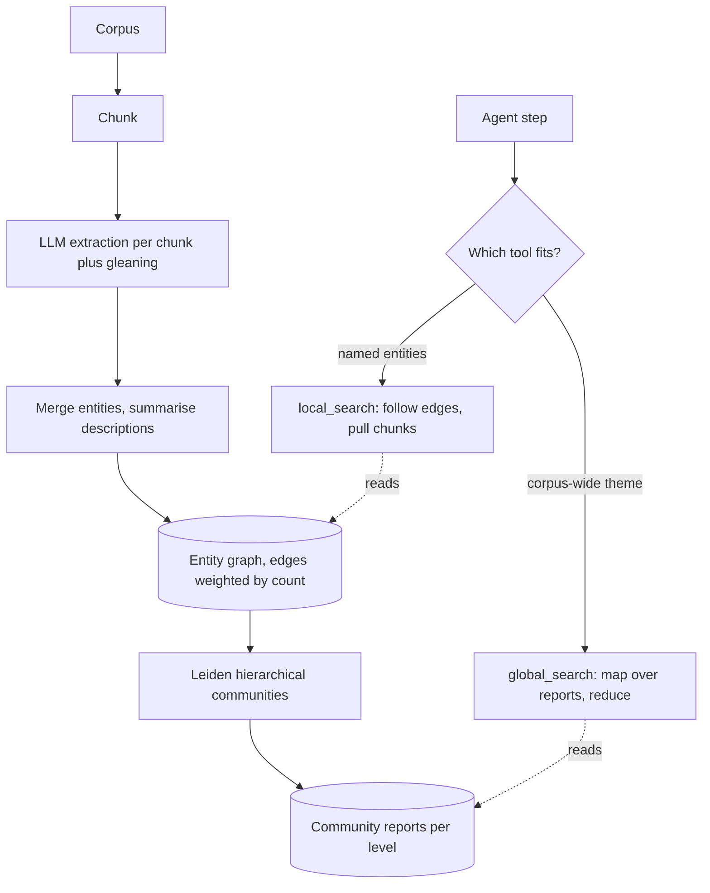

## TL;DR
GraphRAG gives an agent tools for questions top-k search cannot answer: corpus-wide themes and links
across documents. An LLM extracts an entity graph at index time and pre-writes community summaries; that
large indexing bill must be repaid by queries.

## For agent builders
- **Why it matters for agents.** A research or analyst agent asked "what are the recurring problems
  across all incidents?" will otherwise loop over dozens of vector searches and still see a sliver of the
  corpus. GraphRAG's global and local modes are tools that answer those questions in one call.
- **Where it shows up in your stack.** Microsoft's `graphrag` package (index and query CLI), graph
  retrieval integrations in agent frameworks and graph databases, and the tool layer where you expose
  global, local and plain search as separate tools the agent chooses between.
- **What you control.** Whether the corpus and question mix justify indexing, the tool descriptions that
  steer routing, the community level and cost cap per global call, refresh cadence, and building graphs
  per permission domain.
- **What you can skip.** Leiden's internals and extraction prompt details until you commit; first price
  a pilot slice against hybrid search with reranking.

## Why it exists
- **Top-k works only when the answer resembles the question,** living in a few chunks most similar to
  the query. Two question classes break it.
- **Global, sensemaking questions.** "What are the recurring complaints across these 5,000 support
  tickets?" No single chunk is similar; the answer is a property of the whole corpus. Top-k returns a
  handful of arbitrary tickets, summarised confidently and unrepresentatively. Stuffing the whole corpus
  into a long context fails on size, cost, and the model's uneven use of long inputs.
- **Connective questions.** "Which suppliers are linked to the plant that had the recall?" The plant is in
  one document, its suppliers in another; the documents share an entity, not vocabulary or embedding
  neighbourhood. Vector search finds one side of the join and misses the other.
- **Naive fixes pay too much.** Larger k dilutes context; map-reduce over every chunk at query time pays
  the full corpus-reading cost per query, and an agent issuing many searches pays it in steps.
- **The design bet: move the cost to index time.** Read everything once, extract who and what is connected
  to whom, summarise related groups ahead of time, and let queries reuse that work. Worth it when many
  queries need a corpus-level view.

## How it works
### Indexing pipeline
1. **Chunk** the corpus. Size matters more than in ordinary RAG because each chunk becomes an LLM
   extraction call: smaller chunks extract more entities but cost more calls.
2. **Extract** with an LLM prompt per chunk: entities (name, type, description) and relationships (source,
   target, description, strength), optionally claims. The reference implementation can run extra
   "gleaning" passes asking the model whether it missed anything, *because* single-pass extraction
   under-recalls on dense text.
3. **Merge and summarise elements.** The same entity appears in many chunks with different descriptions;
   they are grouped by name and type, and an LLM writes one consolidated description. This is a crude form
   of entity resolution; name variants ("IBM" vs "International Business Machines") remain a known weak
   spot.
4. **Build the graph:** nodes are entities, edges are relationships, weighted by repeated extraction:
   graphrag 3.3.0 sums the LLM's strength score across chunks (the paper describes normalised counts).
5. **Detect communities** hierarchically with the Leiden algorithm, which partitions the graph into densely
   connected groups and recursively subdivides them. Leiden is used *because* it guarantees well-connected
   communities, which the older Louvain method does not.
6. **Summarise communities.** For each community at each level, an LLM writes a report on its key entities,
   relationships and findings. Lower levels are fine-grained; the root level gives a handful of broad
   themes. These reports make global questions answerable cheaply.

### Query modes
| Mode | For | How |
|---|---|---|
| Global search | whole-corpus questions | map-reduce over community reports at a chosen level |
| Local search | specific entities | embed-match entities, fan out to relationships, neighbours, their community reports and original source chunks; rank and fit to a context budget |
| Hybrid (e.g. Microsoft's DRIFT search) | broad then specific | start from the most relevant community reports to draft a broad answer and follow-up questions, then refine with local search over entities and source chunks |

**Global search in detail:**
- **Map:** each report (or batch) produces a partial answer plus a helpfulness score.
- **Reduce:** the highest-scoring partial answers are packed into the context and synthesised.
- **Level choice:** higher is cheaper and broader; lower is more detailed and costs more calls.
- **Cost scales with communities, not relevance:** the map step reads every report at the chosen level
  whatever the question. Newer versions can first rate reports for relevance and skip whole branches of the
  hierarchy that do not matter to the query.

### Exposing the modes to an agent
- **One tool per mode.** `global_search` for themes and corpus-wide counts, `local_search` for named
  entities and their connections, plain `search_docs` for lookups. The tool descriptions do the routing.
- **Global search is a heavy tool.** One call is dozens of LLM calls inside it, so cap it per run and
  return the source-chunk links, not just the synthesised prose.
- **Local search composes in a loop:** call, read neighbours, call again on a new entity, which is
  agent-driven multi-hop retrieval.

### Variants that move the cost
The expensive part is LLM extraction and summarisation of everything at index time, so most variants move
or shrink it.

| Variant | What changes | Fits |
|---|---|---|
| LazyGraphRAG (Microsoft) | graph from cheap NLP noun-phrase co-occurrence instead of LLM extraction; all LLM summarisation deferred to query time; indexing roughly as cheap as vector RAG, paid per query instead | corpora that change often or are queried rarely |
| LightRAG and similar | keep LLM extraction, skip the community hierarchy; retrieve over entity-level and theme-level keys; merge new documents incrementally rather than re-clustering | incremental updates |

### Why each piece is there
Extraction turns text into joinable keys (entities); communities give the corpus a table of contents no
chunk contains; summaries turn an O(corpus) read per query into an O(communities) read; source-chunk links
keep grounding, since a report is a model-written paraphrase.

## Diagram
The upper chain is the expensive index-time pipeline; the lower part shows the agent choosing a tool:
global search reads community reports, local search reads entities and edges back to source chunks.



## Examples
### Agent tools: three retrieval modes with routing in the descriptions
The agent picks the tool; descriptions say what each is for and what it costs. The handlers call into
whatever GraphRAG and search backends you run; their signatures here are placeholders.

```python
TOOLS = [
    {"name": "search_docs",
     "description": "Find specific facts in a few documents (a setting, a date, one incident). Cheap. Use first.",
     "input_schema": {"type": "object", "properties": {"query": {"type": "string"}}, "required": ["query"]}},
    {"name": "local_search",
     "description": "Explore a named entity (team, service, supplier) and what it is connected to across "
                    "documents. Moderate cost. Call again on a returned entity to follow a chain.",
     "input_schema": {"type": "object", "properties": {"entity_or_question": {"type": "string"}},
                      "required": ["entity_or_question"]}},
    {"name": "global_search",
     "description": "Themes, patterns or counts across the WHOLE corpus. Expensive: at most once per task.",
     "input_schema": {"type": "object", "properties": {"question": {"type": "string"}},
                      "required": ["question"]}},
]

def handle(tool, args, run_state, backends):
    if tool == "global_search":
        if run_state.get("global_calls", 0) >= 1:
            return {"error": "global_search budget used; refine with local_search or search_docs"}
        run_state["global_calls"] = run_state.get("global_calls", 0) + 1
        res = backends.graphrag_global(args["question"], community_level=1)
    elif tool == "local_search":
        res = backends.graphrag_local(args["entity_or_question"])
    else:
        res = backends.hybrid_search(args["query"], k=8)
    return {"answer_or_chunks": res.text, "source_chunk_ids": res.source_chunk_ids}   # cite chunks
```

### Worked cost walkthrough: 2,000 incident reports
Illustrative orders of magnitude, not benchmarks, for a corpus of 2,000 internal incident reports
totalling about 4 million tokens.

| Stage | GraphRAG | Plain vector RAG |
|---|---|---|
| Chunks (1,200 tokens each) | roughly 3,300 | same |
| Index calls | one extraction call per chunk plus one gleaning pass ≈ 6,600 calls, each reading a chunk plus a long extraction prompt and writing structured output | one embedding pass |
| Tokens processed | on the order of 15 to 25 million, plus thousands more calls for entity merging and community summarisation | 4 million |
| Model doing the work | a generative LLM, typically one to three orders of magnitude more expensive per token than an embedding model (output tokens more still) | embedding model |
| Index bill | commonly two or more orders of magnitude larger in dollars, set by the extraction model you choose; parts rerun as documents change | baseline |

**Global query:** "What are the most common root causes across all incidents?"
- Vector RAG retrieves 10 chunks, about 0.3% of the corpus, and reports whatever those happen to say.
- GraphRAG uses, say, the 40 level-1 community reports: 40 map calls produce scored partial answers
  ("deployment config drift, seen in communities about service X and Y"), and one reduce call synthesises
  the top-scoring ones. Fewer than 50 calls give an answer grounded in a summary of the whole corpus.
- The index-free way to get the same coverage, map-reduce over every chunk at query time, is about 3,300
  calls per question. Community reports are that reading done once and reused, which is the whole economic
  argument.

**Local query:** "Which teams were involved in incidents touching the payments database?" Local search
matches the entity PAYMENTS-DB, follows its edges to incidents and from incidents to TEAM entities, and
pulls the source chunks for those edges, joining facts that never co-occur in one chunk.

**Agent run, same corpus (illustrative):** with only `search_docs`, an analyst agent issues many searches
of 10 chunks each and still covers a few percent of the corpus. With `global_search` it makes one heavy
call (about 41 LLM calls inside), then a few `search_docs` calls to quote source chunks.

**Decision:** lookup-heavy traffic ("what is the on-call rotation for X?") buys little; daily thematic and
relational questions repay the bill.

### Runnable estimator for your own corpus
Prompt and output sizes and the price ratio are placeholders: replace them with your extraction prompt's
real length and your models' prices.

```python
def estimate(corpus_tokens, chunk=1_200, prompt=1_500, output=500, gleanings=1,
             llm_to_embed_price=30, reports=40, global_queries_per_month=2_000):
    chunks = corpus_tokens // chunk
    calls = chunks * (1 + gleanings)
    llm_tokens = calls * (chunk + prompt + output)        # extraction only; merging/reports add more
    index_cost_vs_embed = llm_tokens * llm_to_embed_price / corpus_tokens
    return {"chunks": chunks, "extraction_calls": calls, "llm_tokens_M": round(llm_tokens / 1e6, 1),
            "index_cost_x_embedding": round(index_cost_vs_embed),
            "global_query_calls": reports + 1,             # map over reports + one reduce
            "naive_mapreduce_calls": chunks,               # read every chunk per question instead
            "calls_saved_per_month": (chunks - reports - 1) * global_queries_per_month}  # global only

print(estimate(4_000_000))
# {'chunks': 3333, 'extraction_calls': 6666, 'llm_tokens_M': 21.3, 'index_cost_x_embedding': 160,
#  'global_query_calls': 41, 'naive_mapreduce_calls': 3333, 'calls_saved_per_month': 6584000}
```

### Production snippet: the reference implementation's CLI flow
Microsoft's `graphrag` package is driven by a project folder with a settings file and an input directory.
In graphrag 3.3.0 the query is positional (older releases took `--query`); a higher
`--community-level` number means smaller communities.

```bash
pip install graphrag
graphrag init --root ./incidents            # writes settings.yaml, .env and default prompts
# (3.3.0 prompts for chat and embedding model names; pass --model and --embedding to skip)
# put text files in ./incidents/input, set the model and API key in settings.yaml / .env
graphrag index --root ./incidents           # extraction, graph, Leiden communities, reports
graphrag query --root ./incidents --method global "Most common root causes?"
graphrag query --root ./incidents --method local  "Teams involved with PAYMENTS-DB?"
```

## Production patterns
- **Price a slice before the archive.** Index a representative 1-5% sample, meter LLM tokens per thousand
  documents, and extrapolate with the estimator above before committing. Monitor tokens and dollars per
  indexed document per run.
- **Route by tool description, then check the routing.** Expose global, local and plain search as
  separate agent tools (or put a cheap classifier in front), with cost hints in the descriptions. Monitor
  per-tool answer quality, global calls per run, and tool choice against a labelled set of question types.
- **Budget the heavy tool.** Cap `global_search` per run and per tenant, and fix its community level in
  the handler rather than letting the model choose. Monitor LLM calls and tokens consumed inside the tool
  per agent run.
- **Tune extraction to the domain.** Set entity types and examples in the extraction prompt (the reference
  implementation ships an automatic prompt-tuning step) and add an entity-resolution pass for aliases.
  Monitor duplicate-node rate and entities per chunk on a sample.
- **Cite chunks, not reports.** Keep source-chunk links on every entity, relationship and report, and make
  tool results and answers cite those chunks. Monitor the share of claims that resolve to a source span.
- **Refresh and scope the graph.** Rebuild community reports on a snapshot cadence (for example weekly)
  for stable corpora, or switch to a deferred-summarisation variant for fast-changing ones; build one graph
  per permission domain. Monitor report age versus newest-document age, and audit with low-privilege
  leakage probes.

## Trade-offs
- **Corpus-wide answers vs indexing cost.** Corpus-wide and multi-hop answers become possible, but indexing
  costs far more than embedding. The balance flips toward plain RAG when queries are mostly specific
  lookups answerable from one chunk.
- **Pre-computed summaries vs staleness.** Community summaries make global queries cheap but are frozen
  interpretations. When the corpus changes daily, recomputation cost and staleness can outweigh the
  benefit.
- **Schema-free extraction vs precision.** LLM extraction needs no hand-built schema but produces noisy,
  inconsistent entity types and duplicate nodes. When the domain has a stable ontology, a curated knowledge
  graph is more precise.
- **Compression vs a paraphrase layer.** Summaries compress well for themes but sit between source and
  answer. For audit-heavy use, require answers to cite underlying chunks rather than community reports.
- **Higher vs lower community levels.** Higher is cheaper and broader; lower gives detail at more map
  calls. Pick by whether users want an overview or specifics.
- **More tools vs agent routing errors.** Three retrieval tools let the agent pick the right one, but
  each extra tool is another choice to get wrong; if routing is poor, a fixed classifier is more
  predictable than tool choice.

## Pitfalls
- **Adopting GraphRAG for fact lookup.** Symptom: a large indexing bill and answer quality no better than
  hybrid search with reranking. Diagnose: score both on an eval set split by question type. Fix: route
  only global and relational questions to it.
- **Skipping entity resolution.** One real entity becomes several nodes; local search returns partial
  neighbourhoods and communities split along spelling variants. Diagnose: sample nodes and count alias
  duplicates. Fix: an alias-merging pass.
- **Treating extraction as done once.** Documents change and the graph silently drifts from the source,
  visible as answers that omit recent incidents. Diagnose: compare report age with newest-document age.
  Fix: a refresh cadence or deferred-summarisation variant.
- **Citing community reports as evidence.** Reviewers cannot find the claimed statement in any source
  document, because the indexing model synthesised it. Fix: cite source chunks.
- **Evaluating only with a judge on "comprehensiveness".** Broad, fluent answers win those comparisons even
  when specific facts are wrong, so add fact-level checks.
- **Letting the agent call global search freely.** Symptom: cost per run spikes because the model uses
  the heavy tool for lookups. Diagnose: log tool choice and LLM calls per run against question type. Fix:
  a per-run cap and descriptions that say "expensive".
- **One graph over documents with different permissions.** Symptom: a theme summary mentions a restricted
  project to users who could not open any of its source documents, because a report inherits the content
  of every chunk it summarises. Fix: one graph per permission domain.

## When to use
- **Use when** a meaningful share of questions is thematic ("what are the main issues"), comparative across
  the corpus, or relational across documents, and the corpus is stable enough that indexing cost
  amortises. Analyst and research agents are the typical fit.
- **Prototype first:** on a representative slice, measure indexing cost per thousand documents, then compare
  against tuned hybrid retrieval with reranking and query decomposition on a labelled question set split by
  question type.
- **Route if gains are narrow:** if they appear only on global questions, send those to GraphRAG and the
  rest to plain RAG.
- **Avoid when** traffic is mostly lookups, or the corpus changes faster than you can afford to re-index.
- **Interviews:** explain the indexing-for-query trade and when you would not use it.

## Exercise
**Goal:** decide go or no-go on GraphRAG for one corpus with measured numbers. No solution is given.
- **Inputs:** 200-500 documents, 20 labelled questions (half global or relational, half lookup), a
  hybrid-search baseline and any LLM API with a spending cap.
- **Deliver:** metered indexing tokens and cost, the estimator re-run with your real prompt sizes, graded
  answers per question type for both systems, and a break-even query volume.
- **Acceptance:** estimator within 2x of metered tokens; every graded answer cites a source chunk; the
  decision follows from the per-type table, not the overall average.

## Role lens
- **Engineer:** Tunes chunk size, extraction prompts and entity types, runs incremental re-indexing, and
  adds citation links from community reports back to source chunks.
- **Architect:** Decides whether the corpus and query mix justify the indexing cost, owns the refresh
  strategy, and designs routing between global, local and plain retrieval.
- **FDE:** Identifies early whether the customer's questions are really thematic, and runs a scoped pilot
  with a cost estimate before committing to indexing their whole archive.

## Check yourself
**Q:** A customer wants GraphRAG over 50,000 frequently updated support tickets so agents can look up past
solutions. Would you recommend it?
**A:** Probably not as the main path. Agents mostly ask lookup questions ("has anyone seen error X with
product Y?"), which hybrid search with reranking handles well, and the corpus changes daily, so expensive
extraction and community summaries would be stale or constantly rebuilt. GraphRAG's advantage is global and
relational questions. If product managers also want "what are the top recurring problems this quarter", run
a periodic GraphRAG or clustering job over a snapshot for that use, route those questions to it, and keep
plain retrieval for lookups. Validate with an eval split by question type before committing spend.

## Interview questions
### What problem does GraphRAG solve that top-k vector retrieval cannot?
- **Global questions:** "what are the recurring complaints across 5,000 tickets" has no similar chunk;
  the answer is a property of the corpus, so top-k returns an arbitrary, unrepresentative handful.
- **Connective questions:** facts joined by a shared entity across documents, not shared vocabulary.
  GraphRAG pre-builds an entity graph and community summaries so both become answerable.

### How would you give an analyst agent access to a GraphRAG index alongside normal search?
- **Separate tools:** `search_docs` for lookups, `local_search` for an entity and its connections,
  `global_search` for corpus-wide themes, with descriptions that state purpose and cost.
- **Guardrails in the handler:** cap global calls per run, fix the community level, and return source-chunk
  ids so the final answer cites original text rather than community reports.
- **Evaluate routing:** a labelled set of question types, checking the tool chosen and cost per run, not
  only answer quality.

### Walk me through the GraphRAG indexing pipeline and say why each step exists.
- **Chunk and extract:** an LLM pulls entities and relationships per chunk, with optional gleaning passes
  because single-pass extraction under-recalls on dense text.
- **Merge and build the graph:** consolidate entity descriptions and weight edges by extraction count;
  this is crude entity resolution, weak on aliases.
- **Leiden communities and reports:** Leiden guarantees well-connected communities (Louvain does not), and
  pre-written reports turn an O(corpus) read per query into an O(communities) read.

### A team indexed their wiki with GraphRAG, and answers to lookup questions are no better than before. What happened, and what would you do?
- **Wrong tool for the traffic.** Lookups answerable from one chunk are served as well by hybrid search
  with reranking, so the indexing bill buys nothing there.
- **Fix:** split the eval set by question type, route only thematic and relational questions to GraphRAG,
  and keep plain retrieval for lookups; drop GraphRAG if global questions are rare.

### How would you estimate whether GraphRAG pays off for a 4-million-token corpus?
- **Index side:** about 3,300 chunks of 1,200 tokens, roughly 6,600 extraction calls with one gleaning
  pass, on the order of 15 to 25 million LLM tokens before merging and reports (illustrative).
- **Query side:** a global query is about 41 calls over 40 reports versus about 3,300 calls for naive
  map-reduce per question.
- **Decide** by how many global and relational queries per month repay the index bill, measured on a
  1-5% pilot slice first.

### When would you choose LazyGraphRAG or LightRAG over the reference GraphRAG?
- **LazyGraphRAG** when the corpus changes often or is queried rarely: cheap noun-phrase co-occurrence
  graphs at index time, with LLM summarisation deferred and paid per query.
- **LightRAG-style** when you need incremental updates: keep LLM extraction, skip the community hierarchy,
  and merge new documents without re-clustering.

## Quiz
### Q: What lets GraphRAG answer "what are the main themes in this corpus?" when vector RAG cannot?
- [ ] It embeds the query with a larger embedding model
- [x] Pre-computed community summaries over the whole entity graph, combined by map-reduce at query time
- [ ] It retrieves many more chunks per query
- [ ] It fine-tunes the model on the corpus during indexing
> No single chunk is similar to a themes question, so top-k fails. Community reports summarise the entire
> corpus ahead of time, and global search map-reduces over them, reading summaries instead of every chunk.

### Q: Where does most of GraphRAG's extra cost come from compared with plain vector RAG?
- [ ] Storing the graph in a graph database
- [ ] Running Leiden community detection
- [x] LLM calls at index time for extraction and summarisation across the whole corpus
- [ ] Larger embedding vectors for entities
> Community detection and storage are cheap. The dominant cost is reading every chunk with an LLM to
> extract entities and relationships, plus generating element and community summaries.

### Q: Which query type benefits most from GraphRAG's local search rather than plain vector search?
- [ ] A question whose answer is a verbatim sentence in one document
- [ ] A question about the current date
- [x] A question requiring facts about related entities that appear in different documents
- [ ] A question answered by a keyword match on a product code
> Local search starts at matched entities and follows relationships to neighbours and their source chunks,
> joining facts that never co-occur. Single-chunk and keyword lookups are served as well by hybrid search.

## Mastery test
**Problem:** a legal team's agent runs GraphRAG over 30,000 contracts in three permission tiers. Global
answers cost more each month, partners say themes miss last week's deals, and one associate saw a summary
naming a restricted client. Diagnose and redesign.

**A strong answer:**
- traces the leak to one graph across tiers, since reports inherit every chunk, and builds one per tier;
- ties staleness to frozen reports, measures report age, and picks a refresh cadence or deferred variant;
- ties rising cost to map calls growing with community count, so uses dynamic selection or a higher
  level, and caps global calls on lookups;
- gates the redesign on a per-type eval with chunk citations.

## Use cases & projects
### Use cases
- **Incident and postmortem analysis agents.** Global search answers "what keeps going wrong across all
  incidents?" from community summaries in one tool call.
- **Due-diligence and research agents.** Local search links people, companies and events mentioned in
  different documents that no single chunk connects.
- **Customer-feedback mining.** Themes across thousands of tickets or reviews come from pre-written
  community summaries instead of dozens of vector searches.
- **Tool routing.** An agent that holds global, local and plain search as separate tools picks the cheap
  one for lookups and the graph one for corpus-wide questions.

### Mini project
**Pilot GraphRAG against hybrid search on a slice (2-3 hours).**
- **Goal:** decide with numbers whether GraphRAG earns its indexing cost for your agent's questions.
- **Steps:** pick a few hundred documents; index them with Microsoft's `graphrag` package and record
  tokens and cost; write 10 global and 10 lookup questions; answer each with global or local search and
  with hybrid search plus reranking; expose both as agent tools and log which one the agent chooses.
- **Done when:** you have a table of indexing cost, per-query cost, latency and graded answer quality per
  question type, plus a go or no-go note on scaling to the full corpus.
