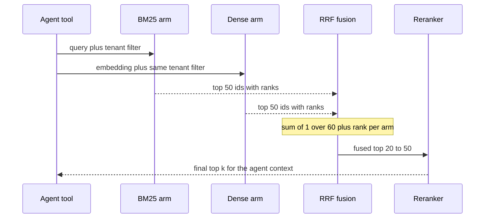

## TL;DR
Hybrid search is a common default for production agents: run BM25 and a dense retriever on the
same query and merge, because they fail on different queries. Fuse by rank (RRF), apply one filter to
both arms, and prove the gain with recall@k.

## For agent builders
- **Why it matters for agents.** An agent's queries mix ids copied from tool output with paraphrased
  questions, and it cannot tell a retrieval miss from a missing fact. Hybrid raises first-stage recall,
  which bounds every answer, plan and tool call that depends on retrieved context.
- **Where it shows up in your stack.** LangChain's `EnsembleRetriever` (weighted rank fusion over a BM25
  retriever and a vector retriever), hybrid modes in Elasticsearch, OpenSearch, Qdrant and Weaviate, SQL
  RRF in Postgres, and the retrieve node of a LangGraph RAG agent. LangSmith or your tracer shows which
  arm produced each chunk.
- **What you control.** Arm depth, fusion method and weights, the shared tenant/ACL filter, reranker
  depth, and whether the agent sees one fused tool or two separate ones.
- **What you can skip.** Fusion variants beyond RRF and weighted scores. Start with RRF; tune only with
  labels.

## Why it exists
- **Neither retriever dominates.** BM25 misses paraphrase; dense misses exact identifiers and
  out-of-domain jargon.
- **Failures overlap only partly.** Illustrative numbers: BM25 alone gets the relevant chunk into the top
  10 for 70% of queries, dense for 75%. Identical failures would cap hybrid at 75%; in practice the union
  often lands well above either, recovering identifier searches and paraphrases.
- **Recall is the ceiling.** Generation cannot answer from a chunk that was never retrieved, so
  first-stage recall bounds everything downstream; hybrid raises it cheaply. An agent that misses once
  may also retry with similar words and miss again.
- **Naive merging fails.** "Concatenate and sort by score" mixes an unbounded BM25 sum (often single or
  double digits for a multi-term query, depending on corpus and engine) with cosine in a narrow
  model-specific band, so you just get the BM25 list followed by the dense list.
- **Even per-query [0, 1] normalization is fragile:** a one-word query's top BM25 hit may be a weak match
  stretched to 1.0. Fusion methods combine evidence from rankers that do not share a scale.

## How it works
### Two retrievers, one query, in parallel
1. Send the query to both arms at once.
2. **Lexical arm:** analyze into terms, run BM25 over an inverted index.
3. **Dense arm:** embed the query, run an ANN search.
4. Each returns its top-n with scores.

- **n > final k** (commonly 50 to 200 per arm for a final 5 to 10), because fusion needs overlap and
  depth, and a reranker wants a wide pool.
- **Filters must be identical in both arms;** otherwise one arm returns documents the other was forbidden
  to. In a multi-tenant agent this is a data-leak bug, not a quality bug.
- **Run the arms concurrently,** because the tool's latency is paid on every agent step that searches.

### Reciprocal rank fusion
RRF ignores scores and uses only ranks:

```
RRF(d) = Σ_arms 1 / (k + rank_arm(d))        k = 60 in the original paper
```

- **Agreement adds up.** A document found by both arms gets two contributions; one arm, one.
- **k damps the top.** Without it rank 1 is worth 1.0 and rank 2 only 0.5, letting one arm's top hit
  dominate.

| Case (k = 60) | Score |
|---|---|
| Rank 1 in one arm | 1/61 ≈ 0.0164 |
| Rank 10 in one arm | 1/70 ≈ 0.0143 |
| Rank 10 in both arms | ≈ 0.0286, beats a lone rank 1 |

- **Design intent:** agreement between retrievers is stronger evidence than one confident vote.
- **Why it is everywhere:** no tuning, no normalization, no knowledge of score scales. Most engines with
  hybrid search offer it (Elasticsearch, OpenSearch, Qdrant and Weaviate among them, in recent versions)
  and many RAG frameworks use it by default.
- **Check your defaults;** they differ and change between releases. Weaviate, for example, moved its
  default to a normalized score fusion.
- **Weakness:** it throws away magnitude; a dense hit at cosine 0.92 and the next at 0.55 are just
  adjacent ranks.
- **Refinement 1, per-arm weights** (`w_arm / (k + rank)`): trust one arm more without touching scores.
- **Refinement 2, k as a knob:** smaller k steepens the curve so one arm's top ranks count more; larger k
  flattens it toward pure agreement counting.

### Weighted score fusion
1. Normalize each arm's scores per query (min–max to [0, 1], or z-scores).
2. Combine as `α·dense + (1 − α)·sparse`.

- **Gain:** exploits a decisive dense score or a decisive exact match; α biases toward the arm that wins
  on your traffic.
- **Fragile, because** normalization depends on the candidate pool (a longer list changes the minimum),
  per-query normalization inflates weak top hits, and α must be tuned on labeled data and re-tuned when
  either model or the corpus changes.
- **Z-scores soften this** but still assume each arm's top-n has a comparable spread, which is what varies
  most from query to query (see the worked example below).

### Query-dependent weights
- **Idea:** lean lexical when the query looks like an identifier (digits, hyphens, quoted strings) and
  dense when it reads as a question.
- **Works when** query classes are cleanly separable in your logs; it is one more component to evaluate
  per slice.
- **Engine knobs:** Weaviate's `alpha`, OpenSearch's normalization processors, Elasticsearch's RRF and
  weighted retrievers.
- **The agent alternative:** let the model pass a hint (for example an `exact` flag in the tool schema)
  and weight from it; evaluate it like any routing rule.

### Where the arms live
| Layout | Examples | Trade |
|---|---|---|
| One engine, two indexes | Elasticsearch/OpenSearch BM25 field + dense vector field, fused server-side; Postgres pgvector + `tsvector` with a SQL join and RRF; Qdrant sparse vectors (BM25-style or learned) beside dense; Weaviate BM25 inverted index beside its vector index | simpler consistency and latency |
| Two engines | search engine for lexical, vector database for dense, fused in the application | more moving parts and two consistency boundaries, but each engine does what it is best at |

- **Postgres caveat:** built-in `ts_rank` is not BM25 (no IDF and no saturation in the BM25 sense), so a
  true BM25 arm needs an extension that implements it.
- **Consistency is the same either way:** a document must be written to both arms before it is
  "indexed", and deleted from both, or a query can return a chunk that exists in one and is gone from
  the other.

### After fusion
- Fusion yields a merged list ordered by combined evidence.
- Most pipelines pass the top 20 to 50 to a cross-encoder reranker, which reads query and chunk together
  and produces the final top k that enters the agent's context.
- **Hybrid is the recall stage, the reranker the precision stage, fusion the handshake between them.**

### Measuring whether it helped
- **Hybrid is a hypothesis, not a guarantee.** On a labeled set compute recall@k for BM25 alone, dense
  alone and the fusion.
- **Inspect both directions:** queries where fusion beat the best single arm and ones where it lost.
- **Watch small k:** adding BM25 noise to a strong dense arm can lower precision at small k while raising
  recall at large k; the reranker usually recovers it, but you need to see it.
- **Close the loop on the agent:** also compare task success or answer correctness on an agent eval set,
  because better recall that adds noisy context can still hurt the final answer.

## Diagram
Watch one agent tool call: the same query and the same filter go to both arms in parallel, each returns a
deep top-n, fusion uses only ranks, and the reranker turns the fused pool into the final top k for the
agent's context.



## Examples
### Hybrid search tool for an agent: parallel arms, one filter, provenance
The tool builds the filter once, runs both arms concurrently, fuses with RRF and records which arm found
each chunk, so traces explain every result. `bm25_arm` and `dense_arm` are your async search functions.

```python
import asyncio
from collections import defaultdict

async def hybrid_search(query, tenant_id, bm25_arm, dense_arm, depth=50, k=8, rrf_k=60):
    flt = {"tenant_id": tenant_id}                    # ONE filter object for both arms
    lexical, semantic = await asyncio.gather(
        bm25_arm(query, flt, depth), dense_arm(query, flt, depth))   # lists of chunk ids
    scores, found_by = defaultdict(float), defaultdict(list)
    for arm, ranked in (("bm25", lexical), ("dense", semantic)):
        for rank, cid in enumerate(ranked, start=1):
            scores[cid] += 1.0 / (rrf_k + rank)
            found_by[cid].append(f"{arm}@{rank}")
    top = sorted(scores, key=scores.get, reverse=True)[:k]
    return [{"chunk_id": c, "found_by": found_by[c]} for c in top]   # log this in the trace
```

- **Trace check:** if wrong answers cluster on chunks with `found_by` from one arm only, that arm needs
  attention; if right chunks never appear, raise depth or fix an arm.

### Worked scenario: what hybrid costs an agent per task
A research agent searches 4 times per task. Per-search timings are illustrative orders of magnitude.

| Stage | Sequential arms | Parallel arms |
|---|---|---|
| BM25 query | 15 ms | 15 ms, overlapped |
| Embed query + ANN | 40 ms + 10 ms | 50 ms (the longer arm) |
| RRF fusion | ~1 ms | ~1 ms |
| Rerank top 30 | 120 ms | 120 ms |
| Per search | ~186 ms | ~171 ms |
| Per task (4 searches) | ~744 ms | ~684 ms |

- **The reranker, not the second arm, dominates.** Parallel arms make BM25 nearly free; depth of the
  reranked pool is the lever that moves agent latency.

### Reciprocal rank fusion in a dozen lines
Document 3 is the BM25 arm's top hit but absent from the dense top 10; it falls to fifth behind four
documents both arms agreed on, including document 8, which was only rank 4 and rank 6.

```python
from collections import defaultdict

def rrf(ranked_lists, k=60):
    """ranked_lists: iterable of lists of doc ids, best first. Returns [(doc_id, score)]."""
    scores = defaultdict(float)
    for ranking in ranked_lists:
        for rank, doc_id in enumerate(ranking, start=1):
            scores[doc_id] += 1.0 / (k + rank)
    return sorted(scores.items(), key=lambda kv: -kv[1])

bm25_top  = [3, 17, 42, 8, 21, 5, 11, 9, 30, 2]      # best first, from the inverted index
dense_top = [42, 17, 7, 21, 13, 8, 19, 25, 6, 1]     # best first, from the ANN index

for doc_id, score in rrf([bm25_top, dense_top])[:5]:
    print(doc_id, f"{score:.5f}")
# 42 0.03227   rank 3 + rank 1
# 17 0.03226   rank 2 + rank 2
# 21 0.03101   rank 5 + rank 4
# 8  0.03078   rank 4 + rank 6
# 3  0.01639   rank 1, BM25 only
```

### Production snippet: RRF in one Postgres query
Two subqueries (one ordered by the `tsvector` rank, one by cosine distance), each with a `ROW_NUMBER()`
rank, joined on chunk id with a full outer join and ordered by the sum of `1.0 / (60 + rank)`. The same
tenant filter appears in both arms.

```sql
SET LOCAL hnsw.ef_search = 100;   -- >= the arm depth below, inside a transaction

WITH lexical AS (
  SELECT id, ROW_NUMBER() OVER (ORDER BY ts_rank(tsv, q) DESC) AS rank
  FROM chunks, plainto_tsquery('english', $1) AS q
  WHERE tenant_id = $3 AND tsv @@ q
  ORDER BY ts_rank(tsv, q) DESC
  LIMIT 50
),
semantic AS (
  SELECT id, ROW_NUMBER() OVER (ORDER BY embedding <=> $2) AS rank
  FROM chunks
  WHERE tenant_id = $3
  ORDER BY embedding <=> $2
  LIMIT 50
)
SELECT COALESCE(l.id, s.id) AS id,
       COALESCE(1.0 / (60 + l.rank), 0) + COALESCE(1.0 / (60 + s.rank), 0) AS rrf
FROM lexical l FULL OUTER JOIN semantic s ON l.id = s.id
ORDER BY rrf DESC
LIMIT 10;
```

### Worked scenario: how min–max normalization misleads
A vague query. BM25's top three are a near-tie among weak matches; dense has a clear winner.

| Rank | BM25 raw | BM25 min–max | Dense raw | Dense min–max |
|---|---|---|---|---|
| 1 | 2.1 | 1.0 | 0.81 | 1.0 |
| 2 | 2.0 | 0.5 | 0.62 | 0.27 |
| 3 | 1.9 | 0.0 | 0.55 | 0.0 |

- The BM25 arm's essentially arbitrary first place now carries exactly the same weight as the dense arm's
  decisive one.
- Its second place outweighs the dense second by almost 2×, purely an artifact of stretching a 0.2-wide
  range to 1.
- RRF would have treated both arms' rank 2 identically, which is the safer default when spreads vary.

## Production patterns
- **Start with server-side or library RRF.** Use your engine's built-in rank fusion (for example
  Elasticsearch's `rrf` retriever, whose rank constant defaults to 60) or LangChain's `EnsembleRetriever`
  before writing custom fusion. Monitor recall@10 per arm and fused on a labeled set of real agent queries
  each release.
- **One filter object, both arms.** Build tenant, ACL and metadata filters once from the agent's
  authenticated session, never from model-written arguments, and pass the same object to the lexical and
  dense queries; add a CI canary that runs a cross-tenant query and fails if any foreign chunk appears.
- **Size arm depth and engine limits together.** Fetch 50 to 200 per arm, and raise engine caps to match,
  such as pgvector's `hnsw.ef_search` to at least the arm's `LIMIT`. Monitor rows returned per arm versus
  requested.
- **Reconcile the two indexes.** Write and delete through one path that updates both arms, and run a
  periodic job comparing chunk ids (or counts per document) across them. Monitor the diff count and the
  age of the oldest unreconciled document.
- **Slice the evaluation and log provenance.** Tag labeled queries by type (identifier, question, short
  keyword), gate releases on per-slice recall, and record which arm found each chunk in agent traces.
  Monitor the exact-identifier slice, which hides regressions behind gains elsewhere.
- **Move to weighted fusion only with labels.** If one arm clearly dominates, tune α (or per-arm RRF
  weights) on labeled data and record it with the model and corpus versions. Monitor it after every
  model or corpus change, since α must be re-tuned.

## Trade-offs
- **Higher first-stage recall for mixed traffic,** at double the query-time work (an embedding call, an
  ANN search and a BM25 query) and index storage; if one arm is already at the recall ceiling on your
  labeled set, the second is cost without benefit.
- **RRF: tuning-free and robust to scale,** but it discards magnitude; when one arm is far stronger on your
  traffic, weighted fusion with a tuned α can beat it, at the price of re-tuning on every model or corpus
  change.
- **One engine vs two.** Server-side fusion in one engine keeps consistency and latency simple; a search
  engine plus a vector database scale independently but make every write a two-phase problem.
- **Deeper candidate lists** improve fusion and give the reranker more to work with, but latency and
  reranker cost grow with depth, multiplied by every search an agent makes; once recall@depth is flat,
  extra depth is waste.
- **One fused tool vs model-chosen arms.** Fusion removes misrouting at the cost of running both arms
  every call; separate tools are cheaper but depend on the model choosing well.

## Pitfalls
- **Summing raw BM25 and cosine scores.** Symptom: results are simply the BM25 list, because its scores
  are an order of magnitude larger. Diagnose: print both arms' raw score ranges for a few queries. Fix:
  RRF or per-query normalization.
- **A metadata or ACL filter in one arm only.** Symptom: a user sees a document they should not, or a
  filtered query returns items from the unfiltered arm; in an agent the leaked chunk may be quoted
  straight into an answer or passed to another tool. Diagnose: log `found_by` and the tenant of every
  returned chunk; a cross-tenant canary query fails.
- **No shared commit or reconciliation between indexes.** Symptom: "I just deleted that document and it
  still shows up" from one arm, hours after the other dropped it. Diagnose: diff chunk ids per document
  across the two indexes.
- **Fused scores as relevance thresholds.** RRF values depend on list depth and the number of arms, so a
  cutoff tuned at depth 50 behaves differently at depth 100.
- **Declaring victory on aggregate recall.** Symptom: a regression on a query class (say, exact SKU
  lookups) hidden by gains elsewhere. Fix: slice the evaluation by query type.

## When to use
- **Default to hybrid** for agents over corpora mixing prose with identifiers, names, codes or jargon
  (most enterprise content) and for users who both search and ask questions.
- **Skip it when** a labeled evaluation shows one arm already captures the relevant chunk in nearly every
  case, or serving constraints rule out one arm (no GPU for embeddings, or no inverted index available).
- **Measure:** recall@k per arm and fused, sliced by query type, plus end-to-end answer quality or agent
  task success with and without the second arm.
- **Start with RRF;** move to weighted fusion only with labeled data to tune it and a process to re-tune.

## Exercise
**Goal:** build a hybrid search tool for a two-tenant corpus and prove both its gain and its safety. No
solution is given.
- **Inputs:** 2,000+ chunks split across two `tenant_id` values, a BM25 retriever and a vector store of
  your choice, and 40 labeled queries tagged identifier or question.
- **Deliver:** one async tool running both arms with one filter object, RRF fusion, `found_by` provenance
  per chunk; recall@10 per arm and fused, per slice; the same with min–max weighted fusion at two α values.
- **Acceptance:** fused recall@10 is at least the best single arm on each slice, or you explain the slice
  where it is not; a cross-tenant canary test passes; arm depth versus recall shows where it goes flat.

## Role lens
- **Engineer:** Implements both arms behind one retrieval interface, writes the RRF or normalized fusion
  step, and keeps the candidate depth and fusion constants in configuration with tests on labeled
  queries.
- **Architect:** Chooses between one engine with two indexes and two specialized engines, and owns the
  write-path consistency and filtering contract that both arms must honor.
- **FDE:** Demonstrates the gain to a customer by replaying their real query log through BM25-only,
  dense-only and hybrid and showing which of their own queries each configuration recovers.

## Check yourself
**Q:** You are adding BM25 to an existing dense-only RAG system in Postgres with pgvector. Describe the
retrieval query, how you would merge the two result sets, what could go wrong with filters and deletes,
and how you would prove the change helped.
**A:** First, note that Postgres's native `ts_rank` is a term-frequency ranking without IDF, not BM25;
either accept it as the lexical arm (often good enough for identifier matching, which is what the dense arm
lacks) or install an extension that implements real BM25. With the native route, add a `tsvector` column
with a GIN index beside the existing vector column, and at query time run
two subqueries limited to the same tenant and document filters: one ordered by the full-text rank over
the `tsvector`, one ordered by cosine distance on the embedding, each returning its top 50 with a row
number. Join them on chunk id with a full outer join and compute reciprocal rank fusion, 1/(60 + rank)
summed across arms, ordering by that sum and taking the top 10 for the reranker or the prompt. Because
both arms live in one table, deletes and filters are naturally consistent, which is a real advantage over
a separate search engine; the risks are forgetting to apply the same `WHERE` clause to both subqueries,
and the HNSW arm returning fewer rows than asked for. pgvector's HNSW scan returns at most
`hnsw.ef_search` candidates (40 by default), so `LIMIT 50` needs ef_search raised to at least 50 even
with no filter, and a selective `WHERE` is applied after the graph search, starving the arm further
unless iterative index scans (pgvector 0.8 and later) are enabled. Also note
the GIN index accelerates only the match; `ts_rank` is computed for every matching row before sorting. To
prove it helped, run the labeled query set through dense-only and hybrid, compare recall@10 overall and
per query type, inspect queries that regressed, and check p95 latency, since the second subquery adds
time.

## Interview questions
### Design the retrieval tool for a multi-tenant support agent. What goes into it?
- **One fused tool:** BM25 and dense arms run in parallel at depth 50 or so, fused with RRF, then a
  reranker picks the top k that enters the agent's context.
- **Security in the tool, not the prompt:** the tenant and ACL filter comes from the authenticated
  session, never from model-written arguments, and is applied identically to both arms.
- **Observability:** log arm provenance per chunk in traces and evaluate per query slice and on agent
  task success.

### After adding hybrid, an agent quotes a document from another tenant. How do you debug and prevent it?
- **Likely cause:** the tenant or ACL filter is applied in only one arm, so that arm returns forbidden
  chunks and a strong match carries one through fusion into the agent's context.
- **Prevent it:** build one filter object and pass it to both arms, and add a CI canary that runs a
  cross-tenant query and fails if any foreign chunk appears.

### When would you choose weighted score fusion over RRF, or skip hybrid altogether?
- **Weighted fusion** only when one arm clearly dominates and you have labels to tune α, re-tuned after
  every model or corpus change, because min–max normalization inflates weak top hits.
- **Skip hybrid** when a labeled evaluation shows one arm already captures the relevant chunk in nearly
  every case, since the second arm doubles query-time work and index storage.

### How deep should each arm retrieve, and how do you know when to stop adding depth?
- **Typical sizing:** 50 to 200 candidates per arm for a final 5 to 10, with the top 20 to 50 fused results
  passed to a cross-encoder reranker, because fusion needs overlap and the reranker needs a wide pool.
- **Stop when recall@depth is flat** on your labeled set; beyond that, latency and reranker cost grow with
  no gain.
- **Check engine caps match,** for example pgvector's `hnsw.ef_search` at least the arm's `LIMIT`, and
  monitor rows returned per arm versus requested.

## Quiz
### Q: Why can BM25 scores and cosine similarities not simply be added together?
- [ ] Because BM25 scores are always negative and cosine scores are always positive
- [x] Because BM25 is an unbounded sum that varies with query length and term rarity, while cosine sits in a narrow model-specific band, so one scale swamps the other
- [ ] Because cosine similarity is a distance and must be inverted first
- [ ] Because the two retrievers return different document ids for the same chunk
> The two scores measure different things on unrelated scales; a sum is dominated by whichever is
> numerically larger, typically BM25. Fusion therefore uses ranks (RRF) or per-query normalization
> before combining.

### Q: In reciprocal rank fusion with k = 60, why can a document ranked 10th by both arms outrank one ranked 1st by a single arm?
- [ ] Because RRF penalizes documents that appear in only one list by halving their score
- [ ] Because rank 10 receives a bonus for stability across retrievers
- [x] Because 1/70 + 1/70 exceeds 1/61, so agreement from two arms contributes more than a top rank from one
- [ ] Because the constant k is subtracted from single-arm scores
> Each arm contributes 1/(k + rank); two moderate contributions sum to about 0.0286 while a lone rank-1
> contributes about 0.0164. The constant k flattens the top of the curve so that a single confident arm
> cannot dominate.

### Q: A hybrid system applies the tenant filter only in the dense arm. What is the most serious consequence?
- [ ] Latency doubles because BM25 must scan all tenants
- [x] The lexical arm can return chunks from other tenants, which fusion may rank highly and expose to the user
- [ ] RRF scores become negative for cross-tenant documents
- [ ] The dense arm returns fewer than k results and fusion fails
> Fusion merges whatever each arm returns; a filter missing from one arm lets forbidden documents into
> the candidate pool, and a strong lexical match can carry one to the top. Filters and ACLs must be
> enforced identically in both arms.

## Mastery test
**Problem:** a parts-catalog agent fuses BM25 and dense with RRF (k = 60). The team adds a third arm, a
learned sparse index, and aggregate recall@10 rises 3 points, but exact part-number lookups regress: the
right part, BM25's rank 1 and absent elsewhere, now often lands outside the top 10. Explain and fix.

**A strong answer:**
- computes a lone rank 1 at 1/61 ≈ 0.0164, while a near-miss part at rank 30 in two arms gets
  2/90 ≈ 0.022, so agreement on look-alike codes outvotes the exact match;
- fixes with a higher BM25 weight on identifier-style queries (2/61 ≈ 0.033), a smaller k, or an
  exact-match short-circuit;
- gates releases on the identifier slice, not aggregate recall, and checks the reranker sees the true part.

## Use cases & projects
### Use cases
- **Default retrieval for RAG agents.** Hybrid is the common first-stage choice when an agent's queries
  mix copied identifiers with paraphrased questions.
- **Multi-tenant agent platforms.** A shared tenant and ACL filter applied identically to both arms keeps
  fusion from surfacing another tenant's documents.
- **Recall-bound agent tasks.** Planning, troubleshooting and compliance agents whose answers depend on
  finding one specific chunk benefit most from the recall lift.
- **Debugging retrieval misses.** Tracing which arm produced each chunk shows whether a failure was
  lexical, semantic or a fusion problem.

### Mini project
**Build and evaluate a fused search tool for an agent (2-3 hours).**
- **Goal:** show the recall gain of RRF fusion over each arm alone on agent-style queries.
- **Steps:** index the same 1k-5k chunks in a BM25 retriever and a vector store with a shared
  `tenant_id` field; implement RRF over the top 50 of each arm; label 30 queries mixing ids and
  paraphrases; measure recall@10 for BM25, dense and fused results; wrap the fused search as one tool and
  log which arm contributed each returned chunk.
- **Done when:** you have a recall table for the three setups, a test proving no cross-tenant chunk is
  returned, and trace logs attributing chunks to arms.
