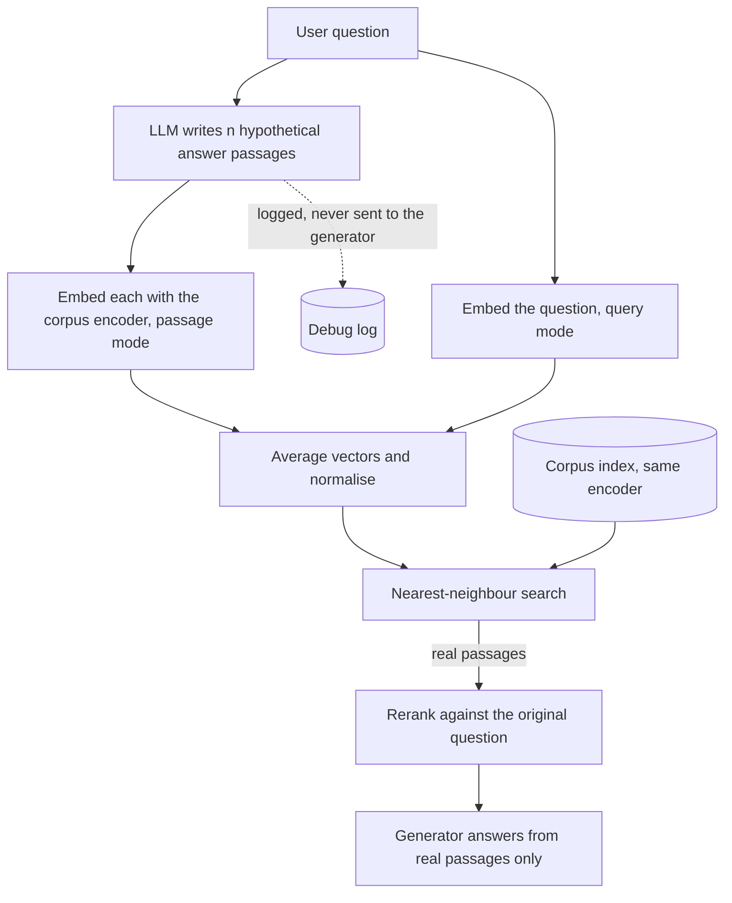

## TL;DR
HyDE has an LLM write a plausible answer passage, embeds that instead of (or with) the question, and
retrieves the real passages nearest to it. Answer-shaped text lands near real answers even with wrong
facts; it costs one generation per query.

## Why it exists
- **Queries and passages are different shapes.** "how do I rotate an API key?" is short, interrogative,
  with almost no topical content beyond three words. The answer reads "To generate a new key, open Settings,
  then Keys, and choose Regenerate; the previous key remains valid for 24 hours": declarative, longer, full
  of vocabulary the question never used.
- **Some encoders do not close the gap.** Encoders trained on large sets of (query, passage) pairs learn to
  map the two shapes together. Used zero-shot, out of domain, or trained without such pairs (the original
  paper used an unsupervised encoder), they do not: the question sits in a "questions about keys" region,
  the passage in "procedures about keys", and the question's nearest neighbours are other questions, which
  the corpus does not contain.
- **The direct fix needs labels.** Training the retriever on in-domain labelled pairs needs labels you
  usually do not have. Instruction-prefixed embedding models ("query:" versus "passage:") are the cheap
  modern version of that fix and should be tried first.
- **HyDE needs no labels and no training.** If the query is the wrong shape, generate something of the
  right shape. Even a partly wrong answer is closer to the real one than the question was.

## How it works
### The steps
1. **Generate.** Prompt the LLM: "write a passage that answers: {question}". The original work sampled
   several hypothetical documents per query; samples cost linearly and reduce the variance from any single
   hallucinated detail.
2. **Encode with the document encoder.** Embed each hypothetical with the same model that embedded the
   corpus, because the comparison must be passage-to-passage in one space. A different encoder defeats the
   whole point.
3. **Aggregate.** Average the hypothetical embeddings, optionally adding the original query's embedding.
   Averaging keeps what samples agree on (topic, entities, structure) and suppresses what they disagree on
   (invented numbers); the query anchors the result to the user's actual words.
4. **Search.** Nearest-neighbour search with the aggregated vector returns real passages.
5. **Answer from real passages only.** The hypothetical never reaches the generation prompt. It is a search
   key, not evidence; treating it as evidence is how hallucinations get cited.

### Why hallucinated details mostly do not matter
- **An embedding model is a lossy compressor.** It preserves the gist (what the passage is about, which
  entities and terms appear, how it is structured) and gives little weight to a specific number or date.
- **So a wrong number still lands right.** A hypothetical saying keys stay valid for 48 hours when the
  truth is 24 still lands next to the key-rotation passage, because everything except the number matched.
- **The paper's framing:** the encoder acts as a filter that grounds the generated text in the real corpus.
- **The exception is entity-level error.** Writing about the wrong product, or confusing two similarly
  named services, puts the vector in the wrong neighbourhood, and no amount of averaging rescues it.

### Where it fits with neighbouring techniques
| Technique | Relation to HyDE |
|---|---|
| **Query rewriting** | HyDE is a special case: rewriting the query into document-shaped text. |
| **Query2doc** | Close relative: concatenates the original query with the generated pseudo-document (repeating the query so it is not drowned out); shown to help sparse BM25 as well as dense. |
| **Doc2query-style expansion** | The mirror image at index time: a model writes the questions each chunk answers, indexed with (or as keys for) the chunk, so the corpus becomes question-shaped. Generation moves from every query to ingestion: suits high query volume and stable corpora. HyDE suits the reverse, or a corpus you cannot re-index. |
| **Hybrid search** | The hypothetical can feed the sparse leg, since it has answer vocabulary the question lacked; but it also has invented terms, so keep the original query for BM25 too. |
| **Contextual / parent-document retrieval** | Index-side; HyDE is query-side, and they combine. |
| **Reranker** | Score the real candidates against the original question, not the hypothetical. |

### When the gap is already closed
- **Modern instruction-tuned embedders** trained on large query-passage corpora have narrowed the gap
  substantially.
- **On such a model HyDE's gain can be small, zero or negative,** and it always adds a generation call.
- **The honest position is model- and corpus-dependent:** measure recall@k on your golden set with and
  without it.

## Diagram
Note where the hypothetical stops: it shapes the search vector, but only real passages reach the
reranker and the generator, both of which see the original question.



## Examples
### HyDE with multiple samples and a query anchor
`llm`, `embed` and `index.search` are stubs for any provider, encoder and vector store.

```python
import numpy as np

def hyde_search(question, n_samples=3, k=10, include_query=True):
    prompt = f"Write a short documentation passage that answers the question.\nQuestion: {question}\nPassage:"
    hypos = [llm(prompt, temperature=0.7) for _ in range(n_samples)]   # parallelise in production
    vecs = [embed(h, kind="passage") for h in hypos]          # same encoder as the index
    if include_query:
        vecs.append(embed(question, kind="query"))             # anchor to the user's words
    v = np.mean(np.stack(vecs), axis=0)
    v = v / np.linalg.norm(v)                                  # cosine-normalised index assumed
    return index.search(v, k), hypos

hits, hypos = hyde_search("How do I rotate an API key without downtime?")
# Illustrative hypothetical: "To rotate an API key, create a new key in Settings > API Keys, update
# your clients to use it, then revoke the old key. Old keys stay valid for 48 hours after a new one
# is created so that clients can migrate." The 48 is invented; the real passage says 24 hours, but
# the topic, entities and structure match, so the real passage is retrieved and the generator answers
# from it, never from the hypothetical.
```

### Runnable toy: the question finds questions, the hypothetical finds the answer
Pure Python with a bag-of-words stand-in for an embedding, so it shows the shape mismatch lexically, not
dense-model behaviour. Note the hypothetical's wrong "48 hours" barely matters.

```python
import math, re
from collections import Counter

def vec(text):                                   # toy bag-of-words "embedding"
    return Counter(re.findall(r"[a-z0-9]+", text.lower()))

def cos(a, b):
    dot = sum(a[t] * b[t] for t in a)
    return dot / (math.sqrt(sum(v * v for v in a.values())) * math.sqrt(sum(v * v for v in b.values())))

corpus = {
    "key-rotation": "To generate a new key, open Settings, then Keys, and choose Regenerate; "
                    "the previous key remains valid for 24 hours.",
    "faq-billing": "How do I update my billing address? Open Billing and edit the address.",
    "sso-setup": "To enable single sign-on, open Settings, then Security, and upload the IdP metadata.",
}
question = "how do I rotate an API key?"
hypo = ("To rotate an API key, open Settings, then Keys, generate a new key and update clients; "
        "the previous key remains valid for 48 hours.")
for name, q in (("question", question), ("hypothetical", hypo)):
    ranked = sorted(corpus, key=lambda d: cos(vec(q), vec(corpus[d])), reverse=True)
    print(f"{name:12}", [(d, round(cos(vec(q), vec(corpus[d])), 2)) for d in ranked])
# question     [('faq-billing', 0.28), ('key-rotation', 0.16), ('sso-setup', 0.0)]
# hypothetical [('key-rotation', 0.82), ('sso-setup', 0.29), ('faq-billing', 0.18)]
```

The bare question's best match is the other "How do I ..." text; the answer-shaped hypothetical ranks the
real procedure first.

### Worked scenario: deciding whether to ship it
Illustrative A/B on a golden set for an internal wiki; the shape of the decision, not a benchmark.

| Variant | recall@10 | Added p95 latency | Verdict |
|---|---|---|---|
| Generic encoder, plain query | 0.6 | none | baseline |
| Generic encoder + HyDE (3 samples + query) | higher | one generation | ship if the gain beats the latency cost |
| Instruction-prefixed encoder, plain query | test first | none | if it matches HyDE, skip HyDE |
| Instruction-prefixed encoder + HyDE | often flat | one generation | usually not worth it |

## Production patterns
- **HyDE as a fallback, not the default path.** Run plain retrieval first; only when the top score or
  reranker score is below a cut-off tuned on your golden set, generate the hypothetical and search again.
  Monitor the fallback rate and recall@k on the fallback slice.
- **Short, capped hypotheticals.** Ask for a short passage and cap generation with the provider's max
  output tokens setting, keeping it under the encoder's input limit so nothing is silently truncated.
  Monitor generation latency at p95, which dominates HyDE's cost.
- **Parallel samples, one embedding batch.** Issue the n generations concurrently and embed them in one
  batch call with the index's own encoder and document mode. Monitor that the encoder version used at
  query time matches the one recorded for the index.
- **Keep the original query in every leg.** Average the query embedding into the dense vector and send the
  original text (not the hypothetical) to BM25 and to the reranker. Monitor identifier-heavy queries as a
  separate slice, where dropping the query regresses first.
- **Firewall the hypothetical.** Log it for debugging but strip it before the generation prompt; add an
  eval check that flags answer facts found in the hypothetical but in no retrieved passage.

## Trade-offs
- **Big gains on mismatched encoders vs none on matched ones.** Largest with zero-shot or out-of-domain
  encoders and question-shaped queries over passage-shaped corpora; with an instruction-tuned embedder
  trained on your query type the gain shrinks or reverses.
- **Recall vs latency and cost.** One generation per query adds latency on the order of several hundred
  milliseconds to a few seconds (a whole passage must be decoded before search starts) and a per-query
  cost; using it only as a fallback when first-pass scores are weak keeps it off the common path.
- **Robust to small errors vs fragile to entity confusion.** On private or novel domains the model writes a
  generic passage, and retrieval becomes generic with it.
- **Stability vs cost of samples.** Several samples stabilise the aggregated vector at linear cost; one is
  cheaper and noisier, and the right number depends on how much the hypotheticals disagree.

## Pitfalls
- **Feeding the hypothetical into the answer prompt.** The symptom is fluent answers containing facts that
  appear in no retrieved passage.
- **Encoding the hypothetical with a different model than the index.** The symptom is retrieval worse than
  the plain-query baseline.
- **Dropping the original query entirely.** The symptom is regressions on queries with exact identifiers,
  such as ticket numbers, that the hypothetical paraphrased away.
- **Using it on time-sensitive questions** (current prices, latest version). The model writes stale
  details and the vector drifts toward old passages; the symptom is retrieval of outdated versions.
- **Adopting it because the paper reported gains.** The symptom is added latency and a flat recall@k.
- **Reranking against the hypothetical.** The symptom is a top result matching the invented details (the
  "48 hours" passage from an old version) over the true answer.
- **Exceeding the encoder's input limit.** The symptom is silent truncation and a vector that represents
  only the opening sentences.

## When to use
- **Use when** queries are question-shaped, the corpus is passage-shaped, and the embedder was not trained
  for that asymmetry: a generic or older encoder, or a domain far from its training data.
- **Little to fix when** the corpus is itself question-shaped (an FAQ indexed on its questions, or chunks
  expanded with generated questions).
- **Compare against index-time question generation** when query volume is high and the corpus stable; it
  pays the generation cost once per chunk rather than once per query.
- **Try first:** instruction-prefixed embeddings and hybrid search, since they are free at query time.
- **Avoid for** identifier lookups, time-sensitive facts, and domains the LLM knows nothing about.
- **Measure:** recall@k and MRR on a golden set with and without it, and the latency it adds at p95.
- **Interviews:** the standard answer to "how would you improve dense retrieval without labelled data";
  the strong candidate also explains why hallucinations in the hypothetical are mostly harmless and when
  they are not.

## Role lens
- **Engineer:** Implements the generate, embed, average, search path, keeps the hypothetical out of the
  answer prompt, and A/B tests recall@k against the plain-query baseline.
- **Architect:** Decides whether the extra generation fits the latency and cost budget, and whether a
  better embedding model would remove the need for it altogether.
- **FDE:** Checks whether the customer's domain is one the model can write plausibly about before
  recommending HyDE, and demonstrates the gain or lack of it on their own queries.

## Check yourself
**Q:** An internal wiki search uses a generic off-the-shelf embedding model; questions are phrased as
"how do I..." and recall@10 is about 0.6. Would HyDE help, how would you test it, and what are the risks?
**A:** Probably yes: the queries are question-shaped, the wiki is passage-shaped, and a generic encoder
is exactly the zero-shot setting where the asymmetry hurts. Test by generating two or three hypothetical
passages per golden-set question, embedding them with the same encoder as the index, averaging with the
query embedding, and comparing recall@10 and MRR against the baseline; also test an instruction-prefixed
encoder and hybrid search, which may close the gap for free. Risks: the wiki covers private systems the
model cannot write about, giving generic hypotheticals; identifier-heavy queries regress if the original
query is dropped; latency rises by one generation; and if the hypothetical ever leaks into the answer
prompt, invented details get cited. Keep it as a search key only.

## Interview questions
### What is HyDE and why does a partly hallucinated passage retrieve the right documents?
- **Definition:** an LLM writes a plausible answer passage, you embed it with the corpus encoder instead of
  (or with) the question, and retrieve the real passages nearest to it.
- **Why it works:** questions and passages are different shapes; an answer-shaped text lands among real
  answers, while a bare question's nearest neighbours are other questions.
- **Why wrong facts mostly do not matter:** the encoder is a lossy compressor that keeps topic, entities and
  structure and gives little weight to a specific number such as "48 hours" versus 24.

### You added HyDE and recall@10 dropped below the plain-query baseline. What do you check?
- **Encoder mismatch:** the hypothetical must be embedded with the same model and mode as the corpus;
  a different encoder puts it in an unrelated space.
- **Dropped query:** identifier-heavy queries regress when the original is not averaged in or not sent to
  BM25 and the reranker.
- **Entity confusion and truncation:** on private domains the model writes about the wrong product, and a
  long hypothetical may be silently truncated past the encoder's input limit.

### When would you not use HyDE?
- **When the embedder already closes the gap:** an instruction-tuned model trained on query-passage pairs
  of your query type leaves little gain while the generation cost stays.
- **For identifier lookups and time-sensitive facts,** where invented or stale details pull the vector
  toward the wrong or outdated passages.
- **At high query volume over a stable corpus,** index-time question generation pays the generation cost
  once per chunk instead of once per query.

### How do you keep HyDE's latency acceptable in production?
- **Use it as a fallback:** run plain retrieval first and only generate when first-pass scores fall below a
  cut-off tuned on the golden set.
- **Keep hypotheticals short** with a capped output length, and generate the n samples concurrently,
  because one decoded passage (several hundred milliseconds to a few seconds) precedes the search.
- **Monitor** the fallback rate, p95 generation latency and recall@k on the fallback slice.

### How does HyDE relate to Query2doc and doc2query?
- **Query2doc** concatenates the original query with the generated pseudo-document, and helps sparse BM25
  as well as dense retrieval.
- **Doc2query-style expansion** is the mirror image at index time: generate the questions each chunk
  answers, so the corpus becomes question-shaped.
- **Choose by where you can pay:** HyDE for a corpus you cannot re-index or low query volume, doc2query for
  high volume and a stable corpus.

## Quiz
### Q: Why does a hypothetical answer with a wrong number still retrieve the right passage?
- [ ] The LLM is usually right about numbers in technical domains
- [x] The embedding preserves topic, entities and structure and gives little weight to a specific detail, so the vector still lands in the right neighbourhood
- [ ] The vector index ignores numeric tokens
- [ ] The reranker corrects the number before searching
> Encoders are lossy compressors that keep the gist; the paper describes the encoder as a filter that
> grounds the generated text in the corpus. Entity-level errors, unlike numeric ones, do move the vector.

### Q: Which mistake most directly defeats HyDE's mechanism?
- [ ] Sampling three hypotheticals instead of one
- [ ] Including the original query embedding in the average
- [x] Embedding the hypothetical with a different model than the one that embedded the corpus
- [ ] Using a temperature above zero for generation
> The whole idea is passage-to-passage comparison in one space; a different encoder places the
> hypothetical in an unrelated space, so nearest neighbours are meaningless.

### Q: When is HyDE most likely to add latency without improving recall?
- [ ] When the corpus is passage-shaped technical documentation
- [x] When the embedding model is instruction-tuned on query-passage pairs matching your query type
- [ ] When queries are phrased as natural-language questions
- [ ] When no labelled relevance data exists
> Such models already map questions near their answers, which is the gap HyDE was designed to close;
> the remaining benefit is small or negative while the generation cost stays.
