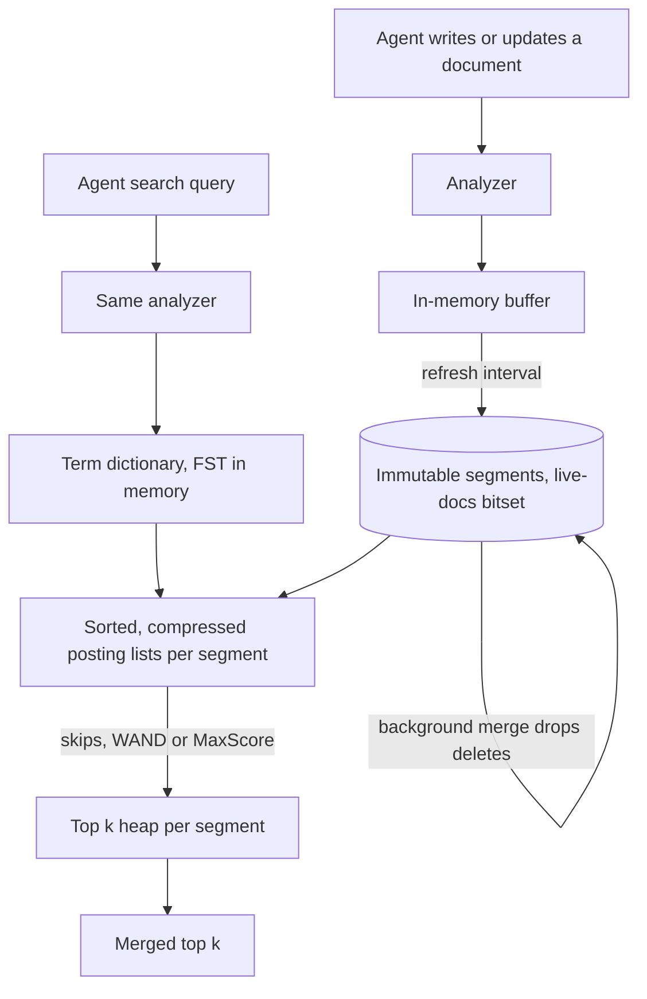

## TL;DR
The inverted index is the engine under an agent's keyword search: each term maps to a sorted posting list,
so a query reads only its terms' lists. For agents, its refresh delay, analyzer and cheap filters matter
more than its internals.

## For agent builders
- **Why it matters for agents.** Agents write and then read: create a ticket, save a note, then search
  for it one step later. Inverted-index engines make writes searchable only after a refresh, so an agent
  can miss its own write. Analyzer choices decide whether ids copied between tools match at all.
- **Where it shows up in your stack.** Elasticsearch and OpenSearch (Lucene), Tantivy-based engines, the
  keyword half of hybrid vector databases, and LangChain or LlamaIndex retrievers that wrap them.
- **What you control.** Field mappings and analyzers, `refresh_interval` and per-write refresh, keyword
  fields for tenant and ACL filters, and whether the tool asks for exact hit counts.
- **What you can skip.** Posting compression formats, the term-dictionary FST and the details of WAND.
  Know that top-k is cheap, exact counts are not, and pruning is exact.

## Why it exists
- **The forward index is too slow.** Document id → words means "which documents mention indemnification"
  opens and scans every document: O(total tokens) per query. A million documents of a thousand tokens each
  is a billion token comparisons per query, growing linearly with the corpus.
- **Caching does not help,** because queries are too diverse, and agent-written queries are more diverse
  still.
- **Queries are short; vocabularies are smaller than corpora.** Precompute, per term, the documents that
  contain it, and a five-term query reads five lists. Cost tracks how many documents contain the query
  terms, not how many exist.
- **The decisive part is the cheap part.** Rare terms carry most of the ranking signal and have short
  lists.
- **Doing it well defines the structure.** Common-term lists are huge (compress them); intersections must
  not read all of both lists; ranking needs per-document statistics; documents change while queries run;
  the dictionary is hit millions of times a second. Every feature of Lucene (under Elasticsearch and
  OpenSearch) or the engines inside Vespa and Tantivy answers one of these. At the high end it is sharded
  across machines, still on CPUs.

## How it works
### Background: dictionary, postings and pruning
- **Term dictionary.** Maps each term to its posting list's location and statistics such as document
  frequency; supports exact lookup and ordered traversal for prefix and wildcard queries. Lucene keeps a
  finite-state transducer (a compressed, trie-like automaton) over term prefixes in memory, pointing into
  on-disk blocks of sorted terms.
- **Posting list.** Documents containing the term, sorted by document id, each with term frequency,
  optionally positions (for phrase and proximity queries) and payload data.
- **Sorted ids pay three ways.** Merge intersection with two cursors costs O(|A| + |B|) instead of
  O(|A|·|B|); gap encoding (variable-byte or bit-packed, PForDelta and relatives) uses a byte or two, often
  fewer bits, instead of four; and lists stream through the CPU cache.
- **Skip data.** Stored per block of roughly a hundred entries (Lucene encodes postings in blocks of 128),
  it lets an intersection jump stretches that cannot match. Rare AND common costs about the size of the
  rare list.
- **Ranking data.** BM25 needs document length from a per-field norms structure, plus collection-wide N
  and average length; in a sharded engine each shard holds its own statistics unless the coordinator
  fetches global ones first.

| Strategy | How | Consequence |
|---|---|---|
| Term-at-a-time | walk each term's list fully, accumulate partial scores per document | every list is read to the end |
| Document-at-a-time | advance all lists in lockstep, score each document completely | what Lucene and most production engines mostly use, because it enables early termination |

- **Upper bounds:** with BM25 you can precompute, per term, the maximum score any document can get from it.
- **WAND and MaxScore** use those bounds to skip documents that cannot enter the current top k, so a
  top-10 query over a term in ten million documents reads a small fraction of the list.
- **That is why** "return the top 10" is far cheaper than "return all matches sorted".

MaxScore step by step, OR query "iphone15 case" (rare term max 9.0, common term max 1.5):
1. Fill the top-10 heap from the first documents seen; its weakest entry, the threshold θ, is now 4.0.
2. A document containing only "case" scores at most 1.5 < θ, so it can never enter the results.
3. "case" becomes a *non-essential* list: the engine stops iterating it and only advances "iphone15".
4. It probes "case" (via skips) only for the candidate ids that list produces; four million postings
   shrink to a few thousand lookups.

- **WAND** reaches the same effect by ordering cursors by current document id and summing upper bounds
  until they exceed θ.
- **Block-max variants** bound the score within each block of postings, not only per term (Lucene stores
  these as *impacts*, frequency and length pairs), so even a common term can skip low-scoring blocks.
- **The pruning is exact,** not approximate: the top k is identical to scoring everything, only cheaper.
  It improves as θ rises, which is why engines prefer not to compute an exact total hit count.

### Analysis defines the terms
1. Tokenize, lowercase, maybe strip accents.
2. Stem ("running" → "run"), drop stopwords, split or keep hyphenated tokens.
3. The output tokens are the index keys.

- **The analyzer is the entire semantic contract.** A query is analyzed the same way and looked up by
  exact key, so whatever the analyzer does not normalize cannot match.
- **Consequences:** the same text in two fields with different analyzers behaves like two different
  indexes, and changing an analyzer requires a full re-index.
- **Agent consequence:** ids flow between tools verbatim (`INC-20931`, `sku_44-B`), so map them as
  `keyword` fields or analyze them to keep the whole token, or the agent's exact lookup fails.

### Segments, immutability and read-after-write
- **Write-once,** because mutating a compressed, sorted list in place is impractical.
- **Segments.** New documents accumulate in memory and flush as a new immutable **segment**, a complete
  mini-index. Queries run against every segment and merge results.
- **Deletes** go into a per-segment bitset of live documents; postings stay until a background merge
  rewrites the segments without them. **Updates** are a delete plus a re-add.
- **Easy to forget, 1:** a document is not searchable until its segment is flushed (the refresh interval).
  An agent whose next step runs faster than the refresh cannot find what it just wrote.
- **Easy to forget, 2:** deleted documents still affect statistics like document frequency until merged,
  so scores drift slightly on churning indexes such as agent memory.

### Phrase and positional queries
- **Phrase** "fuser overheating": intersect the two lists, then check within each shared document whether
  a position of the first term is immediately followed by one of the second.
- **Proximity** relaxes "immediately" to a window.
- **Cost:** positions substantially enlarge the index, which is why engines let you turn them off per field.

### Relationship to filtering and to IVF
- **Filters are postings too.** Tenant id, date ranges and document type are posting lists or bitsets
  intersected with term lists, so lexical search gets filtering almost for free; vector indexes struggle
  to match this. Per-user and ACL filters on agent tools are cheap here.
- **IVF is an inverted index** whose "terms" are cluster ids, which is why the name carries over.

## Diagram
Read the top half as the write path an agent's save-note tool triggers (documents become immutable
segments on refresh, merges drop deletes) and the bottom half as the read path its search tool triggers
(the same analyzer, a dictionary lookup, then pruned traversal of sorted posting lists in every segment).



## Examples
### Worked scenario: the agent cannot find the ticket it just created
A support agent calls `create_ticket`, then two steps later `search_tickets` to link related issues.
Timings are illustrative.

| Time | Event | Searchable? |
|---|---|---|
| 0 ms | `create_ticket` indexes INC-20931 into the buffer | no |
| ~400 ms | next LLM step decides to search | no |
| ~600 ms | `search_tickets("INC-20931")` runs | no: refresh not yet run, zero hits |
| 1,000 ms | refresh at `refresh_interval` `1s` flushes a segment | yes, too late |

- **What the agent does.** It concludes the ticket failed to save and creates a duplicate.
- **Fixes.** Index agent-written documents with `refresh=wait_for`, return the new id from the write tool
  so the agent does not need to search for it, or read by id (a get by id does not wait for refresh in
  Elasticsearch, as it reads the latest version).

### Agent write tool that is searchable on return
The write tool blocks until the document is visible to search and returns the id, so the next step's
search sees it. Use the Elasticsearch Python client; the index mapping matches the production snippet.

```python
from elasticsearch import Elasticsearch

es = Elasticsearch("http://localhost:9200")

def create_ticket(tenant_id: str, title: str, body: str) -> dict:
    resp = es.index(
        index="tickets",
        document={"tenant_id": tenant_id, "title": title, "body": body},
        refresh="wait_for",          # return only after a refresh makes it searchable
    )
    return {"id": resp["_id"], "status": "created"}   # hand the id back to the agent

def search_tickets(tenant_id: str, query: str, k: int = 5) -> list[dict]:
    resp = es.search(index="tickets", size=k, query={"bool": {
        "must": {"multi_match": {"query": query, "fields": ["title^3", "body"]}},
        "filter": {"term": {"tenant_id": tenant_id}},   # postings filter: cheap and exact
    }})
    return [{"id": h["_id"], "title": h["_source"]["title"]} for h in resp["hits"]["hits"]]
```

- **Cost:** `wait_for` adds up to one refresh interval to the write call, which is fine for agent writes
  and wrong for bulk loads.

### A tiny index by hand
Build postings with positions, intersect sorted lists with two cursors, and answer a phrase query from
positions: the three operations every engine performs.

```python
import re
from collections import defaultdict

docs = {1: "pgvector supports hnsw and ivfflat indexes",
        2: "hnsw graphs trade memory for recall",
        3: "ivfflat partitions vectors with k-means",
        4: "recall measures how many true neighbors the index returns"}

analyze = lambda text: re.findall(r"[a-z0-9]+", text.lower())   # shared by index and query
postings = defaultdict(list)          # term -> [(doc_id, tf, [positions]) ...], doc ids ascending
doc_len = {}
for doc_id, text in sorted(docs.items()):                          # sorted => lists stay sorted
    tokens = analyze(text); doc_len[doc_id] = len(tokens)
    where = defaultdict(list)
    for i, t in enumerate(tokens): where[t].append(i)
    for t, pos in where.items(): postings[t].append((doc_id, len(pos), pos))

def intersect(a, b):                  # AND of two sorted lists: O(|a| + |b|), no hashing
    i = j = 0; out = []
    while i < len(a) and j < len(b):
        if a[i][0] == b[j][0]: out.append(a[i][0]); i += 1; j += 1
        elif a[i][0] < b[j][0]: i += 1
        else: j += 1
    return out

def phrase(t1, t2):                   # positions make "hnsw graphs" differ from "graphs hnsw"
    p1 = {d: p for d, _, p in postings[t1]}; p2 = {d: p for d, _, p in postings[t2]}
    return [d for d in sorted(p1.keys() & p2.keys()) if any(x + 1 in p2[d] for x in p1[d])]

print(postings["hnsw"])                                    # [(1, 1, [2]), (2, 1, [0])]
print(intersect(postings["hnsw"], postings["recall"]))     # [2]
print(phrase("hnsw", "graphs"), phrase("graphs", "hnsw"))  # [2] []
print({t: len(p) for t, p in postings.items() if len(p) > 1})  # df>1: {'hnsw': 2, 'ivfflat': 2, 'recall': 2}
```

Real engines add compression, skip pointers and segments on top, but the shape is exactly this: a
dictionary of terms, sorted lists, and merge-style traversal.

### Worked scenario: "iphone15 case" over ten million items
| Step | Postings touched | Why |
|---|---|---|
| Naive OR, score every match | ~4,008,000 | every document containing either term |
| AND with skips | ~8,000 plus skip jumps in "case" | driven by the rare list; skip data jumps blocks of 128 in the common list |
| Top-10 OR with MaxScore, θ = 4.0 | ~8,000 plus up to ~8,000 skip-assisted probes into "case" | "case" alone maxes at 1.5 < θ, so it becomes non-essential |
| Same, with an exact total hit count | ~4,008,000 | counting every match defeats the pruning |

The ranking is identical in every row; only the work differs.

### Production snippet: index settings that follow from the structure
```json
PUT /products
{
  "settings": { "index": { "refresh_interval": "1s" } },
  "mappings": {
    "properties": {
      "title":     { "type": "text" },
      "body":      { "type": "text", "index_options": "freqs" },
      "tenant_id": { "type": "keyword" },
      "sku":       { "type": "keyword" }
    }
  }
}
```

- `body` keeps frequencies for BM25 but drops positions, so no phrase queries on it and a smaller index.
- `tenant_id` and `sku` are `keyword` fields: one exact term each, ideal for filters and for ids an agent
  copies between tools.

## Production patterns
- **Make agent writes visible before the tool returns.** Use `refresh=wait_for` on writes from agent
  tools, return the new id, and prefer get-by-id over search when the agent already knows the id. Monitor
  duplicate-creation rate and "searched for own write, got nothing" events in traces.
- **Reindex behind an alias after analyzer changes.** Create a new index with the new analyzer, copy data
  with the `_reindex` API, then switch the read alias atomically, so the agent's tool never points at a
  half-built index. Monitor document counts in old and new indexes before the swap.
- **Wait for refresh in tests, not sleep.** Index test documents with `refresh=wait_for` (or call
  `_refresh`) so agent integration tests and evals see their writes deterministically. Monitor flaky-test
  rate in CI.
- **Pause refresh during bulk loads.** Set `refresh_interval` to `-1` for a large backfill and restore it
  afterwards, which avoids many tiny segments. Monitor segment count and merge time after the load.
- **Watch deleted-document bloat.** On high-churn indexes (agent memory, ticket state) track the
  deleted-docs count (the `_cat/indices` API shows it) and run a force merge with `only_expunge_deletes`
  in a quiet window if merges lag. Keep top-k cheap: leave `track_total_hits` at its bounded default.
  Monitor index size and p99 latency over weeks.

## Trade-offs
- **Postings make queries cost matching documents, not corpus size,** but indexing becomes the expensive,
  latency-adding step; the balance flips for write-heavy, rarely queried data where a scan is cheaper.
- **Positions enable phrase and proximity queries** at a substantial index-size cost; drop them on fields
  only ever filtered or scored as a bag of words.
- **Immutable segments give lock-free reads and crash safety,** at the price of refresh latency and merge
  I/O; a tighter refresh interval for near-real-time search trades CPU and more small segments for
  freshness.
- **Per-write `wait_for` vs a fast global refresh.** Waiting on agent writes gives read-after-write where
  it matters without a cluster-wide refresh cost; a very short global interval helps everyone but creates
  many small segments.
- **Heavier analysis (stemming, synonyms, decompounding)** raises recall on natural-language queries but
  lowers precision on identifiers and names; which side wins depends on the query mix, so measure per
  query type.

## Pitfalls
- **Partial re-index after an analyzer change.** Old segments hold tokens from the old rules. Symptom: a
  query matches a document indexed last month but not its identical twin indexed today.
- **Expecting writes to be searchable immediately.** Symptom: flaky integration tests that pass only with
  a sleep, or an agent that creates duplicates because it cannot find what it just wrote, caused by the
  refresh interval and segment flush.
- **Ignoring deleted-document bloat.** Symptom: index size never shrinks and query latency slowly rises
  until a forced merge.
- **Wildcard or leading-wildcard queries on large dictionaries.** Symptom: one query pins a CPU, because it
  expands to thousands of terms and thousands of posting-list reads. Agents given a raw query-string tool
  can emit these; constrain the tool's query syntax.
- **Reading per-shard scores as globally comparable.** Symptom: the same document scores differently after
  a reshard, because document frequency was computed per shard.
- **Learned sparse vectors (SPLADE-style) in an engine tuned for BM25.** Expanded queries have many terms
  with similar weights, leaving dynamic pruning little to skip, so latency can be far higher than BM25 on
  the same index. Measure p99 before assuming "it is just an inverted index".

## When to use
- **Use whenever** text must be found by the terms it contains: lexical search, BM25, keyword filters, log
  search, and the sparse half of hybrid retrieval behind an agent's tools.
- **Prefer it over scanning** once the corpus is more than a few thousand documents or queries are
  frequent; **over a vector index** whenever exact matching, filtering and explainability dominate.
- **Know its limits:** no meaning without an analyzer or a learned sparse model, and a re-index when the
  analyzer changes.
- **Measure:** index size, refresh latency, p99 query latency against posting-list length, and merge I/O.
- **Day to day** it surfaces as analyzer configuration, mapping decisions and refresh settings.
- **Interviews:** explain why posting lists are sorted and how a top-k query avoids reading entire lists.

## Role lens
- **Engineer:** Defines field mappings and analyzers, keeps query-time analysis identical to index-time,
  and tunes refresh and merge settings against measured freshness and latency targets.
- **Architect:** Decides what counts as a document, which fields carry positions, how sharding interacts
  with global statistics, and how the lexical index stays consistent with the vector store.
- **FDE:** Explains to a customer why their log search returns last week's events but not the last
  minute's, and why an analyzer change means a full re-index window.

## Check yourself
**Q:** A product search handles ten million items. The term "case" appears in four million of them and
"iphone15" in eight thousand. A user searches "iphone15 case". Explain how the engine evaluates this
query without reading four million postings, and what structures make that possible.
**A:** The engine analyzes the query into two terms and opens both posting lists, which are sorted by
document id. A document-at-a-time traversal advances the two cursors in lockstep; because the "iphone15"
list has only eight thousand entries, the engine uses skip pointers in the "case" list to jump ahead to
each candidate id from the rare list rather than reading the common list sequentially, so the
intersection costs on the order of the small list plus skips. For top-k ranking, per-term score upper
bounds let WAND or MaxScore skip whole blocks of the "case" list whose best possible BM25 contribution
cannot lift a document into the current top ten. Compression keeps the common list cache-friendly, and
the term dictionary lookups are two trie traversals. If the query were OR rather than AND, the same upper
bounds still prune most of the common list for a top-10 result.

## Interview questions
### What is an inverted index and why is it faster than scanning documents?
- **Definition:** a map from each analyzed term to a posting list of the documents containing it, sorted
  by document id, with term frequency and optionally positions per entry.
- **Why it is fast:** a five-term query reads five lists, so cost tracks how many documents contain the
  query terms rather than how many documents exist; a forward-index scan is O(total tokens) per query.

### Your agent creates a record, then searches for it and finds nothing, so it creates a duplicate. What is going on and how do you fix it?
- **Cause:** the write sits in an in-memory buffer until a refresh flushes it into a segment, and the
  agent's next step ran inside that window (`1s` by default in the snippet above).
- **Fix:** index agent writes with `refresh=wait_for`, return the new id from the write tool, and read by
  id when the id is known; add an idempotency key so a retry cannot create a second record.

### Integration tests that index a document and immediately search for it are flaky. Why, and what is the fix?
- **Cause:** new documents become searchable only when a refresh flushes them into a segment, after the
  refresh interval.
- **Fix:** index test documents with `refresh=wait_for` or call `_refresh`, instead of adding sleeps that
  pass on a fast laptop and fail on a busy CI runner.

### How does a top-10 query avoid reading a posting list of four million entries?
- **Per-term upper bounds:** with BM25 each term's maximum contribution is known, so once the top-10 heap
  threshold θ exceeds the common term's bound, documents containing only that term cannot qualify.
- **MaxScore or WAND** then iterate the rare list and probe the common list through skip data, and
  block-max impacts skip low-scoring blocks; the result is exact, not approximate.
- **Exact total hit counts defeat this,** so an agent tool should not ask for them.

### When would you turn off positions on a field, and what do you lose?
- **Turn them off** on fields only ever filtered or scored as a bag of words, because positions
  substantially enlarge the index (`"index_options": "freqs"` keeps BM25 frequencies).
- **You lose** phrase and proximity queries on that field; changing it later needs a full re-index.

### Index size keeps growing on a high-churn index even though the document count is flat. What is happening?
- **Deletes are only marked:** updates are a delete plus re-add, and deleted postings stay in segments
  until a background merge rewrites them, also skewing document frequency meanwhile.
- **Check** the deleted-docs count in `_cat/indices`; if merges lag, run a force merge with
  `only_expunge_deletes` in a quiet window and watch p99 latency.

## Quiz
### Q: Why are posting lists kept sorted by document id?
- [ ] So that the most relevant documents appear first in the list
- [x] So that lists can be intersected with a linear merge, compressed as small gaps, and skipped through with pointers
- [ ] Because document ids are assigned in order of relevance by the analyzer
- [ ] So that BM25 scores can be stored as a running cumulative sum
> Sorted order turns AND queries into a two-cursor merge, makes consecutive ids differ by small gaps that
> compress well, and allows skip pointers to jump past non-matching stretches. Relevance is computed at
> query time; the list has no notion of it.

### Q: Why does a Lucene-based engine write immutable segments and record deletes in a bitset instead of editing posting lists in place?
- [x] Because compressed, sorted lists cannot be modified efficiently, and immutable files allow lock-free concurrent reads and simple crash recovery
- [ ] Because deleted documents must remain searchable for audit purposes
- [ ] Because the term dictionary cannot be rebuilt after a delete
- [ ] Because bitsets are the only structure that supports phrase queries
> Inserting into a bit-packed, delta-encoded list would mean rewriting it; appending whole segments and
> masking deletes keeps readers lock-free and recovery simple, at the cost of refresh latency and merge
> work. Deleted documents are hidden from results, not kept for audit.

### Q: After changing the stemmer on a field, a team re-indexes only documents modified in the last week. What symptom should they expect?
- [ ] No change, because stemming is applied at query time only
- [ ] All older documents become unsearchable until the index is restarted
- [x] Queries analyzed with the new stemmer match recently indexed documents but miss older ones whose postings still hold the old tokens
- [ ] Older documents rank higher because their posting lists are shorter
> The analyzer is applied at both index and query time, and lookups are exact-key matches on the stored
> tokens. Documents indexed under the old rules hold old tokens, so the new query tokens do not find
> them; a full re-index is required.
