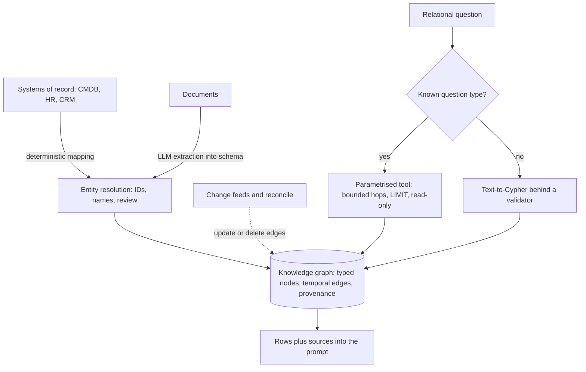

## TL;DR
A knowledge graph stores facts as typed entities and typed relationships under a schema. In RAG it
complements vector search, answering joins, counts and exact constraints that similarity cannot. The hard part is building it:
extraction, entity resolution, schema design and sync.

## Why it exists
- **Some answers are a path or a count, not a passage.** Vector retrieval ranks passages by similarity:
  good for "explain our refund policy", poor for "Which customers use a product affected by CVE-123?",
  "How many open contracts does each subsidiary of Acme hold?", "Who approved the change that broke
  service Y?".
- **The facts share an entity, not wording.** They are scattered across documents. Top-k returns passages
  about the CVE but cannot follow product to deployment to customer, and cannot count reliably at all.
- **Naive alternatives fail somewhere.** Bigger k or long-context stuffing hopes the model does the join in
  its head, unreliably and unverifiably. Iterative agentic retrieval can follow links, but each hop is a
  fuzzy search that can drift, and every query re-derives the same structure.
- **Relational tables are close but awkward.** They represent the facts, but variable-length paths ("any
  number of reporting levels") are awkward to express, though recursive CTEs handle many cases.
- **A graph makes relationships first-class data.** Entities get identities, so mentions across documents
  resolve to one node; relationships get types and direction, so a query follows exactly the edges it
  means; the schema rejects wrong facts at write time. The question becomes a precise traversal instead of
  a similarity guess.

## How it works
### Data model
| Family | Model | Query language | Fits |
|---|---|---|---|
| Property graphs (Neo4j, Amazon Neptune, Memgraph and others) | nodes with labels and key-value properties; directed relationships with a type and their own properties | Cypher, its standardised relative GQL, or Gremlin | pragmatic, popular in application engineering |
| RDF triple stores | every fact is a (subject, predicate, object) triple with URIs as identifiers; ontology languages (RDFS, OWL) add class hierarchies and inference rules | SPARQL | data integration across organisations and standard vocabularies; heavier to adopt |

Either way the unit is a fact like `(Service:payments)-[:DEPENDS_ON]->(Database:pg-main)`.

### Schema (ontology)
- **Decide** entity types, relationship types, their direction and cardinality, and the properties each
  carries.
- **It is the leverage point.** A good schema makes common questions short traversals. A vague one
  ("RELATED_TO" everywhere) degrades the graph back into a co-occurrence network that cannot answer precise
  questions.
- **Start from the questions** the graph must answer and model only what they need.

### Construction
1. **From structured sources** (CMDB, HR system, CRM, ticketing): deterministic mapping, high precision. Do
   this first, *because* it is cheap and trustworthy.
2. **From text:** an LLM or NER model extracts entities and relationships into the schema, using
   structured outputs so types are constrained. Recall and precision are both imperfect, so store
   provenance (source document, span, extraction run) on every edge.
3. **Entity resolution:** merge "Acme Corp", "ACME" and "Acme Corporation Ltd" into one node, using
   identifiers where available, then normalised names, attributes and, for hard cases, an LLM or human
   review. Skipping this splits facts across duplicate nodes and silently breaks traversals.

### Using it for retrieval
| Pattern | How | Watch out |
|---|---|---|
| Text-to-query | an LLM translates the question into Cypher or SPARQL, given the schema; result rows go into the prompt | validate (read-only, allowed labels, row limits) *because* the model will occasionally invent labels or write unbounded traversals |
| Entity-anchored expansion | link question entities to nodes, pull their k-hop neighbourhood, serialise those facts plus provenance-linked chunks into context | neighbourhood size |
| Graph as filter or booster | traversal results (e.g. all documents attached to systems owned by team T) become a metadata filter or ranking signal for vector search | keep the traversal cheap |
| Tools for agents | expose a few parametrised graph queries as tools instead of free-form generation | use when reliability matters more than flexibility |

### Keeping it true
- **The graph is derived data.** Sync it from systems of record with change feeds, re-extract changed
  documents, and delete edges whose provenance disappears; otherwise it confidently answers with stale
  facts.
- **Many facts are true only for a period.** Priya led project X until March; service A depended on
  pg-main before the migration. Without time on edges, a re-extraction either overwrites history or leaves
  both versions asserted at once, and "who owns X?" returns two people.
- **Put validity on the edge** (`valid_from`, `valid_to`, plus the source's timestamp), because the
  relationship, not the node, is what changed. Default queries to "currently valid".
- **Text-extracted edges carry extraction confidence and run id**, so a bad prompt version can be rolled
  back by deleting its edges.

## Diagram
Construction (systems of record and documents through entity resolution, kept current by change feeds)
keeps the graph true; retrieval turns a relational question into a bounded traversal whose per-hop
provenance becomes the citation trail.



## Examples
### A join beats similarity (runnable, in memory)
A miniature graph. In production the same logic is one Cypher query, shown in the comment.

```python
from collections import defaultdict

# (subject, relation, object, source_doc) -- provenance on every edge
facts = [
    ("CVE-123",   "AFFECTS",     "libfoo 2.1",  "sec-advisory-17"),
    ("svc-billing","USES",       "libfoo 2.1",  "sbom-billing"),
    ("svc-search","USES",        "libfoo 3.0",  "sbom-search"),
    ("Acme",      "SUBSCRIBES",  "svc-billing", "crm-export"),
    ("Globex",    "SUBSCRIBES",  "svc-billing", "crm-export"),
    ("Initech",   "SUBSCRIBES",  "svc-search",  "crm-export"),
]
out_edges, in_edges = defaultdict(list), defaultdict(list)
for s, r, o, src in facts:
    out_edges[(s, r)].append((o, src))
    in_edges[(o, r)].append((s, src))

def customers_exposed(cve):
    hits = []
    for lib, src1 in out_edges[(cve, "AFFECTS")]:
        for svc, src2 in in_edges[(lib, "USES")]:
            for cust, src3 in in_edges[(svc, "SUBSCRIBES")]:
                hits.append((cust, svc, [src1, src2, src3]))
    return hits

print(customers_exposed("CVE-123"))
# [('Acme', 'svc-billing', [...]), ('Globex', 'svc-billing', [...])]
# Cypher: MATCH (:CVE {id:'CVE-123'})-[:AFFECTS]->(l)<-[:USES]-(s)<-[:SUBSCRIBES]-(c)
#         RETURN c.name, s.name
```

- **Three facts, three documents** (advisory, SBOM, CRM). A vector search would likely return the advisory
  and maybe an SBOM, but nothing connects library version to customer.
- **The traversal is exact:** it returns Acme and Globex, excludes Initech because its service uses a
  different library version, and carries a source for every hop, which becomes the citation trail.
- **This alone does not justify a graph database:** a fixed three-hop query is also three SQL joins.
- **Variable length is where the graph pays.** Real dependency data is transitive: svc-billing uses libbar,
  which bundles libfoo 2.1. "Any path of `USES|DEPENDS_ON` edges of length 1 to 6" is one Cypher pattern
  (`(s)-[:USES|DEPENDS_ON*1..6]->(l)`) and a recursive CTE with cycle handling in SQL.

### Production snippet: a parametrised, bounded, read-only graph tool
What an agent calls instead of writing Cypher itself: fixed query text, parameters only, bounded path
length, currently-valid edges, a row limit, and read routing. Uses the Neo4j Python driver (5.x).

```python
import os
from neo4j import GraphDatabase, RoutingControl

driver = GraphDatabase.driver(os.environ["NEO4J_URI"],
                              auth=(os.environ["NEO4J_USER"], os.environ["NEO4J_PASSWORD"]))

EXPOSED = """
MATCH (:CVE {id: $cve})-[a:AFFECTS]->(l:Library)
MATCH p = (s:Service)-[:USES|DEPENDS_ON*1..6]->(l)
WHERE all(x IN relationships(p) WHERE x.valid_to IS NULL OR x.valid_to > datetime())
MATCH (c:Customer)-[r:SUBSCRIBES]->(s)
WHERE r.valid_to IS NULL OR r.valid_to > datetime()
RETURN DISTINCT c.name AS customer, s.name AS service,
       [a.source_doc] + [x IN relationships(p) | x.source_doc] + [r.source_doc] AS provenance
LIMIT $limit
"""

def customers_exposed(cve: str, limit: int = 200):
    records, _, _ = driver.execute_query(EXPOSED, cve=cve, limit=min(limit, 200),
                                         routing_=RoutingControl.READ)
    return [r.data() for r in records]       # rows plus per-hop sources for citations
```

## Production patterns
- **Load systems of record first, keyed by stable IDs.** Map CMDB, HR and CRM rows with `MERGE` on their
  IDs and add uniqueness constraints (in Cypher, `CREATE CONSTRAINT ... REQUIRE c.id IS UNIQUE`) so
  duplicates cannot be written. Monitor duplicate-candidate counts from the resolution job.
- **Parametrised tools over free-form Cypher.** Expose a few tested queries with bounded hops, `LIMIT` and
  read routing; allow text-to-Cypher only behind a validator (allowed labels, read-only, row limit) and a
  query timeout. Monitor tool error rate, empty-result rate and p95 query time.
- **Provenance and run ids on every extracted edge.** Store source document, span, confidence and
  extraction run id, so a bad prompt version is rolled back by deleting edges with that run id. Monitor
  edges per run and the share without provenance (target zero).
- **Temporal edges by default.** Write `valid_from` and `valid_to` on relationships that change, close the
  old edge instead of deleting it, and filter queries to currently valid. Monitor entities with more than
  one currently-valid owner.
- **Change-feed sync plus reconcile.** Apply source change events as they arrive, and run a periodic
  reconcile that deletes edges whose provenance no longer exists. Monitor lag from source change to graph
  update.

## Trade-offs
- **Exact joins vs build cost.** Joins, counts and multi-hop paths become reliable, but you pay for schema
  design, extraction and entity resolution. When questions are mostly "explain this topic", vector RAG
  gives more for less.
- **Structured-source vs text-extracted edges.** Structured graphs are precise and cheap to maintain;
  text-extracted ones reach more knowledge at lower precision. Mix them and keep provenance so you know
  which edges to trust.
- **Text-to-Cypher vs fixed tools.** It handles open-ended questions but fails on schema drift and complex
  queries. When the question set is narrow, a handful of parametrised query tools is more reliable.
- **RDF/OWL vs property graphs.** RDF and OWL give standard vocabularies and inference but steeper tooling
  and skills. Property graphs ship faster unless cross-organisation integration or formal reasoning is a
  requirement.
- **Graph database vs relational.** A dedicated graph database suits deep variable-length traversal but adds
  an operational system. For shallow, fixed joins plain relational joins are enough, and recursive CTEs
  cover moderate variable-length cases such as reporting chains of bounded depth.

## Pitfalls
- **Modelling everything as a generic `RELATED_TO` edge.** Traversals return everything or nothing, and the
  graph answers nothing more precisely than vector search.
- **Skipping entity resolution.** Symptom: answers list "Acme" and "ACME Corp" as different customers, or
  miss half of an entity's relationships.
- **Letting the LLM generate unvalidated queries.** Symptom: hallucinated labels returning empty results,
  or an unbounded path query that times out the database.
- **Building the graph once from a document dump.** It drifts from source systems and answers with
  reorganised teams or retired services weeks later.
- **Time-bound relationships without validity dates.** Symptom: "who owns service X?" returns both the
  current and the previous owner, or history vanishes after a re-extraction.
- **Dropping provenance.** Graph answers cannot be cited, and when an extracted fact is wrong nobody can
  find which document or extraction run produced it.

## When to use
- **Use when** important questions are relational (dependencies, ownership, supply chains, org structure,
  fraud rings), need exact counts or constraints, or span many documents joined by shared entities, and
  much of the data already exists in structured systems.
- **Avoid when** the corpus is prose and questions are explanatory.
- **Measure** on a question set split into lookup, relational and aggregate types, comparing graph-backed
  answers with hybrid retrieval.
- **Interviews:** explain when a graph beats embeddings, how you would build one from messy text, and how
  you keep it consistent with its sources.

## Role lens
- **Engineer:** Writes the extraction pipeline with constrained output types, the entity resolution step,
  and validated Cypher or parametrised graph tools the model can call.
- **Architect:** Owns the schema, the boundary between system-of-record data and extracted facts, and the
  sync strategy that keeps the graph from becoming a stale shadow copy.
- **FDE:** Maps the customer's CMDB, CRM or HR data into a graph during discovery, often uncovering that
  their key questions are joins that their current search tool could never answer.

## Check yourself
**Q:** A team built a knowledge graph by having an LLM extract triples from 10,000 documents. Answers to
"which projects does Priya lead?" are incomplete and sometimes include another person's projects. Diagnose.
**A:** Two likely causes. Entity resolution: "Priya", "Priya S." and "P. Sharma" became separate nodes, so
traversal from one node misses edges attached to the others, which explains the incompleteness; worse,
two different Priyas may have merged by name alone, which explains wrong projects. Fix with identifiers from
the HR system and attribute-based matching. Second, schema looseness: if extraction produced varied relation
names (LEADS, MANAGES, WORKS_ON), the query misses synonyms or includes non-lead roles. Constrain relation
types in the extraction schema, and better still, load ownership from the project system directly.

## Interview questions
### When does a knowledge graph beat vector search for RAG?
- **When the answer is a path or a count, not a passage:** "which customers use a product affected by
  CVE-123" needs product to deployment to customer, facts that share an entity but not wording.
- **Why vectors fail there:** similarity finds passages about the CVE but cannot follow typed edges or
  count reliably, while a traversal is exact and carries provenance for every hop.

### How would you build a knowledge graph from a customer's messy documents and systems?
- **Start from questions** and design a schema with specific relationship types, never a generic
  `RELATED_TO`.
- **Load structured sources first** (CMDB, HR, CRM) by stable IDs, because it is cheap and precise; then
  extract from text with constrained structured outputs and provenance on every edge.
- **Resolve entities** with identifiers, normalised names, attributes and human review for hard cases.

### "Who owns service X?" returns two people. What is wrong and how do you fix it?
- **Missing time on edges.** The owner changed, and re-extraction left both relationships asserted, or
  history was overwritten.
- **Fix:** put `valid_from` and `valid_to` on the relationship, close the old edge instead of deleting it,
  default queries to currently valid, and alert on entities with more than one current owner.

### Would you store a dependency and ownership graph in a graph database or in Postgres?
- **Postgres** when joins are shallow and fixed, such as a three-hop query, or variable length is bounded:
  recursive CTEs with cycle handling cover reporting chains and similar cases without a new system.
- **A graph database** when deep variable-length traversal is the core workload, such as
  `[:USES|DEPENDS_ON*1..6]` over transitive dependencies, enough to justify operating another store.

### How do you let an agent query the graph safely?
- **Prefer parametrised tools:** fixed query text, parameters only, bounded hops, `LIMIT`, read routing and
  a query timeout, because the model will occasionally invent labels or write unbounded traversals.
- **Allow text-to-Cypher only behind a validator** (read-only, allowed labels, row limits) and monitor
  error rate, empty-result rate and p95 query time.

## Quiz
### Q: Which question is a knowledge graph best placed to answer that top-k vector search handles poorly?
- [ ] Summarise the company travel policy
- [x] List all customers subscribed to a service that depends on a library affected by a given vulnerability
- [ ] Find the paragraph that explains how to reset a password
- [ ] Translate a policy document into French
> The vulnerability question is a three-hop join across documents that share entities, not wording. A graph
> traverses typed edges exactly; similarity search finds passages about the CVE but cannot follow the chain.

### Q: Why is entity resolution critical when building a graph from extracted text?
- [ ] It reduces the size of the embedding index
- [ ] It is required by the Cypher query language
- [x] Unmerged duplicates split one entity's facts across nodes, so traversals return incomplete answers
- [ ] It removes the need for a schema
> Text names the same thing many ways. Without merging them, each node holds part of the facts, and wrong
> merges are equally harmful because they attach one entity's relationships to another.

### Q: When are a few parametrised graph query tools better than free-form text-to-Cypher?
- [ ] When the schema changes every day
- [x] When the important question types are known and narrow, and reliability matters more than flexibility
- [ ] When the graph has no provenance
- [ ] When users only ask open-ended exploratory questions
> Fixed, tested queries cannot hallucinate labels or write unbounded traversals. Free-form generation buys
> flexibility for open questions, at the cost of validation work and occasional broken or slow queries.
