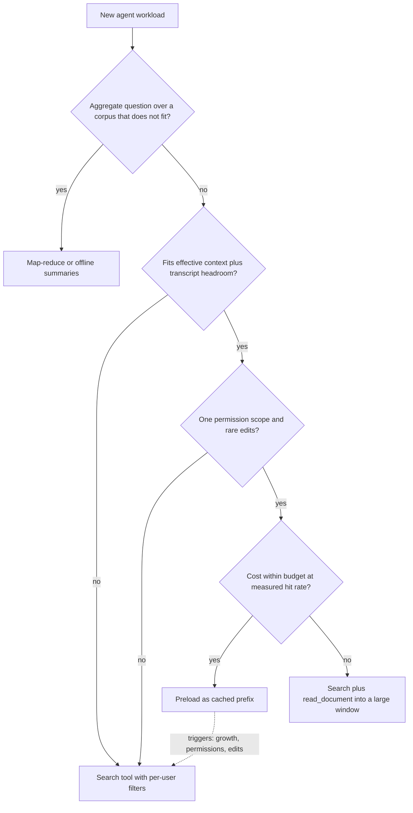

## TL;DR
An agent can preload knowledge into its context or fetch it with a search tool. Preloading suits small,
static, shared corpora and whole-document reasoning; a retrieval tool wins for large, changing,
permissioned or high-volume ones, because agents re-send their context every step.

## For agent builders
- **Why it matters for agents.** A chat app sends the corpus once per question; an agent sends it on
  *every step* of its loop. A 150k-token corpus in a 20-step run is 3 million input tokens before caching,
  and it eats window the transcript needs for tool calls and results.
- **Where it shows up in your stack.** The system prompt and preloaded documents (the cached prefix), a
  `search` or `read_document` tool the agent calls, provider prompt caching (`cache_control` breakpoints
  with Anthropic, automatic prefix caching with OpenAI), and context-compaction logic in your framework.
- **What you control.** What goes in the stable prefix versus behind a tool, whether the tool returns
  chunks or whole documents, the per-step token budget for tool results, and the triggers that move a
  workload from preloaded to retrieved.
- **What you can skip.** Attention-cost derivations. Know that prefill grows with input length, cached
  tokens are cheap only while the prefix is byte-identical and warm, and recall degrades mid-context.
- **The same decision applies to agent memory.** Keeping the full conversation history is long-context;
  retrieving past memories on demand is RAG. The arithmetic below decides both.

## Why it exists
- **RAG began as a necessity.** Early context windows held a few thousand tokens, so you had to select.
  Windows grew to the hundreds of thousands and, for some models, around a million tokens. Why maintain
  chunking, embeddings, indexes and rerankers, each a source of failure, when the model could read everything?
- **"Always stuff the context" is wrong.** Every token is paid for on every call, prefill time grows with
  input length, and recall of a specific fact in a very long prompt is less reliable than in a short one,
  especially among near-duplicate distractors. An agent multiplies all three by its step count.
- **"Always retrieve" is wrong too.** Retrieval itself fails (see retrieval failure diagnosis), chunking
  destroys cross-references, and "list every clause in this contract that conflicts with section 4" needs
  the whole document, not the top five chunks.
- **So it is a measurable engineering decision.** Inputs: corpus size, change rate, query volume (and
  steps per agent run), permission model, latency budget, and whether answers need local facts or global
  synthesis.

## How it works
### The cost and latency model
| Quantity | Long-context | RAG |
|---|---|---|
| Input tokens per query | about the corpus size *C* | retrieved budget *R* (often a few thousand) plus the question |
| Cost ratio | about *C / R* times RAG | 1 |
| Time to first token | grows with *C* | small and roughly constant |
| Agent run of *S* steps | about *S × C* before caching | the transcript plus retrieved results |

- **Prefill compute grows at least linearly** with input length (attention adds a quadratic term), so
  time-to-first-token grows with *C*. In an agent that latency is paid on every step, not once.
- **Prompt caching changes the arithmetic.** If the corpus is an identical prefix across calls, many
  providers bill cached input tokens at a discount and skip much of the prefill.
- **Caching only holds while the prefix is byte-identical and the cache stays warm**, so a corpus that
  changes hourly or differs per user gets little benefit.

With per-token input price *p*, cached-read discount factor *d* (the fraction of full price a cached
token costs) and cache hit rate *h*:

```
cost_long ≈ p × C × (h × d + (1 − h))        + cache-write cost on each miss
cost_rag  ≈ p × (R + q)                       + embedding, index and rerank costs
```

- **The hit rate *h* is not a free parameter.** Provider caches expire after a short idle period
  (minutes, and vendor-specific), so *h* depends on whether requests sharing the prefix arrive closer
  together than the TTL.
- **Cache writes can cost extra.** Some providers price the cache *write* above a normal input token.
- **Busy vs sparse traffic:** a busy single-tenant workload can sit near *h* ≈ 1; a workload with few
  queries per prefix pays the write premium again and again.
- **Agents help the hit rate within a run.** Steps of one run arrive seconds apart, so the prefix usually
  stays warm across the loop, but a run that pauses for a human approval can outlive the TTL.

### The quality model
- **Accepting N tokens is not using N tokens well.** Known effects:
  - **Lost in the middle:** facts mid-context are recalled less reliably than those at the start or end.
  - **Harder tasks degrade more:** multi-fact and reasoning tasks drop more than single-needle lookups.
  - **Distractors:** irrelevant but similar passages pull the model off the answer.
- **Effective context is model- and task-specific**, so measure it on your own data, not a spec sheet.
- **Agents fill the middle themselves.** As tool calls and results accumulate, a preloaded corpus drifts
  toward the middle of the context, so recall of it can drop as the run gets longer.
- **RAG has its own ceiling:** if the retriever misses the evidence, the generator never sees it. In an
  agent, the model also has to decide to search and write a good query.

### The non-functional constraints
- **Permissions:** with one shared prompt, every user sees every document. RAG filters per user at query
  time; long-context needs a per-permission-set prompt, which kills cache reuse. For agents acting on a
  user's behalf, the retrieval tool is the natural place to enforce that user's permissions.
- **Freshness:** RAG updates one document's chunks; long-context rebuilds the whole prompt (and cache).
- **Citations:** RAG returns chunk IDs naturally; long-context needs the model to cite positions, which is
  harder to verify.
- **Scale:** past the window, long-context simply does not apply; most enterprise corpora are far larger.

### The middle ground
- **Retrieve documents, not chunks.** Retrieve at the *document* level, then put whole retrieved
  documents into a large context. This keeps retrieval's selectivity and permission filtering, gives the
  model full sections to reason over, and tolerates imprecise ranking because the window is generous.
  For agents this is a `search` tool that returns document IDs plus a `read_document` tool.
- **Global questions are a third shape.** "What are the recurring complaints across 30,000 tickets?":
  top-k returns a handful of examples and calls it an answer; long-context cannot fit the corpus.
- **Use map-reduce or precomputed summaries.** Process each document or batch independently, then
  aggregate the partial results, or build summaries retrieval can target. It is expensive per question,
  which is why it usually runs offline or on a schedule; an agent can fan out sub-agents for it, at that cost.

## Diagram
The decision path: answer shape first, then whether the corpus fits and stays shared and static, then
whether volume (questions times agent steps) makes per-token cost dominate.



## Examples
### Agent scenario: preloaded corpus vs a search tool over a 20-step run
Illustrative prices and sizes: a 4,000-token system prompt, a 150,000-token manual, 1,500 new transcript
tokens per step, and (for the tool variant) four searches of 3,000 tokens each, averaged as 600 per step.

```python
p = 3 / 1_000_000                          # illustrative $3 per million input tokens

def run_cost(prefix, steps, new_per_step, d=0.10, cached=True):
    """Input cost of one agent run. Each step re-sends the whole context; with caching, everything
    seen on the previous step is billed at fraction d (warm cache, append-only transcript)."""
    total, ctx = 0.0, prefix
    for s in range(steps):
        if cached and s > 0:
            total += p * ((ctx - new_per_step) * d + new_per_step)
        else:
            total += p * ctx
        ctx += new_per_step
    return total

SYS, MANUAL, STEPS = 4_000, 150_000, 20
for name, prefix, new in [("preloaded", SYS + MANUAL, 1_500), ("search tool", SYS, 1_500 + 600)]:
    print(f"{name:<12} uncached ${run_cost(prefix, STEPS, new, cached=False):.2f}"
          f"  cached ${run_cost(prefix, STEPS, new):.2f} per run")
# preloaded    uncached $10.09  cached $1.50 per run
# search tool  uncached $1.44  cached $0.26 per run
# Ignores cache-write premiums and embedding/vector-store costs.
```

| Per day at 1,000 runs (illustrative) | Preloaded manual | Search tool |
|---|---|---|
| Uncached | ≈ $10,090 | ≈ $1,440 |
| Cached, warm through the run | ≈ $1,500 | ≈ $260 |
| Context used at step 20 | ≈ 182k tokens | ≈ 44k tokens |

- **Read it as an agent builder:** caching makes preloading viable, but the tool variant is still about
  6× cheaper and leaves the window free for the transcript. Preloading wins only if retrieval recall is
  poor or the task needs the whole manual at once.

### Worked scenario: a 300-page support manual
Illustrative calculation: prices and latencies are made-up round numbers for the arithmetic, not any
vendor's rates.

- **Setup:** a 300-page product manual of about 150,000 tokens; 20,000 questions a day; input costs $3 per
  million tokens; cached input is billed at 10% of that; RAG sends 6,000 tokens of retrieved context per question.

| Approach | Arithmetic | Daily input cost |
|---|---|---|
| Long-context, no cache | 150k × 20,000 = 3 billion tokens/day | $9,000/day |
| Long-context, cached prefix | 3B × $0.30/M | ≈ $900/day, plus periodic cache writes |
| RAG | 6k × 20,000 = 120M tokens/day | $360/day, plus embedding and vector store costs |

- **The cached figure needs two conditions:** every user may see the whole manual, and it changes rarely.
- **Check the cache assumption.** 20,000 questions a day is one every four seconds or so, comfortably
  inside any cache TTL, so *h* stays near 1. At 50 questions a day spread across office hours, gaps often
  exceed the TTL: many requests pay full price plus a cache write, and $900 is not reachable.
- **Change one fact: per-customer editions for 40 customers.** Long-context needs 40 cached prefixes, each
  with its own warm-up cost and eviction risk. RAG just adds a `customer_id` filter.
- **Change another: a legal team, five questions a day over one 200-page contract**, each requiring
  cross-references. Cost is trivial at that volume and whole-document reasoning beats top-k chunks. Long
  context wins.

### Cost calculator with cache hit rate
Runnable; it reproduces the table and shows what a low hit rate does. All prices are illustrative.

```python
def cost_long(C, n, p, d, h, write_premium=0.0):
    """Daily input cost when corpus C (tokens) is the prompt prefix on n queries.
    p: $ per token, d: cached price as a fraction of p, h: cache hit rate,
    write_premium: extra fraction of p paid per token on a cache write (vendor-specific)."""
    hits, misses = n * h, n * (1 - h)
    return p * C * (hits * d + misses * (1 + write_premium))

def cost_rag(R_plus_q, n, p):
    return p * R_plus_q * n                  # plus embedding, index and rerank costs

p = 3 / 1_000_000                            # illustrative $3 per million input tokens
C, R = 150_000, 6_000                        # 300-page manual; retrieved budget per question

print(f"long, no cache : ${cost_long(C, 20_000, p, d=0.10, h=0.0):,.0f}/day")    # $9,000
print(f"long, cached   : ${cost_long(C, 20_000, p, d=0.10, h=1.0):,.0f}/day")    # $900
print(f"rag            : ${cost_rag(R, 20_000, p):,.0f}/day")                    # $360 (question tokens ignored)

# Low volume: 50 questions/day, gaps often exceed the cache TTL (illustrative h=0.3, 25% write premium)
per_q = cost_long(C, 50, p, d=0.10, h=0.3, write_premium=0.25) / 50
print(f"long, 50/day   : ${per_q:.3f} per question vs ${C * p * 0.10:.3f} at a perfect hit rate")
```

- **Output of the last line:** about $0.407 per question against $0.045 at a perfect hit rate, roughly 9×
  the forecast, which is exactly the "bill several times the forecast" pitfall below.

## Production patterns
- **Prototype preloaded, migrate on triggers.** For a corpus that fits with headroom for the transcript,
  ship the agent with the corpus in its prefix first to prove value, and write down the triggers that
  force a search tool: per-user permissions, corpus growth past the measured effective context, frequent
  edits. Monitor corpus size in tokens and edit rate.
- **Cache-friendly agent prompt layout.** Put system prompt, tool schemas and any preloaded corpus first
  as a byte-identical prefix, then the append-only transcript; with Anthropic, mark the prefix with a
  `cache_control` breakpoint, while OpenAI caches long prefixes automatically. Monitor cached-token counts
  in the usage fields of each response, per step, not an assumed hit rate.
- **Search plus read tools for document-level retrieval.** Give the agent a `search` tool that returns
  document or section IDs with per-user filters (parent-document retrieval) and a `read_document` tool
  bounded by a token budget. Monitor input tokens per step and accuracy split by question type.
- **Effective-context eval before choosing a limit.** Plant known facts at the start, middle and end of
  contexts of growing length, plus multi-fact questions with distractors, on your own documents. For
  agents, also test at the transcript length of a late step. Cap context where accuracy starts to drop
  and re-run on every model change.
- **Offline map-reduce for corpus-wide questions.** Run a scheduled job that summarises each document or
  batch, then aggregates; store the outputs so the agent's search tool can target them. Monitor job cost
  per run and the age of the newest summary.

## Trade-offs
- **No retrieval failure surface vs per-token cost.** Long-context removes retrieval failures entirely,
  but you pay per token on every call, and an agent pays it on every step. It flips to RAG as query volume
  times steps times corpus size grows past your cost budget.
- **Cheap cached prefix vs fragmentation.** Prompt caching makes a large static prefix cheap, but only for
  identical prefixes. Per-user permissions, frequent edits or many tenants fragment the cache and erase
  the saving.
- **Whole-document structure vs local lookups.** Whole-document context preserves cross-references and
  global structure that RAG chunks lose. RAG regains the advantage when questions are local lookups of
  one fact among thousands of documents.
- **Short prompts vs evidence loss.** RAG keeps prompts short and latency low, but every stage can drop
  evidence. When retrieval recall on your eval set is poor and the corpus fits, long-context is the faster
  way to a working system.
- **Agent autonomy vs a guaranteed read.** A search tool lets the agent fetch only what it needs, but it
  may skip searching or query badly; a preloaded corpus is always there. Preload the few documents almost
  every run needs and put the rest behind the tool.

## Pitfalls
- **Trusting the advertised window as the usable window.** Symptom: a demo that works on the first and
  last sections and quietly misses facts from the middle of the corpus. Diagnose: split eval accuracy by
  the position of the answer in the prompt. Fix: cap context where accuracy drops.
- **Stuffing a multi-tenant corpus into one prompt.** Symptom: a user gets an answer drawn from a document
  they are not entitled to see. Fix: per-user filters in a retrieval tool.
- **Comparing approaches on a handful of easy questions.** Both look perfect; the gap only shows on
  multi-fact, distractor-heavy or cross-document questions in a proper eval set.
- **Forgetting latency.** Symptom: time-to-first-token of many seconds on every request, because the full
  corpus is prefilled each time without a warm cache; in an agent it repeats every step. Diagnose: log
  TTFT per step against input and cached tokens.
- **Modelling cached long-context cost at a 100% hit rate.** Symptom: a bill several times the forecast.
  Cause: bursty or low-volume traffic lets the cache expire between requests. Diagnose: cached-token share
  from usage fields, plotted against the gap between requests. Fix: re-run the cost model at measured *h*.
- **Answering corpus-wide aggregate questions with top-k retrieval.** Symptom: confident "trends" built
  from five retrieved examples that a count over the full corpus would contradict.
- **Building heavy RAG infrastructure for a corpus of a few documents.** Symptom: weeks spent tuning
  chunking for a problem the model could have solved by reading everything.
- **Sizing the preloaded corpus without the transcript.** Symptom: an agent that works for five steps,
  then hits the context limit or triggers compaction mid-task. Diagnose: log context tokens per step and
  the step where compaction fires. Fix: budget corpus plus your longest run's transcript, with headroom.

## When to use
- **Start with long-context when:** the corpus fits comfortably in the window with headroom, changes
  rarely, has a single permission scope, and query volume is modest; or tasks need synthesis across a
  whole document.
- **Prefer RAG when:** the corpus exceeds the window or grows, changes frequently, needs per-user
  filtering, must cite verifiable sources, or volume makes per-token cost dominant.
- **For agents specifically:** preload only what nearly every run needs and fits beside the transcript;
  everything else goes behind a search tool.
- **Measure both on the same eval set:** accuracy split by question type, cost per query (or per agent
  run), p95 time-to-first-token, and the real logged cache hit rate rather than an assumed one.
- **Neither, when:** questions are aggregates over a corpus that does not fit; plan a map-reduce or
  offline summarisation job instead.

## Exercise
**Goal:** produce a measured preload-or-search recommendation for one agent workload, with the flip
point stated in numbers. No solution is given.
- **Inputs:** a real corpus you can share with a model (a manual or wiki export of 30k-150k tokens), 30
  questions with known answers (a third needing two facts, some placed mid-corpus), and a provider API
  with prompt caching.
- **Deliver:** both variants behind one agent interface, a per-step log of input, cached and output
  tokens and TTFT, and a cost model fed with the measured hit rate.
- **Acceptance:** your model's predicted cost per run is within 20% of the billed usage fields; accuracy
  is split by question type and answer position; you state the corpus size, edit rate or daily volume
  at which your recommendation flips.

## Role lens
- **Engineer:** Builds both variants behind one interface, measures accuracy, cost and latency on the same
  eval set, and implements document-level retrieval into a large context as the hybrid.
- **Architect:** Owns the cost model and the permission boundary: decides which workloads justify retrieval
  infrastructure and where cached long prompts are safe given tenancy and change rate.
- **FDE:** Runs a quick long-context prototype on the customer's real documents to prove value in days, then
  explains with numbers when volume, permissions or corpus growth require moving to RAG.

## Check yourself
**Q:** A customer's entire knowledge base is 80,000 tokens today and the model window is far larger. They
ask why they should pay for a retrieval pipeline. What do you tell them?
**A:** At 80k tokens long-context is a strong default: no chunking or index to get wrong, and prompt
caching makes a static prefix cheap. But I would check four things. Volume: tokens per query times daily
queries against the budget, with and without cache hits. Permissions: if different users may see different
documents, one shared prompt leaks data. Change rate and growth: frequent edits invalidate the cache, and
if the base will grow past what the model uses reliably, we will need retrieval anyway. Quality: test
middle-of-context and multi-fact questions, not just easy ones. If all four pass, ship long-context and
revisit when one changes.

## Interview questions
### Context windows now reach hundreds of thousands of tokens. Why does RAG still exist?
- **Cost:** every token is paid for on every call, so long-context input costs about *C / R* times a RAG
  prompt of retrieved budget *R*.
- **Latency:** prefill compute grows at least linearly with input length, so time-to-first-token grows with
  corpus size unless a warm cache skips it.
- **Quality and constraints:** recall of a specific fact in a very long prompt is less reliable (lost in the
  middle, distractors), and one shared prompt cannot enforce per-user permissions.

### You are building a support agent over a 150,000-token manual. Do you preload it or give the agent a search tool?
- **Do the per-run arithmetic:** the corpus is re-sent on every step, so a 20-step run is over 3 million
  input tokens uncached; with a warm cache roughly $1.50 per run versus about $0.26 for a search tool at
  illustrative prices.
- **Check the window:** corpus plus a late-step transcript (about 182k tokens at step 20) must fit the
  measured effective context, not just the advertised one.
- **Then constraints:** per-user permissions or frequent edits push to the tool; whole-manual reasoning or
  poor retrieval recall pushes to preloading.

### When would you pick long-context even though RAG is cheaper per query?
- **Whole-document reasoning:** listing every clause that conflicts with section 4 needs the whole contract,
  and chunking destroys cross-references.
- **Low volume:** five questions a day over one 200-page contract makes cost trivial.
- **Poor retrieval recall on a corpus that fits:** long-context is the faster way to a working system while
  retrieval is fixed, provided the corpus has a single permission scope.

### Your agent's cached long-context bill came in several times the forecast. How do you debug it?
- **Check the real hit rate:** read cached-token counts from each response's usage fields, per agent step,
  instead of the assumed *h* ≈ 1.
- **Look at traffic shape:** provider caches expire after a short idle period, so bursty or low-volume
  traffic, or runs paused for human approval, pay full price plus a cache-write premium on each miss; at
  50 questions a day the cost can be roughly 9× the perfect-hit figure.
- **Look for prefix fragmentation:** per-tenant editions, per-permission prompts or a prefix that is not
  byte-identical (a timestamp near the top, reordered tool schemas) each break reuse.

## Quiz
### Q: Why does prompt caching often fail to rescue the long-context approach in a multi-tenant SaaS product?
- [ ] Cached tokens are billed at a higher rate than uncached ones
- [x] Each tenant or permission set needs a different prefix, so caches fragment and are rarely reused
- [ ] Caching only works for prompts shorter than the RAG context
- [ ] Cached prompts cannot include document text
> Caching saves cost only when many calls share an identical prefix. Per-tenant or per-permission corpora
> create many distinct prefixes, each needing its own write and staying warm, so the discount rarely applies.

### Q: Which task most favours putting a whole document in context over top-k chunk retrieval?
- [ ] Finding the support phone number in a 10,000-document knowledge base
- [ ] Answering "what is our parental leave policy" across all HR documents
- [x] Listing every clause in one contract that contradicts its termination section
- [ ] Looking up a product's price by SKU
> Contradiction finding needs the model to compare many parts of one document, which chunk retrieval
> fragments. The others are local lookups over large corpora, where retrieval is cheaper and sufficient.

### Q: A model advertises a very large context window. What is the right way to decide how much of it to use?
- [ ] Use all of it; the provider guarantees uniform recall across the window
- [ ] Never exceed half the window, which is a universal rule of thumb
- [x] Measure accuracy on your own questions as context length grows, including middle-position and multi-fact cases
- [ ] Use whatever fits within the per-request rate limit
> Effective context depends on the model and the task; recall varies with position and with distractors.
> Only an eval on your data at increasing lengths tells you where quality starts to drop.

## Mastery test
**Problem:** a coding agent preloads a 60k-token repository summary and runs 30-step sessions. Each step
adds about 2,000 tokens of tool output. Users report it "forgets the architecture" late in sessions and
the bill doubled after a change that put the current git branch name at the top of the system prompt.
Explain both and redesign.

**A strong answer:**
- computes the late-step context (about 60k + 30 × 2k = 120k) and links forgetting to the summary
  drifting into the middle, plus compaction if the window is tight;
- identifies the branch name as breaking the byte-identical prefix, so the cache misses across sessions
  and branches, and moves volatile text after the stable prefix;
- proposes keeping a short architecture core in the prefix and the rest behind a `search` or
  `read_document` tool, checked by cached-token counts and accuracy split by step number.

## Use cases & projects
### Use cases
- **Agents over one small, static manual.** A product guide that rarely changes and fits comfortably
  sits in a cached prefix, so the agent needs no search tool at all.
- **Enterprise knowledge agents.** Large, changing and permissioned corpora go behind a retrieval tool,
  because re-sending them on every step is unaffordable and leaks across users.
- **Whole-document review.** Contract or code review that needs cross-references loads the full
  document, often through a `read_document` tool, rather than top-k chunks.
- **Agent memory design.** Keeping full conversation history versus retrieving past memories on demand
  is the same decision, made with the same per-step token arithmetic.

### Mini project
**Measure preload versus search for a multi-step agent (2-3 hours).**
- **Goal:** compare cost, latency and accuracy of preloading a corpus versus a search tool in a 10-step
  agent run.
- **Steps:** pick a corpus of a few dozen documents and 20 questions with known answers, including some
  that need two facts; build variant A with the corpus in the system prompt (with provider prompt
  caching on) and variant B with a `search` tool returning a few thousand tokens; log input, cached-input
  and output tokens per step plus end-to-end latency.
- **Done when:** you have a per-variant table of tokens per run, cost per run, latency and accuracy, and
  a one-paragraph recommendation stating which corpus size or change rate would flip the choice.
