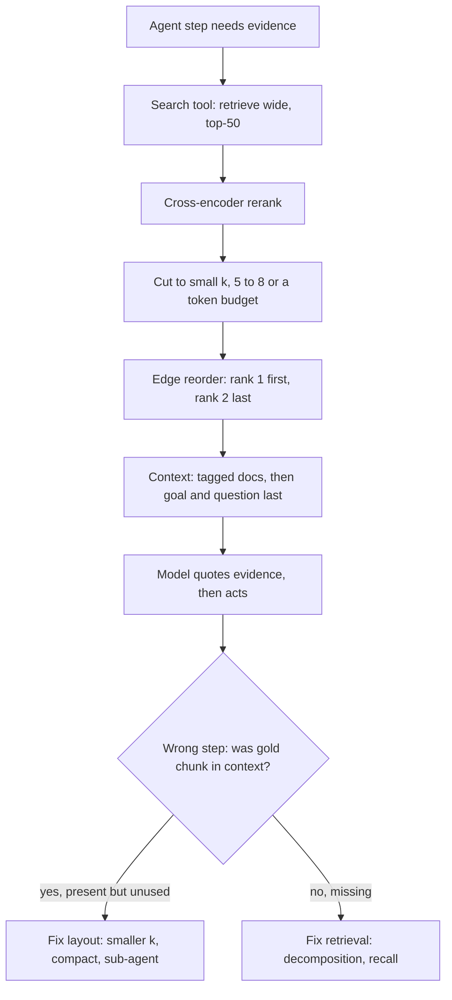

## TL;DR
Models use the start and end of a long context far more reliably than the middle. In an agent, retrieved
chunks and old tool results pile up in that middle, so retrieve fewer, place the best at the edges and
restate the current goal last.

## For agent builders
- **Why it matters for agents.** An agent's context is a growing middle: system prompt at the top, the
  newest step at the bottom, and every earlier search result and tool output in between. Facts the agent
  fetched at step 3 can be present at step 15 and still be ignored.
- **Where it shows up in your stack.** The prompt builder of your RAG tool, the result formatter of each
  tool, LangChain's long-context reorder document transformer, and compaction or summarization steps in
  agent frameworks.
- **What you control.** How many chunks a search tool returns, their order, how long tool results are,
  whether the agent restates its goal and plan at the end, and when old turns are compacted.
- **What you can skip.** Settling which attention mechanism causes the curve. Know its shape, that it is
  model-specific, and how to run a position sweep on your own model.

## Why it exists
- **Raising k is the reflex, and it often backfires.** The retrieval eval says the gold chunk is in the
  top-20 for 94% of questions, yet the model misses it. Every extra chunk is a distractor that pushes the
  evidence toward the middle.
- **The experiment controlled one variable.** Multi-document QA with k retrieved passages, exactly one
  containing the answer; move it from position 1 to the middle to position k, holding all else fixed.
  Accuracy was highest at the start, next at the end, lowest in the middle. In some configurations the
  middle scored below answering with no documents at all.
- **It was not a quirk.** The effect grew with the number of passages; the extended-context variants of
  the models tested at the time did not escape it; a synthetic key-value lookup task showed the same curve
  for several models, so it is not only about distractors that look like the answer.
- **The context window is not a database.** "More context means more information means better answers" is
  wrong because attention is a competition over a fixed budget of probability mass. Retrieved chunks are
  by construction similar to each other and to the question, so they split that mass among lookalikes.
- **Training taught the model where things sit:** instructions at the top, the question and answer at the
  bottom. A pipeline that ignores position quietly converts retrieval wins into generation losses.

## How it works
### The shape of the curve
- **U-shaped.** Plot accuracy against the gold passage's position for a fixed k: a primacy advantage at the
  first positions, a recency advantage at the last, a trough in between.
- **Trough depth is model-specific.** Models trained since the original study, with long-context training
  data and near-perfect single-fact needle-in-a-haystack scores, show a much shallower trough.
- **It has not gone away.** Multi-fact questions, reasoning over several passages and very long contexts
  still show positional sensitivity. Agent runs are exactly that: many facts, spread across many turns.
- **Treat it as a quantity to measure** for your model and your chunk size, not as a constant.

### Background: proposed mechanisms
These are explanations offered in the literature, not settled facts.
1. **Primacy.** In a causal transformer every later token can attend to the first tokens, and the first
   positions tend to become attention sinks that absorb large attention mass regardless of content, so
   early material is repeatedly available and reinforced.
2. **Recency.** Rotary position encodings and the statistics of training text make nearby tokens attend
   to each other more strongly, and chat-format training puts the question right before the answer, so
   the model learns to look back a short distance for what matters.
3. **The middle has neither.** With many similar passages, attention that would single out the gold
   passage is diluted across lookalikes, and nothing structural compensates.

### What it does to a RAG prompt
The natural layout is "concatenate chunks in rank order, then the question":

| Slot | What lands there | Effect |
|---|---|---|
| First | rank 1 | good |
| Early middle | ranks 2 to 5, often the real evidence for multi-part questions | in the trough |
| Last (strongest after first) | the weakest chunk | wasted |

Raising k makes every row worse: more distractors, and the evidence deeper in the trough.

### What it does to an agent transcript
| Region | Contents | Risk |
|---|---|---|
| Top | system prompt, tool definitions, original task | strong, but far from the current step |
| Middle | earlier tool calls, search results, scratch reasoning | the trough: fetched facts get ignored |
| Bottom | latest tool result and the model's next move | strongest, dominates the decision |

- **Symptoms:** the agent re-searches for something it already found, forgets a constraint from the
  original task, or contradicts an earlier tool result.
- **Each tool result adds to the middle**, so verbose tools (raw HTML, full documents, 50 search hits)
  deepen the trough for every later step.

### Mitigations and why each works
1. **Retrieve fewer, better.** Rerank with a cross-encoder, then cut to a small k (5 to 8 is a common
   operating point; measure yours). Each removed distractor returns attention mass to the evidence and
   shortens the middle.
2. **Reorder for the edges.** Rank 1 first, rank 2 last, rank 3 second, rank 4 second-to-last, and so on,
   so the best evidence sits at both ends of the U. LangChain ships this as a document transformer; it is
   ten lines to write yourself.
3. **Question last.** Long documents first, then the question and instructions, and repeat the key
   instruction at the end. Anthropic's long-context guidance recommends exactly this layout. The question
   sits in the recency window right before generation, and the document prefix is stable, which is also
   what prompt caching wants. In an agent, the equivalent is restating the goal and remaining plan near
   the end of the context.
4. **Optionally sandwich the question.** In a causal model, document tokens are encoded before the model
   has seen a question placed after them, so only the final positions read the documents "with the
   question in mind". Stating the question briefly *before* the documents too (query-aware
   contextualization in the original study) lets every document token be processed in light of it.
   - The study found this helped its synthetic key-value lookup a great deal but changed multi-document
     QA little, so measure it; do not default to it.
5. **Structure the context.** Wrap each chunk in a tagged block with an id and source, and ask the model to
   quote the relevant sentences before answering. The quotes land at the end of the prompt, right before
   the answer, turning "find it in the middle" into "read what you just wrote".
6. **Compress.** Extract only the relevant sentences from each chunk (an LLM or a small extractive model)
   before the final prompt, so the middle is short. For agents, trim tool results to what the step needs
   and compact old turns into a short notes block.
7. **Map-reduce.** When a question genuinely needs many passages, answer per passage or per small group and
   combine, so no single prompt has a long middle. Sub-agents with their own small contexts are the agent
   form of this.
8. **Measure.** Run a position sweep on your model with your chunk size before and after changes.

## Diagram
The context-builder path for an agent step: retrieve wide, rerank, cut, reorder for the edges, then end
with the goal and question, with error triage deciding whether layout or retrieval is the fix.



## Examples
### Agent context builder: trimmed results, edge order, goal restated last
Each step's context ends with the task and the agent's current plan, so the recency window holds what the
next decision depends on. `position_sweep` measures how much middle your model tolerates.

```python
import random

def reorder_for_edges(ranked):
    """rank1 first, rank2 last, rank3 second, rank4 second-to-last ... best evidence at both ends."""
    front, back = [], []
    for i, doc in enumerate(ranked):
        (front if i % 2 == 0 else back).append(doc)
    return front + back[::-1]

print(reorder_for_edges([1, 2, 3, 4, 5, 6, 7]))        # [1, 3, 5, 7, 6, 4, 2]

def format_search_result(ranked_chunks, k=6):
    docs = reorder_for_edges(ranked_chunks[:k])        # reranked upstream; cut, then edge order
    return "\n\n".join(f'<doc id="{c["id"]}" source="{c["source"]}">\n{c["text"]}\n</doc>' for c in docs)

def build_step_context(task, notes, recent_turns, plan):
    return [
        {"role": "user", "content": f"Task: {task}"},
        {"role": "user", "content": f"Notes from earlier steps (compacted):\n{notes}"},
        *recent_turns,                                   # last few tool calls and results, verbatim
        {"role": "user", "content": f"Reminder - task: {task}\nRemaining plan: {plan}\n"
                                    "Quote the evidence you rely on, then choose the next action."},
    ]

def position_sweep(llm, build_prompt, gold, distractors, question, grader, k=20, trials=30):
    """Accuracy as a function of where the gold chunk sits among k-1 distractors."""
    acc = {}
    for pos in range(k):
        correct = 0
        for _ in range(trials):
            ctx = random.sample(distractors, k - 1)
            ctx.insert(pos, gold)
            correct += grader(llm(build_prompt(ctx, question)))   # grader returns 1 or 0
        acc[pos] = correct / trials
    return acc
# Illustrative shape for a 20-chunk context: ~0.9 at position 0, ~0.65 around position 10, ~0.8 at 19.
# Run it per question type and per model; the trough depth is what tells you how much k you can afford.
```

### Worked numbers: rerank, cut, reorder
| Pipeline | Context size | Where the gold chunk (retrieval rank 3) sits |
|---|---|---|
| 20 chunks of 400 tokens, rank order | 8,000 tokens | position 3 of 20: behind two lookalikes, ahead of seventeen more |
| Rerank and cut to 6, reranker keeps it at rank 3 | 2,400 tokens | position 3 of 6, only three distractors after it |
| Plus edge reordering | 2,400 tokens | second block from the start |
| Reranker promotes it to rank 1 or 2 | 2,400 tokens | at one of the two edges |

### Worked scenario: a research agent that forgets what it found
A research agent makes one search per step and appends 20 chunks of 400 tokens (8,000 tokens) each time.
Figures are illustrative.

| Step | Context | Where the key fact from step 2 sits | Behaviour |
|---|---|---|---|
| 2 | ~18k tokens | near the bottom | used correctly |
| 6 | ~50k tokens | deep in the middle | agent searches for it again |
| 10 | ~82k tokens | deeper still | final answer contradicts it |
| Fix: k = 6 after rerank, notes block, goal restated last | ~25k at step 10 | in the notes block near the end | used, no repeat searches |

### Error triage: evidence present but unused
Before touching k, split failures by whether retrieval found the gold chunk. Pure Python over eval rows,
or over agent traces where you log which chunks were in context at the failing step.

```python
def triage(rows):
    """rows: dicts with gold_in_context (bool) and correct (bool) per eval question."""
    wrong = [r for r in rows if not r["correct"]]
    unused = sum(r["gold_in_context"] for r in wrong)
    return {"wrong": len(wrong),
            "evidence_present_but_unused": unused,          # position / distractor problem
            "evidence_missing": len(wrong) - unused}        # retrieval problem

rows = ([{"gold_in_context": True, "correct": True}] * 61 +
        [{"gold_in_context": True, "correct": False}] * 33 +
        [{"gold_in_context": False, "correct": False}] * 6)
print(triage(rows))   # 39 wrong: 33 with evidence present, 6 missing -> fix layout, not recall
```

## Production patterns
- **Rerank then cut by budget inside the search tool.** Retrieve wide (for example top-50), rerank with a
  cross-encoder, and return the top 5 to 8 or a fixed token budget per model to the agent. Monitor
  end-to-end accuracy against k on the eval set; it usually peaks and then declines.
- **Edge reorder in the result formatter.** Apply `reorder_for_edges` (or LangChain's long-context reorder
  document transformer) after reranking, except where order carries meaning. Monitor accuracy by
  gold-chunk position in sampled traces.
- **Goal and plan restated at the end.** Keep the stable prefix (system prompt, tool schemas, documents)
  first, and end each step's context with the task, key constraints and remaining plan. Monitor
  dropped-constraint errors and prompt-cache hit rate together.
- **Compact old turns at a boundary.** When the transcript passes a token threshold, summarize old tool
  results into a short notes block that keeps ids and key facts. Monitor repeat searches for the same
  query within a run; they signal facts lost in the middle.
- **Position sweep on every model change.** Run the sweep per question type before switching models or
  deployments, and store the curve with the model version. Alert when the trough deepens beyond the
  previous model's.
- **Evidence-present-but-unused metric.** Log whether the gold or cited chunk was in context for each
  graded failure; track that rate weekly. Rising values mean layout and distractors, not retrieval.

## Trade-offs
- **Smaller k: fewer distractors vs recall.** Cutting k after reranking costs recall. It flips when
  questions need many pieces of evidence (multi-hop, aggregation), where compression or map-reduce beats a
  smaller k.
- **Edge reordering: free vs natural order.** It destroys natural order. It flips when order carries
  meaning (log timelines, document sections); keep the order and label each chunk explicitly instead.
- **Question before documents: better reading vs prefix caching.** It lets a causal model read the
  documents with the question in view, but puts per-query text ahead of them and breaks prefix caching. It
  flips to question-last-only when many questions reuse the same long document set (chat over one
  contract).
- **Quote-then-answer: evidence use vs tokens.** Better evidence use and checkable quotes, at the price of
  output tokens and latency; vendor citation features can recover some of that cost.
- **Compaction: short middle vs lost detail.** Summarizing old turns keeps the context short, but a
  summary can drop the one fact a later step needs and costs a prefix-cache miss. Keep ids so the agent
  can re-fetch.
- **Newer long-context model: no engineering vs fragility.** It shrinks the trough, but the effect is
  model-dependent and silently returns when a customer swaps models.

## Pitfalls
- **Raising k to fix misses.** Symptom: retrieval recall@k goes up in the eval while end-to-end answer
  accuracy goes down.
- **Evaluating only with the gold chunk at position 1, or a single-needle test.** Symptom: a green eval and
  production answers that ignore facts sitting in the prompt.
- **Instructions and question before 20,000 tokens of documents.** Symptom: the model answers a different
  question or drops constraints stated at the top.
- **Ordering chunks by document order or timestamp without a reason.** Symptom: the best chunk is buried
  in the middle behind weaker ones.
- **Full parent sections at a high k.** Symptom: context overflow and a quality collapse that looks like a
  model regression but is a layout problem.
- **Verbose tool results in a long agent loop.** Symptom: the agent repeats searches and contradicts
  earlier findings after ten or so steps. Fix: trim results, compact old turns, restate the goal last.
- **Treating the effect as fixed.** Symptom: a pipeline tuned for one model regresses silently after a
  model upgrade or a customer's choice of a different deployment.

## When to use
- **Use when** a prompt carries more than a handful of retrieved passages, every time someone proposes
  raising k, and whenever an agent run grows past a few tool calls.
- **Measure:** the evidence-present-but-unused rate in error analysis (retrieval found the gold chunk, the
  answer is still wrong), because that gap, not recall, is what this effect produces. Then run a position
  sweep and track answer accuracy against k, which usually peaks and then declines.
- **Day to day:** the ordering in your prompt builder, the cut after the reranker, and the question-last
  template.
- **Interviews:** "recall@20 is 95% but answers are wrong 30% of the time, what do you check?" The strong
  answer names position and distractors before touching the embedding model.

## Role lens
- **Engineer:** Implements rerank, cut and edge reordering in the prompt builder, uses a documents-first
  question-last template, and adds a position-sweep test to the eval suite.
- **Architect:** Sets the context budget policy per model (k, chunk size, compression) and treats every
  "just add more context" request as a measured trade rather than a free improvement.
- **FDE:** When a customer insists on stuffing all their documents into the prompt, runs the position
  sweep on their data and uses the curve to justify retrieval, reranking and a small k.

## Check yourself
**Q:** Your retrieval eval shows the gold chunk is in the top-20 for 94% of questions, but end-to-end
accuracy is 61%. The team proposes raising k to 40. Argue for or against, and propose a plan.
**A:** Against. Recall is not the bottleneck; the gap between 94% evidence-present and 61% correct says
the generator is failing to use evidence it already has, which is the signature of distractors and
position. Raising k adds twenty more distractors and pushes the evidence deeper into the middle, so it
should make things worse. Plan: run error analysis on the failures and classify them as evidence present
but unused versus evidence missing; for the first class, add a cross-encoder reranker and cut to the top
5 to 8, reorder so the strongest chunks sit at the edges, move the question after the documents, and ask
for quotes before the answer; run a position sweep before and after; re-measure end to end. Only if the
second class dominates (typically multi-hop or aggregation questions, whose other pieces of evidence a
single-gold-chunk recall metric does not track) reach for query decomposition or map-reduce rather than
a bigger k.

## Interview questions
### What is the lost-in-the-middle effect, and why does it happen?
- **Definition:** accuracy depends on where the relevant passage sits in a long prompt, highest at the
  start, next at the end, lowest in the middle: a U-shaped curve.
- **Proposed mechanisms:** early positions act as attention sinks (primacy), rotary encodings and chat
  training favour nearby tokens (recency), and similar retrieved chunks dilute attention in between.
  These are explanations from the literature, not settled facts.

### Your agent re-runs searches for facts it already retrieved earlier in the run. What is happening and what do you change?
- **Diagnosis:** the earlier results are still in context but now sit in the middle of a long
  transcript, behind many later tool outputs, so the model does not use them.
- **Changes:** return fewer, reranked chunks per search; trim tool results; compact old turns into a
  notes block with ids; restate the task and plan at the end of each step's context.
- **Verify** with repeat-search counts per run and the evidence-present-but-unused rate on replayed traces.

### Why can increasing k make a RAG system worse even though recall goes up?
- **Each extra chunk is a distractor.** Retrieved chunks are similar to each other and to the question, so
  they split a fixed budget of attention among lookalikes.
- **The evidence moves into the trough.** In rank order, ranks 2 to 5 already sit in the early middle;
  more chunks push them deeper, so recall@k rises while end-to-end accuracy falls.

### How would you measure whether your model and chunk size suffer from this?
- **Run a position sweep:** place the gold chunk at every position among k-1 random distractors, repeat
  for many trials, and plot accuracy per position for each question type.
- **Track evidence-present-but-unused** in error analysis, and accuracy against k, which usually peaks and
  then declines.
- **Repeat on every model change**, because trough depth is model-specific and can silently return.

### When would you not reorder chunks for the edges?
- **When order carries meaning**, such as log timelines or consecutive document sections; reordering
  destroys it, so keep natural order and label each chunk explicitly.
- **When k is already tiny**, there is little middle to escape, so reranking and a question-last
  template do most of the work.

### Newer models score near-perfect on needle-in-a-haystack. Can you drop these mitigations in your agent?
- **Not safely.** Single-fact needle tests show a much shallower trough, but multi-fact questions,
  multi-passage reasoning and very long contexts still show positional sensitivity, and long agent runs
  are all three.
- **Keep them cheap and measured:** rerank-and-cut and question-last cost little, and they protect you
  when a customer swaps to a different model or deployment.

## Quiz
### Q: What does the lost-in-the-middle finding say about how models use long contexts?
- [ ] Accuracy declines linearly with the position of the relevant passage
- [x] Accuracy is highest when the relevant passage is at the start or end and lowest when it is in the middle
- [ ] Only the first passage is ever used, so k should always be 1
- [ ] The effect appears only in models with context windows under 4,000 tokens
> The measured curve is U-shaped, with primacy and recency advantages and a trough in between. The
> trough depth varies by model and shrinks with long-context training, but it is not a linear decay.

### Q: Which prompt layout best mitigates the effect for a RAG answer?
- [ ] Question first, then chunks in retrieval-rank order, then a reminder of the question
- [x] Chunks first with the strongest at the beginning and end, then the question and instructions last
- [ ] Chunks sorted by document timestamp, then the question
- [ ] All chunks concatenated without separators so the model treats them as one document
> Edge placement exploits primacy and recency for the evidence, and question-last puts the task in the
> recency window right before generation. Rank order buries ranks 2 to 5 in the early middle.

### Q: Recall@20 is 94% but answer accuracy is 61%. What is the best first change?
- [ ] Raise k to 40 so more evidence is available
- [ ] Switch to a larger embedding model
- [x] Rerank, cut to a small k, reorder for the edges, and re-measure end-to-end accuracy
- [ ] Increase chunk overlap so the answer appears in more chunks
> The gap is evidence-present-but-unused, a generation-side problem caused by distractors and position.
> More k or more overlap adds distractors; a different embedding model targets recall, which is already
> high.
