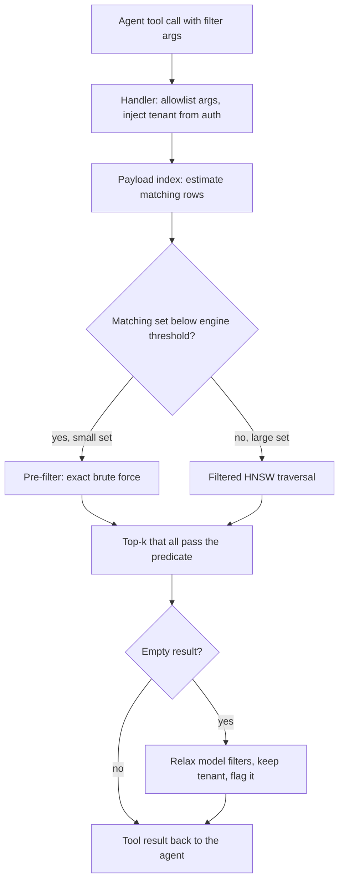

## TL;DR
When your agent calls a search tool with "contracts, last 90 days", metadata filtering turns those
arguments into hard predicates applied *inside* the vector search. Where the predicate runs (before,
during or after the ANN walk) decides whether the agent gets ten answers or none.

## For agent builders
- **Why it matters for agents.** Agents scope their own searches: the model fills `doc_type`, date
  ranges and language as tool arguments. A filter that silently returns zero hits makes the agent retry,
  rephrase or hallucinate, so filter behaviour shows up as wasted steps and wrong answers.
- **Where it shows up in your stack.** The filter argument of your retriever tool (LangChain and
  LlamaIndex retrievers accept metadata filters), Qdrant payload filters, pgvector `WHERE` clauses and
  Weaviate filters behind them, and the self-query pattern that turns natural language into predicates.
- **What you control.** Which fields the tool schema exposes as enums, the code that validates the
  model's arguments, the tenant and ACL predicates injected from the authenticated session (never from
  the model), and the fallback when a filtered search comes back empty.
- **What you can skip.** The internals of how each engine repairs filtered HNSW graphs. Know the k·s
  arithmetic, the selectivity bands and that you must measure filtered recall; that is enough.

## Why it exists
- **Embeddings encode topic, not ownership.** A vector says what a chunk is about, not which tenant owns
  it, when it was written or which product version it describes.
- **Similarity is soft; real constraints are hard.** "Only the 2025 travel policy", "only this customer's
  tickets", "only contracts, not emails", "only French". The 2024 and 2025 versions are near-duplicates,
  so they are each other's nearest neighbours; the top-k fills with the wrong year and the agent
  confidently answers from stale rules.
- **Writing the attribute into the text fails.** "Year: 2025. Tenant: acme." barely moves a vector that
  compresses hundreds of tokens, so the "filter" is probabilistic at best. It cannot express ranges,
  negation or list membership at all.
- **Post-filtering an approximate top-k fails.** It returns too few results, or none, as soon as the
  predicate is selective (arithmetic below). So the predicate must be part of the search, which is why
  vector databases ship payload indexes and filtered graph traversal instead of leaving it to the caller.

## How it works
### The agent's view: filters are tool arguments
1. **The tool schema exposes filter fields.** Typed and enumerated (`doc_type`, `language`, a
   `created_at` range), so the model picks from a fixed set instead of inventing values.
2. **The model fills them** from the user's request, or from its own plan ("check last quarter only").
3. **Your handler validates** each argument against an allowlist and drops unknown fields.
4. **Your handler injects security predicates** (`tenant_id`, principals) from the session.
5. **The engine executes** the combined predicate inside the search, as described below.
6. **The handler reports back** to the model: results, plus whether the filter was relaxed, so the agent
   can tell the user rather than loop.

### Why post-filtering breaks: the k·s arithmetic
Let *s* be the fraction of the corpus that passes the filter. If the unfiltered top-k is roughly a random
sample with respect to that attribute, about *k·s* results survive.

| Setting | Expected survivors |
|---|---|
| k = 10, filter keeps 1% | 0.1, usually an empty list |
| Over-fetch k/s = 1,000 candidates | about ten on average |

- **Over-fetching only half-fixes it.** ANN recall degrades at large k and latency grows.
- **Survivors are still not the true top-10 among matching rows**, because those may sit outside the
  unfiltered top-1,000 entirely.
- **For an agent, an empty list is not neutral.** The model reads "no results" as "no such document" and
  either answers wrongly or spends more tool calls retrying.

### Representing metadata
Each vector carries a payload: `tenant_id`, `doc_id`, `source`, `doc_type`, `language`, `created_at`
(as an integer timestamp, not a string), `version`, `section_path`, and, for access control, a list of
allowed principals.

| Field type | Predicates it supports |
|---|---|
| Keyword | exact match and set membership (`in [...]`) |
| Numeric, datetime | ranges |
| Boolean, geo | their own operators |
| Array | "any of" |

- **Types decide what is possible and fast**, so pick them deliberately at ingestion.
- **A filterable field needs a payload index** (a bitmap or inverted index keyed by value), exactly as a
  relational column needs an index. Without it the engine scans every candidate's payload and filtered
  latency grows linearly with collection size.
- **Keyword fields map cleanly to tool-schema enums**, which is the cheapest way to stop the model
  inventing values like `"doc_type": "agreements"`.

### Three places the predicate can run
1. **Pre-filtering.** Evaluate the predicate first with the payload index to get the allowed IDs.
   - Small set (hundreds to a few tens of thousands of vectors): brute-force exact distances over just
     those IDs; no ANN structure is needed.
   - Large set: pass the allowed set into the ANN search as a bitmap mask.
   - Result is exact with respect to the predicate; cost scales with the size of the allowed set.
2. **Post-filtering.** ANN top-k′, then drop failures. Trivial to build. Acceptable only when the
   predicate passes most rows, for example excluding the 2% of documents flagged as deleted. For a
   selective predicate the arithmetic above breaks it.
3. **Filtered traversal (in-search filtering).** The HNSW greedy walk evaluates the predicate on every
   candidate and only admits passing nodes to the result set. It still traverses through failing nodes so
   the graph stays connected. This is the default in most engines.
   - Failure mode: with a very selective predicate the walk visits many failing nodes before finding
     passing ones, and passing nodes may be poorly connected to each other, so recall drops and latency
     spikes.

### How engines switch strategy
Engines switch on estimated cardinality: below a threshold they brute-force the pre-filtered set, above
it they run filtered traversal.

| Engine | Mechanism |
|---|---|
| Qdrant | a threshold in its HNSW configuration |
| Weaviate | a flat-search cutoff |
| pgvector (historically) | post-filter: the planner pulls `ef_search` candidates from the index, then applies `WHERE`, so a selective predicate returns fewer than `LIMIT` rows |
| pgvector (recent) | iterative index scans keep walking until enough rows pass |
| pgvector (pre-filter option) | partial indexes (`CREATE INDEX ... WHERE tenant_id = ...`) |

### Why filtered traversal loses recall, and the repairs
- **Edges ignore metadata.** HNSW hops greedily along edges, and each node keeps only a few dozen (the
  `M` parameter). Edges were chosen for geometric closeness, not for sharing a tenant or a year.
- **Selective filters strand the walk.** If only 1% of nodes pass, a passing node's neighbours mostly
  fail. The walk spends its `ef` budget expanding failing nodes or stalls in a region with no passing
  nodes, returning fewer or worse results than exist.
- **Raising `ef_search` is a patch.** It buys some recall back at linear cost; it does not fix the
  topology.

Engines repair it three ways:
1. **Estimate cardinality first.** From the payload index, *before* searching, because that estimate
   decides brute force versus traversal.
2. **Add edges at build time** among nodes sharing an indexed payload value (Qdrant does this for indexed
   keyword fields), so each value's subgraph stays navigable.
3. **Widen the neighbourhood during the walk**, for example also considering neighbours-of-neighbours when
   direct neighbours fail (the ACORN approach, which Weaviate adopted as a filter strategy).

Each fix costs memory, build time or per-hop work, so none is free and measuring selectivity still matters.

### The decision rule is selectivity
| Selectivity *s* | Strategy |
|---|---|
| Tiny | pre-filter and brute-force: exact, cheap, ANN index irrelevant |
| Dangerous middle (roughly 0.1% to 10%; model it for your engine) | filtered traversal can lose recall: measure here |
| Large (most rows pass) | filtered traversal costs about the same as unfiltered; even post-filtering with modest over-fetch works |

Measure the middle band: run labeled queries with their real filters and compute recall@k per
selectivity bucket, not just unfiltered. Agent-chosen filters drift toward this band, because models
stack constraints (type plus date plus language).

### Multi-tenancy is the most common filter
| Layout | Gain | Cost |
|---|---|---|
| One collection per tenant | strong isolation, simple queries | thousands of small graphs cost memory and operations |
| Shared collection + `tenant_id` predicate on every query | one index, cheap | enforcement must live in code the caller cannot bypass |
| Tenant-aware layout (Qdrant's tenant payload index option, Weaviate's native per-tenant shards) | filtered search touches one region | engine-specific setup |

The tenant predicate is on every request, so it must be the cheapest predicate you have. In an agent the
"caller" includes the model, so the tenant must never be a tool argument. The ACL-aware retrieval lesson
covers the security side.

### Where filter values come from
- **The UI:** date pickers, product selectors.
- **The authenticated request:** tenant, principals. Never from the request body or the model.
- **An LLM parsing natural language** ("last quarter's incident reports") into structured predicates: the
  self-query pattern from query rewriting, or the agent filling tool arguments. Allowlist, keep it off
  security fields, and add a fallback (retry without the filter, or ask), because a misparse silently
  empties the result.

### Filters and the rest of the pipeline
- **Same predicate in every arm.** Apply it in BM25 and dense (hybrid search) and before reranking,
  otherwise one arm surfaces documents the other excluded.
- **Metadata updates are payload writes, not re-embeds.** Changing a document's status or ACL should never
  trigger re-computing its vectors.

## Diagram
Follow an agent's filtered search: the model proposes arguments, code validates them and injects the
tenant from auth, and the payload index estimate picks brute force or filtered HNSW traversal.



## Examples
### Agent tool: a validated filter builder for model-chosen arguments
The model proposes filters as tool arguments; code decides which survive. Security fields come only from
the authenticated session. The filter is a Qdrant-style `must` list; adapt the shape to your engine.

```python
SEARCH_TOOL = {                                   # schema the agent sees: enums, no tenant field
    "name": "search_docs",
    "input_schema": {"type": "object", "properties": {
        "query": {"type": "string"},
        "doc_type": {"enum": ["contract", "email", "policy"]},
        "language": {"enum": ["en", "fr", "de"]},
        "created_at": {"type": "object", "properties": {"gte": {"type": "integer"}, "lt": {"type": "integer"}}},
    }, "required": ["query"]},
}
ALLOWED = {"doc_type": {"contract", "email", "policy"}, "language": {"en", "fr", "de"}}
RANGE_FIELDS = {"created_at"}                 # integer epoch seconds, never strings
SECURITY = {"tenant_id", "allowed", "denied"}

def build_filter(llm_filter, tenant_id):
    must = [{"key": "tenant_id", "match": {"value": tenant_id}}]   # from auth, never from the model
    for field, value in llm_filter.items():
        if field in SECURITY:
            continue                                               # model may not set security fields
        if field in ALLOWED and value in ALLOWED[field]:
            must.append({"key": field, "match": {"value": value}})
        elif field in RANGE_FIELDS and isinstance(value, dict) and set(value) <= {"gte", "lt"}:
            must.append({"key": field, "range": {op: int(v) for op, v in value.items()}})
    return {"must": must}                                          # unknown fields are dropped, not guessed

def handle_search_docs(run, args, session, k=10):                  # called from the agent loop
    query, llm_filter = args["query"], {f: v for f, v in args.items() if f != "query"}
    hits = run(query, build_filter(llm_filter, session.tenant_id), k)
    if not hits and llm_filter:                                    # empty: likely misparse, relax, keep tenant
        hits = run(query, build_filter({}, session.tenant_id), k)
        return {"results": hits, "note": f"no match for filters {llm_filter}; showing unfiltered results"}
    return {"results": hits}

f = build_filter({"doc_type": "contract", "tenant_id": "evil", "year": "2025"}, "acme")
print(f)  # tenant stays 'acme'; unknown 'year' dropped; doc_type kept
```

- **The `note` field matters.** It tells the model the filter was relaxed, so it can say "no contracts
  from that period; here is the closest material" instead of presenting unfiltered hits as matches.

### Simulation: pre-filter versus post-filter
200k random unit vectors split across 100 tenants, so any single tenant's filter keeps about 1% of rows.
`pre_filter` evaluates the predicate first and does an exact search inside it; `post_filter` takes the
unfiltered top-k′ and drops other tenants, as a post-filtering engine would.

```python
import numpy as np
rng = np.random.default_rng(0)
N, d, k = 200_000, 64, 10
X = rng.standard_normal((N, d)).astype(np.float32); X /= np.linalg.norm(X, axis=1, keepdims=True)
tenant = rng.integers(0, 100, N)                      # 100 tenants: each filter keeps ~1% of rows
q = rng.standard_normal(d).astype(np.float32); q /= np.linalg.norm(q)
sims = X @ q                                          # cosine similarity of every row to the query

def pre_filter():                                     # predicate first, exact search inside it
    allowed = np.flatnonzero(tenant == 7)             # ~2,000 ids, straight from a payload index
    return allowed[np.argsort(-sims[allowed])[:k]]

def post_filter(k_fetch):                             # unfiltered top-k_fetch, then drop other tenants
    top = np.argpartition(-sims, k_fetch)[:k_fetch]
    keep = top[tenant[top] == 7]
    return keep[np.argsort(-sims[keep])][:k]

truth = set(pre_filter())
for kf in (10, 100, 1_000, 10_000):
    got = post_filter(kf)
    print(f"over-fetch {kf:>6}: {len(got):>2} results, {len(set(got) & truth):>2}/{k} correct")
# Output with this seed: over-fetch 10 -> 0 results; 100 -> 0; 1,000 -> 9 results, 9/10 correct;
# 10,000 -> 10 results, 10/10 correct, at 5x the candidate volume of the exact pre-filtered search.
```

| Over-fetch k′ | Expected k′·s | Results | Correct |
|---|---|---|---|
| 10 (a naive `top_k=10` call) | 0.1 | 0 | 0 |
| 100 | 1 | 0 | 0 |
| 1,000 | 10 | 9 | 9/10 |
| 10,000 | 100 (capped at k) | 10 | 10/10 |

- **Pre-filtering touched ~2,000 rows and was exact.** Post-filtering had to over-fetch 5% of the whole
  corpus to match it.
- **Count is fixed before correctness.** At k′ = 1,000 all nine survivors were correct, but the tenant's
  tenth-nearest row ranked outside the unfiltered top-1,000, beyond any post-processing.

### Worked scenario: an agent burning steps on empty filtered searches
A support agent searches a post-filtering store with `top_k=10`. The user asks about one small
customer's tickets; that customer is about 1% of the corpus. Figures are illustrative.

| Step | What the agent does | Result |
|---|---|---|
| 1 | `search_docs(customer filter, top_k=10)` | 0 hits (expected 0.1) |
| 2 | rephrases the query, same filter | 0 hits |
| 3 | drops the date range it added | 0 hits |
| 4 | answers "I could not find any tickets" | wrong: ~2,000 matching chunks exist |

Four model calls and a wrong answer, caused by retrieval arithmetic, not by the prompt. With pre-filtering
or filtered traversal step 1 returns 10 correct hits, and the run ends in two calls.

## Production patterns
- **Expose filters as enums in the tool schema.** Give the agent only fields that have payload indexes,
  with enumerated values where possible, and keep tenant and ACL fields out of the schema. Monitor the rate
  of dropped or invalid filter arguments per field; a rise means the descriptions or enums need work.
- **Index every filtered field, and only those.** When adding a filter to the product, create the payload
  index in the same change (for example `create_payload_index` with a keyword schema in Qdrant, a B-tree
  or partial index in pgvector). Monitor filtered p95 latency against collection size; growth means a
  scan.
- **Let the engine choose by cardinality.** Configure the brute-force threshold (Qdrant's HNSW threshold,
  Weaviate's flat-search cutoff) or enable pgvector iterative index scans on recent versions. Monitor the
  rate of queries returning fewer than k results, bucketed by selectivity.
- **Tenant-aware layout for skewed tenants.** When a few tenants are huge and most are tiny, mark the
  tenant field as a tenant index (Qdrant) or use native per-tenant shards (Weaviate). Monitor per-tenant
  recall@k and latency, not the global average.
- **Relax with a visible note, not silently.** On an empty result, relax the model-chosen filters (never
  the tenant), log why and tell the agent. Monitor relax rate per field and search calls per run; spikes
  point at a parsing or indexing regression.
- **Filtered recall in the eval gate.** Bucket labeled queries by selectivity, replay them with the
  filters your agent actually generated, and block deploys on recall@k drops in the 0.1% to 10% band.
  Monitor the same buckets in production traces.

## Trade-offs
- **Pre-filtering: exact vs scan cost.** Exact with respect to the predicate, but cost scales with the
  allowed set. Once the filter passes most of the corpus, brute force becomes a full scan and you need the
  graph instead.
- **Post-filtering: zero engine support vs correctness.** Adequate when nearly every row passes. It flips
  to useless as the pass fraction drops, and it never guarantees the true filtered top-k.
- **Payload indexes: fast predicates vs memory and writes.** Each indexed field costs memory and write
  throughput. Indexing every field you might ever filter on is the vector-store version of indexing every
  column.
- **Collection per tenant: isolation vs overhead.** Isolation and trivially cheap predicates, but thousands
  of small HNSW graphs cost more memory and operations than one shared graph. The flip depends on tenant
  count and size skew.
- **Agent-chosen filters: precision vs silent empties.** Model-scoped searches are sharper, but each
  misparse empties the results, so they cost validation, a fallback and an eval on generated filters.
- **Rich filter schema vs model reliability.** Each extra field is another place for the model to guess
  wrong; expose the few fields users actually scope by.

## Pitfalls
- **Post-filtering an ANN top-k.** Symptom: small tenants or rare document types return fewer than k
  results, or none, while the unfiltered query returns plenty; agents loop on retries. Cause: only k·s
  candidates survive. Diagnose: log result count and filter selectivity per call; short results cluster
  at low *s*. Fix: pre-filter or filtered traversal.
- **Filtering on a field with no payload index.** Symptom: filtered latency grows with collection size
  while unfiltered queries stay flat, because the engine scans payloads. Diagnose: list the collection's
  payload indexes and compare with fields in logged filters. Fix: add the index.
- **Dates stored as strings in mixed formats.** Range predicates compare lexically, so "newest document"
  queries return old content or nothing for some windows. Diagnose: sample `created_at` values and their
  types. Fix: integer timestamps.
- **Re-embedding to change metadata.** A status or ACL change is a payload update and should cost
  milliseconds. Re-embedding burns budget, delays the change (bad for an ACL revoke) and can introduce
  version skew if the embedding model has moved on. Fix: a payload write.
- **Accepting `tenant_id` or ACL values from the client or the model.** Symptom: cross-tenant leakage the
  moment someone edits a request body or a prompt injection sets a tool argument. Diagnose: diff the
  tenant in each executed filter against the session's tenant. Fix: derive them from identity.
- **Predicate in only one hybrid arm, or after reranking.** Symptom: results include documents the filter
  should have excluded. Diagnose: check every returned hit against the predicate. Fix: apply it in every
  arm, before reranking.
- **Evaluating recall only without filters.** Symptom: a filtered-traversal recall collapse in production
  for selective filters that never shows in the eval. Fix: bucket by selectivity.
- **Silent relaxation.** Symptom: the agent cites unfiltered results as if they matched "last 90 days".
  Fix: return a note with the tool result saying the filter was relaxed.

## When to use
- **Use when** a constraint is a hard predicate rather than a preference: tenant, access control, date
  range, document type, language, product version, publication status.
- **Avoid when** it is a soft preference such as "prefer recent"; that belongs in score boosting or
  reranking, where it trades off against relevance instead of excluding it.
- **Measure:** filtered recall@k on labeled queries bucketed by selectivity, p95 latency per bucket, the
  rate of queries returning fewer than k results, and search calls per agent run.
- **Interviews:** "what happens when a filter matches 0.5% of the rows?" Cover the three strategies, k·s
  and the brute-force threshold.

## Exercise
**Goal:** measure filtered recall per selectivity band on a real engine and prove your search tool
survives model-chosen filters. No solution is given.
- **Inputs:** 50k-200k vectors (synthetic or your corpus) with `tenant_id`, `doc_type` and an integer
  `created_at`; a local Qdrant, pgvector or Weaviate; 30 labeled queries.
- **Constraints:** tenants sized so filters keep 50%, 5%, 0.5% and 0.01% of rows; payload indexes only on
  fields the tool exposes.
- **Deliver:** a table of recall@10 against an exact filtered scan, p95 latency and the fewer-than-k rate
  per band, plus the tool handler.
- **Acceptance:** recall@10 ≥ 0.95 in every band after tuning; a test proves a model-supplied
  `tenant_id` is ignored; an empty result returns a relax note.

## Role lens
- **Engineer:** Designs the payload schema with typed fields, creates payload indexes for every filtered
  field, writes a validated filter builder, and tests the fewer-than-k cases explicitly.
- **Architect:** Decides the tenant layout (shared collection with predicate versus collection per
  tenant), which fields are filterable, and the rule that security predicates derive from identity, never
  from request bodies.
- **FDE:** Maps the customer's document attributes (SharePoint sites, Confluence spaces, product lines,
  regions) onto filterable metadata during ingestion and checks that the filters match how users actually
  scope their questions.

## Check yourself
**Q:** A support search over 5 million ticket chunks lets agents scope to one customer. One customer owns
300,000 chunks, another owns 400. The index is HNSW with post-filtering. What happens for each customer,
and how would you redesign the filter?
**A:** Post-filtering survives roughly k·s of the fetched candidates. The large customer is 6% of the
corpus, so an over-fetch of ~170 candidates yields about 10 results, which is workable. The small customer
is 0.008% of the corpus; even a top-1,000 over-fetch yields 0.08 expected survivors, so agents see empty
results. Redesign: put a payload index on `customer_id` and let the engine pick the strategy by
cardinality: brute-force exact search over the 400 chunks for the small customer (cheaper than any graph
walk), filtered traversal or a tenant-aware layout for the large one. Verify with filtered recall@k
measured per customer-size bucket, add an alert on fewer-than-k results, and never accept `customer_id`
from the client without checking the caller is authorized for it.

## Interview questions
### Why can't you just write the tenant or year into the chunk text and rely on similarity?
- **Embeddings encode topic, not hard attributes.** A prefix like "Year: 2025" barely moves a vector that
  compresses hundreds of tokens, so the constraint becomes probabilistic at best.
- **It cannot express the predicates you need.** Ranges, negation and list membership have no meaning in
  vector space, so hard constraints belong in typed payload fields with a payload index.

### Your agent's search tool takes filters from the model. How do you design it so it is safe and does not loop?
- **Schema:** expose only indexed fields, as enums or typed ranges, and leave `tenant_id` and ACL fields
  out entirely; the handler injects them from the session.
- **Validation:** drop unknown fields and values in code instead of guessing, so a hallucinated argument
  cannot widen or break the search.
- **Fallback:** on an empty result relax the model's filters, keep the tenant, and say so in the tool
  result, so the agent explains instead of retrying the same empty search.

### Users report that a "contracts only, last 90 days" search returns 3 results instead of 10. How do you debug it?
- **Check the strategy first.** If the engine post-filters an ANN top-k, survivors are about k·s, so a
  selective filter returns fewer than k by construction.
- **Then check the field.** A missing payload index, or dates stored as strings, explains slow or empty
  ranges; `created_at` should be an integer timestamp.
- **Then check the parse.** If an LLM produced the filter, log the predicate it built and the relax rate;
  a misparsed `doc_type` silently shrinks the set.

### When would you choose one collection per tenant over a shared collection with a tenant predicate?
- **Per tenant** when isolation requirements are strict and tenants are few and large: queries are
  trivially cheap and nothing can leak across a missing predicate.
- **Shared collection** when there are thousands of small tenants, because thousands of small HNSW graphs
  cost more memory and operations than one graph with a cheap, indexed `tenant_id` predicate.
- **Tenant-aware layouts** (Qdrant's tenant payload index, Weaviate's per-tenant shards) sit in between
  and suit heavy size skew.

### Your filter matches 0.5% of 20 million vectors. What happens inside the engine, and what do you measure?
- **About 100,000 rows match**, which is in the dangerous middle band where filtered traversal can strand
  the walk among failing nodes and lose recall.
- **Engines respond** by estimating cardinality first, adding build-time edges among nodes that share an
  indexed value, or widening the neighbourhood during the walk (ACORN-style).
- **Measure** filtered recall@k on labeled queries in that selectivity bucket, p95 latency, and the
  fewer-than-k rate, rather than unfiltered recall.

### Agent traces show many runs with three or more consecutive search calls. What do you look for?
- **Empty or short filtered results.** Group the calls by filter field and selectivity; post-filtering or
  a missing index makes selective filters return fewer than k, and the model retries.
- **Invalid arguments.** Count dropped filter values; a model guessing enum values it was not given
  points at a tool-description problem.
- **Fix and verify** by switching to pre-filtering or filtered traversal and checking that search calls
  per run fall on a replayed trace set.

## Quiz
### Q: Why does post-filtering an ANN top-k fail for selective predicates?
- [ ] The ANN index cannot compute distances for rows that carry metadata
- [x] Only about k·s of the k candidates pass, and the true filtered top-k may not be in the unfiltered candidates at all
- [ ] Post-filtering forces the engine to rebuild the HNSW graph for each query
- [ ] The predicate is evaluated before the embedding is computed, so it is ignored
> With selectivity s, the expected survivors are k·s (0.1 for k = 10 and s = 1%). Over-fetching helps
> only partly, because matching rows ranked outside the unfiltered candidate set are never seen.

### Q: A filter matches 300 vectors out of 10 million. Which execution strategy is best?
- [ ] Raise ef_search until the filtered HNSW walk finds enough matches
- [ ] Post-filter with an over-fetch of 10,000 candidates
- [x] Pre-filter via the payload index and run an exact brute-force search over the 300 matching IDs
- [ ] Build a separate HNSW index for every distinct value of the filtered field
> Three hundred exact distance computations are cheaper and more accurate than any graph traversal.
> Engines do this automatically below a cardinality threshold; over-fetching and ef_search tuning fight
> the arithmetic instead of avoiding it, and per-value indexes do not scale to arbitrary predicates.

### Q: A date-range filter returns nothing even though matching documents exist. What is the most likely cause?
- [ ] HNSW indexes cannot support range predicates
- [x] Dates were stored as strings in inconsistent formats, so the range comparison is lexical and misses
- [ ] The embedding model does not encode dates
- [ ] The query vector was not normalized before the search
> Range predicates need a numeric or datetime field; mixed string formats compare lexically and silently
> exclude rows. The embedding is irrelevant to a metadata predicate, and HNSW engines support ranges via
> payload indexes.

## Mastery test
**Problem:** a legal agent's search tool stacks `doc_type=contract`, `jurisdiction=DE` and a 30-day range
on a shared 8M-chunk pgvector table with HNSW. Each filter alone keeps 5% to 20% of rows; users say "it
finds nothing recent". Diagnose and redesign.

**A strong answer:**
- multiplies the selectivities (as low as about 0.05% if independent) and sees the stacked filter, not
  each filter alone, sits in the dangerous band;
- checks whether the query post-filters `ef_search` candidates, and the type of the date column;
- proposes iterative index scans (`hnsw.iterative_scan`, pgvector 0.8+) or a pre-filtered exact search for tiny sets, a payload index per field,
  a relax note, and recall@k measured on stacked filters.

## Use cases & projects
### Use cases
- **Contract and policy agents.** The model fills `doc_type` and a date range as search-tool arguments,
  and the filter scopes retrieval to the right document family and period.
- **Multi-tenant support agents.** A tenant predicate injected from the session keeps one customer's
  tickets out of another customer's answers, whatever the model asks for.
- **Multilingual help-desk agents.** A language filter stops the agent quoting a German article to a user
  who asked in English when both exist.
- **Self-query retrieval.** A planner step turns "last quarter's incident reports from the EU region" into
  structured predicates before the vector search runs.

### Mini project
**Build a filtered search tool and measure filtered recall (2-3 hours).**
- **Goal:** expose a search tool whose filter arguments the agent fills, and show how recall changes with
  filter selectivity.
- **Steps:** load a few thousand chunks with `doc_type`, date and tenant fields into a local vector store;
  define the tool schema with enums for `doc_type`; validate the model's arguments in code and inject the
  tenant from the session; run the same queries with filters of high and low selectivity, comparing
  filtered ANN results against an exact filtered scan.
- **Done when:** you have a table of recall@10 per selectivity band, an empty-result fallback the agent
  uses instead of hallucinating, and a test proving a model-supplied tenant value is ignored.
