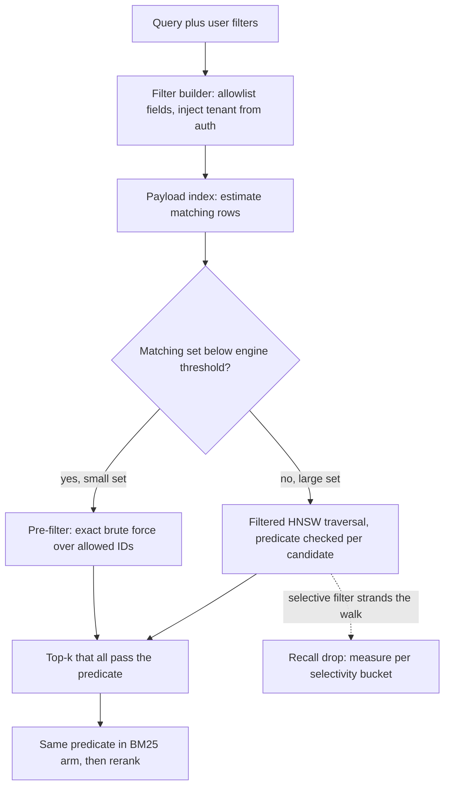

## TL;DR
Metadata filtering stores structured attributes (tenant, date, type, version) next to each vector and
applies them as hard predicates *inside* the search. The real question is where the predicate runs:
before the ANN walk, during it, or after it.

## Why it exists
- **Embeddings encode topic, not ownership.** A vector says what a chunk is about, not which tenant owns
  it, when it was written or which product version it describes.
- **Similarity is soft; real constraints are hard.** "Only the 2025 travel policy", "only this customer's
  tickets", "only contracts, not emails", "only French". The 2024 and 2025 versions are near-duplicates,
  so they are each other's nearest neighbours; the top-k fills with the wrong year and the model
  confidently answers from stale rules.
- **Writing the attribute into the text fails.** "Year: 2025. Tenant: acme." barely moves a vector that
  compresses hundreds of tokens, so the "filter" is probabilistic at best. It cannot express ranges,
  negation or list membership at all.
- **Post-filtering an approximate top-k fails.** It returns too few results, or none, as soon as the
  predicate is selective (arithmetic below). So the predicate must be part of the search, which is why
  vector databases ship payload indexes and filtered graph traversal instead of leaving it to the caller.

## How it works
### Why post-filtering breaks: the k·s arithmetic
Let *s* be the fraction of the corpus that passes the filter. If the unfiltered top-k is roughly a random
sample with respect to that attribute, about *k·s* results survive.

| Setting | Expected survivors |
|---|---|
| k = 10, filter keeps 1% | 0.1, usually an empty list |
| Over-fetch k/s = 1,000 candidates | about ten on average |

- **Over-fetching only half-fixes it.** ANN recall degrades at large k and latency grows.
- **Survivors are still not the true top-10 among matching rows**, because those may sit outside the
  unfiltered top-1,000 entirely.

### Representing metadata
Each vector carries a payload: `tenant_id`, `doc_id`, `source`, `doc_type`, `language`, `created_at`
(as an integer timestamp, not a string), `version`, `section_path`, and, for access control, a list of
allowed principals.

| Field type | Predicates it supports |
|---|---|
| Keyword | exact match and set membership (`in [...]`) |
| Numeric, datetime | ranges |
| Boolean, geo | their own operators |
| Array | "any of" |

- **Types decide what is possible and fast**, so pick them deliberately at ingestion.
- **A filterable field needs a payload index** (a bitmap or inverted index keyed by value), exactly as a
  relational column needs an index. Without it the engine scans every candidate's payload and filtered
  latency grows linearly with collection size.

### Three places the predicate can run
1. **Pre-filtering.** Evaluate the predicate first with the payload index to get the allowed IDs.
   - Small set (hundreds to a few tens of thousands of vectors): brute-force exact distances over just
     those IDs; no ANN structure is needed.
   - Large set: pass the allowed set into the ANN search as a bitmap mask.
   - Result is exact with respect to the predicate; cost scales with the size of the allowed set.
2. **Post-filtering.** ANN top-k′, then drop failures. Trivial to build. Acceptable only when the
   predicate passes most rows, for example excluding the 2% of documents flagged as deleted. For a
   selective predicate the arithmetic above breaks it.
3. **Filtered traversal (in-search filtering).** The HNSW greedy walk evaluates the predicate on every
   candidate and only admits passing nodes to the result set. It still traverses through failing nodes so
   the graph stays connected. This is the default in most engines.
   - Failure mode: with a very selective predicate the walk visits many failing nodes before finding
     passing ones, and passing nodes may be poorly connected to each other, so recall drops and latency
     spikes.

### How engines switch strategy
Engines switch on estimated cardinality: below a threshold they brute-force the pre-filtered set, above
it they run filtered traversal.

| Engine | Mechanism |
|---|---|
| Qdrant | a threshold in its HNSW configuration |
| Weaviate | a flat-search cutoff |
| pgvector (historically) | post-filter: the planner pulls `ef_search` candidates from the index, then applies `WHERE`, so a selective predicate returns fewer than `LIMIT` rows |
| pgvector (recent) | iterative index scans keep walking until enough rows pass |
| pgvector (pre-filter option) | partial indexes (`CREATE INDEX ... WHERE tenant_id = ...`) |

### Why filtered traversal loses recall, and the repairs
- **Edges ignore metadata.** HNSW hops greedily along edges, and each node keeps only a few dozen (the
  `M` parameter). Edges were chosen for geometric closeness, not for sharing a tenant or a year.
- **Selective filters strand the walk.** If only 1% of nodes pass, a passing node's neighbours mostly
  fail. The walk spends its `ef` budget expanding failing nodes or stalls in a region with no passing
  nodes, returning fewer or worse results than exist.
- **Raising `ef_search` is a patch.** It buys some recall back at linear cost; it does not fix the
  topology.

Engines repair it three ways:
1. **Estimate cardinality first.** From the payload index, *before* searching, because that estimate
   decides brute force versus traversal.
2. **Add edges at build time** among nodes sharing an indexed payload value (Qdrant does this for indexed
   keyword fields), so each value's subgraph stays navigable.
3. **Widen the neighbourhood during the walk**, for example also considering neighbours-of-neighbours when
   direct neighbours fail (the ACORN approach, which Weaviate adopted as a filter strategy).

Each fix costs memory, build time or per-hop work, so none is free and measuring selectivity still matters.

### The decision rule is selectivity
| Selectivity *s* | Strategy |
|---|---|
| Tiny | pre-filter and brute-force: exact, cheap, ANN index irrelevant |
| Dangerous middle (roughly 0.1% to 10%; model it for your engine) | filtered traversal can lose recall: measure here |
| Large (most rows pass) | filtered traversal costs about the same as unfiltered; even post-filtering with modest over-fetch works |

Measure the middle band: run labeled queries with their real filters and compute recall@k per
selectivity bucket, not just unfiltered.

### Multi-tenancy is the most common filter
| Layout | Gain | Cost |
|---|---|---|
| One collection per tenant | strong isolation, simple queries | thousands of small graphs cost memory and operations |
| Shared collection + `tenant_id` predicate on every query | one index, cheap | enforcement must live in code the caller cannot bypass |
| Tenant-aware layout (Qdrant's tenant payload index option, Weaviate's native per-tenant shards) | filtered search touches one region | engine-specific setup |

The tenant predicate is on every request, so it must be the cheapest predicate you have. The ACL-aware
retrieval lesson covers the security side.

### Where filter values come from
- **The UI:** date pickers, product selectors.
- **The authenticated request:** tenant, principals. Never from the request body or the model.
- **An LLM parsing natural language** ("last quarter's incident reports") into structured predicates: the
  self-query pattern from query rewriting. Validate against an allowlist of fields and values, never let
  it touch security fields, and add a fallback (retry without the filter, or ask), because a misparsed
  predicate silently returns an empty result set.

### Filters and the rest of the pipeline
- **Same predicate in every arm.** Apply it in BM25 and dense (hybrid search) and before reranking,
  otherwise one arm surfaces documents the other excluded.
- **Metadata updates are payload writes, not re-embeds.** Changing a document's status or ACL should never
  trigger re-computing its vectors.

## Diagram
Follow a filtered query: security predicates come from identity, the payload index estimates
cardinality, and that estimate picks exact brute force or filtered HNSW traversal.



## Examples
### Simulation: pre-filter versus post-filter
200k random unit vectors split across 100 tenants, so any single tenant's filter keeps about 1% of rows.
`pre_filter` evaluates the predicate first and does an exact search inside it; `post_filter` takes the
unfiltered top-k′ and drops other tenants, as a post-filtering engine would.

```python
import numpy as np
rng = np.random.default_rng(0)
N, d, k = 200_000, 64, 10
X = rng.standard_normal((N, d)).astype(np.float32); X /= np.linalg.norm(X, axis=1, keepdims=True)
tenant = rng.integers(0, 100, N)                      # 100 tenants: each filter keeps ~1% of rows
q = rng.standard_normal(d).astype(np.float32); q /= np.linalg.norm(q)
sims = X @ q                                          # cosine similarity of every row to the query

def pre_filter():                                     # predicate first, exact search inside it
    allowed = np.flatnonzero(tenant == 7)             # ~2,000 ids, straight from a payload index
    return allowed[np.argsort(-sims[allowed])[:k]]

def post_filter(k_fetch):                             # unfiltered top-k_fetch, then drop other tenants
    top = np.argpartition(-sims, k_fetch)[:k_fetch]
    keep = top[tenant[top] == 7]
    return keep[np.argsort(-sims[keep])][:k]

truth = set(pre_filter())
for kf in (10, 100, 1_000, 10_000):
    got = post_filter(kf)
    print(f"over-fetch {kf:>6}: {len(got):>2} results, {len(set(got) & truth):>2}/{k} correct")
# Output with this seed: over-fetch 10 -> 0 results; 100 -> 0; 1,000 -> 9 results, 9/10 correct;
# 10,000 -> 10 results, 10/10 correct, at 5x the candidate volume of the exact pre-filtered search.
```

| Over-fetch k′ | Expected k′·s | Results | Correct |
|---|---|---|---|
| 10 (a naive `top_k=10` call) | 0.1 | 0 | 0 |
| 100 | 1 | 0 | 0 |
| 1,000 | 10 | 9 | 9/10 |
| 10,000 | 100 (capped at k) | 10 | 10/10 |

- **Pre-filtering touched ~2,000 rows and was exact.** Post-filtering had to over-fetch 5% of the whole
  corpus to match it.
- **Count is fixed before correctness.** At k′ = 1,000 all nine survivors were correct, but the tenant's
  tenth-nearest row ranked outside the unfiltered top-1,000, so no post-processing of that candidate set
  could have found it.

### Production snippet: a validated filter builder for LLM-parsed constraints
The model proposes filters; code decides which survive. Security fields come only from the authenticated
request. The filter is a Qdrant-style `must` list; adapt the shape to your engine.

```python
ALLOWED = {"doc_type": {"contract", "email", "policy"}, "language": {"en", "fr", "de"}}
RANGE_FIELDS = {"created_at"}                 # integer epoch seconds, never strings
SECURITY = {"tenant_id", "allowed", "denied"}

def build_filter(llm_filter, tenant_id):
    must = [{"key": "tenant_id", "match": {"value": tenant_id}}]   # from auth, never from the model
    for field, value in llm_filter.items():
        if field in SECURITY:
            continue                                               # model may not set security fields
        if field in ALLOWED and value in ALLOWED[field]:
            must.append({"key": field, "match": {"value": value}})
        elif field in RANGE_FIELDS and isinstance(value, dict) and set(value) <= {"gte", "lt"}:
            must.append({"key": field, "range": {op: int(v) for op, v in value.items()}})
    return {"must": must}                                          # unknown fields are dropped, not guessed

def search(run, query, llm_filter, tenant_id, k=10):
    hits = run(query, build_filter(llm_filter, tenant_id), k)
    if not hits and llm_filter:                                    # empty: likely misparse, relax, keep tenant
        return run(query, build_filter({}, tenant_id), k), "relaxed"   # log the reason, or ask the user
    return hits, "filtered"

f = build_filter({"doc_type": "contract", "tenant_id": "evil", "year": "2025"}, "acme")
print(f)  # tenant stays 'acme'; unknown 'year' dropped; doc_type kept
```

## Production patterns
- **Index every filtered field, and only those.** When adding a filter to the product, create the payload
  index in the same change (for example `create_payload_index` with a keyword schema in Qdrant, a B-tree
  or partial index in pgvector). Monitor filtered p95 latency against collection size; growth means a
  scan.
- **Let the engine choose by cardinality.** Configure the brute-force threshold (Qdrant's HNSW threshold,
  Weaviate's flat-search cutoff) or enable pgvector iterative index scans on recent versions. Monitor the
  rate of queries returning fewer than k results, bucketed by selectivity.
- **Tenant-aware layout for skewed tenants.** When a few tenants are huge and most are tiny, mark the
  tenant field as a tenant index (Qdrant) or use native per-tenant shards (Weaviate). Monitor per-tenant
  recall@k and latency, not the global average.
- **Self-query with an allowlist and fallback.** Parse natural-language constraints with an LLM, validate
  fields and values in code, inject security predicates from identity, and relax on empty results with a
  logged reason. Monitor the relax rate per filter field; spikes point at a parsing regression.
- **Filtered recall in the eval gate.** Bucket labeled queries by selectivity and block deploys on recall@k
  drops in the 0.1% to 10% band. Monitor the same buckets in production samples.

## Trade-offs
- **Pre-filtering: exact vs scan cost.** Exact with respect to the predicate, but cost scales with the
  allowed set. Once the filter passes most of the corpus, brute force becomes a full scan and you need the
  graph instead.
- **Post-filtering: zero engine support vs correctness.** Adequate when nearly every row passes. It flips
  to useless as the pass fraction drops, and it never guarantees the true filtered top-k.
- **Payload indexes: fast predicates vs memory and writes.** Each indexed field costs memory and write
  throughput. Indexing every field you might ever filter on is the vector-store version of indexing every
  column.
- **Collection per tenant: isolation vs overhead.** Isolation and trivially cheap predicates, but thousands
  of small HNSW graphs cost more memory and operations than one shared graph. The flip depends on tenant
  count and size skew.
- **LLM-derived filters: natural language vs silent empties.** Natural-language constraints work, but every
  misparse silently empties the result set, so they cost a validation layer and a fallback path.

## Pitfalls
- **Post-filtering an ANN top-k.** Symptom: small tenants or rare document types return fewer than k
  results, or none, while the same query without the filter returns plenty. Fix: pre-filter or filtered
  traversal.
- **Filtering on a field with no payload index.** Symptom: filtered latency grows with collection size
  while unfiltered queries stay flat. Fix: add the index.
- **Dates stored as strings in mixed formats.** Range predicates compare lexically; "newest document"
  queries return old content or nothing for certain date windows. Fix: integer timestamps.
- **Re-embedding to change metadata.** A status or ACL change is a payload update and should cost
  milliseconds, not an embedding job.
- **Accepting `tenant_id` or ACL values from the client or the model.** Symptom: cross-tenant leakage the
  moment someone edits a request body. Fix: derive them from identity.
- **Predicate in only one hybrid arm, or after reranking.** Symptom: results include documents the filter
  should have excluded. Fix: apply it in every arm, before reranking.
- **Evaluating recall only without filters.** Symptom: a filtered-traversal recall collapse that shows up in
  production for selective filters and never in the eval. Fix: bucket by selectivity.

## When to use
- **Use when** a constraint is a hard predicate rather than a preference: tenant, access control, date
  range, document type, language, product version, publication status.
- **Avoid when** it is a soft preference such as "prefer recent"; that belongs in score boosting or
  reranking, where it trades off against relevance instead of excluding it.
- **Measure:** filtered recall@k on labeled queries bucketed by selectivity, p95 latency per bucket, and
  the rate of queries returning fewer than k results.
- **Day to day:** the filter builder is where security, UX and retrieval quality meet.
- **Interviews:** "what happens in your vector database when a filter matches 0.5% of the rows?" Cover
  pre-, post- and in-traversal filtering, the k·s arithmetic, and the cardinality threshold at which the
  engine should switch to brute force.

## Role lens
- **Engineer:** Designs the payload schema with typed fields, creates payload indexes for every filtered
  field, writes a validated filter builder, and tests the fewer-than-k cases explicitly.
- **Architect:** Decides the tenant layout (shared collection with predicate versus collection per
  tenant), which fields are filterable, and the rule that security predicates derive from identity, never
  from request bodies.
- **FDE:** Maps the customer's document attributes (SharePoint sites, Confluence spaces, product lines,
  regions) onto filterable metadata during ingestion and checks that the filters match how users actually
  scope their questions.

## Check yourself
**Q:** A support search over 5 million ticket chunks lets agents scope to one customer. One customer owns
300,000 chunks, another owns 400. The index is HNSW with post-filtering. What happens for each customer,
and how would you redesign the filter?
**A:** Post-filtering survives roughly k·s of the fetched candidates. The large customer is 6% of the
corpus, so an over-fetch of ~170 candidates yields about 10 results, which is workable. The small customer
is 0.008% of the corpus; even a top-1,000 over-fetch yields 0.08 expected survivors, so agents see empty
results. Redesign: put a payload index on `customer_id` and let the engine pick the strategy by
cardinality: brute-force exact search over the 400 chunks for the small customer (cheaper than any graph
walk), filtered traversal or a tenant-aware layout for the large one. Verify with filtered recall@k
measured per customer-size bucket, add an alert on fewer-than-k results, and never accept `customer_id`
from the client without checking the caller is authorized for it.

## Interview questions
### Why can't you just write the tenant or year into the chunk text and rely on similarity?
- **Embeddings encode topic, not hard attributes.** A prefix like "Year: 2025" barely moves a vector that
  compresses hundreds of tokens, so the constraint becomes probabilistic at best.
- **It cannot express the predicates you need.** Ranges, negation and list membership have no meaning in
  vector space, so hard constraints belong in typed payload fields with a payload index.

### Users report that a "contracts only, last 90 days" search returns 3 results instead of 10. How do you debug it?
- **Check the strategy first.** If the engine post-filters an ANN top-k, survivors are about k·s, so a
  selective filter returns fewer than k by construction.
- **Then check the field.** A missing payload index, or dates stored as strings, explains slow or empty
  ranges; `created_at` should be an integer timestamp.
- **Then check the parse.** If an LLM produced the filter, log the predicate it built and the relax rate;
  a misparsed `doc_type` silently shrinks the set.

### When would you choose one collection per tenant over a shared collection with a tenant predicate?
- **Per tenant** when isolation requirements are strict and tenants are few and large: queries are
  trivially cheap and nothing can leak across a missing predicate.
- **Shared collection** when there are thousands of small tenants, because thousands of small HNSW graphs
  cost more memory and operations than one graph with a cheap, indexed `tenant_id` predicate.
- **Tenant-aware layouts** (Qdrant's tenant payload index, Weaviate's per-tenant shards) sit in between
  and suit heavy size skew.

### Your filter matches 0.5% of 20 million vectors. What happens inside the engine, and what do you measure?
- **About 100,000 rows match**, which is in the dangerous middle band where filtered traversal can strand
  the walk among failing nodes and lose recall.
- **Engines respond** by estimating cardinality first, adding build-time edges among nodes that share an
  indexed value, or widening the neighbourhood during the walk (ACORN-style).
- **Measure** filtered recall@k on labeled queries in that selectivity bucket, p95 latency, and the
  fewer-than-k rate, rather than unfiltered recall.

### Why should metadata changes never trigger re-embedding?
- **The vector did not change.** A status or ACL change alters payload, not content, so it is a payload
  write that costs milliseconds.
- **Re-embedding is slow and risky.** It burns embedding budget, delays the change (bad for ACL revokes)
  and can introduce version skew if the embedding model has moved on.

## Quiz
### Q: Why does post-filtering an ANN top-k fail for selective predicates?
- [ ] The ANN index cannot compute distances for rows that carry metadata
- [x] Only about k·s of the k candidates pass, and the true filtered top-k may not be in the unfiltered candidates at all
- [ ] Post-filtering forces the engine to rebuild the HNSW graph for each query
- [ ] The predicate is evaluated before the embedding is computed, so it is ignored
> With selectivity s, the expected survivors are k·s (0.1 for k = 10 and s = 1%). Over-fetching helps
> only partly, because matching rows ranked outside the unfiltered candidate set are never seen.

### Q: A filter matches 300 vectors out of 10 million. Which execution strategy is best?
- [ ] Raise ef_search until the filtered HNSW walk finds enough matches
- [ ] Post-filter with an over-fetch of 10,000 candidates
- [x] Pre-filter via the payload index and run an exact brute-force search over the 300 matching IDs
- [ ] Build a separate HNSW index for every distinct value of the filtered field
> Three hundred exact distance computations are cheaper and more accurate than any graph traversal.
> Engines do this automatically below a cardinality threshold; over-fetching and ef_search tuning fight
> the arithmetic instead of avoiding it, and per-value indexes do not scale to arbitrary predicates.

### Q: A date-range filter returns nothing even though matching documents exist. What is the most likely cause?
- [ ] HNSW indexes cannot support range predicates
- [x] Dates were stored as strings in inconsistent formats, so the range comparison is lexical and misses
- [ ] The embedding model does not encode dates
- [ ] The query vector was not normalized before the search
> Range predicates need a numeric or datetime field; mixed string formats compare lexically and silently
> exclude rows. The embedding is irrelevant to a metadata predicate, and HNSW engines support ranges via
> payload indexes.
