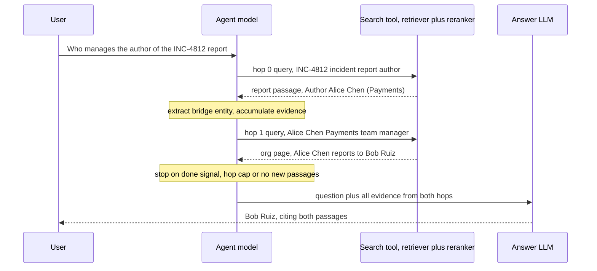

## TL;DR
Some answers need a second fact that is only findable once you know the first. Multi-hop retrieval is
an agent loop with a search tool: retrieve, read the bridging fact, write the next query, repeat under a
hop limit, then answer with citations.

## For agent builders
- **Why it matters for agents.** This is a core reason agents beat fixed RAG pipelines: the next query
  comes from what the last tool call returned. It is also where agents burn cost, loop on the same query
  and invent the second fact.
- **Where it shows up in your stack.** A ReAct-style loop over a `search` tool in any provider SDK, a
  LangGraph graph with a conditional edge back to the search node (bounded by its `recursion_limit`
  setting), LlamaIndex agents, and the per-step traces you read in LangSmith or similar.
- **What you control.** The hop or tool-call cap, the no-progress rule, what each tool result returns
  (full passages or short notes), reranking per hop, and the cite-or-refuse rule on the final answer.
- **What you can skip.** Training multi-hop dense retrievers (Xiong et al.). Prompted loops over an
  off-the-shelf retriever are what agent teams ship.

## Why it exists
- **The second query does not exist yet.** "Who manages the author of the report for incident 4812?" needs
  the author's name before "manager of Alice" is even a query. One-shot retrieval finds the first hop at
  best, since the terms that would retrieve the second do not exist yet.
- **It is not a ranking problem, so ranking fixes do not apply.** "Alice reports to Bob" shares no
  distinctive terms or topic with "incident 4812": its embedding is nowhere near the question's, and its
  BM25 score is at best an incidental match on a common word such as "report".
  - **Raising k fails:** the passage sits so far down, among thousands of unrelated passages, that it is
    effectively outside the affordable tail.
  - **A reranker fails:** it cannot promote a candidate that was never retrieved.
  - **Query rewriting fails:** it cannot invent the name Alice before anyone has read the incident report.
- **Benchmarks were built to expose it.** HotpotQA has "bridge" questions (an intermediate entity links two
  documents, inherently sequential) and "comparison" questions (two entities looked up and compared; they
  fan out in parallel, which is query decomposition). Press et al.: even when a model can answer each hop,
  composing them fails at a measurable rate, and making the hops explicit narrows that gap.
- **The alternatives cost more up front.** A knowledge graph answers "manager of the author of X" in one
  traversal, but someone must extract entities and relations offline and keep them fresh. Stuffing the
  whole corpus into context works for small corpora and fails on cost and size for the rest. Multi-hop
  needs neither; it pays per question instead.

## How it works
### The loop
State: the original question, the evidence gathered so far, and a hop counter.

1. **Plan the next query.** An LLM reads the question and the evidence so far and emits the next search
   query or a "sufficient" signal. The query is generated from the evidence, not the question, because the
   bridging entity lives in the evidence.
2. **Retrieve.** Use the normal retriever (hybrid plus reranker if you have one). Precision matters more
   than in single-shot RAG, because a wrong top passage sends the next hop in the wrong direction.
3. **Accumulate.** Append new passages, deduplicating by id. Evidence accumulates rather than being
   replaced, because the final answer needs both hops.
4. **Terminate.** Stop when the planner says "enough", the hop cap is reached, or a hop adds no new
   passages.
5. **Answer.** A final prompt with the question and all evidence produces the answer with citations per hop.

Why all three stop conditions, because each alone fails:

| Condition | What it covers | Failure if used alone |
|---|---|---|
| Planner "done" signal | ends solved questions early | the model may loop or stop early |
| Hop cap | guarantees termination, bounds cost | wastes hops on questions answered at hop one |
| No-progress detection | catches a planner that keeps issuing the same query | does not end a solved question, and does not bound a chain that keeps finding new but useless passages |

### Three named formulations
| Name | Mechanism | Why it helps |
|---|---|---|
| **Self-ask** (Press et al.) | model writes "Follow up: ..." questions, answers each with a search call ("Intermediate answer: ..."), ends with "So the final answer is" | the scaffold makes hops legible and easy to log |
| **IRCoT** (Trivedi et al.) | interleaves chain-of-thought with retrieval: each reasoning sentence becomes the next query; retrieved passages feed the next sentence | a reasoning step naturally names the thing to look up next |
| **ReAct-style agent loops** | thought, action (search), observation, repeat; agentic RAG exposes the retriever as a tool | generalises both; hop caps and progress checks still apply |

### Forming a good second-hop query
- **Extract the bridge entity and ask something specific:** "Alice Chen manager" or "who does Alice Chen
  report to", not "who is the manager?".
- **Few-shot examples of the extraction step** in the planner prompt are the cheapest way to get this right.
- **Carry a disambiguating attribute** (team, email) from hop one when entities are ambiguous (two Alices).

### What to carry between hops
| Option | Gains | Costs |
|---|---|---|
| Full passages to the planner | faithful | by hop three the planner reads thousands of tokens, mostly irrelevant to the next query |
| Short bridging notes ("INC-4812 author: Alice Chen, Payments") plus passage ids | focused, cheap planner | notes are model-written and cannot be cited, so the final answer prompt still gets the full passages |

- **Pass the queries already tried,** because a planner that can see its previous query is less likely to
  reissue it.

### Compounding error
```
P(chain succeeds) = r1 × r2 × ...      # r2 is hop-two success *given* a correct hop one
```

- **Assumes a wrong first hop is never recovered,** the realistic case, since a wrong bridge entity produces
  a confidently wrong second query.
- **Illustratively,** 0.9 × 0.9 ≈ 0.81 for two hops and ≈ 0.73 for three.
- **Three responses follow from the product:**
  1. **Raise per-hop precision,** usually with a reranker, which buys more here than in single-shot RAG.
  2. **Keep hop count minimal.**
  3. **Do not commit greedily when hop one is ambiguous.** Keep the top two or three candidate bridge
     entities (a small beam), run the next hop for each, and let the final step pick the chain whose
     evidence agrees. It costs b times the retrievals but turns one fragile chain into several.

### Learned alternatives
- **Multi-hop dense retrieval (Xiong et al.)** trains the query encoder on the question plus the previously
  retrieved passage, so the second-hop vector comes from both without a generated query.
- **It removes an LLM call per hop** but needs multi-hop training data resembling your domain, which is why
  prompted loops with off-the-shelf retrievers dominate in enterprise settings.

### Evaluating
- **Per-hop supporting-fact recall** (HotpotQA labels supporting sentences for exactly this).
- **Final answer, hop-count distribution and cost per question.**
- **Final-answer accuracy alone hides where chains die.**

### Mapping the loop onto an agent harness
| Loop element | Where it lives in a tool-calling agent |
|---|---|
| Plan the next query | the model's tool call; its `query` argument is the bridge query |
| Planner "done" signal | the model replies without a tool call |
| Hop cap | a max-steps or max-tool-calls limit in your loop (LangGraph's `recursion_limit` plays this role, but counts graph steps: about two per hop) |
| No-progress detection | the tool executor: repeated query or zero new passage ids |
| Accumulate evidence | tool results appended to the transcript |
| Answer with citations | the final model turn, checked by a citation validator |

- **The transcript is the evidence store.** Every hop's result stays in context, so result size per hop
  sets how many hops fit before cost or the window bites.
- **The stop conditions belong in code, not only the prompt.** A prompt asking the model to stop is a
  signal; a counter in the harness is a guarantee.

## Diagram
Follow one bridge question through the agent loop: each hop's query comes from the evidence, and three
independent stop conditions guard the exit.



## Misconceptions
- **"A better retriever or a reranker will find the second hop."** "Alice Chen reports to Bob Ruiz"
  shares nothing with "incident 4812", so it is never a candidate. A reranker cannot promote what was not
  retrieved, and no rewrite can name Alice before the report is read.
- **"Asking the model to stop when done is enough."** A prompt is a signal, not a guarantee. Enforce the
  hop cap and the no-progress check (repeated query, zero new passage ids) in the harness, or the agent
  loops and the bill grows.
- **"Each hop is 90% reliable, so the chain is too."** Hops compound: illustratively 0.9 × 0.9 ≈ 0.81 for
  two and ≈ 0.73 for three, because a wrong bridge entity yields a confidently wrong next query. Per-hop
  precision is worth more here than in single-shot RAG.
- **"Comparison questions are multi-hop."** "Compare A and B" names both entities up front, so it fans out
  in parallel (query decomposition). Multi-hop is for bridge questions, where the next query depends on an
  answer you do not have yet.
- **"Hops are cheap because each search is cheap."** Every hop is a sequential model call that re-reads
  the whole transcript. Input tokens grow faster than hop count (~10,500 over three calls in the example).

## Examples
### A bounded multi-hop loop
`llm` returns text, `retrieve` returns `(id, text)` pairs; the planner emits JSON so termination is
explicit and loggable.

```python
import json

PLAN = """Question: {q}
Evidence so far:
{ev}
Queries already tried: {tried}
If the evidence answers the question, return {{"done": true}}.
Otherwise extract the entity or fact you still need, and return
{{"done": false, "query": "<a specific search query naming that entity>"}}"""

def multi_hop(question, max_hops=3, k=5):
    evidence, seen, trace = [], set(), []
    for hop in range(max_hops):
        ev = "\n".join(f"[{i}] {t}" for i, t in evidence) or "(none)"
        tried = "; ".join(t["query"] for t in trace) or "(none)"
        try:
            plan = json.loads(llm(PLAN.format(q=question, ev=ev, tried=tried)))
        except ValueError:
            break                        # malformed plan: answer from what we have
        if plan.get("done") or not plan.get("query"):
            break
        hits = retrieve(plan["query"], k)
        new = [(i, t) for i, t in hits if i not in seen]
        trace.append({"hop": hop, "query": plan["query"], "new": len(new)})
        if not new:                      # no progress: stop instead of looping
            break
        seen.update(i for i, _ in new); evidence.extend(new)
    ev = "\n".join(f"[{i}] {t}" for i, t in evidence)
    answer = llm(f"Question: {question}\nEvidence:\n{ev}\nAnswer with citations, "
                 f"or say the evidence is insufficient.")
    return answer, trace

ans, trace = multi_hop("Who manages the engineer who wrote the report for incident INC-4812?")
# Illustrative trace:
#   hop 0  query="INC-4812 incident report author"      -> report: "Author: Alice Chen (Payments)"
#   hop 1  query="Alice Chen Payments team manager"     -> org page: "Alice Chen reports to Bob Ruiz"
#   hop 2  planner returns done=true; answer cites both passages
# Cost of this 2-hop answer: 3 planner calls + 2 retrievals + 1 answer call, all sequential.
```

### Runnable: compounding error and the cost of a beam
Pure Python. Illustrative per-hop rates; substitute your measured per-hop recall.

```python
from math import prod

def chain_success(per_hop):          # a wrong hop is never recovered
    return prod(per_hop)

def retrievals(hops, beam=1):        # hop one once, later hops once per kept bridge entity
    return 1 + beam * (hops - 1)

for hops in (1, 2, 3):
    p = chain_success([0.9] * hops)
    print(f"{hops} hops: success {p:.2f}, retrievals {retrievals(hops)} greedy / {retrievals(hops, 3)} beam=3")
print(f"rerank lifts per-hop to 0.95: 3 hops -> {chain_success([0.95] * 3):.2f}")
# 1 hops: success 0.90, retrievals 1 greedy / 1 beam=3
# 2 hops: success 0.81, retrievals 2 greedy / 4 beam=3
# 3 hops: success 0.73, retrievals 3 greedy / 7 beam=3
# rerank lifts per-hop to 0.95: 3 hops -> 0.86
```

- **Per-hop precision compounds:** a hypothetical lift from 0.9 to 0.95 per hop moves a three-hop chain
  from 0.73 to 0.86.
- **A beam is linear in width:** three bridge candidates turn 3 retrievals into 7, worth it only when hop
  one is genuinely ambiguous.

### Agent scenario: the same loop as a tool-calling agent with guards in the harness
`call_model(messages, tools)` returns `.text` and `.tool_calls`, `.as_message()` turns the reply back into
a transcript entry, and `tool_result(id, content)` builds the provider's result message; all are stubs.

```python
def run_agent(question, max_steps=4, k=5):
    messages = [{"role": "user", "content": question}]
    seen, tried = set(), set()
    for step in range(max_steps):                          # hop cap, enforced in code
        reply = call_model(messages, tools=[SEARCH_TOOL])
        messages.append(reply.as_message())
        if not reply.tool_calls:
            return reply.text, step                         # the model's "done" signal
        for call in reply.tool_calls:
            q = call["input"]["query"].strip()
            key = " ".join(q.lower().split())               # normalised only for the repeat check
            if key in tried:                                # no progress: same query again
                content = {"status": "repeated_query", "hint": "name the entity you still need"}
            else:
                tried.add(key)
                new = [(i, t) for i, t in retrieve(q, k) if i not in seen]
                seen.update(i for i, _ in new)
                content = ({"status": "ok", "passages": [{"id": i, "text": t} for i, t in new]}
                           if new else {"status": "no_new_passages"})
            messages.append(tool_result(call["id"], content))
    messages.append({"role": "user", "content": "Search budget reached. Answer only from the passages "
                     "above, cite their ids for every fact, and say which fact is still missing."})
    # keep the tool defined (the transcript holds tool calls) but forbid calling it
    final = call_model(messages, tools=[SEARCH_TOOL], tool_choice="none")
    return final.text, max_steps                            # partial answer, never a silent timeout
```

Illustrative token flow for the INC-4812 question, with a 2,000-token system prompt and tool schemas and
~1,500 tokens (5 passages) per search result:

| Step | Model does | Transcript before the call | New tokens appended |
|---|---|---|---|
| 1 | search "INC-4812 incident report author" | ~2,000 | ~1,500 |
| 2 | search "Alice Chen Payments team manager" | ~3,500 | ~1,500 |
| 3 | answers "Bob Ruiz", citing both passages | ~5,000 | answer |
| Total input across 3 calls | | ~10,500 | |

- **Each extra hop re-reads everything before it,** so input grows faster than hop count; prefix caching
  on an append-only transcript recovers much of that cost.
- **Returning short notes plus ids** instead of five full passages shrinks the per-hop append, at the cost
  of fetching full passages again for the cited answer.

## Production patterns
- **Gate the loop behind hop one.** Run normal single-shot retrieval first and enter the loop only when the
  planner says the evidence is insufficient, so single-hop traffic pays nothing extra. Monitor the share of
  questions that take more than one hop.
- **Hard ceilings in the agent harness.** Set a hop cap (the example uses `max_hops=3`; in LangGraph,
  `recursion_limit`), a per-question token or cost budget and a wall-clock timeout, and answer from
  partial evidence with an "insufficient" note when any trips. Monitor how often each ceiling fires.
- **Rerank every hop.** Put the cross-encoder on each hop's candidates, not only the last, because a wrong
  bridge poisons later hops. Monitor per-hop supporting-fact recall on the multi-hop golden slice.
- **Log the trace.** Persist the `trace` (query, new passages, hop) and the bridging notes per request, as
  one span per tool call in your agent tracing tool, so a failed chain shows where it died. Alert on rising
  no-progress stops, which often mean a missing document type in the index.
- **Cite-or-refuse for every hop.** Require a retrieved passage id for each bridging fact in the final
  answer and reject answers whose second fact has no citation. Monitor the uncited-fact rate, the signal
  for parametric-memory shortcuts.
- **Feed no-progress back as a tool result.** Instead of silently stopping, return a status such as
  `repeated_query` or `no_new_passages` with a hint, so the agent can name the missing entity or give up
  cleanly. Monitor how often a hint is followed by a productive next query.

## Trade-offs
- **Reach vs latency.** Latency grows with hop count and hops are strictly sequential; gate with a
  classifier or let hop one decide, so single-hop questions never pay for a loop.
- **Recovery by reformulation vs poisoned chains.** The model can recover from a weak retriever by
  reformulating, but a wrong bridge entity poisons every later hop; reranking each hop raises per-hop
  precision and pays for itself here.
- **Beam robustness vs retrievals.** A small beam over candidate bridge entities protects against a wrong
  first hop but multiplies later retrievals by the beam width; it pays when hop-one entities are ambiguous
  (common names, duplicate reports) and is waste when the bridge is an exact identifier.
- **No offline extraction vs per-question cost.** Versus a knowledge graph, fresh data works immediately,
  but each question pays runtime cost; when the same relations are queried constantly, build the graph.
- **Bounded cost vs simplicity.** Versus long-context stuffing, cost is bounded per hop rather than per
  corpus; for a corpus that fits comfortably in the window with caching, stuffing is simpler and often
  better.
- **Open agent loop vs fixed two-hop pipeline.** A free agent loop handles any chain length and
  recovers by reformulating, but its cost and latency vary per question; when every question has the
  same shape (incident → service → owner), a fixed two-step pipeline is cheaper and easier to evaluate.

## Pitfalls
- **No hop cap or no-progress check.** Symptom: runaway cost and timeouts on questions the corpus cannot
  answer. Diagnose: plot the hop-count distribution and count repeated queries per trace. Fix: both
  guards, in code.
- **Answering hop two from parametric memory.** Symptom: a confident answer whose second fact cites no
  retrieved passage and cannot be reproduced for private entities. Diagnose: the uncited-fact rate per
  hop. Fix: cite-or-refuse.
- **A generic second-hop query** because the bridge entity was not extracted. Symptom: the same passages
  retrieved twice and a chain that stalls at hop two. Diagnose: check whether each hop's query contains an
  entity from the previous result. Fix: few-shot the extraction step.
- **Evidence overflowing the context across hops.** Symptom: hop-one evidence truncated away before the
  answer. Diagnose: log transcript tokens per step. Fix: short notes plus ids, full passages at answer time.
- **Scoring only the final answer.** Symptom: the dashboard cannot show that most failures die at hop two.
  Fix: per-hop supporting-fact recall.
- **Running comparison questions as sequential chains.** Symptom: latency double a parallel fan-out. Fix:
  decompose independent facets.
- **Stop rules only in the system prompt.** "Stop after three searches" is advice, not a limit. Symptom:
  the occasional 15-step run. Fix: enforce the cap and no-progress rule in the harness and end with a
  forced answer turn.

## When to use
- **Use when** questions chain through entities the question does not name: org charts and ownership
  (incident → service → owner), dependency graphs, legal cross-references ("as defined in section 3"), and
  "the author of X's other work".
- **Avoid when** the corpus already has a maintained knowledge graph: traverse it instead.
- **Gate it** when questions are overwhelmingly single-hop, so the loop only engages when hop one leaves the
  question unanswered.
- **Measure:** hop-level recall, hop-count distribution, final accuracy on a multi-hop golden slice, and
  cost per question.

## Exercise
**Goal:** build a bounded two-hop search agent and find where its chains die. No solution is given.
- **Inputs:** a corpus of about 50 short documents where 15 questions need two linked documents (incident →
  service → owner) and 5 are unanswerable because the second document is missing; label the supporting
  document per hop.
- **Deliver:** a loop with a hop cap, a no-progress rule enforced in code, a forced answer turn, and a
  per-question trace; a table of per-hop recall, accuracy, hops used and input tokens.
- **Acceptance:** no run exceeds the cap; every unanswerable question ends with "insufficient" and no
  invented owner; you can name the hop where each failed chain died.

## Role lens
- **Engineer:** Implements the planner prompt, the bounded loop with deduplication and progress checks, and
  per-hop logging so a failed chain shows exactly where it died.
- **Architect:** Decides between runtime multi-hop, an offline knowledge graph, or long-context stuffing
  for a given corpus and query mix, and sets the hop and cost ceilings.
- **FDE:** Finds the chained questions in a customer's logs ("who owns the service that broke"), builds the
  golden slice, and tunes the planner to the customer's entity types and naming conventions.

## Check yourself
**Q:** "Which on-call engineer owns the service that caused incident INC-4812?" Explain why single-shot
retrieval fails, design the hops, and name what could go wrong at each.
**A:** The incident report names the causing service but not its owner; the ownership record names the
service and engineer but never the incident, so no passage matches the whole question and no k rescues
the second document. Hop one: retrieve "INC-4812 root cause service", read the report and extract the
service name. Hop two: retrieve "<service> on-call owner" against the ownership or runbook pages. Stop
when the planner says the owner is found, with a cap of three hops and a no-progress check. Hop-one risks:
a stale duplicate report names a different service, so rerank for precision. Hop-two risks: a generic
query ("service owner") retrieves the wrong service, or the model fills in a name from memory, so require
that the final answer cite a retrieved passage for the owner and evaluate per-hop recall on a golden
slice.

## Interview questions
### What makes a question multi-hop, and why can a better single-shot retriever not solve it?
- **Definition:** the answer needs a second fact that is only findable once a first fact (the bridge
  entity) has been read, as in HotpotQA's "bridge" questions.
- **Why ranking fails:** the second passage shares no distinctive terms or topic with the question, so it
  is never in the candidate list; raising k, reranking or rewriting cannot surface it.
- **The fix is sequential:** retrieve, extract the bridge, form the next query from the evidence, repeat.

### Your multi-hop agent's costs spiked and many requests time out. How do you debug it?
- **Read the logged traces** for the expensive requests: repeated queries point to a missing no-progress
  check or a planner that cannot see the queries already tried.
- **Check the ceilings:** a hop cap, a per-question cost budget and a wall-clock timeout should each fire
  and fall back to a partial, "insufficient evidence" answer.
- **Look for unanswerable questions:** if the corpus lacks the second document, the loop can only waste
  hops, so alert on rising no-progress stops.

### When would you build a knowledge graph instead of running multi-hop retrieval?
- **When the same relations are queried constantly** (owner of service, manager of person): one traversal
  replaces several sequential LLM and retrieval calls per question.
- **The cost moves offline:** someone must extract entities and relations and keep them fresh, whereas the
  loop works on fresh data immediately.
- **For small corpora,** long-context stuffing with caching can be simpler than either.

### How do you stop the agent's final answer from inventing the second fact?
- **Require a citation per bridging fact** and reject answers whose second fact cites no retrieved passage.
- **Let the answer prompt say "insufficient"** when the chain did not complete, so an empty hop is not
  filled from parametric memory; the forced answer turn after the cap should say so explicitly.
- **Monitor the uncited-fact rate,** which shows parametric shortcuts, especially for private entities.

## Quiz
### Q: Why does increasing top-k not help a bridge-type multi-hop question?
- [ ] Larger k slows the reranker too much
- [x] The second document shares no distinctive terms or topic with the question, so it ranks far below any affordable cut-off, not merely just outside the top-k
- [ ] Vector indexes cap results at a fixed number
- [ ] Multi-hop questions require sparse retrieval
> Ranking fixes only reorder candidates that made the candidate list; a passage about "Alice reports to
> Bob" has no meaningful similarity to "incident 4812" until the name Alice is known, which requires
> reading the first hop.

### Q: Why does a well-built multi-hop loop combine a "done" signal, a hop cap and a no-progress check?
- [ ] Because the hop cap alone cannot guarantee the loop terminates
- [ ] Because the no-progress check is needed to detect when the answer is found
- [x] Because each covers a different failure: the model can stop early or never stop, the cap bounds cost but cannot end a solved question early, and the progress check catches repeated queries before the cap
- [ ] Because frameworks such as ReAct require all three
> The cap guarantees termination and bounds cost, but on its own it spends every hop even after the
> answer is found; the done signal ends solved questions early, and the progress check stops a planner
> reissuing the same query without waiting for the cap.

### Q: Per-hop retrieval succeeds 90% of the time. Roughly how often does a three-hop chain succeed, treating hops as independent?
- [ ] About 90%, since each hop is independent
- [ ] About 30%, since errors add up linearly
- [x] About 73%, since the probabilities multiply
- [ ] About 97%, since later hops can correct earlier ones
> Each hop must succeed for the chain to succeed, so 0.9 × 0.9 × 0.9 ≈ 0.73; this is why per-hop precision
> via reranking and minimal hop counts matter more in multi-hop than in single-shot RAG.

## Mastery test
**Problem:** a vendor-risk agent answers "Which of our suppliers' parent companies had a data breach this
year?" Traces show 9-step runs, repeated queries, and two breaches attributed to a company with the same
name as a real parent. Per-hop recall is 0.85 at hop one. Redesign it.

**A strong answer:**
- sees an enumeration first (list suppliers via a filter or table), then a fan-out of two-hop chains;
- carries a disambiguating attribute (registry number, country) from hop to hop to stop name collisions;
- enforces caps and no-progress in code, reranks each hop, and estimates success near 0.85 × r2;
- requires a cited passage per breach and reports suppliers with no evidence.

## Use cases & projects
### Use cases
- **Research and due-diligence agents.** "Who owns the supplier of X, and what did they report?" needs the
  first result to form the second query.
- **Incident and debugging agents.** An error points to a service, the service points to a runbook, the
  runbook points to a config; each hop is a new search.
- **Enterprise knowledge agents.** Answers that join an org chart, a project page and a policy doc need
  chained lookups, bounded by a hop cap.
- **Cost and loop control.** Teams set a tool-call cap and a no-progress rule because unbounded loops
  repeat the same query and burn budget.

### Mini project
**A bounded multi-hop search agent (2-3 hours).**
- **Goal:** answer two-hop questions with a capped loop that stops on no progress and cites every hop.
- **Steps:** build a small corpus where answers need two linked documents and write about 15 such
  questions; implement a ReAct-style loop over a `search` tool with a hop cap of 4 and a rule that stops
  when a query repeats or returns no new chunks; require the final answer to cite one chunk per hop or
  refuse; log hops, tokens and correctness per question.
- **Done when:** you have per-question traces, a table of accuracy against hop count, and at least one
  example where the no-progress rule stopped a loop.
