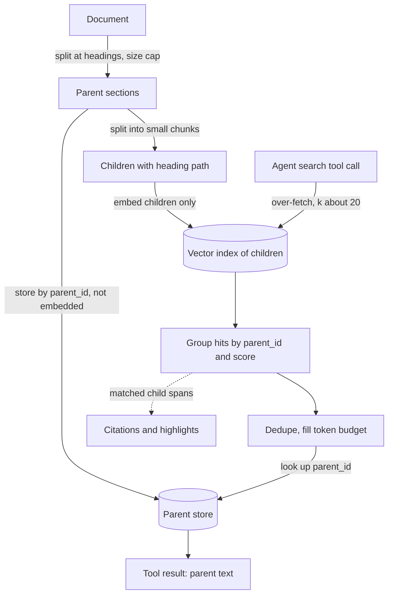

## TL;DR
Parent-document retrieval searches small, sharp child chunks and returns their larger parent sections.
For an agent it decides what a search tool returns: whole sections up front, or matched snippets with a
second tool to read the section.

## For agent builders
- **Why it matters for agents.** "Right passage, wrong details" is a common agent failure: the tool
  returned the sentence but not the table header, plan name or caveat. Parents fix that, but every
  parent (~1,200 tokens in the manual below) stays in the transcript for the rest of the run.
- **Where it shows up in your stack.** LangChain's `ParentDocumentRetriever`, LlamaIndex's sentence-window
  and auto-merging retrievers, a vector store for children plus a key-value or document store for
  parents, and the tool schemas your agent sees.
- **What you control.** Child and parent sizes, the score aggregation, the token budget per tool result,
  and whether the agent gets parents directly or snippets plus a `read_section` tool.
- **What you can skip.** Building a multi-level auto-merging hierarchy by hand. Two levels plus a
  heading path on each child cover most agent knowledge bases.

## Why it exists
- **One chunk size is wrong in both directions.** "The limit is 50 requests per minute." alone is an
  excellent key: a rate-limit query lands on it with a high score. As an answer it is useless: it does not
  say which endpoint, which plan, or that bursts up to 100 are tolerated for ten seconds. Those facts sit
  in the surrounding 1,500-token section.
- **Embedding the whole section blurs the key.** The section also covers authentication and pagination, so
  the vector averages all three; the rate-limit query scores middling and may lose to a short FAQ entry
  that merely mentions limits.
- **The usual workarounds patch one side and break the other.**
  - **Large chunks:** context, but lower recall and mixed topics.
  - **Small chunks with large k:** a pile of fragments to stitch, no guarantee they come from the same
    section, and duplicates of one neighbourhood crowding the prompt.
  - **Overlap:** smears a little context across boundaries but cannot carry a table header 1,000 tokens
    back to the row that needs it.
- **Retrieval and generation need not use the same unit.** Index the unit that matches best, give each a
  pointer to the unit that answers best: a lookup on small keys followed by a join to large values.

## How it works
### Data model
| Store | Holds | Embedded? | Why |
|---|---|---|---|
| **Vector index of children** | small chunks (a sentence, or roughly 100–300 tokens as an illustrative range) with metadata `{parent_id, doc_id, offset}` | yes, only children | children carry `parent_id` because retrieval is a join |
| **Parent store** | plain key-value or document store: `parent_id` → parent text (a section, a page, or roughly 1–2k tokens) plus metadata | no | parents are never searched; embedding them wastes space and tempts someone to search them |

### Indexing
1. **Split each document into parents,** preferably at structural boundaries (headings, sections) so each
   parent is coherent, with a size cap so a runaway section is cut.
2. **Split each parent into children,** embed the children, store the parents.

Illustratively, a 40-page manual of roughly 25k tokens:

| Unit | Count | Size |
|---|---|---|
| Section parents | about 20 | ~1,200 tokens |
| Children | about 125 | ~200 tokens |
| Vectors in the index | 125 | |
| Texts in the parent store | 20 | |

### Query path
1. **Over-fetch children.** Search with k larger than the parents you will return, say 20, because several
   children usually belong to one parent.
2. **Group by `parent_id` and score each parent:** by its best child's score (pinpoint questions) or by the
   number or fraction of its children that hit ("which section is about this" questions).
3. **Deduplicate and budget.** Take the top-n parents that fit: n × parent tokens must fit the context.
4. **Optionally rerank** the parents, or rerank children first and then regroup, with a cross-encoder.
5. **Send parents, cite children.** Keep the matched child spans for citations and highlighting, since a
   2k-token citation is not something a user can verify.

### Variants
| Variant | Parent is | Why it exists |
|---|---|---|
| **Sentence-window retrieval** | a window of a few sentences either side of a single-sentence hit, assembled at query time | centred on the match; suits dense prose where fixed section boundaries are arbitrary |
| **Hierarchical / auto-merging** | three or more levels (document, section, paragraph); enough retrieved children of one node are replaced by the node | many hits in one section are evidence the section, not the fragments, is the right unit |
| **Document as parent** | the whole document | fine for short self-contained records (FAQ entries, tickets); for long documents it collapses into context stuffing |

### Choosing the score aggregation
| Rule | Favours | Bias |
|---|---|---|
| **Max child** | the parent with the single best passage | none by size; misses "broad section" questions |
| **Count of hits** | parents with many moderate hits, often broad overview sections | size bias: a parent with 30 children has more chances to place hits in the top-20 than one with 4, regardless of relevance |
| **Fraction of children hit** | removes the size bias | over-rewards tiny parents with one lucky hit |

Pick by question type, and measure: the rules rank parents differently on the same child hits.

### What it does not fix
- **It fixes what the generator *sees*, not what the index can *match*.** The child is still embedded alone.
- **Children lose their subject.** "The limit is 50 requests per minute." under a heading naming the
  endpoint and plan only matches queries that do not mention them; "search endpoint Pro plan rate limit"
  can miss it, and the parent never gets fetched.
- **Cheap remedy:** embed each child with its heading path prepended
  (`"API > Search > Pro plan: The limit is 50..."`) while storing the bare child for citation.
- **Stronger remedy:** contextual retrieval, which writes a chunk-specific context with an LLM.
- **They compose:** contextualised children for matching, parents for answering.

### Two ways to expose it to an agent
| Tool design | What one search returns | When it wins |
|---|---|---|
| **Parents up front** | the top parents, each with matched spans | few searches per task, answers that need the whole section |
| **Snippets plus `read_section`** | matched child spans with `parent_id` and heading path; a second tool returns the parent by id | many searches per task, where most hits are only glanced at |

- **The second design is progressive disclosure.** The agent reads cheap snippets, then pays for a
  parent only when a snippet looks like the answer, so transcript growth tracks what it actually reads.
- **It costs a step.** Each `read_section` is another sequential model call, so it loses when nearly
  every hit needs its section anyway.

## Diagram
Two stores, one join behind the search tool: children are searched, hits are grouped and scored per
parent (max, count or fraction), parents are fetched by id, and citations point back at the matched
child spans.



## Misconceptions
- **"Parent-document retrieval improves what the index can match."** It changes what the generator sees,
  not what gets found. The child is still embedded alone, so "The limit is 50 requests per minute." can
  miss a query naming the endpoint and plan, and its parent is never fetched. Prepend the heading path or
  use contextual retrieval for matching.
- **"Overlap gives you the same context."** Overlap smears a few sentences across a boundary. It cannot
  carry a table header 1,000 tokens back to the row that needs it; a pointer to the parent can.
- **"Embed the parents too, for good measure."** Parents are never searched, so their vectors waste space,
  and their averaged topics blur the key. Embed children only and keep parents in a key-value store.
- **"Rank parents by how many children hit."** Count favours big sections: a parent with 30 children has
  more chances to land hits than one with 4. Max child suits pinpoint questions, fraction removes the
  size bias but rewards one lucky hit on a tiny parent; pick by question type and measure.
- **"Bigger parents are always safer, up to the whole document."** Each parent stays in the agent's
  transcript (19,200 tokens for 4 searches of 4 parents above), and a 25k-token manual as parent does not
  fit a 6,000-token budget at all. Size parents to sections, or return snippets plus `read_section`.

## Examples
### Two stores and the query-side join
Heading paths are prepended to children for matching. `embed`, `index.add`, `index.search` and `split` are
stubs for your encoder, vector store and chunker.

```python
from collections import defaultdict

parents = {}                                   # parent_id -> {"text": ..., "doc": ...}

def ingest(doc_id, text):
    # split by heading yields (heading_path, section_text) pairs, e.g. ("API > Search", "...")
    for p_i, (heading, section) in enumerate(split(text, by="heading", max_tokens=1500)):
        pid = f"{doc_id}#p{p_i}"
        parents[pid] = {"text": section, "doc": doc_id}
        for c_i, child in enumerate(split(section, max_tokens=200)):
            index.add(id=f"{pid}#c{c_i}",
                      vector=embed(f"{heading}\n{child}", kind="passage"),  # heading aids matching
                      meta={"parent_id": pid, "child_text": child})         # bare child for citing

def retrieve_parents(query, k_children=20, n_parents=4):
    hits = index.search(embed(query, kind="query"), k_children)   # [(score, meta)]
    by_parent = defaultdict(list)
    for score, meta in hits:
        by_parent[meta["parent_id"]].append((score, meta["child_text"]))
    ranked = sorted(by_parent.items(), key=lambda kv: max(s for s, _ in kv[1]), reverse=True)
    out = []
    for pid, children in ranked[:n_parents]:
        out.append({"parent_id": pid, "text": parents[pid]["text"],
                    "matched_spans": [t for _, t in children]})   # keep spans for citations
    return out

ctx = retrieve_parents("What is the rate limit for the search endpoint on the Pro plan?")
# A short child "Pro plan: 50 requests/minute, bursts to 100 for 10 s" scores highest; the
# generator receives its 1,500-token parent section, which also names the endpoint and the
# exceptions, and the citation points at the matched child span rather than the whole section.
```

### Runnable: three aggregation rules, three different winners
Pure Python. The same eight child hits, ranked by max, count and fraction.

```python
from collections import defaultdict

children_per_parent = {"overview": 30, "rate-limits": 4, "changelog-note": 1}
hits = [  # (score, parent_id) for the top child hits of one query
    (0.91, "rate-limits"), (0.62, "overview"), (0.60, "overview"), (0.59, "overview"),
    (0.58, "overview"), (0.57, "changelog-note"), (0.55, "overview"), (0.52, "rate-limits"),
]
by_parent = defaultdict(list)
for score, pid in hits:
    by_parent[pid].append(score)

rules = {
    "max":      lambda pid, s: max(s),
    "count":    lambda pid, s: len(s),
    "fraction": lambda pid, s: len(s) / children_per_parent[pid],
}
for name, rule in rules.items():
    ranked = sorted(by_parent, key=lambda pid: rule(pid, by_parent[pid]), reverse=True)
    print(f"{name:9}", ranked)
# max       ['rate-limits', 'overview', 'changelog-note']    <- pinpoint answer wins
# count     ['overview', 'rate-limits', 'changelog-note']    <- big section wins on volume
# fraction  ['changelog-note', 'rate-limits', 'overview']    <- one lucky hit on a tiny parent wins
```

### Worked scenario: context cost per request
Illustrative, using the manual above with a 6,000-token evidence budget:

| Design | Unit sent | Units that fit | Distinct sources |
|---|---|---|---|
| Children only | ~200-token child | 30 | many fragments, often from the same section |
| Parent-document | ~1,200-token parent | 5 (after dedup) | 5 coherent sections |
| Whole document as parent | ~25k-token manual | 0 | overflow |

### Agent scenario: snippets first, sections on demand
Two tools over the same two stores; `index`, `embed` and `parents` are as in the ingestion example, with
one addition: `ingest` also stores `"heading": heading` in each child's `meta`, so snippets can show it.

```python
TOOLS = [
    {"name": "search_manual",
     "description": "Search the product manuals. Returns short matched snippets with a section id and "
                    "heading path. Call read_section before answering from a snippet that lacks the plan, "
                    "endpoint, table header or exceptions.",
     "input_schema": {"type": "object", "properties": {"query": {"type": "string"}},
                      "required": ["query"]}},
    {"name": "read_section",
     "description": "Return the full text of one manual section by its section id.",
     "input_schema": {"type": "object", "properties": {"section_id": {"type": "string"}},
                      "required": ["section_id"]}},
]

def search_manual(query, k_children=20, max_snippets=8):
    hits = index.search(embed(query, kind="query"), k_children)          # [(score, meta)]
    return [{"section_id": m["parent_id"], "heading": m.get("heading", ""),
             "snippet": m["child_text"]} for _, m in hits[:max_snippets]]

def read_section(section_id):
    p = parents.get(section_id)
    if p is None:                                    # store drift: say so, never return empty text
        return {"status": "not_found", "section_id": section_id}
    return {"status": "ok", "section_id": section_id, "text": p["text"]}
```

Illustrative transcript cost for a task with 4 searches, using ~200-token children and ~1,200-token
parents:

| Tool design | Per search | Section reads | Tool-result tokens per task |
|---|---|---|---|
| Parents up front, 4 per search | 4 × 1,200 = 4,800 | 0 | 19,200 |
| Snippets (8 × 200) plus 2 `read_section` calls | 1,600 | 2 × 1,200 = 2,400 | 8,800 |

The snippet design uses less than half the context but adds 2 sequential steps.

## Production patterns
- **Use the framework retriever when it fits.** LangChain's `ParentDocumentRetriever` (`langchain-classic` since 1.0)
  takes a child splitter, an optional parent splitter, a vector store for children and a document store for parents;
  LlamaIndex offers `SentenceWindowNodeParser` (paired with a metadata-replacement postprocessor that
  swaps in the window) and `AutoMergingRetriever`. Monitor unique parents per query and
  tokens per request after adopting either.
- **Snippet-then-read tools for multi-search agents.** When an agent searches several times per task,
  return matched child spans with `parent_id` and offer a `read_section` tool, as in the agent scenario.
  Monitor section reads per task, tool-result tokens per run, and answers given from a snippet whose
  section was never read.
- **Heading-path children.** Embed `heading path + child` and store the bare child for citation, as in
  `ingest` above. Measure child recall@k on queries that name a product or plan, the slice this fixes.
- **Over-fetch, group, budget.** Fetch roughly 4–5 children per parent you plan to return (20 for 4 in the
  example), group by `parent_id`, then fill a token budget rather than a fixed n. Monitor how often the
  budget truncates the last parent.
- **Keep the stores consistent.** Re-index by document: delete every child whose `doc_id` matches and
  replace the parents in one job, then verify each child's `parent_id` resolves. Alert on parent-lookup
  misses, which otherwise silently produce empty contexts (or, in an agent, a `not_found` tool result).
- **Cite the matched span.** Return `matched_spans` with offsets to the UI and highlight them inside the
  parent. Track citation-verification complaints or reviewer disagreement as the signal.

## Trade-offs
- **Depth vs breadth.** Each hit costs parent-sized context, so fewer distinct sources fit a budget; this
  favours depth and flips against you when questions need breadth across many documents.
- **Sharp keys vs index size.** Children give sharp keys but the index holds several times more vectors
  per document than parent-size indexing (125 versus 20 in the manual above), raising storage and ANN
  cost; worth it until index size, not quality, is the constraint.
- **Deduplication vs evidence count.** It removes redundant parents but collapses several strong hits into
  one source; for aggregation questions that want evidence from many places, return more parents or use
  sentence windows.
- **Structural vs fixed-size parents.** By heading they are coherent but vary wildly in size; fixed-size
  parents are predictable but cut mid-topic; the right choice follows the corpus's formatting discipline.
- **Parents up front vs snippets plus a read tool.** Parents up front answer in fewer agent steps but
  fill the transcript with sections the agent only glanced at; snippets plus `read_section` keep context
  small at the cost of extra sequential calls, and flip to worse when nearly every hit needs its section.

## Pitfalls
- **The whole document as parent for long documents.** Symptom: context overflow, lost-in-the-middle
  effects and a cost spike, with no recall gain over stuffing. Diagnose: log parent tokens per request
  against the budget. Fix: section-level parents with a size cap.
- **Skipping deduplication.** Symptom: the same parent repeated and fewer unique sources than the budget
  allowed. Diagnose: unique `parent_id`s per request.
- **Citing the parent instead of the matched child span.** Symptom: citations pointing at a 2k-token
  section users cannot verify, and reviewers calling them wrong. Fix: cite matched spans with offsets.
- **Reranking children, then emitting parents in child order without regrouping.** Symptom: parent order
  that does not reflect the strongest evidence. Fix: regroup after reranking.
- **Parent store and child index out of sync** after re-indexing or deletion. Symptom: `parent_id` lookups
  that miss and silently produce an empty context. Diagnose: a nightly job that resolves every child's
  `parent_id`, plus lookup-miss counts. Fix: re-index per document.
- **Children so small they are generic** ("See below.", "Note:"). Symptom: high similarity scores on
  sentences that carry no information. Diagnose: list top-scoring children under ~10 tokens. Fix: a
  minimum child size.
- **Assuming parents fix matching.** Symptom: queries naming the product or plan still miss a section whose
  children never mention it. Diagnose: child recall@k on the product-or-plan slice. Fix: prepend heading
  paths or contexts to children.
- **Agent answers from the snippet without reading the section.** Symptom: "right passage, wrong details"
  returns after switching to snippets. Diagnose: in traces, count answers citing a section with no
  `read_section` call. Fix: say in the tool description when to call it.

## When to use
- **Use for** long, structured documents where answers depend on surrounding context: manuals, contracts,
  runbooks, codebases with file-level context, research papers.
- **Skip for** short, self-contained records (tickets, FAQ entries, product listings), where the record is
  already the right unit for matching and answering.
- **First change to try** when answers are "right passage, wrong details" because the generator lacked the
  surrounding section.
- **Measure:** child-level recall@k against a single-chunk-size baseline, then answer faithfulness and
  tokens per request (tool-result tokens per run, for agents), since the gain in context is paid for in
  budget.

## Exercise
**Goal:** build the two-store join and decide between parents up front and snippets plus `read_section`.
No solution is given.
- **Inputs:** 3-5 long structured documents (manuals or runbooks), 25 golden questions whose answers need
  a table header, plan name or caveat near the matching sentence, with the answer section labelled.
- **Deliver:** children with heading paths, a parent store, max-child grouping with dedup and a token
  budget, and both tool designs; a table of section recall@4, accuracy, tool calls and tokens per task.
- **Acceptance:** every child's `parent_id` resolves; accuracy beats a single-chunk-size baseline on the
  same questions; citations point at child spans; you can say which design wins on your mix and why.

## Role lens
- **Engineer:** Builds the two-store pipeline, the parent grouping and deduplication, and keeps child
  spans for citations while sending parents to the generator.
- **Architect:** Sets parent and child sizes against the context budget and the corpus structure, and
  decides whether the parent store is the system of record or a derived cache.
- **FDE:** Recognises "the bot found the right page but missed the caveat" in a customer's failures and
  maps their document structure (headings, sections) onto parent boundaries.

## Check yourself
**Q:** A RAG system over 200-page product manuals retrieves the right sentence but answers wrongly because
the generator never sees the table header or the plan name. Design the fix and name the new costs.
**A:** Switch to parent-document retrieval: split each manual into section-level parents at headings
with a size cap, split sections into small children, embed only the children with `parent_id` metadata,
and store parents in a key-value store. At query time search the children with a generous k, group by
parent, score by best child, deduplicate, take the top few parents that fit the context budget, and keep
the matched child spans for citations. New costs: each hit consumes a section's worth of tokens so fewer
sources fit, the index holds many more vectors, and the parent store must stay in sync with the index on
every re-index or deletion. Validate with child recall@k and answer faithfulness against the old
single-size baseline.

## Interview questions
### What is parent-document retrieval and what problem does it solve?
- **Definition:** index small child chunks linked by `parent_id` to larger parents, search the children,
  and give the generator the parents.
- **Why:** one chunk size is wrong both ways; a short sentence is a sharp key but a useless answer, and a
  whole section answers well but its embedding blurs several topics.
- **It decouples the units:** the retrieval unit is chosen for matching and the generation unit for
  answering, like a lookup on small keys joined to large values.

### Users say the agent cites a whole section they cannot check, and some answers come back with empty context. How do you debug?
- **Citation granularity:** return the matched child spans with offsets and highlight them inside the
  parent instead of citing the 2k-token section.
- **Empty contexts:** check the tool spans in the trace for `parent_id` lookups that miss (empty text or
  `not_found` results), the sign that the parent store and child index drifted apart after a re-index or
  deletion.
- **Fix the sync:** re-index per document (delete all children for the `doc_id`, replace its parents in one
  job) and alert on lookup misses.

### Your agent searches four times per task and its context fills with manual sections. What do you change?
- **Measure first:** at 4 parents of ~1,200 tokens per search, four searches add 19,200 tokens of tool
  results, most of which the agent never cites.
- **Switch to snippets plus `read_section`:** return matched child spans with section ids and let the
  agent read only the sections it needs (about 8,800 tokens for two reads in the same task).
- **Watch the new failure:** answers from unread snippets, so state in the tool description when to read,
  and check it in the agent eval.

### When would you not use parent-document retrieval?
- **Short self-contained records** such as tickets, FAQ entries and product listings, where the record is
  already the right unit.
- **Breadth questions** that need evidence from many documents, because each hit costs parent-sized
  context and fewer distinct sources fit.
- **When matching, not context, is the failure:** parents do not help a child that lacks its subject;
  prepend heading paths or use contextual retrieval instead.

### Size it: a 6,000-token evidence budget with ~1,200-token parents. How many sources fit, and what does the index cost?
- **About 5 parents fit** after deduplication, versus about 30 bare ~200-token children.
- **The index grows:** a ~25k-token manual becomes about 125 child vectors instead of 20 section vectors,
  raising storage and ANN cost.
- **Over-fetch accordingly:** roughly 4–5 children per parent you return (20 for 4), then fill the token
  budget rather than a fixed n.

## Quiz
### Q: Why are parents stored outside the vector index rather than embedded alongside the children?
- [ ] Vector databases cannot store documents longer than 512 tokens
- [x] Parents are never searched, only fetched by id after a child hit, so embedding them wastes space and invites blurry whole-section matches
- [ ] Embedding parents would make the children's vectors less accurate
- [ ] Parents must be stored in a relational database for citations
> The pattern deliberately matches on sharp child keys and answers with parent values; the parent store is
> a join target, and a plain key-value lookup is all it needs.

### Q: Which score aggregation ranks a parent by the single best passage it contains?
- [ ] Mean of all child scores in the parent
- [ ] Number of children retrieved from the parent
- [x] Maximum child score within the parent
- [ ] Fraction of the parent's children that were retrieved
> Max-child scoring suits pinpoint questions; count or fraction rules favour broad sections with many
> moderate hits and are what auto-merging uses to decide a whole node is the right unit.

### Q: A team sets the parent to the entire document for 200-page manuals. What is the most likely result?
- [ ] Higher precision, because the whole document is always relevant
- [ ] Lower index size, because fewer vectors are stored
- [x] Context overflow and lost-in-the-middle effects, collapsing back into context stuffing
- [ ] Faster retrieval, because parent lookups replace vector search
> The parent must fit the context budget alongside other parents; a whole long manual per hit defeats the
> purpose, which is sharp matching with just enough surrounding context.

## Mastery test
**Problem:** a legal agent over 300-page contracts finds the right clause but misses definitions ("as
defined in Section 1.4") and exceptions two pages later. Sections vary from 200 to 9,000 tokens, and the
agent searches 5 times per task. Parent-document retrieval is proposed. Is it enough?

**A strong answer:**
- caps parent size (split the 9,000-token sections) and keeps children with heading paths;
- sees that a cross-referenced definition is not in the same parent: that is a second hop or a
  definitions lookup, not a bigger parent;
- prefers snippets plus `read_section` at 5 searches per task, and measures tokens per run and accuracy.

## Use cases & projects
### Use cases
- **Agents over pricing tables and specs.** A matched row is useless without its table header and plan
  name, which the parent section supplies.
- **Contract and policy agents.** Caveats and exceptions often sit a paragraph away from the matching
  sentence, so returning the parent keeps them in view.
- **Token-budgeted agent loops.** Teams return short snippets plus a `read_section` tool so the agent pulls
  a full parent only when it needs one.
- **Manuals and runbooks.** Small children for sharp matching plus a heading path keep step-by-step
  procedures intact when retrieved.

### Mini project
**Snippets plus `read_section` versus direct parents (2-3 hours).**
- **Goal:** compare two ways of giving an agent surrounding context and their token cost.
- **Steps:** chunk a small document set into small children linked to parent sections; build mode A, where
  `search` returns deduplicated parents, and mode B, where `search` returns child snippets with parent IDs
  and the agent can call `read_section`; run about 20 questions whose answers need nearby details; log
  correctness, tool calls and transcript tokens.
- **Done when:** you have a table of accuracy, tool calls and tokens for both modes, and a short note on
  which questions each mode got wrong.
