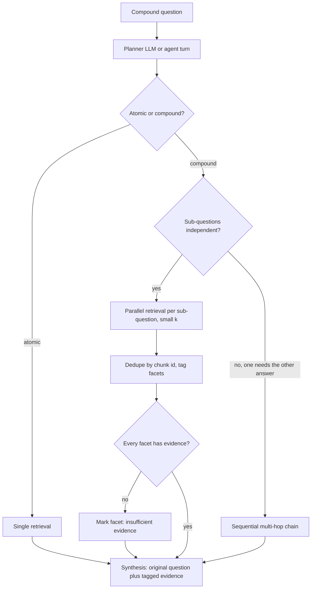

## TL;DR
Query decomposition splits a compound question into standalone sub-questions and retrieves for each. In
an agent it is one turn with several parallel search calls: independent parts fan out, dependent parts
chain, which is multi-hop retrieval.

## For agent builders
- **Why it matters for agents.** "Compare A and B" is the most common question shape an agent fails with
  one search. Emitting one search call per facet, in parallel, fixes recall without adding sequential
  steps; chaining dependent facets is the agent loop doing multi-hop.
- **Where it shows up in your stack.** Parallel tool calls in the provider APIs (several tool calls in one
  model response), LlamaIndex's sub-question query engine, fan-out nodes in LangGraph (its `Send` API
  for map-reduce), and per-call spans in your traces.
- **What you control.** Whether the agent or a fixed planner splits, the cap on calls per step, the chunk
  budget per call, the "no evidence" result per facet, and the gate that leaves atomic questions alone.
- **What you can skip.** The compositionality-gap benchmarks in depth. Know that composing is a separate
  failure from retrieving, and give the synthesis step every facet's evidence or its absence.

## Why it exists
- **A compound question embeds as one blurry point.** "Compare the refund windows of the Standard and
  Enterprise plans for EU customers" is roughly a mixture of two intents, so its embedding sits between the
  two regions where relevant passages live and is nearest to neither.
- **BM25 has the same bias.** It sums term matches, so the top of the list is whichever document mentions
  the most query terms: usually a passage about one plan with a passing mention of the other. The second
  half is served by the tail of the ranking, and the tail does not reach the prompt.
- **The obvious fixes fail.**
  - **Wider top-k** trades precision for a small recall gain; the second plan's passage may still rank
    below dozens about the first.
  - **Larger chunks** that try to capture both topics blur the embeddings for every other query.
  - **Longer context** to "reason over more" only helps if the evidence was retrieved at all.
- **Models have a compositionality gap too.** Press et al.: models that answer each component correctly
  still fail the composed question at a noticeable rate. Explicit components, per-component evidence and a
  separate composing step attack the retrieval and the reasoning failure with one mechanism.

## How it works
### Step 1: decide whether to split, then split
- **A planner prompt** returns a list of sub-questions, or a signal that the question is atomic.
- **The atomic branch exists because decomposition is not free.** Every sub-question is another retrieval;
  splitting "what is the refund window?" into three parts adds noise and latency for nothing.
- **Each sub-question is standalone and repeats shared constraints** ("for EU customers", "on the annual
  plan"), because the retriever sees sub-questions one at a time and a dropped qualifier changes the answer.

### Step 2: classify dependencies
| Kind | Example | Execution |
|---|---|---|
| Independent | refund window of plan A does not depend on plan B | fan out in parallel |
| Dependent | "who manages the author of the report" needs the first answer | run in sequence; this is multi-hop retrieval |

- **A planner can emit a small DAG;** in practice two levels, "parallel batch" then "sequential
  follow-up", cover most cases.
- **Least-to-most prompting (Zhou et al.) is the sequential form.** Order sub-problems simplest to hardest
  and feed each answer into the next, which is why a dependent sub-question is written *after* its
  predecessor is answered, not up front.

### The limit: the parts must be nameable
- **The planner can only split what the question names.** "Compare Standard and Enterprise" decomposes
  because both entities are in the text.
- **Enumeration questions do not.** "List all plans that allow EU data residency": the answer set's members
  are what you are trying to find, so the planner cannot write one sub-question per plan without already
  knowing the plans.
- **Use instead:** a metadata filter or structured query over the corpus, or an enumeration step that first
  retrieves the list of entities and then fans out over it (a two-hop pattern, not plain decomposition).

### Step 3: retrieve per sub-question
- **Smaller k per sub-question,** because each is now a sharp key and the context budget is shared.
- **The arithmetic binds.** With a budget of 8 chunks and 3 sub-questions, each facet gets 2 or 3 chunks,
  so per-facet precision matters more than it did for one query with 8.
- **Metadata filters** derived from the sub-question (product = Enterprise) apply here too.

### Step 4: combine the evidence
| Option | How | Gains | Costs |
|---|---|---|---|
| **Merge contexts** | Deduplicate chunks by id, note which sub-question retrieved each, one generation with the original question | One generation call, simplest citations | Budget split n ways; the model must compose itself |
| **Answer per sub-question, then synthesise** | A short cited answer per sub-question from its own evidence, then a final composing call | Isolates reasoning, scales to larger evidence, shows when a facet had no evidence | n + 1 generation calls |

- **The sub-answer prompt must allow "insufficient evidence",** because otherwise an empty retrieval turns
  into a confident parametric guess that the synthesis step cannot detect.

### Step 5: synthesise with provenance
- **The final prompt holds** the original question, the sub-questions, and evidence or sub-answers tagged by
  sub-question, so citations stay attached to the facet they support.
- **Keep the original question,** because decomposition may have lost tone or an implicit constraint the
  model can recover when it sees both.

### Why not let a single agent loop do all this?
- **It can; agentic RAG is the generalisation.**
- **Prefer explicit decomposition when the question shape is predictable,** because fan-out is parallel and
  bounded (n retrievals, known latency), whereas an agent loop is sequential and open-ended.
- **Rule of thumb:** decomposition for breadth, the agent loop for depth.

### Decomposition inside an agent turn
| Step | Fixed pipeline | Tool-calling agent |
|---|---|---|
| Split | planner prompt returns sub-questions | the model emits several search calls in one response |
| Atomic gate | planner's atomic branch | the model emits one call |
| Independent facets | `asyncio.gather` over retrievals | your tool executor runs the calls concurrently |
| Dependent facets | sequential follow-up | the next loop iteration, after reading results |
| Synthesis | final composing call | the agent's next turn, with every tool result in context |

- **The agent decides the split, your executor enforces the rules.** Cap the calls per step, split the
  chunk budget across them, and return an explicit "no evidence" result for an empty facet.
- **Every call needs its own result.** Return one result per tool-call id (most provider APIs expect
  this), including for calls you skipped, so the agent knows which facets were not searched.

## Diagram
Watch the two branches after planning (by a planner prompt or the agent's own tool calls): atomic
questions skip the fan-out, independent sub-questions retrieve in parallel, and dependent ones become a
sequential multi-hop chain.



## Examples
### Fan-out with parallel retrieval and merged evidence
`llm` and `retrieve` are stubs for any provider and vector store; `retrieve` returns `(chunk_id, text)`
pairs.

```python
import asyncio, json

PLAN = """Question: {q}
If this question has multiple independent parts, split it into 2-4 standalone sub-questions.
Each sub-question must repeat any shared constraint (region, plan, date). If the question is
atomic, return it unchanged. Return JSON: {{"sub_questions": [...]}}"""

async def retrieve_async(q, k):
    return await asyncio.to_thread(retrieve, q, k)   # wrap a sync retriever

async def decomposed_search(question, k_each=4):
    try:
        subs = [s for s in json.loads(llm(PLAN.format(q=question)))["sub_questions"]
                if isinstance(s, str)][:4] or [question]
    except (ValueError, KeyError, TypeError):
        subs = [question]                             # planner failed: treat as atomic
    results = await asyncio.gather(*(retrieve_async(s, k_each) for s in subs))
    evidence = {}                                     # chunk id -> text and every sub that found it
    for sub, hits in zip(subs, results):
        for cid, text in hits:                        # dedupe, but keep all facet tags
            evidence.setdefault(cid, {"text": text, "subs": []})["subs"].append(sub)
    return subs, evidence

ANSWER = """Original question: {q}
Sub-questions:
{subs}
Evidence (each chunk is tagged with the sub-question that retrieved it):
{ev}
Answer the original question. Cite chunk ids. If a sub-question has no supporting chunk,
say so instead of guessing."""

async def answer(question):
    subs, evidence = await decomposed_search(question)
    ev = "\n".join(f"[{cid}] ({'; '.join(e['subs'])}) {e['text']}" for cid, e in evidence.items())
    # list every sub-question, so one whose chunks are absent or irrelevant is still visible
    return llm(ANSWER.format(q=question, subs="\n".join(subs), ev=ev))

print(asyncio.run(answer(
    "Compare the refund windows of the Standard and Enterprise plans for EU customers.")))
# planner output, illustrative: ["What is the refund window of the Standard plan for EU customers?",
#                                "What is the refund window of the Enterprise plan for EU customers?"]
```

### Runnable: budget split, facet tags and empty facets
Pure Python. Shows the shared budget per facet, a comparison table tagged with both facets, and a facet
with no evidence surfaced instead of hidden.

```python
def merge(subs, results, budget=8):
    k_each = max(1, budget // len(subs))
    evidence, empty = {}, []
    for sub, hits in zip(subs, results):
        if not hits:
            empty.append(sub)
        for cid, text in hits[:k_each]:
            evidence.setdefault(cid, {"text": text, "subs": []})["subs"].append(sub)
    return k_each, evidence, empty

subs = ["Standard refund window, EU", "Enterprise refund window, EU", "Pro refund window, EU"]
results = [
    [("std-refund", "..."), ("plan-compare", "..."), ("std-faq", "...")],
    [("plan-compare", "..."), ("ent-msa", "...")],
    [],
]
k_each, ev, empty = merge(subs, results)
print(k_each)                                   # 2: budget 8 shared by 3 facets
for cid, e in ev.items():
    print(cid, e["subs"])                       # plan-compare carries both facet tags
print("no evidence:", empty)                    # ['Pro refund window, EU']: say so, do not guess
```

### Worked scenario: cost and latency of a 3-way fan-out
Illustrative orders of magnitude for one compound question; plug in your own measurements.

| Design | Retrievals | LLM calls | Wall-clock shape |
|---|---|---|---|
| Single query | 1 | 1 (answer) | one retrieval + one generation |
| Decompose, merge contexts | 3 in parallel | 2 (planner + answer) | planner + slowest retrieval + generation |
| Decompose, answer per sub-question | 3 in parallel | 5 (planner + 3 sub-answers + synthesis) | planner + slowest branch + synthesis |

The planner call is paid by every question, including atomic ones, which is why the gate matters.

### Agent scenario: executing parallel search calls with a shared budget
The agent emitted several `search_docs` calls in one response. The executor caps them, shares the chunk
budget, runs them concurrently and returns one result per call id. `retrieve` is a stub.

```python
import asyncio

MAX_SEARCHES_PER_STEP = 4

async def execute_search_calls(tool_calls, budget_chunks=8):
    run, skip = tool_calls[:MAX_SEARCHES_PER_STEP], tool_calls[MAX_SEARCHES_PER_STEP:]
    k_each = max(1, budget_chunks // max(1, len(run)))        # 8 chunks over 3 calls -> 2 each
    hits = await asyncio.gather(*(asyncio.to_thread(retrieve, c["input"]["query"], k_each)
                                  for c in run))
    results = []
    for call, found in zip(run, hits):
        content = ({"status": "ok", "passages": [{"id": i, "text": t} for i, t in found]} if found
                   else {"status": "no_evidence"})            # the agent must say so, not guess
        results.append({"tool_call_id": call["id"], "content": content})
    for call in skip:                                          # never drop a call silently
        results.append({"tool_call_id": call["id"],
                        "content": {"status": "skipped", "reason": "max 4 searches per step"}})
    return results
```

| Design for a 3-facet comparison | Model calls | Searches | Sequential round trips |
|---|---|---|---|
| Agent searches one facet per step | 4 (3 steps + answer) | 3 | 3 |
| Agent emits 3 parallel calls in one step | 2 (1 step + answer) | 3 in parallel | 1 |
| Fixed planner, merge contexts | 2 (planner + answer) | 3 in parallel | 1 |

## Production patterns
- **Let the agent fan out, and cap it in the executor.** When the agent emits several search calls in one
  response, run them concurrently, cap calls per step (the example caps at 4) and return a "skipped"
  result for the rest. Monitor calls per step, the share of steps with parallel calls, and p95 step
  latency, which tracks the slowest call.
- **Gate before you split.** Run decomposition only when a cheap check fires (the planner's atomic branch,
  or a classifier on length and conjunctions such as "and", "vs", "compare"). Monitor the fraction of
  traffic decomposed and latency for atomic questions before and after launch.
- **Cap fan-out and budget per facet.** Limit sub-questions (the example caps at 4) and divide a fixed
  chunk budget across them, as `merge` does. Monitor prompt tokens and any truncation of the last facet's
  evidence.
- **Constraint-carry check.** After planning, or on the agent's parallel calls, verify that shared
  qualifiers in the original (region, plan, date) appear in every sub-question, and re-plan or fall back to
  the original if not. Monitor how often the check fires.
- **Per-facet evidence status.** Log for each sub-question whether it retrieved anything above your
  relevance cut-off, and force an explicit "no evidence" line in the answer when it did not. Alert on a
  rising empty-facet rate, which usually means an index gap.
- **Evaluate on a compound slice.** Keep a golden slice of comparison and multi-facet questions and track
  per-sub-question recall, final accuracy and (for agents) the number of steps taken on it separately from
  the rest. Monitor its p95 latency, which tracks the slowest branch.

## Trade-offs
- **Facet recall vs call count.** n sub-questions mean n retrievals (and n extra generations if answered
  separately); parallel fan-out keeps wall-clock near one retrieval, but p95 latency becomes the slowest
  branch.
- **Good split vs bad split.** A good split sharpens every facet's recall; a bad split is worse than none,
  so the gate that leaves atomic questions alone matters as much as the splitter.
- **Traceability vs cross-evidence reasoning.** Per-sub-question answers surface missing evidence but lose
  reasoning a single merged context allows; merge when facets interact, separate when they don't.
- **Sharp sub-queries vs shared passages.** They rank facet-specific passages higher but demote a single
  passage covering both facets, such as a plan-comparison table; if it appears under both, tag it with
  both, or the synthesis treats one facet as unsupported.
- **Agent-driven split vs fixed planner.** The agent splits only when needed and adapts to what it finds,
  but you cannot test its split in isolation; a fixed planner is predictable and unit-testable, and wins
  when question shapes are known in advance.

## Pitfalls
- **Over-decomposing simple questions.** The symptom is lookups that used to be fast and right becoming
  slower and noisier after the feature shipped.
- **Dropping shared constraints.** The symptom is a synthesis that compares the right plans for the wrong
  region, because "for EU customers" fell off one sub-question.
- **Answering an evidence-less facet from memory.** The symptom is a comparison where one side has
  precise, cited numbers and the other plausible, uncited ones.
- **Exceeding the budget with n × k chunks.** The symptom is silent truncation of the evidence for
  whichever sub-question came last.
- **No deduplication across sub-questions.** The symptom is repeated passages in the prompt and a model
  that over-weights whatever was repeated.
- **Decomposing an enumeration question** ("all plans with EU residency"). The symptom is sub-questions
  about a member list the planner made up, which omits real members and can include ones that do not exist.
- **Treating a dependent chain as independent.** The symptom is a second sub-question like "what is the
  manager's email?" that is vague on its own and retrieves nothing useful.
- **An agent searching facets one per step.** The symptom is comparison questions taking three or four
  sequential steps; say in the system prompt or tool description that independent facets should be
  searched in parallel in one turn, and check the parallel-call share in traces.

## When to use
- **Use when** the question shape is "compare", "A and also B", "X before and after Y", or anything naming
  several entities or facets.
- **Not for unknown members:** "list all" questions need a filter or an enumeration hop instead.
- **Gate it:** the planner's atomic branch or a classifier on question length and conjunctions keeps it
  away from simple lookups.
- **Avoid when** latency is tight and the corpus is small enough that one wide retrieval plus a reranker
  already covers both facets.
- **Measure:** per-sub-question recall, final-answer accuracy on the compound-question golden slice, the
  fraction of queries decomposed, and the latency distribution.
- **Interviews:** "a user asks to compare two products and the bot only talks about one" is a decomposition
  question; the strong answer also says how dependent sub-questions turn into multi-hop retrieval.

## Role lens
- **Engineer:** Implements the planner prompt with an atomic branch, parallel retrieval, deduplicated
  merging, and a synthesis prompt that refuses to fill gaps without evidence.
- **Architect:** Decides whether decomposition is a fixed pipeline stage or a capability of an agent loop,
  and sets the per-sub-question budget so fan-out cannot blow the context or the cost model.
- **FDE:** Spots compound questions in a customer's query logs, builds the golden slice that proves the
  gain, and tunes the planner to the customer's entities and constraints.

## Check yourself
**Q:** Users ask "Compare the data-retention defaults of our Standard and Enterprise plans for EU
customers" and the bot answers only about Standard. Design the decomposition and name two ways the
design can go wrong.
**A:** Have a planner split the question into two standalone sub-questions that each repeat the EU
constraint: the retention default for Standard in the EU and the same for Enterprise. Retrieve for both
in parallel with a small k each, deduplicate the chunks, tag each with its sub-question, and run one
synthesis prompt with the original question and the tagged evidence, requiring citations and an explicit
"no evidence" statement per facet. Failure modes: the planner drops "EU" from one sub-question and the
synthesis compares different regions; or the Enterprise retrieval returns nothing and the model fills in
a plausible number from memory, which only an "insufficient evidence" rule and per-facet recall
measurement would catch. A third is cost: without a gate, every simple question pays for the planner.

## Interview questions
### What is query decomposition, and why does it help retrieval on compound questions?
- **Definition:** an LLM planner splits a compound question into focused, standalone sub-questions,
  retrieves for each, and answers from the merged evidence.
- **Why it helps:** one embedding of a two-intent question lands between the two relevant regions, and
  BM25 favours whichever document mentions the most terms, so the second facet stays in the tail.
- **It also narrows the compositionality gap,** because explicit components and a separate composing step
  address reasoning as well as retrieval.

### "List all plans that allow EU data residency" returns an incomplete, partly invented list after you added decomposition. Why, and what do you change?
- **Cause:** the planner can only split what the question names; for an enumeration it guesses the member
  list, omitting real plans and inventing others.
- **Fix:** route enumeration questions to a metadata filter or structured query, or to a two-hop pattern
  that first retrieves the list of entities and then fans out over it.
- **Detect it:** add enumeration questions to the golden set and check the gate classifies them correctly.

### When would you merge contexts versus answer each sub-question separately?
- **Merge** when facets interact and the model needs cross-evidence reasoning: one generation call, but the
  budget is split n ways.
- **Answer per sub-question then synthesise** when evidence is large or you need to see which facet had no
  support: n + 1 generation calls.
- **Either way,** the sub-answer or synthesis prompt must allow "insufficient evidence", or an empty facet
  becomes a confident guess.

### A 3-way fan-out made p95 latency jump even though retrievals run in parallel. What is going on?
- **Wall-clock is planner plus the slowest branch,** so p95 tracks the worst of three retrievals, not the
  average one.
- **The planner call is paid by every question,** including atomic ones, unless a gate skips it.
- **Levers:** gate on a cheap classifier, cap sub-questions, set a timeout per branch, and track the
  compound slice's p95 separately from the rest of traffic.

### Your agent answers comparison questions correctly but takes four steps each. How do you speed it up?
- **It is searching one facet per step:** three sequential model calls plus searches, then the answer.
- **Make it fan out:** instruct parallel calls for independent facets and let the executor run them
  concurrently, so it becomes one step with three calls plus the answer.
- **Guard the fan-out:** cap calls per step, share the chunk budget, return "no evidence" per empty facet,
  and confirm on the compound slice that accuracy held while steps dropped.

### How do you size retrieval k when splitting into sub-questions, or when an agent emits parallel searches?
- **Share a fixed chunk budget:** with 8 chunks and 3 sub-questions each facet gets 2 or 3 chunks, so
  per-facet precision matters more than for one query with 8.
- **Deduplicate across facets** and tag shared chunks (such as a plan-comparison table) with every facet
  that found them.
- **Monitor** prompt tokens and truncation of the last facet's evidence, which is the silent failure when
  n × k exceeds the budget.

## Quiz
### Q: Why does a single dense retrieval tend to miss half of a two-part comparison question?
- [ ] Embedding models cannot encode questions longer than one sentence
- [x] The question's embedding is a mixture of two intents and lands near neither region, so the ranking is dominated by whichever half matches best
- [ ] Vector databases return only one document per topic
- [ ] Comparison questions always require a knowledge graph
> One vector represents one point; a two-topic question sits between the two relevant clusters, and the
> top-k fills with passages about the stronger match while the other facet stays in the tail.

### Q: When should sub-questions run sequentially instead of in parallel?
- [ ] When there are more than three sub-questions
- [ ] When the retriever is a sparse BM25 index
- [x] When a sub-question can only be formed from the answer to a previous one
- [ ] When the context budget is small
> Dependent sub-questions ("who manages the author of the report?") need the earlier answer to exist as
> a query; that chain is multi-hop retrieval. Independent facets fan out in parallel for lower latency.

### Q: One side of a comparison comes back with precise cited numbers and the other with plausible uncited ones. What is the most likely cause?
- [ ] The reranker favoured one plan's documents
- [x] One sub-question retrieved no evidence and the model answered it from parametric memory
- [ ] Deduplication removed the second plan's chunks
- [ ] The embedding model was trained on one plan's documents
> An empty retrieval for a facet is invisible to the synthesis step unless the sub-answer prompt must
> state "insufficient evidence"; without that rule the model fills the gap with a confident guess.
