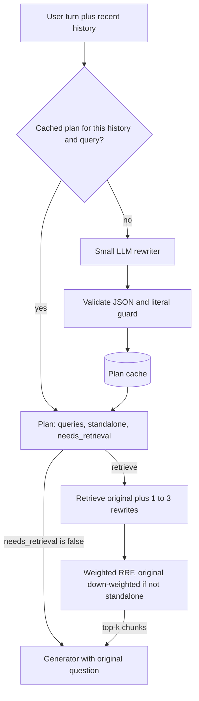

## TL;DR
Query rewriting turns raw conversational input into retrieval-friendly search strings. In a tool-calling
agent the model already does it when it writes the search tool's `query` argument; your job is to steer
that rewrite and guard it.

## For agent builders
- **Why it matters for agents.** Every search tool call is a rewrite: the agent condenses the
  conversation into a query string. Bad queries (dropped references, "fixed" error codes, invented
  entities) are the most common reason an agent's retrieval step fails.
- **Where it shows up in your stack.** The tool's `description` and parameter descriptions (your rewriter
  prompt), LangChain's `create_history_aware_retriever` and `MultiQueryRetriever` in pipeline-style RAG,
  LlamaIndex query transforms, and the traces (LangSmith or similar) where you read the queries agents wrote.
- **What you control.** What the tool description asks the query to look like, which filters the agent may
  set, server-side guards on literals and filters, and whether the original user text is also searched.
- **What you can skip.** Training a rewriter with downstream feedback (Ma et al.). Prompted rewriting plus
  a guard and an eval covers almost every agent.

## Why it exists
- **Retrievers assume the query looks like the passage.** BM25 needs shared terms; dense retrieval needs
  nearby embeddings. User text is written for a human, not an index: short, referring to earlier turns,
  in different words, or burying one useful identifier in a wall of paste.
- **Real queries break the assumption predictably.**
  - "and on Android?" has nothing retrievable alone: the subject is three messages back and the retriever
    has no memory.
  - "cancel my subscription" vs docs saying "terminate your plan": the sparse leg finds nothing, the dense
    leg scores it merely similar.
  - A 200-line stack trace swamps the embedding with boilerplate and drowns the one line, an error code,
    that would have matched exactly.
  - Product names are abbreviated, misspelled or replaced by nicknames the documents never use.
- **The naive fixes each fail somewhere.** Embedding the whole history dilutes current intent. Asking users
  to phrase better does not survive contact with users. Synonym expansion of the index helps vocabulary
  but not references or long pastes, and bloats every document.
- **The rewrite step sees everything at once.** The conversation so far, the current message and (via its
  prompt) the corpus conventions. An LLM is good at exactly this transformation, and a small one is enough.

## How it works
### Where it sits
1. **Input:** the user turn plus recent history go to a rewriter prompt.
2. **Output:** a small structured object: one or more search strings, optional metadata filters, and an
   optional "no retrieval needed" flag.
3. **Retrieve:** each search string goes to the retriever(s); the result lists are fused.
4. **Generate:** the fused context plus the *original* question go to the generator. The generator still
   sees the user's words, because the rewrite is for the index, not for the answer.

### The forms a rewrite takes
| # | Form | Example | Mismatch it fixes, and why |
|---|---|---|---|
| 1 | **Condensing** (conversational RAG) | "and on Android?" → "How do I enable push notifications on Android?" | Missing references; retrievers are stateless, so the standalone question is all they can act on. |
| 2 | **Normalisation** | fix typos, expand abbreviations, map aliases to canonical product names | Spelling and aliases; BM25 matches exact terms and a misspelled name's embedding is not reliably near the correct one. |
| 3 | **Multi-query expansion** | several paraphrases, retrieve each, fuse with reciprocal rank fusion | Vocabulary; one embedding is one point, several cover the neighbourhood. Costs several retrievals instead of one. |
| 4 | **Keyword extraction** | from a long paste, pull error codes, function names, version strings for the sparse leg plus a one-line summary for the dense leg | Dilution; long inputs dilute both legs. |
| 5 | **Step-back abstraction** | "why did key K-7 get HTTP 429 at 3pm Tuesday" → also "what are the API rate-limit rules" | Abstraction; documents describe general rules, not incidents, so retrieve for both. |
| 6 | **Routing and filtering** | emit filters (product, date range, document type); emit "no retrieval" for greetings or questions about the conversation itself | Scope; restricts the candidate pool. |
| 7 | **Document-shaped rewriting** (HyDE) | write a hypothetical answer passage and search with it | Question shape vs passage shape in embedding space; has its own lesson. |

- **Build from failure analysis, not wholesale.** Each form fixes one specific mismatch, so switch on only
  the forms your failures call for.
- **Research vs production.** Ma et al. treat the rewriter as a trainable module optimised by downstream
  answer-quality feedback, with the LLM reader frozen. In production the same shape is usually a prompted
  small model, because the input is short and the output is shorter.

### Design choices and why
- **Always retrieve for the original too, but weight it.** A rewrite can drift; fusing original and
  rewrite(s) means a bad rewrite degrades gracefully instead of replacing a working path. But "and on
  Android?" retrieves noise, and with plain RRF over two lists that noise takes roughly half the fused
  top-k. Lower the original's fusion weight when the rewriter says it is not standalone; equal weight when
  it is.
- **Protect literals.** Never alter quoted strings, codes, numbers or version identifiers. "Fixing"
  `ERR_4012` into `error 4012` breaks the one exact match you had.
- **Use a small, fast model and cache.** The rewrite adds a sequential LLM call to every request; a cache
  keyed on (hash of recent history, query) removes it for repeats.
- **Tell the rewriter about the corpus.** A sentence such as "documents are organised per product and use
  the terms plan, seat and workspace" produces rewrites in the index's vocabulary.
- **Log the pair.** Store original and rewrite with every request, because retrieval failures must be
  attributable to the rewrite or to the index.
- **Treat the input as untrusted.** The rewriter is an LLM reading user text; a query containing
  instructions can hijack it, so constrain the output format and validate it.

### In a tool-calling agent, the model is the rewriter
| Concern | Pipeline RAG | Tool-calling agent |
|---|---|---|
| Who rewrites | a separate small rewriter call before retrieval | the agent model, when it writes the `query` argument |
| Extra latency | one sequential call per turn | none: the query comes out of the call that decided to search |
| "Needs retrieval?" | a `needs_retrieval` flag | the agent simply does not call the tool |
| Where you steer it | the rewriter prompt | the tool and parameter descriptions |
| What still needs code | validation, literal guard, fusion | the same: guard and fuse inside the tool |

- **Condensing comes free, drift does not.** The agent sees the whole conversation, so "and on Android?"
  usually becomes a standalone query. But it can still drop a literal, invent a product or over-specify.
- **Keep a dedicated rewriter only for specific forms.** Multi-query expansion, step-back or keyword
  extraction from a huge paste can run inside the tool, where they cost no extra agent step.

## Diagram
Trace one follow-up turn: the rewriter (a pipeline step, or the agent writing its tool call) decides
whether to retrieve at all, both the original and the rewrites are searched, and the answer still
addresses the user's own words.



## Examples
### Condensing plus expansion with weighted RRF
`llm(prompt)` returns text and `retrieve(query, k)` returns ranked chunk ids; any provider or vector store
works.

```python
import json, hashlib

REWRITE_PROMPT = """Conversation so far:
{history}
Latest user message: {query}
Rewrite the latest message as 1-3 standalone search queries for a product documentation index.
Keep every code, number and quoted string exactly as written. Use the documentation's own terms
(plan, seat, workspace). Return JSON: {{"queries": [...], "standalone": true|false, "needs_retrieval": true|false}}
"standalone" means the latest message is understandable without the conversation."""

_cache = {}

def rewrite(history, query):
    key = hashlib.sha256((history[-2000:] + "\n" + query).encode()).hexdigest()
    if key not in _cache:
        raw = llm(REWRITE_PROMPT.format(history=history[-2000:], query=query))
        try:                                       # validate: never trust the format
            plan = json.loads(raw)
            qs = [q for q in plan["queries"] if isinstance(q, str)][:3]
            plan = {"queries": qs, "standalone": plan.get("standalone") is not False,
                    "needs_retrieval": plan["needs_retrieval"] is not False}
        except (ValueError, KeyError, TypeError):
            plan = {"queries": [], "standalone": True, "needs_retrieval": True}  # original only
        _cache[key] = plan
    return _cache[key]

def rrf(ranked_lists, weights, c=60):            # weighted reciprocal rank fusion
    scores = {}
    for lst, w in zip(ranked_lists, weights):
        for rank, cid in enumerate(lst):
            scores[cid] = scores.get(cid, 0.0) + w / (c + rank + 1)
    return sorted(scores, key=scores.get, reverse=True)

def search(history, query, k=8):
    plan = rewrite(history, query)
    if not plan["needs_retrieval"]:
        return []
    queries = [query] + plan["queries"]            # original always included...
    weights = [1.0 if plan["standalone"] else 0.3] + [1.0] * len(plan["queries"])  # ...but down-weighted
    return rrf([retrieve(q, 20) for q in queries], weights)[:k]

ctx = search("user: how do I turn on push notifications?\nassistant: In Settings > Alerts...",
             "and on Android?")
# rewrite: "enable push notifications on Android", standalone=false, so the bare "and on Android?"
# list (generic Android pages) only fills slots the rewrite's list leaves weakly supported
```

### Runnable: why the non-standalone original needs a lower weight
Two disjoint 20-item lists, fused into a top-8, exactly as `search` does. Pure Python.

```python
def rrf(ranked_lists, weights, c=60):
    scores = {}
    for lst, w in zip(ranked_lists, weights):
        for rank, cid in enumerate(lst):
            scores[cid] = scores.get(cid, 0.0) + w / (c + rank + 1)
    return sorted(scores, key=scores.get, reverse=True)

original = [f"android-generic-{i}" for i in range(20)]   # "and on Android?" alone
rewrite = [f"push-android-{i}" for i in range(20)]       # "enable push notifications on Android"
for w in (1.0, 0.3):
    top = rrf([original, rewrite], [w, 1.0])[:8]
    print(w, sum(c.startswith("android-generic") for c in top), "of 8 generic")
# 1.0 4 of 8 generic   <- plain RRF: noise takes half the context
# 0.3 0 of 8 generic   <- down-weighted: generic pages only appear if the rewrite's list runs thin
```

With weight 0.3 the original's best item scores 0.3/61 ≈ 0.0049, below the rewrite's 8th item at
1/68 ≈ 0.0147, so the original only matters when it agrees with the rewrite.

### Worked scenario: what each form changed in a failure review
Illustrative review of a support bot's 40 worst retrievals, grouped by cause:

| Raw input | Failure | Form applied | Retrieved after |
|---|---|---|---|
| "and on Android?" | generic Android pages | condensing | push-notification setup for Android |
| "cancel my subscripton" | no BM25 hits | normalisation + docs vocabulary ("terminate your plan") | plan termination page |
| 200-line stack trace with `ERR_4012` | boilerplate matches | keyword extraction | the error-code reference page |
| "why did key K-7 get 429?" | incident threads only | step-back | rate-limit rules plus the original's hits |

### Agent scenario: steer the agent's query, then guard it in the tool
The tool description is the rewriter prompt; the tool body re-adds the raw user text when the agent's
query lost a literal. `retrieve(query, k, filters)` is a stub; `rrf` is the function above.

```python
import re

SEARCH_TOOL = {
    "name": "search_docs",
    "description": ("Search the product documentation. Write `query` as a standalone search string: "
                    "resolve references to earlier turns, use the docs' terms (plan, seat, workspace), "
                    "and copy error codes, version strings and quoted text exactly as the user wrote them."),
    "input_schema": {"type": "object",
                     "properties": {"query": {"type": "string"},
                                    "product": {"type": "string", "enum": ["web", "ios", "android"]}},
                     "required": ["query"]},
}

LITERAL = re.compile(r'"[^"]+"|\b[A-Z]+_\d+\b|\b\d+(?:\.\d+)+\b')   # quotes, ERR_4012, 2.3.1
ALLOWED_PRODUCTS = {"web", "ios", "android"}                         # never trust the enum alone

def run_search_docs(tool_input, user_message, k=8):
    q = str(tool_input.get("query", ""))[:300]                       # validate type and length
    lost = [m for m in LITERAL.findall(user_message) if m not in q]
    queries, weights = [q], [1.0]
    if lost:                                                          # literal guard: search raw text too
        queries.append(user_message); weights.append(1.0)
    product = tool_input.get("product")
    filters = {"product": product} if product in ALLOWED_PRODUCTS else {}
    return rrf([retrieve(x, 20, filters) for x in queries], weights)[:k], {"query": q, "lost": lost}
# Log the second return value on the tool span: it is how you audit the agent's rewrites later.
```

## Production patterns
- **Steer the agent's rewrite through the tool description.** In an agent, put the rewriting rules
  (standalone, docs vocabulary, copy literals) in the search tool's description, and read a weekly sample
  of agent-written queries from traces next to the user turns. Monitor recall@k on follow-up turns
  measured from the agent's actual queries.
- **Retrieve only what each turn needs, and hide the latency.** Have the rewriter return `standalone` and
  `needs_retrieval` flags; skip retrieval entirely for small talk, and start the original query's
  retrieval in parallel with the rewrite call so only the rewrites' retrieval waits on the LLM. Monitor the
  share of turns rewritten and the rewrite-call p95 latency.
- **Literal-preservation guard.** After rewriting, check that every quoted string, code-like token (for
  example matching a pattern such as `[A-Z]+_\d+`) and number in the input still appears in at least one
  rewrite; if not, fall back to the original. Monitor the guard's fallback rate per release of the prompt.
- **Cache keyed on history plus query.** Hash the truncated recent history and the message (as in
  `rewrite` above) and store the plan in an in-process or shared cache with a TTL. Monitor hit rate; a drop
  after a prompt change is expected, a drop otherwise means history formatting changed.
- **Version and log rewrites.** Store prompt or tool-description version, original, rewrites and fused ids
  per request (as attributes on the tool span in an agent trace), so a bad answer can be traced to the
  rewrite or the index. Review a weekly sample of rewrites that introduced entities absent from the history.
- **Gate prompt changes on a multi-turn golden set.** Compare recall@k with and without the rewriter, and
  across prompt and tool-description versions, before shipping. Monitor recall@k on follow-up turns
  separately from first turns.

## Trade-offs
- **Better retrieval vs an extra sequential call.** Adds latency and cost per request; worth it for
  conversational or noisy input, not for well-formed single-turn queries from trained users.
- **Multi-query recall vs cost and precision.** Raises recall but multiplies retrieval cost and admits
  drifted paraphrases that lower precision; pays off when retrieval is cheap relative to a wrong answer.
- **Corpus conventions in the prompt vs staleness.** Improves vocabulary matching but couples the prompt
  to the corpus, so it goes stale when products are renamed or documents restructured.
- **One standalone question vs nuance.** Condensing loses detail from long conversations, such as a
  constraint the user corrected earlier; including the last few turns verbatim in the rewriter prompt
  limits this.
- **Agent-written queries vs a dedicated rewriter.** Letting the agent write the query costs no extra
  call and uses the full conversation, but you steer it only through descriptions; a dedicated rewriter
  inside the tool is more controllable and testable, at one more model call per search.

## Pitfalls
- **The rewriter invents specifics.** "the API" becomes a named third-party API; the symptom is fluent
  answers about the wrong product that cite real documents.
- **Normalisation rewrites exact identifiers.** The symptom is the BM25 leg no longer matching the one
  document containing the error code, right after rewriting shipped.
- **Retrieving only for the rewrite.** The symptom is a regression on simple queries that worked before
  the rewriter shipped.
- **Fusing a non-standalone original at full weight.** The symptom is follow-up answers whose context is
  half generic passages matching only the fragment ("Android", "pricing").
- **Rewriting every turn, including "thanks".** The symptom is wasted calls and odd snippets injected
  into small talk.
- **Judging rewrites that "look better".** Measure recall@k before and after on a golden set instead;
  the symptom is a launch with no metric that moved.
- **Letting user text steer the rewriter.** The symptom is rewrites containing instructions or filters the
  user should not be able to set, a prompt-injection path into the retrieval layer.
- **Stacking a pipeline rewriter in front of an agent's tool.** The agent already condensed the query, so
  the symptom is two rewrites in series, extra latency and compounding drift. Rewrite once: either the
  agent or the tool, not both for the same form.

## When to use
- **Use condensing** the moment the interface is conversational; without it, follow-up questions retrieve
  garbage. In an agent, the tool description that asks for standalone queries is the condensing step.
- **Add normalisation and keyword extraction** when failure analysis shows vocabulary mismatch or long
  pasted inputs; add multi-query or step-back expansion when recall@k is the measured bottleneck and
  retrieval is cheap.
- **Avoid when** queries are well-formed single turns in the corpus's own vocabulary, or the latency
  budget has no room for a sequential call.
- **Measure:** recall@k with and without the rewriter on a golden set, the p95 latency it adds, and the
  fraction of queries where the rewrite differs from the input.
- **Interviews:** "how do you handle follow-up questions in a RAG chatbot" and "what if users use
  different terminology than the docs" are both query-rewriting questions.

## Role lens
- **Engineer:** Writes and versions the rewriter prompt, guards identifiers, fuses results with RRF, and
  logs original and rewritten queries so retrieval failures can be attributed.
- **Architect:** Decides where rewriting lives in the pipeline, which model runs it under the latency
  budget, and whether its output may set metadata filters that touch access control.
- **FDE:** Tunes the rewriter prompt to a customer's vocabulary and product names, and shows the before and
  after recall numbers that justify the extra call.

## Check yourself
**Q:** A support chatbot answers first questions well, but follow-ups such as "what about on Android?"
retrieve unrelated passages. Diagnose the cause, propose a fix, and say what could go wrong with it.
**A:** The retriever only sees the literal follow-up, which has no retrievable content; the subject is in
the earlier turns. Add a condensing step: a small LLM reads the recent history and the new message and
emits a standalone question, such as "how do I enable push notifications on Android", which is then
retrieved alongside the original text and fused. Risks: the rewriter can drift or hallucinate an entity,
so keep the original query in the fusion and log both; it adds a sequential call, so use a fast model and
cache on history plus query; it must not alter codes or quoted strings; and it reads untrusted text, so
constrain its output format. Validate with recall@k on a golden set of multi-turn conversations before
and after.

## Interview questions
### What is query rewriting in RAG, and why do it at query time rather than at index time?
- **Definition:** a small LLM step between user and retriever that turns raw input into standalone,
  index-friendly search strings, plus optional filters and a "no retrieval" flag.
- **Why query time:** fixing the key per request is far cheaper than re-indexing the corpus for every way a
  human might phrase a question.
- **Why it works:** the rewriter sees the history, the message and the corpus conventions at once, which the
  stateless retriever never does.

### After shipping a rewriter, simple single-turn queries got worse. How do you debug it?
- **Pull the logged pairs** (original, rewrite, fused ids) for the regressed queries and compare recall@k
  with and without the rewriter on the golden set.
- **Look for drift:** invented entities, altered literals such as `ERR_4012`, or paraphrases away from the
  docs vocabulary.
- **Check the fusion:** if only the rewrite is retrieved, add the original back; if the turn is standalone,
  give the original equal weight.

### When would you not add a query rewriter?
- **Well-formed single-turn input:** trained users already write in the corpus's vocabulary, so the step
  adds a sequential call with no recall gain.
- **Tight latency budgets:** retrieval for the rewrites must wait for the rewrite call, so it adds one
  sequential LLM round trip even if the original's retrieval runs in parallel.
- **No failure evidence:** each form fixes a specific mismatch, so without failure analysis you are paying
  for drift risk without a measured benefit.

### Why down-weight the original query in RRF for a non-standalone follow-up?
- **Plain RRF splits the context:** two disjoint 20-item lists fused at equal weight give the fragment's
  generic hits about half of a top-8.
- **At weight 0.3** the original's best item scores about 0.0049, below the rewrite's 8th item at about
  0.0147, so it only contributes where the rewrite's list runs thin or agrees.
- **Keep equal weight** when the turn is standalone, because then the original is a good query in its own
  right.

### How do you keep the rewriter, or an agent's search arguments, from becoming a prompt-injection path?
- **Treat user text as untrusted:** constrain the output (or the tool's input schema) to JSON and validate
  types and lengths in code before use.
- **Never let it set access-control filters** freely; allow-list the filter fields and values it may emit,
  and take tenant or user scope from the session, never from model-written arguments.
- **Monitor:** sample rewrites and tool calls containing instructions or filters absent from the
  conversation.

### Your agent already sees the whole conversation. Do you still need a query rewriter?
- **Usually not as a separate call:** the agent condenses when it writes the tool's `query` argument, so a
  pipeline rewriter in front adds latency and a second chance to drift.
- **You still need the rest of the pattern:** a tool description that asks for standalone queries in the
  docs vocabulary, a literal guard in the tool, and fusion with the raw user text when literals were lost.
- **Keep a dedicated step for specific forms** such as multi-query or step-back expansion, run inside the
  tool, and justify it with recall@k on the agent's logged queries.

## Quiz
### Q: Why should the original user query still be retrieved for after rewriting?
- [ ] The generator needs the original query's embedding to answer
- [x] A rewrite can drift from the user's intent, and fusing results from both lets a bad rewrite degrade gracefully instead of replacing a working path
- [ ] Vector databases reject rewritten queries that differ from the logged input
- [ ] Rewrites are only used for the sparse BM25 leg
> Rewriters are LLMs and sometimes misread intent or invent specifics; keeping the original query in the
> fused result set preserves the baseline behaviour while the rewrite adds recall.

### Q: Which rewrite form directly addresses "why did key K-7 get HTTP 429 at 3pm on Tuesday?"
- [ ] Condensing the conversation into a standalone question
- [ ] Multi-query paraphrase expansion
- [x] Step-back abstraction to "what are the API rate-limit rules", retrieved alongside the original
- [ ] Spelling normalisation
> Documentation describes general rules, not the user's specific incident, so an abstracted question is
> what the corpus can match; the original is kept for the exact identifiers.

### Q: A team adds normalisation and the BM25 leg stops finding a document that contains error code ERR_4012. What most likely happened?
- [ ] The inverted index needs rebuilding after rewriting is enabled
- [ ] BM25 cannot match tokens containing underscores
- [x] The rewriter altered the literal identifier, so the exact term no longer appears in the query
- [ ] The embedding model truncated the rewritten query
> Normalisation that "fixes" codes, numbers or quoted strings destroys the exact-match signal BM25 depends
> on; the rewriter prompt must protect literals and the eval should include identifier-heavy queries.

## Use cases & projects
### Use cases
- **Conversational support agents.** Follow-ups like "what about the second one?" must become a
  standalone query before search, or retrieval runs on a pronoun.
- **Agents searching logs or tickets by identifier.** Error codes, SKUs and ticket IDs must survive the
  rewrite verbatim, so teams add a literal-preservation guard to the search tool.
- **Agents over jargon-heavy corpora.** Rewriting user wording into the corpus's vocabulary, while also
  searching the original text, lifts recall on internal docs.
- **Trace review for agent quality.** Reading the queries an agent actually wrote is often the fastest way
  to find why a run answered wrong.

### Mini project
**Add a guarded rewrite step to an agent's search tool (1-2 hours).**
- **Goal:** make multi-turn follow-ups retrieve correctly without corrupting literals.
- **Steps:** collect about 20 multi-turn conversations, including some with error codes or IDs; add a
  rewrite prompt that turns the history plus last turn into a standalone query; add a server-side check
  that every quoted string, number and code in the user text still appears in the rewritten query, falling
  back to the original if not; compare hit rate with no rewrite, rewrite only, and guarded rewrite.
- **Done when:** you have a hit-rate table for the three variants and a list of the rewrites the guard
  caught, with one sentence on each.
