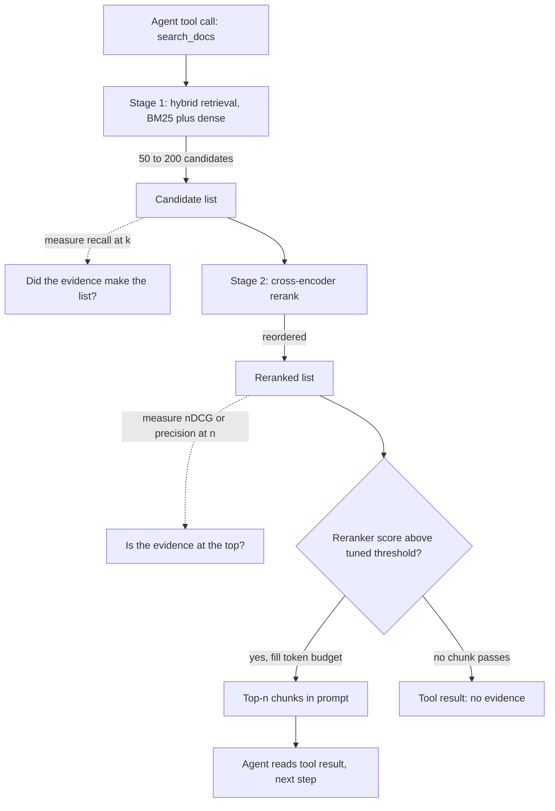

## TL;DR
Every time an agent calls its search tool, recall decides whether the evidence arrived and precision
decides how much noise lands in its transcript. Stage retrieval inside the tool: wide and cheap for
recall, then a reranker and token budget for precision.

## For agent builders
- **Why it matters for agents.** A search tool's output is appended to the agent's context and re-read on
  every later step. Low recall makes the agent answer from memory or search again; low precision fills
  the transcript with distractors that steer the next tool call wrong.
- **Where it shows up in your stack.** The retriever behind your search tool (a LangChain or LlamaIndex
  retriever, a vector store query), its `k`, a reranker step, and the eval harness (LangSmith datasets,
  or your own golden set script) that scores it.
- **What you control.** Candidate depth k, the reranker, how many tokens one tool result may return, a
  relevance threshold, and an explicit "no evidence" result the agent can act on.
- **What you can skip.** The formal IR theory of F-beta; recall@k, precision@k, nDCG and hit rate vs
  full recall are enough to tune and debug an agent's retrieval.

## Why it exists
- **You must cut a ranked list somewhere.** Cut early (top-3) and the list is clean but incomplete: an
  answer passage ranked fourth is gone, and nothing downstream recovers it. Cut late (top-50) and the
  evidence is probably there, buried among forty-odd irrelevant passages the generator must read, pay for,
  and be distracted by.
- **No cut wins on both axes, because ranking is imperfect.** With a perfect ranker every relevant passage
  sits above every irrelevant one, and one threshold gives recall 1.0 and precision 1.0 together.
- **The reader is a model, not a human.** Classical search tolerated noise because a person scanned the
  list. A language model has a finite context, loses accuracy when the relevant passage sits mid-prompt
  ("lost in the middle"), and can be steered wrong by similar but conflicting passages (an old policy next
  to the new one). So precision affects correctness, not just cost.
- **Recall is a hard floor.** Barring answers the model knows from pretraining, a RAG system cannot be more
  accurate than the fraction of questions whose evidence reached the prompt.
- **"Retrieve more and let the model sort it out" fails.** It converts a recall problem into a precision
  problem instead of solving either. The way out: cheap retrievers and expensive rerankers have different
  cost-per-candidate profiles, so let each optimise the metric it is good at.

## How it works
### The two numbers
For a query with relevant set R (the chunks that actually contain the answer) and retrieved top-k set S_k:

```
precision@k = |R ∩ S_k| / k
recall@k    = |R ∩ S_k| / |R|
```

- **Recall@k never falls as k grows,** because S_k only gains members.
- **Precision@k usually falls,** because each extra slot holds a lower-ranked, less likely relevant item.
- **The recall curve has a knee.** recall@k against k rises steeply then flattens; the knee is where extra
  candidates stop buying recall.
- **F1 and F-beta collapse the pair** (harmonic mean; recall- or precision-weighted). In RAG you rarely
  should, because the two numbers belong to different pipeline stages.
- **Rank-aware metrics refine it.** MRR (reciprocal rank of the first relevant hit) and nDCG (graded
  relevance, discounted by position) reward the right passage near the top, which matters because the
  generator reads the prompt in order.

### Which recall, and the precision ceiling
| Detail | What goes wrong | What to do |
|---|---|---|
| **Hit rate vs full recall** | Dashboards often report "recall@k" as hit rate (at least one relevant chunk appeared). Right when any single chunk answers (the same policy stated in three places); wrong when the answer needs several chunks (a table, its definitions, its exclusions): hit rate says 1.0 while a piece is missing. | Label each golden question "any-of" or "all-of" and score accordingly. |
| **Precision is capped by \|R\|** | precision@k can never exceed \|R\| / k. One relevant chunk scores at most 0.2 at k = 5 even with perfect ranking, so averaging over questions mostly measures how many relevant chunks each has. | Use nDCG or MRR for ranking quality; read precision@k as "what fraction of the prompt is noise", the cost the generator pays. |
| **Labels are incomplete** | A near-duplicate of the answer chunk nobody labelled counts as a false positive, so measured precision understates true precision. A better retriever that surfaces the duplicate can look worse. | Inspect "regressions" by hand before trusting them. |

### Why both numbers hurt a generator
- **Recall failure is unrecoverable downstream.** No prompt engineering retrieves a passage that is absent.
- **Precision failure is only partly recoverable.** The model can ignore some noise, at three concrete costs:
  - **Tokens:** k chunks of 300 tokens is 300 × k input tokens per call (15,000 at k = 50).
  - **Position:** the relevant passage lands at an arbitrary spot among distractors, and position matters.
  - **Distractors:** near-duplicates and stale versions are exactly what similarity search ranks highly, so
    the noise is not random; it is the most confusable material in the corpus.

### The staged resolution
1. **Candidate generation, optimised for recall.** An ANN index over embeddings, an inverted index for BM25,
   or both fused (hybrid) return a wide list, say 50–200 candidates. Cheap per candidate, because the query
   is encoded once and the index does the rest.
2. **Reranking, optimised for precision.** A cross-encoder reads (query, passage) jointly and scores
   relevance far more accurately than vector distance. It costs a full forward pass per pair, so it is only
   affordable on stage 1's short list. It reorders candidates so the top-n is dense with relevant material.
3. **Selection under a budget.** Take the top-n that fit the context budget, optionally dropping anything
   below a relevance threshold, so an unanswerable question yields an empty context rather than a
   confident answer built on junk.

| Stage | Metric | Question it answers |
|---|---|---|
| 1. Candidates | recall@k | Did the evidence make it into the candidate set? |
| 2. Rerank | precision@n or nDCG@n | Is the evidence at the top? |
| Whole pipeline | answer accuracy or faithfulness | Is the answer right? |

When end-to-end accuracy drops, these per-stage numbers tell you which stage broke.

### The other levers
| Lever | Recall | Precision | Catch |
|---|---|---|---|
| Smaller chunks | down (multi-part answer needs more hits) | up (sharper keys per hit) | depends on how self-contained chunks are |
| Hybrid search | up (catches lexical matches dense misses) | not its main effect | extra index |
| Query expansion | up | down | more noise |
| Metadata filters | destroyed if the filter is wrong | up (smaller pool) | filter correctness |
| Score thresholds | down for some queries | up | scores are not calibrated across queries, so a fixed threshold silently returns nothing for some |

### Inside an agent's search tool
- **The funnel lives behind the tool boundary.** The agent writes a query; the tool runs stage 1, stage 2
  and selection, and returns only the budgeted top-n. The model never sees the 50–200 candidates.
- **Precision costs compound across steps.** In single-shot RAG a noisy context is paid once. In an agent,
  each tool result stays in the transcript, so noise from step 2 is re-read at steps 3, 4 and onward.
- **Recall failures change behaviour, not just answers.** An agent that gets nothing useful tends to
  search again with a drifting query or answer from pretraining. A clear "no evidence" result gives it a
  correct next move instead.
- **The agent can partly repair recall.** Unlike a fixed pipeline, it can reformulate and search again,
  but each retry is another sequential step, so stage-1 recall still sets latency and cost.

## Diagram
Follow one tool call through the funnel: each stage is measured by the metric it is good at, and the
threshold decides whether the agent receives passages or an honest "no evidence" result.



## Examples
### Golden-set evaluation of stage 1 vs stage 2
Each question has human-labelled answer-bearing chunk ids; the code computes recall@k and precision@k for
stage 1 (hybrid retrieval) and stage 2 (reranked).

```python
from statistics import mean

golden = {  # question -> set of chunk ids that contain the answer (labelled by hand)
    "What is the SLA credit for 99.5% availability?": {"sla-table", "credit-defs", "credit-exclusions"},
    "How long are audit logs retained?": {"retention-policy"},
}

def precision_recall(retrieved, relevant, k):
    top = retrieved[:k]
    hit = len(set(top) & relevant)
    return hit / k, hit / len(relevant)

def evaluate(search, k):
    p, r = [], []
    for q, relevant in golden.items():
        pk, rk = precision_recall(search(q), relevant, k)
        p.append(pk); r.append(rk)
    return mean(p), mean(r)

# search_hybrid(q) -> ranked chunk ids; rerank(q, ids) -> ids reordered by a cross-encoder
stage1 = lambda q: search_hybrid(q)
stage2 = lambda q: rerank(q, search_hybrid(q)[:50])
for k in (5, 20, 50):
    print("stage1", k, evaluate(stage1, k))
print("stage2", 5, evaluate(stage2, 5))
```

Illustrative results for the first question:

| Run | Finds | precision | recall | Prompt tokens |
|---|---|---|---|---|
| Stage 1, top-5 | `sla-table`, `credit-defs`; misses `credit-exclusions` (its text says "service credits shall not apply" without the word SLA) | 0.4 | 0.67 | 1,500 |
| Stage 1, top-50 | all three | 0.06 | 1.0 | 15,000 |
| Stage 2, rerank 50 → keep 5 | all three in the top-5 | 0.6 | 1.0 | 5 × 300 = 1,500 |

- **The second question shows the ceiling.** It has one relevant chunk, so even a perfect reranker scores
  precision@5 = 0.2, and the golden-set average of 0.4 (0.6 and 0.2) says nothing bad about ranking.
- **So report stages separately.** Over the whole golden set, report recall@50 for stage 1 and nDCG@5 (or
  precision@5 alongside |R|) for stage 2 as separate dashboards.
- **Score the first question "all-of".** With hit rate it would have looked perfect at k = 5.

### Runnable: one ranking, five metrics
Pure Python, no dependencies. It shows hit rate saturating while recall and nDCG still have room to move.

```python
import math

def metrics(ranked, relevant, k):
    top = ranked[:k]
    hits = [d in relevant for d in top]
    p = sum(hits) / k
    r = sum(hits) / len(relevant)
    hit_rate = 1.0 if any(hits) else 0.0
    mrr = next((1 / (i + 1) for i, h in enumerate(hits) if h), 0.0)
    dcg = sum(1 / math.log2(i + 2) for i, h in enumerate(hits) if h)
    ideal = sum(1 / math.log2(i + 2) for i in range(min(k, len(relevant))))
    return dict(p=round(p, 2), r=round(r, 2), hit=hit_rate, mrr=round(mrr, 2), ndcg=round(dcg / ideal, 2))

relevant = {"sla-table", "credit-defs", "credit-exclusions"}
ranked = ["sla-table", "old-sla-2022", "credit-defs", "faq-uptime", "status-page",
          "billing-terms", "credit-exclusions"] + [f"noise-{i}" for i in range(43)]
for k in (3, 5, 10, 50):
    print(k, metrics(ranked, relevant, k))
# 3  {'p': 0.67, 'r': 0.67, 'hit': 1.0, 'mrr': 1.0, 'ndcg': 0.7}
# 5  {'p': 0.4,  'r': 0.67, 'hit': 1.0, 'mrr': 1.0, 'ndcg': 0.7}
# 10 {'p': 0.3,  'r': 1.0,  'hit': 1.0, 'mrr': 1.0, 'ndcg': 0.86}
# 50 {'p': 0.06, 'r': 1.0,  'hit': 1.0, 'mrr': 1.0, 'ndcg': 0.86}
```

Hit rate and MRR are 1.0 at every k, yet the exclusions clause only arrives at rank 7: an "all-of" question
needs recall, not hit rate.

### Agent search tool with a budget and a "no evidence" result
The tool schema uses the Anthropic-style `input_schema` shape; other providers take the same JSON Schema
under a different key. `search_hybrid` and `rerank_scored` are stubs for your retriever and reranker.

```python
SEARCH_TOOL = {
    "name": "search_docs",
    "description": ("Search the policy knowledge base. Returns a few passages that passed a relevance "
                    "check, or status 'no_evidence'. On no_evidence, rephrase once, then tell the user "
                    "you could not find it. Never answer policy questions from memory."),
    "input_schema": {"type": "object",
                     "properties": {"query": {"type": "string"}},
                     "required": ["query"]},
}

def search_docs(query, k_candidates=50, budget_tokens=1500, min_score=0.0):
    # min_score: tune on reranker scores against the golden set, never a global cosine value
    cands = search_hybrid(query)[:k_candidates]            # stage 1: wide, for recall
    ranked = rerank_scored(query, cands)                   # stage 2: [(score, chunk)], best first
    out, used = [], 0
    for score, chunk in ranked:
        if score < min_score:
            break                                          # below threshold: stop, do not pad
        if used + chunk.tokens > budget_tokens:
            continue                                       # budget in tokens, not chunks
        out.append({"id": chunk.id, "text": chunk.text}); used += chunk.tokens
    if not out:
        return {"status": "no_evidence", "passages": []}   # a next move the agent can act on
    return {"status": "ok", "passages": out}
```

### Worked scenario: what k does to an agent's transcript
A policy agent makes 4 search calls per task; chunks are ~300 tokens and every tool result stays in the
transcript for the rest of the run.

| Tool design | Tokens per result | Tool-result tokens after 4 calls | Noise per result |
|---|---|---|---|
| Raw top-5 | 1,500 | 6,000 | ~3 of 5 passages (precision 0.4), and an "all-of" piece missing |
| Raw top-50 | 15,000 | 60,000 | ~47 of 50 passages (precision 0.06) |
| Rerank 50, keep 5 within budget | 1,500 | 6,000 | ~2 of 5 passages (precision 0.6), recall 1.0 |

- **Top-50 multiplies the transcript by 10.** Every later step re-reads those 60,000 tokens, and the
  distractors sit next to the evidence for the next tool-call decision.
- **The reranked tool matches top-5 on size** while carrying the evidence top-5 missed.

## Production patterns
- **Wide-then-narrow inside the tool.** When the corpus is large, the search tool fetches 50–200 hybrid
  candidates and reranks with a cross-encoder down to the 5–10 that fit a per-call budget. Monitor recall@50 on the golden set and the reranker's p95 latency separately,
  since tool latency adds to every agent step.
- **Pick k at the knee, on a schedule.** In the nightly or CI eval, sweep k over values such as 5, 10, 20,
  50, 100, plot recall@k, and set candidate depth just past the knee. Re-run whenever the embedding model,
  chunker or corpus changes, since the knee moves.
- **Per-stage dashboards and gates.** Track recall@k (candidates) and nDCG@n (final list) as separate
  series, plus agent-level answer accuracy, and fail a retrieval change in CI when either drops beyond a
  tolerance you set on the golden set. Trace tools such as LangSmith let you score the retriever span and
  the final answer of the same run separately.
- **Budget tool results in tokens, not chunks.** Select reranked chunks until a per-call token budget is
  filled rather than a fixed n, so long chunks cannot blow up the transcript. Monitor tool-result tokens
  per call, total transcript tokens per run, and the share of calls hitting the cap.
- **Return "no evidence" as a first-class tool result.** Tune the cut-off on the reranker's scores against
  the golden set (not a global cosine value) and return an explicit status the tool description tells the
  agent how to handle. Monitor the empty-result rate per route and how often the agent still answers
  after one.

## Trade-offs
- **Larger k vs tokens, latency and position.** Raises recall, but stops paying once the recall curve has
  flattened, and flips to harmful when distractors outnumber evidence.
- **Reranker precision vs latency.** A forward pass per candidate pair, typically tens to hundreds of
  milliseconds for 50–100 pairs on a GPU and more on CPU. Not worth it when stage 1 is already precise or
  latency is tight.
- **Relevance threshold vs coverage.** Raises precision and lets the system say "no evidence", but
  similarity scores are not calibrated across queries, so a cut-off that works for one query returns
  nothing for another.
- **Smaller chunks vs multi-part answers.** Raise precision per hit and sharpen embeddings, but a
  multi-part answer then needs several hits, so recall at fixed k drops; the balance depends on how
  self-contained the corpus units are.
- **Agent retries vs stage-1 recall.** An agent can recover a missed passage by searching again, which
  lets you run a cheaper first stage, but each retry is a sequential model call plus a search; once
  retries become routine rather than rare, buying recall in the tool is usually cheaper.

## Pitfalls
- **Measuring only end-to-end accuracy.** Symptom: every fix is a guess, because failures cannot be
  attributed to recall (never retrieved) or precision (retrieved but ignored). Diagnose: for each failing
  question, log whether a labelled chunk was in the candidates, in the final top-n, and cited. Fix:
  per-stage metrics on a golden set.
- **Tuning k on a handful of complaint queries.** Symptom: regressions on queries nobody was looking at.
  Diagnose: rerun the full golden set before and after and diff per-question recall. Fix: tune only
  against the golden set.
- **Labelling relevance by embedding similarity.** Symptom: excellent retrieval metrics alongside wrong
  answers. Diagnose: hand-check 20 "relevant" labels against the question. Fix: label by whether the chunk
  answers the question.
- **Counting any chunk of the right document, or hit rate, as "recall".** Symptom: recall@5 near 1.0 while
  the clause that answers a table or multi-condition question is still missing. Diagnose: score "all-of"
  questions with full recall and compare. Fix: label any-of or all-of, at chunk level.
- **Treating precision as cost-only.** Symptom: answers cite a plausible but outdated passage that sat next
  to the correct one. Diagnose: list the final top-n of failing questions and flag stale or near-duplicate
  versions. Fix: rerank, dedupe and filter by version.
- **Trusting incomplete relevance labels.** Symptom: a retriever change "lowers precision". Diagnose:
  inspect the new top results by hand; they are often unlabelled duplicates of the answer. Fix: add them to
  the labels.
- **Returning an empty list with no status.** The agent cannot tell "nothing relevant" from "tool broke".
  Symptom: loops of near-identical searches or a confident answer from memory. Diagnose: count consecutive
  similar queries per run after empty results. Fix: return an explicit `no_evidence` status and say in the
  tool description what to do with it.

## When to use
- **Always, as a lens,** whenever a RAG system or search tool is designed or debugged.
- **Default to two stages** when the corpus is large enough that stage 1 cannot be precise on its own,
  which is almost always.
- **Decide k and n from data.** Pick k at the knee of recall@k on a golden set; pick n (what reaches the
  prompt) from the generator's context budget and the measured precision after reranking.
- **Measure:** recall@k for the candidate stage and precision@n or nDCG@n for the final list, tracked
  separately so a regression in one is not masked by the other. "Our RAG answers 70% of questions":
  find which number fails before proposing a fix.

## Exercise
**Goal:** choose k, n and a "no evidence" threshold for a search tool from your own measurements. No
solution is given.
- **Inputs:** any corpus of 200+ chunks, a golden set of 30 questions with labelled chunks (mark each
  any-of or all-of, include 5 unanswerable ones), BM25 or a small embedding model, and an open
  cross-encoder.
- **Deliver:** a recall@k curve for k in 5, 10, 20, 50, 100; nDCG@5 with and without reranking; a threshold
  on reranker scores; tokens per tool result at your chosen setting.
- **Acceptance:** you can point to the knee on the curve; the reranked nDCG@5 beats stage 1; at least 4 of
  the 5 unanswerable questions return `no_evidence` while answerable recall drops by under 5 points.

## Role lens
- **Engineer:** Builds the golden set and the metric script, tunes k and the reranker cut-off, and wires
  recall@k and precision@n into the eval harness so every retrieval change is scored.
- **Architect:** Owns the pipeline shape: whether a reranker is worth its latency, what context budget the
  generator gets, and which stage each team's metric belongs to.
- **FDE:** Explains to a customer why "retrieve more documents" made answers worse, and uses the two
  numbers to turn "the bot is wrong sometimes" into a specific, measurable retrieval failure.

## Check yourself
**Q:** A RAG assistant over internal policies answers about 70% of questions correctly with dense top-5
retrieval. Before changing anything, how do you decide between raising k, adding a reranker, changing
chunking, or fixing the prompt?
**A:** Build or reuse a golden set with labelled answer-bearing chunks, then compute recall@5 and recall@50
on the current retriever. If recall@50 is much higher than recall@5, the evidence is indexed but ranked
too low, so a reranker (or a larger k if the generator tolerates it) is the right lever. If recall@50 is
also low, the index itself cannot surface the evidence: look at chunking, hybrid search or the embedding
model. If recall@5 is already high but answers are wrong, retrieval is not the bottleneck; inspect
precision@5 for distractors and stale versions, check where the evidence sits in the prompt, and look at
the generation prompt. Measuring first prevents spending a week on a reranker when the passage was never
in the candidate set.

## Interview questions
### Define recall@k and precision@k for retrieval, and say why a RAG team cares about both.
- **Recall@k** is the share of answer-bearing chunks that appear in the top-k; **precision@k** is the share
  of the top-k that bear the answer.
- **Recall is a hard floor** on accuracy, because the generator cannot use evidence that never reached the
  prompt.
- **Precision affects correctness, not just cost,** because distractors such as a stale policy next to the
  current one steer the model wrong and push the real evidence into the middle of the prompt.

### Your team raised top-k from 5 to 50 and answer accuracy went down. What happened and what do you do?
- **Likely cause:** recall rose but precision collapsed (for example from 0.4 to 0.06), so the prompt filled
  with near-duplicates and outdated passages, and the evidence landed mid-context.
- **Confirm with numbers:** compare recall@5 and recall@50 on the golden set, and check where the evidence
  sits in the prompt for failing questions.
- **Fix:** keep 50 as the candidate depth but add a cross-encoder rerank down to a token-budgeted top-n, so
  each stage optimises its own metric.

### When would you not add a reranker?
- **When stage 1 is already precise:** if precision@5 is high on the golden set, a reranker adds latency
  for little gain.
- **When the latency budget is tight:** a forward pass per pair costs tens to hundreds of milliseconds for
  50–100 pairs on a GPU, more on CPU.
- **When recall@50 itself is low:** a reranker only reorders candidates, so the fix is chunking, hybrid
  search or the embedding model instead.

### How do you choose candidate depth k and final n for a search tool an agent calls several times per task?
- **k from the recall curve:** sweep k (for example 5, 10, 20, 50, 100) on the golden set and set it just
  past the knee, where extra candidates stop buying recall.
- **n from the transcript budget:** fill reranked chunks up to a per-call token budget, and multiply by
  calls per task, because every result stays in context (4 calls at 15,000 tokens is 60,000).
- **Re-run on change:** the knee moves when the embedding model, chunker or corpus changes, so keep the
  sweep in a scheduled eval.

### Your agent gets nothing useful from search and answers from memory anyway. How do you fix it?
- **Give the tool a real "no evidence" result:** an explicit status, decided by a reranker-score threshold
  tuned on the golden set, instead of an empty or padded list.
- **Tell the agent what to do with it:** the tool description says rephrase once, then say it could not
  find the answer; never answer that topic from memory.
- **Measure both sides:** recall@k of the tool on the golden set, and how often the agent answers after a
  `no_evidence` result, scored as a faithfulness failure in the agent eval.

## Quiz
### Q: Why does a two-stage retrieve-then-rerank pipeline exist instead of a single better retriever?
- [ ] Rerankers are cheaper per candidate than ANN search
- [x] Cheap first-stage retrieval can afford to be wide for recall, while the expensive reranker can only be afforded on a short list, where it buys precision
- [ ] Vector databases cannot return more than a few results per query
- [ ] Rerankers improve recall by finding documents the first stage missed
> A cross-encoder scores each (query, passage) pair with a full forward pass, so it is only affordable on
> the candidates stage 1 already found; it reorders them for precision, which can raise recall@5, but it can never lift recall above what the
> candidate list already had (recall@50 here).

### Q: Recall@50 is 0.92 but recall@5 is 0.55 on your golden set. Which change addresses the gap most directly?
- [ ] Switching to smaller chunks
- [ ] Lowering the similarity threshold
- [x] Adding a reranker over the top-50 candidates
- [ ] Increasing chunk overlap
> The evidence is already in the candidate set but ranked low, which is exactly what a reranker fixes.
> Smaller chunks or overlap change what gets indexed, which is the fix when recall@50 itself is low.

### Q: What does a fixed similarity-score threshold across all queries most commonly cause?
- [ ] Higher recall on every query
- [x] Empty contexts for some queries, because similarity scores are not calibrated across queries
- [ ] Duplicate passages in the prompt
- [ ] Slower first-stage retrieval
> Cosine or dot-product scores are relative to each query's embedding, so a value that marks "relevant"
> for one query can be above every candidate for another, which silently returns nothing.

## Mastery test
**Problem:** a contract-review agent's search tool shows hit rate@10 = 0.9, yet lawyers say a third of
answers miss a carve-out. Carve-outs sit in a separate exceptions schedule that cites clauses by number
("Clause 7.2 does not apply where...").

The tool already reranks the top-50. Say what you measure first, then redesign it.

**A strong answer:**
- calls hit rate wrong for all-of questions; measures full recall@10 and recall@50 split by main-clause
  and exception chunks;
- sees that if exception recall@50 is low the reranker cannot help: it only reorders, and "Clause 7.2"
  shares no words with the question;
- fixes stage 1 by structure (fetch exceptions citing a retrieved clause, or prefix each with that
  clause), within the token budget, gated on exception recall.

## Use cases & projects
### Use cases
- **Support agents over a help centre.** Tuning candidate depth and the reranker decides whether the one
  article with the refund rule reaches the agent without five near-duplicates beside it.
- **Research agents that search many times.** Each search result stays in the transcript, so per-call
  precision controls how fast the context fills and how often later steps are steered wrong.
- **Agents that must say "I don't know".** An explicit "no evidence" tool result, backed by measured
  recall, lets the agent refuse or ask instead of answering from memory.
- **Regression gates for retrieval changes.** Teams track recall@k and precision@k on a golden set before
  shipping a new embedder, chunker or reranker behind the agent's search tool.

### Mini project
**Tune k and a reranker for an agent's search tool (2-3 hours).**
- **Goal:** find the candidate depth k and final n that give the agent high recall without flooding its
  context.
- **Steps:** build a small corpus and a golden set of about 30 questions with labelled relevant chunks;
  wrap retrieval as a `search` tool; measure recall@k and precision@k for several k values with and without
  a reranker; then run a simple tool-calling agent on the golden questions at two settings and log answer
  correctness and tool-result tokens.
- **Done when:** you have a table of recall, precision, tokens per tool result and answer accuracy per
  setting, and a one-paragraph recommendation for the default k and n with the reason.
