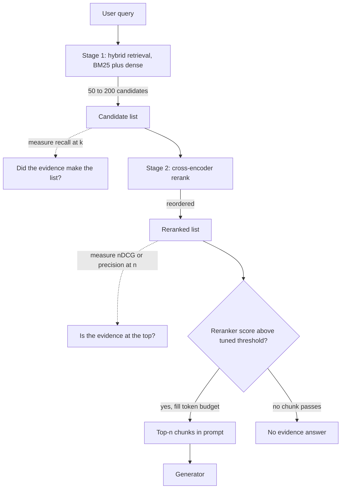

## TL;DR
Recall is the share of answer-bearing passages you retrieved; precision is the share of retrieved passages
that bear the answer. Widening top-k trades one for the other, so stage retrieval: wide and cheap for
recall, then narrow and expensive for precision.

## Why it exists
- **You must cut a ranked list somewhere.** Cut early (top-3) and the list is clean but incomplete: an
  answer passage ranked fourth is gone, and nothing downstream recovers it. Cut late (top-50) and the
  evidence is probably there, buried among forty-odd irrelevant passages the generator must read, pay for,
  and be distracted by.
- **No cut wins on both axes, because ranking is imperfect.** With a perfect ranker every relevant passage
  sits above every irrelevant one, and one threshold gives recall 1.0 and precision 1.0 together.
- **The reader is a model, not a human.** Classical search tolerated noise because a person scanned the
  list. A language model has a finite context, loses accuracy when the relevant passage sits mid-prompt
  ("lost in the middle"), and can be steered wrong by similar but conflicting passages (an old policy next
  to the new one). So precision affects correctness, not just cost.
- **Recall is a hard floor.** Barring answers the model knows from pretraining, a RAG system cannot be more
  accurate than the fraction of questions whose evidence reached the prompt.
- **"Retrieve more and let the model sort it out" fails.** It converts a recall problem into a precision
  problem instead of solving either. The way out: cheap retrievers and expensive rerankers have different
  cost-per-candidate profiles, so let each optimise the metric it is good at.

## How it works
### The two numbers
For a query with relevant set R (the chunks that actually contain the answer) and retrieved top-k set S_k:

```
precision@k = |R ∩ S_k| / k
recall@k    = |R ∩ S_k| / |R|
```

- **Recall@k never falls as k grows,** because S_k only gains members.
- **Precision@k usually falls,** because each extra slot holds a lower-ranked, less likely relevant item.
- **The recall curve has a knee.** recall@k against k rises steeply then flattens; the knee is where extra
  candidates stop buying recall.
- **F1 and F-beta collapse the pair** (harmonic mean; recall- or precision-weighted). In RAG you rarely
  should, because the two numbers belong to different pipeline stages.
- **Rank-aware metrics refine it.** MRR (reciprocal rank of the first relevant hit) and nDCG (graded
  relevance, discounted by position) reward the right passage near the top, which matters because the
  generator reads the prompt in order.

### Which recall, and the precision ceiling
| Detail | What goes wrong | What to do |
|---|---|---|
| **Hit rate vs full recall** | Dashboards often report "recall@k" as hit rate (at least one relevant chunk appeared). Right when any single chunk answers (the same policy stated in three places); wrong when the answer needs several chunks (a table, its definitions, its exclusions): hit rate says 1.0 while a piece is missing. | Label each golden question "any-of" or "all-of" and score accordingly. |
| **Precision is capped by \|R\|** | precision@k can never exceed \|R\| / k. One relevant chunk scores at most 0.2 at k = 5 even with perfect ranking, so averaging over questions mostly measures how many relevant chunks each has. | Use nDCG or MRR for ranking quality; read precision@k as "what fraction of the prompt is noise", the cost the generator pays. |
| **Labels are incomplete** | A near-duplicate of the answer chunk nobody labelled counts as a false positive, so measured precision understates true precision. A better retriever that surfaces the duplicate can look worse. | Inspect "regressions" by hand before trusting them. |

### Why both numbers hurt a generator
- **Recall failure is unrecoverable downstream.** No prompt engineering retrieves a passage that is absent.
- **Precision failure is only partly recoverable.** The model can ignore some noise, at three concrete costs:
  - **Tokens:** k chunks of 300 tokens is 300 × k input tokens per call (15,000 at k = 50).
  - **Position:** the relevant passage lands at an arbitrary spot among distractors, and position matters.
  - **Distractors:** near-duplicates and stale versions are exactly what similarity search ranks highly, so
    the noise is not random; it is the most confusable material in the corpus.

### The staged resolution
1. **Candidate generation, optimised for recall.** An ANN index over embeddings, an inverted index for BM25,
   or both fused (hybrid) return a wide list, say 50–200 candidates. Cheap per candidate, because the query
   is encoded once and the index does the rest.
2. **Reranking, optimised for precision.** A cross-encoder reads (query, passage) jointly and scores
   relevance far more accurately than vector distance. It costs a full forward pass per pair, so it is only
   affordable on stage 1's short list. It reorders candidates so the top-n is dense with relevant material.
3. **Selection under a budget.** Take the top-n that fit the context budget, optionally dropping anything
   below a relevance threshold, so an unanswerable question yields an empty context rather than a
   confident answer built on junk.

| Stage | Metric | Question it answers |
|---|---|---|
| 1. Candidates | recall@k | Did the evidence make it into the candidate set? |
| 2. Rerank | precision@n or nDCG@n | Is the evidence at the top? |
| Whole pipeline | answer accuracy or faithfulness | Is the answer right? |

When end-to-end accuracy drops, these per-stage numbers tell you which stage broke.

### The other levers
| Lever | Recall | Precision | Catch |
|---|---|---|---|
| Smaller chunks | down (multi-part answer needs more hits) | up (sharper keys per hit) | depends on how self-contained chunks are |
| Hybrid search | up (catches lexical matches dense misses) | not its main effect | extra index |
| Query expansion | up | down | more noise |
| Metadata filters | destroyed if the filter is wrong | up (smaller pool) | filter correctness |
| Score thresholds | down for some queries | up | scores are not calibrated across queries, so a fixed threshold silently returns nothing for some |

## Diagram
Follow the funnel: each stage is measured by the metric it is good at, and the threshold decides between
an answer and an honest "no evidence".



## Examples
### Golden-set evaluation of stage 1 vs stage 2
Each question has human-labelled answer-bearing chunk ids; the code computes recall@k and precision@k for
stage 1 (hybrid retrieval) and stage 2 (reranked).

```python
from statistics import mean

golden = {  # question -> set of chunk ids that contain the answer (labelled by hand)
    "What is the SLA credit for 99.5% availability?": {"sla-table", "credit-defs", "credit-exclusions"},
    "How long are audit logs retained?": {"retention-policy"},
}

def precision_recall(retrieved, relevant, k):
    top = retrieved[:k]
    hit = len(set(top) & relevant)
    return hit / k, hit / len(relevant)

def evaluate(search, k):
    p, r = [], []
    for q, relevant in golden.items():
        pk, rk = precision_recall(search(q), relevant, k)
        p.append(pk); r.append(rk)
    return mean(p), mean(r)

# search_hybrid(q) -> ranked chunk ids; rerank(q, ids) -> ids reordered by a cross-encoder
stage1 = lambda q: search_hybrid(q)
stage2 = lambda q: rerank(q, search_hybrid(q)[:50])
for k in (5, 20, 50):
    print("stage1", k, evaluate(stage1, k))
print("stage2", 5, evaluate(stage2, 5))
```

Illustrative results for the first question:

| Run | Finds | precision | recall | Prompt tokens |
|---|---|---|---|---|
| Stage 1, top-5 | `sla-table`, `credit-defs`; misses `credit-exclusions` (its text says "service credits shall not apply" without the word SLA) | 0.4 | 0.67 | 1,500 |
| Stage 1, top-50 | all three | 0.06 | 1.0 | 15,000 |
| Stage 2, rerank 50 → keep 5 | all three in the top-5 | 0.6 | 1.0 | 5 × 300 = 1,500 |

- **The second question shows the ceiling.** It has one relevant chunk, so even a perfect reranker scores
  precision@5 = 0.2, and the golden-set average of 0.4 (0.6 and 0.2) says nothing bad about ranking.
- **So report stages separately.** Over the whole golden set, report recall@50 for stage 1 and nDCG@5 (or
  precision@5 alongside |R|) for stage 2 as separate dashboards.
- **Score the first question "all-of".** With hit rate it would have looked perfect at k = 5.

### Runnable: one ranking, five metrics
Pure Python, no dependencies. It shows hit rate saturating while recall and nDCG still have room to move.

```python
import math

def metrics(ranked, relevant, k):
    top = ranked[:k]
    hits = [d in relevant for d in top]
    p = sum(hits) / k
    r = sum(hits) / len(relevant)
    hit_rate = 1.0 if any(hits) else 0.0
    mrr = next((1 / (i + 1) for i, h in enumerate(hits) if h), 0.0)
    dcg = sum(1 / math.log2(i + 2) for i, h in enumerate(hits) if h)
    ideal = sum(1 / math.log2(i + 2) for i in range(min(k, len(relevant))))
    return dict(p=round(p, 2), r=round(r, 2), hit=hit_rate, mrr=round(mrr, 2), ndcg=round(dcg / ideal, 2))

relevant = {"sla-table", "credit-defs", "credit-exclusions"}
ranked = ["sla-table", "old-sla-2022", "credit-defs", "faq-uptime", "status-page",
          "billing-terms", "credit-exclusions"] + [f"noise-{i}" for i in range(43)]
for k in (3, 5, 10, 50):
    print(k, metrics(ranked, relevant, k))
# 3  {'p': 0.67, 'r': 0.67, 'hit': 1.0, 'mrr': 1.0, 'ndcg': 0.7}
# 5  {'p': 0.4,  'r': 0.67, 'hit': 1.0, 'mrr': 1.0, 'ndcg': 0.7}
# 10 {'p': 0.3,  'r': 1.0,  'hit': 1.0, 'mrr': 1.0, 'ndcg': 0.86}
# 50 {'p': 0.06, 'r': 1.0,  'hit': 1.0, 'mrr': 1.0, 'ndcg': 0.86}
```

Hit rate and MRR are 1.0 at every k, yet the exclusions clause only arrives at rank 7: an "all-of" question
needs recall, not hit rate.

## Production patterns
- **Wide-then-narrow retrieval.** When the corpus is large, fetch 50–200 hybrid candidates and rerank with a
  cross-encoder down to the 5–10 that fit the context budget. Monitor recall@50 on the golden set and the
  reranker's p95 latency separately.
- **Pick k at the knee, on a schedule.** In the nightly or CI eval, sweep k over values such as 5, 10, 20,
  50, 100, plot recall@k, and set candidate depth just past the knee. Re-run whenever the embedding model,
  chunker or corpus changes, since the knee moves.
- **Per-stage dashboards and gates.** Track recall@k (candidates) and nDCG@n (final list) as separate
  series, and fail a retrieval change in CI when either drops beyond a tolerance you set on the golden set.
- **Budget the context in tokens, not chunks.** Select reranked chunks until a token budget is filled
  rather than a fixed n, so long chunks cannot blow up cost. Monitor prompt tokens per call and the share
  of calls hitting the cap.
- **Threshold with an explicit "no evidence" path.** If you drop low-relevance chunks, tune the cut-off on
  the reranker's scores against the golden set (not a global cosine value) and route empty contexts to a
  "cannot find this" answer. Monitor the empty-context rate per route.

## Trade-offs
- **Larger k vs tokens, latency and position.** Raises recall, but stops paying once the recall curve has
  flattened, and flips to harmful when distractors outnumber evidence.
- **Reranker precision vs latency.** A forward pass per candidate pair, typically tens to hundreds of
  milliseconds for 50–100 pairs on a GPU and more on CPU. Not worth it when stage 1 is already precise or
  latency is tight.
- **Relevance threshold vs coverage.** Raises precision and lets the system say "no evidence", but
  similarity scores are not calibrated across queries, so a cut-off that works for one query returns
  nothing for another.
- **Smaller chunks vs multi-part answers.** Raise precision per hit and sharpen embeddings, but a
  multi-part answer then needs several hits, so recall at fixed k drops; the balance depends on how
  self-contained the corpus units are.

## Pitfalls
- **Measuring only end-to-end accuracy.** Failures cannot be attributed to recall (never retrieved) or
  precision (retrieved but ignored); the symptom is that every fix is a guess.
- **Tuning k on a handful of complaint queries.** The symptom is regressions on queries nobody was looking
  at, visible only once a golden set exists.
- **Labelling relevance by embedding similarity.** Label by whether the chunk answers the question; the
  symptom is excellent retrieval metrics alongside wrong answers.
- **Counting a hit for any chunk of the right document.** The symptom is high "recall" while the specific
  clause that answers the question is still missing from the prompt.
- **Treating precision as cost-only.** The symptom is answers citing a plausible but outdated passage that
  sat next to the correct one in the context.
- **Reporting hit rate as "recall" on multi-chunk questions.** The symptom is recall@5 near 1.0 while
  answers to table or multi-condition questions are still incomplete.
- **Trusting incomplete relevance labels.** The symptom is a retriever change that "lowers precision" where
  manual inspection shows the new top results are unlabelled duplicates of the answer.

## When to use
- **Always, as a lens.** Not an optional technique: apply it whenever a RAG system is designed or debugged.
- **Default to two stages** when the corpus is large enough that stage 1 cannot be precise on its own,
  which is almost always.
- **Decide k and n from data.** Pick k at the knee of recall@k on a golden set; pick n (what reaches the
  prompt) from the generator's context budget and the measured precision after reranking.
- **Measure:** recall@k for the candidate stage and precision@n or nDCG@n for the final list, tracked
  separately so a regression in one is not masked by the other.
- **Interviews:** "how would you improve a RAG system that answers 70% of questions" is this question in
  disguise; the strong answer measures which number is failing before proposing a fix.

## Role lens
- **Engineer:** Builds the golden set and the metric script, tunes k and the reranker cut-off, and wires
  recall@k and precision@n into the eval harness so every retrieval change is scored.
- **Architect:** Owns the pipeline shape: whether a reranker is worth its latency, what context budget the
  generator gets, and which stage each team's metric belongs to.
- **FDE:** Explains to a customer why "retrieve more documents" made answers worse, and uses the two
  numbers to turn "the bot is wrong sometimes" into a specific, measurable retrieval failure.

## Check yourself
**Q:** A RAG assistant over internal policies answers about 70% of questions correctly with dense top-5
retrieval. Before changing anything, how do you decide between raising k, adding a reranker, changing
chunking, or fixing the prompt?
**A:** Build or reuse a golden set with labelled answer-bearing chunks, then compute recall@5 and recall@50
on the current retriever. If recall@50 is much higher than recall@5, the evidence is indexed but ranked
too low, so a reranker (or a larger k if the generator tolerates it) is the right lever. If recall@50 is
also low, the index itself cannot surface the evidence: look at chunking, hybrid search or the embedding
model. If recall@5 is already high but answers are wrong, retrieval is not the bottleneck; inspect
precision@5 for distractors and stale versions, check where the evidence sits in the prompt, and look at
the generation prompt. Measuring first prevents spending a week on a reranker when the passage was never
in the candidate set.

## Interview questions
### Define recall@k and precision@k for retrieval, and say why a RAG team cares about both.
- **Recall@k** is the share of answer-bearing chunks that appear in the top-k; **precision@k** is the share
  of the top-k that bear the answer.
- **Recall is a hard floor** on accuracy, because the generator cannot use evidence that never reached the
  prompt.
- **Precision affects correctness, not just cost,** because distractors such as a stale policy next to the
  current one steer the model wrong and push the real evidence into the middle of the prompt.

### Your team raised top-k from 5 to 50 and answer accuracy went down. What happened and what do you do?
- **Likely cause:** recall rose but precision collapsed (for example from 0.4 to 0.06), so the prompt filled
  with near-duplicates and outdated passages, and the evidence landed mid-context.
- **Confirm with numbers:** compare recall@5 and recall@50 on the golden set, and check where the evidence
  sits in the prompt for failing questions.
- **Fix:** keep 50 as the candidate depth but add a cross-encoder rerank down to a token-budgeted top-n, so
  each stage optimises its own metric.

### When would you not add a reranker?
- **When stage 1 is already precise:** if precision@5 is high on the golden set, a reranker adds latency
  for little gain.
- **When the latency budget is tight:** a forward pass per pair costs tens to hundreds of milliseconds for
  50–100 pairs on a GPU, more on CPU.
- **When recall@50 itself is low:** a reranker only reorders candidates, so the fix is chunking, hybrid
  search or the embedding model instead.

### Why can precision@5 average 0.4 on a golden set even with a perfect ranker?
- **Precision is capped by |R| / k.** A question with one relevant chunk scores at most 0.2 at k = 5,
  however good the ranking is.
- **So the average mostly measures** how many relevant chunks each question has, not ranking quality.
- **Use nDCG@n or MRR** to judge ranking, and read precision@k as the fraction of the prompt that is noise.

### How do you choose candidate depth k and final n for a production pipeline?
- **k from the recall curve:** sweep k (for example 5, 10, 20, 50, 100) on the golden set and set it just
  past the knee, where extra candidates stop buying recall.
- **n from the context budget:** fill reranked chunks up to a token budget, checked against measured
  precision after reranking.
- **Re-run on change:** the knee moves when the embedding model, chunker or corpus changes, so keep the
  sweep in a scheduled eval.

## Quiz
### Q: Why does a two-stage retrieve-then-rerank pipeline exist instead of a single better retriever?
- [ ] Rerankers are cheaper per candidate than ANN search
- [x] Cheap first-stage retrieval can afford to be wide for recall, while the expensive reranker can only be afforded on a short list, where it buys precision
- [ ] Vector databases cannot return more than a few results per query
- [ ] Rerankers improve recall by finding documents the first stage missed
> A cross-encoder scores each (query, passage) pair with a full forward pass, so it is only affordable on
> the candidates stage 1 already found; it reorders them for precision, which can raise recall@5, but it can never lift recall above what the
> candidate list already had (recall@50 here).

### Q: Recall@50 is 0.92 but recall@5 is 0.55 on your golden set. Which change addresses the gap most directly?
- [ ] Switching to smaller chunks
- [ ] Lowering the similarity threshold
- [x] Adding a reranker over the top-50 candidates
- [ ] Increasing chunk overlap
> The evidence is already in the candidate set but ranked low, which is exactly what a reranker fixes.
> Smaller chunks or overlap change what gets indexed, which is the fix when recall@50 itself is low.

### Q: What does a fixed similarity-score threshold across all queries most commonly cause?
- [ ] Higher recall on every query
- [x] Empty contexts for some queries, because similarity scores are not calibrated across queries
- [ ] Duplicate passages in the prompt
- [ ] Slower first-stage retrieval
> Cosine or dot-product scores are relative to each query's embedding, so a value that marks "relevant"
> for one query can be above every candidate for another, which silently returns nothing.
