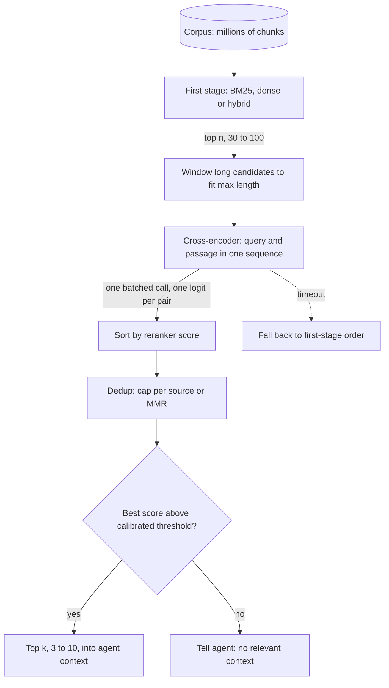

## TL;DR
A reranker decides which few chunks enter an agent's context. A cross-encoder scores query and passage
together, far more accurately than a bi-encoder but too slowly for a corpus, so retrieval pulls a few
dozen candidates and the reranker keeps the best.

## For agent builders
- **Why it matters for agents.** Every tool result stays in the transcript, so each extra chunk is paid
  for on every later step. A reranker lets the search tool return 3 good chunks instead of 10 mixed ones,
  cutting tokens, distractors and wrong tool decisions, and its score gives the agent an honest "nothing
  relevant found".
- **Where it shows up in your stack.** LangChain's `ContextualCompressionRetriever` with a cross-encoder
  or Cohere reranker, LlamaIndex node postprocessors, sentence-transformers `CrossEncoder`, hosted rerank
  APIs, and the step between retrieve and generate in a LangGraph RAG agent.
- **What you control.** Candidate depth n, final k, the reranker model, the "no relevant context"
  threshold, the latency budget and fallback, and deduplication.
- **What you can skip.** Reranker training losses. Know that hard negatives are why rerankers fix what
  retrievers miss, and that each pair is scored in isolation.

## Why it exists
- **First-stage retrieval is built for recall at scale.** BM25, dense or hybrid, the architecture that
  makes it scale also limits its precision.
- **A bi-encoder never sees query and passage together.** It embeds each independently; the only
  interaction is one dot product at the end. "Does this passage answer this question" must be squeezed
  into a fixed-size vector computed without knowing the question.
- **Fine distinctions blur.** Right product but wrong year, discusses the topic without answering, answers
  a negated version of the question: exactly what a single vector loses, and exactly what makes an agent
  act on the wrong policy.
- **The accurate model is too slow for a corpus.** A cross-encoder runs attention across query and passage
  as one sequence, so it can check the year, notice negation and verify the answer is present. But every
  pair needs a full forward pass, with nothing precomputable, because the passage representation depends
  on the query. A million passages per query is impossible in a serving path.
- **Two stages resolve it.** Spend the cheap, precomputable model on the whole corpus for candidates, the
  expensive accurate one on only those. The reranker never has to be fast over the corpus, only over
  fifty items.

## How it works
### The cross-encoder
- **Input:** one sequence, `[CLS] query [SEP] passage [SEP]`.
- **Joint attention:** full self-attention over the concatenation, so passage tokens are conditioned on
  the query and vice versa.
- **Output:** a classification head on the `[CLS]` output (or a pooled representation) gives one scalar,
  the relevance logit.
- **Training data:** labeled query–passage pairs (MS MARCO is the standard public source).
- **Losses:** pointwise (relevant or not), pairwise (the relevant passage must beat a hard negative) or
  listwise over a candidate set.
- **Hard negatives matter:** passages a first-stage retriever ranked highly but which are wrong, which
  teaches the reranker precisely the distinctions the retriever cannot make.

### Bi-encoder vs cross-encoder cost
| | Bi-encoder | Cross-encoder |
|---|---|---|
| Passage side | tower runs once at index time, output stored | nothing stored |
| Query side | tower runs once per query | part of every pair |
| Score | a dot product | one forward pass per pair |

- **Per-pair cost:** a pass over roughly |query| + |passage| tokens.
- **Worked cost:** a 20-token query and 400-token passages, 50 candidates = 50 passes over about 420 tokens
  each, 21,000 tokens of encoder compute per query.
- **Latency (illustrative; measure yours):** with GPU batching, typically tens of milliseconds for a
  small model and more for a large one. An agent pays it on every search.
- **Scaling:** linear in n, and somewhat faster than linear in passage length, because attention in each
  pass is quadratic in the pair's length while the rest is linear.
- **So decide chunk size and reranker together:** longer chunks cost more per candidate and risk
  truncation.

### The pipeline inside an agent's search tool
1. **Retrieve** the top-n from the first stage (hybrid or dense), with n chosen so recall@n is near its
   ceiling on your labeled set; 30 to 100 is typical.
2. **Score** n pairs with the cross-encoder in one batch.
3. **Sort** by reranker score and keep the top k (3 to 10) for the tool result.
4. **Optionally threshold** to drop candidates the reranker considers irrelevant, so the LLM sees fewer
   distractors and a "no relevant context" path can trigger; for an agent, that path tells it to
   rephrase, try another tool, or ask the user.

n is the lever: too small and the reranker cannot recover what retrieval missed (it only reorders); too
large and latency and cost grow for no gain, because recall@n has plateaued.

- **Query choice matters in agents.** Rerank against the agent's tool query, or against the user's
  original question when the tool query is a terse keyword rewrite; evaluate both on traces.

### Why it improves answers, not just rankings
- **The answer moves to position 1 or 2.** Models use information at the start (and end) of a long
  context more reliably than information buried in its middle.
- **Near-misses are demoted.** Passages that share vocabulary but not the answer are precisely the ones
  that induce confident wrong answers.
- **Smaller k after reranking** shortens prompts and cuts cost, and in an agent the saving repeats on
  every later step because tool results stay in the transcript.

### Length and truncation
- **Hard limit:** 512 tokens for BERT-derived models, longer for newer ones.
- **Silent truncation:** a passage longer than the limit minus the query is cut, so only its beginning is
  scored.
- **Fix:** keep chunks within the limit, or split long candidates into windows, score each and take the
  maximum.

### Alternatives on the cost–accuracy curve
| Option | How | Position on the curve |
|---|---|---|
| Late interaction (ColBERT) | one vector per passage token; score sums, over query tokens, the max similarity to any passage token | between bi- and cross-encoders in accuracy and cost; token-level matching stays precomputable; much larger index |
| LLM rerankers | prompt a generative model for pointwise relevance, a pairwise preference, or a listwise ordering | strongest on nuanced relevance and instructions such as "prefer the newest policy"; slowest, most expensive, sensitive to candidate order |
| Hosted rerank APIs | providers (Cohere, Voyage, Jina and others) expose a reranking model behind an endpoint, typically cross-encoder style though architectures are not always disclosed | no GPU to run, but a network call per query and per-call pricing |

- Listwise LLM reranking usually runs as a sliding window from the bottom of the list to the top, because
  the full pool does not fit or degrades in one prompt.
- **The agent itself is an LLM reranker** if you hand it 30 chunks; a dedicated reranker is usually far
  cheaper per call than spending the agent model's context on that judgment.

### What a reranker does not see
- **Each pair is scored in isolation;** it does not know what else is in the list.
- **Near-duplicates both win:** two near-identical chunks get two near-identical high scores and both take
  a slot. Fix with deduplication or a diversity step (maximal marginal relevance, or a cap per source
  document) after reranking.
- **Context-dependent pairs lose:** it cannot judge that a general rule and its specific exception are only
  useful together. Fix by keeping k large enough, or expanding to parent sections.

### Score semantics
- **Comparable within a query.** A cross-encoder logit ranks candidates for the same query.
- **Loosely comparable across queries** if trained pointwise with a sigmoid, which makes a "no good
  passage" threshold possible.
- **Calibrate on labeled data;** it is not a probability unless the training made it one.

## Diagram
Follow the funnel inside one agent search call: the cheap first stage narrows the corpus to n
candidates, the cross-encoder scores each pair jointly in one batch, and only the top k (after dedup and
an optional threshold) go back to the agent.



## Examples
### Worked scenario: what reranking saves an agent in context tokens
A research agent searches 5 times per task. Chunks are 400 tokens, and every tool result stays in the
transcript for the remaining steps.

| Configuration | Chunks per search | Tokens added per search | Tool-result tokens after 5 searches |
|---|---|---|---|
| No reranker, k = 10 | 10 | 4,000 | 20,000 |
| Reranker over n = 50, k = 3 | 3 | 1,200 | 6,000 |

- **Compounding.** Each later LLM step re-reads all earlier results, so the 14,000-token difference is
  paid again on every step after the last search (prefix caching cuts the price but not the distraction).
- **Quality.** Fewer near-miss chunks means fewer confident wrong tool calls; check it on an agent eval
  set, not only with NDCG.

### Rerank inside the agent's search tool, with threshold and timeout fallback
The tool reranks in one batched call under a hard time budget, falls back to first-stage order on
timeout, and returns an explicit signal when nothing clears the calibrated threshold.

```python
from concurrent.futures import ThreadPoolExecutor, TimeoutError as Timeout
from sentence_transformers import CrossEncoder

ce = CrossEncoder("cross-encoder/ms-marco-MiniLM-L-6-v2", max_length=512)
pool = ThreadPoolExecutor(max_workers=4)
THRESHOLD = 0.0          # calibrated on labeled queries for THIS model version
BUDGET_S = 0.15          # hard latency budget for the rerank step

def search_tool(query, first_stage, n=50, k=3):
    cands = first_stage(query, n)                       # [(chunk_id, text)], best first
    fut = pool.submit(ce.predict, [(query, t) for _, t in cands], batch_size=64)
    try:
        scores = fut.result(timeout=BUDGET_S)
    except Timeout:                                     # the abandoned call still occupies a worker
        return {"results": [c for c, _ in cands[:k]], "reranked": False}   # fallback
    ranked = sorted(zip(cands, scores), key=lambda x: -x[1])
    keep = [(c[0], float(s)) for c, s in ranked[:k] if s >= THRESHOLD]
    if not keep:
        return {"results": [], "note": "No relevant passages. Rephrase or try another source."}
    return {"results": keep, "reranked": True}
```

- **Log `reranked` and the top score** in the trace; a rising fallback rate or a shifted score
  distribution is the first sign of GPU trouble or a model change.

### Two-stage retrieval with public models
A small bi-encoder retrieves five candidates by cosine; an MS MARCO cross-encoder rescores each pair
jointly.

Vocabulary overlap is a bad guide here: the price-match and warranty passages share "30 days"
and "laptops" with the query but answer nothing, while the real answer needs two passages, the general
30-day rule and the 14-day exception for laptops.

```python
import numpy as np
from sentence_transformers import SentenceTransformer, CrossEncoder

passages = [
    "Returns are accepted within 30 days of delivery if the item is unopened.",
    "Laptops and tablets may be returned within 14 days; the box must be unopened.",
    "Opened software cannot be returned; unopened software follows the 30-day policy.",
    "Our 30-day price-match guarantee covers laptops bought in store or online.",
    "Return shipping labels can be printed from your order page.",
    "Warranty claims for laptops older than 30 days go through the manufacturer.",
]
query = "Can I return an unopened laptop after 20 days?"

bi = SentenceTransformer("sentence-transformers/all-MiniLM-L6-v2")
ce = CrossEncoder("cross-encoder/ms-marco-MiniLM-L-6-v2")

P = bi.encode(passages, normalize_embeddings=True)
q = bi.encode(query, normalize_embeddings=True)
stage1 = np.argsort(-(P @ q))[:5]                     # top-5 by cosine: cheap, precomputable
print("stage 1:", [passages[i][:40] for i in stage1])

pairs = [(query, passages[i]) for i in stage1]
scores = ce.predict(pairs)                            # one joint forward pass per pair
for i, s in sorted(zip(stage1, scores), key=lambda t: -t[1]):
    print(f"{s:+6.2f}  {passages[i][:60]}")
# Typically the 14-day laptop rule and the general 30-day rule rise to the top two, and the
# price-match and warranty passages fall. The exact order of the top two varies by model, and
# neither model reasons that the exception overrides the rule: that is the LLM's job, so both must
# survive into the top k.
```

### Production snippet: windowed scoring plus a per-source cap
Long candidates are split into overlapping windows (by words here, as a stand-in for tokens) so nothing
is truncated, all windows go in one batched call, and a per-document cap stops near-duplicates filling
the top k. `score_pairs` is any batch scorer, such as `CrossEncoder(...).predict`.

```python
def windows(text, size=200, stride=150):
    """Split a long passage into overlapping word windows that fit the reranker."""
    words = text.split()
    if len(words) <= size:
        return [text]
    return [" ".join(words[i:i + size]) for i in range(0, len(words) - size + stride, stride)]

def rerank(query, candidates, score_pairs, k=5, per_source=2):
    """candidates: [(source_id, text)]. score_pairs: e.g. CrossEncoder(...).predict."""
    pairs, owner = [], []
    for idx, (_, text) in enumerate(candidates):
        for w in windows(text):
            pairs.append((query, w)); owner.append(idx)
    scores = score_pairs(pairs)                      # one batched call for every window
    best = {}
    for idx, s in zip(owner, scores):                # passage score = its best window
        best[idx] = max(s, best.get(idx, float("-inf")))
    out, used = [], {}
    for idx in sorted(best, key=best.get, reverse=True):
        src = candidates[idx][0]
        if used.get(src, 0) < per_source:            # cap near-duplicates from one document
            out.append((src, round(best[idx], 2))); used[src] = used.get(src, 0) + 1
        if len(out) == k:
            break
    return out

toy = lambda pairs: [sum(w in p.lower() for w in q.lower().split()) for q, p in pairs]
cands = [("policy-v1", "laptops may be returned within 14 days"),
         ("policy-v2", "laptops may be returned within 14 days unopened"),
         ("policy-v2", "laptops may be returned within 14 days if unopened box"),
         ("policy-v2", "unopened laptops returned within 14 days"),
         ("faq", "filler " * 500 + "return an unopened laptop within 14 days")]
print(rerank("return unopened laptop 14 days", cands, toy, k=4))
# [('policy-v2', 5), ('policy-v2', 5), ('faq', 5), ('policy-v1', 4)]
# The third policy-v2 copy is capped; the FAQ answer at word 500 is found by its last window.
```

### Worked scenario: choosing n from the cost curve
Same setup as above (20-token query, 400-token passages, about 420 tokens per pair).

| Candidates n | Encoder tokens per query | Relative reranker cost | Worth it? |
|---|---|---|---|
| 20 | 8,400 | 0.4× | only if recall@20 is already near the ceiling |
| 50 | 21,000 | 1× | typical starting point |
| 100 | 42,000 | 2× | if recall@100 is clearly above recall@50 |
| 200 | 84,000 | 4× | rarely; the Quiz case where 20 → 200 added only latency |

Read recall@n off your labeled set first; the right n is where that curve flattens, not where the GPU
runs out.

## Production patterns
- **Pick n from the recall@n curve.** Plot recall@n for n = 10 to 200 on labeled queries (seeded from
  real agent tool calls) and set n just past the knee; keep it in configuration. Monitor recall@n and
  reranker p95 together each release.
- **One batched call per query.** Send all pairs in a single `predict` call with an explicit `batch_size`,
  never a per-candidate loop. Monitor p95 latency against n; linear growth with n at small n means you
  are unbatched.
- **Enforce the length budget.** Set the reranker's `max_length` explicitly, count tokens with its own
  tokenizer at ingestion, and window long chunks as above. Monitor the share of candidates that would be
  truncated.
- **Calibrate the "no relevant context" threshold.** Choose the cutoff on labeled queries for this model,
  store it with the model version, and have the agent's tool return an explicit "nothing relevant"
  result below it, so the agent rephrases, switches tools or asks the user. Monitor the fire rate; a
  sudden change usually means a model or data change.
- **Fall back on timeout.** Give the reranker a hard latency budget and return the first-stage order if it
  is exceeded, so a slow GPU does not fail the agent's step. Monitor fallback rate in traces.
- **Deduplicate and keep k small.** Cap results per source document or apply MMR before returning to the
  agent, and keep k at 3 to 5 unless evals show the agent needs more. Monitor duplicate-source rate and
  tool-result tokens per task.

## Trade-offs
- **Precision the first stage cannot reach,** at one transformer pass per candidate per query; it turns
  against you when the first stage is already precise at your k on labeled queries, or the latency budget
  is single-digit milliseconds.
- **More candidates raise the chance of promotion** until recall@n plateaus; beyond that every extra
  candidate is pure latency and GPU cost.
- **A larger reranker scores more accurately,** but the gain shrinks with candidate quality, so a small
  reranker on a good hybrid stage often beats a large reranker on a weak dense stage.
- **Hosted rerank APIs remove the GPU and model maintenance,** but add a network hop, per-call cost and a
  data-egress question some customers cannot accept; self-hosting wins when volume is high or data is
  sensitive.
- **Reranker vs letting the agent model judge.** A reranker adds a model and a latency step but saves
  agent context on every later step; handing the agent 30 chunks is simpler but costs tokens and invites
  distraction.

## Pitfalls
- **Reranking the top 5 and expecting better recall.** Symptom: "the reranker did nothing", because the
  answer was never in the five. Rerankers reorder, they do not retrieve; widen n.
- **Chunks longer than the reranker's maximum length.** Symptom: long, relevant passages score low because
  only their first few hundred tokens were read.
- **A web-QA reranker in a domain with its own relevance** (legal, clinical, code). Symptom: confident
  reordering that human reviewers disagree with. Validate with NDCG on your labels and fine-tune if needed.
- **Unbatched reranking on the critical path.** Symptom: p95 latency scales with n because candidates were
  scored one at a time, multiplied by every search the agent makes.
- **Raw-logit thresholds copied from another model or dataset.** Symptom: a "no relevant context" path
  that fires on everything or never, since score scales differ between rerankers; the agent then either
  gives up on every task or never admits it found nothing.
- **No deduplication after reranking.** Symptom: five prompt slots hold three copies of the same
  boilerplate paragraph from different document versions, crowding out the passage that differed.

## When to use
- **Add a reranker when** the relevant chunk is usually in the top 30 to 50 but not reliably in the top 5,
  the common state of a tuned hybrid system; it is often the cheapest single improvement to agent answer
  quality and context size.
- **Skip it when** first-stage precision is already high on your labels, the latency budget cannot absorb
  tens of milliseconds, or the corpus is tiny enough that the LLM can read everything.
- **Measure:** NDCG@k or MRR before and after, recall@n at the chosen depth, added p95 latency and
  per-query cost, plus agent task success and tool-result tokens per task.
- **Day to day:** the n and k configuration, the batching code and the length check.
- **Interviews:** explain why a bi-encoder cannot do what a cross-encoder does, and why that makes two
  stages necessary.

## Role lens
- **Engineer:** Wires the batched cross-encoder call between retrieval and prompt assembly, enforces the
  token-length limit on candidates, and tracks NDCG and p95 latency per deployment.
- **Architect:** Sets the candidate depth and the latency budget split between retrieval and reranking,
  and decides between a hosted rerank API and a self-hosted model on cost, volume and data residency.
- **FDE:** Shows a customer side-by-side top-5 lists before and after reranking on their own queries,
  which is usually the fastest way to earn the extra latency.

## Check yourself
**Q:** Your RAG system retrieves 50 hybrid candidates and reranks them, yet answer quality is unchanged
from the version without the reranker. Walk through how you would diagnose this before touching the
reranker model.
**A:** First check recall@50 on the labeled set: if the relevant chunk is missing from the 50 candidates
for most failing queries, the reranker has nothing to promote and the fix is first-stage retrieval or
chunking, not reranking. If recall@50 is high, look at the reranker's output directly: compute NDCG@5 or
MRR before and after reranking; no change suggests the reranker is not actually applied in the serving
path (wrong list passed, scores ignored, results re-sorted later by the original score), or that
candidates exceed its maximum length so it scores truncated text, or that the domain is far from the
reranker's training data. Then check prompt assembly: if all 50 chunks still go into the prompt rather
than the top 5, reranking only changed order inside a context the model cannot use well. Only after
those checks would I try a different or fine-tuned reranker.

## Interview questions
### What is the difference between a bi-encoder and a cross-encoder, and why use both?
- **Bi-encoder:** embeds query and passage independently, so passage vectors are precomputed and scoring
  is one dot product, which scales to millions of passages.
- **Cross-encoder:** runs attention over query and passage as one sequence, catching negation, wrong years
  and missing answers, but needs a full forward pass per pair with nothing precomputable.
- **So two stages:** the bi-encoder (or BM25, or hybrid) for recall, the cross-encoder for precision over
  a few dozen candidates.

### Your agent's context grows past budget on research tasks and its answers wander. How can reranking help?
- **Shrink each tool result:** rerank 50 candidates and return the top 3 instead of 10, so a 5-search
  task adds about 6,000 tokens of results rather than 20,000 at 400-token chunks.
- **Cut distractors:** near-miss chunks that share vocabulary but not the answer are demoted, which reduces
  confident wrong tool calls.
- **Verify on agent evals:** compare task success and tool-result tokens per task, not only NDCG.

### Should an agent's search tool return "nothing found" based on the reranker score?
- **Yes, when calibrated:** a cutoff chosen on labeled queries for this reranker version lets the tool
  return an explicit empty result, so the agent rephrases, tries another tool or asks the user.
- **Guard it:** store the threshold with the model version, monitor the fire rate, and recalibrate on any
  model change, because logit scales differ between rerankers.

### Long, relevant passages keep scoring low after reranking. What is going on?
- **Silent truncation:** BERT-derived rerankers stop at 512 tokens, so a passage longer than the limit
  minus the query is scored only on its beginning.
- **Fix:** keep chunks within the limit, or split long candidates into overlapping windows, score each in
  the same batch and take the maximum; monitor the share of candidates that would be truncated.

### How do you budget reranker latency, and what is the cost of 50 candidates?
- **Cost is per pair:** a 20-token query and 400-token passages give about 420 tokens per pass, so 50
  candidates are 21,000 encoder tokens per query, linear in n.
- **Latency is illustrative until measured:** tens of milliseconds for a small model with GPU batching,
  paid on every agent search.
- **Protect the request:** one batched call, a hard timeout, and a fallback to first-stage order.

### When would you not add a reranker, or reach for an LLM reranker instead?
- **Skip it** when first-stage precision is already high on your labels, the budget is single-digit
  milliseconds, or the corpus is small enough for the LLM to read everything.
- **LLM rerankers** are strongest on nuanced relevance and instructions such as "prefer the newest policy",
  but they are slowest, most expensive and sensitive to candidate order.

## Quiz
### Q: Why is a cross-encoder more accurate than a bi-encoder at judging whether a passage answers a query?
- [ ] Because it uses a larger embedding dimension
- [x] Because attention runs jointly over query and passage tokens, so the model can compare specific words and constraints instead of two independently compressed vectors
- [ ] Because it is trained on more data by construction
- [ ] Because it computes cosine similarity with a learned temperature
> The bi-encoder's only interaction is a dot product between vectors computed without seeing each other;
> the cross-encoder conditions every token on the other side, which captures negation, exact entities
> and whether the answer is actually present. Model size and data are independent of the architecture.

### Q: Why can a cross-encoder not replace the first-stage retriever entirely?
- [ ] Its scores are not sortable because they are unnormalized logits
- [ ] It cannot process more than one passage per query
- [x] Its passage representations depend on the query, so nothing can be precomputed and every passage in the corpus would need a full forward pass per query
- [ ] It requires an inverted index that vector databases do not provide
> A bi-encoder's passage vectors are computed once and reused; a cross-encoder's are query-conditioned
> and must be recomputed for each query, which is linear in corpus size with a transformer pass per
> item. That is affordable for fifty candidates and impossible for millions.

### Q: A team increases the number of reranked candidates from 20 to 200 and sees no improvement in answer quality but a large latency increase. What does this most likely indicate?
- [ ] The reranker is overfitting to the larger candidate set
- [x] Recall of the first stage had already plateaued by 20 candidates, so the extra 180 contained almost no relevant passages to promote
- [ ] The reranker's maximum sequence length was exceeded by the larger batch
- [ ] Cross-encoders degrade as batch size grows because of attention dilution
> Reranking can only promote what retrieval returned; if the relevant chunk was already within the first
> 20 nearly every time, deeper candidate lists add cost without new relevant material. Batch size affects
> throughput, not per-pair scores, and sequence length is per pair, not per batch.

## Use cases & projects
### Use cases
- **Token-lean search tools.** Reranking lets a tool return 3 strong chunks instead of 10 mixed ones,
  which matters because every tool result is re-read on later agent steps.
- **Honest "nothing found" answers.** A reranker score threshold gives the agent a signal to re-query or
  say it does not know.
- **Fine-grained policy and contract agents.** Wrong year, negation and topic-but-no-answer passages are
  what cross-encoders catch and bi-encoders miss.
- **Latency-budgeted pipelines.** Teams tune candidate depth and fall back to the first-stage order when
  the reranker is slow or down.

### Mini project
**Add a reranker to an agent's search tool and measure the payoff (2-3 hours).**
- **Goal:** show how a cross-encoder changes answer quality, tokens and latency in a small RAG agent.
- **Steps:** start from any retriever over 1k-5k chunks; add a sentence-transformers `CrossEncoder` that
  reranks the top 20, 50 and 100 candidates down to 3; label 30 queries; record precision@3, added
  latency per call and tool-result tokens; run the agent on 10 queries with and without reranking and
  compare total transcript tokens.
- **Done when:** you have a table of quality, latency and tokens per candidate depth, a chosen depth and
  "no relevant context" threshold, and a fallback path tested by disabling the reranker.
