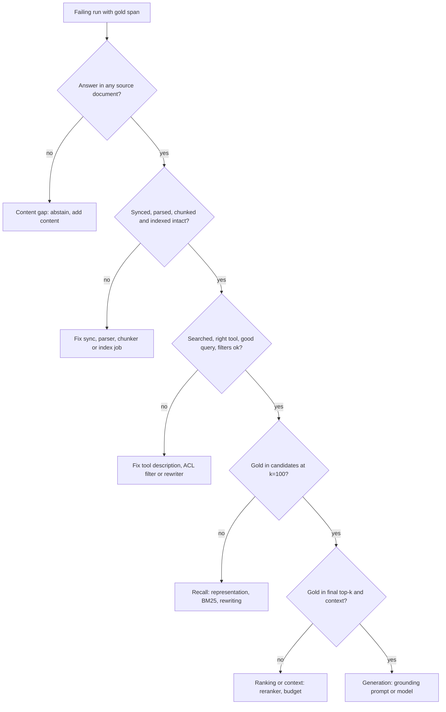

## TL;DR
A wrong agent answer means evidence was lost somewhere: in ingestion, parsing, chunking, indexing,
filtering, the agent's own search calls, ranking, context or generation. Trace the gold evidence to the
*first* stage where it disappears, because only that stage's fix helps.

## For agent builders
- **Why it matters for agents.** In an agent, retrieval is a tool the model chooses to call, with a query
  the model writes. That adds failure stages a fixed pipeline does not have: the agent never searched,
  searched with a query that dropped the key term, picked the wrong index, or stopped after one weak result.
- **Where it shows up in your stack.** Agent traces in tools such as LangSmith, Langfuse, Arize Phoenix or
  OpenTelemetry spans: each `search` tool call with its arguments, the returned chunk IDs and scores, and
  the final prompt. Retrieval evals with gold spans sit beside your end-to-end agent evals.
- **What you control.** What the retrieval tool logs (candidate IDs per retriever, filters, index version),
  how gold is labelled (document plus answer span), and the per-stage regression tests that gate a prompt,
  model or index change.
- **What you can skip.** Fancy attribution tooling. A labelled set of a few dozen failures, complete traces
  and a counting script locate the dominant cause.

## Why it exists
- **A RAG pipeline is a chain of lossy steps**, and the user sees only the end. Stages where evidence can
  vanish: never ingested, parsed or chunked badly, missing from the index, filtered out, ranked too low,
  dropped from the context, or ignored by the model. An agent adds its own search decisions on top.
- **One symptom, many unrelated causes.** "The bot said our refund window is 14 days, it is 30" could mean:
  the PDF was never synced; OCR turned "30" into "3O"; the number landed in a chunk with no mention of
  refunds; an ACL filter excluded it; a blog post outranked it; the reranker ranked it 6th when only the
  top 5 are kept; or the model preferred an older FAQ already in the prompt.
- **Global changes are a coin toss without knowing where evidence was lost.** Swapping the embedding
  model, raising top-k, rewriting the prompt or adding a reranker can even *look* like it worked, because
  the few examples you tried improve while others regress.
  Teams burn weeks re-embedding when the parser was dropping every table.
- **Answer-level metrics cannot locate the loss.** An LLM judge scoring "correct / incorrect" gives the
  failure rate, not its location. Per-stage visibility (where was the right chunk at every step?) turns an
  argument about models into a counting exercise.

## How it works
### Step 1: get failures with known gold evidence
- **Collect failing queries** from evals, thumbs-down feedback or support escalations. For agents, collect
  the whole run, not just the final message.
- **Identify the *gold* source** for each: the document and passage that actually answers it, found by a
  person (or an LLM, spot-checked by a human). Without a gold target you can only guess, so this
  labelling is the expensive but non-negotiable part.
- **A few dozen labelled failures** usually reveal the dominant cause.
- **Label gold as *document plus answer span*** (the sentence or cell that settles the question), not as a
  chunk ID, because chunk IDs are an artifact of the current chunker and change the moment you re-chunk.
  Map the span to whichever chunks contain it at diagnosis time.
- **Track multi-evidence questions per span.** A limit in one section and the exception in another, or two
  documents to compare: the answer fails if *any* span is lost, and each may be lost at a different stage.
  Agents meet these often, because multi-step questions are why you built an agent.

### Step 2: walk the stages in pipeline order
Ask the same questions in the order data flows, and stop at the first "no":

1. **Corpus coverage.** Is the answer in any source document at all? If not, it is a content gap, not a
   retrieval bug, and the right behaviour is abstention.
2. **Ingestion and freshness.** Was the current version synced, or is the index serving a stale or deleted copy?
3. **Parsing.** Does the extracted text contain the answer intact? Check tables, scanned pages, headers,
   multi-column layouts and numbers.
4. **Chunking.** Is the answer inside one chunk with enough context to be found, or split across a
   boundary, or orphaned from its heading?
5. **Indexing.** Can you look up that chunk ID in the vector and keyword indexes? Embedding jobs fail
   silently; a dimension mismatch or a crashed batch leaves holes.
6. **Filtering.** Do metadata, tenant or ACL filters exclude it for this user? Run the query with and
   without filters.
7. **Query transformation.** If the pipeline rewrites, expands, routes or decomposes the query, compare raw
   and transformed queries. Re-run retrieval with the raw query: if gold appears, the loss is here.
   - A rewriter that drops the product code, a router sending a billing question to the HR index, or a
     decomposition that loses the constraint all look like recall failures downstream.
   - **In an agent this stage is the model's tool call.** The query argument, the index or tool chosen,
     and whether it searched at all are all model decisions; see the agent stages below.
8. **Candidate recall.** At a generous depth (say k=100), what rank does gold get from dense search, from
   BM25, and after fusion?
   - **Absent at k=100** is a representation problem: vocabulary mismatch, IDs and codes that embeddings
     blur, or a query that needs rewriting or decomposition.
   - **Look at what *did* rank above it.** A near-duplicate older version or a generic overview page
     outranking the answer needs a different fix (dedup, freshness metadata) from a list of unrelated chunks.
9. **Ranking.** Present at 40 but cut at final top-k 5? That is precision: a reranker, better fusion
   weights or a larger final k.
   - **The asymmetry with step 8:** recall at depth is a property of the representation; ordering within
     the candidates is a property of the scorer. That is why the two numbers point at different components.
10. **Context assembly.** Did it survive token budgeting, deduplication and ordering, or was it truncated or
    buried mid-context? In agents, also check tool-result truncation and history compaction, which can
    drop a passage the agent retrieved several steps earlier.
11. **Generation.** It was in the prompt, near the top, and the model still answered wrong: a grounding,
    prompt or model problem, not retrieval. Separate the sub-cases:
    - **A conflicting passage the model preferred** was also in context (a retrieval-precision problem in disguise).
    - **Parametric knowledge won:** the model ignored the context.
    - **Reasoning failed:** the answer needed arithmetic or combining two passages and the model got it wrong.

### The agent-specific stages
When retrieval is a tool, stage 7 splits into decisions you can read straight from the trace:

| Agent stage | Question | Typical fix |
|---|---|---|
| Tool selection | did it call search at all, or answer from memory? | tool description, a system rule to search before answering policy questions |
| Tool routing | did it call the right index or tool? | clearer tool names and descriptions, fewer overlapping tools |
| Query argument | did the query keep the key terms (codes, names, dates)? | tool description asking for exact identifiers, a hybrid BM25 leg |
| Persistence | did it stop after one weak result or loop on the same query? | step budget, "rephrase once if nothing relevant" instruction, dedup of repeated calls |
| Result use | was gold in a tool result but later truncated or compacted away? | larger result budget, cite-then-compact |

- **Diagnose with the raw question too.** Re-run retrieval with the user's original question: if gold
  appears there but not for the agent's query, the loss is the query argument, not the index.

### Step 3: count, then fix the biggest bucket
- **Tally first-loss stage across failures.** The distribution decides the work, *because* each fix only
  helps its own bucket: a reranker cannot recover a chunk that was never indexed, and re-embedding cannot
  fix a table the parser flattened, and neither helps an agent that never called search.
- **Hold the fix with regression tests.** Turn labelled failures into per-stage assertions
  (`gold in candidates@100`, `gold in context`), plus "search was called" for agent runs.

### What makes this cheap
- **A per-call trace (fields under Production patterns) makes steps 5 to 9 lookups** instead of re-runs.
  Without it, every diagnosis reproduces state that may have changed since.

## Diagram
Walk a labelled failure down the pipeline and stop at the first "no": that stage is its bucket, and the
bucket names the fix. For an agent, the filter-and-rewrite question includes the agent's own tool call.



## Examples
### Agent scenario: first loss across an agent's tool calls
An agent run may call `search` several times. This checks the agent-specific stages first, then hands the
best call to the pipeline-stage check below.

```python
def agent_first_loss(gold_doc: str, gold_span: str, run: dict, retrieve) -> str:
    """run: one agent trace. run['calls'] = [{'tool','args','result_ids','result_docs'}...];
    retrieve(query) -> doc ids for the raw question (re-run at diagnosis time, same index version)."""
    searches = [c for c in run["calls"] if c["tool"].startswith("search")]
    if not searches:
        return "tool selection: agent answered without searching"
    if not any(c["tool"] == run["expected_tool"] for c in searches):
        return f"tool routing: called {[c['tool'] for c in searches]}, expected {run['expected_tool']}"
    hit = [c for c in searches if gold_doc in c["result_docs"]]
    if not hit:
        if gold_doc in retrieve(run["user_question"]):
            qs = [c["args"]["query"] for c in searches]
            return f"query argument: raw question finds gold, agent queries {qs} do not"
        return f"retrieval: gold absent for raw and agent queries after {len(searches)} calls"
    if gold_span not in run["final_prompt"]:
        return "result use: retrieved, then truncated or compacted out of context"
    return "generation: gold was in context, model did not use it"

run = {"user_question": "What is the refund window for plan PRO-7?", "expected_tool": "search_policies",
       "calls": [{"tool": "search_policies", "args": {"query": "refund window"},
                  "result_ids": ["c2"], "result_docs": ["refund-faq"]}],
       "final_prompt": "...Old FAQ: refunds within 14 days..."}
print(agent_first_loss("refund-policy", "within 30 days", run, lambda q: ["refund-policy"]))
# query argument: raw question finds gold, agent queries ['refund window'] do not
```

### First-loss attribution from a logged trace
Finds the first stage where the gold chunk is lost inside one retrieval call.

```python
def first_loss(gold: str, trace: dict, store: dict) -> str:
    """trace: per-request log; store: chunk_id -> {'text':..., 'indexed': bool}."""
    if gold not in store:
        return "parse/chunk: gold passage not in any chunk"
    if not store[gold]["indexed"]:
        return "indexing: chunk exists but has no vector/keyword entry"
    if gold in trace["filtered_out"]:
        return f"filtering: excluded by {trace['filters']}"
    ranks = {name: ids.index(gold) + 1 if gold in ids else None
             for name, ids in trace["candidates"].items()}   # e.g. dense, bm25, fused @100
    if all(r is None for r in ranks.values()):
        return f"recall: absent from all candidate lists {ranks}"
    if gold not in trace["reranked"][: trace["final_k"]]:
        return f"ranking: candidate ranks {ranks}, cut by final_k={trace['final_k']}"
    if gold not in trace["context_ids"]:
        return "context assembly: dropped by token budget or dedup"
    pos = trace["context_ids"].index(gold) + 1
    return f"generation: in context at position {pos}, model did not use it"

trace = {
    "filters": {"tenant": "acme"}, "filtered_out": [],
    "candidates": {"dense": ["c9", "c4", "c7"], "bm25": ["c7", "c2", "c4"]},
    "reranked": ["c9", "c4", "c2", "c7"], "final_k": 3, "context_ids": ["c9", "c4", "c2"],
}
store = {c: {"text": "...", "indexed": True} for c in ["c2", "c4", "c7", "c9"]}
print(first_loss("c7", trace, store))
# ranking: candidate ranks {'dense': 3, 'bm25': 1}, cut by final_k=3
```

### Counting buckets and resolving span-based gold labels
Runnable as is. The tally decides the work; the resolver keeps gold labels valid across re-chunking.

```python
from collections import Counter

first_losses = (["ranking"] * 25 + ["parsing"] * 15 + ["generation"] * 10
                + ["content gap"] * 6 + ["filtering"] * 4)        # 60 labelled failures

tally = Counter(first_losses)
for stage, n in tally.most_common():
    print(f"{stage:<12} {n:>3}  {n / len(first_losses):.0%}")

def resolve_gold(doc_id, span, chunks):
    """Map a gold answer span to whichever current chunks contain it."""
    return [c["id"] for c in chunks if c["doc_id"] == doc_id and span in c["text"]]

chunks = [{"id": "c1", "doc_id": "refund-policy", "text": "Refunds are accepted within 30 days."},
          {"id": "c2", "doc_id": "refund-faq", "text": "Old FAQ: refunds within 14 days."}]
print(resolve_gold("refund-policy", "within 30 days", chunks))   # ['c1']
```

### Worked scenario: what the buckets say
Running attribution across, illustratively, 60 labelled failures of a RAG pipeline:

| First-loss stage | Failures | Share | What it points to |
|---|---|---|---|
| Ranking | 25 | 42% | add or tune the reranker |
| Parsing | 15 | 25% | fix the parser |
| Generation | 10 | 17% | grounding prompt or model |
| Content gap | 6 | 10% | abstain; add content |
| Filtering | 4 | 7% | check ACL and metadata filters |

- **Conclusion:** add or tune the reranker and fix the parser first.
- **The embedding model is not the bottleneck at all**: no bucket is "recall absent at depth".
- **The same team's agent version** (illustrative) could show a different chart: if many failures land in
  "query argument" or "tool selection", the fix is the tool description or a search-first rule, and no
  retrieval change would move them.

## Production patterns
- **Per-call retrieval traces.** On every request (and every search tool call inside an agent run), log
  query, rewritten queries, filters, candidate IDs and scores per retriever, rerank order, final context
  IDs and the index version. For regulated corpora, log IDs and hashes only. Monitor the share of
  requests with a complete trace.
- **Per-stage regression tests in CI.** For every labelled failure, assert `gold in candidates@100`, gold in
  the final top-k, and `gold in context`; for agent runs also assert the expected search tool was called.
  Run them on any chunker, embedding, reranker, tool-description or prompt change, and track which
  assertion breaks, not just pass/fail.
- **Weekly failure triage.** Sample thumbs-down and escalated queries, label gold spans with SMEs, run
  first-loss attribution and publish the bucket chart. Track bucket shares week over week to confirm a
  fix shrank its own bucket.
- **Separate stage metrics on the dashboard.** Report recall@100, recall at final k and gold-in-context rate
  as three numbers, never one blended score, plus search-call rate and searches per run for agents.
  Alert when any drops after a deploy or re-index.
- **Span-based gold labels.** Store gold as `doc_id` plus answer-span text and resolve to chunk IDs at eval
  time by substring match, so a chunking change does not silently zero the eval set. Monitor spans that
  resolve to no chunk: those are parsing or chunking losses.
- **Raw-question replay.** For agent failures, automatically re-run retrieval with the user's original
  question and compare with the agent's tool queries. A high share of "raw finds gold, agent query does
  not" points at the tool description, not the index.

## Trade-offs
- **Labelling gold vs speed.** Labelling every failure is slow but is the only thing that makes stage
  attribution possible. LLM-assisted labelling is faster yet needs spot checks because it shares the
  system's blind spots.
- **Full traces vs storage and privacy.** Traces make diagnosis a lookup, at the cost of storage and of
  logging sensitive text. Flip to logging IDs and hashes only when the corpus contains regulated data.
- **Largest bucket first vs interacting buckets.** Fixing the biggest bucket gives the biggest win, but
  improving parsing creates new chunks that may shift ranking. Re-run attribution after each change
  instead of fixing several at once.
- **Deep-k recall vs eval cost.** Measuring recall at a deep k (100) isolates representation from ranking
  but costs extra queries per eval. It is worth it whenever you are about to choose between an embedding
  change and a reranker.
- **Agent freedom vs diagnosability.** Letting the agent choose whether and how to search handles varied
  questions, but adds tool-selection and query-argument buckets. A fixed retrieve-first step removes those
  buckets when nearly every question needs documents.

## Pitfalls
- **Changing the embedding model first** because it is the most visible component. Symptom: a costly
  re-index that moves aggregate scores by noise while the same queries keep failing. Diagnose: compare
  recall@100 with recall at final k first. Fix: attribute before choosing the component.
- **Treating content gaps as retrieval bugs.** Symptom: tuning that "improves" recall by surfacing loosely
  related chunks, raising confident wrong answers instead of abstentions. Diagnose: confirm a gold span
  exists in the corpus before labelling a failure. Fix: abstain and route the gap to content owners.
- **Diagnosing against today's index for a failure logged last week.** Documents changed in between, so the
  reproduction succeeds and the bug is closed as "cannot reproduce". Fix: logged traces with index version.
- **Reading only the final context and blaming the model.** Symptom: prompt rewrites that do not help.
  Cause: without candidate lists you cannot tell "never retrieved" from "retrieved and cut". Diagnose:
  check gold's rank in each retriever's candidates. Fix: log candidates per retriever.
- **Fixing failures one by one without counting.** Symptom: whack-a-mole where each fix regresses another
  query because nobody saw the distribution. Fix: tally first-loss buckets before any change.
- **Recording gold evidence as chunk IDs.** Symptom: measured recall collapses to near zero right after a
  chunking change while real answer quality is unchanged. Diagnose: count gold labels whose IDs no longer
  exist. Fix: span-based labels.
- **Evaluating the retriever with your questions, not the agent's queries.** Symptom: offline recall looks
  fine while the agent keeps failing, because it searches with short paraphrases that drop identifiers.
  Fix: build retrieval evals from logged agent tool-call queries as well as user questions.

## When to use
- **Use when:** answer quality is below target and the cause is not obvious, before any model or index
  change, and as the standing triage process for production feedback.
- **Use for agents** whenever an agent eval fails on a knowledge question: decide first whether it is an
  agent-decision bucket or a pipeline bucket.
- **Measure:** recall@k at candidate depth, recall at final k, and "gold in context" separately, so each
  stage has its own number.
- **Prerequisite:** if you lack gold labels and traces, the first deliverable is building those, not tuning.

## Exercise
**Goal:** attribute 20 real failures of a small RAG agent to their first-loss stage and prove one fix
moved its own bucket. No solution is given.
- **Inputs:** a corpus of at least 50 documents including one scanned or table-heavy PDF, a `search`
  tool with dense and BM25 legs, and 20 questions the agent gets wrong (seed some: a code the embedding
  blurs, an ACL-filtered document, a question with no answer in the corpus).
- **Deliver:** a trace logger per tool call, span-based gold labels, an attribution script that prints
  one first-loss stage per failure, the bucket table, and one targeted fix.
- **Acceptance:** every failure has exactly one stage, checked by hand on 5; re-running after the fix
  shrinks its bucket while other buckets do not grow by more than one; re-chunking the corpus leaves
  the gold labels resolvable.

## Role lens
- **Engineer:** Instruments the pipeline to log candidate IDs, scores, filters and final context per request,
  and writes the attribution script and per-stage regression tests.
- **Architect:** Requires stage-level observability and gold-labelled eval sets as part of the RAG platform,
  so quality work is driven by measured failure distributions rather than opinion.
- **FDE:** Sits with customer SMEs to label failing questions, then shows them a bucket chart that separates
  "your documents lack this" from "our retrieval missed it", which changes the conversation.

## Check yourself
**Q:** Recall@5 on your eval set is 62%, recall@100 is 91%. A colleague proposes switching to a larger
embedding model. What do you conclude and what do you do instead?
**A:** The gold chunk is in the top 100 for 91% of queries but only reaches the top 5 for 62%, so most
misses are ranking failures, not representation failures. A better embedding might help a little, but the
cheaper and more targeted fix is a cross-encoder reranker over the top 50 to 100, better hybrid fusion, or
a larger final k if the context budget allows. The remaining 9% absent at depth 100 need separate
attribution: parsing, chunking, filtering or vocabulary mismatch, possibly helped by BM25 or query
rewriting. I would also check generation failures among queries where gold was in context, since those
would not move with any retrieval change.

## Interview questions
### What is first-loss attribution and why is it better than an answer-level score?
- **Definition:** for each failing query with known gold evidence, find the first pipeline stage where that
  evidence disappears, then count failures per stage.
- **Why first:** once evidence is lost, every later stage fails as a consequence, so only the first loss has
  a fix that helps; counting later stages double-counts.
- **Why not an answer score:** an LLM judge gives the failure rate, not its location, so it cannot choose
  between a reranker, a parser fix and a prompt change.

### Your agent answers policy questions wrongly, but offline retrieval evals look healthy. How do you find the cause?
- **Read the agent traces, not the retriever metrics:** did it call search at all, the right tool, and with
  what query argument? Offline evals usually use the user's question, not the agent's query.
- **Replay the raw question:** if gold appears for the user's question but not for the agent's query, the
  loss is the query argument; fix the tool description (keep identifiers verbatim) or add a BM25 leg.
- **Check result use:** gold retrieved early but compacted or truncated before the answer is a context
  problem, fixed with a larger result budget or citing before compaction.

### Your RAG bot is wrong on 20% of questions. Walk me through your first week.
- **Build the inputs:** collect failing queries from evals, thumbs-down and escalations, and label gold as
  document plus answer span with SMEs; a few dozen usually reveal the dominant cause.
- **Make it a lookup:** make sure per-request traces log rewritten queries, filters, candidate IDs per
  retriever, rerank order, final context IDs and index version.
- **Attribute and count:** run first-loss attribution, chart the buckets, fix the biggest one, and lock it in
  with per-stage regression tests such as `gold in candidates@100`.

### When would you not reach for a reranker to fix bad answers?
- **When gold is absent at depth:** if recall@100 is low, a reranker has nothing to promote; that is a
  representation, parsing, chunking or filtering problem.
- **When the bucket is generation:** gold was in context near the top and the model still answered wrong,
  so the fix is the grounding prompt, conflict handling or the model.
- **When the bucket is a content gap:** the answer is in no document, so the right behaviour is abstention,
  and "improving" retrieval only surfaces loosely related chunks.
- **When the agent never searched:** a tool-selection failure is fixed in the tool description or a
  search-first rule; no ranking change reaches it.

### What would you put on a retrieval quality dashboard for a production agent, and what numbers would make you act?
- **Three separate stage numbers:** recall@100, recall at final k, and gold-in-context rate, never one
  blended score.
- **Read the gap:** a wide gap between recall@100 and recall at final k points at ranking (reranker, fusion,
  final k); low recall@100 points at representation or an upstream loss; gold in top-k but not in context
  points at token budgeting or dedup.
- **Agent signals:** search-call rate on knowledge questions and searches per run; a drop after a prompt or
  model change means the agent stopped looking.
- **Alert on deltas:** any of these dropping after a deploy or re-index, plus the share of requests with a
  complete trace falling.

## Quiz
### Q: The gold chunk, whose parsed text you have confirmed contains the answer intact, appears at rank 2 in BM25 results and nowhere in dense results, but the answer is still wrong. What do you check next?
- [ ] Re-embed the corpus with a larger embedding model
- [x] Whether it survived fusion, reranking and final top-k into the actual context
- [ ] Whether the document was parsed correctly
- [ ] Whether the LLM temperature is too high
> Parsing is ruled out by the stem, and a BM25 hit at rank 2 shows the chunk is indexed and passes the
> filters. The next stages in order are fusion, reranking and context assembly (a dense miss can still sink
> it in fusion); only if it reached the context does generation become the suspect.

### Q: Why is "first stage where the gold evidence is lost" the right unit of attribution?
- [ ] Because later stages are always more expensive to fix
- [ ] Because only the first stage is observable in logs
- [x] Because once evidence is lost, every later stage fails as a consequence, so only the first loss has a fix that helps
- [ ] Because LLM judges can only evaluate the first stage
> If a chunk was never indexed, the reranker and generator also "fail" on it, but changing them cannot help.
> Attributing to the first loss avoids double counting and points to the one fix that recovers the query.

### Q: A failure cannot be reproduced: today the same query retrieves the right chunk. What is the most likely reason and the fix to the process?
- [ ] The ANN index is nondeterministic; switch to exact search
- [x] The corpus or index changed since the failure; log per-request traces with candidate IDs and index version
- [ ] The user typed the query differently; normalize queries
- [ ] The reranker randomly drops candidates; add a seed
> Documents are synced and re-chunked continuously, so reproducing later tests a different system. Logging
> what was actually retrieved, with the index version, makes diagnosis a lookup on the real state.

## Mastery test
**Problem:** after moving from a fixed pipeline to an agent with three search tools (docs, tickets,
code), accuracy on knowledge questions drops from 81% to 70%. Offline recall@100 on user questions is
unchanged at 90%. Searches per run fell from 1.0 to 0.6. Where do you look, and in what order?

**A strong answer:**
- reads the unchanged recall and the fall in searches as a sign the loss is in agent decisions, not the
  index, and checks tool selection first (runs that answered without searching);
- then checks tool routing across the three overlapping tools and replays the raw question against the
  agent's query arguments;
- counts first-loss buckets on labelled failures before fixing, and proposes tool-description changes or
  a search-first rule, guarded by per-stage tests including "expected search tool was called".

## Use cases & projects
### Use cases
- **Triage of thumbs-down agent answers.** Each bad answer is traced to the first stage that lost the
  gold evidence, so the fix goes to parsing, indexing, the search query or the prompt, not to a guess.
- **Gating index, model or prompt changes.** Per-stage regression tests show whether a change moved
  recall at retrieval, at reranking or only at generation.
- **Diagnosing agent search behaviour.** Traces reveal runs where the agent never called search, wrote a
  query that dropped the key term, or stopped after one weak result.
- **Weekly failure reviews.** A labelled set of a few dozen failures and a counting script tell the team
  which stage to invest in next.

### Mini project
**Build a first-lost-stage report for an agent's failures (2-3 hours).**
- **Goal:** for 20 failing agent questions, name the first stage where the gold evidence disappeared.
- **Steps:** take a small RAG agent with a `search` tool; log each tool call's arguments, returned chunk
  IDs, scores and index version; label each failing question with its gold document and answer span;
  write a script that checks, in order, whether the gold was ingested, chunked intact, retrievable by
  the agent's actual query, ranked into the kept set, present in the final prompt and used in the answer.
- **Done when:** you have a table of 20 failures with one first-lost stage each, a count per stage, and
  one targeted fix whose re-run moves at least some failures out of the top stage.
