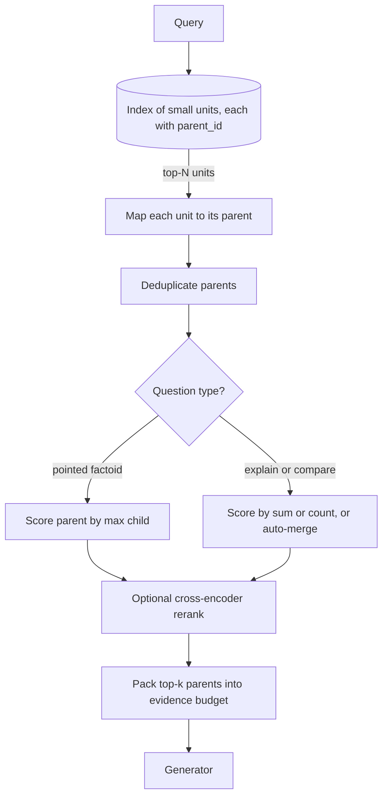

## TL;DR
Granularity is the size of the retrieved unit, from sentence to document. Small units match sharply but
starve the generator; large units carry context but blur vectors. Resolve it by matching on small units
and returning their parent, measured per question type.

## Why it exists
- **It is a different question from chunking.** Chunking decides how a document is cut; granularity
  decides which cut is the unit of retrieval, scoring and return.
- **Matching favours small units.** A vector is a fixed-size summary of its input. A sentence's vector
  says one thing and matches that question sharply; a section's vector says ten things and may lose to a
  shorter chunk that mentions the topic in passing.
- **Generation favours large units.** "The cap is 12 months of fees" is useless without the clause that
  says which cap, under which contract, with which exceptions; alone it produces confident, wrong
  answers. A whole document wastes the budget, and long contexts make models worse at using facts buried
  in the middle.
- **One compromise size is mediocre at both jobs.** Nothing forces the match unit and the return unit to
  be the same object. Match on sentences, return sections, and the compromise disappears; what remains
  is how units point to their parents.

## How it works
### The ladder of units
| Unit (fine to coarse) | What it is |
|---|---|
| **Propositions** | atomic factual statements, often rewritten by an LLM so each stands alone |
| **Sentences** | one sentence |
| **Windows** | a sentence plus a few neighbours |
| **Passages or chunks** | a few hundred tokens |
| **Sections** | heading-delimited |
| **Documents** | the whole file |
| **Document summaries** | a generated digest per document |

- Each level can be the match unit, the return unit, or both.
- Finer sharpens matching and raises the number of vectors (cost, index size); coarser does the reverse.

### Decoupling match from return
Index the small unit with a pointer to its parent: `{unit_id, text, parent_id, position}`. At query time:
1. Retrieve the top-N small units.
2. Map each to its parent.
3. Deduplicate parents (several sentences from one section are one hit).
4. Score each parent by its best child, or by a sum that rewards sections with several matching sentences.
5. Return the top-k parents to the generator.

This works *because* sentence vectors stay sharp for matching while the generator gets the section that
makes the sentence interpretable. It is the mechanism behind sentence-window retrieval, parent-document
retrieval and auto-merging retrievers in common frameworks.

### Variants
- **Sentence window:** match a sentence, return it plus `w` neighbours on each side. Cheap and local;
  good for factoids whose answer lives within a few sentences.
- **Parent chunk:** match small chunks (say 128 tokens), return the enclosing larger chunk (say 1,024
  tokens) or section. The standard small-to-big setup.
- **Auto-merging:** if enough children of one parent are retrieved, replace them with the parent;
  otherwise keep the children. Adapts the returned size to how concentrated the evidence is.
- **Summary-then-chunk:** match per-document summaries to pick documents, then chunks within them. A
  two-level index that scales to large corpora where many documents share vocabulary.
- **Proposition retrieval:** rewrite text into self-contained statements before embedding, so each unit
  carries its subject and no dangling references. Chen et al., 2023 report question-answering gains, at
  the cost of an LLM pass over the whole corpus at indexing time.
- **Multi-vector (late interaction):** the finest match unit is the token. ColBERT-style models keep one
  vector per token and score a passage by summing, over query tokens, each one's best match among
  passage tokens. The return unit stays the passage: decoupling at its limit, because matching sees fine
  detail without a separate parent lookup, paid for with one vector per token instead of one per chunk.

### Making the small unit self-sufficient
- **"The cap is twelve months of fees" embeds well only if the vector knows *which* cap.**
- Carry context into the embedded text: the heading path, the document title, or a short generated
  description of where the span sits (contextual retrieval).
- **The finer the match unit, the more it depends on this**, because a sentence has less of its own
  context to lean on than a 500-token passage.

### Scoring parents
| Scoring | Favours | Question type |
|---|---|---|
| Max child | one strongly matching sentence | "what is the default timeout" |
| Sum or count | topic discussed at length | "explain the retry policy" |

Many systems retrieve more parents than needed and let a cross-encoder reranker, which reads query and
parent text together, settle the order.

### Interaction with the context budget
- **A budget of, say, 4,000 tokens of evidence** fits forty 100-token sentence windows, eight 500-token
  passages or two 2,000-token sections.
- **Usage degrades** as the prompt grows and as relevant facts move away from the beginning and end.
- **So fewer, larger, well-chosen parents** usually beat filling the budget with small fragments.
  Granularity is also a lever on lost-in-the-middle effects.

## Diagram
Follow the small-to-big path: small units are matched, mapped to parents, deduplicated and scored, and
only bounded parents reach the generator's evidence budget.



## Examples
### Small-to-big: match sentences, return sections
Sentence-level matching and section-level return with a local embedding model. Each sentence carries a
`parent` pointer; parents are deduplicated and scored by their best sentence.

```python
import re, numpy as np
from sentence_transformers import SentenceTransformer

sections = {
    "billing/caps": "Fees are capped per contract year. The cap is twelve months of fees. "
                    "Caps exclude taxes and third-party pass-through costs.",
    "billing/invoicing": "Invoices are issued monthly. Payment is due within thirty days. "
                         "Late payments accrue interest at the statutory rate.",
    "support/hours": "Support operates on weekdays. Enterprise plans include weekend coverage.",
}
model = SentenceTransformer("BAAI/bge-small-en-v1.5")

units, parent = [], []
for sid, text in sections.items():
    for sent in re.split(r"(?<=[.!?])\s+", text.strip()):
        units.append(sent); parent.append(sid)
E = model.encode(units, normalize_embeddings=True)          # one vector per sentence

def retrieve(query: str, k_units: int = 6, k_parents: int = 2):
    q = model.encode([query], normalize_embeddings=True)[0]
    scores = E @ q                                             # cosine on unit vectors
    best = {}
    for i in np.argsort(-scores)[:k_units]:                   # match small ...
        p = parent[i]
        best[p] = max(best.get(p, -1.0), float(scores[i]))     # ... dedupe and score parents by max child
    ranked = sorted(best.items(), key=lambda kv: -kv[1])[:k_parents]
    return [(p, round(s, 3), sections[p]) for p, s in ranked]  # ... return big

for hit in retrieve("how much can fees be capped at?"):
    print(hit)
# Expect "billing/caps" first: the sentence about twelve months matches sharply, and the generator
# receives the whole section, including the exclusions it needs to answer correctly.
```

### Auto-merging in a few lines
Return the parent when evidence is concentrated, the children when it is scattered. Pure Python.

```python
def auto_merge(child_hits, children_of, ratio=0.5):
    """Replace a parent's retrieved children with the parent when enough of them matched."""
    out = {}
    for pid, kids in children_of.items():
        hit = [c for c in kids if c in child_hits]
        if not hit:
            continue
        if len(hit) / len(kids) >= ratio:                     # evidence concentrated: return parent
            out[pid] = max(child_hits[c] for c in hit)
        else:                                                 # scattered: keep the small units
            out.update({c: child_hits[c] for c in hit})
    return sorted(out.items(), key=lambda kv: -kv[1])

children_of = {"retry-policy": ["r1", "r2", "r3", "r4"], "timeouts": ["t1", "t2", "t3", "t4"]}
child_hits = {"r1": 0.71, "r2": 0.74, "r3": 0.69, "t2": 0.66}
print(auto_merge(child_hits, children_of))
# [('retry-policy', 0.74), ('t2', 0.66)]: 3 of 4 retry children matched, so return the section
```

### Worked scenario: spending a 4,000-token evidence budget
| Return unit | Units that fit | Typical outcome |
|---|---|---|
| 100-token sentence windows | 40 | sharp but fragmented; "explain" questions never add up |
| 500-token passages | 8 | balanced default for mixed question types |
| 2,000-token sections | 2 | full context; one wrong parent wastes half the budget |

- **Applied to a legal-search case (illustrative):** on 1,024-token chunks the clause holding the
  liability cap ranks fourth, behind chunks about liability in general.
- **The expected fix:** sentence matching with clause-level return sharpens the match on the cap, while
  prompts stay bounded because parents are clauses, not whole contracts. Confirm the gain with
  parent-level recall@k on a golden set rather than assuming it.

## Production patterns
- **Parent-document retriever** — when pointed questions rank diluted chunks above the precise one, use
  LangChain's `ParentDocumentRetriever` with a small `child_splitter` and a larger `parent_splitter`
  (children in the vector store, parents in a docstore). Monitor parent-level recall@k and prompt tokens.
- **Sentence window with metadata replacement** — for factoid-heavy corpora, LlamaIndex's
  `SentenceWindowNodeParser` stores neighbours in metadata and `MetadataReplacementPostProcessor` swaps
  them in after retrieval. Monitor answers that miss a qualifier from just outside the window.
- **Over-retrieve parents, then rerank** — fetch more parents than you will send (for example 20 for a
  final 5) and let a cross-encoder order them. Monitor reranker latency p95 and the rank of the gold
  parent before and after reranking.
- **Hard evidence budget** — pack parents in rank order until a fixed evidence token cap, truncating or
  dropping the rest rather than growing the prompt. Monitor prompt tokens p95 and truncation rate.
- **Granularity per question type** — route factoid queries to max-child scoring and explanatory or
  comparison queries to sum scoring or auto-merging. Monitor eval scores split by query type, not one
  blended number.

## Trade-offs
- **Fine match units vs vector count.** A sentence index holds roughly (passage length / sentence
  length) times as many vectors as a passage index, often an order of magnitude more for few-hundred-
  token passages, which matters at tens of millions of units.
- **Large return units vs budget and position.** They give context but spend the budget faster and push
  facts toward the middle of the prompt, where models use them least reliably; the flip point is your
  context budget.
- **Max-child vs sum scoring.** Max is simple and good for pointed factual questions; sum rewards depth
  and suits explanatory ones. Choose per query type or let a reranker decide.
- **Propositions vs indexing cost.** Self-contained units brought reported retrieval and QA gains
  (largest for retrievers not trained on the target domain), but cost an LLM pass over the corpus at
  indexing time and on every update; not worth it on large, fast-changing corpora.
- **Summary-then-chunk scale vs unrecoverable misses.** It scales on large corpora with repeated
  vocabulary, but if the first stage picks the wrong document, the second stage cannot recover.

## Pitfalls
- **Returning the matched sentence alone.** Answers quote a fact correctly but attach it to the wrong
  entity or ignore an exception stated in the next sentence.
- **Not deduplicating parents.** The top-k is three sentences from one section; one source dominates
  every answer and other relevant sections never appear.
- **One size for matching and returning.** Tuning it endlessly gives a recall-versus-answer-quality
  seesaw that no single value settles.
- **Parents so large that two fill the context.** Prompts get long, generations slow and costly, and
  facts in the middle of the prompt are ignored.
- **Fixed granularity across question types.** Factoid queries do well while "explain" or "compare"
  queries get fragments that never add up to a complete picture.

## When to use
- **Decouple when:** you see precision problems (large chunks scoring middling for pointed questions) or
  context problems (small chunks producing answers that lack qualifiers).
- **Start with:** sentence- or small-chunk matching, section-level return, parent dedupe and max-child
  scoring; move to auto-merging or sum scoring when explanatory queries dominate.
- **Keep whole-document retrieval:** for short documents such as FAQs or tickets, where the document is
  already the right unit.
- **Measure:** parent-level recall@k, answer faithfulness and prompt token usage together, because
  granularity moves all three.
- **Interviews:** answer "what chunk size should we use" with "which size for matching and which for
  returning, and why they need not be equal".

## Role lens
- **Engineer:** Stores parent pointers on every unit, implements parent dedupe and scoring in the
  retriever, and tracks parent-level recall rather than chunk-level recall in the eval harness.
- **Architect:** Decides the index hierarchy (units, parents, summaries) and its storage cost, and sets
  the evidence token budget that bounds how large returned units may be.
- **FDE:** Maps a customer's question mix (factoid versus explanatory) to a granularity choice and
  shows side-by-side answers from fragment-only and parent-return setups to make the case.

## Check yourself
**Q:** A legal-search product indexes 1,024-token chunks. Users report that pointed questions ("what is
the liability cap?") return chunks that discuss liability generally, while the clause with the number
ranks fourth. How would you restructure retrieval, and what would you watch for?
**A:** The 1,024-token vectors are diluted: a chunk about liability in general matches the query about
as well as the chunk holding the specific cap. I would index at sentence or small-chunk level, keep a
pointer from each unit to its enclosing clause or section, retrieve the top units, deduplicate by
parent and score parents by their best child, then return the parent clause so the generator sees the
cap together with its exceptions. I would watch three things: index size, which grows with finer
units; parent-level recall@k on a golden set of clause questions, which should rise; and prompt length,
which should not balloon because parents are bounded clauses rather than whole contracts. If
explanatory queries regress, I would add sum-based parent scoring or a reranker over the parents.

## Interview questions
### How is retrieval granularity different from chunking?
- **Chunking** decides how a document is cut into pieces.
- **Granularity** decides which unit is matched, scored and returned, and the match unit and return unit
  need not be the same object.
- **Why it matters:** small vectors match sharply, large units give the generator context, so separating
  the two removes the compromise size.

### Design small-to-big retrieval for a product manual. What do you store and what happens at query time?
- **Store** small units (sentences or about 128-token chunks) with `{unit_id, text, parent_id, position}`,
  and parents (sections or larger chunks) in a docstore.
- **Query:** retrieve top-N units, map to parents, deduplicate, score by best child, return the top-k
  parents.
- **Make units self-sufficient** by embedding the heading path or title with each small unit.

### When would you not use sentence-level matching?
- **Short documents** such as FAQs or tickets are already the right unit, so whole-document retrieval is
  simpler.
- **Very large corpora:** a sentence index can hold an order of magnitude more vectors than a passage
  index, which costs storage and latency at tens of millions of units.
- **Explanatory-heavy traffic** may be better served by passage units with sum scoring or auto-merging.

### You have a 4,000-token evidence budget. How do you decide what to send?
- **Do the arithmetic:** forty 100-token windows, eight 500-token passages or two 2,000-token sections.
- **Prefer fewer, well-chosen parents,** because usage degrades as prompts grow and facts drift to the
  middle.
- **Over-retrieve and rerank,** then pack in rank order until the cap, and monitor truncation rate and
  prompt tokens p95.

### Answers quote the right number but miss an exception stated in the next sentence. What is wrong?
- **The return unit is too small:** the retriever is sending the matched sentence alone.
- **Fix:** return a sentence window or the parent clause, so the qualifier travels with the fact.
- **Verify** with faithfulness checks on a golden set of questions whose answers carry exceptions.

## Quiz
### Q: Why does indexing small units and returning larger parents outperform a single compromise chunk size?
- [ ] Because small units are cheaper to embed, which frees budget for a bigger model
- [x] Because sharp small-unit vectors improve matching while the returned parent restores the context the generator needs
- [ ] Because vector databases search faster over shorter texts
- [ ] Because larger parents always contain the answer to any question about the document
> Matching and generation want different sizes. Decoupling lets each get its ideal: precise matching on
> focused vectors, and complete context from the parent. Search speed depends on vector count and
> dimension, not text length, and parents do not guarantee answers.

### Q: Several sentences from the same section rank in the top-N. What should the retriever do before returning results?
- [ ] Return each sentence as a separate result so the generator sees all of them
- [ ] Discard all but the lowest-scoring one to reduce bias
- [x] Collapse them into one parent hit, scored by the best (or combined) child score
- [ ] Re-embed the section and search again with the new vector
> Parent deduplication turns several child matches into a single section result, freeing top-k slots
> for other sections and letting the generator read the section once. Re-embedding at query time adds
> cost without changing the outcome.

### Q: Which question type most benefits from sum- or count-based parent scoring rather than max-child scoring?
- [ ] "What is the default connection timeout?"
- [x] "Explain how the retry policy works across services"
- [ ] "Which page mentions the product's launch date?"
- [ ] "Is the API key rotated automatically?"
> Explanatory questions are answered by sections that discuss the topic at length, which several
> matching children indicate. Pointed factual questions want the single best sentence, where max-child
> scoring is the right signal.
