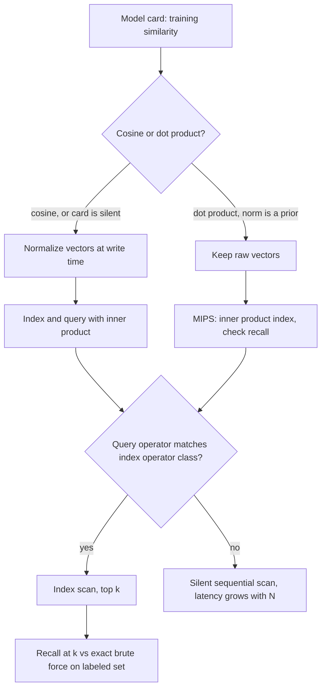

## TL;DR
Every time an agent calls its search tool or recalls memory, a query vector is scored against stored
vectors and the top k come back. Use the similarity the embedding model was trained with; the wrong one
silently feeds the agent worse context.

## For agent builders
- **Why it matters for agents.** The retrieval tool is how an agent sees your documents and its own
  long-term memory. A metric mismatch raises no error: the agent just gets plausible but worse chunks,
  then reasons confidently from them, so the failure shows up as wrong answers, not exceptions.
- **Where it shows up in your stack.** The distance setting of your vector store (pgvector operators,
  FAISS index type, the metric chosen when you create a collection), `vectorstore.as_retriever()` in
  LangChain, `similarity_top_k` in LlamaIndex, and the retriever node or tool inside a LangGraph agent.
- **What you control.** Normalization at write time, the operator class of the index, top k, and any
  score threshold the tool uses to decide "no good results, tell the agent to re-query".
- **What you can skip.** The MIPS-to-L2 reduction proof. Know that unnormalized inner product navigates
  indexes worse; that is enough to make the right call.

## Why it exists
- **Lexical search misses meaning.** It answers "which documents contain these words", so it cannot see
  that "cancel my subscription" and "stop billing me" ask for the same thing. Embedding models map text
  to vectors so that similar meanings land near each other, which is what an agent's free-form tool
  queries need.
- **"Near" is not a given.** A vector is just an array of floats. Retrieval needs a scalar score per
  candidate that (a) is cheap enough to evaluate millions of times per query and (b) agrees with what the
  model learned.
- **Euclidean on raw outputs fails (b).** Embedding models are trained contrastively: the query is pulled
  toward its positive passage and pushed from in-batch negatives, with the loss on one similarity, most
  often cosine scaled by a temperature, sometimes a plain dot product.
- **Magnitudes are leftovers.** The model never sees Euclidean distance, so vector lengths are whatever
  the optimizer left behind. Raw distances mix a signal the model learned (angle) with one it did not
  (length).
- **Two halves to master.** The algebra relating the three scores tells you when the choice does not
  matter; the rule "score must match the training objective" tells you what to do when it does.

## How it works
### The three scores and how they relate
For query **q** and document **d** in ℝᵈ:

```
dot(q, d)   = Σᵢ qᵢ·dᵢ
cos(q, d)   = dot(q, d) / (‖q‖·‖d‖)
‖q − d‖²    = ‖q‖² + ‖d‖² − 2·dot(q, d)
```

| Vectors | Dot product | Cosine | Euclidean (L2) |
|---|---|---|---|
| Unit length | `cos = dot` exactly | same ranking | `‖q − d‖² = 2 − 2·cos`, same ranking |
| Lengths vary | prefers long vectors regardless of direction | ignores length entirely | penalizes both angle and length mismatch |

- On unit vectors all three give the identical ranking; only sign and scale differ.
- The whole metric debate is about what to do with ‖d‖.

### Why normalize at index time
- **Cheap, once.** One division per vector, done when the vector is written by your ingestion job or
  your agent's memory-write step.
- **Cheapest score, cosine result.** A dot product (d multiplies and adds, no square root) then returns
  the cosine ranking, and any index built for inner product or L2 gives cosine results too.
- **Engines do not detect it for you.** pgvector's docs recommend the inner-product operator when vectors
  are already unit length, because choosing inner product skips the per-candidate norm work.
- **Many pipelines already do it.** Most normalize before writing, and several API providers return
  unit-length vectors already; check the model card rather than assuming.

### When magnitude carries meaning
- **Dot-product-trained retrievers** (DPR is the classic example) can give "generally useful" passages a
  larger norm, a built-in prior. Normalizing their document vectors throws that prior away.
- **The query norm never changes the ranking** for a single query; it only rescales that query's scores.
- **Cosine-trained models** have no incentive to keep norms meaningful, so dot product on raw outputs adds
  noise.
- **The rule:** use the similarity the model card names. If it is silent, normalize and use cosine; it is
  the choice that cannot be badly wrong.

### Inner product is not a distance, and indexes notice
- **L2 is a proper metric.** A vector is its own nearest neighbor and the triangle inequality holds, so
  "close to close is close".
- **Cosine distance (1 − cos) is not a metric**, but on unit vectors it is a monotone function of L2, so
  it ranks and navigates like one.
- **Raw inner product has neither property.** A vector's best match is any longer vector pointing roughly
  the same way, and two documents that both score highly against a query need not score highly against
  each other.
- **This is MIPS** (maximum inner product search). Graph and cluster indexes assume neighbors of neighbors
  are good candidates; with widely varying norms that weakens and recall at a given search effort can drop.

The standard reduction from MIPS to L2 search (libraries also accept inner product directly):
1. Let M be the largest document norm.
2. Append the coordinate √(M² − ‖d‖²) to every document and 0 to the query.
3. Every augmented document now has norm M and the query's dot product is unchanged.
4. Nearest-neighbor search by L2 on the augmented vectors returns exactly the MIPS ranking.

If your vectors are normalized, none of this applies, which is one more reason normalization is the default.

### How the computation runs
- **Exact search is a matrix–vector product.** Stack N document vectors into D (N × d) and compute `D·q`:
  N·d multiply-adds.
- **The bound is memory bandwidth**, because every byte of D is read once per query. One million
  1024-dimensional fp32 vectors is 4 GB.
- **Illustrative orders of magnitude:** a single CPU core streams that in hundreds of milliseconds; a GPU
  with roughly a terabyte per second of bandwidth does it in a few milliseconds.
- **Batching amortizes the read.** A matrix–matrix product (D·Qᵀ) reads D once for many queries, which is
  why offline evaluation is cheap while online single-query latency is not. An agent's tool calls arrive
  one at a time, so they pay the single-query cost.
- **Top-k needs no full sort.** A heap or partial selection (`np.argpartition`) is O(N), so the scan, not
  the selection, dominates.
- **Past a few million vectors** you stop scanning and build an approximate index (see ANN indexes),
  trading a little recall for sublinear search.

### Scores are not probabilities
- **Narrow, model-specific band.** Cosine lies in [−1, 1], but almost all query–document pairs for a given
  text embedding model land in a narrow band whose location depends on the model.
- **Unrelated pairs are rarely near zero**, because embedding spaces are anisotropic: everything points
  roughly the same way.
- **0.78 means nothing alone.** A score needs a calibration set from the same model and the same kind of
  pairs. Thresholds must be measured, not copied, and are invalid the moment the model changes.
- **Agent consequence.** A tool that says "no relevant results" below a fixed cutoff will either always
  or never fire after an embedding upgrade, which changes how often the agent re-queries or gives up.

### Operators in real systems
| System | L2 | Cosine | Inner product |
|---|---|---|---|
| pgvector | `<->` (L2 distance) | `<=>` (cosine distance, 1 − cos) | `<#>` (negative inner product) |
| FAISS | `IndexFlatL2` | normalize, then `IndexFlatIP` | `IndexFlatIP` |

- pgvector negates inner product so that `ORDER BY ... ASC` works for all three.
- An index is built for exactly one operator class. A query using a different operator cannot use the
  index; the database silently falls back to a full scan.
- **Framework wrappers hide this.** A LangChain or LlamaIndex vector store picks a distance when the
  collection is created; read which one it chose instead of assuming it matches the model card.

## Diagram
Follow the decision from the model card to the operator: the metric is fixed by training, and the index
must be built for the same operator the agent's search tool queries with, or the engine falls back to a
full scan.



## Examples
### Agent search tool with a calibrated threshold
The tool the agent calls: normalized vectors, inner product, and a cutoff measured on labeled pairs for
this model version. Below the cutoff it tells the agent explicitly, so the agent can rephrase instead of
reasoning from weak chunks.

```python
import numpy as np

MODEL_VERSION = "embed-v3"            # stored with the collection and the threshold
THRESHOLD = {"embed-v3": 0.41}        # calibrated on labeled pairs, never copied from a blog

def normalize(x):
    return x / np.linalg.norm(x, axis=-1, keepdims=True)

class SearchDocsTool:
    def __init__(self, embed, chunks, vectors):
        self.embed, self.chunks = embed, chunks
        self.D = normalize(vectors.astype(np.float32))   # normalize once at write time

    def __call__(self, query: str, k: int = 5) -> dict:
        q = normalize(self.embed(query))
        scores = self.D @ q                              # dot on unit vectors == cosine
        top = np.argpartition(-scores, k)[:k]
        top = top[np.argsort(-scores[top])]
        hits = [{"text": self.chunks[i], "score": float(scores[i])}
                for i in top if scores[i] >= THRESHOLD[MODEL_VERSION]]
        if not hits:                                    # explicit signal for the agent loop
            return {"results": [], "note": "No relevant passages. Try different terms."}
        return {"results": hits}
```

### Magnitude bias, and how normalization removes it
Random vectors stand in for embeddings; 5% of the corpus gets a three-times-larger norm, the way a
dot-product-trained model might inflate "important" passages. The dot-product top-k fills with those
rows, cosine ignores length, and after normalizing at index time the cheap dot product reproduces the
cosine ranking exactly.

```python
import numpy as np
rng = np.random.default_rng(0)
N, d = 100_000, 768
D = rng.standard_normal((N, d)).astype(np.float32)
D[:5000] *= 3.0                               # 5% of the corpus has a 3x larger norm
q = rng.standard_normal(d).astype(np.float32)

def topk(scores, k=5):
    return np.argsort(-scores)[:k]

dot = D @ q                                   # N*d multiply-adds, one pass over D
cos = dot / (np.linalg.norm(D, axis=1) * np.linalg.norm(q))
l2  = np.linalg.norm(D - q, axis=1)

print("dot    :", topk(dot))                  # expect ids < 5000: length wins
print("cosine :", topk(cos))                  # angle only; ids spread over the corpus
print("l2     :", topk(-l2))                  # smaller is better; ids >= 5000: long rows penalized

# Normalize once at write time; the cheap dot product now equals cosine.
Dn = D / np.linalg.norm(D, axis=1, keepdims=True)
qn = q / np.linalg.norm(q)
print("dot on unit vectors == cosine ranking:", np.array_equal(topk(Dn @ qn), topk(cos)))
print("l2 on unit vectors  == cosine ranking:",
      np.array_equal(topk(-np.linalg.norm(Dn - qn, axis=1)), topk(cos)))
```

### Production snippet: pgvector with a matching operator class
Vectors are normalized before insert, so the inner-product operator returns the cosine ranking and the
index and query use the same operator class. This is the SQL behind a typical agent retrieval tool.

```sql
CREATE TABLE chunks (id bigserial PRIMARY KEY, body text, embedding vector(1024));
-- vectors written unit-length, so inner product == cosine ranking
CREATE INDEX ON chunks USING hnsw (embedding vector_ip_ops);

-- <#> returns the NEGATIVE inner product, so ascending order = most similar first
SELECT id, body, -(embedding <#> $1) AS score
FROM chunks
ORDER BY embedding <#> $1
LIMIT 10;

-- Check the plan: an index scan on chunks_embedding_idx, not "Seq Scan on chunks"
EXPLAIN SELECT id FROM chunks ORDER BY embedding <#> $1 LIMIT 10;
```

### Worked scenario: can brute force meet an agent's latency budget?
Exact scan cost is bytes read per query, N × d × bytes per element (1M vectors, d = 1024).

| Precision | Bytes per vector | Corpus size | Read per query |
|---|---|---|---|
| fp32 | 4,096 | 4 GB | all 4 GB |
| fp16 | 2,048 | 2 GB | half the bandwidth |
| int8 | 1,024 | 1 GB | a quarter of the bandwidth |

- **Single query.** At roughly a terabyte per second (GPU), fp32 takes about 4 ms per query; a single CPU
  core at an illustrative ~10 GB/s takes ~400 ms.
- **Agent multiplier.** An agent that searches 4 times per task on that CPU spends ~1.6 s in retrieval
  alone (illustrative), before any LLM call.
- **Decision.** If the budget is 50 ms per search on CPU, quantize, batch queries, or move to an ANN
  index; the scan, not the top-k selection, is what you are paying for.

## Production patterns
- **Normalize at write, use inner product.** When the model card says cosine, encode with
  `normalize_embeddings=True` (sentence-transformers) or divide by the norm yourself, then index with
  `vector_ip_ops` in pgvector or `IndexFlatIP` in FAISS. Apply the same rule to agent memory writes.
  Monitor a sample of stored norms in the ingestion job; alert if any drifts from 1.0.
- **Gate the query plan in CI.** Run `EXPLAIN` on the exact SQL your ORM or framework retriever emits
  and fail the build if it shows a sequential scan on the vector table. Monitor p95 tool-call latency
  against row count; linear growth means the index is not used.
- **Keep an exact reference.** Hold a labeled query set (real agent tool queries pulled from traces in
  LangSmith or your own logs) and compute recall@k of the production path against a brute-force scan
  whenever the model, metric or precision changes. Monitor recall@10 per release.
- **One collection per embedding version.** Store the model name and version with the collection;
  re-embed into a new collection and switch the agent's tool only after the recall check passes. Monitor
  that no collection contains rows from two model versions.
- **Calibrate thresholds per model.** If the tool filters on score, pick the cutoff from labeled pairs
  at a target precision for this model version and store it next to the version. Monitor the share of
  tool calls that return zero results, and the agent's re-query rate, after each model upgrade.

## Trade-offs
- **Dot product: cheapest and keeps the magnitude prior.** It flips to harmful the moment the model was
  cosine-trained, because then norms are noise and long vectors win for no reason.
- **Cosine: scale-invariant.** Verbose and terse passages compete on direction alone. The cost is a
  normalization pass and the loss of any information the model encoded in vector length.
- **Exact brute force: perfect recall, zero index maintenance.** It stops being viable when N·d·bytes can
  no longer be streamed within your latency budget, typically somewhere in the low millions of vectors
  on CPU. Small per-user agent memories often stay below that forever.
- **fp16 or int8 storage: half or a quarter of the bandwidth.** The ranking cost is small, until you
  threshold scores, because near-ties at the cutoff move first.
- **Threshold in the tool vs always return k.** A cutoff stops the agent reasoning from junk, but a
  miscalibrated one makes it give up or loop on re-queries; always returning k leaves the judgment to
  the model and costs context tokens.

## Pitfalls
- **Index and query operators disagree.** The index uses `vector_cosine_ops`, the query uses `<->`.
  Symptom: query time grows linearly with corpus size and `EXPLAIN` shows a sequential scan. Fix: query
  with the matching operator or build a matching index.
- **L2 or dot product on raw outputs of a cosine-trained model.** Symptom: rankings disagree with the
  vendor's playground for the same query, usually favoring long passages. Fix: normalize.
- **Copying a similarity threshold** (say 0.8) from a blog post or a previous model. Symptom: after an
  embedding upgrade everything or nothing passes, because the score distribution shifted, and the agent
  suddenly reports "nothing found" on every task. Fix: recalibrate.
- **Treating score as confidence across queries.** A 0.72 for one query and a 0.72 for another say
  nothing comparable, so "answer only if score > t" needs per-model calibration on labeled pairs.
- **Mixing two embedding models or versions in one collection.** Symptom: documents indexed after the
  switch are never retrieved (or only they are), since the two spaces are unrelated. Agent memories
  written before an upgrade vanish the same way. Fix: re-embed.

## When to use
Every dense retrieval step in an agent makes this choice, usually implicitly inside a framework default.
- **Decide at collection creation:** read the model card, pick its similarity, normalize at write time
  unless the model relies on magnitude, and create the index with the matching operator class.
- **Measure:** recall@k against an exact brute-force scan on a labeled set of real agent queries whenever
  you change the model, the metric or the precision, because a wrong metric degrades quality without
  raising an error.
- **Use brute force when** the corpus is small (per-user memory, a single customer's documents) or you
  need an exact reference; move to an approximate index when latency or memory forces it.
- **Interviews:** derive the relationship between the three scores and explain why a cosine-trained model
  should not be queried with dot product on raw vectors.

## Role lens
- **Engineer:** Chooses `normalize_embeddings=True` and the matching operator class, writes the
  brute-force recall check, and catches the metric mismatch in `EXPLAIN` output before it reaches
  production.
- **Architect:** Owns the embedding contract: one model, one metric, one normalization rule per
  collection, versioned so a model change triggers re-indexing instead of a silently mixed space.
- **FDE:** Diagnoses "search got worse after we moved to Postgres" at a customer by checking which
  operator the ORM emits against which index exists, often a five-minute fix.

## Check yourself
**Q:** A customer's pgvector table has an HNSW index created with `vector_cosine_ops`, but their ORM
generates queries with the `<->` operator. Latency rose from 20 ms to 2 s as the table grew to five
million rows. Explain what is happening, how to fix it, and whether the fix will change the results users
see.
**A:** The index is built for cosine distance but the query asks for L2 distance, so the planner cannot
use it and falls back to a sequential scan over all five million vectors; that is why latency scales with
table size. The fix is either to query with `<=>` or to build a second index with `vector_l2_ops`.
Whether results change depends on normalization: if the stored vectors and the query are unit length, L2
and cosine produce the same ordering, so switching operators changes only speed. If they are not
normalized, the L2 ranking was mixing magnitude into the score, and moving to cosine will change rankings,
probably for the better if the model was cosine-trained. A strong answer also mentions validating with a
brute-force recall check on a labeled sample before and after.

## Interview questions
### Why do cosine, dot product and L2 give the same ranking on normalized vectors, and why does that matter?
- **The algebra:** with unit norms, cosine equals the dot product, and ‖q − d‖² = 2 − 2·cos, a
  monotone transform, so all three order candidates identically.
- **Why it matters:** normalizing once at write time lets you use the cheapest score (dot product) and
  any index built for inner product or L2 while still getting cosine results.

### Your RAG agent started giving wrong answers after a team swapped embedding models. How do you debug it?
- **Check the contract first:** which similarity does the new model card name, are vectors normalized,
  and does the collection mix rows from the old and new model?
- **Check thresholds:** a score cutoff calibrated on the old model sits at an arbitrary point in the new
  model's score distribution, so the search tool returns everything or nothing.
- **Measure:** recall@10 of the production path against an exact brute-force scan on a labeled set of
  real agent queries, then look at agent traces to confirm the bad answers follow bad retrievals.

### Should an agent's search tool apply a score threshold or always return top k?
- **Threshold when calibrated:** a cutoff measured on labeled pairs for this model version lets the tool
  return an explicit "nothing relevant" signal, so the agent rephrases instead of reasoning from junk.
- **Always return k otherwise:** an uncalibrated cutoff makes the agent give up or loop. Return k with
  scores and let the model or a reranker judge, and track zero-result rate and re-query rate per release.

### When would you deliberately not normalize your embeddings?
- **When the model was trained with a dot-product objective** and uses norm as a prior, as DPR-style
  retrievers can for "generally useful" passages; normalizing throws that signal away.
- **The cost:** raw inner product is not a metric, so graph and cluster indexes navigate worse and recall
  at a fixed search effort can drop; verify against brute force.

### How large a corpus can an agent's tool search exactly within a 50 ms budget?
- **Exact search is bandwidth-bound:** bytes read per query are N × d × bytes per element; 1M
  1024-dimensional fp32 vectors are 4 GB.
- **Rough numbers:** about 4 ms on a GPU at roughly a terabyte per second, about 400 ms on one CPU core at
  an illustrative ~10 GB/s, so a CPU needs int8, batching or an ANN index to hit 50 ms at that size.
- **Agents multiply it:** several searches per task means retrieval latency is paid several times before
  the user sees an answer.

### What does a cosine score of 0.78 tell you about relevance?
- **On its own, nothing.** Embedding spaces are anisotropic, so scores for one model cluster in a narrow,
  model-specific band and unrelated pairs are rarely near zero.
- **To use it as a filter**, calibrate a cutoff on labeled pairs for that model version at a target
  precision, store it with the version, and recalibrate on every model change.

## Quiz
### Q: Why do cosine similarity, dot product and Euclidean distance produce the same ranking on unit-length vectors?
- [ ] Because normalization removes the angular component, leaving only magnitude to compare
- [x] Because with ‖q‖ = ‖d‖ = 1, cosine equals the dot product and ‖q − d‖² equals 2 − 2·dot, a monotonic transform
- [ ] Because unit vectors are orthogonal, so all three scores reduce to a count of shared dimensions
- [ ] Because databases always convert to cosine internally regardless of the operator used
> Expanding ‖q − d‖² gives ‖q‖² + ‖d‖² − 2·dot; with both norms equal to one it becomes 2 − 2·dot, which
> orders candidates exactly like the dot product, and the dot product is the cosine once the norms are
> one. Nothing about orthogonality or database internals is involved.

### Q: An embedding model was trained with a cosine objective. Which query-time choice is most likely to degrade retrieval quality?
- [ ] Normalizing vectors at index time and using an inner-product index
- [ ] Using a cosine-distance operator with unnormalized stored vectors
- [x] Using an unnormalized dot product, so that vectors with larger norms rank higher regardless of direction
- [ ] Converting the stored vectors to fp16 before building the index
> A cosine-trained model never saw its vector magnitudes in the loss, so norms are uninformative; dot
> product on raw vectors rewards them anyway. The first two options both produce cosine rankings, and
> fp16 storage changes results only at the margin.

### Q: A team sets a "relevant if cosine > 0.8" filter that works well. They switch to a different embedding model and the filter now rejects almost everything. What is the most likely explanation?
- [ ] The new model produces vectors that are not unit length, so cosine cannot exceed 0.8
- [ ] The new model has a smaller dimension, which caps the maximum cosine value
- [x] Score distributions are model-specific, so the old threshold sits at a different place in the new model's distribution
- [ ] The new model requires the dot product operator and cosine is returning distances instead
> Cosine is bounded by one regardless of dimension or normalization, so neither mechanical explanation
> holds. Each model places query–document pairs in its own band of scores; a threshold calibrated on one
> model is an arbitrary line for another and must be re-estimated on labeled pairs.
