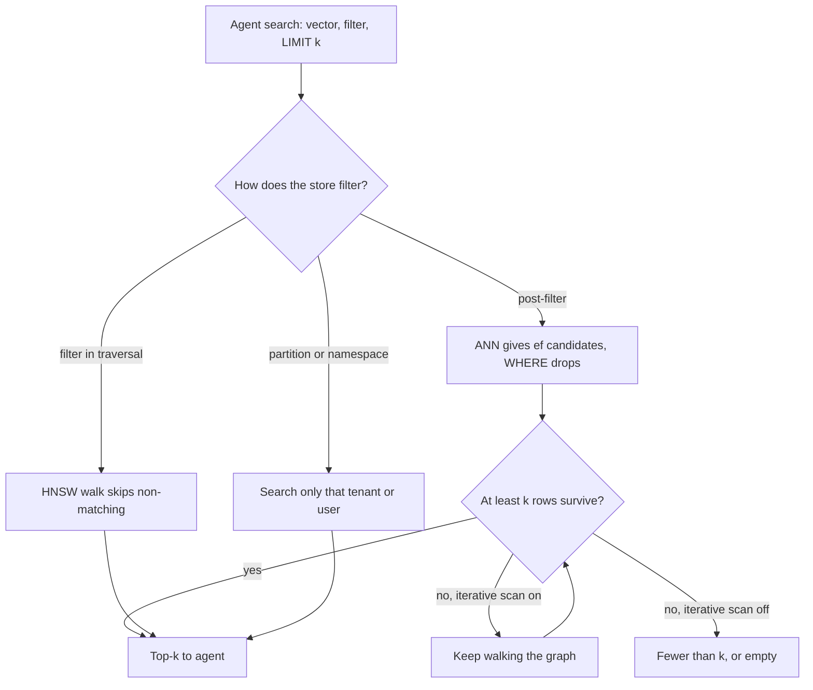

## TL;DR
A vector database is where your agent's knowledge and long-term memory live: embeddings plus metadata,
returning the k nearest under filters at request speed. pgvector, Qdrant, Weaviate, Milvus, Pinecone and
Chroma differ on operations, filtering and scale, not retrieval quality.

## For agent builders
- **Why it matters for agents.** Every search-tool call and memory recall is a filtered nearest-neighbour
  query on the agent's critical path. Per-user memory is a very selective filter, and "save, then recall
  next step" needs read-your-writes; stores differ most on both.
- **Where it shows up in your stack.** LangChain and LlamaIndex vector store integrations (PGVector,
  Qdrant, Pinecone, Weaviate, Milvus, Chroma), the store behind a LangGraph agent's long-term memory, and
  managed "file search" features that hide a vector store behind a tool.
- **What you control.** Which store, the collection schema and metadata (user, tenant, ACL, model),
  filter indexes, `ef_search`, consistency on writes, and the token budget of what the tool returns.
- **What you can skip.** HNSW internals and vendor feature matrices; know filtered search,
  read-your-writes and the memory sum.

## Lab
### Task
Build the three memory tools an agent needs on a real vector-store API: `save_memory`, `recall_memory`
and `forget_user`. Time box: 45-75 minutes. Do ANN indexes, Similarity search and Embedding pipelines
first.
- **Runs locally:** qdrant-client's in-process mode (`QdrantClient(":memory:")`) needs no server, and a
  hashed bag-of-words `embed` stands in for the embedding model, so no download or API key.
- **Done means:** saves are idempotent and wait for the write, recall never leaks another user's
  memories and still returns k hits for a user who owns 8 of 508 points, and forgetting a user deletes
  every one of their points and nobody else's.
- **Carry-over:** the same calls work against a Qdrant server; only the client constructor changes.

### Starter code
Save as `memory_store.py`; `pip install qdrant-client` (checked with qdrant-client 1.20.0 on Python
3.12.14).

```python
# memory_store.py  (Python 3.10+, pip install qdrant-client; runs in-process, no server)
import hashlib, math, re, uuid, warnings
from qdrant_client import QdrantClient, models

DIM, COLLECTION = 64, "memories"


def embed(text: str) -> list[float]:
    """Deterministic stand-in for the shared embedding function: hashed bag of words, unit length."""
    v = [0.0] * DIM
    for w in re.findall(r"[a-z0-9]+", text.lower()):
        v[int(hashlib.md5(w.encode()).hexdigest(), 16) % DIM] += 1.0
    n = math.sqrt(sum(x * x for x in v)) or 1.0
    return [x / n for x in v]


def make_client() -> QdrantClient:
    client = QdrantClient(":memory:")          # local mode; swap for QdrantClient(url=...) in production
    client.create_collection(COLLECTION, vectors_config=models.VectorParams(
        size=DIM, distance=models.Distance.COSINE))
    with warnings.catch_warnings():          # local mode ignores payload indexes; a server uses them
        warnings.simplefilter("ignore")
        client.create_payload_index(COLLECTION, field_name="user_id",
                                    field_schema=models.PayloadSchemaType.KEYWORD)
    return client


def save_memory(client: QdrantClient, user_id: str, text: str) -> str:
    """YOUR CODE: upsert one point whose id is derived from (user_id, text), so saving the same fact
    twice keeps one point. Payload: user_id and text. Wait for the write so the next step can recall it.
    Return "Saved."."""
    raise NotImplementedError("save_memory")


def recall_memory(client: QdrantClient, user_id: str, query: str, k: int = 5) -> list[str]:
    """YOUR CODE: return up to k memory texts of this user only, nearest first. The filter must run
    inside the search, so a user with few memories still gets k hits."""
    raise NotImplementedError("recall_memory")


def forget_user(client: QdrantClient, user_id: str) -> int:
    """YOUR CODE: delete every memory of this user (and nobody else's); return how many were deleted."""
    raise NotImplementedError("forget_user")


if __name__ == "__main__":
    client = make_client()
    try:
        for i in range(300):
            save_memory(client, "big-co", f"meeting note {i} about quarterly planning")
        for fact in ["prefers invoices in EUR", "billing contact is Dana",
                     "timezone is Europe/Berlin", "prefers invoices in EUR"]:
            save_memory(client, "u42", fact)
        print("points:", client.count(COLLECTION, exact=True).count)
        print("recall:", recall_memory(client, "u42", "which currency for invoices", k=3))
        print("forgot:", forget_user(client, "u42"))
        print("after: ", recall_memory(client, "u42", "invoices"),
              client.count(COLLECTION, exact=True).count)
    except NotImplementedError as e:
        print("not implemented yet:", e)
```

### Expected output
The starter prints `not implemented yet: save_memory`. A correct solution prints (the duplicate save
leaves 303 points, not 304):

```
points: 303
recall: ['prefers invoices in EUR', 'timezone is Europe/Berlin', 'billing contact is Dana']
forgot: 3
after:  [] 300
```

The last two recall hits share no word with the query and both score 0.0, so their order is the store's
tie-break; with qdrant-client 1.20.0 it is the order shown, whatever id scheme you use. The first hit
must be `'prefers invoices in EUR'`.

### Tests
Save next to `memory_store.py` and run `pytest -q` (checked with pytest 9.1.1). On the starter all five
fail with `NotImplementedError`; a correct solution passes all five in about a second.

```python
# test_memory_store.py  (run: pytest -q)
from qdrant_client import models
from memory_store import COLLECTION, forget_user, make_client, recall_memory, save_memory


def count(client, user_id=None):
    flt = None
    if user_id:
        flt = models.Filter(must=[models.FieldCondition(
            key="user_id", match=models.MatchValue(value=user_id))])
    return client.count(COLLECTION, count_filter=flt, exact=True).count


def seeded():
    client = make_client()
    for i in range(500):
        save_memory(client, "big-co", f"note {i} about invoices and quarterly planning")
    for i in range(8):
        save_memory(client, "u42", f"fact {i}: prefers invoices in EUR")
    return client


def test_saving_the_same_fact_twice_keeps_one_point():
    client = make_client()
    assert save_memory(client, "u1", "prefers invoices in EUR") == "Saved."
    save_memory(client, "u1", "prefers invoices in EUR")
    save_memory(client, "u2", "prefers invoices in EUR")      # same text, other user: separate point
    assert count(client, "u1") == 1 and count(client) == 2


def test_recall_is_scoped_to_the_user():
    client = seeded()
    hits = recall_memory(client, "u42", "invoices", k=5)
    assert hits and all(h.startswith("fact ") for h in hits), "another user's memories leaked"


def test_small_user_still_gets_k_hits():
    client = seeded()                                          # u42 owns 8 of 508 points
    assert len(recall_memory(client, "u42", "quarterly planning invoices", k=5)) == 5


def test_nearest_memory_comes_first():
    client = make_client()
    for fact in ["timezone is Europe/Berlin", "prefers invoices in EUR", "billing contact is Dana"]:
        save_memory(client, "u7", fact)
    assert recall_memory(client, "u7", "invoices currency", k=3)[0] == "prefers invoices in EUR"


def test_forget_user_removes_all_and_only_that_user():
    client = make_client()
    for i in range(25):
        save_memory(client, "u9", f"memory {i}")
    save_memory(client, "u10", "keep me")
    assert forget_user(client, "u9") == 25
    assert count(client, "u9") == 0 and count(client, "u10") == 1
    assert recall_memory(client, "u9", "memory") == []
```

### Failure scenarios
- **Post-filter in Python:** query with `limit=k` and no `query_filter`, then drop other users' hits.
  `test_small_user_still_gets_k_hits` gets 0 instead of 5, because big-co's 500 notes fill the top 5.
  Debug: log hit count against k per recall, then rerun with the filter inside `query_points`.
- **Random point ids (`uuid.uuid4()`).** The duplicate test counts 2 points for one fact; in production
  recall returns the same preference several times. Debug: count points per `(user_id, text)`; use a
  `uuid5` of both.
- **Forget by `scroll` then delete by ids.** `scroll` returns one page (10 points by default), so 10 of 25
  memories are deleted and the rest survive an erasure request. Debug: count the user's points after
  deleting; delete with `models.FilterSelector` and the same user filter instead.

### Submission
- **`memory_store.py` and the unchanged `test_memory_store.py`** in a repo or gist.
- **A `pytest -q` run** showing 5 passed, and `python memory_store.py` output matching the expected block.
- **One injected fault** from the list above, with the failing assertion and how you traced it.
- **A short note (under 150 words):** what changes against a Qdrant server (payload index now used,
  `wait=True` latency) and how you would check filtered recall there with a brute-force comparison.
- **Evaluated on:** all tests green, no cross-user hit in any test, and a note that names the store
  behaviour each guard depends on.

## Why it exists
- **Exact search is O(N·d) per query.** Ten million 1536-dimensional vectors is roughly 15 billion
  multiply-adds and about 61 GB of float32 streamed from memory per query: fine for a nightly batch,
  hopeless on a CPU node at 100 queries per second with a 50 ms budget.
- **ANN indexes fix speed, not operations.** HNSW and IVF cut the work to a small fraction of the corpus
  at a modest recall cost, but FAISS or hnswlib give an in-memory index with no persistence, updates
  (graph indexes handle deletes awkwardly), text and metadata storage, filtering, replication or
  sharding. Teams starting with "FAISS and a pickle file" rebuild each after an incident.
- **Plain relational arrays scan every row.** Storing float arrays and ordering by computed distance is
  exact and simple, but somewhere between hundreds of thousands and a few million vectors (illustrative;
  it depends on dimension, hardware and latency budget) it stops fitting an interactive request.
- **So a vector database packages ANN indexing with database properties:** durability, CRUD, filtering,
  access control and horizontal scale.

## How it works
### The common core
- **Collection or table** with a fixed dimension and a distance metric.
- **Records:** an id, a vector and a payload of metadata.
- **ANN index:** almost always HNSW, with IVF, product-quantization and disk-oriented variants for larger
  corpora.
- **Filtered search, CRUD** with soft-deletes compacted later, **durability** through a write-ahead log
  and snapshots, optional **quantization**, and an HTTP or gRPC API.
- **Tuning:** `M` and `ef_construction` at build time, `ef_search` or `nprobe` at query time. Higher
  recall always costs more latency, paid on every agent search step.

### Filtering is where they differ
| Strategy | How | Failure |
|---|---|---|
| Pre-filtering | restrict to matching rows, then search them | exact but slow when the filter is loose |
| Post-filtering | ANN top-k first, then drop non-matching rows | a selective filter leaves fewer than k, or none |
| Filter in traversal | Qdrant's filterable HNSW; brute-force fallback when very selective | engine-specific behaviour to learn |

- **pgvector post-filters:** it applies the `WHERE` clause to rows coming out of the index scan, so a
  filtered query can return fewer rows than `LIMIT` asks for.
- **pgvector 0.8.0 added opt-in iterative index scans** (`hnsw.iterative_scan`) that keep walking the
  graph until enough matching rows are found, up to the cap set by `hnsw.max_scan_tuples`, so a very
  selective filter can still come back short.
- **`relaxed_order` versus `strict_order`:** relaxed is faster but may return rows slightly out of
  order; re-sort in an outer query (pgvector's docs use a materialized CTE) when order matters.
- **Knowing your store's behaviour** is how you debug "the filtered query returns nothing", which an
  agent sees as "no memories found" for a user who has plenty.

### Agent memory is the extreme filter
- **One user's memories are a tiny slice** of a shared collection, so post-filtering an ANN scan almost
  never finds them.
- **Small slices are cheap to search exactly.** A few thousand vectors per user can be scored directly
  after selecting them by an indexed user field; Postgres may pick the B-tree on the user column and
  compute distances for just those rows.
- **Or isolate by design:** a namespace, partition or per-tenant shard per user group, or a store whose
  filter-aware traversal or brute-force fallback handles very selective filters.

### The six, briefly
- **pgvector:** a Postgres extension with a `vector(d)` column, operators `<->` (L2), `<=>` (cosine
  distance) and `<#>` (negative inner product), and `ivfflat` and `hnsw` indexes; without an index it
  does an exact scan. Strength: transactions, joins against real tables, row-level security, one backup,
  a team that already runs it. Limits: single-node scaling, index build time and memory, filtered recall.
- **pgvector sharp edges:** HNSW and IVFFlat indexes on `vector` accept at most 2,000 dimensions, so a
  3,072-dimensional model needs `halfvec` (indexable up to 4,000) or truncation. There is no built-in
  BM25, so hybrid search fuses with Postgres full-text search (whose `ts_rank` is a different scoring
  function) or adds another extension.
- **Qdrant:** open source, written in Rust. HNSW with payload-aware filtering in the traversal; scalar,
  binary and product quantization; named and sparse vectors per point for hybrid search; REST and gRPC;
  sharding and replication in distributed mode; a managed cloud.
- **Weaviate:** open source, written in Go. HNSW, optional modules that call an embedding model at write
  and query time, built-in BM25 with hybrid score fusion, GraphQL and REST APIs, and multi-tenancy with
  per-tenant shards.
- **Milvus:** open-source distributed system separating compute from storage: segments in object storage,
  metadata in etcd, a log service as write-ahead log (historically Pulsar or Kafka; varies by release).
  Many index types (IVF variants, HNSW, DiskANN, GPU).
- **Milvus at scale:** targets billions of vectors, heavier to operate; Milvus Lite embeds in Python for
  development, Zilliz Cloud is managed.
- **Pinecone:** fully managed, proprietary; serverless and pod-based deployments, namespaces for tenant
  isolation, metadata filtering, sparse-dense hybrid search. Zero operations; you pay per usage and data
  and index live with the vendor.
- **Chroma:** open source, Python/JS-first; embedded in the app process with on-disk persistence or as a
  small server; collections with `add`, `query` and `where` filters over an HNSW index. Single-node mode
  suits prototypes and tests, not high concurrency or multi-node.
- **Chroma hosted:** a separate, distributed offering; check its current capabilities.
- **Adjacent options:** FAISS and hnswlib (libraries, not databases), Elasticsearch and OpenSearch kNN
  (if you already run them for lexical search), Redis, LanceDB and Vespa.

### When a write becomes searchable
| System | Read-your-writes behaviour |
|---|---|
| pgvector | visible the moment its transaction commits, like any row |
| Qdrant | upsert takes a `wait` flag: return only after the change is applied, or earlier |
| Milvus | consistency levels per collection or query: Strong, Bounded, Session, Eventually |
| Pinecone | documented as eventually consistent; a short delay before new records appear |

This matters for pipelines that upsert then verify counts, for "upload a document, then ask about it"
flows, where the first question can miss it, and for agents that recall a memory one step after saving.

### What "scale" means here
1. **Memory is the first wall.** Vectors plus the HNSW graph must be in RAM for low latency; as an
   illustrative order of magnitude, ten million 1536-dimensional float32 vectors are about 61 GB before
   the graph.
2. **Beyond one node,** engines shard by id hash and replicate shards for reads; disk-based indexes trade
   latency for capacity.
3. **Quantization** shrinks memory 4× (int8) to 32× (binary), or more with product quantization, usually
   with full-precision rescoring to recover recall.
4. **Write throughput is the second wall.** HNSW inserts are expensive, so bulk loads should finish
   before the index is built. Agent memory writes trickle in continuously instead, so check sustained
   insert latency too.

## Diagram
A filtered query's path decides whether you get k results: post-filtering can starve a selective
tenant or user, while iterative scans, filter-aware traversal or a partition keep the result list full.



## Examples
### pgvector end to end
A chunk table keyed by the pipeline's content hash, an HNSW index on cosine distance, a tenant filter and
the query-time recall knob. The index parameters shown are pgvector's defaults.

```sql
CREATE EXTENSION IF NOT EXISTS vector;

CREATE TABLE chunks (
  id         text PRIMARY KEY,          -- content hash from the embedding pipeline
  doc_id     text NOT NULL,
  tenant_id  text NOT NULL,
  model      text NOT NULL,             -- which embedding model produced the vector
  body       text NOT NULL,
  embedding  vector(1536) NOT NULL      -- dimension is fixed per column
);

-- Bulk load first, then build the index: HNSW construction is the slow, memory-hungry step.
CREATE INDEX chunks_embedding_hnsw ON chunks
  USING hnsw (embedding vector_cosine_ops) WITH (m = 16, ef_construction = 64);
CREATE INDEX chunks_tenant_idx ON chunks (tenant_id);

-- Query time: wider graph search for better recall (default 40).
SET hnsw.ef_search = 100;
-- pgvector 0.8.0+: keep scanning the graph until LIMIT rows survive the WHERE clause.
SET hnsw.iterative_scan = relaxed_order;   -- checked against pgvector 0.8.2

SELECT id, doc_id, 1 - (embedding <=> $1::vector) AS cosine_similarity
FROM chunks
WHERE tenant_id = $2 AND model = 'text-embedding-3-small'
ORDER BY embedding <=> $1::vector       -- must use the same operator the index was built for
LIMIT 10;
```

- **The `model` predicate** makes an in-place model migration safe inside one table, as long as the new
  model has the same dimension (a different one needs a new column or table: the blue/green route).
  During migration it is also a filter that can shrink HNSW results, as described above.
- **The `ORDER BY` operator must match the index's operator class**, or Postgres falls back to a
  sequential scan.

### Agent scenario: per-user memory tools on Qdrant
Save waits for the write to apply, so the next agent step can recall it; recall filters on an indexed
`user_id` payload field. `embed` is the shared embedding function.

```python
import uuid
from qdrant_client import QdrantClient, models   # checked: qdrant-client 1.20.0, server 1.19.1

client = QdrantClient(url="http://localhost:6333")
if not client.collection_exists("memories"):
    client.create_collection("memories", vectors_config=models.VectorParams(
        size=1536, distance=models.Distance.COSINE))           # size = your embedder's dimension
client.create_payload_index("memories", field_name="user_id",
                            field_schema=models.PayloadSchemaType.KEYWORD)

def save_memory(user_id: str, text: str) -> str:
    pid = str(uuid.uuid5(uuid.NAMESPACE_URL, f"{user_id}:{text}"))   # idempotent point id
    client.upsert("memories", wait=True, points=[models.PointStruct(
        id=pid, vector=embed(text), payload={"user_id": user_id, "text": text})])
    return "Saved."

def recall_memory(user_id: str, query: str, k: int = 5) -> list[str]:
    hits = client.query_points("memories", query=embed(query), limit=k,
        query_filter=models.Filter(must=[models.FieldCondition(
            key="user_id", match=models.MatchValue(value=user_id))])).points
    return [h.payload["text"] for h in hits]
```

- **`wait=True`** trades a little save latency for read-your-writes in the same run.
- **The payload index** lets Qdrant's filter-aware search handle a tiny slice.

### Why a small tenant gets empty results
A pure-Python simulation of post-filtering: the "small" tenant owns 1% of 10,000 rows, and the index
hands `ef` candidates to the `WHERE` clause.

```python
import random

random.seed(0)
N, k = 10_000, 10
rows = [{"id": i, "tenant": "small" if i % 100 == 0 else "big", "score": random.random()}
        for i in range(N)]                                   # "small" owns 1% of the rows
ranked = sorted(rows, key=lambda r: -r["score"])             # stand-in for the ANN candidate order

def post_filter(ef):                                         # index returns ef candidates, then WHERE
    return [r for r in ranked[:ef] if r["tenant"] == "small"][:k]

def iterative(ef=40):                                        # keep widening until k rows survive
    while len(post_filter(ef)) < k and ef < N:
        ef *= 2
    return ef, len(post_filter(ef))

pre = [r for r in ranked if r["tenant"] == "small"][:k]      # filter first, then rank: exact
print("post-filter, ef=40 :", len(post_filter(40)), "rows")   # 0 rows
print("post-filter, ef=100:", len(post_filter(100)), "rows")  # 2 rows
print("iterative scan      :", iterative(), "(candidates visited, rows)")  # (1280, 10)
print("pre-filter          :", len(pre), "rows")              # 10 rows
```

At 1% selectivity you expect about one survivor per 100 candidates, so `LIMIT 10` needs on the order of
1,000 candidates. That is why selective tenants need iterative scans, filter-aware traversal or their own
partition.

### Worked scenario: one user's memories in a shared collection
50,000 users with 2,000 memories each share one 100-million-row collection (illustrative).

| Quantity | Value |
|---|---|
| One user's share of rows | 2,000 ÷ 100,000,000 = 0.002% |
| Expected survivors from 100 post-filtered candidates | about 0.002, so effectively none |
| Candidates needed for 5 survivors | about 250,000 |
| Exact scan of that user's 2,000 vectors at 1536 dims | about 3 million multiply-adds, trivial |

Per-user memory wants pre-filtering by an indexed user field or isolation, not a bigger `ef_search`.

### Worked choice: three teams
| Situation | Pick | Because |
|---|---|---|
| Postgres app, 2M chunks, per-tenant filters, 50 QPS | pgvector | about 12 GB raw fits one node; row-level security for tenants |
| 80M chunks, heavy filtered traffic, platform team | Qdrant or Milvus self-hosted | filter-aware HNSW, quantization, sharding |
| No ops staff, residency allows a vendor | Pinecone or another managed service | zero operations, usage-based pricing |

## Production patterns
- **Tune `ef_search` against measured recall** — for a sample of real agent queries with their real
  filters, compute exact top-10 (for example with a brute-force scan offline) and compare with the index
  results at several `hnsw.ef_search` values. Pick the lowest that meets the recall target; monitor
  recall@10 and p95 latency together.
- **Bulk load, then index** — in pgvector, load rows, raise `maintenance_work_mem` for the session, then
  `CREATE INDEX` (parallel workers speed it up); in Qdrant, upload with HNSW `m=0` (checked on 1.19),
  then restore `m`. Monitor build time and memory per
  million vectors.
- **Index the filter fields** — create payload indexes on user, tenant and date fields (Qdrant
  `create_payload_index`, a B-tree in Postgres) and give tiny tenants their own namespace or partition.
  Monitor result count below k per tenant, and empty memory recalls for users known to have memories.
- **Read-your-writes where users expect it** — pass `wait=True` on Qdrant upserts in "upload then ask"
  flows and agent memory saves, use Strong consistency in Milvus for verification queries, and poll
  before confirming in eventually consistent services. Monitor time from upsert to first successful query.
- **Treat the index as derived** — keep documents and chunk text in a source-of-truth store, snapshot the
  vector store, and rehearse a full rebuild. Monitor soft-deleted fraction; compact or re-index before
  it erodes recall.
- **Budget search latency per agent step** — an agent searching five times per task pays store p95 five
  times. Trace each tool call (LangSmith or your own spans) and alert on latency per step.

## Trade-offs
- **pgvector consolidation vs scale.** One system, transactions and joins against business data, but
  slow index builds, vertical scaling and careful filtered recall; it flips toward a dedicated engine at
  tens of millions of vectors or when filtered queries dominate the load.
- **Dedicated open-source engine vs operating it.** Qdrant, Weaviate and Milvus generally give stronger
  filtered search, quantization and horizontal scale, but are another stateful system to run, upgrade
  and back up; without a platform team, go managed.
- **Managed vs self-hosted.** Pinecone, Qdrant Cloud, Zilliz Cloud and Weaviate Cloud remove operations,
  at usage-based pricing (storage plus reads and writes, model varies by vendor), a data-residency
  question and an exit cost; strict residency or a large, rarely-queried corpus flips it back.
- **Embedded vs server.** Chroma, Milvus Lite and LanceDB need no infrastructure and suit notebooks, tests
  and demos, but offer no concurrency, replication or multi-node growth.
- **Waiting writes vs agent latency.** Read-your-writes makes a memory recallable next step but slows the
  save tool; skip it only when the memory is not needed within the run.
- **Text in the payload vs a pointer.** One hop for retrieval, but inflated memory and backups; a pointer
  is leaner at the cost of a second lookup.

## Pitfalls
- **Filtered query returns fewer than k, or none.** Cause: post-filtering inside the index scan.
  Diagnose: log result count against k per query, and rerun the query with the filter applied before
  ranking (exact) to compare. Fix: a higher `ef_search`, iterative scans, a store with filterable HNSW,
  or partitioning by the filter key.
- **Agent memory recall is empty for active users.** Cause: a per-user filter post-applied to a global
  ANN scan. Diagnose: `EXPLAIN` the recall query, or count that user's rows directly. Fix: index the
  user field, pre-filter, or partition memories by user group.
- **HNSW on a `vector(3072)` column.** The build fails on pgvector's 2,000-dimension limit. Use
  `halfvec(3072)` with `halfvec_cosine_ops`, or a truncated Matryoshka dimension, decided before the
  schema ships.
- **Building HNSW before the bulk load.** The load takes hours because every insert updates the graph.
  Load first, index after.
- **Measuring recall only at default query parameters.** Great benchmark numbers, then missing results
  once filters and real queries arrive. Diagnose: recall@10 versus brute force on logged, filtered
  queries.
- **Vector store as the source of truth.** After a chunking bug or model upgrade nobody can rebuild the
  index. Keep documents elsewhere and treat the index as derived.
- **Letting soft-deleted vectors accumulate.** Memory grows and recall degrades until the collection is
  compacted or re-indexed. Diagnose: track the soft-deleted fraction.
- **A different distance operator than the index.** Latency jumps from milliseconds to seconds because
  the planner chose a sequential scan. Diagnose: `EXPLAIN` shows `Seq Scan` instead of the HNSW index.
- **One giant multi-tenant collection with a selective tenant filter.** Small tenants get empty or slow
  results. Use namespaces, per-tenant shards or partitions.

## When to use
- **Start with pgvector** when the app already runs on Postgres and the corpus is in the low millions:
  no new system, transactional updates alongside business data, row-level security for ACL-aware
  retrieval, and agent memory in the same database as users.
- **Move to Qdrant, Weaviate or Milvus** when filtered recall, write throughput or corpus size outgrow
  one Postgres node, or you need built-in quantization and hybrid sparse-dense search.
- **Choose Pinecone or another managed service** when no one can operate a database and data residency
  allows it.
- **Use Chroma** for notebooks, tests and demos, and plan to leave it.
- **Measure:** recall@k at your real filters, p95 latency at target QPS, index build time and memory per
  million vectors.
- **Interviews:** explain filtered-search behaviour and size memory from vector count and dimension,
  rather than reciting vendor features.

## Exercise
**Goal:** measure how filtered recall behaves in a real store and find the settings that keep it above
0.95 for a tenant owning 1% of the rows.
- **Inputs:** pgvector 0.8+ or Qdrant in Docker, 100,000 unit vectors at 384 dimensions, a `tenant`
  field where one tenant owns 1%, and 50 queries.
- **Deliver:** recall@10 against an exact filtered scan and p95 latency for both tenants, across
  `ef_search` 40, 100 and 400, iterative scan off and on (or Qdrant with and without a payload index).
- **Acceptance:** one row reproduces the short-result problem (drop any tenant B-tree, or the
  planner pre-filters); your chosen configuration meets 0.95 for
  both tenants and you state its latency cost.

## Role lens
- **Engineer:** Chooses index parameters, writes the filtered queries, tunes `ef_search` against measured
  recall, and schedules compaction so deletes do not silently erode results.
- **Architect:** Owns the build-versus-buy and single-system-versus-dedicated decision, the multi-tenancy
  model, and the sizing from vector count, dimension and QPS to nodes and cost.
- **FDE:** Fits the store to the customer's constraints: existing Postgres estate, data-residency rules,
  on-prem versus cloud, and the operations team that will inherit it after the engagement.

## Check yourself
**Q:** A startup runs its product on Postgres, has two million chunks, needs per-tenant filtering and
expects about 50 queries per second. Do they need a dedicated vector database, and what would make you
change that answer later?
**A:** Not yet. Two million 1536-dimensional vectors are about 12 GB raw, which fits a mid-sized Postgres
instance with an HNSW index, and 50 QPS is within reach with `ef_search` tuned against measured recall.
pgvector keeps chunks transactionally consistent with tenant tables and lets row-level security enforce
tenant isolation, which is a real security advantage. The risks to watch are filtered recall for small
tenants, index build time during re-indexing, and memory as the corpus grows. I would move to a dedicated
engine or a managed service when the corpus passes tens of millions of vectors, when filtered queries
start returning short result lists, when write bursts from re-indexing hurt the production database, or
when hybrid sparse-dense search and quantization become requirements.

## Interview questions
### What does a vector database give you that FAISS or hnswlib alone does not?
- **Database properties around the ANN index:** persistence through a write-ahead log and snapshots,
  CRUD with soft-deletes, payload storage and filtering, access control, replication and sharding.
- **Why it matters:** a library index lives in memory with none of these, so teams that start with "FAISS
  and a pickle file" end up rebuilding each one after an incident.

### A small tenant's filtered queries return empty results while big tenants are fine. Walk me through it.
- **Diagnose:** the store post-filters, so at 1% selectivity about one row survives per 100 candidates and
  `LIMIT 10` needs on the order of 1,000 candidates.
- **Fix in pgvector:** raise `hnsw.ef_search` or enable `hnsw.iterative_scan` (0.8.0+).
- **Structural fix:** a store with filter-aware HNSW, a payload index on the tenant field, or a per-tenant
  namespace, shard or partition.

### Design the storage for long-term memory of an agent with 50,000 users. What do you watch for?
- **Schema:** one record per memory with vector, text, user id, timestamp and model, under a
  content-addressed id so repeated saves are idempotent.
- **Filtering:** each user is a tiny slice, so index the user field and pre-filter, or partition; a
  post-filtered global ANN scan returns nothing.
- **Consistency and latency:** wait for writes when the agent recalls within the same run, and budget
  recall latency per step because it repeats inside the loop.

### When would you not pick a dedicated vector database?
- **Already on Postgres, low millions of vectors:** pgvector adds no new system, keeps chunks
  transactional with business tables and lets row-level security enforce tenant isolation.
- **Prototype or tests:** Chroma, Milvus Lite or LanceDB embed in the process with no infrastructure.
- **No ops staff:** a managed service beats self-hosting an engine nobody can run, if data residency allows.

### Size the memory for 80 million 1536-dimensional chunks and say how you would fit it.
- **Raw float32:** 80M × 1536 × 4 bytes ≈ 491.5 GB before the HNSW graph and payloads.
- **Quantize:** int8 is about 122.9 GB, binary about 15.4 GB, with full-precision rescoring to recover
  recall.
- **Scale out:** shard by id hash across nodes with replicas for reads, or use a disk-based index and
  accept higher latency.

### Your agent saves a user preference, then one step later its recall tool cannot find it. Why, and what do you change?
- **Cause:** the store is not read-your-writes for that path, for example eventually consistent in
  Pinecone or a Qdrant upsert sent without waiting.
- **Fix:** pass `wait=True` on Qdrant upserts, use Strong consistency in Milvus, or poll until the record
  is queryable before the save tool returns.
- **Monitor** the time from upsert to first successful query, and the same flow for user document uploads.

## Quiz
### Q: Why can a filtered nearest-neighbour query return fewer results than requested even though many rows match the filter?
- [ ] The vector index stores only a sample of the rows
- [x] The engine runs the approximate search first and applies the filter afterwards, so matching rows outside the retrieved candidates are never seen
- [ ] Filters disable the index and force an exact scan that times out
- [ ] Metadata filters are only applied to the first shard
> Post-filtering, which is what a plain pgvector HNSW scan does, means the ANN index returns its
> nearest candidates and the filter removes those that do not match. If the filter is selective, few candidates survive. Filterable HNSW,
> iterative scans or partitioning by the filter key are the fixes.

### Q: Which statement best captures the difference between pgvector and a dedicated engine such as Qdrant or Milvus?
- [ ] pgvector uses exact search while dedicated engines use approximate search
- [ ] Dedicated engines produce better embeddings
- [x] pgvector gives transactions and joins inside the database you already run, while dedicated engines offer filter-aware indexing, quantization and horizontal scaling at the cost of operating another system
- [ ] pgvector cannot store metadata alongside vectors
> Retrieval quality comes from the embedding model and the index parameters, which all of them support.
> The real difference is operational: consolidation and transactional consistency on one side, scale and
> specialised features on the other.

### Q: A team builds the HNSW index, then bulk-inserts ten million vectors, and the load takes many hours. What should they have done?
- [ ] Used a lower-dimensional embedding model
- [x] Loaded the vectors first and built the index afterwards, because each insert into an existing graph is expensive
- [ ] Used cosine distance instead of inner product
- [ ] Split the data across more collections
> HNSW inserts search the graph to place every new node and update neighbour links, which is far slower
> than building the graph in one pass over loaded data. Bulk load, then build, is the documented
> sequence for pgvector, and engines such as Qdrant let you defer indexing during bulk upload for the
> same reason.

## Mastery test
**Problem:** a B2B agent stores 30 million chunks for 400 tenants in one pgvector table. The largest
tenant owns 40% of rows, the smallest 0.01%. Small tenants report "no results"; a 1536-dimension model
upgrade is planned. Choose a design and justify it.

**A strong answer:**
- sizes it: about 184 GB raw at float32 before the graph, so one node needs `halfvec`, quantization or
  more memory;
- explains post-filter starvation and fixes it with iterative scans, exact scans via an indexed tenant
  column for tiny tenants, or partitions;
- plans the upgrade blue/green with a `model` column or new table, measured against brute force;
- names when Qdrant or Milvus wins: filtered traffic dominates or one node stops fitting.

## Use cases & projects
### Use cases
- **Long-term agent memory.** Per-user recall is a very selective filtered query, so filter indexes and
  filtered-search behaviour decide whether memory recall stays fast and complete.
- **Save-then-recall in one task.** An agent that writes a fact and reads it on the next step needs
  read-your-writes consistency from the store.
- **Teams already on Postgres.** pgvector keeps vectors, metadata and transactions in one database, which is
  often the simplest store for an agent backend.
- **Large multi-tenant knowledge bases.** Dedicated stores such as Qdrant, Milvus or Pinecone are chosen when
  scale, sharding or filtering needs outgrow a single Postgres node.

### Mini project
**Back an agent's memory tools with pgvector or Qdrant (2-3 hours).**
- **Goal:** build `remember` and `recall` tools on a real vector store and measure filtered recall.
- **Steps:** create a collection with user id, timestamp and model name as metadata, plus a filter index on
  user id; load notes for 50 users; expose `remember(text)` and `recall(query)` tools to a small agent; test
  save-then-recall in one task and measure recall and latency at two search-width values (pgvector
  `hnsw.ef_search`, or `hnsw_ef` in Qdrant's `SearchParams`).
- **Done when:** recall never returns another user's notes, a fact saved in one step is found in the next,
  and a table shows recall and p95 latency per `ef_search` setting.
