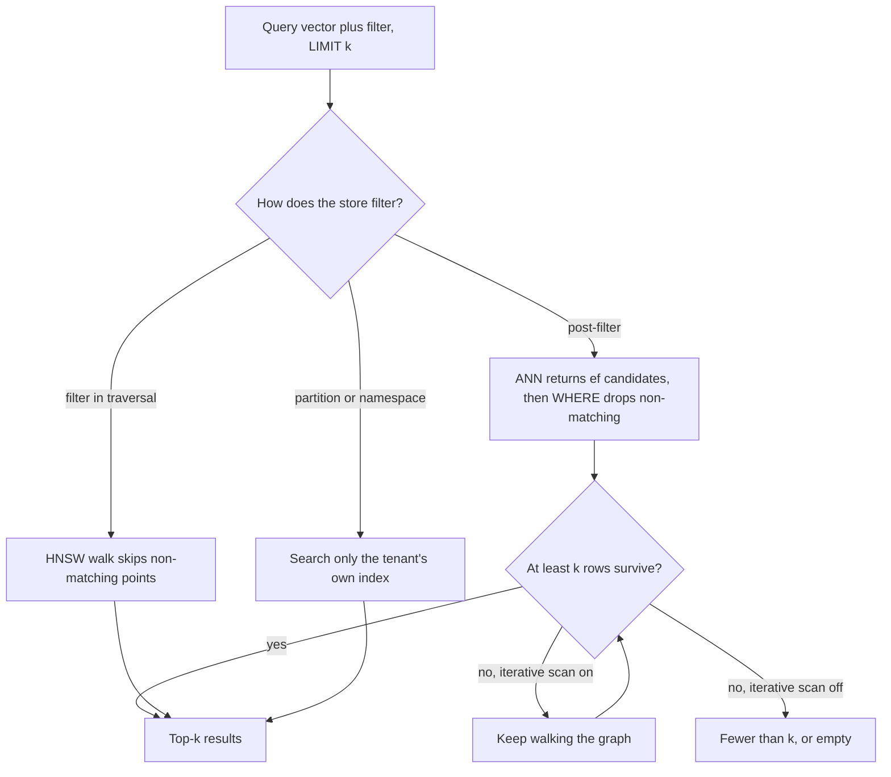

## TL;DR
A vector database stores embeddings with metadata and returns the k nearest vectors under filters, fast
enough for a request path. pgvector lives in Postgres; Qdrant, Weaviate and Milvus are dedicated engines;
Pinecone is managed; Chroma is for prototypes. Choose on operations and scale.

## Why it exists
- **Exact search is O(N·d) per query.** Ten million 1536-dimensional vectors is roughly 15 billion
  multiply-adds and about 61 GB of float32 streamed from memory per query: fine for a nightly batch,
  hopeless on a CPU node at 100 queries per second with a 50 ms budget.
- **ANN indexes fix speed, not operations.** HNSW and IVF cut the work to a small fraction of the corpus
  at a modest recall cost, but FAISS or hnswlib give an in-memory index with no persistence, updates
  (graph indexes handle deletes awkwardly), text and metadata storage, filtering, replication or
  sharding. Teams starting with "FAISS and a pickle file" rebuild each after an incident.
- **Plain relational arrays scan every row.** Storing float arrays and ordering by computed distance is
  exact and simple, but somewhere between hundreds of thousands and a few million vectors (illustrative;
  it depends on dimension, hardware and latency budget) it stops fitting an interactive request.
- **So a vector database packages ANN indexing with database properties:** durability, CRUD, filtering,
  access control and horizontal scale.

## How it works
### The common core
- **Collection or table** with a fixed dimension and a distance metric.
- **Records:** an id, a vector and a payload of metadata.
- **ANN index:** almost always HNSW, with IVF, product-quantization and disk-oriented variants for larger
  corpora.
- **Filtered search, CRUD** with soft-deletes compacted later, **durability** through a write-ahead log
  and snapshots, optional **quantization**, and an HTTP or gRPC API.
- **Tuning:** `M` and `ef_construction` at build time, `ef_search` or `nprobe` at query time. Higher
  recall always costs more latency.

### Filtering is where they differ
| Strategy | How | Failure |
|---|---|---|
| Pre-filtering | restrict to matching rows, then search them | exact but slow when the filter is loose |
| Post-filtering | ANN top-k first, then drop non-matching rows | a selective filter leaves fewer than k, or none |
| Filter in traversal | Qdrant's filterable HNSW; brute-force fallback when very selective | engine-specific behaviour to learn |

- **pgvector post-filters:** it applies the `WHERE` clause to rows coming out of the index scan, so a
  filtered query can return fewer rows than `LIMIT` asks for.
- **pgvector 0.8.0 added opt-in iterative index scans** (`hnsw.iterative_scan`) that keep walking the
  graph until enough matching rows are found.
- **Knowing your store's behaviour** is the key to debugging "the filtered query returns nothing".

### The six, briefly
- **pgvector:** a Postgres extension with a `vector(d)` column, operators `<->` (L2), `<=>` (cosine
  distance) and `<#>` (negative inner product), and `ivfflat` and `hnsw` indexes; without an index it
  does an exact scan. Strength: transactions, joins against real tables, row-level security, one backup,
  a team that already runs it. Limits: single-node scaling, index build time and memory, filtered recall.
- **pgvector sharp edges:** HNSW and IVFFlat indexes on `vector` accept at most 2,000 dimensions, so a
  3,072-dimensional model needs `halfvec` (indexable up to 4,000) or truncation. There is no built-in
  BM25, so hybrid search fuses with Postgres full-text search (whose `ts_rank` is a different scoring
  function) or adds another extension.
- **Qdrant:** open source, written in Rust. HNSW with payload-aware filtering in the traversal; scalar,
  binary and product quantization; named and sparse vectors per point for hybrid search; REST and gRPC;
  sharding and replication in distributed mode; a managed cloud.
- **Weaviate:** open source, written in Go. HNSW, optional modules that call an embedding model at write
  and query time, built-in BM25 with hybrid score fusion, GraphQL and REST APIs, and multi-tenancy with
  per-tenant shards.
- **Milvus:** open-source distributed system separating compute from storage: segments in object storage,
  metadata in etcd, a log service as write-ahead log (historically Pulsar or Kafka; varies by release).
  Many index types (IVF variants, HNSW, DiskANN, GPU). Targets billions of vectors, heavier to operate;
  Milvus Lite embeds in Python for development, Zilliz Cloud is the managed version.
- **Pinecone:** fully managed, proprietary; serverless and pod-based deployments, namespaces for tenant
  isolation, metadata filtering, sparse-dense hybrid search. Zero operations; you pay per usage and data
  and index live with the vendor.
- **Chroma:** open source, Python/JS-first; embedded in the app process with on-disk persistence or as a
  small server; collections with `add`, `query` and `where` filters over an HNSW index. Single-node mode
  suits prototypes and tests, not high concurrency or multi-node. The hosted service is a separate,
  distributed offering; check its current capabilities rather than assuming.
- **Adjacent options:** FAISS and hnswlib (libraries, not databases), Elasticsearch and OpenSearch kNN
  (if you already run them for lexical search), Redis, LanceDB and Vespa.

### When a write becomes searchable
| System | Read-your-writes behaviour |
|---|---|
| pgvector | visible the moment its transaction commits, like any row |
| Qdrant | upsert takes a `wait` flag: return only after the change is applied, or earlier |
| Milvus | consistency levels per collection or query: Strong, Bounded, Session, Eventually |
| Pinecone | documented as eventually consistent; a short delay before new records appear |

This matters for pipelines that upsert then immediately verify counts or run a test query, and for "upload
a document, then ask about it" flows, where the first question can miss the new document.

### What "scale" means here
1. **Memory is the first wall.** Vectors plus the HNSW graph must be in RAM for low latency; as an
   illustrative order of magnitude, ten million 1536-dimensional float32 vectors are about 61 GB before
   the graph.
2. **Beyond one node,** engines shard by id hash and replicate shards for reads; disk-based indexes trade
   latency for capacity.
3. **Quantization** shrinks memory 4× (int8) to 32× (binary), or more with product quantization, usually
   with full-precision rescoring to recover recall.
4. **Write throughput is the second wall.** HNSW inserts are expensive, so bulk loads should finish
   before the index is built.

## Diagram
A filtered query's path decides whether you get k results: post-filtering can starve a selective
tenant, while iterative scans, filter-aware traversal or a partition keep the result list full.



## Examples
### pgvector end to end
A chunk table keyed by the pipeline's content hash, an HNSW index on cosine distance, a tenant filter and
the query-time recall knob. The index parameters shown are pgvector's defaults; raising
`hnsw.ef_search` increases recall at the cost of latency.

```sql
CREATE EXTENSION IF NOT EXISTS vector;

CREATE TABLE chunks (
  id         text PRIMARY KEY,          -- content hash from the embedding pipeline
  doc_id     text NOT NULL,
  tenant_id  text NOT NULL,
  model      text NOT NULL,             -- which embedding model produced the vector
  body       text NOT NULL,
  embedding  vector(1536) NOT NULL      -- dimension is fixed per column
);

-- Bulk load first, then build the index: HNSW construction is the slow, memory-hungry step.
CREATE INDEX chunks_embedding_hnsw ON chunks
  USING hnsw (embedding vector_cosine_ops) WITH (m = 16, ef_construction = 64);
CREATE INDEX chunks_tenant_idx ON chunks (tenant_id);

-- Query time: wider graph search for better recall (default 40).
SET hnsw.ef_search = 100;
-- pgvector 0.8.0+: keep scanning the graph until LIMIT rows survive the WHERE clause.
SET hnsw.iterative_scan = relaxed_order;

SELECT id, doc_id, 1 - (embedding <=> $1::vector) AS cosine_similarity
FROM chunks
WHERE tenant_id = $2 AND model = 'text-embedding-3-small'
ORDER BY embedding <=> $1::vector       -- must use the same operator the index was built for
LIMIT 10;
```

- **The `model` predicate** makes an in-place model migration safe inside one table, as long as the new
  model has the same dimension (a different one needs a new column or table: the blue/green route).
  During migration it is also a filter that can shrink HNSW results, as described above.
- **The `ORDER BY` operator must match the index's operator class**, or Postgres falls back to a
  sequential scan.

### Why a small tenant gets empty results
A pure-Python simulation of post-filtering: the "small" tenant owns 1% of 10,000 rows, and the index
hands `ef` candidates to the `WHERE` clause.

```python
import random

random.seed(0)
N, k = 10_000, 10
rows = [{"id": i, "tenant": "small" if i % 100 == 0 else "big", "score": random.random()}
        for i in range(N)]                                   # "small" owns 1% of the rows
ranked = sorted(rows, key=lambda r: -r["score"])             # stand-in for the ANN candidate order

def post_filter(ef):                                         # index returns ef candidates, then WHERE
    return [r for r in ranked[:ef] if r["tenant"] == "small"][:k]

def iterative(ef=40):                                        # keep widening until k rows survive
    while len(post_filter(ef)) < k and ef < N:
        ef *= 2
    return ef, len(post_filter(ef))

pre = [r for r in ranked if r["tenant"] == "small"][:k]      # filter first, then rank: exact
print("post-filter, ef=40 :", len(post_filter(40)), "rows")   # 0 rows
print("post-filter, ef=100:", len(post_filter(100)), "rows")  # 2 rows
print("iterative scan      :", iterative(), "(candidates visited, rows)")  # (1280, 10)
print("pre-filter          :", len(pre), "rows")              # 10 rows
```

At 1% selectivity you expect about one survivor per 100 candidates, so `LIMIT 10` needs on the order of
1,000 candidates. That is why selective tenants need iterative scans, filter-aware traversal or their own
partition.

### Worked choice: three teams
| Situation | Pick | Because |
|---|---|---|
| Postgres app, 2M chunks, per-tenant filters, 50 QPS | pgvector | about 12 GB raw fits one node; row-level security for tenants |
| 80M chunks, heavy filtered traffic, platform team | Qdrant or Milvus self-hosted | filter-aware HNSW, quantization, sharding |
| No ops staff, residency allows a vendor | Pinecone or another managed service | zero operations, usage-based pricing |

## Production patterns
- **Tune `ef_search` against measured recall** — for a sample of real queries with their real filters,
  compute exact top-10 (for example with a brute-force scan offline) and compare with the index results
  at several `hnsw.ef_search` values. Pick the lowest that meets the recall target; monitor recall@10 and
  p95 latency together.
- **Bulk load, then index** — in pgvector, load rows, raise `maintenance_work_mem` for the session, then
  `CREATE INDEX` (parallel workers speed it up); in Qdrant, defer HNSW indexing during the upload via the
  collection's optimizer settings and restore them afterwards. Monitor build time and memory per
  million vectors.
- **Index the filter fields** — create payload indexes on tenant and date fields (Qdrant
  `create_payload_index`, a B-tree in Postgres) and give tiny tenants their own namespace or partition.
  Monitor result count below k per tenant.
- **Read-your-writes where users expect it** — pass `wait=True` on Qdrant upserts in "upload then ask"
  flows, use Strong consistency in Milvus for verification queries, and poll before confirming in
  eventually consistent services. Monitor time from upsert to first successful query.
- **Treat the index as derived** — keep documents and chunk text in a source-of-truth store, snapshot the
  vector store on a schedule, and rehearse a full rebuild. Monitor soft-deleted fraction and compact or
  re-index before it erodes recall.

## Trade-offs
- **pgvector consolidation vs scale.** One system, transactions and joins against business data, but
  slow index builds, vertical scaling and careful filtered recall; it flips toward a dedicated engine at
  tens of millions of vectors or when filtered queries dominate the load.
- **Dedicated open-source engine vs operating it.** Qdrant, Weaviate and Milvus generally give stronger
  filtered search, quantization and horizontal scale, but are another stateful system to run, upgrade
  and back up; without a platform team that burden flips the decision toward managed.
- **Managed vs self-hosted.** Pinecone, Qdrant Cloud, Zilliz Cloud and Weaviate Cloud remove operations,
  at usage-based pricing (storage plus reads and writes, model varies by vendor), a data-residency
  question and an exit cost; strict residency or a large, rarely-queried corpus flips it back.
- **Embedded vs server.** Chroma, Milvus Lite and LanceDB need no infrastructure and suit notebooks, tests
  and demos, but offer no concurrency, replication or multi-node growth; the first multi-user deployment
  flips it.
- **Text in the payload vs a pointer.** One hop for retrieval, but inflated memory and backups; a pointer
  to a document store is leaner at the cost of a second lookup.

## Pitfalls
- **Filtered query returns fewer than k, or none.** Cause: post-filtering inside the index scan. Fix
  with a higher `ef_search`, iterative scans, a store with filterable HNSW, or partitioning by the
  filter key.
- **HNSW on a `vector(3072)` column.** The build fails on pgvector's 2,000-dimension limit. Use
  `halfvec(3072)` with `halfvec_cosine_ops`, or a truncated Matryoshka dimension, decided before the
  schema ships.
- **Building HNSW before the bulk load.** The load takes hours because every insert updates the graph.
  Load first, index after.
- **Measuring recall only at default query parameters.** Great benchmark numbers, then missing results
  once filters and real queries arrive.
- **Vector store as the source of truth.** After a chunking bug or model upgrade nobody can rebuild the
  index. Keep documents elsewhere and treat the index as derived.
- **Letting soft-deleted vectors accumulate.** Memory grows and recall degrades until the collection is
  compacted or re-indexed.
- **A different distance operator than the index.** Latency jumps from milliseconds to seconds because
  the planner chose a sequential scan.
- **One giant multi-tenant collection with a selective tenant filter.** Small tenants get empty or slow
  results. Use namespaces, per-tenant shards or partitions.

## When to use
- **Start with pgvector** when the app already runs on Postgres and the corpus is in the low millions:
  no new system, transactional updates alongside business data, row-level security for ACL-aware
  retrieval.
- **Move to Qdrant, Weaviate or Milvus** when filtered recall, write throughput or corpus size outgrow
  one Postgres node, or you need built-in quantization and hybrid sparse-dense search.
- **Choose Pinecone or another managed service** when no one can operate a database and data residency
  allows it.
- **Use Chroma** for notebooks, tests and demos, and plan to leave it.
- **Measure:** recall@k at your real filters, p95 latency at target QPS, index build time and memory per
  million vectors.
- **Interviews:** explain filtered-search behaviour and size memory from vector count and dimension,
  rather than reciting vendor features.

## Role lens
- **Engineer:** Chooses index parameters, writes the filtered queries, tunes `ef_search` against measured
  recall, and schedules compaction so deletes do not silently erode results.
- **Architect:** Owns the build-versus-buy and single-system-versus-dedicated decision, the multi-tenancy
  model, and the sizing from vector count, dimension and QPS to nodes and cost.
- **FDE:** Fits the store to the customer's constraints: existing Postgres estate, data-residency rules,
  on-prem versus cloud, and the operations team that will inherit it after the engagement.

## Check yourself
**Q:** A startup runs its product on Postgres, has two million chunks, needs per-tenant filtering and
expects about 50 queries per second. Do they need a dedicated vector database, and what would make you
change that answer later?
**A:** Not yet. Two million 1536-dimensional vectors are about 12 GB raw, which fits a mid-sized Postgres
instance with an HNSW index, and 50 QPS is within reach with `ef_search` tuned against measured recall.
pgvector keeps chunks transactionally consistent with tenant tables and lets row-level security enforce
tenant isolation, which is a real security advantage. The risks to watch are filtered recall for small
tenants, index build time during re-indexing, and memory as the corpus grows. I would move to a dedicated
engine or a managed service when the corpus passes tens of millions of vectors, when filtered queries
start returning short result lists, when write bursts from re-indexing hurt the production database, or
when hybrid sparse-dense search and quantization become requirements.

## Interview questions
### What does a vector database give you that FAISS or hnswlib alone does not?
- **Database properties around the ANN index:** persistence through a write-ahead log and snapshots,
  CRUD with soft-deletes, payload storage and filtering, access control, replication and sharding.
- **Why it matters:** a library index lives in memory with none of these, so teams that start with "FAISS
  and a pickle file" end up rebuilding each one after an incident.

### A small tenant's filtered queries return empty results while big tenants are fine. Walk me through it.
- **Diagnose:** the store post-filters, so at 1% selectivity about one row survives per 100 candidates and
  `LIMIT 10` needs on the order of 1,000 candidates.
- **Fix in pgvector:** raise `hnsw.ef_search` or enable `hnsw.iterative_scan` (0.8.0+).
- **Structural fix:** a store with filter-aware HNSW, a payload index on the tenant field, or a per-tenant
  namespace, shard or partition.

### When would you not pick a dedicated vector database?
- **Already on Postgres, low millions of vectors:** pgvector adds no new system, keeps chunks
  transactional with business tables and lets row-level security enforce tenant isolation.
- **Prototype or tests:** Chroma, Milvus Lite or LanceDB embed in the process with no infrastructure.
- **No ops staff:** a managed service beats self-hosting an engine nobody can run, if data residency allows.

### Size the memory for 80 million 1536-dimensional chunks and say how you would fit it.
- **Raw float32:** 80M × 1536 × 4 bytes ≈ 491.5 GB before the HNSW graph and payloads.
- **Quantize:** int8 is about 122.9 GB, binary about 15.4 GB, with full-precision rescoring to recover
  recall.
- **Scale out:** shard by id hash across nodes with replicas for reads, or use a disk-based index and
  accept higher latency.

### A user uploads a document and the first question about it misses it. Why, and what do you change?
- **Cause:** the store is not read-your-writes for that path, for example eventually consistent in
  Pinecone or a Qdrant upsert sent without waiting.
- **Fix:** pass `wait=True` on Qdrant upserts, use Strong consistency in Milvus, or poll until the record
  is queryable before confirming the upload.
- **Monitor** the time from upsert to first successful query.

## Quiz
### Q: Why can a filtered nearest-neighbour query return fewer results than requested even though many rows match the filter?
- [ ] The vector index stores only a sample of the rows
- [x] The engine runs the approximate search first and applies the filter afterwards, so matching rows outside the retrieved candidates are never seen
- [ ] Filters disable the index and force an exact scan that times out
- [ ] Metadata filters are only applied to the first shard
> Post-filtering, which is what a plain pgvector HNSW scan does, means the ANN index returns its
> nearest candidates and the filter removes those that do not match. If the filter is selective, few candidates survive. Filterable HNSW,
> iterative scans or partitioning by the filter key are the fixes.

### Q: Which statement best captures the difference between pgvector and a dedicated engine such as Qdrant or Milvus?
- [ ] pgvector uses exact search while dedicated engines use approximate search
- [ ] Dedicated engines produce better embeddings
- [x] pgvector gives transactions and joins inside the database you already run, while dedicated engines offer filter-aware indexing, quantization and horizontal scaling at the cost of operating another system
- [ ] pgvector cannot store metadata alongside vectors
> Retrieval quality comes from the embedding model and the index parameters, which all of them support.
> The real difference is operational: consolidation and transactional consistency on one side, scale and
> specialised features on the other.

### Q: A team builds the HNSW index, then bulk-inserts ten million vectors, and the load takes many hours. What should they have done?
- [ ] Used a lower-dimensional embedding model
- [x] Loaded the vectors first and built the index afterwards, because each insert into an existing graph is expensive
- [ ] Used cosine distance instead of inner product
- [ ] Split the data across more collections
> HNSW inserts search the graph to place every new node and update neighbour links, which is far slower
> than building the graph in one pass over loaded data. Bulk load, then build, is the documented
> sequence for pgvector, and engines such as Qdrant let you defer indexing during bulk upload for the
> same reason.
