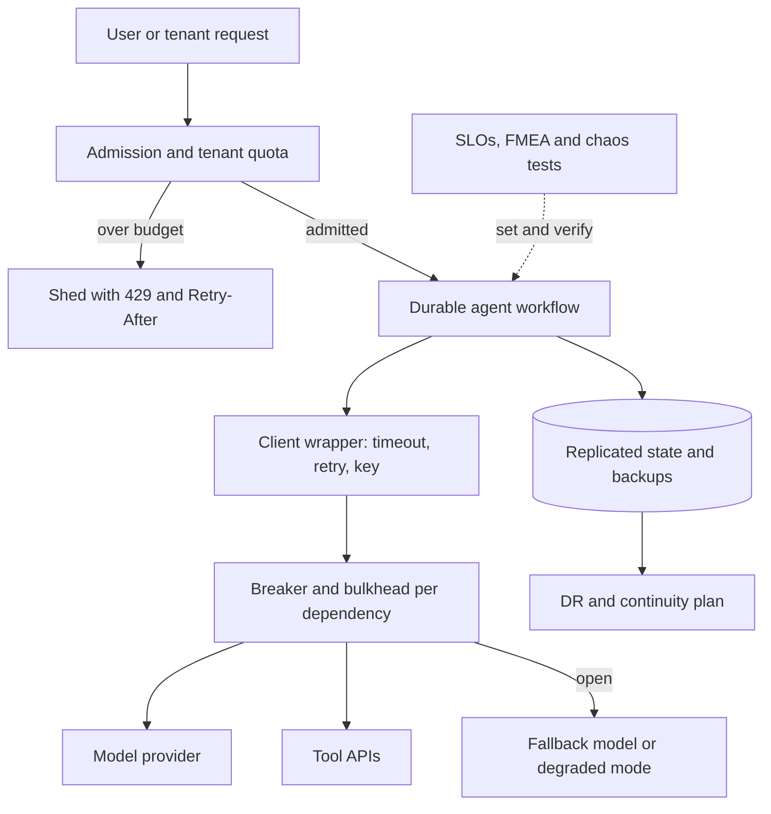

## Overview
This module is about keeping an AI product and its agents working, or failing in a controlled way,
when the things they depend on do not. An agent run chains many model and tool calls, so a fault that
is rare per call becomes routine per run. Every lesson here is a mechanism you put around those calls.

The lessons connect in five groups:

- **Targets:** SLIs, SLOs, SLAs and error budgets turn "reliable" into a number measured from the user's side, including quality and cost for model endpoints. High availability shows how availabilities multiply along a request path and why the model provider usually caps yours.
- **Per-call hygiene:** fault tolerance supplies the baseline toolkit for every remote call: timeouts, bounded jittered retries and idempotency.
- **Containment:** circuit breakers, bulkheads, backpressure and load shedding, and tenant-level quotas each stop one slow dependency, workload or customer from consuming capacity everyone else needs.
- **Survival of larger losses:** durable workflow execution makes long agent runs and approval flows survive crashes and deploys without redoing paid model calls. Multi-region architecture, disaster recovery and business continuity widen the frame to region loss, deleted data, vendor exits and the people and decisions around a restore.
- **Verification:** FMEA finds the failure modes nobody is watching, and chaos engineering proves the mechanisms actually fire.

Which lessons matter most for agents:

- **Core (you use them directly in the agent loop):** fault-tolerance, circuit-breakers, bulkheads and durable-workflow-execution.
- **Useful (you meet them when serving and operating agents):** slas-slos, high-availability, backpressure-and-load-shedding, tenant-level-quotas-and-noisy-neighbor-isolation, multi-region-architecture, disaster-recovery, fmea and chaos-engineering-and-resilience-testing.
- **Background:** business-continuity, whose management-system details the business owns, though the continuity ladder's engineering rungs are yours.

After the module you can:

- Set SLOs for an LLM service and an agent's task completion.
- Size pools and queues with Little's law.
- Design fallbacks and failover with stated RPO and RTO.
- Show evidence that each mechanism works.

It matters most for Architects, who own these trade-offs, and for Engineers who carry the pager.

## Why it matters
- **Engineer:** You write the client wrapper every agent service imports, so you must get timeouts, retry budgets, idempotency keys, breaker thresholds, per-dependency semaphores and `Retry-After` handling right, and export the metrics that show when agent traffic is quietly running on a fallback path.
- **Architect:** You choose the availability target, the number of zones, regions and model providers, the RPO and RTO for each store of agent state, and the isolation boundaries between tenants and workload classes, and each choice sets cost, complexity and what the SLA can honestly promise.
- **FDE:** Enterprise buyers ask about multi-region, continuity plans and what happens when your AI vendor is down; you need credible answers, a sensible SLA, and quotas that stop one customer's backfill or looping agent from slowing everyone else on a shared deployment.

## Mental model
Picture reliability as a budget defended in rings around every agent step.

| Ring | What it does | Lessons |
|---|---|---|
| Centre: error budget | The amount of failure users will tolerate, measured as they experience it | slas-slos, high-availability |
| Per-call hygiene | Timeout, bounded retry and idempotency turn transient faults into successes without duplicating side effects | fault-tolerance |
| Containment | Breakers, bulkheads, backpressure, load shedding and tenant quotas keep a local fault local by capping its share of capacity | circuit-breakers, bulkheads, backpressure-and-load-shedding, tenant-level-quotas-and-noisy-neighbor-isolation |
| Survival of larger losses | Redundancy and failover for components and regions, durable execution for long processes, backups separated in time, place and trust, continuity plans for suppliers and people | durable-workflow-execution, multi-region-architecture, disaster-recovery, business-continuity |
| Verification | FMEA decides which faults to worry about; chaos experiments show whether each ring holds | fmea, chaos-engineering-and-resilience-testing |

- **Size containment with Little's law:** in-flight = rate × time, which sets every pool, queue and cap.
- **Evidence over intent:** a mechanism nobody has seen fire does not count as protection.

## Suggested order
1. fault-tolerance — agent core: the baseline per-call toolkit of timeouts, retry budgets, idempotency and fallbacks that every agent step and the later patterns build on.
2. circuit-breakers — agent core: stops sending to a failing model or tool, the first containment pattern layered on top of timeouts and retries.
3. bulkheads — agent core: caps aggregate resource use per tool, model or workload, covering the window before a breaker trips.
4. durable-workflow-execution — agent core: makes multi-step agent and approval processes survive crashes and deploys without repeating side effects.
5. slas-slos — sets measurable targets and error budgets, so every mechanism has a goal to defend and agent health means task done correctly.
6. high-availability — shows how availabilities compose along a dependency chain and why the provider caps your nines.
7. backpressure-and-load-shedding — applies Little's law to overload, bounding queues and rejecting early to protect goodput.
8. tenant-level-quotas-and-noisy-neighbor-isolation — extends bounded capacity to fair division among tenants who share a provider key or GPU pool.
9. multi-region-architecture — moves from component failure to region loss, latency and residency, where state placement decides what is lost.
10. disaster-recovery — defines RPO and RTO and the restore of state that redundancy cannot protect, such as indexes, weights and deleted data.
11. business-continuity — background: wraps DR in function-first planning for vendors, people, roles and communication during a disruption.
12. fmea — systematically lists and ranks failure modes, especially silent AI ones, to decide what to guard and test.
13. chaos-engineering-and-resilience-testing — verifies the earlier mechanisms by injecting the top FMEA faults under a bounded blast radius.

## Capstone
### Brief
**Use case:** a B2B SaaS company is about to sign its first enterprise customers for a multi-tenant
document question-answering and drafting agent. Your job is to harden it so one tenant, one tool or one
provider outage cannot take everyone down.

The service today has:

- **A chat endpoint** that retrieves from a vector store and calls a hosted LLM.
- **A batch endpoint** that re-embeds customer documents.
- **An agent flow** that drafts a reply, waits for human approval and then sends it through a CRM API.

It runs in one region on one provider key with one shared worker pool, and a single tenant's backfill
has already slowed everyone. This is the module's major project, spread over a week.

- **Define targets:** SLIs and SLOs for availability, latency, answer quality and cost per task.
- **Find the risks:** run an FMEA of the request path.
- **Implement the fixes the top rows call for:** a shared client wrapper with timeouts, retry budgets and idempotency keys, a breaker and secondary-provider fallback, per-dependency bulkheads, queue-wait-based load shedding, per-tenant token buckets with fair queuing, and the approval flow as a durable workflow.
- **Plan for loss:** write the DR and continuity plan, including how the vector index is restored or rebuilt and what happens if the provider is down for a day.
- **Prove it:** run fault-injection experiments against the design.

### Deliverables
- An SLO document with SLI definitions (including a quality SLI backed by an eval), 30-day targets, error-budget arithmetic, a burn-rate alert rule and a draft external SLA that is looser than the SLOs.
- An FMEA spreadsheet covering at least 15 failure modes across retrieval, model calls, tools and tenancy, scored S × O × D, with the top five mapped to specific mitigations in the code.
- Working code for the resilience layer: a client wrapper, a circuit breaker with a fallback provider, per-dependency semaphores sized with Little's law, an admission controller that sheds by queue wait and priority, per-tenant quotas, and the approval flow as a durable workflow.
- A DR and business-continuity runbook listing every stateful asset (database, vector index, prompt registry, secrets) with its RPO, RTO and restore-or-rebuild method, named roles, and the manual fallback mode.
- A resilience test report from at least four experiments (provider 429s and latency, CRM hang, noisy-tenant backfill, worker crash mid-workflow), each with steady-state hypothesis, blast radius, abort condition, measured result and follow-up fix.

### Rubric
- During a simulated noisy-tenant backfill, other tenants' p95 chat latency stays within the latency SLO, and per-tenant dashboards show only the offending tenant's queue wait and 429s rising.
- With the CRM API hanging, chat requests that do not need the CRM keep succeeding; the CRM bulkhead saturates, its breaker opens within the stated threshold, and no worker pool beyond that compartment is exhausted.
- Killing a worker mid-approval resumes the workflow at the same step with no second model call and no duplicate CRM send, shown by activity history and idempotency-key logs.
- Pool sizes, queue bounds and retry budgets are each justified in writing with Little's law or error-budget arithmetic, not chosen arbitrarily.
- A timed restore drill records actual RPO and RTO against the targets, including the measured time and cost to re-embed the vector index if it must be rebuilt.
- Every chaos experiment states its hypothesis and abort condition before it runs, at least one refuted hypothesis produced a code or config change, and the change was verified by re-running the experiment.
