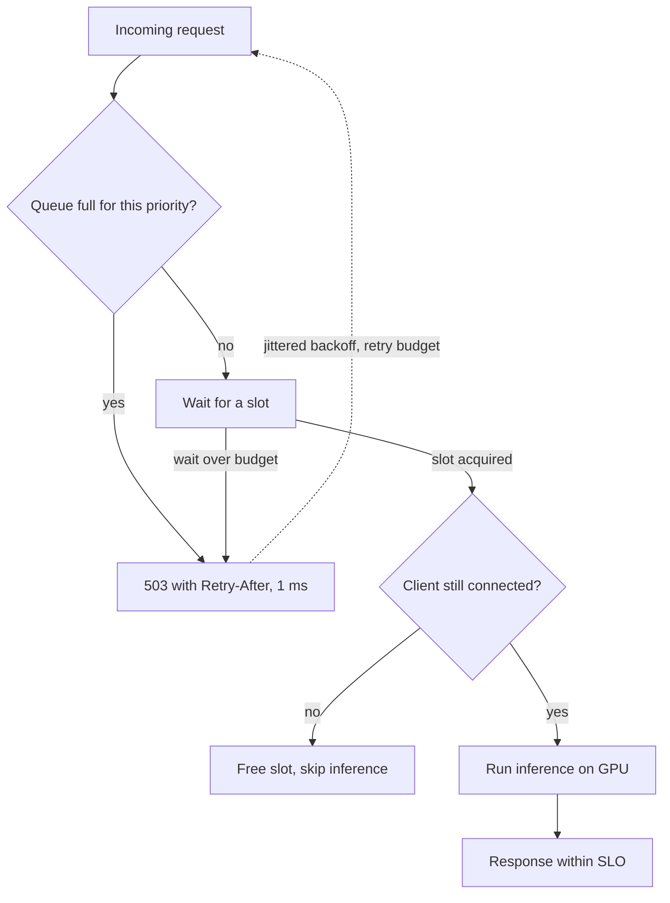

## TL;DR
One agent run fans out into many model and tool calls, so overload arrives fast. **Backpressure**
pushes "slow down" upstream via bounded queues and 429/503; **load shedding** rejects whole runs early
and cheaply so admitted runs finish within budget.

## For agent builders
- **Why it matters for agents.** An agent multiplies load: one user request can become 10 to 50 model calls,
  parallel tool calls and retries. Shedding individual steps wastes the tokens already spent on a run, so
  agents need admission at the run level and honest handling of the provider's 429s.
- **Where it shows up in your stack.** The provider's 429 and `Retry-After`, SDK `max_retries`, a
  semaphore or token budget in front of your model client, vLLM's `max_num_seqs` when self-hosting, the
  workflow engine's per-queue concurrency limits, and fan-out limits on parallel tool calls.
- **What you control.** Run admission by priority and estimated token cost, the concurrency cap per
  tenant and per tool, how the loop reacts to 429 (back off, do not retry harder), and cancelling runs
  whose user left.
- **What you can skip.** Queueing-theory proofs. Keep Little's law, the M/M/1 shape and
  `max_queue ≈ service_rate × max_acceptable_wait`; they size every limit you will set.

## Decision case
### Scenario
An agent platform hits a provider token quota every Monday morning, and a launch in 3 weeks will make
the peak worse. Three workloads share one quota. All figures are illustrative.
- **Quota:** 2.0 million tokens a minute, fixed until a contract change that takes longer than 3 weeks.
- **Peak demand (2 hours):** interactive chat agents 40 runs a minute × 15,000 tokens = 0.6M; background
  research agents 20 × 60,000 = 1.2M; batch document summaries 300 × 2,000 = 0.6M. Total 2.4M, 20% over.
- **Off-peak demand:** 1.4M tokens a minute.
- **Targets:** interactive first token within 3 s at p95; research runs finish within 30 minutes; batch
  summaries within 6 hours of arrival.

### Options
| Option | How it works | Interactive at peak | Batch | Fits 3 weeks |
|---|---|---|---|---|
| A. Bigger queue and autoscaling | queue everything FIFO, add workers | after 30 min the excess is 0.4M × 30 = 12M tokens, a 12M / 2M = 6 minute wait for every new arrival | served late with the rest | yes, but more workers cannot raise a quota |
| B. Retry 429s harder | every step retries on 429 with backoff | each call has about a 2.0 / 2.4 ≈ 83% chance; a 10-call run without retries finishes 0.833^10 ≈ 16% of the time, and retries add load | competes equally with chat | yes, and it feeds a metastable retry storm |
| C. Run-level admission by priority | estimate tokens per run type, admit interactive and research first, batch gets what is left | 0.6M admitted, within quota | gets 0.2M of 0.6M: 200 docs a minute deferred | yes: a gate plus token estimates |
| D. More quota or a second provider | contract change or failover | solves it | solves it | no: lead time exceeds 3 weeks, and a second model needs evals |

### Decision
**Option C now, and start D for next quarter.** Admitting whole runs against the token budget keeps
interactive and research inside quota (0.6M + 1.2M = 1.8M), so neither is shed. Batch takes the
remaining 0.2M tokens a minute.

Over a 2 hour peak, batch defers 200 × 120 = 24,000 documents, 48M tokens. Off-peak spare capacity is
2.0M − 1.4M = 0.6M a minute, so the backlog drains in 48 / 0.6 = 80 minutes. The worst batch delay is
about 2 hours plus 80 minutes, 3 hours 20 minutes, inside 6 hours.
- **Why not A:** the bottleneck is quota, not workers, so the queue converts overload into a 6 minute wait.
- **Why not B:** random 429s spread across steps burn quota on runs that never finish.
- **Why not D now:** it cannot land in 3 weeks; it is the fix for growth, not for this launch.

**What would change it.** A peak of length T hours delays batch by about T hours plus 40T minutes, so
peaks longer than about 3.6 hours break the 6 hour target and D becomes urgent. So does interactive plus
research demand passing 2.0M on its own, because then shedding would hit users.

### Trade-offs accepted
- **Batch runs late on Mondays.** Publish the expected delay and alert on batch queue age above 4 hours.
- **Token estimates can be wrong.** An underestimate lets admitted runs overrun the quota and draw 429s
  mid-run. Track estimate error per run type and lower the admission budget if it passes 10%.
- **A gate is a new failure point.** If it fails open, the quota is overrun; if closed, everything is
  rejected. Alert on admission rate dropping to zero.
- **Rejected interactive runs are possible above forecast.** They get a fast 503 with `Retry-After`;
  monitor interactive rejections and the share retried.

### Review rubric
- **Load in the limiting unit:** demand is stated in tokens a minute per workload against the quota, not
  in requests or CPU.
- **Little's law applied:** the write-up computes backlog and wait for the queueing option and shows why
  a bigger queue fails.
- **Priority is a policy:** it states which class is shed first and why, tied to each class's target.
- **Backlog drain checked:** deferred work is sized and its drain time compared with the deadline.
- **Retry behaviour named:** clients honour `Retry-After` with jitter and a retry budget.
- **Reversal condition:** names the peak length or demand that would force more quota.

## Why it exists
- **Little's law makes overload arithmetic.** `L = λ × W`: requests inside equal arrival rate times time
  spent. A service completing 50 requests per second and receiving 60 accumulates 10 per second forever.
- **Queued requests die on arrival.** After one minute, 600 requests wait, each facing a 12-second wait
  before service starts. With a 10-second client timeout, every one is already dead, yet the server still
  serves them to clients that hung up and retried; real arrival is now 60 plus retries.
- **That is congestive collapse:** goodput (useful work) falls toward zero while machines run at 100%.
- **Trouble starts before capacity is exceeded.** Latency explodes as utilisation approaches 1, so a
  service that looks fine at 70% falls apart during a 30% surge (see the M/M/1 numbers below).
- **The naive fixes fail.** "A bigger queue" converts depth into latency and buys nothing once wait
  exceeds what callers tolerate. "Autoscale" helps only if capacity arrives faster than the queue grows,
  rarely true for GPU services where a replica takes minutes to pull weights and warm up. Fixed-quota rate
  limiting handles abuse but not legitimate surges, and cannot see the server's real condition.
- **LLM serving makes it concrete.** A GPU server batches a fixed number of sequences; beyond that,
  requests queue, time-to-first-token inflates, and users retry or resend from another tab. The
  provider's own 429s are backpressure aimed at you; honouring them with backoff rather than retrying
  harder is the difference between a slow hour and a dead one.

## How it works
### Why latency explodes: the M/M/1 shape
In the simplest queueing model (M/M/1: random arrivals, one server), mean time in system is
`W = S / (1 − ρ)`, where `S` is the service time and `ρ` the utilisation.

| Utilisation ρ | Time in system |
|---|---|
| 50% | 2× service time |
| 90% | 10× |
| 95% | 20× |

- **Real services are not M/M/1,** but the shape, latency exploding as utilisation approaches 1, is general.

### What the system must do
The naive design does neither of these:
1. **Tell the source to slow down** (backpressure).
2. **Refuse work it cannot finish in time** (load shedding).

### Backpressure: propagate the limit upstream
Backpressure is the chain of signals that makes the fastest component in a pipeline run at the speed of
the slowest.

| Where | Mechanism |
|---|---|
| Inside a process | a bounded queue: a producer calling `put()` on a full queue blocks or fails instead of allocating more memory |
| Across a network | TCP flow control (the receive window), HTTP 429 or 503 with `Retry-After`, gRPC `RESOURCE_EXHAUSTED`, a streaming protocol where the consumer pulls chunks at its own pace |
| Message systems | consumer lag you watch, and a producer that pauses on it |

- **Design rule:** every hop has a bounded buffer and a defined behaviour when it is full, *because* an
  unbounded buffer anywhere silently absorbs the signal and the overload reappears there as memory
  exhaustion.

### Load shedding: refuse early, refuse cheap
Shedding drops or rejects some requests to keep the others within their SLO. The mechanics that matter:
- **Reject at the front door.** The cheapest point to refuse is before any expensive work: before
  retrieval, before tokenisation, before taking a GPU slot. A rejection that costs a millisecond
  preserves capacity; one that happens after ten seconds of queueing has already spent it.
- **Use queue wait time as the overload signal**, not CPU. For a GPU service CPU is meaningless, and
  for any service the quantity users feel is how long a request waited. Bound the queue by time:
  if the oldest waiting request has been there longer than the budget allows, start shedding.
- **Size the queue from the SLO**: `max_queue ≈ service_rate × max_acceptable_wait`. At 50 req/s
  and a 2 s wait budget, a queue deeper than 100 only manufactures timeouts.
- **Shed by priority.** Classify work as interactive, background or batch, by tenant tier, or by
  whether it is a retry. Under pressure drop batch first, then background, and protect health checks
  and control-plane traffic absolutely. Priority turns shedding from random failure into a policy.
- **Prefer LIFO or CoDel under overload.** A FIFO queue serves the oldest request, the one most likely
  abandoned. Serving newest-first, or dropping when the minimum sojourn time exceeds a target for a
  sustained interval (CoDel), keeps goodput up during the surge.
- **Adaptive concurrency limits.** Instead of a fixed limit, raise it while latency stays flat and lower
  it when latency rises (gradient or TCP-Vegas-style controllers). This tracks real capacity as model
  sizes, prompt lengths and downstream speed change.

### Where retries fit
- **Retries are a load multiplier.** If a client retries each rejected request up to three times, a 10%
  excess becomes roughly 40% at first order; because retries are themselves rejected, total attempts can
  approach four times the original traffic before the budget runs out.
- **Shedding only works if clients back off** on 429/503 with jitter, honour `Retry-After`, and keep a
  retry budget.
- **Client-side circuit breakers** stop the storm once rejection rates are high; **bulkheads** keep one
  overloaded dependency from consuming every worker.

### Metastable failure: why overload outlives its cause
Bronson et al. describe outages where a temporary trigger pushes the system into overload and a
**sustaining effect** keeps it there after the trigger is gone.
- **Triggers:** a surge, a brief dependency slowdown, a cold cache after a deploy.
- **Sustaining effects:** retries (requests time out, clients retry, retries add load, more time out),
  cache misses that make every request more expensive, work done for abandoned requests.
- **Two stable states at the same offered load:** healthy and collapsed. Returning to healthy needs load
  to drop well below normal, not just back to normal.
- **Breaking the loop:** early rejection stops wasted work; client backoff and retry budgets remove the
  amplification.

### Goodput, not throughput
- **The metric:** successful requests completed within the SLO per second.
- **Throughput lies.** A server at 100% utilisation doing 50 req/s while 90% of responses arrive after the
  client gave up has goodput near zero.
- **Dashboards:** queue wait distribution, rejection rate by priority, and goodput side by side.

### LLM-specific shape
- **Capacity is concurrent sequences and tokens, not requests,** so admission should estimate cost
  (prompt length, requested max tokens) and admit by a token budget.
- **Streaming adds a second backpressure path.** A slow consumer of server-sent events does not slow
  generation, so the server needs a bounded per-connection buffer and cancellation on disconnect, or it
  generates tokens nobody will read.
- **Long generations hold their slot for the whole duration,** so a few multi-minute requests can starve
  interactive ones unless they are in a separate pool.

### Agents as load amplifiers
- **Admit runs, not steps.** A run that is rejected at step 9 of 12 has already spent eight steps of
  tokens for nothing. Decide at the front door whether the whole run fits the budget, using an estimate
  of steps and tokens per run type.
- **Cap fan-out.** Parallel tool calls and sub-agents multiply concurrency inside one run; bound them with
  a per-run semaphore so one ambitious plan cannot take every slot.
- **Back off inside the loop.** When the provider returns 429, the agent step waits per `Retry-After`
  with jitter; immediate retries from hundreds of concurrent runs are the retry storm that sustains a
  metastable collapse.
- **Cancel abandoned runs.** If the user closed the tab or the caller's deadline passed, stop the run
  between steps instead of finishing work nobody will read.

## Diagram
The admission path for one request: every rejection happens before the GPU is touched, and the slot is
released if the client left while queued.



## Examples
### Admission control for a chat endpoint
Shed at the door by priority, bound the queue wait by the SLO, release the slot if the client left while
waiting. The limits would be derived from measured service rate and the latency budget, then adjusted by
an adaptive controller.

```python
import asyncio
from fastapi import FastAPI, HTTPException, Request, Response

app = FastAPI()
MAX_INFLIGHT, MAX_QUEUE, MAX_WAIT_S = 32, 64, 2.0   # capacity, service_rate x wait budget, SLO slice
slots = asyncio.Semaphore(MAX_INFLIGHT)
waiting = 0                                          # single event loop: no lock needed

@app.post("/v1/chat")
async def chat(req: Request):
    global waiting
    priority = req.headers.get("x-priority", "interactive")
    batch_cap = MAX_QUEUE // 4                       # batch work gets a quarter of the queue
    # 1) shed at the door: a 1 ms rejection instead of a 10 s timeout
    if waiting >= MAX_QUEUE or (priority == "batch" and waiting >= batch_cap):
        raise HTTPException(503, "overloaded", headers={"Retry-After": "5"})
    waiting += 1
    try:
        # 2) bounded queue wait: beyond the budget the answer would arrive too late to matter
        await asyncio.wait_for(slots.acquire(), timeout=MAX_WAIT_S)
    except asyncio.TimeoutError:
        raise HTTPException(503, "queue wait exceeded", headers={"Retry-After": "5"})
    finally:
        waiting -= 1
    try:
        if await req.is_disconnected():              # 3) client gave up while queued: do not spend the GPU
            return Response(status_code=204)
        return await run_inference(await req.json()) # your model client; token-cost admission goes here
    finally:
        slots.release()
```

- **Runtime caveat:** before Python 3.12, `asyncio.wait_for` could cancel `Semaphore.acquire()` at the
  same instant it succeeded and leak the slot; on older interpreters wrap the acquire so a timed-out
  acquisition releases what it won.
- **Walk the numbers:** inference averaging 640 ms per request with 32 slots gives a service rate of
  about 50 req/s. A 64-deep queue therefore represents roughly 1.3 s of wait, inside the 2 s budget, and
  anything beyond is rejected in microseconds with a `Retry-After` the client should honour.
- **Export** `waiting`, rejections by priority and queue wait time, and an overload becomes a flat goodput
  line instead of a cliff.

### Worked scenario: queue growth and sizing from Little's law
Pure Python, no dependencies: how fast an unprotected queue grows, when requests start dying, and how
deep the queue may be for a given wait budget.

```python
def mm1_time_in_system(service_s, utilisation):
    return service_s / (1 - utilisation)              # W = S / (1 - rho)

def unprotected_wait_s(arrival, service_rate, seconds_in):
    backlog = max(0, (arrival - service_rate) * seconds_in)
    return backlog / service_rate                     # time a new arrival waits before service

def max_queue(service_rate, wait_budget_s):
    return int(service_rate * wait_budget_s)          # deeper only manufactures timeouts

for rho in (0.5, 0.7, 0.9, 0.95):
    print(f"rho={rho:.2f}: {mm1_time_in_system(1.0, rho):.1f}x service time")
print(unprotected_wait_s(60, 50, 60))                 # 12.0 s after one minute at 60 vs 50 req/s
print(max_queue(50, 2.0))                             # 100
# rho=0.50: 2.0x   rho=0.70: 3.3x   rho=0.90: 10.0x   rho=0.95: 20.0x
```

| Second into a 60 vs 50 req/s overload | Backlog | Wait for a new arrival | With 10 s client timeout |
|---|---|---|---|
| 10 | 100 | 2 s | served |
| 50 | 500 | 10 s | at the limit |
| 60 | 600 | 12 s | dead on arrival, and its retry adds load |

### Worked scenario: shedding steps versus shedding runs
An agent averages 12 model calls per run and the provider quota is 600 requests per minute, enough for
50 runs per minute. A spike brings 80 runs per minute (960 calls). Treat rejections as independent and
ignore retries, which makes the step-level case optimistic.

| Policy | What happens | Runs completed per minute |
|---|---|---|
| Shed individual calls (provider 429s at random) | each call succeeds 600/960 = 62.5% of the time; a run needs all 12 | 80 × 0.625^12 ≈ 0.3 |
| Admit runs at the door, reject the rest with `Retry-After` | 50 runs admitted and given their 12 calls | 50 |

- **Step-level shedding burns the whole quota on runs that never finish,** which is goodput near zero
  while the provider dashboard shows full utilisation.
- **Run-level admission turns the same quota into 50 finished runs** and 30 clean, fast rejections the
  client can retry later.

```python
import asyncio

class RunAdmission:
    """Admit an agent run only if its estimated calls fit the per-minute model-call budget."""
    def __init__(self, calls_per_min: int):
        self.budget, self.used = calls_per_min, 0

    def try_admit(self, est_calls: int) -> bool:
        if self.used + est_calls > self.budget:
            return False                  # reject the whole run now: 503 with Retry-After
        self.used += est_calls
        return True

    async def refill_every_minute(self):
        while True:
            await asyncio.sleep(60)
            self.used = 0

gate = RunAdmission(calls_per_min=600)
print(sum(gate.try_admit(12) for _ in range(80)))   # 50 runs admitted, 30 rejected up front
```

- **Simplification:** the gate charges a run's whole estimate to the minute it is admitted. Runs that span
  several minutes need a sliding window or per-step reservations, plus a per-run step budget for runs
  that outgrow their estimate.

## Production patterns
- **Semaphore plus wait timeout in front of every model client.** Size in-flight slots from measured
  capacity (for vLLM, the engine's own `max_num_seqs` caps batched sequences) and the queue from
  `service_rate × max_acceptable_wait`. Monitor queue wait p50/p99 and rejections by priority.
- **Adaptive concurrency at the proxy or library.** Use a latency-gradient limiter such as Envoy's
  adaptive concurrency filter or Netflix's concurrency-limits library instead of a hand-tuned constant.
  Monitor the computed limit over time and alert when it collapses.
- **Client SDK retry discipline.** Cap SDK retries (provider Python SDKs expose a `max_retries` setting),
  honour `Retry-After`, add full jitter, and keep a per-client retry budget. Monitor retries as a share of
  requests; a rising share during an incident is the metastable warning.
- **Separate pools by class.** Run batch and long-generation work on its own queue or deployment with its
  own slot limit, and keep health checks and control-plane endpoints outside any shed queue. Monitor
  interactive time-to-first-token while batch load rises.
- **Cancel on disconnect for streams.** Check for client disconnect while generating and abort the
  request in the engine, with a bounded per-connection buffer. Monitor tokens generated for disconnected
  clients.
- **Run-level admission with a token budget.** Estimate calls and tokens per agent run type, admit runs
  against the provider quota and your own capacity, and reject the rest before step one. Monitor
  completed runs per minute (agent goodput) and runs abandoned mid-way.
- **Per-run fan-out limit.** Bound parallel tool calls and sub-agents per run with a small semaphore,
  and per-tool concurrency for slow internal APIs. Monitor peak concurrent calls per run and tool queue
  wait.

## Trade-offs
- **Shedding vs queueing.** Shedding sacrifices some requests to keep latency bounded for the rest, which
  is right whenever a late answer is worthless; it flips to queueing when callers will genuinely wait, as
  in batch jobs.
- **Blocking backpressure vs explicit rejection.** Blocking keeps every request eventually served but
  stalls producers and can deadlock if a producer also holds resources the consumer needs; explicit
  rejection is safer across services.
- **Fixed vs adaptive limits.** Fixed concurrency limits are predictable and easy to reason about but go
  stale as prompts, models and dependencies change; adaptive limits track reality at the cost of a
  controller to tune.
- **LIFO vs fairness.** LIFO serving maximises goodput under overload but starves old requests and breaks
  fairness; use it only during overload and return to FIFO when the queue drains.
- **Priority shedding vs honest classification.** It protects the work that matters most, but once every
  team marks its traffic "critical", the mechanism degrades to random drops.
- **Run-level vs step-level admission.** Admitting whole runs protects goodput but needs a cost estimate
  that can be wrong for open-ended agents; it flips toward step-level limits plus a per-run step budget
  when run length varies widely.

## Pitfalls
- **Unbounded queues anywhere in the path** (an async job queue, an executor pool, a channel), visible as
  latency rising for minutes before a memory crash instead of a quick, clean rejection.
- **Shedding after the expensive work.** Rejecting at the model call after retrieval and prompt assembly
  already ran, so the server stays saturated while returning errors.
- **Clients retrying 429 and 503 immediately without backoff.** Every shed request returns within
  milliseconds and arrival rate doubles; the symptom is rejections climbing faster than traffic.
- **Using CPU or request count as the overload signal for GPU-bound work.** The GPU is saturated at 20%
  CPU and queue wait time was the signal all along.
- **Waiting for the trigger to pass in a metastable collapse.** The surge ends but errors stay high
  because retries keep load above capacity; the outage outlasts its cause and ends only when someone
  sheds hard or disables retries.
- **Health checks sharing the shed queue.** Under load the load balancer marks healthy nodes dead and
  removes capacity exactly when it is needed, turning overload into an outage.
- **Agents that retry 429s inside the loop at full speed.** Hundreds of concurrent runs each retry their
  failed step immediately; the symptom is the provider's rejection rate climbing while completed runs
  fall. Fix: honour `Retry-After` with jitter and admit fewer runs.

## When to use
- **Every service with finite capacity needs both:** bounded buffers with a defined full behaviour at
  every hop, and an admission decision at the front door driven by queue wait time and priority.
- **Start** by measuring service rate and the latency budget, set queue bounds from them, and add adaptive
  limits once prompt lengths or model mix vary.
- **Choose** blocking backpressure inside a process or pipeline, explicit 429/503 across service
  boundaries, and always pair shedding with client backoff and retry budgets.
- **Measure** goodput, queue wait percentiles and rejection rate by priority; if rejections never happen,
  the limits are either generous or missing.
- **Day to day:** the semaphore in front of the model client and the `Retry-After` handling in the SDK.
- **For agents:** admit at the run level, cap fan-out per run, and measure completed runs, not calls.
- **Interviews:** derive queue size from Little's law and explain why early rejection raises goodput.

## Role lens
- **Engineer:** Puts a bounded semaphore and a queue-wait timeout in front of every model and tool
  client, honours provider `Retry-After`, and exports goodput and rejection metrics by priority.
- **Architect:** Defines the priority classes and tenant tiers that shedding enforces, sets latency
  budgets that queue bounds derive from, and places bulkheads so one workload cannot starve another.
- **FDE:** Explains to a customer why their burst traffic sees 429s rather than slow answers, tunes
  priorities to their business rules, and sizes capacity against their measured peak arrival rate.

## Check yourself
**Q:** A GPU-backed summarisation service handles about 40 requests per second with p50 latency under
a second. A marketing email sends 90 requests per second for ten minutes. Clients time out at 8
seconds and retry twice. Describe what happens without protection, then design the protection and
justify each number.
**A:** The queue grows by 50 requests per second, so a request arriving *t* seconds into the surge
finds about 50*t* ahead of it and waits roughly 50*t* ÷ 40 ≈ 1.25*t* seconds. From about 6.4 seconds
in, new arrivals cannot be served before their 8-second timeout, and the server spends its capacity on
abandoned requests while clients add two retries each, pushing effective arrival toward 270 per second. Goodput falls near zero though
the GPUs are fully busy, and the collapse can outlast the ten-minute surge because retries keep it
fed, the metastable pattern. Protection: bound the queue by wait time, around 40 × (8 s minus
service time), so no admitted request can miss its deadline; shed above that at the front door with
503 and `Retry-After`; classify the campaign's traffic as batch so it gets a small share and
interactive users stay protected; require the client SDK to back off with jitter and cap retries at a
budget; add an adaptive concurrency limit so the bound follows real latency; and alert on goodput and
rejection rate rather than utilisation. The campaign then completes slower, not never, and nobody
else notices.

## Interview questions
### What is the difference between backpressure and load shedding?
- **Backpressure** propagates "slow down" upstream: bounded queues that block or fail, 429/503 with
  `Retry-After`, flow control, so the source sends less.
- **Load shedding** rejects some work early and cheaply so the admitted work meets its latency budget.
- **You need both,** because backpressure only helps if the source listens, and shedding protects you when
  it does not.

### How would you size the request queue for an LLM endpoint?
- **Measure service rate,** for example 32 slots at 640 ms each is about 50 req/s.
- **Apply `max_queue ≈ service_rate × max_acceptable_wait`:** with a 2 s wait budget, about 100; deeper
  only manufactures timeouts.
- **Bound it by time too,** shedding when the oldest waiter exceeds the budget, since prompt lengths change
  real service time.

### A surge ended twenty minutes ago but errors are still high. What is happening and what do you do?
- **Metastable failure:** retries, cold caches or work for abandoned requests sustain the overload after the
  trigger is gone.
- **Break the loop:** shed hard at the front door, disable or cap client retries, and let load fall well
  below normal before reopening.
- **Prevent recurrence** with retry budgets, jittered backoff and goodput alerts.

### Your agent platform hits the provider's rate limit at peak and almost no runs finish. How do you fix it?
- **Diagnose step-level shedding:** 429s land randomly on steps, so most runs fail mid-way after spending
  tokens; at 62.5% per-call success a 12-call run almost never completes.
- **Admit whole runs** against the quota with an estimated call count, reject the excess up front with
  `Retry-After`, and put batch agents in a lower-priority pool.
- **Stop the storm:** back off on 429 with jitter inside the loop, cap SDK retries, and track completed
  runs per minute.

### Why not just autoscale instead of shedding?
- **Scaling is too slow for GPU services:** a replica takes minutes to pull weights and warm up, while the
  queue grows every second.
- **Shedding buys the time:** it keeps admitted requests within SLO while capacity arrives, and autoscaling
  can still run in the background.

### Which metric would you alert on for overload, and why not CPU or throughput?
- **Goodput and queue wait percentiles:** successful requests within SLO per second, and how long requests
  waited, are what users feel.
- **CPU is meaningless** for GPU-bound work, and throughput stays high during collapse while nearly every
  response arrives after the client gave up.
- **For agents, goodput is completed runs per minute,** because a run that dies at step 9 spent tokens and
  delivered nothing.

## Quiz
### Q: Why does adding a larger queue not fix an overloaded service?
- [ ] Larger queues consume GPU memory that the model needs
- [x] Queue depth converts directly into wait time; once wait exceeds what callers tolerate, the server serves requests that have already been abandoned
- [ ] Queues only work for CPU-bound services, not GPU-bound ones
- [ ] Larger queues reduce the service rate by increasing lock contention
> By Little's law, waiting requests equal arrival rate times wait time. A deeper queue lets wait time
> grow past client timeouts, so capacity is spent on work nobody will receive.

### Q: Where should load shedding decisions be made, and why?
- [ ] After inference, so the server can return a partial answer instead of an error
- [ ] At the client, because only it knows its own priority
- [x] As early and cheaply as possible, before retrieval and prompt assembly, so a rejection preserves capacity instead of spending it
- [ ] In the database layer, where contention is easiest to measure
> A rejection that costs microseconds protects the service. Rejecting after seconds of queueing or
> after expensive preprocessing has already consumed the resources shedding was meant to save.

### Q: Which signal is the best trigger for shedding on a GPU-backed LLM endpoint?
- [ ] CPU utilisation above 80%
- [ ] Total requests per second exceeding last week's average
- [x] Queue wait time of admitted requests approaching the latency budget
- [ ] Number of open TCP connections
> Queue wait is what users experience and tracks real capacity regardless of model size or prompt
> length. CPU is irrelevant for GPU-bound work, and request counts ignore how expensive each request is.

## Use cases & projects
### Use cases
- **Agent platforms on a shared provider quota.** Run-level admission turns a fixed requests-per-minute
  limit into the maximum number of finished runs instead of many half-finished ones.
- **Self-hosted model servers behind agents.** A semaphore plus queue-wait timeout in front of vLLM keeps
  interactive agent steps inside their latency budget during batch surges.
- **Agents with parallel tool calls or sub-agents.** Per-run fan-out limits stop one plan from taking
  every slot and every internal API connection.
- **Streaming assistants.** Cancelling generation on disconnect stops spending GPU time on answers no one
  will read.

### Mini project
**Load-test an agent with and without run-level admission (2-3 hours).**
- **Goal:** show that admitting whole runs raises completed agent runs per minute under overload.
- **Steps:** write a fake provider that allows N calls per minute and returns 429 with `Retry-After`
  beyond it (drive it with a simulated clock so a test minute takes a second); run a 12-step fake agent at 1.6× the sustainable run rate, first with no admission control,
  then with the `RunAdmission` gate and jittered backoff on 429.
- **Done when:** a table shows calls made, runs completed and tokens wasted on unfinished runs for both
  policies, and the admitted policy completes close to the sustainable run rate.
