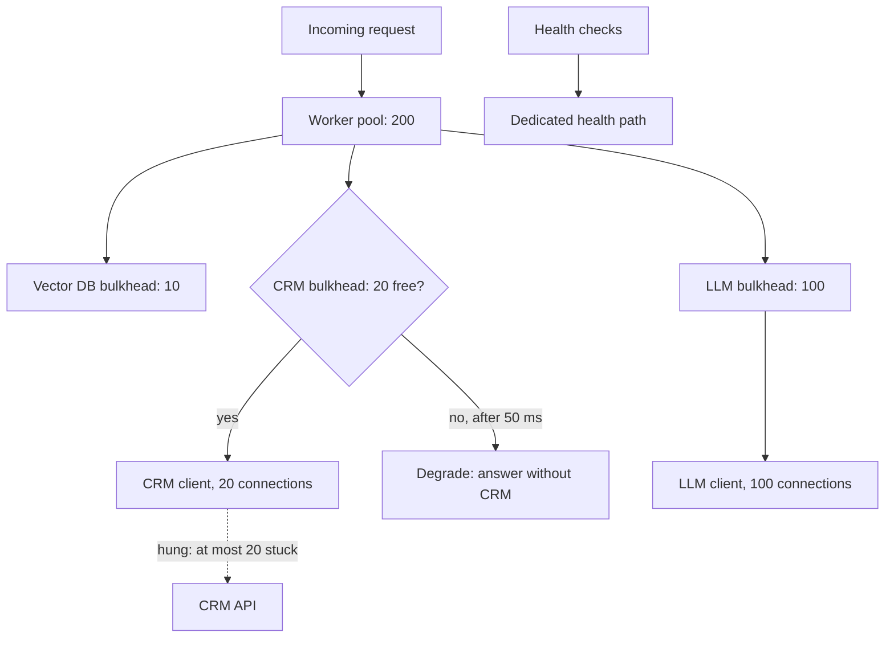

## TL;DR
A bulkhead partitions a shared resource (workers, connections, queues, pods) per dependency, workload
class or tenant, so one exhausted compartment cannot drain the others. It bounds damage in advance, unlike
a breaker; the price is capacity that cannot be borrowed.

## Why it exists
- **One slow dependency becomes a full outage.** A service with one pool of 200 workers calls an LLM, a
  vector database and a customer's CRM API. The CRM hangs until the 30-second timeout. At only 5 CRM calls
  per second, Little's law (concurrency = arrival rate × time in system) gives 5 × 30 = 150 stuck workers,
  three quarters of the pool, reached within half a minute.
- **Healthy paths die with it.** Add LLM traffic and the pool is full; requests that need only the
  healthy LLM and vector store are rejected, health checks share the pool and fail, and pods restart.
  Workload mixing does the same with no failure at all: a batch summarization job that is merely slow and
  plentiful fills the pool, interactive users wait behind it, and nothing is broken.
- **The usual fixes do not cap the aggregate.** A bigger pool only raises the threshold: occupancy under a
  hang is rate × timeout, set by the caller's traffic, and retries push that rate up until any fixed pool
  fills. A shorter timeout only shrinks the number, it does not cap it. A circuit breaker needs a minimum
  number of observed failures first, and a hung dependency that never errors can take minutes to register.
- **The missing property is a hard ceiling per compartment.** A ship's hull is divided into watertight
  compartments so one breach floods one section, not the vessel; a software bulkhead does the same for
  worker threads, connections, semaphores, queues and pods. Where a circuit breaker reacts after it
  detects failure, a bulkhead bounds the damage whether or not anything detects it.

## How it works
### Size with Little's law
```
cap ≈ peak rate × p99 latency + burst headroom     (and a small fraction of the total pool)
tolerated average latency = cap ÷ rate
```
- **Use a high percentile, not the mean,** because LLM latency has a long tail and the cap must absorb it.
- **In the failure case latency equals the timeout,** so occupancy can never exceed the cap no matter how
  slow the dependency gets. The formula tells you both how large a cap is safe and the worst damage the
  dependency can do.
- **Read it backwards.** A cap *C* on a dependency called at rate λ tolerates an average latency of up to
  *C* ÷ λ before callers are rejected. A CRM cap of 20 at 5 calls per second admits everything until CRM
  latency averages 4 seconds, about thirteen times its normal 300 ms; beyond that the bulkhead sheds.
- **That number is the real design choice:** how much slowdown you will absorb before you would rather
  degrade.

### Oversubscription is fine; check the right condition
- **Caps do not have to sum to the pool,** because dependencies rarely all hang at once.
- **What must hold:** when any one compartment is pinned at its cap, the remaining capacity still covers the
  healthy paths' demand. Include any pair that shares a plausible common cause, such as two APIs behind the
  same customer VPN.
- **Check that condition, not the sum.**

### Five forms, from cheapest to strongest
| Form | Mechanism | Use when | Cost |
|---|---|---|---|
| 1. Semaphore | counting semaphore per dependency; acquire before the call, release after; fail immediately or wait a very short bounded time | non-blocking clients; the default in async services | nearly free |
| 2. Thread pool | separate executor per dependency | blocking clients and CPU-bound work (a synchronous SDK, a tokenizer, PDF parsing) that would stall the event loop or each other | threads and context switches |
| 3. Connection pool | separate HTTP client with its own connection limits per upstream | always, *in addition to* a semaphore | a client object per upstream |
| 4. Queue | separate queues and consumer groups per workload class (interactive versus batch, per tenant tier) | batch and interactive share a fleet | more queues and consumers |
| 5. Deployment | separate pods, node pools, namespaces with resource quotas, or clusters; separate provider keys or model deployments | a tenant pays for isolation or a vendor limit must be isolated | highest |

- **Why the connection pool needs its own compartment:** it is itself a shared resource. A hung upstream
  holds its connections open, and if every dependency shares one client, the healthy ones cannot get a
  socket even though their semaphores show headroom.
- **Why queues isolate:** the consumer fleet is the compartment, so a flood of batch jobs can fill the batch
  queue to any depth without delaying an interactive message.
- **Why deployments are strongest:** they are the only form that also isolates vendor-side limits.

### What to compartment by
- **By dependency:** the most common, and the baseline.
- **By workload class:** protects interactive latency from batch volume.
- **By tenant tier:** how you sell isolation.
- **By criticality, the one teams forget:** health and readiness endpoints, authentication and the
  admission layer must never share a compartment with LLM calls, or an upstream outage turns into
  restarts and lock-outs.

### Reject or wait
- **When a compartment is full, fail fast or wait a bounded, short time for a permit.**
- **Unbounded waiting is forbidden** because it recreates the shared-pool problem one level up: the waiters
  are now the stuck resource.
- **A rejection should enable graceful degradation** (answer without the CRM context, serve from cache,
  enqueue for later) or an honest 503 with `Retry-After`.

### How it composes with breakers and load shedding
| Mechanism | Kind | Role |
|---|---|---|
| Bulkhead | static limit | bounds damage regardless of health; also caps the load you put on the dependency |
| Circuit breaker | dynamic reaction | stops sending once failure is observed |
| Load shedding | global admission control | drops the lowest-value work when the whole service is saturated |

- **The bulkhead protects the dependency too:** a cap of 20 is the most concurrent load your service can
  ever put on the CRM, which matters when the CRM's own capacity is the thing that is failing.
- **They stack:** the bulkhead keeps a hung dependency from exhausting the pool while the breaker
  accumulates its minimum calls; once the breaker opens, even the bulkhead's permits are freed; if the
  whole service is saturated, shedding drops the lowest-value work first.

## Diagram
Each dependency gets its own permits and its own HTTP client, and health checks bypass them all; a full
compartment degrades its own requests instead of draining the shared pool.



## Examples
### Per-dependency semaphore bulkheads with a degrade path
Semaphore bulkheads with a short bounded wait, separate HTTP clients so the connection pool is partitioned
too, and a degrade path when a compartment is full. The caps come from Little's law with illustrative
traffic numbers.

```python
import asyncio, httpx

class BulkheadFull(Exception): pass

class Bulkhead:
    """Caps concurrent calls to one dependency; a caller waits at most max_wait for a slot."""
    def __init__(self, name, max_concurrent, max_wait=0.25):
        self.name, self.max_wait = name, max_wait
        self.sem = asyncio.Semaphore(max_concurrent)

    async def run(self, fn, *args, **kw):
        try:
            await asyncio.wait_for(self.sem.acquire(), self.max_wait)
        except asyncio.TimeoutError:
            raise BulkheadFull(f"{self.name} at capacity")     # fail fast; never queue without bound
        try:
            return await fn(*args, **kw)
        finally:
            self.sem.release()                                  # released on success, error or cancellation

# Little's law: concurrency = peak rate x tail latency, plus headroom. Illustrative numbers:
# LLM 20 rps x 3 s = 60 -> cap 100; vector DB 40 rps x 0.05 s = 2 -> cap 10; CRM 5 rps x 0.3 s = 1.5 -> cap 20
# (generous headroom for the CRM, but still a tenth of the 200-worker pool, so a hang can take at most 20).
LLM = Bulkhead("llm", 100)
VEC = Bulkhead("vector_db", 10)
CRM = Bulkhead("crm_api", 20, max_wait=0.05)

# Separate HTTP clients: the connection pool is a shared resource as well.
llm_http = httpx.AsyncClient(limits=httpx.Limits(max_connections=100), timeout=30.0)
crm_http = httpx.AsyncClient(limits=httpx.Limits(max_connections=20), timeout=5.0)

async def handle(req):
    docs = await VEC.run(search, req.query)
    try:
        account = await CRM.run(lookup_account, req.user_id)
    except BulkheadFull:
        account = None                                          # degrade: answer without CRM context
    return await LLM.run(generate, req, docs, account)
```

- **Outcome with the CRM hung:** at most 20 permits plus 20 connections are ever tied up; the other 180
  workers keep serving requests that need only retrieval and the model.
- **Degradation is fast:** CRM-dependent requests degrade in 50 milliseconds instead of hanging for 30
  seconds.
- **The `finally` matters:** a permit leaked on cancellation is a compartment that slowly fills with ghosts.

### Sizing calculator with the oversubscription check
Runnable: computes normal demand, the latency each cap tolerates, and whether the healthy paths still fit
when one compartment is pinned at its cap.

```python
POOL = 200
deps = {                      # name: (peak_rps, p99_latency_s, cap)
    "llm":       (20, 3.0, 100),
    "vector_db": (40, 0.05, 10),
    "crm_api":   (5, 0.3, 20),
}

def demand(rps, latency):
    return rps * latency      # Little's law: concurrency = rate x time in system

for name, (rps, p99, cap) in deps.items():
    print(f"{name}: normal {demand(rps, p99):.1f}, cap {cap}, "
          f"sheds once avg latency > {cap / rps:.2f}s")

for hung, (_, _, cap) in deps.items():   # pin one compartment at its cap
    healthy = sum(demand(r, l) for n, (r, l, _) in deps.items() if n != hung)
    left = POOL - cap
    print(f"{hung} hung: {left} workers left, healthy paths need {healthy:.1f} -> "
          f"{'ok' if left >= healthy else 'CASCADE'}")
# crm_api: normal 1.5, cap 20, sheds once avg latency > 4.00s
# crm_api hung: 180 workers left, healthy paths need 62.0 -> ok
```

### Worked scenario: the CRM hang, before and after
| Quantity | Shared pool | With bulkheads |
|---|---|---|
| CRM occupancy while hung | 5 × 30 = 150 workers | capped at 20 |
| LLM demand | 20 × 3 = 60 workers | 60, served from the 180 left |
| Total demand vs pool | 210 vs 200: saturated | 80 vs 200: fine |
| CRM-dependent request | hangs 30 s, then fails | `BulkheadFull` in 50 ms, answered without CRM |
| Health checks | miss, pods restart | own path, stay green |

## Production patterns
- **Resilience4j bulkheads on the JVM.** A semaphore bulkhead per dependency with `maxConcurrentCalls` and a
  short `maxWaitDuration`; a thread-pool bulkhead (`maxThreadPoolSize`, `coreThreadPoolSize`,
  `queueCapacity`) for blocking SDKs. Monitor available permits and rejected calls per bulkhead.
- **Blocking SDKs off the event loop.** In asyncio, run a synchronous client on its own executor via
  `loop.run_in_executor(executor, fn)` with a small dedicated `ThreadPoolExecutor(max_workers=...)`, so a
  hang stalls only that executor. Monitor event-loop lag; spikes mean blocking code leaked in.
- **One HTTP client per upstream.** Create a separate client with its own connection limits per upstream
  (as with `httpx.Limits` above) and its own timeout. Monitor connection-pool wait time per client.
- **Separate queues for batch and interactive.** Give batch work its own queue and consumer group with its
  own concurrency, so batch depth never delays interactive messages. Monitor per-queue depth and age of
  the oldest message.
- **Namespace quotas for deployment bulkheads.** In Kubernetes, give each workload class or tenant tier its
  own namespace with a `ResourceQuota`, or its own node pool, so one class cannot schedule over another.
  Monitor quota usage and pending pods per namespace.

## Trade-offs
- **Isolation vs utilization.** Capacity in one compartment cannot be borrowed by another, so the CRM's 20
  permits sit idle when the CRM is quiet. When load is bursty and uncorrelated, soft partitions (a
  guaranteed minimum per compartment plus a shared overflow pool) recover most of the waste.
- **Cheap vs strong forms.** Semaphores are cheap but only bound non-blocking work; thread pools isolate
  blocking and CPU-bound calls at the cost of threads; separate deployments isolate everything, including
  vendor limits, at the cost of money. Escalate only when the cheaper form demonstrably leaks.
- **Short vs long wait.** A tiny `max_wait` fails fast but rejects during ordinary micro-bursts; a longer
  one absorbs bursts but ties callers up. Interactive paths want the short wait; batch paths can afford to
  queue, in their own queue.
- **Fine vs coarse compartments.** Many fine compartments give precise isolation and metrics but multiply
  configuration and the chance of mis-sizing one; coarse compartments are simple but share blast radius.
  Partition by failure domain, not by code module.

## Pitfalls
- **Sizing the cap from mean latency.** Symptom: steady trickle of `BulkheadFull` rejections on a healthy
  dependency at peak, because the tail of slow but successful calls holds permits the mean did not account
  for. Fix: size from p99.
- **Setting the cap as a large fraction of the pool.** Symptom: a bulkhead of 150 out of 200 "works" until
  the dependency hangs, and the service still cascades because 150 stuck workers is an outage.
- **Sharing one HTTP client across dependencies behind separate semaphores.** Symptom: the CRM semaphore
  shows five in flight while CRM calls hang, because the LLM's slow responses hold every connection in the
  common pool.
- **Blocking calls inside async code.** Symptom: every compartment reports headroom, yet everything
  including health checks stalls, because a synchronous SDK call froze the event loop that all the
  semaphores live on.
- **Letting health and readiness endpoints share the worker pool.** Symptom: during a dependency outage the
  orchestrator restarts healthy pods, converting a partial outage into a total one.
- **No degrade path for `BulkheadFull`.** Symptom: user-visible error rate rises in lockstep with the share
  of requests that happen to touch the saturated dependency, even though the answer could have been given
  without it.
- **Releasing the permit only on the success path.** Symptom: capacity drifts downward over days; the
  compartment reads full with no real work in flight, and a restart "fixes" it.

## When to use
- **Use when** a service talks to more than one dependency with different latency or reliability, or
  serves more than one workload class.
- **Start with the cheap baseline:** a semaphore per dependency sized from Little's law, a separate HTTP
  client per upstream, and a dedicated path for health checks. Promote to queue-level separation when
  batch and interactive traffic share a fleet, and to deployment separation when a tenant pays for it or a
  vendor key limit must be isolated.
- **Measure** per-compartment in-flight count, rejection rate and wait time; alert on sustained saturation
  of any one compartment, which is an early warning long before the breaker trips.
- **Interviews:** the question is "one slow dependency took down the whole service, how do you prevent
  it". The complete answer is timeouts to bound each call, bulkheads to bound the aggregate, and breakers
  to stop sending, with the sizing arithmetic to show why each is needed.

## Role lens
- **Engineer:** Configures per-dependency semaphores and per-upstream clients, moves blocking SDKs onto
  their own executor, and writes the degrade path for every `BulkheadFull`.
- **Architect:** Decides the compartment boundaries, by dependency, workload class, tenant tier and
  criticality, and whether each lives in-process, at the queue, or as a separate deployment.
- **FDE:** Uses bulkheads so a customer's flaky legacy system cannot take down the agent, and separates
  the customer's bulk backfills from their users' interactive sessions inside one deployment.

## Check yourself
**Q:** An agent service runs one shared pool of 200 workers with 30-second timeouts. It calls an LLM
(about 20 requests per second, 3 seconds each) and a CRM API (5 requests per second, normally 300 ms).
The CRM API hangs. Walk through what happens with numbers, then show how bulkheads change the outcome.
**A:** With the CRM hung, each CRM call occupies a worker until the 30-second timeout. Little's law gives
5 × 30 = 150 workers stuck in steady state, reached within about 30 seconds. LLM traffic needs 20 × 3 = 60
workers, so total demand is 210 against a pool of 200: the pool saturates, LLM-only requests queue or
fail, health checks miss, and pods restart. With a CRM bulkhead capped at 20 permits and a 50 ms maximum
wait, CRM occupancy can never exceed 20; 180 workers remain, more than the 60 the LLM path needs.
CRM-dependent requests receive `BulkheadFull` within 50 ms and degrade by answering without CRM context.
A separate HTTP client for the CRM keeps its hung sockets out of the LLM's connection pool. Shrinking the
CRM timeout to 5 seconds additionally lowers worst-case demand to 25 even without the cap, and a circuit
breaker on top releases the 20 permits once failures are confirmed.

## Interview questions
### What is a bulkhead, and why isn't a bigger shared pool an equivalent fix?
- **Definition:** a hard concurrency ceiling per compartment (dependency, workload class, tenant tier), so
  one exhausted compartment cannot drain capacity the others need.
- **A bigger pool only moves the threshold,** because occupancy during a hang is rate × timeout, set by
  caller traffic; retries raise the rate until any fixed pool fills.
- **The bulkhead turns that unbounded number into one you chose.**

### How would you size a bulkhead for an LLM dependency doing 20 requests per second at a 3-second p99?
- **Little's law:** 20 × 3 = 60 concurrent calls in normal operation, so a cap around 100 leaves burst
  headroom.
- **Check what it tolerates:** 100 ÷ 20 = 5 seconds of average latency before shedding starts.
- **Check the pool:** with that compartment pinned at 100, the remaining workers must still cover every
  healthy path's demand.

### Every compartment shows free permits, yet the whole service, including health checks, is stalled. What do you suspect?
- **A blocking call on the event loop,** such as a synchronous SDK inside async code; all semaphores live on
  that loop, so nothing progresses.
- **Or a shared HTTP client:** a hung upstream holds every connection in the common pool while semaphores
  show headroom.
- **Fix:** move blocking work to its own executor, give each upstream its own client, and watch event-loop
  lag and connection-pool wait.

### When would you not use hard per-dependency bulkheads?
- **When load is bursty and uncorrelated and idle capacity is costly:** hard caps strand permits, so use soft
  partitions with a guaranteed minimum plus a shared overflow pool.
- **When there is only one dependency and one workload class,** a single pool with timeouts and load
  shedding is simpler and loses nothing.

### How do bulkheads, circuit breakers and load shedding work together during a dependency hang?
- **Bulkhead first:** caps how many workers the hung dependency can hold while the breaker is still
  accumulating its minimum calls.
- **Breaker next:** once failures are confirmed it stops sending, freeing the bulkhead's permits.
- **Shedding last:** if the whole service is saturated, global admission control drops the lowest-value
  work first.

## Quiz
### Q: What is the essential difference between a bulkhead and a circuit breaker?
- [ ] A bulkhead retries failed calls; a breaker does not
- [x] A bulkhead statically bounds resource use per compartment regardless of health; a breaker dynamically stops calls after observing failures
- [ ] A bulkhead applies to databases and a breaker to HTTP APIs
- [ ] They are two names for the same mechanism in different libraries
> The bulkhead works before and without detection: a hung dependency can never hold more than its cap.
> The breaker needs evidence of failure first, then removes load entirely. They are complementary, not
> interchangeable.

### Q: A dependency is called 10 times per second with a 20-second timeout. In the worst case, how many concurrent calls can it tie up without a bulkhead?
- [ ] 10
- [ ] 20
- [x] 200
- [ ] 2
> Little's law: concurrency equals arrival rate times time in system, and when the dependency hangs the
> time in system is the timeout, so 10 × 20 = 200. The bulkhead cap replaces that number with a ceiling
> you choose.

### Q: Why give each upstream its own HTTP client even when per-dependency semaphores are already in place?
- [ ] Separate clients make requests faster by avoiding TLS handshakes
- [x] The connection pool is itself a shared resource, and a hung upstream's open connections can exhaust it for healthy upstreams
- [ ] Semaphores do not work with HTTP clients
- [ ] It is required by the HTTP/2 specification
> A semaphore bounds how many calls your code starts, but a shared client has its own connection limit;
> sockets held open by a hung dependency are unavailable to the others, so the healthy paths stall while
> their semaphores show plenty of permits.
