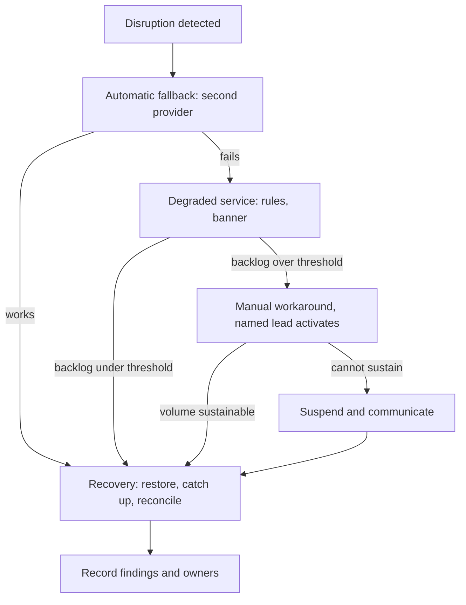

## TL;DR
Business continuity keeps the business functions your agent performs running through any disruption:
provider outages, model deprecations, tool vendor changes, missing approvers, key people leaving.
Disaster recovery is its technical subset; a business impact analysis comes first.

## For agent builders
- **Why it matters for agents.** Once an agent does a job people depend on (triage, refunds, scheduling),
  its model, tools and human approvers become business dependencies. Most continuity events for agents
  never show on a dashboard: a deprecation notice, a quota cut, the one prompt owner leaving.
- **Where it shows up in your stack.** The fallback model list and its eval scores, the degraded-mode
  flag, the human-approval queue, portable prompts and tool schemas in git, and the vendor-exit checklist
  for model and tool suppliers.
- **What you control.** The continuity ladder per agent function, which rung each failure lands on,
  whether a validated second model exists, and how manual or fallback work is reconciled afterwards.
- **What you can skip.** The ISO 22301 management-system details and BIA templates; the business owns
  those. Know the RTO + catch-up rule and build the ladder rungs that are engineering's.

## Decision case
### Scenario
An insurer's claims-triage agent classifies first notices of loss and routes them to adjusters. It runs
on one provider's fine-tuned model, and the provider has just announced that model's retirement in 90
days. No outage has happened; the function still stops on day 91. All figures are illustrative.
- **BIA entry:** about 2 million model calls a month; maximum tolerable downtime 4 hours, because the
  regulator expects claims acknowledged within that window.
- **Quality floor:** at least 94% on the 1,200-item eval set, so 1,128 items. Today's tuned model scores
  1,141 (95.1%).
- **Constraints:** EU data residency for prompts, 2 engineers, a 30-day procurement cycle for any new
  vendor, and the risk committee has flagged single-vendor concentration in its last two reviews.

### Options
| Option | How it works | Eval score | Fits 90 days | Vendor concentration |
|---|---|---|---|---|
| A. Same provider's successor | port prompts, re-tune when tuning opens on day 30 | 1,124 (93.7%) prompted, 4 short; tuned score unknown | about 30 + 14 tune + 7 eval + 14 shadow = 65 days, if tuning closes the gap | unchanged |
| B. Second provider as primary | port prompts and tool schemas, keep A's successor validated as rung-1 fallback | 1,133 (94.4%) prompted, 5 above the floor | 30 procurement + 21 port + 14 shadow = 65 days | removed: two validated vendors |
| C. Self-host an open-weights model | tune a small model on past claims | 1,118 (93.2%), 10 short | GPUs, serving and on-call the team has never run | removed, but adds an ops dependency |
| D. Ask for an extension | negotiate more time | unchanged | depends on the vendor | unchanged |

### Decision
**Option B: move to a second EU-hosted provider, and keep the first provider's successor as the
validated fallback.** It is the only option that clears the 1,128 floor today, without depending on a
tuning run whose result is unknown.

It also resolves the concentration risk the committee raised. Both
A and B take about 65 days, so B leaves the same 25 days of slack against the deadline.
- **Why not A:** it might work, but it bets the deadline on a tuning result and leaves the next
  deprecation just as dangerous.
- **Why not C:** 10 items short, and it trades a vendor risk for an operations risk the team cannot staff.
- **Why not D:** an extension is a request, not a plan; ask for it anyway as slack.

**What would change it.** If procurement cannot sign within 30 days, start A in parallel and pick
whichever passes the eval first.

If the successor, once tuned, beats the second provider on the eval
set, swap which one is primary and which is fallback. If residency rules out the second provider, A
becomes the only path and the extension becomes urgent.

### Trade-offs accepted
- **A thin quality margin.** 5 items above the floor. Run the eval set on every prompt change and alert
  below 1,133.
- **Higher run cost.** The second provider may cost more per token; track cost per claim weekly.
- **Two prompt sets to maintain.** The fallback is only real if it is exercised: route traffic to it for
  one hour each month and record its score.
- **The fallback is below the floor.** At 93.7% it is a degraded rung, so its outputs go to human review
  while it is active, with a banner and a reconciliation sample afterwards.

### Review rubric
- **Function first:** the write-up starts from the BIA entry (volume, maximum tolerable downtime,
  quality floor), not from model names.
- **Evidence, not brochures:** every option has an eval score on the same set, converted to items
  against the floor.
- **Timeline arithmetic:** each option's path to production sums to a date inside the notice period
  with stated slack.
- **Concentration addressed:** the write-up says whether the next deprecation will be a crisis or
  scheduled work.
- **Degraded rung defined:** what happens to outputs while a below-floor fallback is serving.
- **Reversal condition:** names the procurement, eval or residency result that would move the decision.

## Why it exists
- **DR answers "how do we bring the system back", not the hour in between.** Which functions must keep
  working, who may declare the failover, how customers are told, what staff do by hand, and what happens
  when the failure is a supplier you cannot restore.
- **A fast restore without authority is not continuity.** A company that restores its database in forty
  minutes but spends six hours finding who may approve the restore has a DR plan and no continuity.
- **More redundancy cannot touch many disruptions.** A provider deprecates your tuned model with ninety
  days' notice; a vendor changes terms so your use case is no longer permitted; a regulator halts
  processing of a data category; the engineer holding undocumented knowledge leaves. None show on an
  uptime dashboard, and all stop a function as thoroughly as a region outage.
- **AI products concentrate these risks.** Many run a core function on a single external model, a single
  embedding model the whole index depends on, and a few people who understand the evaluation set.
- **Buyers ask.** "Describe your business continuity plan" and "what happens if your AI vendor is
  unavailable" are standard security-questionnaire lines, and a credible answer is often a precondition
  for the deal.

## How it works
### Background: the BC lifecycle in brief
- **Business impact analysis (BIA) first,** because mid-disruption nobody has time to decide what
  matters. It is a ranked inventory of business **functions, not systems**: what each does and who
  depends on it, its **maximum tolerable downtime** (how long before harm becomes unacceptable; some
  frameworks say maximum acceptable outage), the resources, systems and suppliers it needs, and what an
  hour of disruption costs in money, compliance exposure and trust.
- **RPO and RTO for each supporting system are derived from the BIA,** so an honest one often shrinks the
  expensive list: most functions can wait a day, a few cannot wait ten minutes.
- **Restoring the system is not restoring the function.** People still clear the backlog, re-enter manual
  work and verify results, so the system RTO must leave room:

```
RTO + time to catch up and verify ≤ maximum tolerable downtime
```

- **Example:** a function that tolerates four hours and needs two hours of catch-up gets an RTO of two
  hours, not four.
- **Threat and dependency mapping** lists, per function, how it can be disrupted and through which
  dependency; FMEA is the structured tool for it.

| Category | Examples |
|---|---|
| Infrastructure | region, network |
| Suppliers | model provider, vector database SaaS, identity provider |
| Data | corruption, loss of access |
| People | key-person loss, mass unavailability |
| External | legal, regulatory, reputational |

### Continuity risks specific to agents
- **Supplier concentration on one model vendor,** plus model and API deprecation timelines and sudden
  pricing or quota changes.
- **Prompts, tool schemas and eval sets are intellectual property** that may live in one person's head
  or one unbacked-up notebook.
- **Tool and MCP server suppliers.** An agent that books, files or pays through a third-party API stops
  when that API changes terms or retires an endpoint, even if your model is fine.
- **Human approvers are a dependency.** An agent whose consequential actions wait on a human gate is
  only as continuous as the approver rota; holidays and sick days are continuity events.
- **Embedding model lock-in.** The whole index depends on one embedding model; its retirement forces a
  re-embed that must be planned like a migration.

### Strategies per function, in a ladder
Each agent-backed function gets a sequence of fallbacks, cheapest and most automatic first:
1. **Automatic technical fallback**: secondary provider, smaller self-hosted model, cached results.
   Owned by engineering and covered by fault-tolerance mechanisms.
2. **Degraded service**: retrieval-only answers, templated responses, longer queues, or the agent drafts
   and a human sends, with customers informed. Owned by product; the acceptable degradation is decided in
   advance, not in the incident.
3. **Manual workaround**: humans perform the function with a documented procedure and the minimum
   tooling, *because* the business function matters more than the automation that normally does it.
4. **Suspension with communication**: the function pauses, customers and regulators are told what and
   when, and the backlog plan is known.

### Phases, plans and drills (compressed)
| Phase | What happens |
|---|---|
| **Response** | detect, contain, decide to activate, communicate |
| **Continuity** | operate on the chosen rung of the ladder for as long as needed |
| **Recovery** | restore the primary path, work off the backlog, reconcile manual or fallback work into the systems of record, stand down |

- **Plans are detailed about response and vague about recovery,** yet recovery is where data gets lost:
  tickets triaged on a spreadsheet never entered, fallback-model answers nobody re-checked.
- **The plan documents** activation criteria (who may declare an event, on what evidence), roles with
  named deputies and decision authority, a communication tree for staff, customers and regulators, and
  recovery and return-to-normal steps.
- **Write it for 3 a.m.** with the usual experts unavailable; it is a different document from an
  architecture diagram.
- **Plans decay, so test them.** Tabletop exercises walk a scenario on paper and surface missing
  decisions; functional drills execute the fallback (switch provider in production for an hour, process
  a day's work manually for a sample). Each exercise ends with recorded findings and owners.
- **Review** when architecture, suppliers or staffing change, and at least annually. ISO 22301 formalises
  this lifecycle; regulated customers may ask for alignment with it.

### Vendor exit as a continuity control
For every critical supplier of your agent (model, embedding model, tool APIs), know the exit:
- portable prompts, tool schemas and evals that have been run on a second model;
- an export path for the vector index and its embedding-model version;
- contract clauses on notice periods;
- a tested procedure to switch.

The exit plan is the BC answer to supplier failure, and it turns a model deprecation from a crisis into
scheduled work.

## Diagram
The continuity ladder for one critical function: each rung activates only when the cheaper, more
automatic one above it fails, and every path ends in a recovery phase that reconciles work.



## Examples
### Worked continuity plan for AI support triage
Figures illustrative.

**BIA entry.** A SaaS company lists "classify and route inbound support tickets" as critical:
- about 300 tickets per hour at peak;
- a contractual first-response time of four hours for enterprise customers;
- maximum tolerable downtime of two hours before SLA penalties start;
- dependencies: one model provider for classification, a vector database SaaS for similar-ticket
  retrieval, the ticketing system, and two engineers who maintain the prompts and the 1,200-item eval set;
- derived targets: RTO one hour for the triage service, RPO five minutes for the routing audit log.

**Threats recorded:** provider outage or quota cut, provider model deprecation, vector SaaS outage, loss
of both prompt maintainers, a prompt-injection incident that forces a halt.

**Ladder for a provider outage.**

| Time | Rung | Detail |
|---|---|---|
| T+0 | automatic fallback | second provider, prompts already validated against the eval set with a recorded accuracy gap |
| T+10 minutes | degraded service | if that also fails: keyword rules route to a general queue, with a banner telling agents triage is degraded |
| T+15 minutes | communication | status page updates |
| T+30 minutes | manual workaround | if backlog exceeds 150 tickets, the support lead activates it: two agents triage from a shared view |
| T+60 minutes | communication | enterprise customers with contractual notification clauses are emailed |

- **Manual capacity:** the BIA shows two agents sustain roughly half of peak volume, so the backlog grows
  at about 150 tickets per hour, and enterprise tickets are pulled first to protect the four-hour SLA.
- **Why RTO is one hour against two hours of tolerable downtime:** an hour at peak on the manual rung
  leaves roughly 150 untriaged tickets. The restored service needs time to work them off and to have the
  manually routed tickets checked before the enterprise response clock runs out.

**Deprecation and people risk.**
- The second provider is exercised in production for one hour every month.
- The eval set lives in the repository with two named owners plus a documented onboarding runbook.
- The plan is tabletop-tested twice a year; last year's drill found the fallback provider's key had
  expired, which is now monitored.

### Deriving RTO and sizing the manual rung
A small model of the arithmetic above, so the plan is recomputed when volume or staffing changes. The
restored-service throughput of 600 tickets per hour is an illustrative assumption.

```python
def derived_rto_h(max_tolerable_downtime_h, catch_up_h):
    return max_tolerable_downtime_h - catch_up_h      # RTO + catch-up <= MTD

def backlog_after(hours, arrivals_per_h, capacity_per_h, start=0):
    return max(0, start + (arrivals_per_h - capacity_per_h) * hours)

def drain_hours(backlog, restored_per_h, arrivals_per_h):
    spare = restored_per_h - arrivals_per_h
    return float("inf") if spare <= 0 else backlog / spare

peak, manual = 300, 150                               # manual mode sustains about half of peak
left = backlog_after(1, peak, manual)                 # one hour on the manual rung
print(left, drain_hours(left, restored_per_h=600, arrivals_per_h=peak))
# 150 0.5   -> half an hour of catch-up, plus checking manual routes
print(derived_rto_h(4, 2))
# 2         -> a function tolerating 4 h with 2 h catch-up gets a 2 h RTO
```

- **If `drain_hours` returns infinity,** the restored service cannot outrun arrivals and the backlog plan
  needs extra capacity, not a shorter RTO.

### Worked scenario: the approval queue is the continuity risk
A refunds agent proposes refunds and a human approves each one. During a holiday week only two approvers
are on the rota. Figures illustrative.

| Quantity | Value |
|---|---|
| Refunds proposed by the agent at peak | 120 per hour |
| Approver throughput | 2 people × 40 per hour = 80 per hour |
| Backlog growth | 40 per hour, so 320 after an 8-hour day |
| Customer promise | refund decision within 24 hours |

- **Nothing is down,** yet the function misses its promise by day two. The BIA should list approvers as a
  dependency with a minimum rota.
- **Ladder options:** auto-approve refunds below a threshold the business accepts, route overflow to a
  trained deputy group, or pause new proposals and tell customers the expected wait.
- **Reconcile afterwards:** sample auto-approved refunds for errors, because the degraded rung changed
  the control.

## Production patterns
- **Monthly live fallback exercise.** Route a slice of production traffic, or all of it for one hour, to
  the second provider with its validated prompts. Monitor the eval-measured accuracy gap, fallback error
  rate and credential expiry.
- **Degraded mode behind a runtime flag.** Make each ladder rung switchable without a deploy, through a
  feature-flag service or config store, and show the active rung in the UI. Monitor which rung is active
  and for how long.
- **Named activation roles with deputies.** Keep a one-page plan listing who may declare an event, their
  deputies, and the evidence required, linked from the incident channel. Monitor time from detection to
  activation in every drill.
- **Vendor-exit checklist per critical supplier.** Record the second model's eval score, index export path
  with embedding-model version, contract notice period and last tested switch date. Review it when a
  deprecation notice arrives or quarterly.
- **Reconciliation step in every recovery.** After stand-down, enter manually handled work into the system
  of record and re-check fallback-model outputs on a sample. Monitor items still unreconciled.
- **Approver rota as a monitored dependency.** For agents behind human approval gates, track queue depth
  and approver throughput, and page a deputy group when the backlog would breach the customer promise.
  Monitor approval wait time p95.

## Trade-offs
- **Thorough BIA vs owner time.** It focuses spend on the functions that matter, but takes real time from
  business owners; it flips to a lightweight version for small teams whose entire product is one function.
- **Manual workarounds vs volume.** They keep the function alive without any system, yet sustain only a
  fraction of volume; worth documenting when the function is critical and volume is manageable.
- **Validated second provider vs eval cost.** It gives a real exit and fallback, at the cost of running
  evals twice and accepting behaviour differences; it stops paying when the function is non-critical.
- **Frequent drills vs team time.** They keep plans honest but consume engineering and operations time;
  the balance tilts to more drills as contractual penalties and regulatory exposure grow.
- **Detailed vs short plans.** Detailed plans cover more scenarios but go stale faster; shorter plans with
  clear roles and a decision tree survive turnover better than hundred-page binders.
- **Human gates vs continuity.** Approval gates make agent actions safer but turn approver availability
  into a dependency; relaxing the gate during a disruption keeps the function alive at the price of
  weaker control.

## Pitfalls
- **Writing the plan for systems instead of functions.** The team restores the database while nobody
  handles the customers; the symptom is a "successful recovery" followed by churn and penalties.
- **Fallbacks that exist on paper only.** The secondary provider was never run against the eval set, and
  its first production use reveals a large accuracy drop or broken tool schemas.
- **Undefined activation authority.** Visible as an hour lost to "who can approve this" while the backlog
  grows; name the roles and deputies in advance.
- **Single points of knowledge.** One engineer understands the prompts and the eval set, and the plan
  silently assumes they are reachable. Key-person loss is a continuity event.
- **No recovery phase in the plan.** Work done manually during the event is never reconciled, visible weeks
  later as tickets, orders or approvals that exist on paper or in a chat thread but not in the system of
  record.
- **Ignoring supplier-side disruptions** such as deprecations, quota cuts and terms changes because the
  dashboard is green; the symptom is a ninety-day deadline nobody planned for.
- **Forgetting the agent's tool suppliers.** The model has a fallback, but the booking or payments API
  the agent acts through has none; the symptom is an agent that answers fine and cannot do its job.

## When to use
- **Do a BIA** the moment an AI feature supports a function someone depends on contractually or
  operationally.
- **Revisit it** when you add a supplier, drop a human from the loop, or sign an enterprise customer with
  notification or recovery clauses.
- **Keep it proportionate:** a one-page ladder with named roles beats a binder nobody reads.
- **Measure** drill findings closed, time to activate the fallback, and the sustainable throughput of the
  manual mode, since auditors and customers will ask for those numbers.
- **Day to day:** the "what do we do if the provider is down for a day" conversation and the vendor-exit
  checklist.
- **Interviews:** BC is function-first and includes people, suppliers and communication; DR is the
  technical restore underneath it.

## Role lens
- **Engineer:** Builds and exercises the automatic fallback tier, keeps the second provider's prompts
  and evals current, and makes the degraded mode observable and switchable without a deploy.
- **Architect:** Owns the dependency map and supplier concentration risk, sets the degradation ladder per
  function, and translates the BIA's tolerable downtime into system RPO and RTO.
- **FDE:** Writes the customer-facing continuity answer for questionnaires, aligns the plan with the
  customer's own BC programme, and runs the joint tabletop that proves both sides know their roles.

## Check yourself
**Q:** Your assistant's only model provider announces that the model you use will be retired in ninety
days, and its replacement scores noticeably lower on your eval set. Is this a business continuity
event, and how should a mature plan have prepared for it?
**A:** Yes. Nothing is down, but a critical function faces a dated loss of its primary dependency with
a quality regression attached, which is exactly a supplier disruption in BIA terms. A mature plan
would already hold an exit path: prompts and tool schemas kept portable, a second provider or a
self-hosted model evaluated on the same set with a recorded gap, and the eval set itself versioned
with named owners so the comparison can be rerun this week rather than rebuilt. The response is then
scheduled work: run the eval against the replacement and the alternates, pick the best, tune prompts
with the gap measured, canary the switch, and update the ladder so the retired model is no longer a
fallback. Communication to customers who contractually care about model changes happens on the
plan's timeline. Without that preparation, the same notice becomes a ninety-day scramble and a
silent quality drop.

## Interview questions
### How is business continuity different from disaster recovery?
- **BC is function-first:** it keeps a business function running by any means, including manual work, a
  different supplier or a communicated pause.
- **DR is the technical subset** that restores systems; it does not decide who declares the event, how
  customers are told, or what staff do by hand meanwhile.

### A function tolerates two hours of downtime. How do you set the RTO of the system behind it?
- **Subtract catch-up and verification:** `RTO + time to catch up and verify ≤ maximum tolerable downtime`.
- **So with an hour of backlog work and checks,** the system RTO is one hour, not two.
- **Recompute when volume grows,** because a bigger backlog lengthens catch-up.

### Design the fallback ladder for an AI feature whose only provider goes down.
- **Rung 1:** automatic switch to a second provider with prompts validated on the eval set.
- **Rung 2:** degraded service decided in advance, such as rules or retrieval-only answers with a banner.
- **Rung 3:** a documented manual workaround with a named lead; **rung 4:** suspend and communicate, with a
  backlog plan.

### Your agent's tool vendor announces it is retiring the API the agent books through. What do you do?
- **Treat it as a continuity event:** the function stops on the retirement date even though the model is
  fine, so it goes on the plan with a dated owner.
- **Run the exit:** find the replacement API, update the tool schema and adapter behind a stable tool
  name, and rerun the agent eval set to catch changed arguments or results.
- **Keep a manual rung** (agent drafts, human books) until the new tool passes evals in production.

### When is a validated second model provider not worth it?
- **When the function is non-critical** and can wait for the primary to return; running evals twice and
  managing behaviour differences then costs more than the outage.
- **It pays** once contractual penalties, enterprise deals or deprecation risk make a dated loss of the
  model expensive.

### What would you measure to show a customer your continuity plan works?
- **Time to activate the fallback** in drills, and drill findings closed with owners.
- **Sustainable throughput of the manual mode,** for example half of peak, and the resulting backlog growth.
- **Last successful live fallback exercise date** and the measured accuracy gap of the second provider.

## Quiz
### Q: What is the relationship between business continuity and disaster recovery?
- [ ] They are synonyms used by different industries
- [x] DR is the technical subset of BC that restores systems; BC also covers functions, people, suppliers and communication
- [ ] BC is for small outages and DR is for large ones
- [ ] DR is planned by the business and BC by engineering
> Continuity asks how the function keeps running, including by hand or through a different supplier.
> Recovery asks how the system comes back. A fast restore with nobody handling customers is DR without BC.

### Q: Where should the RTO for a system come from?
- [ ] The cloud provider's published recovery figures for the service
- [ ] The engineering team's estimate of how fast a restore can run
- [x] The business impact analysis's maximum tolerable downtime for the functions that system supports
- [ ] The average duration of past incidents
> Objectives are requirements set by business impact, then met by engineering. Deriving them from what
> the system can already do inverts the logic and hides the gap the plan exists to close.

### Q: Which of these is a business continuity risk that uptime monitoring will not detect?
- [ ] A model provider returning 503 errors for ten minutes
- [ ] A database primary failing over to its replica
- [x] The one engineer who maintains the prompts and the evaluation set resigning
- [ ] A load balancer health check marking a node unhealthy
> Key-person loss stops a function's ability to change or recover safely without any system going
> down. BC treats people and knowledge as dependencies to be documented and duplicated.

## Use cases & projects
### Use cases
- **Support and triage agents under contract.** A continuity ladder (second model, rules, manual triage,
  communicated pause) keeps first-response SLAs during a provider outage.
- **Model deprecation notices.** Portable prompts and a versioned eval set turn a retirement into
  scheduled migration work instead of a scramble.
- **Agents behind human approval gates.** Approver rotas, deputies and threshold-based auto-approval keep
  the function alive when approvers are unavailable.
- **Enterprise security questionnaires.** "What happens if your AI vendor is unavailable" is answered
  with drill dates, fallback eval gaps and manual-mode throughput.

### Mini project
**Write and drill a one-page continuity ladder for an agent (1-2 hours).**
- **Goal:** prove an agent-backed function survives its model provider going away for an afternoon.
- **Steps:** pick a small agent (for example a ticket classifier); write a BIA line with maximum
  tolerable downtime; implement a degraded-mode flag that switches to a second model, then to keyword
  rules; run your eval set on each rung; size the manual rung with the backlog code above.
- **Done when:** a one-page plan lists rungs, owners and activation criteria, and a table shows each
  rung's accuracy, throughput and the derived RTO.
