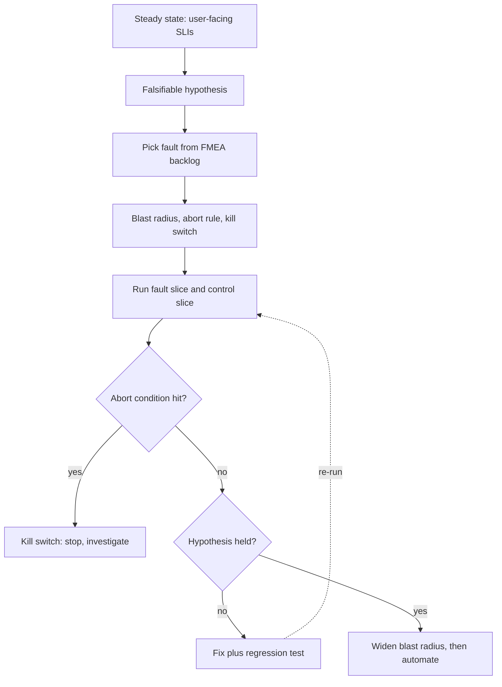

## TL;DR
An agent's fallbacks, breakers, retries and step budgets run rarely and rot silently. Resilience testing
exercises them on purpose; chaos engineering runs controlled experiments: hypothesis, bounded fault,
measurement. Agent faults include 429s, slow tools, stale retrieval and malformed output.

## For agent builders
- **Why it matters for agents.** Agents fail in ways no unit test reaches: a 429 storm turns into a
  fifty-step loop, a slow tool stalls every run, a fallback model rejects your tool-call format. Injecting
  those faults on purpose is the only way to know your loop, budgets and fallbacks behave before a real
  incident does it for you.
- **Where it shows up in your stack.** A fault-injecting wrapper around your model client and tool adapters,
  model stubs that return refusals or malformed JSON, Toxiproxy or mesh fault rules in front of tool APIs,
  synthetic canaries through fallback providers, and your agent eval harness scoring runs under fault.
- **What you control.** Which faults you inject (the top FMEA rows first), the steady-state SLIs (task
  completion, steps per task, cost per task), the blast radius and abort rule, and the spending cap.
- **What you can skip.** Infrastructure chaos platforms at first. Application-level hooks in your own
  clients cover most agent faults, because you cannot make a vendor's API fail, but your client can.

## Why it exists
- **Fallback code is the least-tested code in any system.** A team ships multi-provider failover. Six
  months later the primary degrades, the fallback fires for the first time in production, and fails: the
  secondary's API key expired, its model does not accept the same tool-call format, or its rate limit is a
  tenth of the primary's.
- **Existing tests do not reach it.** Every layer of resilience is another untested path. Unit tests mock
  the dependency. End-to-end tests run the happy path. Staging has neither production traffic patterns nor
  production data volumes nor the real vendor quotas.
- **Letting incidents validate the design is the naive alternative.** You learn, but the lesson arrives at
  three in the morning, at full scale, uncontrolled, with customers watching. Chaos engineering's founding
  observation: the failure will happen anyway; the only choice is whether it happens while you are
  watching, at one percent of traffic, with a kill switch, or later.
- **Emergent failures need whole-system tests.** Retry storms, thundering herds on recovery, cache
  stampedes, and cost amplification when traffic falls to a pricier fallback model are predicted by no
  component test; only exercising the whole system under fault reveals them.
- **Systems drift.** A fallback verified in March is unverified by June after three model upgrades and a
  vendor's quota change. Verification has to be repeated, which means it has to be cheap and automated.

## How it works
### Resilience testing: proving the mechanisms you built
This pre-production family comes first, because there is no point running experiments against mechanisms
that do not exist yet. In pre-production it covers fault injection, load, stress and soak tests, failover
drills and game days.

| Test | What you do | What it proves |
|---|---|---|
| Fault injection | at the dependency boundary, make the provider client return 429s, 5xxs, 8-second latencies or truncated completions for a configurable fraction of calls | timeouts, breakers, backoff and fallbacks behave as designed |
| Load | expected peak | SLOs hold |
| Stress | beyond peak | where the knee is (latency explodes) and whether shedding engages |
| Soak | hours at steady load | leaks, including agent-specific ones: conversation state that never expires, token budgets that creep upward per session |
| Failover and recovery drills | kill the primary database, region or model deployment on a schedule | actual recovery time and data loss against disaster-recovery targets |
| Continuous fallback canaries | a synthetic request through the secondary provider every few minutes | expired credentials, renamed models and quota changes are caught before a real failover |
| Game days | scheduled, cross-team scenario exercises including paging, runbooks, communication, decision-making | the humans work too |

- **Canaries are the single cheapest control against fallback rot.**
- **Game days matter because** a perfect failover with a confused on-call is still an outage.

### Chaos engineering: discovering what you did not build for
The discipline is defined by its method, not by breaking things.

1. **Define steady state as user-facing output.** Success rate, p95 latency, task completion rate, cost
   per task: the SLIs. Not CPU or queue depth, because the hypothesis is about whether users notice.
2. **State a falsifiable hypothesis.** "If the primary provider returns 429 on 30 percent of calls, success
   rate stays at or above 99 percent and p95 rises by less than 20 percent." A hypothesis makes the result
   a finding either way; "we killed a pod and nothing happened" teaches nothing.
3. **Only hypothesize resilience you believe you have.** If you already expect the system to fall over, the
   experiment has nothing to discover and the right move is to fix it first.
4. **Inject realistic events.** Latency, errors, instance loss, network partition, dependency
   unavailability, resource exhaustion, zone loss, clock skew. Prefer the events your FMEA ranked highest;
   that table is the experiment backlog.
5. **Minimize blast radius.** Start in staging, then one percent of production, an internal tenant, one
   availability zone. Define an abort condition and a kill switch before starting. Run during business
   hours with on-call informed, because an experiment indistinguishable from an incident is one.
6. **Compare experiment and control.** Route a slice of traffic through the fault and an equal slice
   without, and compare the SLIs, as in an A/B test. This separates the fault's effect from background
   noise, but only with enough traffic in each arm (see the sizing note below).
7. **Fix, then widen, then automate.** Each refuted hypothesis becomes a fix and a regression test. Verified
   hypotheses graduate to larger blast radius and eventually to continuous automated runs, because the
   system will drift away from the verified state.

### Sizing the experiment
- **Telling 99 percent success from 98 percent** needs on the order of a thousand requests per arm: the
  standard error of a 99 percent rate over 1,000 requests is about 0.3 points.
- **So a one-percent slice of a low-traffic service may need hours to reach a verdict.** Size the slice and
  the duration together.

### Injection mechanisms
| Level | Tools and techniques | Best for |
|---|---|---|
| Application | hooks in your own provider and tool clients | AI systems: you cannot make a vendor's API go down, but your client can behave as if it had |
| Network | a proxy (Toxiproxy is a common choice) or a service mesh's fault-injection rules: latency, bandwidth caps, connection resets | internal dependencies |
| Infrastructure | kill instances and pods, fill disks, hog CPU: the Chaos Monkey lineage, continued by Kubernetes-native LitmusChaos and Chaos Mesh, commercial platforms, and cloud providers' fault-injection services | instance and zone loss |
| Data (AI-specific, usually hand-built) | serve a stale index snapshot, drop a fraction of retrieved chunks, revoke a tool's credentials, or return refusals, truncated text and malformed JSON from a model stub | guards against wrong answers |

### What is different about LLM and agent systems
- **Faults are semantic as well as operational.** A model returns plausible nonsense; retrieval returns the
  wrong tenant's documents; a tool reports success with wrong data. Infrastructure chaos never produces
  these, so the experiment must inject them and the hypothesis must be about whether guards (schema
  validation, groundedness checks, confirmation steps) catch them.
- **Amplification.** Injecting 429s should reveal whether backoff, jitter and step budgets hold, or whether
  an agent loops fifty times and a retry storm forms.
- **Cost.** A fault that pushes traffic to a fallback model has a dollar blast radius as well as a latency
  one, so experiments need a spending cap and the cost SLI belongs in the hypothesis.
- **Agent steady state needs agent SLIs.** Add task completion rate, steps per task and tool calls per task
  to success rate and p95, because an agent can "succeed" after twice the steps and three times the cost.
- **Judge with your eval set, not only status codes.** Run a fixed set of agent tasks under the fault and
  score them with the same graders you use in CI, so a fallback model's quality drop shows up as a finding.

## Diagram
The experiment loop: the hypothesis and abort condition come before any fault, and both outcomes (held or
refuted) produce work.



## Examples
### Fault-injecting client wrapper and experiment runner
A wrapper around the real model client, controlled by environment variables so it is inert by default,
plus a minimal runner with an abort condition. Run once as a control and once with a fault, and compare
the two results against the hypothesis.

```python
import asyncio, os, random, time

class RateLimitError(Exception): pass

class ChaosLLM:
    """Wraps the real client. Injects faults on a fraction of calls; inert unless CHAOS_RATE is set."""
    def __init__(self, client):
        self.client = client
        self.rate = float(os.getenv("CHAOS_RATE", "0"))
        self.mode = os.getenv("CHAOS_MODE", "latency")

    async def complete(self, **kw):
        if random.random() < self.rate:
            if self.mode == "latency":
                await asyncio.sleep(8.0)                 # provider at 8 s: do timeouts and breakers fire?
            elif self.mode == "rate_limit":
                raise RateLimitError("429")              # do backoff, jitter and step budgets hold?
            elif self.mode == "garbage":
                return {"content": "{not json", "usage": {"total_tokens": 5}}   # does validation catch it?
        return await self.client.complete(**kw)

async def experiment(handler, requests, min_success=0.95):
    """Runs traffic through `handler`, aborts if steady state is violated, reports the SLIs."""
    latencies, ok = [], 0
    for req in requests:
        t0 = time.perf_counter()
        try:
            await handler(req); ok += 1
        except Exception:
            pass
        latencies.append(time.perf_counter() - t0)
        if len(latencies) >= 20 and ok / len(latencies) < min_success:
            raise RuntimeError("steady state violated; experiment aborted")   # the kill switch
    latencies.sort()
    return {"success_rate": ok / len(latencies),
            "p95_s": latencies[int(0.95 * (len(latencies) - 1))]}

# Control run: CHAOS_RATE=0. Experiment: CHAOS_MODE=rate_limit CHAOS_RATE=0.3.
# Hypothesis: success_rate >= 0.99 and p95_s < 1.2 x the control's. Anything else is a finding.
```

- **In production the same wrapper sits in the deployed service** behind a per-tenant or per-request flag,
  so the fault can be applied to one percent of real traffic.
- **The runner's abort check becomes an alert** on the experiment slice's SLIs that flips the flag off.

### Fault-injecting tool adapter for an agent
The same idea one layer down: wrap each tool the agent can call, so experiments can make one tool slow,
failing or wrong while the model and other tools stay real.

```python
import asyncio, os, random

class ChaosTool:
    """Wraps one agent tool. Inert unless CHAOS_TOOL names this tool."""
    def __init__(self, name, fn):                              # own env vars, so ChaosLLM stays inert
        self.name, self.fn = name, fn
        self.on = os.getenv("CHAOS_TOOL") == name
        self.rate = float(os.getenv("CHAOS_TOOL_RATE", "0"))
        self.mode = os.getenv("CHAOS_TOOL_MODE", "latency")

    async def __call__(self, **args):
        if self.on and random.random() < self.rate:
            if self.mode == "latency":
                await asyncio.sleep(8.0)                       # does the tool timeout fire?
            elif self.mode == "error":
                raise ConnectionError(f"{self.name} unreachable")   # does the breaker open, does the model adapt?
            elif self.mode == "empty":
                return []                                      # does the agent treat empty as a fact?
        return await self.fn(**args)

# Wrap every tool at startup: tools = {n: ChaosTool(n, f) for n, f in tools.items()}
# Experiment: CHAOS_TOOL=search CHAOS_TOOL_MODE=error CHAOS_TOOL_RATE=0.5, then run the agent eval set.
```

### Worked scenario: 429s against an agent loop
Illustrative results from a staging run of 500 agent tasks with 30 percent injected 429s on the model
client, before and after the fixes the experiment produced.

| SLI | Control | Fault, first run | Fault, after fixes |
|---|---|---|---|
| Task completion | 96% | 81% | 95% |
| Model calls per task (median) | 6 | 19 | 8 |
| Steps hitting the 25-step budget | 0.4% | 12% | 0.8% |
| Cost per task | 1.0× | 2.9× | 1.3× |

- **Finding:** the agent loop retried each 429 as a new step, with no backoff, so retries consumed the step
  budget and tokens.
- **Fixes:** retry 429s inside the client with jittered backoff honoring `Retry-After`, never as a new agent
  step, and count waits against the run's time budget, not its step budget.
- **Hypothesis re-run:** completion back within 1 point of control; the experiment became a weekly job.

### How long must the experiment run? A runnable sizing check
A standard two-proportion power calculation (two-sided 5 percent, 80 percent power) for telling a 99
percent control from a 98 percent fault arm, and what that means in hours per arm.

```python
from math import ceil, sqrt

def se(p, n):
    return sqrt(p * (1 - p) / n)          # standard error of a success rate

def n_per_arm(p_control, p_fault, z_alpha=1.96, z_power=0.84):
    """Requests per arm to tell two success rates apart (two-sided 5%, 80% power)."""
    var = p_control * (1 - p_control) + p_fault * (1 - p_fault)
    return ceil((z_alpha + z_power) ** 2 * var / (p_control - p_fault) ** 2)

print(f"SE of 99% over 1,000 requests: {100 * se(0.99, 1000):.2f} points")   # 0.31
n = n_per_arm(0.99, 0.98)
print("requests per arm, 99% vs 98%:", n)                                     # 2313
for rps, slice_ in [(10, 0.01), (10, 0.10), (200, 0.01)]:
    hours = n / (rps * slice_) / 3600
    print(f"{rps} rps service, {slice_:.0%} slice: {hours:.1f} h per arm")
# 10 rps at 1%: 6.4 h | 10 rps at 10%: 0.6 h | 200 rps at 1%: 0.3 h
```

| Service | Slice | Time per arm |
|---|---|---|
| 10 requests per second | 1% | ~6.4 hours |
| 10 requests per second | 10% | ~0.6 hours |
| 200 requests per second | 1% | ~0.3 hours |

The formal answer (~2,300 per arm) matches the "order of a thousand" rule of thumb; widen the slice once the
abort condition has proven it fires, rather than running a tiny slice for so long that drift muddies it.

## Production patterns
- **Fallback canary on a schedule.** Send one synthetic request through every fallback provider and model
  every few minutes from a scheduler, tagged so it is excluded from user SLIs. Alert on any failure;
  monitor canary latency and the secondary's response schema.
- **Flag-gated client faults.** Ship the `ChaosLLM`-style wrapper in production behind a feature flag scoped
  to an internal tenant or a request header, with rate and mode as flag values. Monitor the experiment
  slice's SLIs separately and auto-disable the flag when the abort threshold is crossed.
- **Proxy faults for internal tools.** Put Toxiproxy between the agent and a tool API in staging and add a
  latency toxic (for example `toxiproxy-cli toxic add -t latency -a latency=8000 <proxy>`), or use a
  service mesh's fault-injection rules (Istio's VirtualService `fault` with `delay` or `abort` and a
  percentage). Monitor breaker transitions and bulkhead rejections.
- **Agent eval suite under fault.** In CI or nightly, run the agent's task set once clean and once per
  top-ranked fault (a tool down, model 429s, malformed JSON, empty retrieval) and compare completion, steps
  and cost per task. Monitor the gap between clean and faulted runs per release.
- **Quarterly game day with the humans.** Script a scenario (primary provider down, SSO connector cut),
  page the real on-call, and time detection, decision and recovery against the runbook. Track action items
  to closure like postmortem actions.
- **Spending cap on every experiment.** Before any drill that routes traffic to a pricier fallback, set a
  budget for the experiment slice and put cost per task in the hypothesis. Monitor spend per slice in near
  real time.

## Trade-offs
- **Production signal vs risk.** Production experiments give true signal, with real traffic, data and vendor
  limits, at real risk; staging is safe but misses emergent behavior. Start in staging and graduate to
  production only once abort conditions, per-slice observability and a kill switch exist.
- **Small blast radius vs evidence.** A small slice limits harm but also limits evidence: the smaller the
  slice, the longer the experiment must run to separate the fault's effect from noise. Widen the slice once
  the abort condition has proven it fires, rather than running a tiny slice for so long that drift muddies
  the comparison.
- **Coverage vs cost.** Every experiment costs engineering time and sometimes vendor dollars, because faults
  push traffic to fallbacks and retries; prioritize by FMEA risk rather than by what is easy to inject.
- **Continuous vs scheduled.** Continuous automated chaos catches drift but demands a mature on-call and can
  be mistaken for a real incident; scheduled game days are cheaper and clearer but only test what someone
  remembered to schedule.
- **Semantic vs infrastructure faults.** Semantic fault injection tests the guards that matter for AI but
  needs trustworthy evals to judge success; infrastructure fault injection is easy to measure but blind to
  wrong-answer failures. Do both, in that order of importance for an LLM product.

## Pitfalls
- **Running without a steady-state hypothesis.** Symptom: a log of experiments none of which produced a fix,
  and nobody able to say what was verified.
- **No abort condition or kill switch.** Symptom: a postmortem whose root cause is the chaos experiment
  itself.
- **Injecting only infrastructure faults into an AI system.** Symptom: pods survive every drill, then the
  first real 429 storm triggers agent loops and a cost spike nobody tested for.
- **Never canarying the fallback.** Symptom: the first real failover fails for a configuration reason, an
  expired key, a renamed model, a lower quota, that a five-minute synthetic check would have caught.
- **Experimenting without per-slice observability.** Symptom: the hypothesis cannot be evaluated because the
  experiment's traffic is indistinguishable from everything else in the dashboards.
- **Applying faults to shared customer traffic without regard to contracts.** Symptom: a customer's SLA
  breached by your own experiment, and a difficult conversation about who caused the outage.
- **Ignoring the cost blast radius.** Symptom: a full-traffic primary-failure drill that routes an hour of
  traffic to the expensive fallback model, visible on the next invoice.
- **Measuring only success rate for an agent.** Symptom: the drill "passes" at 99 percent success while
  steps and cost per task tripled. Fix: put steps, tool calls and cost per task in the hypothesis.

## When to use
- **Begin once** the basic mechanisms exist and observability can show SLIs for an experiment slice; before
  that, build the mechanisms.
- **Progression:** dependency fault injection in staging for the top three FMEA rows, synthetic canaries
  through every fallback path, one game day per quarter for failover and disaster recovery, then production
  chaos at one percent for the most critical mechanisms, growing toward automation.
- **Avoid** for a prototype or a service with no SLO, because there is no steady state to defend.
- **Measure** hypotheses verified and refuted, weaknesses found per experiment, time to detect and time to
  abort.
- **Interviews:** describe one experiment end to end: steady state, hypothesis, fault, blast radius, abort
  condition, result, and the fix it produced.

## Role lens
- **Engineer:** Builds the fault-injection hooks into provider and tool clients, writes the experiment and
  its abort check, and turns every refuted hypothesis into a regression test.
- **Architect:** Decides which failure modes must be proven rather than assumed before launch, sets the
  blast-radius and approval policy, and ties experiments to SLOs and the FMEA backlog.
- **FDE:** Runs a game day with the customer before go-live, cutting their SSO or ERP connector to show
  the agent degrading gracefully, so their operations team has seen the behavior and the runbook works
  in their environment.

## Check yourself
**Q:** You have shipped multi-provider fallback for an agent. How would you prove it works without
waiting for the primary provider to fail, and what would you watch for?
**A:** Three layers. First, a synthetic canary every few minutes through the secondary path, which
catches expired keys, renamed models and quota changes continuously. Second, staging fault injection:
force 100 percent 503s from the primary through the client hook with the hypothesis that success rate
stays at or above 99 percent, p95 stays within budget and cost per request stays under twice the
control; watch specifically for tool-call format incompatibilities, differing context limits and
schema differences between the two models. Third, production chaos on one percent of an internal
tenant's traffic with 30 percent injected 429s, aborting if success drops below 98 percent. Throughout,
watch retry amplification (provider calls per user request), fallback rate, breaker state transitions
and spend, and sample the fallback outputs through your quality evals because the secondary model may be
measurably worse. Finally test recovery: when the primary returns, traffic should move back through the
breaker's half-open probes without a thundering herd.

## Interview questions
### Why run chaos experiments in production at all, when staging is safer?
- **Staging lacks the real conditions:** production traffic patterns, data volumes and vendor quotas, which
  is where emergent failures like retry storms and herds on recovery live.
- **The failure will happen anyway;** the choice is whether it happens at one percent of traffic, during
  business hours, with a kill switch, or at full scale at night.
- **But graduate there:** staging first, and production only with abort conditions, per-slice observability
  and a kill switch.

### Design a chaos experiment for an agent whose provider starts returning 429s.
- **Steady state:** success rate, p95, task completion and cost per task on the experiment slice.
- **Hypothesis:** with 30 percent injected 429s, success stays at or above 99 percent and p95 rises less than
  20 percent; also provider calls per user request stay bounded (no loop).
- **Blast radius and abort:** an internal tenant at one percent, abort below 98 percent success, a spending
  cap; compare against a control slice.

### A tool your agent uses goes down in an experiment and task completion barely moves, but cost doubles. What happened and what do you change?
- **The agent compensated expensively:** it likely re-called the dead tool, or reached for slower tools and
  more steps, so it still finished but at twice the tokens.
- **Check the traces:** tool calls per task to the failed tool, steps per task, and which errors the model
  saw; a raw exception or vague error invites retries.
- **Fix:** a breaker that returns a clear `tool_unavailable` result, a cap on repeat calls to the same tool,
  and cost per task in every future hypothesis.

### How long would you run an experiment on a 1 percent slice of a 10-request-per-second service?
- **Size from the effect you want to see:** 99 versus 98 percent success needs roughly 2,300 requests per arm
  at 5 percent significance and 80 percent power.
- **A 1 percent slice of 10 requests per second is 0.1 per second,** so about 6.4 hours per arm.
- **Options:** widen the slice once the abort rule has proven it fires, or accept a larger detectable effect.

### What faults would you inject that infrastructure chaos tools never produce?
- **Semantic faults:** plausible-but-wrong output, refusals, truncated text, malformed JSON from a model
  stub, stale index snapshots, dropped chunks, cross-tenant retrieval, revoked tool credentials.
- **Why:** an LLM product's worst failures are silent wrong answers, so the hypothesis is whether schema
  validation, groundedness checks and confirmation steps catch them, judged by trustworthy evals.

### When would you not invest in chaos engineering yet?
- **No SLO, no steady state:** for a prototype there is nothing to defend.
- **Mechanisms missing:** if you already expect the system to fall over, fix it first; the experiment has
  nothing to discover.
- **No per-slice observability:** the hypothesis could not be evaluated, so build that before the first run.

## Quiz
### Q: What distinguishes chaos engineering from ordinary fault-injection testing?
- [ ] Chaos engineering only runs in production, while fault injection only runs in staging
- [x] A falsifiable steady-state hypothesis measured on user-facing SLIs, a bounded blast radius, and comparison against a control
- [ ] Chaos engineering uses random faults, while fault injection uses chosen ones
- [ ] Chaos engineering requires a dedicated tool such as Chaos Monkey
> Fault injection is a mechanism; chaos engineering is an experimental method built on it. The hypothesis
> is what turns "we broke it and watched" into a finding, and the blast radius and control group are
> what make running it on real systems defensible.

### Q: Which class of fault is most specific to AI systems and most often skipped in drills?
- [ ] Killing a pod in the inference deployment
- [ ] Losing an availability zone
- [x] Semantic faults such as plausible-but-wrong output, malformed JSON and stale or cross-tenant retrieval
- [ ] Filling the disk on a worker node
> Infrastructure faults are easy to inject and measure, but an LLM product's worst failures are silent
> wrong answers. Only injecting those, via model and retrieval stubs, tests whether validation,
> grounding checks and confirmation steps actually catch them.

### Q: Why run a synthetic request through the fallback provider continuously rather than only during drills?
- [ ] To keep the fallback provider's cache warm for lower latency
- [ ] Because vendors require minimum usage to keep an account active
- [x] Fallback paths rot through credential expiry, model renames and quota changes, and a canary detects that before a real failover does
- [ ] To accumulate usage data for negotiating a better contract
> The fallback carries no traffic in normal operation, so nothing exercises it between drills. A cheap
> periodic request turns months of silent decay into an alert within minutes of the configuration
> breaking.

## Use cases & projects
### Use cases
- **Proving multi-provider fallback for an agent.** Canaries plus injected 503s show the secondary model
  accepts your tool schemas and stays within quality and cost budgets.
- **Hardening the agent loop against 429 storms.** Injected rate limits reveal whether backoff, step budgets
  and cost caps hold or the agent loops.
- **Testing tool-failure handling.** Making one tool slow, failing or empty shows whether the agent adapts,
  retries sensibly, or fabricates an answer.
- **RAG staleness drills.** Serving an old index snapshot tests whether freshness alerts and groundedness
  checks catch stale answers.
- **Customer go-live game days.** Cutting a customer's SSO or ERP connector shows their operations team how
  the agent degrades.

### Mini project
**Run a chaos experiment on your agent's tool layer (2-3 hours).**
- **Goal:** state a hypothesis about how your agent handles a failing tool, test it, and turn the result
  into a fix or a regression test.
- **Steps:** wrap your agent's tools with the `ChaosTool` adapter above; pick 30 tasks from your eval set;
  run them clean as the control; run them again with one tool at 50 percent errors, then with empty results;
  record task completion, steps per task, calls to the failed tool and cost per task.
- **Done when:** you have a written hypothesis, a control-versus-fault table, at least one finding with a
  fix, and the faulted run added to CI so it repeats on every release.
