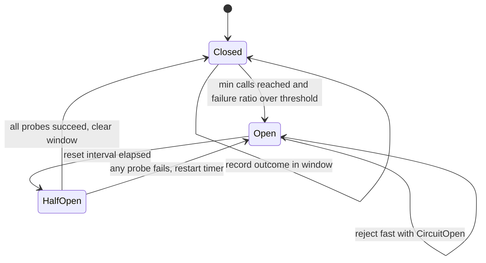

## TL;DR
A circuit breaker counts a dependency's recent failures and, past a threshold, fails fast for a
cooling-off period, then lets a few trial calls test recovery. It trades a few wrongly rejected requests
for a caller that stays alive.

## Why it exists
- **Failing dependencies drain callers.** Every caller that keeps trying a failing or timing-out
  dependency ties up threads and connections waiting for answers that will not come, and the retries make
  recovery harder.
- **Cascading failure has a precise mechanism.** An agent service calls a provider with a 30-second timeout
  at 50 requests per second; the provider degrades to 100 percent timeouts. By Little's law the service
  accumulates 50 × 30 = 1,500 stuck calls, far more than any sensible pool. Within a minute the pool is
  exhausted, health checks fail, the orchestrator restarts pods, and a partial outage upstream becomes a
  total outage here.
- **Timeouts and retries are not enough.** Timeouts bound a single call but not the aggregate: 1,500 stuck
  calls at 30 seconds each is the result *with* timeouts. Retries with backoff make the aggregate worse,
  because they multiply attempts exactly when attempts are worthless. Waiting for the provider to fix
  itself is not a strategy when your own service dies first.
- **The breaker does two things at once.** It stops consuming the caller's resources immediately, because
  rejected calls return in microseconds rather than seconds, and it removes load from the dependency,
  which is struggling precisely because it is overloaded, so whatever is wrong there can clear.
- **The name is literal.** Electrical breakers exist for the same reason: when a fault draws too much
  current, the right response is to open the circuit, not to keep supplying power and hope.

## How it works
### Three states
A breaker is a small state machine wrapped around a call.

1. **Closed.** Calls flow through. Every outcome is recorded in a sliding window, either the last N calls
   or the last T seconds. If the failure ratio in the window crosses a threshold *and* the window holds at
   least a minimum number of calls, the breaker trips. The minimum exists because one failure out of one
   call is a 100 percent failure rate and should not trip anything.
2. **Open.** Every call is rejected immediately with a distinct error (`CircuitOpen`), no network
   involved, for a reset interval. This is where resources are freed and the dependency gets relief.
3. **Half-open.** When the interval elapses, a limited number of trial calls are allowed. If they succeed
   the breaker closes and the window is cleared; if any fails it reopens and the timer restarts. The limit
   matters because if every waiting caller rushed in on the first tick of recovery, a partly healed
   dependency would be knocked down again.

### What counts as a failure
| Outcome | Count it? | Because |
|---|---|---|
| Timeouts, connection errors, 5xx | yes | they describe the dependency's health |
| 429 | judgment call | many teams count it (calling a rate-limited endpoint helps nobody); others route it to a separate rate-limit backoff so one noisy caller's quota exhaustion does not open the breaker for everyone sharing it |
| 4xx client errors (malformed request, invalid schema) | no | they are your bug; counting them opens the breaker on a healthy provider |
| Slow success | yes, for LLM traffic | a provider answering correctly in 25 seconds is, for an interactive product, down |

- **Either way, a 429's `Retry-After` should inform the wait.**
- **Slow calls need explicit handling.** Libraries such as Resilience4j expose a slow-call-rate threshold
  for exactly this; if yours does not, a tight timeout turns slowness into a countable failure.

### Consecutive count or failure ratio
- **Consecutive count** (the one in Nygard's and Fowler's original descriptions) trips after N consecutive
  failures. It needs no window and reacts fast to a hard outage, but a single success resets it, so a
  dependency failing 70 percent of the time may never accumulate N in a row.
- **Ratio over a sliding window** handles partial failure, which is the common case for overloaded
  providers, at the cost of the minimum-calls guard and more state.
- **Rule:** consecutive counts for low-traffic or all-or-nothing dependencies, ratios for anything with
  steady traffic.

### Choosing thresholds
| Setting | Starting point | Reasoning |
|---|---|---|
| Window | 50 to 100 calls | large enough that a single burst of errors does not trip it |
| Minimum calls | 20 | statistically meaningful at your traffic level |
| Trip ratio | 50 percent failures | ordinary error rates (a few percent) never approach it |
| Reset interval | 30 seconds | recovery is noticed within a minute |
| Half-open probes | 3 | enough evidence without flooding |

- **Low-traffic dependencies need longer time-based windows:** at two calls a minute a 20-call minimum would
  take ten minutes to trip.

### Time to trip
- **A failure is recorded only when the call ends,** so a breaker cannot trip on timeouts sooner than one
  timeout after the outage begins.
- **Worked numbers:** with the defaults above, 50 requests per second and a 20-second timeout, the first 20
  failures are recorded about 20 seconds in. By then roughly 50 × 20 = 1,000 calls have been started, and
  all of them are still holding a worker.
- **Fast errors trip fast:** connection refused or an immediate 503 trips the same breaker in well under a
  second.
- **Consequences:** the timeout belongs inside the breaker and should be set from the product's latency
  need, not from the provider's worst case; and a bulkhead is still needed to cap occupancy during that
  first window.

### Granularity
- **One breaker per failure domain, not one per service name.** A provider's `model-a` deployment in one
  region can be failing while `model-b` is fine, so key the breaker by provider × model × region, and tool
  APIs by endpoint.
- **A single "the provider" breaker fails both ways:** it either trips on partial failures and takes healthy
  paths with it, or never trips because healthy traffic dilutes the ratio.

### What happens when it is open
- **Without a fallback, a breaker converts slow failures into fast failures.** That is already worth having,
  since it keeps the service and its health checks alive.
- **The user experience is rescued by what you do with `CircuitOpen`:** route to a secondary provider or
  smaller model, return a cached or degraded answer, or enqueue the work for later and say so.
- **The breaker is the detector; the fallback is the recovery.**

### Composition with retries, timeouts and bulkheads
- **Retry outermost, then the breaker, then the timeout around the call.** This is a common arrangement and
  the one Resilience4j documents as its default. Each retry attempt is counted by the breaker, and once it
  opens the remaining attempts short-circuit instantly, provided the retry policy treats `CircuitOpen` as
  non-retryable.
- **Retry inside the breaker is wrong:** each counted "call" takes several timeouts to register, delaying
  the trip while multiplying load.
- **A bulkhead sits alongside:** a concurrency cap per dependency bounds how many callers can be stuck while
  the breaker is still accumulating its minimum calls.

## Diagram
The three states and what moves the breaker between them; note that half-open lets only a few probes
through before deciding.



## Examples
### A compact asyncio breaker with fallback
A count-based window, a minimum-calls guard, a capped number of half-open probes, and a fallback at the
call site. It is single-process; a fleet shares breaker state through a library or a small Redis record,
but the state machine is the same.

```python
import asyncio, collections, time

class CircuitOpen(Exception): pass
class UpstreamError(Exception): pass          # 5xx / connection-level failures from the provider

class CircuitBreaker:
    def __init__(self, window=50, min_calls=20, fail_ratio=0.5, reset_after=30.0, probes=3):
        self.window, self.min_calls, self.fail_ratio = window, min_calls, fail_ratio
        self.reset_after, self.probes = reset_after, probes
        self.results = collections.deque(maxlen=window)    # True = failed call
        self.state, self.opened_at, self.probe_ok, self.probe_inflight = "closed", 0.0, 0, 0

    def _allow(self):
        if self.state == "open":
            if time.monotonic() - self.opened_at < self.reset_after:
                return False                                # fail fast: no network call at all
            self.state, self.probe_ok, self.probe_inflight = "half_open", 0, 0
        if self.state == "half_open":
            if self.probe_inflight >= self.probes:
                return False                                # only a few trial calls at a time
            self.probe_inflight += 1
        return True

    def _trip(self):
        self.state, self.opened_at = "open", time.monotonic()

    def _record(self, failed):                              # failed=None: ignored outcome (e.g. a 4xx)
        if self.state == "half_open":
            self.probe_inflight -= 1                        # always release the probe slot
            if failed is None: return
            if failed: self._trip(); return                # still broken: reopen, timer restarts
            self.probe_ok += 1
            if self.probe_ok >= self.probes:                # enough evidence of recovery
                self.state, self.results = "closed", collections.deque(maxlen=self.window)
            return
        if failed is None: return
        self.results.append(failed)
        n = len(self.results)
        if n >= self.min_calls and sum(self.results) / n >= self.fail_ratio:
            self._trip()

    async def call(self, fn, *args, timeout=10.0, **kw):
        if not self._allow():
            raise CircuitOpen("dependency marked unhealthy")
        try:
            result = await asyncio.wait_for(fn(*args, **kw), timeout)
        except (asyncio.TimeoutError, ConnectionError, UpstreamError):
            self._record(True); raise
        except BaseException:                               # 4xx, cancellation: neither success nor failure
            self._record(None); raise
        self._record(False)
        return result

breaker = CircuitBreaker()

async def answer(prompt):
    try:
        return await breaker.call(primary_llm, prompt, timeout=20)
    except CircuitOpen:
        return await secondary_llm(prompt)                   # other vendor, smaller model, or cached reply
```

- **The timeout lives inside `call`,** so slow responses become failures the window can see.
- **The catch-all branch matters more than it looks.** Without it, a 4xx or a cancelled request during
  half-open would never release its probe slot, and after three such calls the breaker would reject
  everything forever while the dependency was healthy.
- **Emit a metric on every state transition;** a breaker that opens silently is an outage nobody is
  looking at.

### Worked scenario: one minute of a provider outage
Illustrative timeline for the service above (50 requests per second, 20-second timeout, minimum 20 calls,
50 percent ratio) when the provider starts timing out every call at t = 0.

| Time | Without breaker | With breaker (timeout inside) |
|---|---|---|
| 0 to 20 s | ~1,000 calls started, all holding workers | same: no failure has been recorded yet |
| ~20 s | first timeouts land, retries add more attempts | first 20 failures recorded, breaker opens |
| 20 to 50 s | in-flight calls keep growing toward pool size, health checks start failing | new calls rejected in microseconds and sent to the fallback |
| ~50 s | pods restarted, outage spreads to routes that never used the provider | half-open: only 3 probes go out; they time out ~20 s later and the breaker reopens |

The breaker does not help with the ~1,000 calls started before it trips; a bulkhead caps those at its size.

### Production config: the same policy in Resilience4j
For JVM services the library expresses these settings directly (Spring Boot property names).

```yaml
resilience4j:
  circuitbreaker:
    instances:
      llmPrimary:
        slidingWindowType: COUNT_BASED
        slidingWindowSize: 100
        minimumNumberOfCalls: 20
        failureRateThreshold: 50
        slowCallDurationThreshold: 5s       # slow success counts as a failure
        slowCallRateThreshold: 50
        waitDurationInOpenState: 30s
        permittedNumberOfCallsInHalfOpenState: 3
        ignoreExceptions:
          - com.example.llm.BadRequestException   # your 4xx: not the provider's fault
```

## Production patterns
- **Key breakers by failure domain.** Keep a registry keyed by provider, model and region (and tool
  endpoint), creating breakers lazily. Monitor each breaker's call volume: a partition that never reaches
  its minimum calls is too fine to trip.
- **Library breakers with shared state.** In Python, `pybreaker` offers a consecutive-failure breaker
  (`fail_max`, `reset_timeout`, `exclude` for ignored exceptions) and a Redis-backed state store so replicas
  agree; in the JVM, Resilience4j as above. Monitor rejected calls and time spent open per breaker.
- **Make `CircuitOpen` non-retryable.** In Resilience4j add `CallNotPermittedException` to the retry
  policy's ignored exceptions; in your own code, exclude `CircuitOpen` from the retry predicate. Monitor that
  latency drops when a breaker opens; if it does not, the retry layer is still waiting.
- **Mesh-level outlier detection for per-host faults.** Istio's DestinationRule `outlierDetection`
  (`consecutive5xxErrors`, `interval`, `baseEjectionTime`) ejects individual bad hosts from the pool, which
  complements an application breaker that decides when the whole dependency is down. Monitor ejected-host
  counts.
- **Jitter the reset interval and alert on state.** Use `reset_after * random.uniform(0.8, 1.2)` so
  replicas do not probe on the same tick; export breaker state as a gauge per dependency and alert when a
  breaker has been open longer than its reset interval several times running.

## Trade-offs
- **Fast protection vs false trips.** Aggressive thresholds protect the caller quickly but trip on transient
  blips and reject requests that would have succeeded; the balance shifts toward longer windows and higher
  minimums as traffic per breaker falls.
- **Fine vs coarse granularity.** Fine-grained breakers (per model, per region, per endpoint) isolate
  precisely, but each partition may never reach its minimum calls; coarse breakers trip reliably yet take
  healthy sub-dependencies down with the sick one. Partition only as finely as your traffic supports.
- **Short vs long reset interval.** A short one notices recovery fast but re-hammers a dependency that is
  still down; a long one keeps you on the fallback longer than needed. The better your fallback, the longer
  you can afford to wait.
- **Local vs shared state.** Local per-process breakers need no coordination, but every replica discovers
  the outage independently and small replicas may never accumulate enough calls; shared state fixes that at
  the cost of a network hop and a new dependency on the store.

## Pitfalls
- **Counting 4xx client errors as failures.** Symptom: the breaker opens after you ship a bad prompt
  template or schema change while the provider's status page is green, and the fallback quietly serves
  degraded answers. Fix: ignore client errors.
- **Omitting the minimum-calls guard.** Symptom: open/closed flapping in the state metric overnight, when
  traffic is low and a single failure is a 100 percent rate.
- **Retrying across an open breaker.** Symptom: latency does not drop when the breaker opens because the
  retry policy keeps re-raising `CircuitOpen` with backoff, and logs fill with rejections.
- **Ignoring slow success.** Symptom: worker and connection pools exhaust during a latency incident while
  the breaker stays closed because nothing returned an error. Fix: tight timeout or slow-call threshold.
- **Opening without alerting or fallback.** Symptom: a sudden wall of fast 503s that nobody connects to an
  upstream problem, because the service's own error rate looks like the cause.
- **Leaking half-open probe slots on outcomes the breaker ignores.** Symptom: a breaker stuck half-open,
  rejecting nearly all traffic, while direct calls to the dependency succeed.
- **Letting every replica probe at the same instant.** Symptom: a dependency that recovers for ten seconds
  and collapses again on each reset tick; add jitter to the reset interval.

## When to use
- **Use when** a synchronous call goes to a dependency that can fail slowly and whose failure you can do
  something about: provider and model endpoints, tool and partner APIs, vector stores, anything over a
  network.
- **Avoid when** the call is in-process; think twice when there is no fallback and the request genuinely
  must wait. There, a tight timeout plus a bounded queue is more honest than a breaker that rejects work you
  will have to redo.
- **Measure** state transitions, rejected-call counts, time spent open, and fallback rate, and alert when a
  breaker has been open longer than its reset interval several times running.
- **Interviews:** the expected depth is the three states, why half-open exists, what should and should not
  count as a failure, and how the breaker composes with timeouts, retries and bulkheads.

## Role lens
- **Engineer:** Wraps every provider, model and tool client in breaker plus timeout plus fallback, keys
  breakers by failure domain, and emits state-transition metrics.
- **Architect:** Defines the failure domains that get their own breaker, the fallback policy for each
  dependency, and demands the cascading-failure walk-through in design reviews.
- **FDE:** In a customer's environment the flaky dependencies are their own systems (CRM, ticketing,
  identity); the breaker keeps the agent responsive and the FDE explains why it said "tool unavailable"
  rather than hanging.

## Check yourself
**Q:** Your agent calls a customer's ticketing API. At their peak hour the API's p99 climbs to 40 seconds
without returning errors, your breaker (set to open at 50 percent failures) never opens, and your
service's worker pool exhausts. What is wrong, and how do you fix it?
**A:** The breaker only sees errors, and the failure mode here is slow success, so from its point of view
nothing is failing. Fix it in layers. Put a timeout appropriate to the product, perhaps 5 seconds, inside
the breaker so slow calls become countable failures, or enable a slow-call-rate threshold if the library
has one. Add a bulkhead that caps concurrent calls to that API, so even before the breaker trips the
stuck calls cannot take more than, say, 20 of 200 workers. Check the minimum-calls setting against this
API's traffic so the trip is reachable. Then give `CircuitOpen` a fallback: queue the ticket write for
asynchronous retry and tell the user it has been queued, rather than failing the whole turn. Finally,
verify with metrics: the breaker should now open within a minute of the latency spike and worker-pool
utilization should stay flat.

## Interview questions
### Why don't timeouts alone prevent a cascading failure when a provider goes down?
- **A timeout bounds one call, not the aggregate.** By Little's law, in-flight calls equal arrival rate
  times duration: 50 requests per second with a 30-second timeout is 1,500 stuck calls.
- **That exhausts the worker pool,** so routes that never touch the provider fail too and health checks
  restart pods.
- **A breaker fixes the aggregate** by rejecting in microseconds once the failure ratio is clear, and a
  bulkhead caps occupancy before that.

### Consecutive-failure breaker or failure-ratio breaker: which would you pick and why?
- **Consecutive count** is simple and reacts fast to hard, all-or-nothing outages, and suits low-traffic
  dependencies.
- **But a single success resets it,** so a dependency failing 70 percent of the time may never trip it.
- **A ratio over a sliding window** catches the partial failures typical of overloaded providers, at the
  cost of a minimum-calls guard and more state.

### How would you design breakers for an LLM gateway that uses two providers, three models and two regions?
- **One breaker per failure domain:** provider × model × region, so a failing deployment does not take
  healthy ones down and healthy traffic does not dilute the sick one's ratio.
- **Check traffic per partition:** each breaker must reach its minimum calls; merge partitions or use
  time-based windows where it cannot.
- **Fallback map:** for each key, name the secondary (other region, other vendor, smaller model, cache).

### In what order do you compose retry, circuit breaker and timeout, and what breaks if you get it wrong?
- **Retry outermost, then breaker, then timeout around the call,** with `CircuitOpen` non-retryable, so
  every attempt is counted and the remaining attempts short-circuit once it opens.
- **Retry inside the breaker** means each counted call takes several timeouts to register, delaying the
  trip while multiplying load on the failing dependency.

### When would you not add a circuit breaker?
- **In-process calls,** which do not fail slowly over a network.
- **When there is no fallback and the request must wait,** because rejecting work you will have to redo is
  worse than a tight timeout plus a bounded queue.
- **Very low-traffic dependencies** with ratio breakers, where the minimum calls is unreachable; use a
  consecutive count or a time-based window instead.

## Quiz
### Q: What is the purpose of the half-open state?
- [ ] To let all queued requests through at once when the reset interval ends
- [x] To test recovery with a limited number of trial calls without flooding a dependency that may still be unhealthy
- [ ] To count client errors separately from server errors
- [ ] To hold requests in memory until the dependency recovers
> If every waiting caller rushed in at the first sign of recovery, a partly healed dependency would be
> knocked down again. A few probes give evidence of recovery cheaply; one failure reopens the breaker.

### Q: Which outcome should NOT count toward tripping a breaker on an LLM provider call?
- [ ] A request that exceeded its timeout
- [ ] A 503 Service Unavailable response
- [x] A 400 Bad Request caused by a malformed payload from your own code
- [ ] A connection refused error
> The breaker measures the dependency's health. A 400 from your own bad request says nothing about the
> provider, and counting it would open the circuit, and switch to a fallback, while the provider is fine.

### Q: A team places a 3-attempt retry policy inside the breaker (breaker outermost, retries inside). During an outage, what is the effect?
- [ ] Nothing changes; the order of resilience wrappers is irrelevant
- [ ] The breaker trips faster because each attempt is counted
- [x] Each counted call takes roughly three timeouts to register as a failure, delaying the trip while retries triple load on the failing dependency
- [ ] The retries are skipped automatically once the first attempt fails
> With retries inside, the breaker records one outcome per request, and only after all three attempts
> have timed out, so it reaches its minimum-calls threshold a third as fast as when every attempt is
> counted, and until it trips every request keeps sending three attempts to the dependency. With retry
> outside and `CircuitOpen` non-retryable, each attempt is counted, the trip comes sooner, and the
> remaining attempts short-circuit instead of reaching the network.
