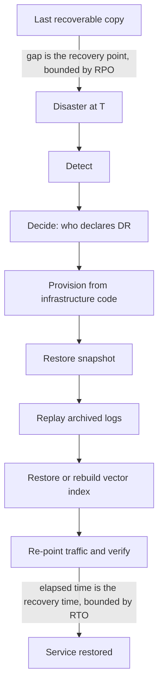

## TL;DR
Disaster recovery restores your agent after failures redundancy cannot mask. **RPO** is how much agent
state, in time, you may lose; **RTO** is how long you may be down. Vector indexes, memory and
checkpoints all count, and an unrehearsed plan is a hypothesis.

## For agent builders
- **Why it matters for agents.** An agent's state is spread across many stores: transcripts, long-term
  memory, run checkpoints, vector indexes, prompts, tool registries and adapters. Lose one and the
  restored agent behaves differently, and restoring checkpoints to an earlier point can make it repeat
  actions the outside world already saw.
- **Where it shows up in your stack.** Postgres point-in-time recovery for sessions and checkpoints,
  vector index snapshots, git for prompts and tool schemas, artefact storage for fine-tuned adapters,
  and the workflow engine's history store.
- **What you control.** The inventory of agent state, restore versus rebuild per store, snapshot
  intervals, where idempotency keys live, and the drill that runs your agent eval set on the restored
  system.
- **What you can skip.** Writing backup tooling; use the database's managed PITR or tools like
  pgBackRest or WAL-G. Know the RPO/RTO arithmetic and the restore-or-rebuild table.

## Why it exists
- **HA redundancy is in the same place and real time,** which makes it useless for a whole class of
  disasters: a region loss, a deleted database, corrupted data, a compromised account.
- **Replicas copy mistakes.** Synchronous replication faithfully copies a `DROP TABLE`, a bad migration
  or a ransomware encryption to every replica within milliseconds. A regional outage takes every zone
  down together, and a leaked cloud credential can delete replicas with the primary.
- **You need a copy separated three ways:** in time (point-in-time history), in place (another region
  or account) and in trust (immutable, separately permissioned).
- **"Nightly backups and good intentions" fails three ways.** Nobody tested the restore, so it takes a
  day and surfaces a missing dependency; the backup is up to 24 hours old, so a day of conversations,
  approvals or orders vanishes; and it covers the database but not the vector index, prompt registry,
  fine-tuned adapter weights or secrets, so the restored system behaves differently.
- **AI state is expensive to recreate.** Rebuilding a vector index over millions of chunks means
  re-embedding hundreds of millions of tokens, money and hours that count in RTO. Fine-tuned weights
  never checkpointed to durable storage are simply gone.

## How it works
### The two numbers, precisely
Picture a timeline with the disaster at T:
- **Recovery point:** the gap between the most recent recoverable state and T. The RPO is the maximum
  gap you agreed to tolerate.
- **Recovery time:** the gap between T and service coming back. The RTO is the maximum you agreed to
  tolerate.
- **Objectives vs actuals:** objectives are promises set with the business; the measured results of a
  real recovery or drill are the actuals (some teams write them RPA and RTA). The gap between
  objective and actual is the finding.

### RPO is bounded by how often state is copied away
| Mechanism | Worst-case RPO |
|---|---|
| Nightly snapshot | up to 24 h |
| Continuous log shipping (write-ahead log archived every minute) | about a minute |
| Synchronous cross-region replication | approximately zero, at the cost described in multi-region |

### RTO is a sum
1. Detect.
2. Decide.
3. Provision or promote.
4. Restore data and replay logs.
5. Re-point traffic.
6. Verify.

- **Teams who only measure the restore step** are usually off by an hour of detection and decision.
- **Log replay is the term people forget.** Point-in-time recovery restores the last base snapshot and
  re-applies every logged change since it, so a weekly base backup with continuous logs has a tiny RPO
  and a long, growing replay time.
- **So base-backup frequency is an RTO lever,** while log-shipping frequency is an RPO lever.

### Logical disasters add time to detect
- **You can only restore to a point you still have.** For a bad migration, a bug quietly corrupting rows
  or ransomware that encrypts slowly, retention must exceed the longest plausible time before anyone
  notices.
- **Corruption found after ten days with seven days of retention is unrecoverable,** regardless of RPO.
- **Restoring to before the bad event discards later good writes,** so recovery from logical damage is
  usually a *selective* restore into a side database, then repairing the affected rows, not a wholesale
  rollback.

### The four strategies
Named roughly as the AWS guidance does, in rising cost and falling RPO/RTO:

| Strategy | What runs in the DR site | RPO | RTO | Fits |
|---|---|---|---|---|
| **1. Backup and restore** | periodic backups to another region or account; infrastructure rebuilt from code on demand | hours | hours to a day | cheapest; internal tools |
| **2. Pilot light** | continuous data replication; minimum core (database replica, container images, secrets) always on, the rest created at failover | minutes | tens of minutes to hours | minutes of data loss acceptable, cheap idle cost |
| **3. Warm standby** | a scaled-down but fully functional copy, scaled up on failover | seconds to minutes | minutes | downtime must be minutes |
| **4. Multi-site active-active** | both sites serve traffic; failover is a routing change | near zero with synchronous replication | near zero | the multi-region pattern |

### Mechanisms that make the numbers real
- **Point-in-time recovery** from a base snapshot plus an archived log lets you restore to just before
  a bad write, *because* a replica cannot un-apply a mistake but a log can be replayed up to a chosen
  second.
- **Immutable, isolated backups**: object-lock or vault policies, a separate account with separate
  credentials, *because* a disaster that includes a compromised identity must not reach the backup.
- **Copies separated by medium and place**, often summarised as the 3-2-1 rule: three copies, on two
  different kinds of storage, one off-site; for cloud systems, read "off-site" as another region *and*
  another account.
- **Infrastructure as code** so the DR environment can be created, not hand-built, during the worst
  hour of the year.
- **Restore drills** on a schedule, timed, with the resulting RTA and RPA recorded. The drill also
  catches the quiet killers: a backup job that has been silently failing, a missing KMS key grant.
- **Runbooks** that name who decides, how failover is triggered, and how failback happens, including
  the reconciliation of writes that landed after the recovery point.

### The AI-specific inventory
List every store, decide whether it is *restored* or *rebuilt*, and estimate the time:

| Store | Restore or rebuild | Note |
|---|---|---|
| Conversation and session databases | restore | primary source of user state |
| Vector indexes | restore from index snapshot in minutes, or rebuild by re-embedding in hours | record the embedding model version with the index, or a rebuild produces an index the query path cannot use |
| Source documents in object storage | usually versioned | near-zero RPO |
| Prompt and config registries | in git, trivially recoverable | only if the deploy pipeline reads from git, not a mutable store |
| Fine-tuned weights and adapters | copy to a second region as artefacts | retraining is not a recovery plan |
| Agent checkpoints and workflow histories | restore | runs after the recovery point replay from an earlier step |
| Eval datasets and golden sets | restore | losing them silently breaks release gates |
| Agent long-term memory | restore, with its embeddings or the model version to re-embed | memories are user data: same RPO and residency as transcripts |
| Tool registry, MCP server configs, tool schemas | in git, redeployed | a restored agent with different tool schemas makes different calls |

### Agents and the world that moved on
- **Restoring agent state does not restore the world.** If checkpoints are restored to 10 minutes before
  the disaster, runs replay steps whose emails, tickets or payments already happened.
- **So deduplication must live in the target system,** not only in your database: the tool sends an
  idempotency key and the receiver remembers it, so a replayed step after restore is a no-op.
- **Keep an action log outside the restored store,** for example an append-only log in another account,
  so you can reconcile which side effects landed after the recovery point.

## Diagram
The timeline view: RPO looks backwards from the disaster to the last copy, RTO looks forwards and is
the sum of every step until verified service.



## Examples
### Worked RTO/RPO budget for a RAG assistant
All figures are illustrative orders of magnitude.

**Targets and state.** The business sets RPO 15 minutes and RTO 4 hours. State: a 500 GB Postgres
database (sessions, tenants, audit log), a vector index of 2 million chunks averaging 500 tokens each,
300 GB of source documents in versioned object storage, prompts and configs in git, one fine-tuned adapter.

**Current plan:** nightly Postgres snapshot copied cross-region, no index snapshot, adapter stored only
on the training machine.
- **Worst-case RPO is 24 hours,** failing the 15-minute target.
- **The adapter is unrecoverable.**

| RTO step | Current plan | Revised plan |
|---|---|---|
| Detect and decide | 30 min | 30 min |
| Provision from infrastructure code | 20 min | 20 min |
| Restore 500 GB snapshot | roughly 45 min (no logs to replay, which is why the RPO is so bad) | 45 min |
| Replay WAL | none | 15 min (up to a day of WAL after the nightly base snapshot) |
| Vector index | rebuild: 2M × 500 = 1 billion tokens at provider rate limits in the low millions of tokens per minute, on the order of eight hours | snapshot restore of roughly 20 minutes |
| Verify | 15 min | 15 min |
| **Total** | **about 10 hours, failing RTO** | **≈ 145 minutes, inside 4 hours** |

**Revised plan in detail.**
- **Continuous WAL archiving** to the DR region with a one-minute archive interval: RPO about 1 minute,
  meets 15.
- **Vector index snapshot** to the DR region every six hours. Index RPO of 6 h is acceptable because
  documents since then can be incrementally re-embedded in the background.
- **Adapter and its training manifest** copied to artefact storage in both regions.
- **Replay time must be measured:** 15 minutes is an estimate for this write volume, and replay speed
  depends on write rate, not database size.
- **A quarterly timed drill** replaces the estimates with actuals.
- **Retention of 35 days** of snapshots and logs, because the team's worst past case of silent
  corruption took two weeks to notice.

### RTO and RPO calculator for a design review
Turn the budget into code so it is recomputed every time a store or interval changes.

```python
def worst_rpo_min(copy_interval_min):
    return copy_interval_min                       # loss is bounded by the copy interval

def reembed_min(chunks, tokens_per_chunk, tokens_per_min):
    return chunks * tokens_per_chunk / tokens_per_min

def rto_min(steps):
    return sum(steps.values())                     # RTO is a sum, not the restore step alone

current = {"detect_decide": 30, "provision": 20, "restore": 45,
           "index": reembed_min(2_000_000, 500, 2_000_000), "verify": 15}
revised = {"detect_decide": 30, "provision": 20, "restore": 45, "replay": 15,
           "index": 20, "verify": 15}

for name, steps, rpo in (("current", current, worst_rpo_min(24 * 60)),
                         ("revised", revised, worst_rpo_min(1))):
    rto = rto_min(steps)
    print(f"{name}: RPO {rpo} min ({'ok' if rpo <= 15 else 'FAIL'}), "
          f"RTO {rto:.0f} min ({'ok' if rto <= 240 else 'FAIL'})")
# current: RPO 1440 min (FAIL), RTO 610 min (FAIL)   index rebuild alone is 500 min at 2M tokens/min
# revised: RPO 1 min (ok), RTO 145 min (ok)
```

### Worked scenario: restoring an agent's checkpoints after a bad migration
A bad migration corrupts the run-checkpoint table at 14:00. The team restores it to 13:50 with
point-in-time recovery. Figures are illustrative.

| Item | Value |
|---|---|
| Agent runs active between 13:50 and 14:00 | 120 |
| Action-tool calls they made in that window | 300 (tickets, emails, refunds) |
| Calls replayed on resume if nothing is done | up to 300 |
| Duplicates with idempotency keys honoured by the target systems | 0 |
| Duplicates with keys stored only in the restored database | up to 300, because the keys were rolled back too |

- **The lesson:** the record of "this action already happened" must survive the restore, so it lives in
  the receiving system or an action log outside the restored store.
- **Verify the restored agent,** not only the database: run the golden eval set and a few replayed runs
  against the restored environment before re-pointing traffic.

## Production patterns
- **Continuous WAL archiving plus periodic base backups.** For Postgres, archive WAL to object storage in
  the DR region (tools such as pgBackRest or WAL-G do this) and take base backups often enough that replay
  stays inside RTO. Monitor archive lag and the age of the newest base backup.
- **Cross-account, object-locked backup vault.** Write backups into a separate account with its own
  credentials and object-lock or vault-lock retention, so a compromised production identity cannot delete
  them. Monitor backup job success and alert on any retention-policy change.
- **Index snapshots tagged with the embedding model.** Snapshot the vector index on a schedule and store the
  embedding model name and version beside it; the restore script refuses a mismatch. Monitor snapshot age
  against the index RPO.
- **Timed quarterly restore drill.** Restore into a clean environment from infrastructure code, run a
  smoke test and the golden eval set, and record RPA and RTA per store. Monitor the gap between objective
  and actual, and treat a missed objective as an incident finding.
- **Retention sized to detection time.** Set snapshot and log retention longer than the slowest past
  case of noticed corruption (35 days in the example above). Monitor the oldest restorable point.
- **Agent eval set as the DR acceptance test.** A restore is done only when the restored agent passes the
  same golden tasks as production, with the same prompts, tool schemas and index. Monitor eval score of
  the restored environment against the last production run.
- **Action log outside the restore boundary.** Append every side-effecting tool call with its
  idempotency key to a log in a separate account, so post-restore replays can be reconciled. Monitor log
  write failures, because a gap there means unknown actions after a restore.

## Trade-offs
- **Shorter RPO vs cost.** It means more frequent or continuous replication, costing bandwidth, storage
  and sometimes write latency; it flips to "nightly is fine" when the data is cheaply re-derivable.
- **Shorter RTO vs idle infrastructure.** It means more kept running idle (warm standby, active-active);
  it flips to backup-and-restore when an hour of downtime costs less than the standby's monthly bill.
- **Rebuild vs snapshot derived state.** Rebuilding vector indexes saves storage but spends hours and
  provider tokens during the worst moment; snapshotting costs storage every day to save that one day.
- **Immutable backups vs agility.** Immutable, separately-owned backups protect against compromised
  credentials and bad automation but make routine cleanup and retention changes slower and more
  bureaucratic.
- **Automated vs human-decided failover.** Automation shortens RTO but can trigger on false alarms and
  cause data loss or split brain; a human decision step adds minutes and removes that class of error.
- **Resume vs restart agent runs after restore.** Resuming from restored checkpoints saves model spend
  and user time but risks replaying actions; restarting from scratch is simpler and flips to the safer
  choice when tools are not idempotent.

## Pitfalls
- **Backups that are never restored.** The job has been failing for months or the restore needs a key
  nobody has. The symptom is discovering it during the disaster; the cure is timed drills.
- **Replication mistaken for backup.** A bad migration or deletion is faithfully copied to every replica
  within seconds, and no point-in-time copy exists to roll back to.
- **Recovering the database but not the rest of the inventory.** The restored assistant answers from an
  empty index or an older prompt and the incident continues as a quality incident.
- **Backups in the same account and region as production.** Reachable by the same credentials, so one
  leaked key or one wrong Terraform destroy removes both.
- **Measuring RTO as the restore step only.** Forgetting detection, decision and traffic cut-over; the
  drill shows two hours where the plan said thirty minutes.
- **Retention shorter than the time to notice logical corruption.** The symptom is a bug report about
  bad data whose first bad write is older than the oldest backup.
- **Forgetting agent memory and tool schemas in the inventory.** The restored agent has no long-term
  memories or calls tools with an older schema; the symptom is users saying "it forgot me" or a spike in
  tool validation errors after recovery.

## When to use
- **Every production system needs a DR plan;** the choice is the strategy tier, which follows from the
  business impact analysis: what an hour of downtime and an hour of lost data cost per capability.
- **Pick the cheapest tier that meets the agreed RPO and RTO,** write the inventory of state and whether
  each item is restored or rebuilt, automate the restore, and drill it at least quarterly with actuals
  recorded.
- **Use cross-region or cross-account immutable backups** the moment the data has compliance value or
  the threat model includes compromised credentials.
- **Day to day:** the design-review question "where does this new store get backed up and who restores it".
- **Interviews:** derive RPO from the replication mechanism and RTO as a sum, and explain why replicas
  are not backups.

## Role lens
- **Engineer:** Adds every new store to the backup inventory, records embedding and model versions with
  index snapshots, and writes the restore script that the drill actually runs.
- **Architect:** Chooses the DR tier per capability from the agreed RPO/RTO, owns the state inventory
  and the restore-versus-rebuild decision for derived data like indexes.
- **FDE:** Answers the customer's RPO/RTO questionnaire with measured drill results, and aligns the
  deployment's backups with the customer's own retention and residency requirements.

## Check yourself
**Q:** A team says "our Postgres has a synchronous replica in another zone, so our RPO is zero and we
do not need backups." Where does this reasoning fail, and what would you add?
**A:** The replica protects against the primary's hardware or zone failing, which is high availability,
not disaster recovery. It replicates every write, including the destructive ones: a mistaken
`DELETE`, a bad migration, an application bug corrupting rows, or an attacker with the database
credential. After any of those, both copies are equally wrong within milliseconds, and the RPO for
that class of disaster is effectively infinite because there is no earlier state to return to. A
regional outage or an account compromise can also take both. I would add base snapshots plus
continuous WAL archiving to a separate region and account with immutable retention, giving
point-in-time recovery to any second before the bad event, and a timed quarterly restore drill so the
RTO is a measured number. I would also extend the inventory beyond Postgres to the vector index,
prompt registry and model artefacts.

## Interview questions
### Define RPO and RTO, and explain what each one is bounded by.
- **RPO** is the maximum tolerated data loss measured in time; it is bounded by how often state is copied
  away (nightly snapshot up to 24 h, minute-level WAL archiving about a minute).
- **RTO** is the maximum tolerated downtime; it is a sum of detect, decide, provision, restore, replay,
  re-point and verify, so measuring only the restore step underestimates it.

### A bug silently corrupted rows for twelve days before anyone noticed. How do you recover?
- **First check retention:** you can only restore to a point you still have; with seven days of logs the
  clean state is gone.
- **If you have it, restore selectively** into a side database to just before the first bad write, then
  repair the affected rows in production, because a wholesale rollback would discard twelve days of good
  writes.

### When is backup-and-restore enough, and when do you need a warm standby?
- **Backup-and-restore** fits when hours of downtime cost less than running a standby, such as internal tools.
- **Warm standby** fits when the business needs RTO in minutes; you pay for a scaled-down copy running
  continuously.
- **Let the business impact analysis decide** per capability rather than picking one tier for everything.

### Your plan says RTO 30 minutes, but the drill took two hours. Where did the time go?
- **Usually detection and decision,** plus traffic cut-over and verification that the plan never counted.
- **Then log replay:** a weekly base backup means days of WAL to re-apply.
- **And derived state:** rebuilding a vector index by re-embedding a billion tokens takes hours, so
  snapshot it instead.

### Why should a RAG system snapshot its vector index if it can be rebuilt, and what must be stored with it?
- **Rebuild time counts in RTO:** re-embedding can take hours and provider spend, while a snapshot restores
  in minutes.
- **Store the embedding model version** with the snapshot, because a rebuild or restore with a different
  model produces vectors the query path cannot use.

### After restoring agent checkpoints from ten minutes ago, how do you stop runs repeating real actions?
- **The world was not restored,** so emails, tickets and payments from those ten minutes already exist.
- **Deduplicate at the receiver:** every action tool sends an idempotency key the target system
  remembers, so a replayed step returns the first result instead of acting twice.
- **Reconcile from an action log** kept outside the restore boundary, and pause runs whose last action
  has an unknown outcome until a human or a read-after-restore check confirms it.

## Quiz
### Q: A system takes a full backup every night at 02:00. Data is destroyed at 13:00. What is the recovery point loss, and which objective does it test?
- [ ] 13 hours, testing the RTO
- [x] 11 hours, testing the RPO
- [ ] 24 hours, testing the RTO
- [ ] Zero, because the backup can be replayed forward to 13:00
> The last recoverable state is the 02:00 backup, so 11 hours of writes are lost; that gap is the
> recovery point. A full backup alone cannot be rolled forward; that requires archived logs.

### Q: Why is a synchronous database replica not a substitute for backups?
- [ ] Replicas are always slower to restore than backups
- [ ] Replicas cannot be placed in another availability zone
- [x] Replication copies destructive writes and corruption immediately, so there is no earlier state to recover to
- [ ] Replicas increase RPO because they lag the primary
> A replica is a live copy of the present, including mistakes. Point-in-time recovery needs history:
> snapshots plus logs that let you stop just before the bad write.

### Q: For a RAG system, why should the vector index be snapshotted even though it can be rebuilt from the source documents?
- [ ] Source documents cannot be backed up reliably
- [ ] Rebuilt indexes return different search results from the original
- [x] Rebuilding means re-embedding every chunk, which can take hours and provider spend, directly inflating RTO
- [ ] Vector databases do not support restoring from a snapshot
> Rebuild is a valid recovery path, but its duration is part of the recovery time. A snapshot restore
> turns hours of re-embedding into minutes, usually for modest storage cost.

## Use cases & projects
### Use cases
- **RAG assistants with large indexes.** Index snapshots tagged with the embedding model turn an
  eight-hour re-embed into a short restore inside RTO.
- **Agents with long-term memory.** Memory stores get the same RPO, retention and residency as
  transcripts, because losing them is a visible product regression.
- **Action-taking agents.** Idempotency keys honoured by target systems and an external action log make
  checkpoint restores safe to resume.
- **Enterprise security questionnaires.** Measured RPA and RTA from drills answer the customer's DR
  questions for an agent deployment with numbers, not promises.

### Mini project
**Run a timed DR drill on a small RAG agent (2-3 hours).**
- **Goal:** measure the actual RPO and RTO of a toy agent and prove the restored agent behaves the same.
- **Steps:** build a small RAG agent with Postgres (sessions and checkpoints) and a local vector index;
  snapshot the index with its embedding model name; take a base backup and archive WAL; delete the
  database and index; restore to a chosen second, time each RTO step, and run five golden questions.
- **Done when:** a table records RPA and RTA per store against targets, the golden answers match the
  pre-disaster run, and the drill notes list every manual step to automate next.
