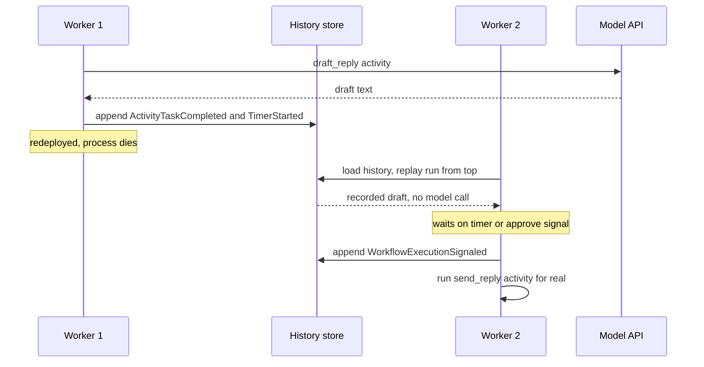

## TL;DR
Durable workflow execution records each agent step (model call, tool call, approval wait) in an
append-only history and replays it to resume after crashes, deploys and days-long waits, without
re-calling the model or repeating tools.

## For agent builders
- **Why it matters for agents.** Agent runs are slow, flaky and expensive: many model calls, tools that
  act on the world, and waits on humans. Durable execution resumes a run at the interrupted step, so a
  deploy at step 14 costs one step, not 14 model calls and duplicated side effects.
- **Where it shows up in your stack.** Temporal, Restate, Inngest, DBOS, AWS Step Functions or Azure
  Durable Functions as the runtime; agent frameworks' checkpointers play a lighter version of the same
  role for graph state.
- **What you control.** The split between workflow code (the loop's decisions) and activities (every
  model and tool call), retry policies and non-retryable errors, idempotency keys from workflow and step
  identity, step budgets with continue-as-new, and payload size.
- **What you can skip.** The engine's internal history store and sharding. Learn replay, determinism and
  at-least-once activities; that explains every bug you will meet.

## Decision case
### Scenario
A procurement team wants a vendor-onboarding agent: it collects documents by email, runs sanctions and
tax checks through tools, asks a buyer to approve, then creates the vendor in the ERP. Vendors take up
to 14 days to reply. All figures are illustrative.
- **Volume:** 1,500 onboardings a week, about 40 model and tool steps each, average duration 6 days. By
  Little's law about 1,500 / 7 × 6 ≈ 1,286 runs are in flight at any moment, most of them waiting.
- **Waits and reminders:** remind the vendor on day 3 and day 7, escalate to the buyer on day 14.
- **Compensation:** if the sanctions check fails after the ERP record exists, the record must be
  deactivated and the buyer told.
- **Constraints:** 4 Python engineers on Kubernetes with Postgres, nobody has run a workflow engine,
  live in 8 weeks, and weekly deploys must not lose or repeat any step.

### Options
| Option | How it works | 14-day waits and reminders | Resume without repeats | Compensation | Fits team and 8 weeks |
|---|---|---|---|---|---|
| A. Status column plus cron | a run table, a sweeper job, retries per step | polling sweeper you write | only as good as your status updates; races with crashes | hand-written | familiar, but grows the bugs in Why it exists |
| B. Framework checkpointer | agent graph with a Postgres checkpointer, pause on approval | pause works; timers need an external scheduler | resumes at the last superstep; tool idempotency is yours | hand-written | fits, with a scheduler and saga code added |
| C. Code-first durable engine | Temporal-style workflow; model and tools as activities | durable timers and signals, no worker held | replay returns recorded results; activities keyed by workflow, run and activity ID | `try`/`except` saga in workflow code | a new runtime to learn and operate |
| D. Declarative state machine | Step Functions style JSON states | built in | built in | built in | awkward for a loop whose next step is chosen by the model |

### Decision
**Option C, a code-first durable engine.** Multi-day waits with reminders, about 1,286 runs mostly
asleep, a compensation path and weekly deploys are exactly what timers, signals, replay and sagas are
for. In A or B the team would rebuild each of them, and that home-grown copy is where steps run twice.
- **Why not A:** a sweeper plus status column is the hand-built fix whose races this lesson describes.
- **Why not B:** fine for short runs with one approval, but 14-day timers and the saga become custom code.
- **Why not D:** the model picks the next tool, and data-dependent branching is painful in JSON states.

**What would change it.** If runs took minutes and waited at most one approval, B is lighter and enough.
If the flow became a fixed pipeline and the company already ran Step Functions, D would fit. If the team
cannot take on a new runtime this quarter, choose B and budget the scheduler and saga work explicitly.

### Trade-offs accepted
- **Determinism rules.** A change to workflow code can break replay of in-flight runs. Keep model and
  tool calls in activities, use versioning patches, and replay recorded histories in CI before deploys.
- **Another system to run.** Monitor task-queue backlog and schedule-to-start latency, and drill a
  worker kill during a vendor wait.
- **Activities are at least once.** ERP and email tools take an idempotency key from workflow ID, run ID
  and activity ID; alert on any duplicate key with a different payload.
- **History growth.** Pass document and transcript references, not payloads, and continue-as-new on a step
  budget; alert on history size per run.

### Review rubric
- **Run shape quantified:** the write-up states steps per run, longest wait and in-flight runs (with the
  Little's law arithmetic) before naming a tool.
- **Primitives mapped:** each requirement (wait, reminder, approval, compensation, resume) is matched to a
  mechanism in every option, not to a feature list.
- **Side effects:** the write-up shows how a retried or replayed step avoids acting twice.
- **Change over time:** it says how code changes reach runs that are already 10 days in.
- **Operational cost:** the option's runtime has an owner, metrics and a drill.
- **Reversal condition:** names the run length or team constraint that would make a lighter option right.

## Why it exists
- **Real processes span time and systems.** Draft a reply with a model, wait for a human to approve,
  send it, poll a vendor for confirmation, retry tomorrow if the vendor is down.
- **One long function loses the process.** A worker dies halfway during a deploy: the draft was made and
  paid for, the approval request was sent, and nobody knows which step completed.
- **The hand-built fix grows the same bugs.** A `status` column plus a cron job that scans for stuck rows
  and a retry loop around each step gives: steps that run twice because the status update raced with the
  crash, timers reimplemented as polling, "waiting for approval" rows nobody sweeps, a state machine spread
  across three services, and no way to change logic while thousands of processes are mid-flight.
- **Queues give retries, not orchestration.** A queue cannot express "wait 48 hours, then if no signal
  arrived, escalate".
- **Agents make it acute.** Each model or tool call can take seconds to minutes, fail transiently and cost
  real money. Re-running the loop duplicates side effects and token spend; abandoning it loses the user's
  work. Durable execution resumes a crash at step 14 of 20 at step 14, with steps 1 to 13 decided and no
  model re-calls.

## How it works
### The core idea: event sourcing applied to a program's execution
- **Every decision becomes an event.** A durable workflow engine records "activity X scheduled",
  "activity X completed with result R", "timer T started", "signal S received" in a durable store.
- **Many engines, one model.** Temporal and its predecessor Cadence, AWS Step Functions, Azure Durable
  Functions, Restate, Inngest, DBOS and others differ in surface but share it.
- **Memory is reconstructible.** Workflow code never holds state that matters only in memory; it can be
  rebuilt from the history.

### Replay
1. A worker crashes or is redeployed; another worker picks up the workflow.
2. It re-executes the workflow code from the beginning *against the recorded history*.
3. Each step whose result is already in the history gets the recorded result instead of running again.
4. The code reaches the same point with identical local variables, then continues with the first step
   that has no recorded outcome.

- **Hence determinism.** No wall-clock reads, random numbers, direct network or database calls, or
  iteration over unordered maps inside the workflow function, *because* a different decision during replay
  would diverge from history and the engine would have to fail the workflow.
- **Engines provide deterministic substitutes:** `workflow.now()`, seeded random, versioned patches.

### Activities: where the real world lives
- **Everything non-deterministic or side-effecting is an activity:** every LLM call, tool call, HTTP
  request and database write.
- **Activities run outside the replay machinery,** with timeouts and a retry policy, and their *results*
  are what gets recorded.
- **The engine guarantees** an activity is retried until it succeeds or the policy gives up, and that its
  result is never recomputed on replay.
- **It cannot guarantee exactly once.** A worker can complete the side effect and crash before reporting,
  and the retry runs it again.
- **So activities must be idempotent,** with a key derived from the workflow and step identity: the same
  exactly-once limitation that applies to every distributed system.

### Durable timers, signals and queries
| Primitive | What it does |
|---|---|
| **Timer** | `sleep(30 days)` is an event, not a blocked thread; the worker is free and any worker resumes the workflow when it fires, across deploys |
| **Signal** | delivers external input, such as a human approval or a webhook, into a running workflow |
| **Query** | reads current state without affecting history |

- **Together they replace cron-plus-polling** with code that reads as a straight-line program.

### Task queues and workers
Workflows and activities are dispatched through named task queues that workers poll. This gives:
- **natural bulkheads:** GPU-bound activities on one queue, email on another;
- **per-queue concurrency limits** that act as backpressure;
- **heartbeats** for long activities, so a dead worker is detected and its activity rescheduled rather
  than waiting for the full timeout.

### Living with long-running code
- **Versioning.** Deploying new workflow code while old histories exist can break replay, so engines offer
  a patch marker that lets new code take the old branch for histories recorded before the change.
- **Continue-as-new.** Very long or unbounded loops, like an agent that may take thousands of steps, close
  the current history and start a fresh one carrying only the needed state, *because* replaying millions
  of events is slow and memory-hungry.

### Failure and compensation
- **Exhausted retries raise an error inside workflow code,** where ordinary control flow decides what
  happens next.
- **So the saga pattern is a `try`/`except`:** record a compensating action after each step that succeeds
  (cancel the booking, refund the charge, retract the draft) and run them in reverse order if a later step
  fails for good.
- **Compensations are activities too,** so they are retried and must be idempotent.
- **This is forward recovery:** the external world cannot be rolled back, only corrected, so the workflow
  encodes how to correct it.

### Mapping an agent loop onto a workflow
| Agent concept | Workflow construct | Why |
|---|---|---|
| Model call that picks the next action | activity | non-deterministic; its recorded result drives replay |
| Tool call | activity with an idempotency key | side effect, retried at least once |
| "Stop after N steps" | counter in workflow state | deterministic, survives replay |
| Human approval of an action | signal plus durable timer | no worker blocked while waiting |
| Transcript and memory | blob or database reference passed between activities | keeps history small |
| Very long run | continue-as-new carrying a compact summary | bounds replay time |

- **The loop itself is ordinary control flow** in the workflow: while not done and under budget, call the
  model activity, then run the tool activity it chose. Branching on model output is fine, because on
  replay that output comes from history.

### Compared with the alternatives
| Approach | Gives | Lacks |
|---|---|---|
| Hand-built saga | compensation | resumption |
| Queue | retries | orchestration |
| Declarative state machine (Step Functions style) | durability with JSON-defined states; excellent for fixed pipelines | awkward for branching agent logic |
| Code-first engine | ordinary programs | simplicity: determinism rules apply |

## Diagram
A worker restart mid-run: replay returns recorded results for finished steps, so only the step with no
recorded outcome really executes.



## Examples
### A Temporal-style approval workflow
A Temporal-style workflow (Python SDK conventions; check names against the current docs) in which the
LLM call and the send are activities, and the approval wait is a durable timer plus signal. A crash
after `draft_reply` completes resumes at the wait without calling the model again.

```python
import asyncio
from datetime import timedelta
from temporalio import activity, workflow
from temporalio.common import RetryPolicy

@activity.defn
async def draft_reply(ticket_id: str) -> str:
    return await llm.complete(f"Draft a reply for ticket {ticket_id}")       # your model client

@activity.defn
async def send_reply(ticket_id: str, text: str) -> None:
    info = activity.info()     # same workflow_id and activity_id on every retry of this step
    await mailer.send(ticket_id, text, idempotency_key=f"{info.workflow_id}:{info.activity_id}")

@workflow.defn
class TicketReplyWorkflow:
    def __init__(self) -> None:
        self.approved: bool | None = None

    @workflow.signal
    def approve(self, ok: bool) -> None:          # delivered by the review UI
        self.approved = ok

    @workflow.run
    async def run(self, ticket_id: str) -> str:
        draft = await workflow.execute_activity(
            draft_reply, ticket_id,
            start_to_close_timeout=timedelta(seconds=90),
            retry_policy=RetryPolicy(maximum_attempts=3, initial_interval=timedelta(seconds=2)),
        )
        try:   # durable wait: no worker is blocked, and it survives restarts and deploys
            await workflow.wait_condition(lambda: self.approved is not None, timeout=timedelta(days=2))
        except asyncio.TimeoutError:
            return "expired"
        if not self.approved:
            return "rejected"
        await workflow.execute_activity(send_reply, args=[ticket_id, draft],
                                        start_to_close_timeout=timedelta(seconds=30))
        return "sent"
```

- **Notice what is *not* in the workflow:** no `datetime.now()`, no HTTP, no database. Those would be
  re-executed on replay.
- **The model is called inside an activity** precisely because it is non-deterministic; its recorded
  result is what the replayed workflow sees.
- **The idempotency key comes from workflow and step identity, not the ticket,** *because* a ticket may
  legitimately get a second reply from a later workflow, while a retry of this step must never send twice.

### A durable tool-calling agent loop
The same conventions applied to a whole agent loop: one activity asks the model for the next action, one
runs the chosen tool, and the step budget lives in workflow state. `start_transcript`, `call_model` and
`run_tool` are your own activities; check SDK names against the current Temporal docs.

```python
from datetime import timedelta
from temporalio import workflow
from temporalio.common import RetryPolicy

STEP = dict(start_to_close_timeout=timedelta(minutes=2),
            retry_policy=RetryPolicy(maximum_attempts=3,
                                     non_retryable_error_types=["ValidationError"]))

@workflow.defn
class AgentRun:
    @workflow.run
    async def run(self, task: str, transcript_ref: str | None = None, steps: int = 0) -> str:
        ref = transcript_ref or await workflow.execute_activity(start_transcript, task, **STEP)
        while steps < 200:                       # step budget: deterministic, survives replay
            action = await workflow.execute_activity(call_model, ref, **STEP)
            if action["type"] == "final":
                return action["answer"]
            ref = await workflow.execute_activity(run_tool, args=[ref, action], **STEP)
            steps += 1
            if steps % 50 == 0:                  # keep history small on long runs
                workflow.continue_as_new(args=[task, ref, steps])
        return "step budget exhausted"
```

- **A crash anywhere replays to the last recorded step:** earlier `call_model` results come from history,
  so no tokens are re-spent and the model's earlier choices cannot change.
- **`run_tool` derives its idempotency key** from workflow ID, run ID (`info.workflow_run_id`) and
  activity ID. Unlike `send_reply` above, this loop uses continue-as-new, and activity IDs are numbered
  per run, so workflow ID plus activity ID alone would collide across continued runs and dedupe a new
  tool call against an old one.
- **The transcript lives behind `ref`,** so the history holds references, not tens of thousands of tokens.

### Trace one run through a redeploy
The reviewer is slow, and the worker is redeployed on day one. The history so far (simplified; real
Temporal histories also interleave workflow-task and activity-started events):

```
1 WorkflowExecutionStarted  ticket_id="T-812"
2 ActivityTaskScheduled     draft_reply
3 ActivityTaskCompleted     result="Hi Dana, the refund was issued on ..."
4 TimerStarted              2 days   (from wait_condition's timeout)
```

1. A new worker picks the workflow up and runs `run()` from the top.
2. At `execute_activity(draft_reply)` the engine finds events 2 and 3 and returns the recorded draft
   without calling the model.
3. At `wait_condition` it finds the timer and simply waits.
4. The `approve` signal arrives on day two and is appended as a `WorkflowExecutionSignaled` event; the
   condition is now true.
5. The code schedules `send_reply`, which has no recorded result and therefore really runs.

- **One model call in total,** however many times the workers restarted.

### A toy replay engine you can run
Plain Python, no engine: a context records each step's result and, on replay, returns it instead of
executing. It shows why steps before the crash cost nothing the second time, and how a code change
surfaces as a non-determinism error.

```python
class Crash(Exception):
    pass

class Ctx:
    def __init__(self, history):
        self.history, self.pos, self.executed = history, 0, []

    def activity(self, name, fn):
        if self.pos < len(self.history):                  # replay: return the recorded result
            recorded, result = self.history[self.pos]
            if recorded != name:
                raise RuntimeError(f"non-determinism: history has {recorded}, code asked {name}")
        else:                                             # new step: really run it, then record
            result = fn()
            self.executed.append(name)
            self.history.append((name, result))
        self.pos += 1
        return result

def research(ctx, topic, crash_after=None):
    notes = []
    for i in range(4):
        notes.append(ctx.activity(f"step{i}", lambda i=i: f"{topic}-note{i}"))
        if crash_after == i:
            raise Crash()
    return notes

history = []                                              # stands in for the durable store
try:
    research(Ctx(history), "kv", crash_after=1)
except Crash:
    pass
ctx = Ctx(history)
print(research(ctx, "kv"), ctx.executed)
# ['kv-note0', 'kv-note1', 'kv-note2', 'kv-note3'] ['step2', 'step3']
```

- **Only `step2` and `step3` ran after the crash;** the first two returned recorded results.
- **Rename a step and replay fails loudly,** which is why real engines need versioning patches.

## Production patterns
- **Model and tools in activities, decisions in the workflow.** Enforce it in code review and keep
  workflow modules free of network clients; Temporal's Python SDK runs workflows in a sandbox that blocks
  many non-deterministic calls. Alert on non-determinism errors after every deploy.
- **Non-retryable errors and bounded retries.** Set a retry policy with a maximum attempts or expiry and
  list validation and auth error types as non-retryable (Temporal's `RetryPolicy` accepts
  `non_retryable_error_types`). Monitor retry counts per activity type and workflows open longer than
  their expected duration.
- **Heartbeats on long model calls.** Call `activity.heartbeat()` periodically inside multi-minute
  activities and set a `heartbeat_timeout` well below the `start_to_close_timeout`, so a dead worker's
  activity is rescheduled quickly. Monitor heartbeat timeouts per worker pool.
- **Task-queue bulkheads.** Route GPU-bound inference activities to their own task queue with a worker
  concurrency limit, and email or tool activities to another. Monitor queue backlog and schedule-to-start
  latency per queue, which is the backpressure signal.
- **Continue-as-new on a step budget.** For agent loops, count steps in workflow state and call
  continue-as-new every few hundred steps, carrying only the needed state. Monitor history size and
  replay latency.
- **References, not payloads.** Store full documents and long transcripts in blob storage and pass keys
  between activities, keeping history small. Monitor per-event payload size.
- **Approval gates as signals.** Before a consequential tool call, the agent workflow waits on an
  approval signal with a durable timeout and an escalation branch, so no worker is held for hours.
  Monitor approval wait time and the share of runs that expire waiting.

## Trade-offs
- **Crash-proof resumption vs determinism rules.** You get readable straight-line orchestration in
  exchange for rules that are easy to violate; the trade pays off once a process has more than two steps
  or waits on humans or timers.
- **Full audit trail vs history bloat.** Every step's inputs and outputs are persisted, but large payloads
  (full documents, long transcripts) bloat history; pass references to blob storage instead.
- **Activity retries vs token spend.** Retries lift success rates, yet retrying an LLM activity re-spends
  tokens and may produce a different answer; make the activity idempotent on its own cache or accept the
  cost knowingly.
- **Versioning vs permanent complexity.** It lets you change logic under running instances, but each
  patch stays until old histories drain; short-lived workflows can skip it, multi-week ones cannot.
- **Declarative state machines vs branching.** They need no determinism discipline and integrate natively
  with cloud services, but become painful when branching is data-dependent, as in agent loops.
- **Durable engine vs framework checkpointer.** A full engine gives timers, signals, retries and task
  queues across services, at the cost of running it; a framework's graph checkpointer is lighter and
  enough when runs are short and waits are rare.

## Pitfalls
- **Calling the model or a tool directly from workflow code.** It works in tests, then replays into a
  second real call, visible as duplicated emails or doubled token bills after a worker restart.
- **Non-deterministic workflow code** (`time.time()`, `uuid4()`, dict iteration order, reading config at
  runtime), which surfaces as workflows failing with non-determinism errors only after a deploy.
- **Activities without idempotency keys.** An at-least-once retry after a crash performs the side effect
  twice; the symptom is duplicates that correlate with deploys and worker restarts.
- **Unbounded agent loops in one history.** Discovered as slowly growing replay latency and memory until
  the workflow stalls; use continue-as-new on a step budget.
- **Retry policies left at defaults that retry forever.** An activity failing on bad input (a
  non-retryable error) keeps retrying for days; workflows never fail and never finish. Mark validation and
  auth errors non-retryable and set a maximum attempts or expiry.
- **Missing heartbeats on long activities.** A dead worker's multi-minute inference is not rescheduled
  until the full timeout expires, inflating latency on every infrastructure hiccup.
- **Putting the whole transcript in workflow history.** Each step appends tens of thousands of tokens, so
  history hits size limits and replay slows; pass a reference to blob storage instead.

## When to use
- **Use when** a process spans more than one side-effecting step, waits on timers or humans, or must
  survive deploys mid-flight: approvals, multi-step agent tasks, document pipelines, onboarding flows,
  anything the business would describe as "a case".
- **Avoid for** a single request-response call or pure data transformations, where a queue and an
  idempotent consumer are enough.
- **Measure** workflow completion rate, time in each activity, retry counts per activity type and history
  size; alert on non-determinism errors after deploys.
- **Day to day:** the discipline "model and tools in activities, decisions in the workflow". The
  agent-reliability module covers checkpoint stores and agent-specific recovery; this lesson is the
  general runtime they rest on.
- **Interviews:** explaining replay and why determinism follows from it is the expected depth.

## Role lens
- **Engineer:** Writes activities for every model and tool call with timeouts, retries and idempotency
  keys, keeps workflow code deterministic, and applies continue-as-new on long agent loops.
- **Architect:** Chooses between a code-first engine and a declarative state machine, defines task-queue
  bulkheads and concurrency limits, and sets the payload and history-size policies.
- **FDE:** Maps a customer's multi-day approval and escalation processes onto workflows with signals,
  and shows the history as the audit trail their compliance team asked for.

## Check yourself
**Q:** A team runs a 30-step research agent as one function inside a job queue with retries. After a
deploy, users report duplicated documents and bills roughly double for the hour. Diagnose it and
explain how durable execution changes the picture.
**A:** The queue restarted the job from step one after the deploy killed the worker mid-run. Every
model call and tool call before the crash point was repeated, so tokens were spent twice and
non-idempotent tool calls such as "create document" ran again. Retries at the job level are
at-least-once for the whole job, which is the wrong granularity. Under durable execution each of the
30 steps is an activity whose result is recorded in the workflow history as it completes. On restart
the workflow replays: steps one to the crash point return their recorded results without executing,
so no tokens are re-spent and no tools re-run, and only the interrupted step is retried. That step
still needs an idempotency key, because the crash could have happened after the side effect and
before the result was recorded. The team should also move the loop under a step budget with
continue-as-new and add heartbeats to long model calls.

## Interview questions
### What is durable execution, and how does it differ from a job queue with retries?
- **Durable execution** records every step's result in an event history and resumes by replaying it, so a
  crash continues from the interrupted step.
- **A queue with retries** is at-least-once for the whole job, so a crash re-runs every earlier model and
  tool call; it also cannot express waits like "48 hours, then escalate".

### Why can't workflow code call `datetime.now()` or the model directly?
- **Recovery re-executes the code against history.** A different clock value or model answer would take a
  different branch, the history would no longer match, and the engine would fail the workflow.
- **So** use the engine's deterministic substitutes for time and randomness, and put every model call in an
  activity whose recorded result replay returns.

### After a deploy, workflows started failing with non-determinism errors. What happened and how do you fix it?
- **Likely cause:** the new code changed the order or set of steps for histories recorded under the old
  code, or added a non-deterministic call.
- **Fix:** guard the change with a versioning patch so old histories take the old branch, remove the
  non-deterministic call, and replay recorded production histories against new code in CI before deploying.

### When would you pick a declarative state machine over a code-first engine?
- **Fixed pipelines** with few data-dependent branches, where JSON-defined states, no determinism
  discipline and native cloud integrations win.
- **Not for agent loops,** whose branching depends on model output; a code-first engine expresses that as
  ordinary control flow.

### An agent workflow runs thousands of steps and replay is getting slow. What do you change?
- **Continue-as-new on a step budget:** close the history and start a fresh one carrying only needed state.
- **Shrink payloads:** store transcripts and documents in blob storage and pass references.
- **Monitor history size and replay latency** so the budget is set from data, not guessed.

### How would you structure a tool-calling agent on a durable workflow engine?
- **Workflow holds decisions:** the loop, the step budget and branching on the model's chosen action.
- **Activities hold the world:** one for the model call, one per tool call, each with timeouts, bounded
  retries, non-retryable validation errors and an idempotency key from workflow and step identity.
- **Human approval is a signal with a timer;** long runs use continue-as-new and pass the transcript by
  reference.

## Quiz
### Q: Why must durable workflow code be deterministic?
- [ ] Because the engine executes it on a single thread for performance
- [x] Because recovery works by re-executing the code against the recorded history, and any divergence makes replay fail
- [ ] Because non-deterministic code cannot be serialised to the database
- [ ] Because activities require deterministic inputs to be retried
> Replay reconstructs state by running the code again and substituting recorded results. If the code
> takes a different branch the second time, the history no longer matches and the engine cannot continue.

### Q: Where should an LLM call live in a durable workflow, and why?
- [ ] In the workflow function, so its result is recorded in history
- [ ] In a signal handler, so it runs only when triggered
- [x] In an activity, because it is non-deterministic and side-effecting; its recorded result is what replay sees
- [ ] In a query handler, so it does not affect workflow state
> Activities run outside replay, with timeouts and retries, and only their results enter the history.
> Calling the model in workflow code would re-invoke it on every replay and break determinism.

### Q: An activity performs a payment and the worker crashes before reporting completion. What does the engine do, and what must the activity therefore guarantee?
- [ ] The engine detects the completed payment and records it automatically
- [ ] The engine marks the workflow failed to avoid any risk of duplication
- [x] The engine retries the activity, so the activity must be idempotent to avoid charging twice
- [ ] The engine rolls back the payment using the recorded history
> Durable execution gives at-least-once activity execution; the engine cannot see external side effects.
> Exactly-once effects come from idempotency keys the receiver deduplicates on, not from the engine.

## Use cases & projects
### Use cases
- **Long-running research and coding agents.** Runs survive deploys and worker crashes at the
  interrupted step, with no re-spent tokens on earlier steps.
- **Agents with human approval.** Drafts wait days for review on a durable timer and signal, then send
  exactly once with an idempotency key.
- **Multi-step business processes run by agents.** Onboarding, refunds and procurement get sagas with
  compensations when a later step fails for good.
- **Document and ingestion pipelines feeding RAG.** Each chunk-embed-index step is an activity with
  retries, so a provider blip does not restart the whole batch.

### Mini project
**Make a tool-calling agent crash-proof (2-3 hours).**
- **Goal:** show that a durable agent loop resumes mid-run without repeating model or tool calls.
- **Steps:** extend the toy replay engine above into a 6-step agent loop with a fake model that picks
  tools and a fake "create document" tool that counts calls; kill the process at a random step, restart
  it against the saved history (a JSON file), then repeat with the real SDK in a local Temporal dev server
  if you have one.
- **Done when:** across 20 random crashes, each run's model call count equals its step count and the
  tool created exactly one document per intended action.
