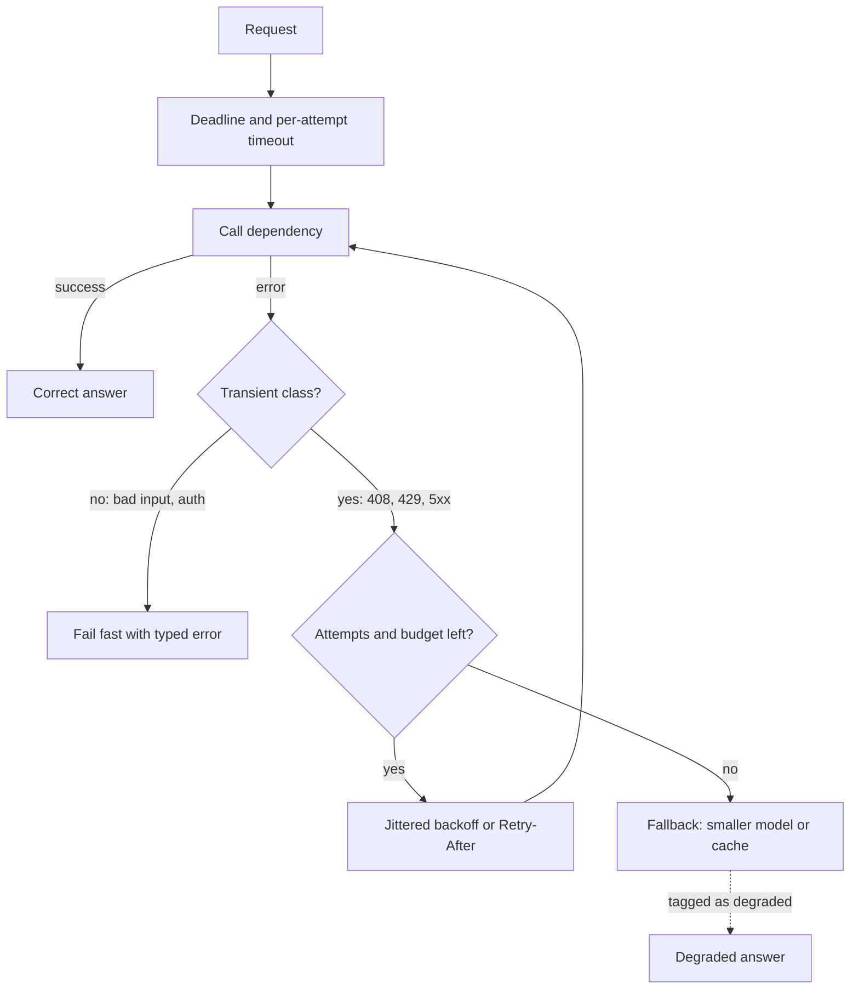

## TL;DR
Fault tolerance keeps a system delivering correct, or explicitly degraded, service while components
fail, using timeouts, bounded retries, idempotency, breakers, bulkheads, fallbacks and replicated state.
The question is which faults you tolerate, how you detect them, and what happens before recovery.

## Why it exists
- **Components fail at rates you cannot engineer away.** A fleet of 1,000 disks with a 1% annual failure
  rate loses about ten a year; 10 million remote calls a day at a 0.01% failure rate is a thousand
  failures daily.
- **Remote calls fail ambiguously.** A request can be lost on the way out, lost on the way back, or merely
  slow, and the caller cannot tell which. Local code never has this failure mode.
- **Better hardware never solved it.** Jim Gray's analysis of Tandem outages found software and
  operations, not hardware, were the dominant causes.
- **The naive `try: call() except: call()` amplifies faults.** It retries what retrying cannot fix (bad
  input, auth errors), duplicates side effects when the first call succeeded but the reply was lost, and
  multiplies load on a struggling dependency, turning a partial failure into a total one.
- **Agents make it urgent.** A 20-step agent at 99% per step finishes cleanly only 0.99²⁰ ≈ 82% of the
  time. Most of the 18% are transient (a 429, a tool timeout, malformed JSON) and are recoverable without
  double-charging a card or sending an email twice.

## How it works
### Vocabulary that keeps designs honest
Avižienis et al. separate three links in a chain:

| Term | Meaning | Example |
|---|---|---|
| **Fault** | the underlying defect | a bug, a dead NIC, a provider incident |
| **Error** | the incorrect internal state it produces | a timed-out call, a null field |
| **Failure** | the service no longer doing what it promised, as users see it | a wrong or missing answer |

- **Fault tolerance stops the chain between error and failure.** Naming which link you are breaking is
  the difference between a design and a hope.

### Choose the fault model first
You tolerate what you design for.
- **Crash-stop:** a node dies and stays dead.
- **Crash-recovery:** it comes back with or without its state, so you must handle duplicate work.
- **Omission and timing:** a message or reply is lost or late. Every remote call needs a timeout,
  because "slow" is indistinguishable from "dead" from the outside.
- **Byzantine (arbitrary):** a component returns well-formed but wrong output, or different answers to
  different callers. Classic systems rarely engineer against it because masking is expensive: Byzantine
  agreement needs 3f + 1 replicas to tolerate f faulty ones, against 2f + 1 for crash faults.
- **LLM value faults look Byzantine.** A confident, schema-valid, wrong tool argument is not malicious,
  so strictly it is a value fault, but nothing about the reply looks broken. That is why output
  validation against ground truth and approval gates belong next to retries.

### Masking versus recovery
- **Masking hides the error entirely.** A replica answers instead, or several components vote and the
  majority wins (N-modular redundancy). Sampling several LLM answers and taking the consensus is the same
  idea, and it only helps when the samples' errors are independent.
- **Backward recovery** returns to a known-good earlier state and redoes the work: checkpoint and
  restart, transaction rollback, replaying a workflow from its history.
- **Forward recovery** moves to a new correct state without undoing: a compensating action (refund the
  charge, retract the email) or a degraded answer.
- **Real-world side effects usually cannot be rolled back,** so agent tools that act on real systems
  need forward recovery designed in.

### The toolbox, in the order you apply it
1. **Timeouts**, *because* a hung call holds a thread, a connection and often a GPU slot; nothing else
   in the list can act until the call returns. Derive them from the latency budget end to end, not
   per hop in isolation.
2. **Bounded retries with backoff and jitter**, *because* transient faults (429, 503, connection reset)
   usually clear within seconds, and jitter prevents every client from retrying in lockstep. Retry only
   transient classes, cap attempts, and give retries a budget (SRE book rule of thumb: around 10% of
   total requests) so an outage cannot double your load.
3. **Idempotency**, *because* retries are only safe if a repeated operation has the same effect as one.
   A pure completion call is naturally idempotent apart from billing; a tool that sends money is not,
   and needs an idempotency key the receiver deduplicates on.
4. **Circuit breakers**, *because* once a dependency is clearly down, continuing to call it wastes your
   latency budget and its recovery capacity; fail fast and probe occasionally.
5. **Bulkheads**, *because* a failing dependency should exhaust its own pool of connections or
   workers, not the shared pool that serves everything else.
6. **Fallbacks and graceful degradation**, *because* "what do we do instead" is a product decision
   made in advance: a cached answer, a smaller model, retrieval-only mode, a static "try again" message.
   Each operation gets one explicit choice.
7. **Replication and consensus for state**, *because* stateless retries cannot recover data; replicas,
   quorum writes and leader election keep the truth alive when a node holding it dies.

### Fail-fast, fail-safe, fail-operational
| Style | Behaviour on fault | Protects |
|---|---|---|
| **Fail-fast** | reports an error immediately rather than hanging | callers' latency budgets |
| **Fail-safe** | moves to a safe state, e.g. an agent refusing to act when its policy check is unavailable | users and the outside world |
| **Fail-operational** | continues full service through redundancy | availability |

- **Default for AI features:** fail-fast internally and fail-safe at action boundaries.

### Detection and its own failure mode
- **Every detector has false positives.** Heartbeats, health checks and error-rate thresholds detect
  faults, but can be wrong.
- **A wrong diagnosis causes split brain.** Declaring a slow primary dead and promoting a replica while
  the old one is still writing leaves two writers.
- **Fencing tokens or a single arbiter** prevent two nodes from both believing they lead.
- **So thresholds trade failover speed** against the risk of acting on a wrong diagnosis.

## Diagram
A fault is contained at each layer before it can become a user-visible failure; the dotted path is the
degraded answer.



## Examples
### A tolerant provider call
A provider call wrapped in tools 1, 2 and 6 from the list: an overall deadline, per-attempt timeout,
retries only on transient statuses, full-jitter backoff that honours `Retry-After`, and a fallback that
degrades instead of failing.

It assumes the call itself has no side effects, so repeating it is safe (tool 3 satisfied by
construction); the breaker and bulkhead (4 and 5) sit around this function, not inside it.

```python
import random, time

class Transient(Exception):
    """Raised by the client on 408/429/5xx; carries Retry-After when the server sent one."""
    def __init__(self, status, retry_after=None):
        self.status, self.retry_after = status, retry_after

def tolerant_complete(primary, fallback, req, *, budget_s=45, attempt_timeout_s=20,
                      max_attempts=3, base_s=0.5, cap_s=8.0):
    deadline = time.monotonic() + budget_s             # one budget for the whole operation
    for attempt in range(max_attempts):
        remaining = deadline - time.monotonic()
        if remaining <= 0:
            break
        try:
            return primary(req, timeout_s=min(attempt_timeout_s, remaining))
        except Transient as e:                         # non-transient errors propagate: retrying cannot fix them
            if attempt == max_attempts - 1:
                break                                  # no attempts left: do not sleep for nothing
            sleep = e.retry_after if e.retry_after is not None \
                else random.uniform(0, min(cap_s, base_s * 2 ** attempt))   # full jitter
            if time.monotonic() + sleep >= deadline:
                break
            time.sleep(sleep)
    # primary exhausted or budget spent: degrade visibly rather than fail
    remaining = max(1.0, deadline - time.monotonic())  # floor: may overrun the budget by up to 1 s
    return fallback(req, timeout_s=remaining)          # smaller model, cached answer, or a typed "unavailable"
```

- **Why three attempts, not ten?** With independent transient failures at 5% per call, one attempt
  succeeds 95% of the time, two 99.75%, three 1 − 0.05³ ≈ 99.99%; a fourth adds almost nothing.
- **That arithmetic only holds while failures are independent.** In a real provider outage they are
  perfectly correlated, every attempt fails, and the loop only triples the load on the provider and spends
  the user's budget. The deadline, the breaker around this function and the fallback matter more.
- **Tag the fallback result** (a header or a field) so the UI and metrics know the answer came from the
  degraded path, and export the retry count to see a provider wobble before it becomes an outage.
- **For side-effecting tool calls,** add an idempotency key to `req` before the first attempt, never
  inside the loop.

### Worked scenario: nested retries during an outage
Three layers each retry "a few times" with no shared budget: the SDK (3 attempts), the service (3) and
the browser client (3). The provider starts failing every call.

| Layer | Attempts per call from above | Calls reaching the provider per user action |
|---|---|---|
| Client | 3 | 3 |
| Service | 3 per client attempt | 9 |
| SDK | 3 per service attempt | 27 |

- **One user action becomes 27 provider calls,** so request volume spikes several-fold exactly when the
  provider is weakest.
- **Fix:** retry at one layer only (usually the one closest to the dependency), disable SDK retries or
  pass a shared deadline down, and cap retries with a budget of around 10% of requests.

## Production patterns
- **One shared client wrapper.** Every team imports the same provider and tool client that applies the
  deadline, transient-only retries with full jitter and `Retry-After` handling. Monitor attempts per
  request and retry ratio per dependency.
- **Retry budget, not just a retry count.** Track retries as a fraction of requests over a short window
  and stop retrying when it passes about 10%, so an outage cannot double load. Monitor the budget
  exhaustion rate as an early outage signal.
- **Idempotency key minted before the first attempt.** Generate one key per intended action (for example
  a UUID stored with the agent step) and send it on every attempt; the receiver stores it with a unique
  constraint and returns the first result on repeats. Monitor duplicate-rejected counts.
- **Read-after-timeout for side-effecting tools.** Classify a timeout on a write as "unknown outcome" and
  query the target system for the key before retrying. Monitor the share of timeouts that turned out to
  have succeeded.
- **Labelled degradation ladder.** Define per operation: primary model, smaller model, cached answer,
  typed "unavailable", and tag responses with which rung served them. Monitor fallback share and run
  chaos tests that force each rung.

## Trade-offs
- **Retries vs load.** Retries raise success rates for transient faults but add load exactly when the
  dependency is weakest; the balance flips to "stop retrying" once the error rate suggests a real outage,
  which is the breaker's job.
- **Replicas vs restore.** Redundant replicas tolerate crash faults but cost double and add consistency
  problems; for rarely used or cheap-to-recompute state, a fast restore beats a live replica.
- **Fail-safe vs feature availability.** Fail-safe defaults protect users when a policy or guard service
  is down, but turn a guard outage into a feature outage; fail-open is acceptable only for guards whose
  absence is low-risk.
- **Tight vs loose timeouts.** Tight timeouts free resources quickly but cut off legitimately slow
  responses such as long generations; the value comes from the latency distribution, and streaming
  changes what "timeout" should mean.
- **Fallback models vs consistency.** They keep the product available but change answer quality and
  behaviour; if customers depend on consistency, label the fallback and measure it separately in evals.
- **Voting vs cost.** Masking by voting (several replicas or several sampled LLM answers) hides value
  faults but multiplies cost and latency by N; it pays only when errors are independent and a wrong
  answer is expensive, and buys nothing when every sample shares the same misleading context.

## Pitfalls
- **Retrying non-idempotent tool calls after a timeout.** The first call succeeded and the reply was
  lost; the symptom is duplicate emails, tickets or charges that correlate with provider latency spikes.
- **Nested retries across layers.** SDK retries × service retries × client retries multiply into tens
  of attempts per user action; visible as request volume spiking several-fold during an incident.
- **Timeouts that add up.** Five sequential hops each with a 30 s timeout cannot meet a 30 s end-to-end
  promise, so users see failures even though every hop "met its timeout".
- **Treating any exception as transient.** Bad prompts or revoked API keys are retried for minutes; the
  symptom is latency without errors in logs until the budget finally expires.
- **Fallbacks that were never exercised.** The secondary provider's key expired or its tool schema
  drifted, discovered only during the primary's outage. Chaos tests exist for this.

## When to use
- **Baseline for every remote call:** timeout, bounded jittered retry on transient classes, and
  idempotency for anything with side effects. That is not a design choice.
- **Add breakers and bulkheads** when a dependency's failure can starve shared resources.
- **Define a fallback** for every user-facing operation where "nothing" is worse than "something degraded".
- **Do not add tolerance you cannot observe.** Export attempt counts, breaker state and fallback usage,
  or you will not know the system is quietly running on its backup path.
- **Day to day:** the client wrapper everyone imports and the FMEA row saying what happens when each
  dependency fails.
- **Interviews:** explain why retries need budgets and idempotency, and walk a fault from detection to
  degraded response.

## Role lens
- **Engineer:** Owns the shared provider and tool client: deadlines, jittered retries on transient
  statuses, idempotency keys for side-effecting tools, and metrics for every degraded path.
- **Architect:** Chooses the fault model and the degradation ladder per capability, and sets the
  rule that no retry layer exists without a budget and no action tool exists without idempotency.
- **FDE:** Maps which of the customer's systems can be retried safely, which need idempotency keys or
  reconciliation, and what degraded mode the customer's operations team will accept.

## Check yourself
**Q:** An agent's "create purchase order" tool call timed out at 30 seconds. The orchestrator retried,
and the customer's ERP now shows two orders. Walk through what went wrong and how the design should
change at each layer.
**A:** The timeout is an omission fault: the caller cannot know whether the first call completed, and
in this case it did. Retrying a non-idempotent operation after an ambiguous failure is the root
mistake. Fixes, from the inside out: the tool must accept an idempotency key generated once per
intended action, before the first attempt, and the ERP adapter must deduplicate on it or query for an
existing order with that key before creating. The orchestrator should classify timeouts on
side-effecting tools as "unknown outcome" and reconcile (read-after-timeout) rather than blindly
retry. The 30 s timeout should be derived from the ERP's actual latency distribution so it does not
trip on normal slow paths. Finally, an approval gate or a daily reconciliation report catches the
cases that still slip through, and the duplicate rate becomes a tracked metric.

## Interview questions
### What is the difference between a fault, an error and a failure, and why does it matter?
- **Fault** is the defect (a bug, a dead NIC), **error** the bad internal state it causes (a timed-out
  call), **failure** the user-visible broken promise.
- **It matters because** each mechanism breaks a specific link: a retry turns an error back into success,
  a fallback stops an error becoming a failure. Naming the link keeps the design honest.

### Why is a plain retry loop dangerous, and what makes retries safe?
- **Danger:** it retries unfixable errors, duplicates side effects when only the reply was lost, and
  multiplies load during an outage.
- **Safe retries need:** transient-only classification, capped attempts with jittered backoff, a shared
  deadline, a retry budget, and idempotency for anything with side effects.

### During a provider incident your request volume to it tripled. How do you find and fix the cause?
- **Look for nested retries:** compare user actions to provider calls per layer; 3 × 3 × 3 gives 27.
- **Fix:** retry in one layer only, propagate a deadline, add a retry budget, and put a circuit breaker
  around the dependency so it fails fast once errors persist.

### When would you choose fail-safe over fail-open for a guard service?
- **Fail-safe** (block the action) when the guard protects money, data or safety: an agent should refuse
  to act when its policy check is down.
- **Fail-open** only when the guard's absence is low-risk, because fail-safe turns a guard outage into a
  feature outage.

### How many retries would you configure for a call with a 5% transient failure rate?
- **About three:** success goes 95%, 99.75%, then about 99.99%; a fourth adds almost nothing.
- **Caveat:** that assumes independent failures. In a real outage they are correlated, so the deadline,
  breaker and fallback matter more than the count.

## Quiz
### Q: Why must retries be combined with idempotency rather than used alone?
- [ ] Idempotency makes the retried call faster because the server can cache it
- [x] After a timeout the caller cannot know whether the first attempt took effect, so a repeat must be harmless
- [ ] Providers reject retries that do not carry an idempotency header
- [ ] Idempotency allows retries to skip the backoff delay
> A lost reply looks identical to a lost request. Without idempotency, retrying after an ambiguous
> failure duplicates side effects; with it, the second attempt either no-ops or returns the first result.

### Q: A dependency starts returning 503s for 40% of calls. Which combination best protects the rest of the system?
- [ ] Increase the retry count to five and remove the timeout so slow calls can finish
- [ ] Switch all calls to synchronous mode so failures are detected sooner
- [x] Keep a short timeout, retry within a budget, open a circuit breaker if errors persist, and serve a defined fallback
- [ ] Disable the dependency's health check so the load balancer keeps traffic flowing
> More retries and no timeout pour load onto a struggling dependency and tie up your own resources.
> Budgeted retries plus a breaker contain the fault, and the fallback keeps users served.

### Q: Which fault model best describes an LLM returning a syntactically valid tool call with the wrong account ID?
- [ ] Crash-stop, because the model stopped doing useful work
- [ ] Omission, because the correct answer was omitted
- [x] Byzantine, because the component produced well-formed but incorrect output that passes shallow checks
- [ ] Timing, because the model answered too quickly to have reasoned
> Byzantine (arbitrary) faults are wrong-but-plausible outputs from a component that has not crashed.
> They are caught by validation against ground truth and by approval gates, not by retries or timeouts.
