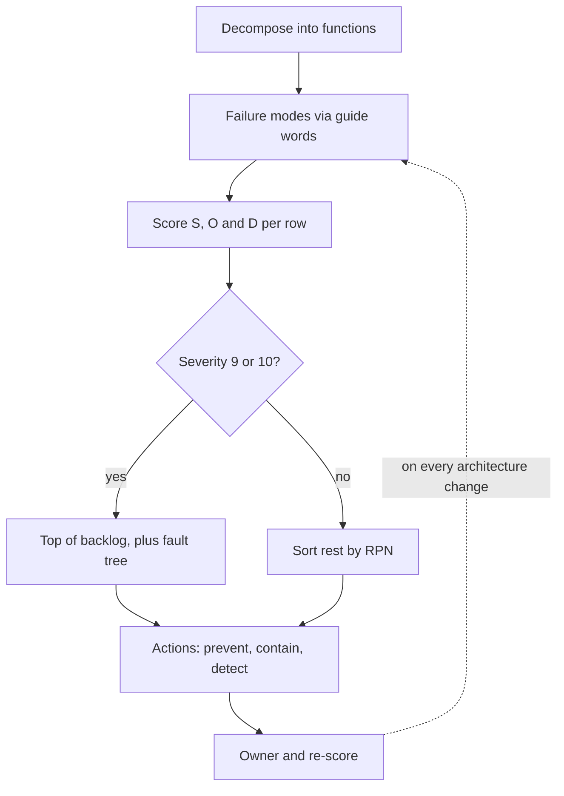

## TL;DR
FMEA is a table of how each part can fail (modes), what happens (effects), why (causes) and how you would
notice (detection), ranked by Severity × Occurrence × Detection. For AI systems it is a postmortem written
before the incident, aimed at silent failures.

## Why it exists
- **Teams discover failure modes one incident at a time.** Postmortems are reactive by definition, and
  chaos experiments only test hypotheses you already hold. Something has to generate the hypotheses, and
  "we will add monitoring and handle issues as they come" generates them at the worst possible moment.
- **AI systems' worst failures are silent.** The service returns 200 OK with a plausible, wrong answer. The
  embedding index stops refreshing and retrieval drifts stale over weeks. An agent's tool call succeeds,
  against the wrong customer's record. Availability monitoring sees a healthy system throughout.
- **Intuition ranks by vividness.** "The provider goes down" gets a failover project while "the tenant
  filter is missing on the new index" gets nothing, even though the second is catastrophic and the first is
  a nuisance with a retry.
- **FMEA counters both mechanically.** Walking the request path component by component with a checklist of
  ways to fail forces attention onto boring, high-consequence modes. Scoring detection separately surfaces
  the key asymmetry: a failure you cannot see is more dangerous than one that pages you, because its effect
  compounds until a customer reports it.
- **The output is a ranked backlog, not a document.** It comes from safety engineering, and it is the
  cheapest way to find the failures nobody is monitoring. The top rows become guards, evals, alerts and
  chaos experiments, in that order of priority.

## How it works
### 1. Decompose the system into functions
- **List the steps in the request path and the cross-cutting concerns.** For a retrieval-augmented agent:
  ingestion, chunking, embedding, index refresh, query embedding, retrieval, tenant scoping, prompt
  assembly, model call, output parsing and validation, tool execution, response delivery; plus
  authentication, rate limiting, logging and the deployment process itself.
- **Match granularity to the decisions you can act on:** "the backend" is too coarse, individual functions
  in a file too fine.

### 2. Enumerate failure modes per function
- **A failure mode is *how* the function fails,** stated as an observable deviation, not as "it breaks".
- **Use guide words to force breadth,** borrowed from hazard analysis: none (no output), more, less, late,
  early, wrong, partial, stale, duplicated, to the wrong recipient, without authorization.
- **Applied to retrieval** this yields "returns nothing", "returns too many chunks and truncates the
  prompt", "returns stale documents", "returns another tenant's documents", "returns the right documents
  too slowly". A team that only lists "retrieval is down" has not done the step.

### 3. Score the three factors
| Factor | Question | Scale (1 to 10) | Note |
|---|---|---|---|
| Severity (S) | effect at the user or business level | 9 to 10 irreversible or legal harm (money moved, data leaked, unsafe advice acted on); 6 to 8 a wrong result the user is likely to act on; 3 to 5 visible degradation or a failed request; 1 to 2 cosmetic | anchor each number with a written example so two raters agree |
| Occurrence (O) | how often the causes produce the mode | 1 practically never to 10 constant | use data where it exists (provider error rates, eval failure rates, index-job history); mark guesses as guesses, because O is the number most often wrong |
| Detection (D) | how likely current controls catch it *before* the effect reaches the user | 1 certain (a type check fails the build) to 10 no way to detect | inverted: a high D is bad |

- **"We have logs" scores 8 or 9** unless someone is alerted by them, because logs nobody reads detect
  nothing.

### 4. Rank: Risk Priority Number and its limits
```
RPN = S × O × D          (1 to 1,000, sort descending)
```
- **Useful because it is simple, misleading in two specific ways.**
- **The factors are treated as interchangeable.** A rare, hard-to-detect catastrophe (S 10, O 1, D 9 gives
  90) ranks below a frequent, moderately visible annoyance (S 4, O 6, D 5 gives 120). Rows with identical
  RPNs can carry completely different risks (S 10, O 2, D 5 and S 5, O 4, D 5 are both 100).
- **The scales are ordinal.** A 6 is "worse than a 5", not 20 percent worse, so the product has no physical
  meaning. Only 120 distinct values between 1 and 1,000 can occur at all, which makes gaps between RPNs
  look larger than the judgment behind them.
- **The industry moved on.** The automotive industry's 2019 handbook replaced RPN with an Action Priority
  table that looks at severity first, then occurrence, then detection, for these reasons.
- **Practical rule:** any row with severity 9 or 10 goes to the top regardless of RPN, then sort the rest by
  RPN.

### 5. Actions, owners and re-scoring
| Action type | Lowers | Example |
|---|---|---|
| Prevention | O | a schema that makes the bad input impossible |
| Containment | S | a confirmation step before an irreversible tool, a spending cap |
| Detection | D | an eval in CI, a freshness alert, a canary query |

- **Assign an owner, re-score after the action,** and revisit the table on every architectural change.
- **A score that never changes** is a sign the table has become decoration.

### Design versus process FMEA
- **Design FMEA** analyzes the system as built.
- **Process FMEA** analyzes how it is operated and changed: deploys, prompt edits, model version upgrades,
  index rebuilds, credential rotation.
- **AI systems need both, and the process rows often score highest,** because a prompt edit or a model
  version change can alter behavior everywhere at once without touching code, and without an eval gate
  nothing stands between the edit and production.

### Bottom-up, one failure at a time, and what that misses
- **FMEA is bottom-up:** it starts from components and asks what each failure does to the whole.
- **Its blind spot is combinations,** because each row considers a single failure mode: the index is stale
  *and* the freshness alert's job is down; the provider is slow *and* retries double the load.
- **Fault tree analysis is the complementary top-down method:** start from one unacceptable outcome ("money
  refunded to the wrong customer") and decompose it with AND/OR gates into the combinations of events that
  produce it.
- **Use both:** FMEA for the breadth of modes, and a small fault tree for each severity-10 effect to check
  that no single failure, or common pair, reaches it.

## Diagram
The loop runs from functions to a ranked backlog; note the severity gate before the RPN sort and the
re-score that closes the loop.



## Examples
### A support assistant with a refund tool
A fragment of an FMEA for an assistant that answers from a document index and can issue refunds through a
tool. Scores are the team's judgment calls on a 1 to 10 scale; the point is the ranking, not the precision.

| Function | Failure mode | Effect | S | Cause | O | Current detection | D | RPN |
|---|---|---|---|---|---|---|---|---|
| Index refresh | Serves stale policy docs | Agent quotes outdated refund terms; customer promised the wrong amount | 7 | Nightly rebuild job fails silently | 4 | Job logs only, no alert | 9 | 252 |
| Refund tool | Refund issued against the wrong order | Money moved irreversibly | 10 | Model copies a similar-looking order id from context | 3 | None before execution | 8 | 240 |
| Tenant scoping | Retrieval returns another tenant's documents | Data leak across customers | 10 | Filter omitted in a new retrieval client | 2 | None | 9 | 180 |
| Model call | Provider timeout or 5xx | Request fails; user sees an error and retries | 4 | Provider incident | 5 | Error-rate alert pages on-call | 2 | 40 |
| Output parsing | Response violates JSON schema | Reply dropped, user sees generic error | 3 | Prompt edit or model drift | 4 | Parser raises; counted and alerted | 3 | 36 |

- **The planned-for failure ranks last.** The provider outage, which everyone had been planning around, is
  loud, so it is already detected and handled. The three rows that matter are quiet.
- **Stale documents:** add a freshness SLI (age of newest indexed document) with an alert. D drops from 9 to
  3 and the RPN to 84.
- **Refund tool:** pass the order id from the ticket's structured field rather than generating it from free
  text, and add a confirmation step above a value threshold. O drops to 1, D to 2, and the RPN to 20, while
  S stays 10 because the harm, if it happens, is unchanged.
- **Tenant scoping:** make the tenant filter mandatory in the retrieval client's constructor and run an
  automated cross-tenant canary query hourly. D drops to 2 and the row, still severity 10, is now contained.
- **Cost:** the team spent one afternoon and re-prioritized a quarter.

### Severity-gated prioritization, runnable
The same rows sorted the way the practical rule says: severity 9 or 10 first, then RPN. Pure RPN would put
stale docs (252) above the refund tool; the gate does not.

```python
rows = [  # (function, failure mode, S, O, D)
    ("Index refresh",  "serves stale policy docs",      7, 4, 9),
    ("Refund tool",    "refund against the wrong order", 10, 3, 8),
    ("Tenant scoping", "returns another tenant's docs", 10, 2, 9),
    ("Model call",     "provider timeout or 5xx",        4, 5, 2),
    ("Output parsing", "violates JSON schema",           3, 4, 3),
]

def rpn(s, o, d):
    return s * o * d

def prioritize(rows, severity_gate=9):
    # rows at or above the severity gate first, then everything by RPN, descending
    return sorted(rows, key=lambda r: (r[2] < severity_gate, -rpn(*r[2:])))

for fn, mode, s, o, d in prioritize(rows):
    print(f"{rpn(s, o, d):>4}  S{s:<2} O{o} D{d}  {fn}: {mode}")
# 240 refund tool, 180 tenant scoping, 252 index refresh, 40 model call, 36 output parsing

distinct = {s * o * d for s in range(1, 11) for o in range(1, 11) for d in range(1, 11)}
print(len(distinct), "distinct RPN values between 1 and 1,000")   # 120
```

## Production patterns
- **Two-hour launch workshop.** Before launch or before adding an irreversible tool, run a session with the
  owner of each stage and a spreadsheet with the columns above; walk the request path with the guide words.
  Track the number of open severity-9-and-10 rows without a control as a launch gate.
- **D column as the monitoring backlog.** Every row with D of 7 or more becomes an alert, SLI or canary
  ticket, for example a freshness SLI on the newest indexed document or an hourly cross-tenant canary query.
  Monitor how many high-D rows remain open.
- **Policy controls for severity 10.** Require a confirmation step, a spending cap or a kill switch for any
  tool on a severity-10 row, and draw a small fault tree for that effect. Monitor confirmation rates and
  kill-switch drills.
- **Process FMEA wired into change management.** Prompt edits, model version upgrades and index rebuilds go
  through an eval gate in CI, because those process rows often score highest. Monitor eval pass rate per
  change and changes shipped without the gate.
- **Re-score from incidents and chaos results.** Each postmortem updates O and D for its row and adds sibling
  modes; the top rows become chaos experiment hypotheses. Monitor the date each row was last re-scored.

## Trade-offs
- **Breadth vs time.** A full FMEA across every component takes days, while a two-hour session over the
  request path finds most of the high-risk rows. Go deep when the system takes irreversible actions or
  carries regulatory exposure; stay shallow for an internal tool with a human in the loop.
- **Numeric scores vs real precision.** They look objective but encode judgment; consistency between raters
  matters more than precision. With a small team, anchored scales or even high/medium/low buckets beat
  spurious decimals.
- **RPN vs severity-first.** RPN gives one sortable number but hides rare catastrophes; severity-first
  ordering protects against catastrophe but can leave frequent, irritating failures unaddressed. Use
  severity gates first, RPN second.
- **Living table vs one-off.** A living table stays useful across architecture changes but needs an owner
  and a review cadence; a one-off exercise is cheap but stale after the first major change, and a stale
  FMEA creates false confidence.

## Pitfalls
- **Listing only "component unavailable" modes.** Symptom: the table reads like an uptime checklist and has
  no rows for wrong, stale, partial or cross-tenant output, which is where AI systems actually fail.
- **Scoring detection as good because "we log it".** Symptom: incident reviews that find the signal was
  sitting in logs for days before a customer reported the problem.
- **Running the analysis alone.** Symptom: the modes that bite live in areas the author does not own, such
  as the data pipeline, the vendor's change process or the customer's upstream system.
- **Treating it as a compliance artifact.** Symptom: RPNs never re-scored, the action column empty, and the
  file last modified the week before an audit.
- **Scoring occurrence from intuition when data exists.** Symptom: provider 429s scored as rare while the
  dashboard shows them daily, so the row is deprioritized and the retry budget never gets fixed.
- **Treating rows as independent.** Symptom: every row has a control, yet an incident happens when two
  controls fail together, for example the canary and the alert both running on the same scheduler that
  stopped.
- **Confusing cause with mode.** Symptom: rows like "engineer forgot the filter", which cannot be detected
  or scored for effect; the mode is "retrieval returns another tenant's data", the forgotten filter is one
  of its causes.

## When to use
- **Use before** launching anything with tool side effects or external users, before adding any
  irreversible tool to an agent, after a serious incident to find its siblings, and whenever you need to
  decide what to monitor or what to chaos-test: the D column is a monitoring backlog and the top rows are
  your first experiments.
- **Skip it** for throwaway prototypes, and never let it substitute for testing; it tells you where to test.
- **In day-to-day work** it shows up as a two-hour workshop with a spreadsheet and the people who own each
  stage.
- **Interviews:** the question is "how would you figure out what could go wrong with this agent"; walk the
  request path with guide words, score a few rows aloud, and name the top three with their mitigations.

## Role lens
- **Engineer:** Enumerates failure modes for the stages they own, scores them with data from dashboards
  and evals, and turns the top rows into guards, regression evals and alerts.
- **Architect:** Owns the system-level table across teams and vendors, sets the severity scale, and
  decides what severity-10 rows require by policy: confirmation steps, spending caps, kill switches.
- **FDE:** Runs a joint FMEA with the customer before go-live, because the customer knows the business
  effects and their legacy systems' failure modes; the result becomes the hypercare monitoring plan.

## Check yourself
**Q:** You are prioritizing reliability work for an agent that reads a customer's CRM and drafts emails
that a human approves before sending. One engineer wants to spend the sprint on multi-provider failover.
Using FMEA reasoning, how do you evaluate that proposal?
**A:** Score the row it addresses. Provider outage: severity about 4, since a human is waiting and can
retry and nothing irreversible happens; occurrence from the provider's history, perhaps 4; detection 2,
because error-rate alerts already fire. RPN around 32. Now score the quiet rows. "Agent reads the wrong
customer's record and drafts an email containing their data": severity 9 if the approver misses it
(personal data sent to the wrong recipient), occurrence 3 given lookups by fuzzy name, detection 8
because nothing checks that the retrieved record matches the recipient. RPN around 216, and it is a
severity-9 row, so it leads regardless. "CRM cache serves stale data" lands in between. The right sprint
is a cheap guard that asserts the recipient's account id equals the retrieved record's id, an eval that
exercises near-duplicate names, and a freshness alert on the cache; failover can follow once the
catastrophic, undetected rows are contained. Show the table so the decision is about numbers, not
opinions.

## Interview questions
### What is FMEA, and why do it when you already have monitoring and postmortems?
- **Definition:** a structured table of failure modes per function, with effects, causes and current
  detection, scored by severity, occurrence and detection so the worst risks are fixed first.
- **Postmortems are reactive and monitoring only sees what you thought to measure;** FMEA generates the
  hypotheses, especially the silent ones (plausible wrong answers, stale retrieval, wrong-record tool calls).

### How would you run an FMEA for a RAG agent you are about to launch?
- **Decompose the request path:** ingestion through response delivery, plus auth, rate limiting, logging
  and deployment.
- **Apply guide words** (none, stale, wrong, partial, to the wrong recipient) to each function, then score
  S, O and D with anchored scales and real data for O.
- **Output:** severity-9-and-10 rows first, each with an owner and a prevention, containment or detection
  action, and the D column turned into alerts.

### Two rows both score an RPN of 100. How do you decide which to fix first?
- **Look at the factors, not the product:** S 10, O 2, D 5 and S 5, O 4, D 5 are both 100 but the first can
  be catastrophic.
- **Severity first,** as the Action Priority approach in the 2019 handbook does, then occurrence, then
  detection.
- **Also remember the scales are ordinal,** so the product has no physical meaning to compare precisely.

### When is FMEA the wrong tool, and what complements it?
- **It considers one failure at a time,** so combinations (a stale index and a dead freshness alert) slip
  through; draw a top-down fault tree for each severity-10 effect.
- **It is not testing:** it tells you where to test and what to chaos-test.
- **For throwaway prototypes** the workshop costs more than the risk it removes.

### Your team is upgrading the model version behind an agent. What does a process FMEA add?
- **Process rows cover how the system changes,** and a model upgrade can alter behavior everywhere at once
  without touching code.
- **Typical modes:** output schema violations, changed refusal or tool-use behavior, quality regressions on
  edge cases, each with low detection unless an eval gate exists.
- **Action:** an eval gate in CI and a staged rollout lower D before the change reaches production.

## Quiz
### Q: What does the Detection score measure, and which direction is bad?
- [ ] How quickly the team responds after an incident is declared; low is bad
- [x] How likely current controls are to catch the failure before its effect reaches the user; high is bad
- [ ] How many monitoring dashboards exist for the component; low is bad
- [ ] How severe the failure is when it is finally noticed; high is bad
> Detection rates the controls that exist today, from 1 (certain to catch it) to 10 (no way to notice).
> The inversion trips people up: a high D multiplies the risk, which is why "we have logs" should not be
> scored as good detection unless someone is alerted by them.

### Q: Why can sorting purely by RPN mislead, and what is the standard correction?
- [ ] RPN ignores occurrence, so frequent failures are under-ranked; weight occurrence double
- [x] RPN treats the factors as interchangeable, so a rare undetectable catastrophe can rank below a frequent cosmetic bug; gate on severity first, then sort by RPN
- [ ] RPN only works for hardware, so software teams should use mean time between failures instead
- [ ] RPN overweights detection, so detection should be dropped from the formula
> S 10 × O 1 × D 9 is 90 while S 4 × O 6 × D 5 is 120, yet the first row, a rare catastrophe nobody would
> notice, is the one that ends the company. Severity-first ordering, as in the Action Priority approach,
> keeps catastrophic rows at the top; doubling a weight only moves the distortion elsewhere.

### Q: Which of these is correctly stated as a failure mode rather than an effect or a cause?
- [ ] The engineer forgot to add the tenant filter to the new retrieval client
- [ ] A customer sees a competitor's pricing document in their answer
- [x] Retrieval returns documents belonging to another tenant
- [ ] The vector database was upgraded last week
> A mode is the observable deviation in the function's output. The forgotten filter and the upgrade are
> causes; the customer seeing the document is the effect. Keeping the three apart is what makes
> occurrence, severity and detection scorable.
