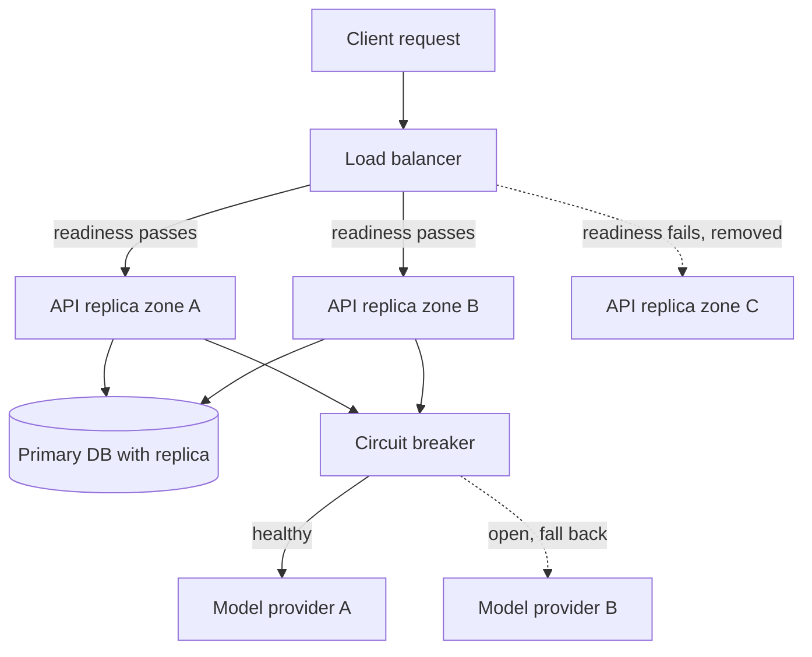

## TL;DR
High availability (HA) keeps a system answering through the failure of any single component, using
redundancy, fast health checks and automatic failover. It costs money and complexity, and an AI
product is capped by its least available dependency, usually the model provider.

## Why it exists
- **A single server is a single point of failure.** One disk, one kernel panic, one bad deploy, one
  availability-zone incident, and the product is down.
- **"Buy a more reliable machine" fails on arithmetic.** A chain of components that must all be up
  multiplies: three dependencies at 99.9% each give 0.999³ ≈ 99.7%, roughly 26 hours of downtime a year
  instead of 9. Modern systems have dozens of components, so this only gets worse.
- **Change, not hardware, is the main enemy.** Most outages in mature organisations follow deploys,
  configuration pushes, schema migrations and certificate rotations. The Google SRE book puts the share
  caused by changes to a live system at roughly 70%. A perfect machine does nothing for that.
- **HA in practice means no single component is required.** You must be able to take any one instance
  out of service, including on purpose, without users noticing.
- **AI systems have it worse.** The request path includes an external model API with its own incidents,
  rate-limit spikes and regional capacity limits, plus GPU hosts with more parts to fail. If the
  provider is 99.9% and you promise 99.95%, no number of replicas of your own code can deliver it.

## How it works
### Measuring it
- **Time-based:** `uptime / total time`.
- **Request-based:** `successful requests / total requests`. This is what users feel and what SLOs
  usually use, because a 10-minute outage at 3 a.m. and one at peak are not the same.
- **The nines convert to a yearly budget** of 8,760 hours:

```
99%     → 87.6 h/year     99.9%  → 8.76 h/year
99.99%  → 52.6 min/year   99.999% → 5.26 min/year
```

### Three formulas that do most of the reasoning
| Rule | Formula | Note |
|---|---|---|
| **Series** (all must work) | `A = A₁ × A₂ × …` | every extra dependency lowers the total |
| **Parallel** (any one suffices) | `A = 1 − (1 − A₁)(1 − A₂)…` | two 99% replicas give 99.99%, assuming perfect failover and independent failures |
| **Single component** | `A = MTBF / (MTBF + MTTR)` | mean time between failures over the whole cycle, including mean time to repair |

- **The parallel formula is wildly optimistic** whenever failures are correlated, and they usually are:
  both replicas run the same code, got the same deploy, sit in the same zone and call the same provider.
- **MTTR is the lever you control.** A component that fails once a month (MTBF ≈ 730 h) and takes 45
  minutes to recover is about 99.9% available. Cutting recovery to 4.5 minutes makes it about 99.99%
  without failing any less often.
- **So HA emphasises fast detection and automatic failover,** because making failures rare is hard and
  slow, while making them short is engineering you control.

### Removing single points of failure
- **Stateless service tier.** Run at least two instances behind a load balancer, spread across
  availability zones. Statelessness matters *because* it makes any instance interchangeable; session
  state, conversation history and job progress move to replicated stores.
- **Replicated state.** A database primary with a synchronous or asynchronous replica and automatic
  promotion; a vector store with replicas; a cache that the service can live without.
- **Redundant plumbing.** Managed load balancers and DNS are themselves redundant; a self-managed
  single nginx box in front of a redundant fleet quietly undoes the fleet.
- **Capacity headroom.** N+1 (or N+2) sizing, *because* a surviving replica that is already at 80%
  cannot absorb its dead sibling's traffic; redundancy without headroom just moves the outage.

### Detecting failure fast
- **Detection time is downtime.** A check that probes every 10 s and needs 3 failures declares death
  after ~30 s, and that interval is pure downtime for traffic routed to the dead node.
- **Test the ability to serve, not to answer HTTP.** A model server whose GPU is wedged will happily
  return 200 from `/health` while every real request times out.
- **Split liveness from readiness.** A cheap *liveness* probe means "restart me"; a *readiness* probe
  reflects dependencies and warm-up and means "send me traffic". Readiness keeps a freshly started model
  server, still loading weights, out of rotation.
- **Readiness covers only what removing this instance fixes.** If every replica's readiness checks the
  same shared model provider, a provider blip marks the whole fleet unready at once. The load balancer
  then has nowhere to send traffic, turning a degraded dependency into a total outage.
- **Shared dependencies belong in circuit breakers and fallbacks,** not in the probe that removes
  instances.

### Failover and its hidden costs
| Mode | How it fails over | Cost |
|---|---|---|
| **Active-passive** | a standby takes over | detection time plus warm-up; a cold standby loading a 70B-parameter model from object storage can take minutes to be useful |
| **Active-active** | every node serves all the time; a failure only reduces capacity | must share state; doubles as proof the second node actually works |

- **In-flight work is lost in both.** A streaming generation dies with its node, so clients need retry
  logic and, for long agent runs, durable checkpoints.

### Stateful failover is where HA gets hard
Stateless replicas are interchangeable; a database primary is not. Promoting a replica raises two
questions the stateless tier never asks:
1. **What is lost?** An asynchronous replica trails the primary, so promotion discards whatever had not
   yet replicated. A synchronous replica loses nothing but adds a round trip to every commit.
2. **Is the old primary really dead?** If it was only slow or partitioned and keeps accepting writes
   after the promotion, you have two primaries (split brain).

- **Managed databases solve this with a single arbiter and fencing,** which is a large part of what you
  pay them for. A self-built failover script that promotes on a missed heartbeat usually does not.

### Change as the biggest availability risk
Because changes cause most outages, HA includes the deployment process:
- **Rolling updates that drain in-flight requests;** the drain timeout must exceed your longest generation.
- **Canaries** that take a fraction of traffic first.
- **Flags** that can disable a feature without a deploy.
- **Rollbacks** that take seconds.
- **A system redundant at runtime but deploying to all replicas at once is not HA.**

### Where AI systems differ
- **Model providers are a shared dependency.** Multi-provider fallback raises availability only if your
  prompts and evals are portable and you accept that the fallback model gives different answers.
  "Available but different" is a product decision, not just an infrastructure one.
- **GPU capacity is expensive,** so N+1 redundancy may be replaced by graceful degradation to a smaller model.
- **For self-hosted serving,** the readiness probe should include a real tiny inference.

## Diagram
A request survives a dead replica because the load balancer only routes to instances whose readiness
passes; the shared provider is guarded by a fallback, not by the probe.



## Examples
### Composing availability from the parts
The script composes the availability of a chat product from its parts and shows how adding a second
model provider moves the bottleneck rather than removing it. All inputs are illustrative targets, not
measured figures, and the parallel rule assumes independent failures and perfect failover.

```python
from functools import reduce

def series(*parts):        # every part must be up
    return reduce(lambda acc, a: acc * a, parts, 1.0)

def parallel(*parts):      # up if any part is up (independent failures, perfect failover)
    return 1 - reduce(lambda acc, a: acc * (1 - a), parts, 1.0)

def downtime_hours_per_year(a):
    return (1 - a) * 8760

lb, api_replica, vector_db, provider = 0.9999, 0.999, 0.9995, 0.999

single = series(lb, parallel(api_replica, api_replica), vector_db, provider)
dual   = series(lb, parallel(api_replica, api_replica), vector_db, parallel(provider, provider))

for label, a in (("one provider", single), ("two independent providers", dual)):
    print(f"{label}: {a:.4%}  ->  {downtime_hours_per_year(a):.1f} h/year")
# one provider:               99.8400%  ->  14.0 h/year   (provider dominates)
# two independent providers:  99.9398%  ->   5.3 h/year   (vector DB now dominates)
```

- **One provider pins the product near 99.84%,** even though the API tier is 99.9999%.
- **A second provider lifts it to ~99.94%,** and now the single vector database is the weakest link,
  which is exactly where the next engineering dollar should go.
- **Shared failure modes** (same upstream GPU cloud, your own shared gateway) put the real number
  somewhere between the two lines.

### Worked scenario: buying a nine with faster recovery
Using `A = MTBF / (MTBF + MTTR)` for a component that fails about once a month (MTBF ≈ 730 h):

| MTTR | How it is achieved | Availability | Downtime per year |
|---|---|---|---|
| 45 min | human paged, manual failover | ≈ 99.9% | ≈ 9 h |
| 4.5 min | automatic failover after health checks | ≈ 99.99% | ≈ 54 min |
| ~30 s detection alone | 10 s probe interval × 3 failures | lower bound on any automated MTTR | n/a |

The failure rate never changed; only detection and failover did. That is why the first HA investment
is usually automation of recovery, not a sturdier box.

## Production patterns
- **Readiness that runs a tiny inference.** For self-hosted model servers, have the readiness endpoint
  generate a few tokens against the loaded model, and keep liveness cheap (process alive). In Kubernetes,
  set a `startupProbe` or a long initial delay to cover weight loading. Monitor probe latency and the
  count of ready pods per zone.
- **N+1 capacity per zone.** Size each zone so the fleet survives losing one zone at peak, for example
  keeping utilisation below about two thirds with three zones. Monitor peak utilisation against that
  ceiling in a weekly capacity review.
- **Drain longer than the longest generation.** On shutdown, fail readiness first, stop accepting new
  streams, then wait; set Kubernetes `terminationGracePeriodSeconds` above your maximum generation time.
  Monitor client errors at each release.
- **Circuit breaker plus provider fallback.** Wrap each model provider in a breaker that opens on error
  rate or latency, and route to a second provider or smaller model with portable prompts. Monitor breaker
  state changes and the share of traffic served by the fallback.
- **Managed failover for stateful tiers.** Use a managed database with multi-zone standby and fencing
  rather than a heartbeat script. Monitor replication lag, because that is the data an async promotion
  would lose.

## Trade-offs
- **Extra nines vs cost.** Every extra nine roughly multiplies cost and complexity, so a 99.9% target
  with fast rollback is often right for internal tools; it flips to 99.99%+ when revenue or safety rides
  on each request.
- **Active-active vs active-passive.** Active-active uses the standby capacity all the time and proves
  it works, but forces you to solve state sharing between nodes; active-passive is simpler and wastes
  the standby until the day it fails.
- **Multi-provider fallback vs output stability.** It raises model availability only when prompts, tool
  schemas and evals are portable; if outputs must be byte-stable, the fallback is a degraded mode, not
  a transparent one.
- **Aggressive health checks vs misdiagnosis.** They fail over faster but mark slow nodes as dead under
  load, turning a latency problem into a capacity problem as traffic piles onto fewer survivors.

## Pitfalls
- **Counting redundancy that shares a failure mode.** Two replicas in one zone, two providers behind one
  gateway, two databases on one deploy pipeline. The symptom is "redundant" components failing together.
- **Health checks that test the process, not the service.** The node stays in rotation while every real
  request fails, and the load balancer keeps sending it traffic.
- **The opposite error: readiness probes that include a shared dependency.** One model-provider or
  database hiccup marks every replica unready together, and the load balancer returns errors from an
  empty pool even though your own code was fine.
- **No headroom.** N replicas each at 80% load, so losing one overloads the rest and the "failover" is a
  cascading failure. Visible as a second outage minutes after the first node died.
- **Promising an SLA above the provider's.** The math makes it impossible; the symptom is a chronic
  error-budget deficit nobody can engineer away.
- **Forgetting that deploys are downtime.** Rolling restarts that kill in-flight generations show up as
  a spike of client errors at every release, not as an "outage".

## When to use
- **Decide the target before the design.** Ask what one hour of downtime costs, convert that into a
  number of nines, and pay for only that.
- **Match the design to the surface.** An internal retrieval tool may be fine at 99.5% with a 15-minute
  rollback; a customer-facing assistant inside a checkout flow needs multi-zone active-active and
  multi-provider fallback.
- **Measure the way users experience it:** successful requests, by endpoint, by tenant, not host uptime.
- **Day to day:** readiness probes, drain timeouts, N+1 capacity reviews, and the design-review question
  "what happens if this box disappears right now?".
- **Interviews:** compose availabilities, explain why the provider caps yours, and distinguish HA
  (surviving a component failure with no visible downtime) from disaster recovery (restoring service
  after a site or data loss, with a measured gap).

## Role lens
- **Engineer:** Implements readiness probes that run a real inference, retry-with-fallback on provider
  errors, and drain timeouts longer than the maximum generation time.
- **Architect:** Sets the availability target per surface, owns the dependency availability math, and
  decides between active-active, active-passive and degradation-instead-of-redundancy for GPU tiers.
- **FDE:** Translates a customer's "five nines" request into the provider's actual SLA and a
  multi-provider or self-hosted design, and documents the residual gap honestly.

## Check yourself
**Q:** A team promises 99.95% availability for an assistant whose path is: global load balancer
(99.99%), three stateless API replicas across zones (99.9% each), one managed vector database
(99.95%), and a single model provider (99.9%). Can they hit the target, and what are the first two
changes you would make?
**A:** No. The three replicas in parallel are effectively 100%, but the series product
0.9999 × 0.9995 × 0.999 ≈ 99.84%, roughly 14 hours a year, is already below target before counting
deploys and their own bugs. The provider is the dominant term, so the first change is an independent
second provider with portable prompts and evals, lifting the model term toward 99.9999% and the product
to about 99.94%. The vector database then dominates; the second change is either a replica with
automatic failover or a degraded mode (answer without retrieval, flagged) so a vector outage is not a
product outage. A strong answer adds that correlated failures make these numbers optimistic and that
the target should be renegotiated unless both changes are funded.

## Interview questions
### What does high availability actually mean, and why is a more reliable server not the answer?
- **Definition:** the system keeps answering through the failure of any single component, measured as
  the fraction of successful requests or of time it works.
- **Why not a better server:** availabilities in series multiply, so dozens of components drag the total
  down, and most outages come from changes such as deploys, not hardware.
- **So the goal is "no single component is required",** reached through redundancy, detection and failover.

### Your model servers pass health checks but users see timeouts. How do you debug and fix it?
- **Suspect a process-level check.** A wedged GPU still returns 200 from a shallow `/health`.
- **Fix readiness to test serving:** run a tiny real inference, with a timeout, and fail readiness when it
  does not complete.
- **Keep liveness cheap,** so warm-up or slow inference does not trigger restart loops.

### Should readiness probes check the model provider? Why or why not?
- **No for shared dependencies.** Every replica would fail together on a provider blip, emptying the load
  balancer pool and turning degradation into a full outage.
- **Probe only what removing this instance fixes,** such as its own loaded model or local resources.
- **Handle the provider with circuit breakers and fallbacks** in the request path instead.

### When would you choose active-passive over active-active?
- **Active-passive fits** when state sharing between nodes is hard, such as a single-writer database, and
  a failover gap of detection plus warm-up is acceptable.
- **Active-active fits** stateless tiers: failures only reduce capacity and the second node is proven daily.
- **Watch the cold standby:** loading a 70B-parameter model from object storage can take minutes, so a
  passive GPU standby may need to be kept warm.

### A component fails monthly and takes 45 minutes to recover. How do you get it to four nines?
- **Use `A = MTBF / (MTBF + MTTR)`:** with MTBF ≈ 730 h, 45 minutes gives about 99.9%.
- **Cut MTTR to about 4.5 minutes** through automatic detection and failover, which gives about 99.99%
  with no change in failure rate.
- **Budget detection inside that:** a 10 s probe needing 3 failures already spends ~30 s.

## Quiz
### Q: Two API replicas each at 99.9% sit behind a load balancer. Why is the combined availability usually worse than the 99.9999% the parallel formula predicts?
- [ ] The load balancer halves the effective capacity of each replica
- [x] Their failures are correlated: same deploy, same zone, same dependencies, so they fail together
- [ ] Parallel composition only applies to databases, not stateless services
- [ ] Health checks cannot distinguish between two identical replicas
> The parallel formula assumes independent failures. Replicas built from the same code and deployed
> together share most failure modes, so the real figure sits far closer to a single replica's.

### Q: A model server loads weights for three minutes after start-up. Which probe design keeps it from receiving traffic too early without causing restart loops?
- [ ] A single liveness probe with a 10-second timeout
- [ ] No probes; the load balancer retries failed requests automatically
- [x] A cheap liveness probe plus a readiness probe that only passes once a test inference succeeds
- [ ] A readiness probe that checks the process is listening on its port
> Readiness gates traffic, liveness gates restarts. A liveness probe that fails during warm-up would
> kill the pod repeatedly; a port check passes before the model can actually answer.

### Q: What distinguishes high availability from disaster recovery?
- [x] HA masks single-component failures with no visible downtime; DR restores service after a site or data loss, accepting a measured gap
- [ ] HA applies to stateless services and DR applies only to databases
- [ ] HA is about hardware failures while DR is about software bugs
- [ ] They are the same practice measured over different time windows
> HA keeps the system up through routine faults using redundancy and failover. DR plans for the
> cases redundancy cannot cover, such as a region loss or corrupted data, and is measured by RPO and RTO.
