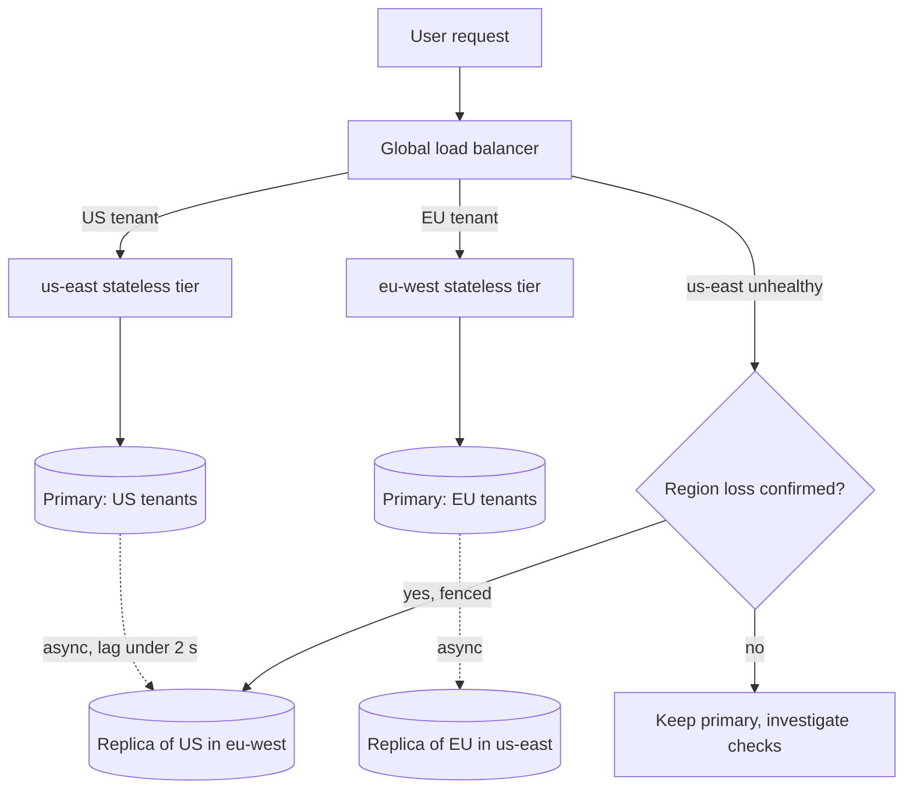

## TL;DR
Multi-region runs your agent platform in several cloud regions to survive region loss, cut latency,
meet residency rules and gain model quota. The hard part is agent state: transcripts, checkpoints and
memory. Start multi-AZ; go multi-region for a named reason.

## For agent builders
- **Why it matters for agents.** Agent runs carry state (transcripts, plans, memory, vector indexes)
  and call region-specific model endpoints. A region loss kills in-flight runs unless they are
  checkpointed in a replicated store, and residency rules decide where the prompt itself may be sent.
- **Where it shows up in your stack.** Per-region model endpoints and quotas, the tenant home-region
  table that routes agent requests, replicated checkpoint and memory stores, and the embedding model
  version used to build each region's vector index.
- **What you control.** Which region owns each tenant's agent state, which model endpoint a
  residency-bound tenant may call, how often runs checkpoint, and which agent workloads you shed when one
  region must carry both.
- **What you can skip.** Building globally consistent databases or CRDT libraries yourself. Know
  partitioned active-active, async lag as RPO and the 50% capacity rule; buy the storage.

## Decision case
### Scenario
A B2B agent platform runs in one region, `us-east`, across three zones. Two deals force a change within
5 months. All figures are illustrative; load is in capacity units where today's region carries 100.
- **EU residency:** new EU tenants (30 units of load) need transcripts, checkpoints, memory and inference
  in the EU. US tenants (70 units) have no residency rule.
- **Region-loss survival:** a US enterprise RFP asks for RTO 1 hour and RPO 1 minute if a region is lost.
- **Workload:** agent runs checkpoint after every step, about 20 steps per run. A quarter of US load
  (17.5 units) is batch summarisation that can wait.
- **Constraints:** infrastructure may grow at most 80% over today's 100 units; 5 engineers, none with
  globally consistent database experience; measured cross-region replica lag p99 under 2 s.

### Options
| Option | How it works | Capacity provisioned | Residency | US region loss |
|---|---|---|---|---|
| A. One region plus backups | stay in `us-east`, cross-region backups | about 103 (+3%) | fails: EU data in the US | restore from backup, hours of RTO |
| B. US active-passive plus an EU stack | `us-west` warm standby sized for all 70 US units, `eu-west` serves EU | 70 + 70 + 30 = 170, plus EU backups: about +73% | met | met, but the standby idles and is rarely exercised |
| C. Partitioned active-active | tenants homed in `us-east` or `eu-west`, US tenants replicate async to `eu-west`, EU tenants back up to a second EU region | `us-east` 70, `eu-west` 30 + (70 − 17.5) = 82.5, total 152.5, plus EU backups: about +56% | met: EU data never leaves the EU | met: RPO ≈ lag (p99 under 2 s), batch is shed |
| D. Shared active-active | globally consistent database, any region writes | similar to C, plus database licensing | needs pinning anyway | met, but every checkpoint pays a cross-region commit: about 20 × 100 ms = 2 s per run |

### Decision
**Option C, partitioned active-active with a tenant home-region table.** It meets residency by
construction, survives a US region loss inside the 1 minute RPO because p99 lag is under 2 s, and costs
about +56% against the 80% ceiling.

Both regions serve traffic every day, so the failover target is
proven by daily use rather than by a rarely run drill.
- **Why not A:** it cannot sign the EU deal.
- **Why not B:** it meets every hard requirement but costs about 17.5 points more and leaves 70 units idle.
- **Why not D:** the team has never run it, and 2 s added per run hurts every agent for a problem
  partitioning already solves.

**What would change it.** If US contracts forbid copies in the EU, US replicas must live in `us-west`,
which pulls the design toward B. If the EU deal fell through, A plus a tested DR plan would be enough.
If the product needed cross-tenant shared workspaces written from both regions, D's cost would buy
something.

### Trade-offs accepted
- **EU tenants degrade in place on an `eu-west` loss.** They cannot fail over to the US; they go
  read-only and restore in the second EU region, with an illustrative 4 hour RTO written into EU
  contracts. Drill the restore each quarter and track its time.
- **Batch is shed on US failover.** 17.5 units of summarisation queue until `us-east` returns. Alert
  on queue age and publish the delay.
- **Seconds of lost writes.** Writes inside the lag window are reconciled at failback; region-tagged
  idempotency keys stop replayed agent steps acting twice. Alert on p99 lag above 30 s.
- **Model quota must fit the survivor.** `eu-west` needs quota for 82.5 units in advance; review quota
  headroom monthly.

### Review rubric
- **Driver named:** the write-up states which of loss survival, latency, residency or quota forces
  multi-region before choosing a topology.
- **Capacity arithmetic:** each option's provisioned capacity follows from per-region load and what is
  shed on failover, compared with the budget.
- **Residency traced end to end:** storage, replicas, backups, inference endpoints and agent memory are
  all placed, not just the primary database.
- **RPO tied to measurement:** data loss is stated as replica lag at p99, not "near zero".
- **Degraded mode explicit:** says what residency-bound tenants get when their home region fails.
- **Reversal condition:** names the contract or product change that would move the choice.

## Why it exists
- **A region is one blast radius.** Even spread across availability zones, it shares a control plane and
  regional services. Regional incidents are rare but take down every zone at once, and in-region
  redundancy cannot help, because it is correlated failure by design. Procurement teams ask "what is
  your multi-region story" right after one.
- **Physics.** Light in fibre travels roughly 200,000 km/s, about 5 ms per 1,000 km one way. A user
  6,000 km from your only region pays at least ~60 ms of round trip before any work, more after routing,
  a visible slice of a chat product's time-to-first-token budget of a few hundred milliseconds.
- **Law.** Data-residency obligations require some customers' data to be stored and processed in a
  jurisdiction. For AI, "processed" includes the prompt sent to the model, so the inference endpoint
  must be in-region too.
- **Provider quotas.** Model providers publish quotas and model availability per region. A second region
  can double your effective rate limit and give you somewhere to run when one region's capacity for a
  model is exhausted.
- **"Same Terraform in two regions behind DNS" fails** the moment two regions accept writes to the same
  record, or a failover promotes a replica that is seconds behind. Compute is easy to duplicate; truth
  is not.

## How it works
### Three topologies, in rising cost
1. **Active-passive.** One region serves; the other holds replicated data and enough infrastructure to
   take over (from "pilot light" to "warm standby"). This is disaster recovery with a shorter clock,
   covered in that lesson; the standby's real risk is that it is never exercised.
2. **Active-active, partitioned.** Every region serves traffic, but each tenant, user or shard has a
   single *home* region that owns its writes; the other regions hold async replicas and can take over
   ownership on failover. This is the workable default for stateful products, *because* it keeps
   every write single-leader and avoids write conflicts entirely while still using all regions.
3. **Active-active, shared.** Any region accepts any write to any record. This needs either a
   globally consistent database that pays cross-region latency on commits or multi-leader replication
   with conflict resolution. Choose it only for data that is genuinely written from everywhere.

### State is the whole problem
| Replication | When the client gets its ack | Failover loss | Cost |
|---|---|---|---|
| **Synchronous** | after the write is durable in both regions | nothing (RPO ≈ 0) | every write waits a cross-region round trip: tens of ms within a continent, ~100 ms or more across an ocean (illustrative orders of magnitude) |
| **Asynchronous** | immediately | the replica's lag, usually sub-second but spiking under load | failover during a spike loses that window |

- **PACELC names the trade honestly:** under a partition you choose availability or consistency, and
  even without one you choose latency or consistency.

### Mechanics per topology
- **Partitioned active-active:**
  1. Route each request to the tenant's home region.
  2. Replicate asynchronously to the others.
  3. On failover, promote the replica and re-home the tenant.
  4. Accept the lag as lost writes to reconcile later.
- **Shared active-active:** resolve conflicts with per-key ownership, CRDTs for data that merges
  naturally (counters, sets), or last-writer-wins where losing an update is tolerable.
- **Helland's advice still holds:** design entities so each transaction touches one entity in one place.

### Routing and failover
- **Geo or latency DNS is slow to fail over.** DNS answers are cached and clients routinely ignore short
  TTLs, so DNS failover takes minutes.
- **Anycast global load balancers move traffic in seconds** and are preferred where available.
- **The dangerous moment is the decision.** Automatic database failover on a flaky health signal causes
  split brain: two primaries both accepting writes.
- **Mature teams automate stateless failover** and keep data-tier failover behind a human-confirmed
  runbook step or a strict fencing mechanism.

### Static stability
- **The failover path must work using only what already runs in the surviving region.** A runbook that
  needs the failed region's CI/CD system, its secrets manager, a DNS or IAM change routed through a
  control plane hosted there, or a registry that only exists there, fails exactly when needed.
- **Pre-provision capacity rather than "scale up on failover",** *because* during a regional event every
  other customer of that cloud calls the same scaling APIs in the same surviving regions at once.

### Capacity is part of the design
- **Failover moves demand, not capacity.** Two regions at 70% utilisation leave a survivor needing 140%.
- **Two options:** run each region at or below 50% (paying for idle capacity), or plan explicit load
  shedding on failover: which tenants and which workloads keep running.
- **Provider quotas follow the same arithmetic** and do not move with your traffic.

### What is different for AI systems and agents
- **Model availability and rollout timing vary by region;** the same model name may not be live in both
  regions on the same day, so pin versions and test in both.
- **Embeddings must come from the same model and version in every region,** or a replicated vector index
  becomes incoherent. Replicate the index artefact or the source documents plus a rebuild pipeline, and
  know how long rebuild takes.
- **Prefix caches and KV caches are per-server;** a failed-over region starts cold and pays higher
  time-to-first-token until warm.
- **Residency pins both storage and inference:** a residency-bound tenant whose home region fails must
  *degrade in place*, not be served from a foreign region.
- **In-flight agent runs die with the region** unless progress is checkpointed in a replicated store,
  which is why durable execution and multi-region go together.
- **Agent memory is tenant data.** Long-term memories and conversation summaries replicate and fail
  over with the tenant's home region, and are bound by the same residency rules as the raw transcript.
- **Tools have regions too.** An agent failed over to `eu-west` may still call a tool API that only
  runs in `us-east`; list each tool's region and fallback before you claim the agent survives region loss.

## Diagram
Partitioned active-active: each tenant's writes go to its home region, replicas trail asynchronously,
and failover promotes a replica only after a human or fencing confirms the region is gone.



## Examples
### Worked failover: two-region, tenant-partitioned agent platform
All numbers illustrative.

**Setup.**
- Regions `us-east` and `eu-west`, each with a full stateless tier, a Postgres primary for its home
  tenants and an async replica of the other region's tenants, typical lag under 2 s.
- Agent checkpoints live in the same database; each region runs at about 40% of capacity.
- Provider quota is 1,000 requests per minute per region; EU tenants are residency-bound.

**Timeline when `us-east` becomes unreachable.**

| Time | Event |
|---|---|
| T+~60 s | global load balancer marks `us-east` unhealthy after failed checks and routes all users to `eu-west` |
| T+few min | on-call confirms the region, not the checks, is the problem and runs the promotion step |
| T+6 min | `eu-west`'s replica of US tenants becomes primary |
| after | agent runs mid-step in `us-east` resume in `eu-west` from their last replicated checkpoint, re-executing the interrupted step plus any step whose checkpoint fell in the ~2 s lag window (idempotency keys make those repeats safe) |

- **Data loss:** writes `us-east` accepted in its last ~2 s never replicated, so the RPO for US tenants
  is about 2 s. They stay stranded in `us-east` until it returns; clients holding their idempotency keys
  can safely resubmit now, and the rest is reconciled from `us-east`'s log at failback.
- **Compute holds:** `eu-west` carries both regions' traffic, 40% + 40% = 80% of one region.
- **Quota does not:** EU's 1,000 rpm must cover roughly double the demand, so the platform sheds batch
  summarisation jobs first and keeps interactive chat.
- **EU tenants are unaffected** and stayed in-region throughout. Had the failure gone the other way,
  residency-bound EU tenants would be put in a read-only degraded mode rather than served from `us-east`.
- **Failback:** when `us-east` returns, replication is reversed, the reconciliation log is replayed, and
  US tenants are re-homed in a low-traffic window after the replica catches up.

### Failover capacity and data-loss calculator
A pre-incident check you can run in a design review: does the survivor hold, what must be shed, and how
many writes a given lag puts at risk. Inputs are illustrative.

```python
def failover_check(utils, demand_rpm, quota_rpm, failed, writes_per_s, lag_s):
    survivor_util = sum(utils.values())                 # survivor absorbs all load
    total_demand = sum(demand_rpm.values())
    survivor = next(r for r in utils if r != failed)
    shed_rpm = max(0, total_demand - quota_rpm[survivor])
    at_risk = writes_per_s[failed] * lag_s              # unreplicated writes in the lag window
    return survivor_util, shed_rpm, at_risk

utils = {"us-east": 0.40, "eu-west": 0.40}
demand = {"us-east": 900, "eu-west": 900}
quota = {"us-east": 1000, "eu-west": 1000}
print(failover_check(utils, demand, quota, "us-east", {"us-east": 50, "eu-west": 40}, lag_s=2))
# (0.8, 800, 100): compute fits at 80%, shed 800 rpm of batch work, ~100 writes to reconcile

utils = {"us-east": 0.70, "eu-west": 0.70}
print(failover_check(utils, demand, quota, "us-east", {"us-east": 50, "eu-west": 40}, lag_s=2)[0])
# 1.4: the survivor would need 140% of its capacity, so shed load or run regions at 50% or less
```

- **Use the lag tail, not the mean,** for `lag_s`: the p99 lag during peak is your real RPO.

### Residency-aware model routing for an agent step
Each agent step picks a model endpoint from the tenant's home region, falls over only where residency
allows, and otherwise degrades in place. Region and endpoint names are placeholders.

```python
ENDPOINTS = {"us-east": "https://models.us-east.example/v1", "eu-west": "https://models.eu-west.example/v1"}

def pick_endpoint(tenant, healthy):
    home = tenant["home_region"]
    if home in healthy:
        return ENDPOINTS[home], "normal"
    if tenant["residency_bound"]:
        return None, "degraded_in_place"          # never send this tenant's prompt abroad
    other = next((r for r in healthy if r != home), None)
    return (ENDPOINTS[other], "failed_over") if other else (None, "unavailable")

print(pick_endpoint({"home_region": "eu-west", "residency_bound": True}, healthy={"us-east"}))
# (None, 'degraded_in_place'): the agent answers read-only or queues the run instead of calling us-east
```

- **Log the routing outcome per step** so a run that switched regions mid-way is visible in traces and
  evals.

## Production patterns
- **Home-region routing table.** Store each tenant's home region in a small replicated config and route
  at the edge on it; re-homing is a data change, not a deploy. Monitor requests served outside their
  home region, which should be zero outside a failover.
- **Region-tagged idempotency keys.** Include the originating region in idempotency keys so writes
  replayed after failover deduplicate against the reconciliation log. Monitor duplicates rejected during
  failback.
- **Human-confirmed data-tier promotion.** Automate stateless traffic shifting at the global load
  balancer, but put database promotion behind a runbook step with fencing of the old primary. Monitor
  time from alert to promotion in every drill.
- **Statically stable failover kit.** Keep CI/CD runners, secrets, container images and model access
  already provisioned in every region; test by cutting the source region off, not by draining it
  politely. Monitor runbook steps that depend on another region.
- **Replication lag as a distribution.** Alert on p99 replica lag per store (database, vector index,
  prompt registry, flags), because the tail is the data you lose. Track it alongside survivor
  utilisation and per-region provider quota headroom.
- **Per-region agent eval gate.** Run the agent eval suite against each region's model endpoint and
  vector index before a rollout and after any failover drill, because model versions and index builds
  drift by region. Monitor eval score deltas between regions.

## Trade-offs
- **Survival and latency vs cost.** Region loss survival and lower latency for distant users are paid for
  with duplicated infrastructure and idle headroom; it stops paying off when all users and regulators sit
  in one geography.
- **Synchronous vs asynchronous replication.** Synchronous gives zero data loss but taxes every write
  with a cross-region round trip; flip to asynchronous when write latency is user-visible and a few
  seconds of loss is survivable.
- **Partitioned vs shared active-active.** Partitioned avoids write conflicts but makes cross-tenant
  features (global search, shared workspaces) hard; shared enables them at the price of conflict
  resolution.
- **Automatic vs manual failover.** Automatic shortens outages but risks split brain on false positives;
  manual data-tier promotion is slower and safer, and becomes the better choice as the data's value rises.
- **More quota vs more validation.** A second region doubles provider quota and model-availability
  options, yet model and prompt behaviour must be validated in two places, doubling eval and rollout work.
- **Checkpoint often vs write cost.** Checkpointing every agent step limits failover loss to the
  interrupted step plus the replication lag window, but adds a replicated write per step; checkpoint less often only when steps are cheap and side-effect free.

## Pitfalls
- **A standby region never failed over to.** Expired credentials, missing secrets, a model not enabled in
  that region; the symptom is discovering it during the real incident.
- **Replicating the database but not the rest.** Without the vector index, prompt registry or feature
  flags, the failed-over region answers from stale or empty retrieval and behaves differently.
- **Assuming DNS TTLs are honoured.** Traffic keeps arriving at the dead region for minutes after
  "failover" and users see errors you believe are impossible.
- **Treating replication lag as zero.** Dashboards show success, but customers report lost messages or
  duplicated agent actions from the seconds before failover.
- **Sizing each region for its own load.** After failover the survivor overloads and a regional outage
  becomes a global one, visible as a second wave of errors minutes after the first.
- **A failover procedure with a hidden dependency on the failed region.** Its CI/CD runner, secrets store
  or registry; drills that only fail over while the source region is healthy never reveal it, so the
  symptom is a runbook step that hangs during the real event.
- **Failing over agents but not their tools.** The agent tier moves, but a tool API or MCP server it
  depends on stays single-region; runs resume and then fail on every tool call. Fix: map tool regions
  and give each a fallback or a typed "unavailable" result.

## When to use
- **Use when you can name the driver:** a contractual requirement to survive region loss, a latency
  budget one region cannot meet for a material user base, a residency rule, or provider quota you cannot
  obtain in one region.
- **Avoid otherwise:** multi-AZ plus a tested disaster-recovery plan is cheaper and usually adequate.
- **Start with** partitioned active-active and asynchronous replication; reserve synchronous or globally
  consistent stores for the few records that truly need them.
- **Measure:** replication lag as a distribution (its tail is your real RPO), failover time and survivor
  utilisation. Rehearse failover on a schedule, ideally by cutting the source region off rather than
  politely draining it.
- **Interviews:** depth shows in talking about where writes are owned and what is lost on failover, not
  about load balancers.

## Role lens
- **Engineer:** Makes every service region-aware (home-region routing, region-tagged idempotency keys,
  checkpointed long runs) and runs the failover rehearsal that proves the second region works.
- **Architect:** Decides the topology, which data is single-leader versus replicated, the consistency
  model per store, and the capacity and quota headroom each region must hold for failover.
- **FDE:** Maps the customer's residency and latency constraints to tenant home regions, and sets
  expectations about what degrades, rather than moves, when a residency-bound region fails.

## Check yourself
**Q:** A customer wants an AI assistant in `us-east` and `eu-west` with "no data loss on failover" and
"no added latency". Both are stated as hard requirements. How do you respond, and what design do you
propose?
**A:** The two requirements conflict for any write: zero loss on region failure requires the write to
be durable in both regions before acknowledgement, which costs a cross-region round trip, tens of
milliseconds at best, on every write. So I would make the trade explicit and split the data. For the
small set of records where loss is unacceptable, such as billing events or approval decisions, use
synchronous replication or a globally consistent store and accept the latency on those operations
only. For high-volume, user-visible writes like conversation turns and agent checkpoints, replicate
asynchronously with sub-second lag, publish the measured RPO, and make the client idempotent so the
few seconds of lost writes can be replayed. Partition tenants by home region to avoid write conflicts,
pin residency-bound tenants to degrade in place, and rehearse the failover so the numbers are measured
rather than promised.

## Interview questions
### Why is multi-AZ not enough for some products, and why is multi-region not the default?
- **Multi-AZ shares a region's control plane and services,** so a regional incident takes every zone down
  together; it cannot answer a contractual region-loss requirement.
- **Multi-region is not the default** because it duplicates infrastructure, needs idle headroom and forces
  hard state decisions. Use it for a named driver: region-loss survival, latency, residency or quota.

### Design a two-region setup for a stateful agent platform. Where do writes go?
- **Partition by tenant:** each tenant has one home region that owns its writes, so there are no
  cross-region write conflicts.
- **Replicate asynchronously** to the other region, checkpoint agent runs in the replicated store, and
  make clients idempotent so lost-window writes can be replayed.
- **Pin residency-bound tenants** so they degrade in place rather than fail over abroad.

### Should database failover across regions be automatic?
- **Usually not fully.** A false-positive health signal can promote the replica while the old primary
  still writes, producing split brain.
- **Automate stateless traffic shifting** in seconds, and gate data-tier promotion on human confirmation
  or strict fencing; the slower path is worth it as data value rises.

### After a regional failover the surviving region fell over too. What happened and how do you prevent it?
- **Likely capacity:** at 70% each, the survivor needed 140%; or provider quota could not cover doubled
  demand.
- **Prevent it** by running regions at or below 50%, or with a pre-agreed shedding plan (batch jobs first),
  pre-provisioned rather than scale-on-failover capacity, and quota headroom per region.

### Your replica lag is usually 200 ms. What RPO do you promise?
- **Not 200 ms.** Lag spikes under load, and failover tends to happen under stress, so the tail matters.
- **Measure lag as a distribution** at peak and publish the p99 or worse as the RPO, then rehearse failover
  to confirm it.

### An EU tenant's agent must keep working when eu-west is down. What can you promise?
- **Not failover to us-east,** if the tenant is residency-bound: the prompt, memory and tool results
  count as processed data and must stay in-jurisdiction.
- **Promise degrade-in-place:** read-only answers from cached data, queued runs that resume when the
  region returns, or a second in-jurisdiction region if the business funds one.
- **Make it visible:** the routing decision is logged per agent step and the degraded mode is in the
  contract.

## Quiz
### Q: In a partitioned active-active design, why does each tenant have a single home region for writes?
- [ ] To reduce storage costs by keeping only one copy of each tenant's data
- [x] So every record has one leader at a time, eliminating cross-region write conflicts while all regions still serve traffic
- [ ] Because cloud providers only permit one writable database per account
- [ ] To guarantee that failover never loses any writes
> Single-leader-per-tenant keeps writes conflict-free without global coordination. Data is still
> replicated to other regions; failover can still lose the replication lag window.

### Q: What is the main risk of fully automatic failover for a cross-region database primary?
- [ ] It makes the replication lag longer because the replica must be verified first
- [ ] It violates data-residency rules in every jurisdiction
- [x] A false-positive health signal can promote the replica while the old primary is still accepting writes, producing split brain
- [ ] It prevents the application tier from also failing over
> Health checks can fail for reasons other than region death. Two primaries both accepting writes
> diverge, and reconciling them is far worse than a few minutes of human-confirmed failover.

### Q: Two regions each run at 70% utilisation. One fails. What is the most likely outcome without a prior plan?
- [ ] The survivor serves all traffic normally because compute autoscaling is instant
- [x] The survivor is driven to 140% of its capacity and overloads, turning a regional outage into a global one
- [ ] Traffic automatically waits in DNS until the failed region returns
- [ ] Provider quotas shift to the surviving region to absorb the load
> Failover moves demand, not capacity. Either run each region at or below 50% or decide in advance
> which workloads to shed, because autoscaling and provider quotas do not react in time.

## Use cases & projects
### Use cases
- **Enterprise agents with EU and US customers.** Tenant home regions keep agent memory, transcripts and
  model calls in-jurisdiction while both regions serve traffic.
- **Agents hitting provider quota ceilings.** A second region's model quota doubles headroom, with batch
  agent work shed first when one region must carry both.
- **Long-running agent platforms with a region-loss SLA.** Replicated checkpoints let interrupted runs
  resume in the surviving region, re-executing only the steps inside the replication lag window.
- **Global RAG assistants.** Each region serves retrieval from an index built with the same embedding
  model version, cutting latency for distant users.

### Mini project
**Simulate a regional failover for an agent platform (2-3 hours).**
- **Goal:** show what an agent platform loses and keeps when one of two regions disappears.
- **Steps:** model two regions as two SQLite files with an async copy job that lags by a configurable
  number of seconds; run fake agent sessions that checkpoint each step to their home region; kill one
  region mid-run, promote its replica, resume runs, and apply the residency routing rule from the example.
- **Done when:** a report lists steps lost per run (about lag × steps per second), runs resumed, tenants
  degraded in place, and survivor load as a share of capacity.
