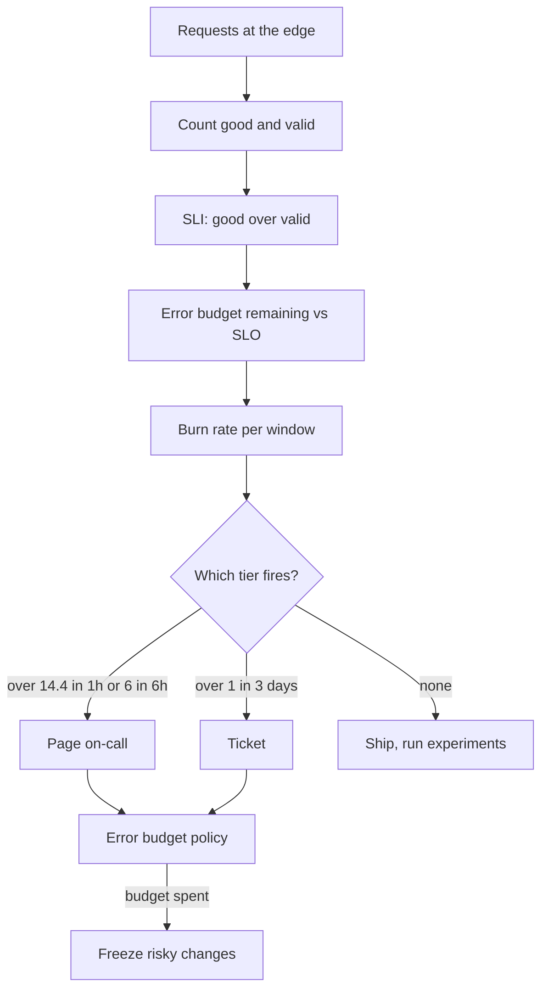

## TL;DR
An SLI measures what users of your agent care about; an SLO is its internal target over a window; an SLA is
the looser external contract. The gap below 100 percent is the error budget. Agent SLIs must capture "task
done correctly", not "returned 200".

## For agent builders
- **Why it matters for agents.** An agent can return 200 on every call and still fail the task: wrong tool,
  wrong record, a loop that hit the step budget, an answer three minutes late. SLOs on task completion,
  latency, quality and cost are how you know the agent is healthy and when to stop shipping prompt and
  model changes.
- **Where it shows up in your stack.** Good and valid counters at your gateway, task-level outcomes from
  agent traces, sampled eval pipelines for quality, burn-rate alerts in Prometheus-style tooling, and the
  provider's SLA that caps what you can promise.
- **What you control.** The one-sentence definition of a "good" agent task, the window and target, the
  burn-rate alert tiers, and the error budget policy that freezes prompt and model changes when the budget
  is spent.
- **What you can skip.** Contract law. Know that the SLA sits below your SLO and that vendor SLAs cover
  availability, not latency or quality.

## Why it exists
- **Without targets, reliability is argued by anecdote.** Product wants features, operations wants
  stability, every incident is a crisis and no incident is ever acceptable.
- **"100 percent reliable" is not a target.** It is impossible, each additional nine costs roughly an order
  of magnitude more, and past a point users cannot perceive the difference because their own network and
  devices fail more often than you do.
- **An SLO makes the trade explicit.** Pick the number users actually need, measure it from their side,
  and treat the remainder as a budget to spend on velocity: deploys, model upgrades, experiments. When the
  budget is gone, reliability work takes priority. That policy, not the number, is what changes behavior.
- **SLAs exist for a different reason.** Enterprise customers need a promise with teeth before procurement
  will sign, so the SLA states a target and the credit paid if it is missed. The internal SLO must be
  stricter, because the gap is the margin to detect and fix problems before they become contract events; a
  team whose SLO equals its SLA has legal in every incident review.
- **AI breaks the classic availability SLI.** The share of non-5xx responses is nearly meaningless for a
  model endpoint: a confident wrong answer in 800 milliseconds counts as a success, and an SLO built only on
  that stays green while customers churn. LLM SLIs must cover latency as users feel it, quality measured by
  evals, and often cost, each breakable by a vendor model change with no code change of yours.

## How it works
### The three layers, precisely
| Layer | What it is | Example |
|---|---|---|
| **SLI** | a ratio: good events ÷ valid events | the fraction of requests answered correctly within two seconds |
| **SLO** | SLI target plus a window | 99.5 percent over 30 days; or 99.9 percent of valid requests good over a rolling 30 days |
| **SLA** | a subset of the SLOs, looser, legally reviewed, with defined remedies and exclusions (scheduled maintenance, customer-caused load) | internal SLO of 99.9 percent behind an external SLA of 99.5 percent |

- **Define "good" in one sentence a query can implement,** for example status 2xx *and* total latency under
  3 seconds *and* output passed schema validation.
- **"Valid" excludes what should not count,** such as malformed client requests, but excluding too much
  hides real failures.
- **Measure as close to the user as you can,** at the load balancer or in the client, because the server
  cannot count requests it never received.
- **Rolling windows suit engineering decisions,** because a calendar window resets everyone's attention on
  the first and exhausts by the twentieth. Calendar windows remain common for SLAs and business reporting
  because contracts and invoices are monthly; many teams run rolling internally and report calendar
  externally.
- **A service usually carries several SLOs:** availability, latency, and for AI products a quality SLO.

### Error budget arithmetic
```
budget = (1 − SLO) × window
99.9% over 30 days: 30 × 24 × 60 = 43,200 minutes × 0.001 = 43.2 minutes of full outage
                    (or 1,000 bad requests per million)
```

| SLO | Budget per 30 days |
|---|---|
| 99 percent | 7.2 hours |
| 99.5 percent | 3.6 hours |
| 99.9 percent | 43.2 minutes |
| 99.95 percent | 21.6 minutes |
| 99.99 percent | 4.32 minutes |

- **The last row is why 99.99 percent requires automated failover:** a human cannot be paged, understand the
  problem and act in four minutes.

### Dependencies cap what you can promise
- **Serial dependencies multiply.** A request path that needs a provider with a 99.9 percent SLA and a vector
  store with 99.95 percent has a ceiling of about 99.85 percent before your own code fails once.
- **Your SLO cannot honestly exceed that ceiling without redundancy.** An independent fallback provider
  raises the provider term toward 1 − (0.001 × 0.001), though true independence is rare and the figure is
  illustrative.

### Burn rate and alerting
- **Burn rate** is how fast you consume budget relative to the pace that would exhaust it exactly at the end
  of the window. A burn rate of 1 spends the whole budget in 30 days; 10 spends it in 3 days.
- **Alert on burn rate, not raw error rate.** A two-minute blip at 5 percent errors consumes a sliver of
  budget and should not page anyone. A persistent 0.3 percent error rate on a 99.9 percent SLO is a 3× burn
  that will breach the SLO in ten days, and should.

| Tier (SRE Workbook multi-window scheme) | Long window | Burn rate threshold | Budget consumed | Action |
|---|---|---|---|---|
| Fast burn | 1 hour | 14.4 | 2 percent of a 30-day budget in an hour | page |
| Medium burn | 6 hours | 6 | 5 percent | page |
| Slow burn | 3 days | 1 | 10 percent | ticket |

- **Each long window is paired with a short one,** so the alert clears once the problem stops.

### The error budget policy
- **The numbers do nothing by themselves.** The policy says what happens when the budget is spent: freeze
  risky launches, require review for prompt and model changes, prioritize reliability work until the budget
  recovers.
- **And when it is plentiful:** ship faster, run chaos experiments, which spend budget on purpose.
- **Agreeing this in advance with product leadership is most of the work.**

### SLIs for AI systems
| SLI | Shape | Note |
|---|---|---|
| **Latency** | time to first token for streaming; total time per response; for agents, time to task completion | task completion can take minutes and needs its own target |
| **Availability** after resilience | fraction completing without a provider or tool error once retries and fallbacks had their chance | measured after the resilience layer |
| **Quality** | fraction of a sampled slice passing automated evals (groundedness, schema, policy), calibrated by a smaller human-labeled sample | sampled because evaluating every response costs as much as serving it |
| **Cost** per successful task | paired with quality | so neither can be gamed by sacrificing the other |
| **Side-effect correctness** for agents | actions reconciled against intent | tickets created equals tickets requested |

- **The quality SLO is the one most likely to move without a deploy,** which is why model version pinning
  and evaluation gates exist.
- **Vendor SLAs usually cover availability only,** with service credits. They do not promise latency or
  quality, so your latency and quality SLOs must assume you absorb those risks yourself.

### Defining a "good" agent task
- **Count tasks, not calls.** One agent task makes many model and tool calls, and retries inside it are
  invisible to the user; the event the user feels is the task.
- **One sentence a query can implement,** for example: the run ended with a final answer, within the step
  budget, under 2 minutes, with no failed side effect, and (on the sampled slice) passed the task grader.
- **Valid tasks exclude** user cancellations and requests the agent correctly refused by policy; excluding
  "the model got confused" would hide exactly the failures you need to see.
- **Read it from traces.** Every run should end with a structured outcome (completed, budget exhausted,
  tool failure, escalated) so the SLI is a count over run records, not a guess from logs.

## Diagram
Counters feed the SLI, the SLO turns it into a remaining budget, burn rate decides who gets alerted, and
the policy decides what the team does next.



## Examples
### Worked month: an assistant on a 99.9 percent SLO
SLO: 99.9 percent "good" responses over a rolling 30 days, where good means 2xx, total latency under 4
seconds, and schema-valid output.

| Quantity | Value |
|---|---|
| Traffic | 20 million requests per month |
| Budget | 20,000 bad responses, equivalent to 43.2 minutes of total outage |
| Average rate | 20,000,000 ÷ 43,200 minutes ≈ 463 requests per minute |

1. **Day 6, provider degradation.** 25 minutes with 60 percent of requests failing or timing out. Bad
   responses: 25 × 463 × 0.6 ≈ 6,945, which is 35 percent of the month's budget gone in 25 minutes.
2. **The fast page fires correctly.** Burn rate during the incident is 0.6 ÷ 0.001 = 600, so the one-hour
   14.4× page fires within the first few minutes. Afterwards 13,055 bad responses remain for 24 days.
3. **Day 9, a prompt edit.** Schema-validation failures rise from 0.02 percent to 0.15 percent,
   persistently: a bad fraction of 0.0015 against an allowed 0.001, a burn rate of 1.5. Nothing is on
   fire, and no page fires.
4. **But the budget will run out.** At 463 × 0.0015 ≈ 0.69 bad responses per minute, 13,055 ÷ 0.69 ≈ 18,800
   minutes, about 13 days, so the SLO will be breached before the window closes.
5. **The slow-burn tier catches it.** The three-day 1× ticket alert fires once the new 1.5× burn dominates
   its window, roughly two days in (around day 11), long before the budget is gone. The paging thresholds
   never fire, which is the point of having a slow-burn tier.
6. **The policy applies.** The prompt change is rolled back or guarded with a repair step, and model
   upgrades are frozen until the rolling budget recovers.
7. **The SLA was never at risk.** The external SLA of 99.5 percent, allowing 100,000 bad responses, was
   never close to breach; the internal SLO forced action two weeks before a customer could have noticed.

### Worked month: a task-completion SLO for a support agent
Illustrative numbers. SLO: 98 percent of valid tasks good over a rolling 30 days, where good means the run
ended with a final answer, within its 25-step budget, under 2 minutes and with no failed side effect.

| Quantity | Value |
|---|---|
| Tasks per month | 50,000, about 1,667 per day |
| Budget | 2 percent, 1,000 bad tasks |
| Days 1 to 10 at 1 percent bad | ~17 bad per day, burn rate 0.5, ~167 used |
| Day 11: a tool schema change makes the model fill one argument wrong | bad rises to 3 percent, burn rate 1.5, ~50 bad per day |
| Remaining budget | ~833 ÷ 50 ≈ 17 days, so a breach around day 27 |

- **No call-level SLI moved.** Model calls returned 200 and the argument errors came back as tool results;
  the failures were runs ending on the step budget after repeated validation errors, which a call-level SLI
  would never count.
- **The slow-burn ticket catches it** once the 3-day window is dominated by the 1.5× burn; the trace outcome
  "budget exhausted" points straight at the tool.
- **The policy applies:** the schema change is rolled back and prompt and tool changes need an eval gate
  until the budget recovers.

### Budget table and multi-window burn-rate alerts, runnable
Reproduces the budget table and evaluates the three alert tiers for the two incidents above (a rule fires
only when both its long and short windows exceed the threshold).

```python
WINDOW_MIN = 30 * 24 * 60                     # 43,200 minutes

def budget_minutes(slo, window_min=WINDOW_MIN):
    return (1 - slo) * window_min

def burn_rate(bad, total, slo):
    return (bad / total) / (1 - slo)          # 1 = exactly exhausts the budget at window end

# Multi-window rules (SRE Workbook): long window, short window, threshold, action
RULES = [("1h", "5m", 14.4, "page"), ("6h", "30m", 6, "page"), ("3d", "6h", 1, "ticket")]

def evaluate(counts, slo=0.999):
    """counts: window -> (bad, total). A rule fires only if BOTH its windows exceed the threshold."""
    return [(action, long_w, thr) for long_w, short_w, thr, action in RULES
            if burn_rate(*counts[long_w], slo) > thr and burn_rate(*counts[short_w], slo) > thr]

for slo in (0.99, 0.995, 0.999, 0.9995, 0.9999):
    print(f"{slo:.2%}: {budget_minutes(slo):7.2f} min per 30 days")   # 432, 216, 43.2, 21.6, 4.32

rpm = 463                                     # requests per minute in the worked month
def window(minutes, bad_fraction):
    total = minutes * rpm
    return (bad_fraction * total, total)

# Day 9: persistent 0.15% bad. Only the slow-burn ticket fires.
slow_burn = {w: window(m, 0.0015) for w, m in
             [("5m", 5), ("1h", 60), ("30m", 30), ("6h", 360), ("3d", 4320)]}
print("prompt regression:", evaluate(slow_burn))     # [('ticket', '3d', 1)]

# Day 6, 25 minutes into the 60%-bad incident: each window's bad fraction.
outage = {"5m": window(5, 0.6), "1h": window(60, 0.25), "30m": window(30, 0.5),
          "6h": window(360, 0.042), "3d": window(4320, 0.0035)}
print("provider outage:  ", evaluate(outage))        # both pages and the ticket
```

## Production patterns
- **Count good and valid at the edge.** Emit two counters from the load balancer or gateway (valid requests,
  and good ones meeting the one-sentence definition) and compute the SLI as a ratio of their rates in your
  metrics system. Monitor the gap between edge and in-service counts; a large gap means the service is
  missing failures users feel.
- **Generate burn-rate alerts from an SLO spec.** Rather than hand-writing alert rules, describe each SLO
  once and let a generator produce the multi-window rules (open-source tools such as Sloth or Pyrra do this
  for Prometheus). Monitor alert precision: pages that did not need action mean thresholds or windows are
  wrong.
- **Sampled quality SLI from an eval pipeline.** Route a fixed random sample of production responses to
  automated evals (groundedness, schema, policy) and a smaller slice to human labeling for calibration;
  report pass rate with its confidence interval. Monitor judge agreement with the human sample.
- **Pin model versions and gate changes on budget.** Call dated model snapshots rather than floating aliases,
  and make prompt or model changes check the remaining budget in CI or the deploy tool. Monitor eval pass
  rate per model version.
- **Task-outcome SLI from agent traces.** Make every agent run emit one structured outcome record (status,
  steps, duration, cost, side-effect check) and compute the task SLI from those records. Monitor the share
  of runs ending on "budget exhausted" or "tool failure" per release and per tool.
- **Budget review in sprint planning.** Show budget remaining per SLO at planning and in a monthly SLO
  review; apply the agreed policy (freeze or accelerate) mechanically. Monitor how many months the budget
  was exhausted and whether shipping behavior changed.

## Trade-offs
- **Tighter SLO vs cost and velocity.** A tighter SLO pleases users but costs roughly an order of magnitude
  more per extra nine, in redundancy and in lost velocity from a smaller budget; it stops paying off once
  users' own client reliability is worse than yours.
- **Edge vs server measurement.** Measuring SLIs at the edge or client is truthful but includes noise you do
  not control; server-side measurement is clean but blind to the failures users feel. Use the edge for
  availability and the server for latency breakdowns.
- **Request-based vs time-based SLOs.** Request-based SLOs weight by traffic, so a ten-minute outage at peak
  costs more than one at night; time-based SLOs ("minutes with error rate under x") treat them equally.
  Request-based reflects user impact better; time-based is simpler to put in a contract.
- **Sampled evals vs human review.** Quality SLIs via sampled automated evals are affordable but noisy and
  judge-dependent; full human review is accurate but too slow and expensive for a 30-day window. The sample
  size sets the confidence, so size it to the decision you need to make.
- **Signing an SLA vs freedom.** An SLA unlocks enterprise deals but makes every dependency's SLA your
  ceiling and converts internal misses into contract events. Worth it when revenue justifies buying the
  redundancy.

## Pitfalls
- **Defining the SLI as "not a 5xx".** Symptom: a green SLO dashboard during a quality incident while
  support tickets climb.
- **Measuring inside the service.** Symptom: the service reports 99.99 percent while the load balancer shows
  2 percent 502s during every deploy.
- **Setting a high-nines SLO on a low-traffic service.** Symptom: at 2,000 requests a month a 99.9 percent
  SLO allows two bad requests, so one flaky client exhausts the budget and burn-rate alerts flap. Fix: a
  longer window, a looser target, or synthetic probes to supply enough events.
- **Using mean latency as the SLI.** Symptom: p50 is fine while a tenth of users wait 20 seconds; use the
  fraction of requests under a threshold instead.
- **Calendar-month windows.** Symptom: relaxed attention on the first, a burned budget by the twentieth,
  every month.
- **Setting the SLO equal to the SLA.** Symptom: legal joins engineering incident reviews and every internal
  miss becomes a credit negotiation.
- **Having no error budget policy.** Symptom: the budget is exhausted three months running and nothing about
  how the team ships has changed.
- **Alerting on raw error-rate thresholds.** Symptom: pages at three in the morning for two-minute blips that
  consumed a fraction of a percent of budget, while a slow burn that will breach the SLO goes unnoticed for
  a week.
- **Assuming a vendor's SLA covers what your SLO needs.** Symptom: the provider "met its SLA" during a
  ten-fold latency degradation that blew your latency SLO, because their SLA only promises availability.
- **Setting a quality SLO without pinning model versions.** Symptom: the eval pass rate drops with no deploy
  in the changelog, and the cause is a silent vendor model update.
- **Counting agent calls instead of tasks.** Symptom: a 99.9 percent call SLI while users report that one
  task in twenty never finishes. Fix: an SLI over run outcomes, with retries inside the run invisible.

## When to use
- **Every user-facing service** needs at least one availability SLO and one latency SLO; an AI service adds a
  quality SLO as soon as it has an eval it trusts, and a cost-per-task target soon after.
- **Set the first SLO from measured history,** slightly below current performance, rather than from
  aspiration, then tighten with evidence.
- **Sign SLAs only** for SLIs you can measure from the customer's vantage point and that your dependencies'
  SLAs can support.
- **Day to day** this looks like checking budget remaining in sprint planning, burn-rate alerts on the
  pager, and a monthly SLO review.
- **Interviews:** define the three terms crisply, compute an error budget from a target and a window without
  hesitation, explain why burn-rate alerting beats threshold alerting, and propose SLIs for an LLM product
  that go beyond uptime.

## Role lens
- **Engineer:** Instruments good and valid counters at the edge, builds the eval sampling pipeline for
  the quality SLI, implements multi-window burn-rate alerts, and checks the budget before risky changes.
- **Architect:** Chooses SLOs per service tier, derives them from dependency SLAs, decides where
  redundancy is required to meet them, and owns the error budget policy agreed with product.
- **FDE:** Translates a customer's SLA request into SLIs measurable inside their environment, explains why
  99.99 percent needs redundancy they have not bought, and builds the shared dashboard that governs
  hypercare.

## Check yourself
**Q:** A customer asks for a 99.95 percent availability SLA on your agent product. Your LLM provider
offers a 99.9 percent SLA, your vector database 99.95 percent, and you have no fallback provider. How
do you respond, and what would have to change?
**A:** Start with the ceiling. The request path needs both dependencies, so availability is bounded by
roughly 0.999 × 0.9995 ≈ 0.9985, about 99.85 percent, before any failure of your own code. Signing
99.95 percent, whose budget is 21.6 minutes per 30 days, would be a promise one provider incident breaks.
The honest response offers 99.5 percent contractually with an internal SLO of 99.9 percent now, and a
path to 99.95 percent priced to include what it costs: an independent fallback provider, which lifts the
provider term toward 1 − 0.001² if the two are truly independent, a vector-store replica, and a
definition of "available" that counts degraded-mode answers from cache or fallback. Add exclusions for
scheduled maintenance and customer-caused overload, and measure from their side of the network. Finally
clarify scope: an availability SLA says nothing about latency or answer quality, so propose separate
latency and quality SLOs, visible on a shared dashboard but not under penalty until both sides trust
the measurement.

## Interview questions
### Define SLI, SLO and SLA, and explain how they relate.
- **SLI:** a ratio of good to valid events measured from the user's side, such as requests that are 2xx,
  under 3 seconds and schema-valid.
- **SLO:** the internal target for that SLI over a window, for example 99.9 percent over a rolling 30 days;
  1 minus the SLO is the error budget.
- **SLA:** a looser external contract on a subset of SLOs with credits and exclusions; it sits below the SLO
  so there is margin to act before a contract event.

### What SLIs would you propose for an LLM chat assistant beyond uptime?
- **Latency as felt:** time to first token for streaming and total response time, as fractions under a
  threshold, not means.
- **Quality:** pass rate of a sampled slice through automated evals (groundedness, schema, policy),
  calibrated against human labels.
- **Cost per successful task,** paired with quality, and availability measured after retries and fallbacks.

### How would you define the SLOs for a tool-calling agent that resolves support tickets?
- **Task SLI, not call SLI:** the fraction of valid runs that end with a final answer, within the step budget
  and a time limit, with no failed side effect, read from structured run outcomes.
- **Add quality and cost:** a sampled task-grader pass rate calibrated against human labels, and cost per
  successful task, so neither can be traded away silently.
- **Policy:** burn-rate alerts on each, and prompt, tool-schema and model changes gated on remaining budget.

### Each agent task makes 15 calls to a provider with 99.9 percent availability. What task availability should you expect, and what do you do about it?
- **Serial calls multiply:** if every call must succeed, 0.999 to the 15th power is about 0.985, so roughly
  1.5 percent of tasks fail before your own code, and a 99.5 percent task SLO is out of reach.
- **Retries inside the run recover independent blips:** with one retry per call, failure per call drops
  toward 0.001², so the task term rises to about 99.998 percent, assuming the failures are independent.
- **Outages are not independent,** so retries do not help during a provider incident; that needs a fallback
  provider, and the task SLO should be set from measured run outcomes, not from the vendor's number.

### Where does the 14.4 burn-rate threshold come from, and why use burn rate at all?
- **14.4 means 2 percent of a 30-day budget in one hour:** 30 days is 720 hours, and 0.02 × 720 = 14.4.
- **Burn rate scales alerts to budget impact,** so a two-minute blip does not page while a persistent 3×
  burn that breaches in ten days does.
- **The 3-day 1× ticket tier** catches slow burns, like a prompt edit at 1.5×, that no page threshold sees.

### What does 99.99 percent availability imply operationally, and when would you refuse to promise it?
- **4.32 minutes of budget per 30 days:** no human can be paged, diagnose and act in that time, so failover
  must be automated.
- **Dependencies cap it:** serial dependencies at 99.9 and 99.95 percent give a ceiling near 99.85 percent,
  so without independent redundancy the promise is not honest.
- **Refuse, or price in redundancy,** and note vendor SLAs usually cover availability only.

## Quiz
### Q: What is the error budget for a 99.9 percent SLO over a 30-day window, expressed as full-outage time?
- [ ] 4.32 minutes
- [x] 43.2 minutes
- [ ] 7.2 hours
- [ ] 21.6 minutes
> 30 days is 43,200 minutes; 0.1 percent of that is 43.2 minutes. The 4.32-minute figure belongs to
> 99.99 percent, 21.6 minutes to 99.95 percent and 7.2 hours to 99 percent; the arithmetic is the same
> multiplication each time.

### Q: Why should the internal SLO be stricter than the external SLA?
- [ ] Because SLAs are measured over longer windows than SLOs
- [ ] Because customers expect the published number to be rounded up
- [x] The gap is the margin in which problems are detected and fixed before they become contract events with penalties
- [ ] Because vendors require it in their own terms of service
> If the SLO equals the SLA, every internal miss is already a breach and legal enters every incident
> review. A stricter SLO forces action while there is still budget left before the contractual line.

### Q: Why alert on error-budget burn rate rather than on a raw error-rate threshold?
- [ ] Because error rates cannot be computed in real time
- [x] Burn-rate alerts page only when the budget is genuinely threatened, catching both fast outages and slow persistent degradation
- [ ] Because burn rate is required for SLA reporting
- [ ] Because raw error rates are always noisier than burn rates
> A two-minute blip consumes a sliver of budget and should not wake anyone; a persistent 0.3 percent
> error rate on a 99.9 percent SLO burns at 3× and will breach within the window. Multi-window burn-rate
> alerts distinguish the two; a single threshold cannot.

## Use cases & projects
### Use cases
- **Launching a customer-facing agent.** A task-completion SLO, a latency SLO and a sampled quality SLO give
  the team one shared definition of "the agent is healthy".
- **Gating prompt and model changes.** Remaining error budget decides whether a new prompt, tool schema or
  model version ships this week or waits.
- **Negotiating an enterprise agent SLA.** Dependency ceilings and budget arithmetic show what availability
  you can honestly sign and what redundancy a higher number needs.
- **Catching slow regressions.** Slow-burn alerts on task outcomes surface a tool or prompt change that
  quietly raised failures by a few points.

### Mini project
**Put an SLO on your agent (2-3 hours).**
- **Goal:** define, measure and alert on a task-level SLO for a small tool-calling agent.
- **Steps:** make each run emit a structured outcome (status, steps, duration, cost); write the one-sentence
  "good task" definition; run 200 tasks from your eval set and compute the SLI; set a target slightly below
  it; inject a regression (break one tool's schema) and replay outcomes through the burn-rate rules from the
  runnable example above.
- **Done when:** you have the SLI, SLO and budget written down, a burn-rate evaluation that fires the right
  tier for the injected regression, and a one-paragraph error budget policy for prompt and model changes.
