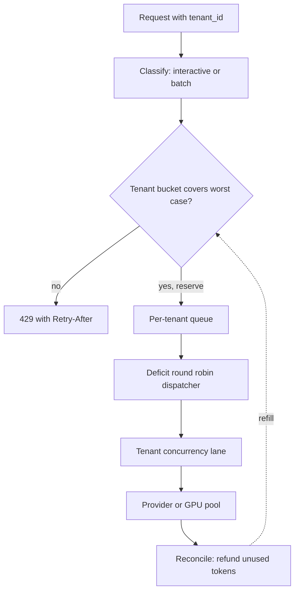

## TL;DR
Tenant-level quotas cap what each tenant may consume of shared pools (provider tokens, GPU concurrency,
workers); isolation (per-tenant lanes, fair queuing, separate pools) makes a tenant at its cap degrade
only itself, turning a shared failure into a local one.

## Why it exists
- **Shared pools, one bursty tenant.** Every tenant draws on the same scarce pools: provider
  tokens-per-minute, GPU concurrency, workers, connections. A noisy neighbor is one tenant whose burst (a
  backfill, a looping agent, a retry storm) fills a pool so everyone else's latency and errors rise.
- **The opening incident.** A gateway fronts one provider key rated, illustratively, at one million tokens
  per minute, shared by forty customers. Tenant A re-embeds 50,000 documents as fast as its client can. The
  global limiter keeps upstream healthy, but its FIFO queue is now 20,000 deep with A's requests. B's
  support chat (400 tokens, needs a two-second answer) waits behind them, B's p95 triples, and dashboards
  show the provider perfectly healthy.
- **The naive fixes fail.** "Add a global rate limit" protects the upstream, not the neighbors: it bounds
  the total but not its division. "Scale up" fails when the scarce resource is a vendor quota or a fixed GPU
  pool, and it rewards the misbehaving tenant with everyone's money. "Ask tenants to behave" ignores that
  agents loop, clients retry, and a tenant's bug becomes your incident.
- **AI workloads make it sharper than classic SaaS.** Work per request spans three or more orders of
  magnitude (a 20-token classification versus a 100k-token summary), so counting requests measures almost
  nothing. Agents fan out, so one user action can become fifty calls.
- **You can only allocate, not add.** The binding resource often belongs to a vendor, so you cannot
  engineer your way out by adding capacity; you can only divide what you already have.

## How it works
### Choose the units you meter
| Unit | What it tracks | Failure it catches |
|---|---|---|
| Tokens per minute (input plus output) | provider limits and cost | large-prompt tenants |
| Requests per minute | request rate | chatty clients |
| Concurrent in-flight requests | provider concurrency, KV-cache memory, worker slots | whatever is actually saturating |
| Spend per day | the bill | runaway cost |

- **Meter tokens and concurrency at minimum,** because a tenant can stay under any request count while
  consuming the whole token budget with large prompts.
- **Concurrency matters for latency,** because latency collapse is a function of concurrency, not of
  request rate.

### Enforce at admission with a token bucket per tenant
1. **Give each tenant its own bucket.** Capacity is the burst it tolerates; refill rate is the sustained
   allowance.
2. **Reserve the worst case.** Output size is unknown until the call finishes, so reserve prompt tokens
   plus `max_tokens`.
3. **Make the call, then reconcile** by refunding the unused part. Charging after the fact would let a
   tenant go arbitrarily far over quota inside a single minute.
4. **Reject immediately when the bucket cannot cover the reservation,** with 429 and a `Retry-After`
   header, rather than queueing. A queue that grows past the budget just moves the noisy-neighbor problem
   into the queue, which is exactly the opening example.

### Isolate the shared path with lanes and fair scheduling
- **Quotas alone are not isolation.** Forty tenants each under quota can still sum to more than the
  provider allows, and a FIFO dispatcher still serves them in arrival order.
- **One queue per tenant, drained round-robin** (or weighted by tier), a simple form of weighted fair
  queuing. A tenant with 20,000 queued requests gets one turn per cycle, the same as a tenant with one.
- **Add a per-tenant concurrency semaphore,** so a single tenant cannot hold every in-flight slot.
- **Fair scheduling is work-conserving:** when only one tenant is active it receives everything, which hard
  caps alone can never offer.

### Be fair in the unit that is scarce
- **Round-robin by request is unfair when sizes differ.** If A's queued requests are 20k-token summaries
  and B's are 400-token chats, one turn each per cycle gives A fifty times B's share of the token budget.
- **Deficit round robin fixes it.** Each tenant's queue earns a quantum of, say, 8k tokens per cycle into a
  deficit counter. It dispatches from the head of its queue while the counter covers the (estimated) token
  cost, carrying the remainder forward.
- **Result:** B sends up to twenty chats per cycle; A's 20k request waits until its counter has accumulated
  three cycles of quantum. Each active tenant receives an equal share of tokens, not of requests.
- **Tiers are just weights:** a tier weight is a larger quantum.

### Divide quotas hierarchically
- **A tenant is rarely one actor.** An enterprise customer has teams, end users and agents inside its
  quota, and one of them can starve the rest exactly as one tenant starves the fleet.
- **The same mechanisms nest:** a bucket per organization, and inside it a bucket or fair-share lane per
  user or API key. A request is admitted only if every level can cover it.
- **Keep the levels few** (organization, then user or workload), because each one is another counter on the
  hot path.

### Tier the isolation
| Tier | Mechanism | What it isolates |
|---|---|---|
| Pooled | shared buckets and lanes | quota share and queue turns |
| Shuffle-sharded | each tenant gets a small random subset of workers (say 2 of 8) | blast radius of a poisonous tenant |
| Dedicated | own provider key or model deployment, worker group, vector-index replica | everything, including vendor-side limits |

- **Dedicated is the bulkhead pattern applied per tenant,** and the only level at which a vendor-side limit
  (a per-key TPM cap) is genuinely isolated, because the vendor's limiter does not know your tenants exist.
- **Shuffle sharding improves isolation combinatorially.** A tenant that poisons its workers (a
  crash-inducing input, a pathological prompt) takes out its own shard. Another tenant shares *both* of
  those workers only if it drew the same pair, which happens for 1 in 28 tenants with 2-of-8.
- **It complements quotas rather than replacing them,** because it bounds the blast radius of a bad tenant
  rather than dividing capacity fairly, and it avoids the cost of dedicated capacity.

### Degrade before you deny
- **A downgrade is often cheaper than a 429:** route to a smaller model, shed the tenant's batch-class
  traffic while keeping interactive traffic, or lower its `max_tokens`.
- **This requires classifying traffic at the edge** (interactive versus batch, user-initiated versus
  agent-initiated) so the scheduler can shed the right thing first.

### Make it observable and billable
- **Tag every request, span and cost record with `tenant_id`.**
- **Watch per-tenant signals:** queue wait, in-flight count, tokens consumed and 429 counts tell you whether
  isolation is working, and they settle the "you throttled us" conversation with data.
- **Quota disputes are a commercial problem,** and the only defense is a measurement both sides trust.

## Diagram
Each request passes the tenant's bucket before it can queue, then the dispatcher drains per-tenant queues
fairly and the tenant's lane bounds its in-flight calls; the reconcile step refunds unused tokens.



## Examples
### Admission layer: per-tenant token bucket and concurrency lane
A single-process sketch: a per-tenant token bucket for tokens per minute with reserve-then-reconcile, plus a
per-tenant semaphore for concurrency. In production the bucket state lives in Redis behind an atomic Lua
script so every gateway replica sees the same level; the logic is identical.

```python
import asyncio, time
from collections import defaultdict

class QuotaExceeded(Exception):
    def __init__(self, tenant, retry_after):
        super().__init__(f"tenant {tenant} over token quota"); self.retry_after = retry_after

class TenantLimiter:
    """Per-tenant token bucket (tokens/min) + concurrency lane. Single-process version."""
    def __init__(self, tokens_per_min, max_in_flight):
        self.rate, self.cap = tokens_per_min / 60.0, float(tokens_per_min)
        self.level = defaultdict(lambda: self.cap)           # starts full: one burst is allowed
        self.stamp = defaultdict(time.monotonic)
        self.lanes = defaultdict(lambda: asyncio.Semaphore(max_in_flight))

    def _refill(self, t):
        now = time.monotonic()
        self.level[t] = min(self.cap, self.level[t] + (now - self.stamp[t]) * self.rate)
        self.stamp[t] = now

    def reserve(self, t, est_tokens):
        if est_tokens > self.cap:                            # can never fit: a 400, not a retryable 429
            raise ValueError(f"request needs {est_tokens} tokens; per-minute cap is {self.cap:.0f}")
        self._refill(t)
        if self.level[t] < est_tokens:                       # reject now; queueing would hide overload
            raise QuotaExceeded(t, retry_after=(est_tokens - self.level[t]) / self.rate)
        self.level[t] -= est_tokens

    def reconcile(self, t, est_tokens, used_tokens):
        self.level[t] += est_tokens - used_tokens            # refund the unused reservation

async def call_llm(limiter, tenant, prompt_tokens, max_output_tokens, call):
    est = prompt_tokens + max_output_tokens                  # worst case: output size unknown until done
    limiter.reserve(tenant, est)
    async with limiter.lanes[tenant]:                        # the tenant's own concurrency lane
        try:
            resp = await call()
        except Exception:
            limiter.reconcile(tenant, est, prompt_tokens)    # failed calls still charge the prompt
            raise
    limiter.reconcile(tenant, est, resp["usage"]["total_tokens"])
    return resp
```

- **Ordering matters:** the reservation happens before the lane is taken and before any provider call, so
  a tenant over quota never occupies a slot.
- **Failed calls still charge the prompt tokens,** so a retry storm counts against the tenant that caused it
  rather than against the shared pool.
- **The 429 carries an honest wait:** `retry_after` is computed from the refill rate, so well-behaved
  clients get a real wait instead of a guess.
- **Oversized requests are a client error.** A request larger than the whole bucket is rejected as a 400,
  because a 429 for it would promise a retry that can never succeed and invite the client to loop.

### Round robin vs deficit round robin, runnable
A's backlog is 20k-token summaries, B's is 400-token chats. Count tokens served over 30 cycles.

```python
from collections import deque

def round_robin(queues, rounds):
    served = {t: 0 for t in queues}
    for _ in range(rounds):
        for t, q in queues.items():
            if q:
                served[t] += q.popleft()          # one request per tenant per cycle
    return served

def drr(queues, quantum, rounds):
    deficit = {t: 0 for t in queues}
    served = {t: 0 for t in queues}
    for _ in range(rounds):
        for t, q in queues.items():
            if not q:
                deficit[t] = 0                    # idle queues do not bank credit
                continue
            deficit[t] += quantum                 # tokens earned this cycle
            while q and q[0] <= deficit[t]:
                cost = q.popleft()
                deficit[t] -= cost
                served[t] += cost
    return served

def backlog():
    return {"A": deque([20_000] * 50), "B": deque([400] * 1000)}

print("round robin:", round_robin(backlog(), rounds=30))   # A: 600000, B: 12000
print("DRR:        ", drr(backlog(), quantum=8_000, rounds=30))  # A: 240000, B: 240000
```

### Worked scenario: hard caps vs fair share for the backfill
Illustrative numbers: the one-million-TPM key, forty tenants, and an assumed ~500 tokens per document for
A's 50,000-document re-embed (25M tokens).

| Policy | A's allowance at night (others idle) | Backfill time | B's chat during the day |
|---|---|---|---|
| Global limit only (FIFO) | whole key | ~25 min | waits behind 20,000 queued requests |
| Hard cap 1/40 each | 25,000 TPM | ~1,000 min (~17 h) | protected |
| Fair share with soft caps | nearly the whole key | ~25 min | protected: one fair turn per cycle |

Fair share wins on both columns because it is work-conserving; hard caps only win when capacity has been
sold to specific customers.

## Production patterns
- **Shared bucket in Redis.** When more than one gateway replica exists, keep bucket state in Redis and
  update it with one Lua script (`EVAL`) that refills, checks and decrements atomically, keyed by tenant.
  Monitor per-tenant 429 rate, Redis latency on the hot path, and provider 429s after scale-out events.
- **Concurrency leases, not bare counters.** For a distributed per-tenant semaphore, store each in-flight
  slot with an expiry so a crashed worker's slot frees itself. Monitor in-flight per tenant against its
  limit and slots reclaimed by expiry, which flag crashing workers.
- **Separate batch and interactive lanes.** Classify at the edge; send backfills to a bounded batch queue
  or a provider's asynchronous batch endpoint, and give interactive traffic its own lane. Monitor batch
  lag and interactive p95 queue wait per tenant.
- **Dedicated keys or deployments for premium tiers.** When a contract promises capacity, give that tenant
  its own provider key or model deployment so the vendor limit is isolated too. Monitor provider-side 429s
  per key and idle capacity cost.
- **Per-tenant dashboards from tags.** Put `tenant_id` on every trace span and cost record; chart token share
  by tenant, queue wait, and 429s split by tenant and by upstream. Isolation works when one tenant's spike
  moves only that tenant's lines.

## Trade-offs
- **Hard caps vs fair share.** Hard per-tenant caps guarantee isolation but strand capacity: if the caps sum
  to the provider limit, each tenant gets 1/N even when the others are idle. This flips toward soft caps
  with fair-share scheduling when tenants are many and bursts are uncorrelated, and back toward hard caps
  when you have sold specific capacity to specific customers.
- **Dedicated pools vs cost.** Dedicated pools and provider keys per tenant give the strongest isolation,
  including against vendor limits, but carry per-tenant minimum cost and operational surface. Worth it when
  a tenant's revenue or contractual commitments exceed the cost of the idle capacity.
- **Token metering vs simplicity.** Metering tokens is accurate but requires reserve-then-reconcile and a
  tokenizer at admission; metering requests is nearly free but gameable with large prompts. Request
  counting is adequate only when a schema bounds prompt size.
- **Reject vs queue.** Rejecting at the cap pushes work back to the client's retry logic and keeps latency
  honest; queueing smooths bursts but hides overload and raises everyone's latency. Queue only batch
  traffic, and only with a bounded depth.

## Pitfalls
- **Relying on a single global rate limit.** Symptom: the provider never returns 429, yet small tenants'
  p99 spikes precisely while one tenant runs a batch job. Fix: per-tenant buckets plus fair draining.
- **Counting requests instead of tokens.** Symptom: one tenant with 100k-token prompts stays inside its
  request quota while the cost report attributes most of the monthly spend to a few percent of calls.
- **Keeping limiter state per replica.** Symptom: effective quota equals cap times replica count and
  silently grows on scale-out; provider 429s appear right after autoscaling events. Fix: shared state.
- **Attributing retries to the pool rather than the tenant.** Symptom: a tenant's retry storm multiplies
  upstream load and every other tenant pays for it. Fix: charge failed calls to the tenant.
- **Fair-queuing by request count when request sizes vary.** Symptom: per-tenant turn counts look equal
  while the token share by tenant shows the large-prompt tenant taking most of the budget. Fix: DRR.
- **Identifying tenants by API key alone when a customer has many end users.** Symptom: the customer
  complains that "our app is slow for some users", because one of their users is starving the rest inside
  a single quota. Fix: a nested per-user level.
- **Not reserving output tokens.** Symptom: your bucket says the tenant is under quota while the provider
  rejects for exceeding tokens-per-minute, because long completions were never counted until they finished.

## When to use
- **Use when** more than one tenant shares a provider key, GPU pool or worker fleet, or when a single
  tenant mixes workload classes (batch backfills next to interactive chat).
- **Start small:** a Redis token bucket keyed by tenant for tokens per minute plus a per-tenant concurrency
  semaphore covers most early-stage services. Add per-tenant queues with fair draining when batch jobs
  appear, and dedicated pools when a contract promises capacity.
- **Measure** per-tenant queue wait, share of tokens by tenant, and 429s split by tenant and by upstream;
  isolation is working when one tenant's spike moves only that tenant's lines.
- **Interviews:** the prompt is usually "a customer's batch job slowed everyone down; what do you change?",
  and the expected answer distinguishes bounding the total from dividing it fairly.

## Role lens
- **Engineer:** Implements the shared token bucket and per-tenant semaphore in the gateway, reserves
  worst-case tokens before each call, and tags every span and cost record with the tenant.
- **Architect:** Owns the tiering model: which units are quota'd, how quotas map to pricing plans and to
  vendor limits, and which tenants justify dedicated keys, deployments or worker pools.
- **FDE:** Inside a customer's deployment the tenants are departments or business units; the FDE
  negotiates their quotas, explains the 429s, and builds the per-team usage dashboard that ends disputes.

## Check yourself
**Q:** A shared gateway fronts one provider key with an illustrative limit of one million tokens per
minute for forty tenants. Tenant A starts an embedding backfill and tenant B's chat latency triples, but
the global rate limiter never fires. Explain why, and design the fix.
**A:** The global limiter bounds total upstream load, not its division; the FIFO queue ahead of it is
dominated by A, so B waits behind thousands of A's requests while the provider stays healthy. The fix
has three layers. First, per-tenant admission: a token bucket per tenant (say an illustrative 50k tokens
per minute default) with worst-case reservation and a concurrency semaphore, so A is rejected with 429
and `Retry-After` once over its share. Second, isolation on the shared path: one queue per tenant drained
round-robin, so even under quota A gets one turn per cycle. Third, classify A's traffic as batch so it
is shed first and only consumes leftover capacity, and move premium tenants to a dedicated key. Verify
with per-tenant queue-wait metrics: after the change, A's wait rises and B's is flat.

## Interview questions
### How do you enforce a tokens-per-minute quota when you do not know the output length in advance?
- **Reserve the worst case:** prompt tokens plus `max_tokens` are taken from the tenant's bucket before
  the call, so the tenant cannot overshoot inside a minute.
- **Reconcile afterwards:** refund the difference between the reservation and actual usage; on failure,
  still charge the prompt so retry storms land on the tenant that caused them.
- **Reject oversized requests as a 400,** because a 429 would promise a retry that can never succeed.

### After autoscaling the gateway from 3 to 12 replicas, provider 429s appear. What happened?
- **Limiter state is probably per replica,** so each replica allows the full cap and effective quota is
  cap times replica count, here four times what it was.
- **Fix:** move bucket state to a shared store (Redis with an atomic script) so every replica decrements
  the same level, and alert on provider 429s right after scale-out events.

### When would you choose hard per-tenant caps over fair-share scheduling?
- **Hard caps** fit when capacity has been sold to specific customers and must be guaranteed, accepting
  that idle shares are stranded (1/N each even when others are idle).
- **Fair share with soft caps** fits many tenants with uncorrelated bursts, because it is work-conserving:
  a lone active tenant gets the whole pool.
- **Many systems combine them:** guaranteed floors for paying tiers, fair share for the remainder.

### Explain shuffle sharding and what it does and does not protect against.
- **Mechanism:** each tenant is routed to a small random subset of workers, say 2 of 8, so a poisonous
  tenant only takes out its own pair.
- **Numbers:** 8 choose 2 is 28 pairs, so another tenant shares both of those workers only 1 time in 28.
- **Limit:** it bounds blast radius from crashes or pathological inputs, but does not divide capacity
  fairly, so quotas are still needed.

### Why is round-robin across per-tenant queues still unfair for LLM traffic, and what replaces it?
- **Request sizes differ by orders of magnitude,** so one turn each gives a 20k-token tenant fifty times
  the token share of a 400-token tenant.
- **Deficit round robin** gives each queue a token quantum per cycle and dispatches while the deficit
  covers the head request, so shares equalize in tokens; tier weights become larger quanta.

## Quiz
### Q: Why does a single global rate limit fail to prevent noisy-neighbor problems?
- [ ] Global limits only count requests, never tokens
- [x] It bounds total upstream load but says nothing about how that load is divided among tenants
- [ ] Rate limiters cannot run in a distributed gateway
- [ ] Providers ignore client-side limits and apply their own
> A global limit protects the dependency, so the provider looks healthy, but the queue in front of it is
> still served in arrival order; one tenant's burst fills it and everyone else waits behind. Isolation
> needs per-tenant admission and fair scheduling, not a tighter total.

### Q: Why should an LLM gateway meter tokens rather than only requests per minute?
- [ ] Token counts are easier to compute than request counts
- [ ] Providers do not enforce request-rate limits
- [x] Cost and provider limits scale with tokens, so one large-prompt tenant can exhaust the budget while under its request quota
- [ ] Request counting cannot be stored in Redis
> Work per request varies by orders of magnitude; a tenant sending 100k-token prompts at a modest request
> rate consumes the tokens-per-minute budget that other tenants need. Requests are a useful secondary
> signal, not the primary unit.

### Q: Which mechanism keeps isolation work-conserving, so idle capacity is not stranded?
- [ ] Hard per-tenant caps that sum to exactly the provider limit
- [ ] Per-replica limiters with no shared state
- [x] Fair-share scheduling across per-tenant queues with soft caps
- [ ] A dedicated provider key for every tenant
> Round-robin or weighted draining of per-tenant queues gives each active tenant an equal turn while a
> lone active tenant receives the whole pool. Hard 1/N caps leave capacity unused when others are idle,
> and per-replica limiters break isolation on scale-out.
