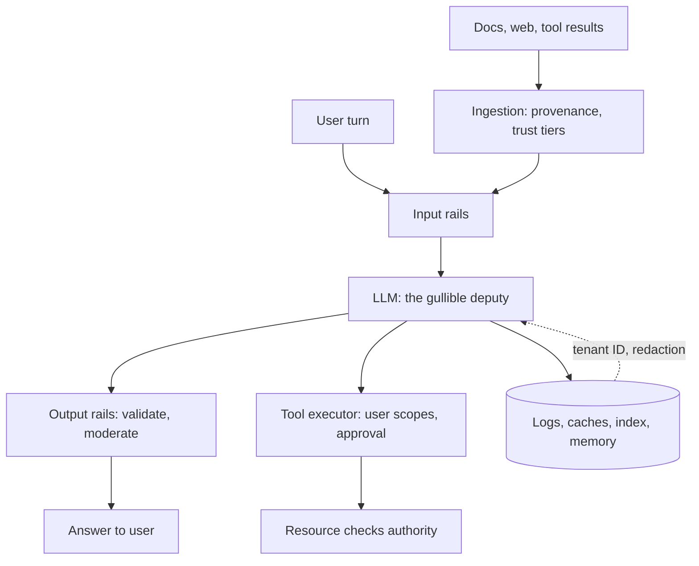

## Overview
This module covers how to keep an LLM system, and above all a tool-using agent, from being turned
against its users, its operator or its data. Every lesson returns to one premise: the model is an
untrusted component that follows instructions wherever it finds them.

A system prompt is an instruction, not an enforcement boundary. The OWASP Top 10 for LLM Applications
gives the shared vocabulary reviewers will use on your agent.

What this module gives an agent builder:
- **Threats:** prompt injection and RAG poisoning explain how untrusted text, typed by a user or planted in a document, web page, corpus or tool result, reaches the model's single input stream.
- **Checkpoints:** input and output guardrails, output validation that turns strings into typed data, content moderation with per-surface thresholds, Llama Guard as a policy-in-the-prompt safety classifier, and NeMo Guardrails as an orchestrator of rails.
- **Data controls:** PII redaction, data leakage and cross-tenant leakage map every place an LLM pipeline copies text: prompts, traces, caches, embeddings, memory and weights.
- **Action controls:** excessive agency and tool privilege escalation cover agents, where a wrong token becomes a real side effect.
- **Supply chain:** treating checkpoints and datasets as build artifacts that can run code or carry backdoors.

Core for agents (you use them directly in the loop): prompt-injection, rag-poisoning, excessive-agency,
tool-privilege-escalation, input-output-guardrails, output-validation, pii-redaction, data-leakage and
cross-tenant-data-leakage.

Useful (you meet them when shipping, reviewing or self-hosting): owasp-top-10-for-llms,
content-moderation, llama-guard, nemo-guardrails and supply-chain-security-for-models-and-datasets.
No lesson here is pure background.

What you can build afterwards:
- A threat model of an agent feature, structured by OWASP item.
- Measured guardrails on every hop of the agent loop, with chosen thresholds.
- Tenant isolation and redaction designed per boundary.
- Scoped agent authority: delegated credentials, consequence tiers and approval gates.
- Item-by-item answers to an enterprise security review.

It matters most for Engineers who build these layers and Architects who own the trust boundaries, and
FDEs need it to pass customer security reviews.

## Why it matters
- **Engineer:** You write the agent code that validates model output and tool arguments with Pydantic, threads a server-derived tenant ID into every vector, cache and memory call, redacts traces, runs moderation and Llama Guard checks, and executes tools with the requesting user's credentials instead of the service's; each of these needs labelled tests and a tracked false-positive rate.
- **Architect:** You decide where the trust boundaries sit in the agent system, which workflows combine private data, untrusted content and outbound capability, which tools are tiered as irreversible and gated, how tenants are isolated across every store, and which models and datasets may enter the registry; those choices, not the prompt, set the blast radius.
- **FDE:** Enterprise buyers of your agent send security questionnaires keyed to OWASP LLM items, ask where their data goes and whether another customer could see it, and want their own moderation policy; you need a threat model, a data-flow map and red-team evidence you can show, and the ability to tune rails per deployment.

## Mental model
Picture the model as a powerful but gullible deputy in the middle of a building with many doors. All
incoming text lands in the same ear, and the deputy cannot tell instructions from data. Security means
guarding the doors, not lecturing the deputy.

| Door | What passes through | Guards you build | Lessons |
|---|---|---|---|
| Inbound | User turns, retrieved chunks, tool results, downloaded checkpoints | Provenance, trust tiers, redaction, injection screening | prompt-injection, rag-poisoning, pii-redaction, supply-chain-security-for-models-and-datasets |
| Outbound | Answers shown to people; copies written to logs, caches, indexes and weights | Validate structure and meaning, moderate content, scan for leaks, enforce tenancy | output-validation, content-moderation, llama-guard, data-leakage, cross-tenant-data-leakage |
| Action | Tool calls that change the world | Only the keys for this task and this user, checked by the resource, a human at irreversible ones | excessive-agency, tool-privilege-escalation |
| Every hop | All of the above | Rails composed and measured | input-output-guardrails, nemo-guardrails, owasp-top-10-for-llms |

- Then prove each guard works with labelled positives, negatives and red-team cases.
- A guard nobody has measured is not a control.

The diagram shows where this module's controls sit around one agent step: inbound text is screened,
outbound text is validated, actions are scoped outside the model, and every store is tenant-scoped.

## Suggested order
1. prompt-injection — the root threat: one input stream with no code/data separation, and the lethal trifecta that turns it into an incident.
2. rag-poisoning — extends injection to the corpus, showing why write-path provenance and trust tiers beat prompt-side defences.
3. excessive-agency — moves from words to actions, shrinking tools, permissions and autonomy to bound the blast radius.
4. tool-privilege-escalation — the confused-deputy deep dive: every tool call must carry only the asking principal's authority.
5. input-output-guardrails — introduces the deterministic checkpoint layer and the measure-before-enforce discipline the next lessons build on.
6. output-validation — the most mechanical output rail: syntactic, structural and semantic validity of anything code consumes, tool arguments included.
7. pii-redaction — the first data control: typed, reversible pseudonymisation applied per boundary.
8. data-leakage — widens from PII to every channel data can leave by: provider, tools, rendering, logs, embeddings and weights.
9. cross-tenant-data-leakage — the multi-tenant special case where vector stores, caches and memory bypass row-level security.
10. owasp-top-10-for-llms — the intro-level map and shared vocabulary; read now to slot every earlier lesson into the checklist reviewers use.
11. content-moderation — classification against a harm taxonomy with per-surface thresholds, actions and review metrics.
12. llama-guard — a concrete open-weight moderation classifier with policy in the prompt, best read once moderation itself is clear.
13. nemo-guardrails — a toolkit that composes rails and classifiers such as Llama Guard, so it comes after the pieces it orchestrates.
14. supply-chain-security-for-models-and-datasets — finishes below the application, treating checkpoints and datasets as signed, scanned build artifacts.

## Capstone
### Brief
**Use case:** a multi-tenant customer-support agent must pass security review before its first
enterprise launch. This is the module's major project, a multi-day build of a working, secured agent.

The agent answers questions from a RAG index built from each customer's help-centre articles, inbound
support tickets and a shared product wiki. It has three tools: look up an order, issue a refund up to a
limit, and email the end customer.

It runs on a hosted LLM, uses an open-weight embedding model pulled from a public hub, keeps
per-conversation memory and a semantic cache, and ships every prompt to a tracing vendor.

Over a week, write an OWASP-structured threat model of the system, then build the controls the top rows
call for:
- Injection and hidden-text handling at ingestion with per-source trust tiers.
- Input and output rails with Pydantic-validated tool arguments.
- Moderation using Llama Guard with a custom category set, composed with a topical rail in NeMo Guardrails or an equivalent pipeline.
- PII pseudonymisation before the provider and irreversible redaction in traces.
- One server-derived tenant ID enforced on the vector store, cache and memory.
- Refunds and outbound email executed with the end user's scopes and gated by human approval above a threshold.
- A pinned, hashed, safe-format embedding model loaded without remote code.

Finish with a red-team run that tries to break each control.

### Deliverables
- A threat model with one row per OWASP LLM item, each naming the affected component, the control, the test that proves it and the residual risk, plus a data-flow diagram showing every store and egress point.
- Working code for the guardrail pipeline: ingestion sanitiser with provenance metadata, input and output rails, Pydantic schemas for every tool argument, Llama Guard moderation with per-rail thresholds, and a tool executor that attaches the requesting user's credential and an approval gate.
- A tenant-isolation module with a single tenant-context wrapper used by every vector, cache and memory call, and a CI suite of cross-tenant canary tests across at least three tenant pairs.
- A PII and leakage policy listing each boundary (provider, traces, index, cache, output, email tool) with the entity list and transformation applied, plus a recall measurement per entity on a labelled sample.
- A model supply-chain record for the embedding model: source revision pinned by commit, file hashes, format and scan results, licence, and the registry entry production loads from.
- A red-team report of at least 25 attacks (direct and indirect injection, poisoned wiki page, system-prompt extraction, cross-tenant probes, refund escalation, exfiltration through a rendered link or email) with outcomes and fixes.

### Rubric
- A poisoned wiki page with a hidden instruction to email order data to an external address is either quarantined at ingestion or, if retrieved, results in no outbound email, and the block appears in the decision log with its source and trust tier.
- Every cross-tenant canary test passes in CI, and grepping the codebase shows no vector, cache or memory call that bypasses the tenant-context wrapper.
- Each rail reports block rate on an adversarial set and false-refusal rate on a benign set of at least 100 examples each, and its thresholds are justified from those numbers rather than defaults.
- A refund above the threshold cannot execute without a recorded human approval, and a refund requested by an injected document fails at the resource layer because the call carries the end user's scopes, not a service account's.
- Sampled traces contain typed placeholders instead of raw emails, phone numbers and order addresses, and measured redaction recall per entity is reported next to the target.
- Production loads the embedding model only from the internal registry by hash, in a non-pickle format with remote code disabled, and swapping a tampered file makes the load fail.
