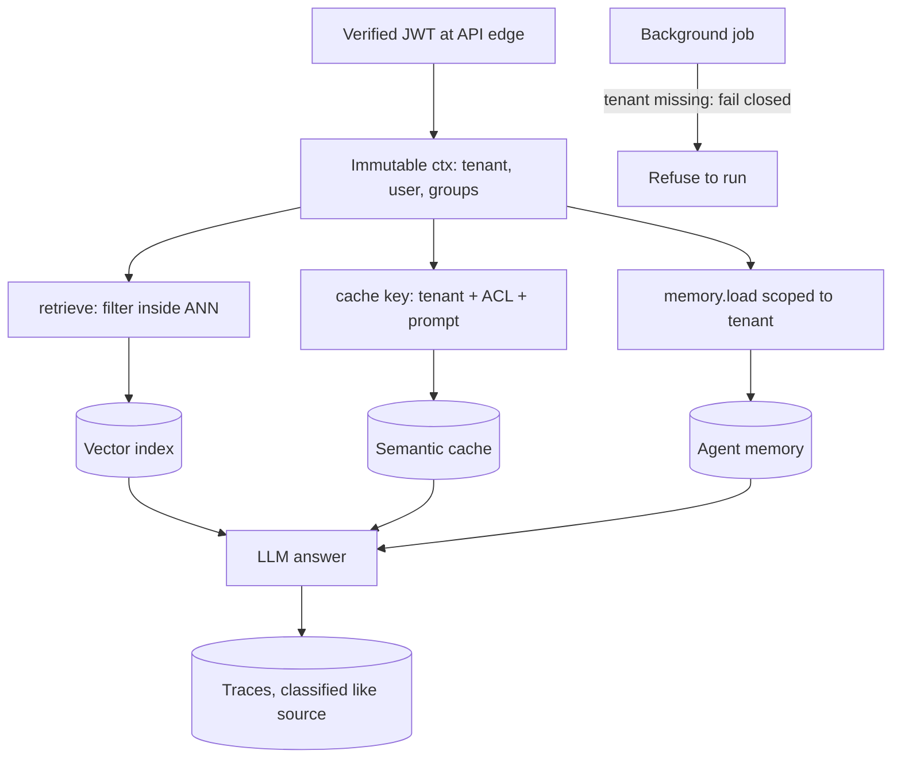

## TL;DR
Cross-tenant leakage is tenant A's data in tenant B's agent answer, because agents copy data into stores
row-level security never sees. Fix: one server-derived tenant ID and a hard pre-filter in every store,
proven by negative tests.

## For agent builders
- **Why it matters for agents.** A multi-tenant agent reads from a vector index, a semantic cache, long-term
  memory and per-tenant tools on every step. Each is a separate store with its own key, and one missing
  scope turns a fluent answer into a breach that nobody notices until a customer screenshot.
- **Where it shows up in your stack.** Your retriever's metadata filter, your memory namespace, the cache
  key in front of the LLM call, the tracing SDK that ships prompts to an observability backend, and the
  connector credentials your tools load.
- **What you control.** Deriving `tenant_id` once at the edge, a scoped store wrapper with no unscoped
  method, tenant and ACL groups in every cache and memory key, fail-closed background jobs, and a canary
  test matrix in CI.
- **What you can skip.** Asking the model to "use only this customer's documents". Once a foreign chunk is
  in context the leak has happened; isolation is a property of your data layer, not of the prompt.

## Why it exists
- **Classic SaaS has one tenancy choke point.** The data-access layer, with a `WHERE tenant_id = ?` on every
  query or row-level security in the database, using well-worn patterns.
- **Agent features copy data *out* of that layer into half a dozen places,** each usually built by a
  different person with a different mental model: chunks in a vector store, completions cached by
  question, agent memory, every prompt and completion shipped to an observability backend by the tracing
  SDK, and examples baked into weights by a fine-tuning job.
- **Retrieval failures are silent.** A wrong row in SQL throws a 403 or returns nothing; a wrong chunk in a
  prompt gets summarised fluently and confidently, and the only signal is a customer screenshot.
- **"Use only this customer's documents" fails.** The model cannot verify ownership, an injected document
  can override the instruction, and once the chunk is in context the leak has already happened: it is now
  in the trace store.
- **Retrieve-then-drop fails quietly too.** In a shared index the top 10 nearest neighbours may all belong
  to a large tenant, so recall for the small tenant collapses to zero, and someone eventually "fixes" it
  by raising k or removing the filter in one code path.

## How it works
### The leak surfaces in an agent pipeline
| # | Surface | How it leaks | Correct form |
|---|---|---|---|
| 1 | **Vector index** | shared collection with a missing filter, or a filter applied after the ANN search | filter evaluated *inside* the search so k means "k within this tenant" |
| 2 | **Semantic cache** | B asks "what is our refund policy?", the cache finds A's near-identical question and returns A's policy verbatim | tenant is part of the key, not a check after the hit |
| 3 | **Prefix / prompt cache** | no content leak (needs the identical prefix), but a hit is measurably faster, so latency reveals someone sent that prefix | treat as a side channel; ask whether a hosted provider scopes its cache per organisation (vendor-dependent) |
| 4 | **Agent memory and state** | keyed by user or session not tenant, recycled session IDs, "remember our API key is…" in a shared namespace | memory namespaced by tenant |
| 5 | **Shared fine-tuned model** | weights become a cross-tenant store with no access control; memorised examples are regurgitated | per-tenant adapters (LoRA) or RAG keep data filterable and deletable |
| 6 | **Observability** | traces with full prompts and completions visible to all engineers, or to all customers in a shared dashboard | classify and restrict traces like the source data |
| 7 | **Tool credentials** | one global CRM key for every tenant; the agent is one injected argument away from another customer's records | per-tenant credentials |
| 8 | **Infrastructure around the model** | March 2023 ChatGPT incident: a Redis client library bug under concurrency exposed other users' chat titles and some billing details | the LLM was not involved; the cache next to it was |
| 9 | **Background jobs** | re-indexing, nightly summarisation, eval and fine-tuning jobs have no verified token; a job falls back to a default tenant, or to "all tenants" because the filter was `None` | carry the tenant explicitly, fail closed |

- **Engines differ on filtered search.** Some implement filtered HNSW natively; others over-fetch and
  post-filter, which degrades under skewed tenant sizes. Know which yours does.

### Tenant is not the only boundary
- **Documents inside a tenant carry their own permissions:** HR files, board minutes, a deal room.
  Everything above applies one level down.
- **Retrieval filters on the caller's groups as well as the tenant** (ACL-aware retrieval).
- **A cache shared across a tenant's users keys on the permission set,** or the CFO's cached answer about
  the restructuring is served to an intern who asks the same question.
- **Practical key:** a hash of the sorted group IDs the caller had at retrieval time.
- **Per-user sources** (a mailbox, a personal drive) produce answers that should not be shared at all.

### The defence pattern
1. **One tenant identity, derived once.** Resolve `tenant_id` from the verified token at the API edge into
   an immutable request context. Never read it from the request body, the model's output, or a retrieved
   document, because all three are attacker-influenceable.
2. **No unscoped call sites.** Wrap every store so the only functions take the context: `retrieve(ctx, q)`,
   `cache.get(ctx, key)`, `memory.load(ctx)`. The unscoped variant should not exist, so a forgotten filter
   is a compile-time or review-time error, not a production leak.
3. **Pre-filter, not post-filter,** because post-filtering silently loses recall and invites the k
   workaround.
4. **Choose the partitioning deliberately** (table below).
5. **Tenant in every cache key.** `hash(tenant_id, model, prompt)`; a semantic cache also filters candidates
   by tenant before similarity.
6. **Jobs carry the tenant explicitly and fail closed.** A job takes `tenant_id` from the record written
   under a verified request context and refuses to run if it is missing, because a `None` filter on most
   vector clients means "no filter".
7. **Classify derived stores like their source.** Embeddings, traces and memory inherit the source's
   classification, access control and retention. Embedding inversion recovers much of the original text
   (Morris et al., 2023), so a leaked vector is a leaked document.
8. **Offboarding reaches every derived copy:** index, caches, memory, traces and any adapter trained on the
   tenant's data, verified by re-running canary queries. Dropping only the source rows leaves the leak
   surfaces populated.
9. **Prove it with canaries.** Plant a unique token per tenant; in CI query every other tenant for it with
   a large k across retrieval, cache and memory, and assert it never appears. In production, sample
   outputs and scan for any tenant's canary in the wrong tenant's response.

| Partitioning | Gives | Costs | Fits |
|---|---|---|---|
| **Collection-per-tenant** | hard isolation, simple deletion | per-tenant resources and operations | a few large or regulated tenants |
| **Namespaces** | the usual middle ground | engine-specific limits | mid-sized fleets |
| **Shared collection + mandatory filter** | scales to thousands of small tenants | one bug away from a leak | self-serve SaaS |

## Diagram
Trace the tenant ID through one agent step: it is derived once from the verified token and must reach
every store as a hard key or pre-filter; any store it skips is a leak surface.



## Misconceptions
- **"Row-level security in the database means the agent is tenant-safe."** RLS guards only the
  relational store. The vector index, semantic cache, memory, traces and fine-tuned weights are
  copies outside it, and each needs its own tenant key or pre-filter.
- **"Filtering retrieved chunks by tenant afterwards is equivalent to filtering in the search."**
  Post-filtering keeps foreign chunks out, but k now means k across all tenants: with 40,000, 2,000
  and 300 chunks in one index, the 300-chunk tenant averages 0.15 of 8 hits (simulation below). That
  collapse tempts someone to raise k or drop the filter. Filter inside the ANN search instead.
- **"Telling the model to use only this customer's documents is a second line of defence."** Once a
  foreign chunk is in the prompt the leak has happened, and it is already in the trace store. The
  model cannot verify ownership; isolation belongs to the data layer.
- **"The tenant ID in the request body or tool arguments is fine to filter on."** The body, the
  model's output and retrieved documents are all attacker-influenceable. Derive `tenant_id` once from
  the verified token and pass it in an immutable context.
- **"Isolating by tenant is enough."** Inside a tenant, documents carry their own ACLs, so a cache
  shared across a tenant's users must key on the permission set too, or the CFO's answer reaches the
  intern.
- **"A missing filter fails loudly."** On most vector clients a `None` filter means no filter, so a
  background job without a tenant silently searches everyone. Make jobs fail closed and prove it with
  canary tests.

## Examples
### A scoped store with a canary test
Every method requires a tenant context, the filter runs inside the vector search, the cache key includes
the tenant, and a parametrised test checks each tenant's canary is invisible to all others. It runs as
`pytest` against Qdrant's in-process local mode (`pip install qdrant-client pytest`, no server).

- **Version-sensitive:** checked against qdrant-client 1.16.1, where the call is `client.query_points(...)`
  with `collection_name`, `query=qvec`, `query_filter` and `limit`. The older `search` method (vector
  argument `query_vector`) is gone in that version.
- **Wire it into the agent:** the retrieval tool calls `answer` or `retrieve` with the context from the
  request, never with arguments the model produced.

```python
import hashlib, pytest
from dataclasses import dataclass
from qdrant_client import QdrantClient, models   # checked against qdrant-client 1.16.1

@dataclass(frozen=True)
class TenantCtx:
    tenant_id: str            # set once from the verified JWT at the API edge
    user_id: str
    groups: frozenset         # document ACL groups, also from the verified identity

class ScopedStore:
    """Every method takes ctx; there is no unscoped variant to call by mistake."""
    def __init__(self, vec: QdrantClient, cache: dict, collection="docs"):
        self.vec, self.cache, self.collection = vec, cache, collection

    def retrieve(self, ctx: TenantCtx, qvec, k=8):
        # filter evaluated inside the ANN search, so k is k *within* the tenant
        flt = models.Filter(must=[
            models.FieldCondition(key="tenant_id", match=models.MatchValue(value=ctx.tenant_id)),
            models.FieldCondition(key="acl_groups", match=models.MatchAny(any=sorted(ctx.groups)))])
        return self.vec.query_points(collection_name=self.collection, query=qvec,
                                     query_filter=flt, limit=k).points

    def cache_key(self, ctx: TenantCtx, model: str, prompt: str) -> str:
        acl = ",".join(sorted(ctx.groups))       # same tenant, different permissions => different key
        return hashlib.sha256(f"{ctx.tenant_id}|{acl}|{model}|{prompt}".encode()).hexdigest()

    def answer(self, ctx, model, prompt, qvec, llm):
        key = self.cache_key(ctx, model, prompt)
        if (hit := self.cache.get(key)) is not None:
            return hit
        out = llm(prompt, self.retrieve(ctx, qvec))
        self.cache[key] = out                    # a real cache also sets a TTL, e.g. ttl=3600
        return out

# CI: each tenant's canary document must be invisible to every other tenant
CANARIES = {"acme": "CANARY-acme-7f3a", "globex": "CANARY-globex-91c2", "initech": "CANARY-initech-c0de"}

def toy_embed(text, dim=64):                     # stand-in for a real embedding model
    v = [0.0] * dim
    for w in text.lower().replace("?", " ").split():
        v[int(hashlib.md5(w.encode()).hexdigest(), 16) % dim] += 1.0
    return v

@pytest.fixture
def embed():
    return toy_embed

@pytest.fixture
def store():
    client = QdrantClient(":memory:")            # local mode, no server needed
    client.create_collection("docs", vectors_config=models.VectorParams(size=64, distance=models.Distance.COSINE))
    client.upsert("docs", points=[
        models.PointStruct(id=i, vector=toy_embed(f"{tok} is the secret"),
                           payload={"tenant_id": t, "acl_groups": ["all-staff"], "text": f"{tok} is the secret"})
        for i, (t, tok) in enumerate(CANARIES.items())])
    return ScopedStore(client, cache={})

@pytest.mark.parametrize("asker", CANARIES)
def test_no_cross_tenant_leak(store, embed, asker):
    ctx = TenantCtx(tenant_id=asker, user_id="qa-bot", groups=frozenset({"all-staff"}))
    for owner, token in CANARIES.items():
        if owner == asker:
            continue
        hits = store.retrieve(ctx, embed(f"what is {token}?"), k=50)   # large k on purpose
        assert not any(token in h.payload["text"] for h in hits), f"{asker} can see {owner}"
```

- **Why k=50:** the large-k test catches a missing or post-applied filter, because the query is phrased to
  make the foreign canary the nearest neighbour. Pass `query_filter=None` and all three cases fail.
- **Why ACL groups in the cache key:** two users of the same tenant with different permissions never share
  a cached answer, at the price of a lower hit rate.

### Simulating post-filter vs pre-filter recall
Three tenants of 40,000, 2,000 and 300 chunks in one index. A post-filter that retrieves the top 8 and drops
foreign hits often returns nothing for the 300-chunk tenant. Pure Python, runs in about ten seconds.

```python
import random, math

random.seed(0)
DIM, K = 16, 8
SIZES = {"big": 40_000, "mid": 2_000, "small": 300}
index = [(t, [random.gauss(0, 1) for _ in range(DIM)]) for t, n in SIZES.items() for _ in range(n)]

def cos(a, b):
    return sum(x * y for x, y in zip(a, b)) / math.sqrt(sum(x * x for x in a) * sum(y * y for y in b))

def post_filter(q, tenant, k=K):
    top = sorted(index, key=lambda r: -cos(q, r[1]))[:k]      # ANN over everyone
    return [r for r in top if r[0] == tenant]                 # then drop foreign hits

def pre_filter(q, tenant, k=K):
    mine = [r for r in index if r[0] == tenant]               # filter inside the search
    return sorted(mine, key=lambda r: -cos(q, r[1]))[:k]

queries = [[random.gauss(0, 1) for _ in range(DIM)] for _ in range(20)]
for t in SIZES:
    post = sum(len(post_filter(q, t)) for q in queries) / len(queries)
    pre = sum(len(pre_filter(q, t)) for q in queries) / len(queries)
    print(f"{t:>5}: post-filter avg hits {post:.2f} of {K}, pre-filter {pre:.2f}")
```

| Tenant | Post-filter avg hits of 8 | Pre-filter |
|---|---|---|
| big (40,000) | 7.50 | 8.00 |
| mid (2,000) | 0.35 | 8.00 |
| small (300) | 0.15 | 8.00 |

- **Reading it:** the small tenant gets almost nothing, which is exactly when someone "fixes" search by
  raising k or dropping the filter in one path.
- **What the agent does with zero hits:** a RAG agent that retrieves nothing tends to answer from its own
  priors or loop on retries, so the recall bug looks like hallucination rather than a scoping bug.

### Worked audit: one agent turn across stores
A support agent for tenant `globex` answers "what is our refund policy?" in one step that touches four
stores. An audit of a first draft (illustrative):

| Store touched in the turn | Key or filter in the draft | Leak if wrong | Fix |
|---|---|---|---|
| Semantic cache | embedding of the question | `acme`'s policy returned verbatim | key on tenant, ACL groups and prompt |
| Vector index | `tenant_id` filter after top 8 | recall near zero for small tenants | filter inside the ANN search |
| Long-term memory | `user_id` only | recycled session sees another tenant's notes | namespace by tenant, then user |
| CRM tool | one global API key | injected order ID reads another customer | per-tenant credential from ctx |

- **Every fix reads the same `TenantCtx`,** so one review question covers the turn: does each store call
  take the context, or something the model or client supplied?

## Production patterns
- **Scoped repository as the only store API.** Expose `retrieve(ctx, ...)`, `cache.get(ctx, ...)` and
  `memory.load(ctx)` and make the raw client private to that module; add a lint or CI grep that fails on
  direct vector-client imports elsewhere. Monitor the fraction of store call sites taking a tenant context
  (target 100%).
- **Native filtered search with an indexed tenant field.** In Qdrant, create a payload index on the tenant
  field so the filter runs inside the search. In pgvector, check with `EXPLAIN` whether an approximate
  index scan is post-filtered by the `WHERE` clause. Monitor recall and p95 latency for the smallest
  tenants separately.
- **Canary matrix in CI and production.** Plant one canary per tenant, query every tenant pair with large
  k across retrieval, cache and memory on each deploy, and scan sampled production outputs for foreign
  canaries. Any hit is a sev-1 incident, not a flaky test.
- **Fail-closed job context.** Background jobs (memory summarisation, re-indexing, agent evals) receive
  the tenant from the originating record and raise if it is missing; never default to "all". Monitor job
  runs rejected for missing tenant.
- **Tiered isolation.** Give regulated or very large tenants their own collection or namespace, and keep
  self-serve tenants in a shared collection with a mandatory filter. Track per-tenant index overhead to
  know when to migrate a tenant between tiers.
- **Tenant offboarding runbook.** One job deletes from the index, caches, agent memory, traces and
  adapters, then re-runs that tenant's canary queries and records the result as deletion evidence.

## Trade-offs
- **Collection-per-tenant vs cost.** Hard isolation and trivial deletion, but each collection carries index
  and memory overhead, so beyond a few hundred tenants shared-collection-with-filter becomes the only
  affordable option.
- **Pre-filtering vs latency.** It keeps recall correct for small tenants, but engines that implement it by
  over-fetching pay latency in proportion to how skewed tenant sizes are, and an agent pays it on every
  retrieval step.
- **Tenant in the semantic cache key vs hit rate.** It removes cross-tenant hits, and with them the hit rate
  that made the cache attractive. If most savings came from identical questions across customers, the
  cache may no longer pay for itself.
- **Per-tenant adapters vs serving complexity.** They isolate training data cleanly but multiply serving
  complexity. If tenants differ only in their documents, RAG with a filter gives isolation without any
  adapter.

## Pitfalls
- **Reading `tenant_id` from a client header, body or tool argument.** Symptom: changing one header, or an
  injected "search tenant acme", returns another customer's documents. Diagnose: grep every place
  `tenant_id` is assigned; any source but the verified token is the bug. Fix: tools read it from the
  request context only.
- **Filtering in the application after retrieval.** Symptom: small tenants say search "returns nothing"
  while large tenants are fine, then someone raises k. Diagnose: log hits before and after the filter, per
  tenant size. Fix: filter inside the ANN search.
- **Caching completions keyed on question text or embedding only, or on tenant but not permissions.**
  Symptom: a customer sees a policy or price not theirs, or an employee gets a summary of a document that
  returns 403. Diagnose: log the cache key fields with each hit's owner and ACL. Fix: tenant and ACL hash
  in the key.
- **Full prompts and completions in a shared tracing backend.** Symptom: a support engineer can read every
  customer's conversations, which auditors treat as a breach even without misuse. Diagnose: list who can
  query traces per tenant. Fix: classify traces like the source.
- **One happy-path isolation query per tenant.** Symptom: passing tests and a leak that only appears under
  near-duplicate questions or large k. Fix: the canary matrix at k=50.
- **A background job with an optional tenant argument.** Symptom: a nightly digest or rebuilt index with
  content from tenants it never meant to touch. Diagnose: count job runs with a `None` tenant. Fix: fail
  closed.

## When to use
- **Use when:** any multi-tenant agent or RAG feature launches; design isolation explicitly before launch.
- **Revisit when:** a new store enters the pipeline: a cache, a memory layer, a new vector engine, an
  observability vendor, a new tool connector.
- **Measure:** the fraction of store call sites that take a tenant context (target 100%, enforced by a lint
  or wrapper), canary-test pass rate across tenant pairs in CI, and sampled production outputs scanned for
  foreign canaries.

## Exercise
**Goal:** find and fix every cross-tenant leak in a deliberately leaky RAG agent. No solution given.
- **Inputs:** three synthetic tenants (40,000, 2,000 and 300 chunks) with one canary each, a semantic cache,
  a memory dict and a nightly summariser job; seed four bugs (post-filter, question-only cache key,
  user-keyed memory, job with optional tenant).
- **Deliver:** a scoped store with no unscoped method, plus a canary matrix covering retrieval, cache,
  memory and the job.
- **Acceptance:** the matrix fails on the seeded version for all four surfaces and passes after your fix
  at k=50; small-tenant recall is 8 of 8; a job started without a tenant raises; two users of one tenant
  with different groups get different cache keys.

## Role lens
- **Engineer:** Writes the scoped wrappers, puts the tenant in every cache key, and adds the canary test
  matrix to CI so a missing filter fails the build rather than a customer.
- **Architect:** Decides collection-per-tenant versus shared-with-filter, how tenant identity flows from
  the edge to every store, and what classification derived stores like embeddings and traces inherit.
- **FDE:** Demonstrates isolation to a customer's security team with the canary test and explains why a
  shared index with a mandatory filter is, or is not, acceptable for their regulatory regime.

## Check yourself
**Q:** Your RAG product is moving from five enterprise tenants, each with its own vector collection, to
two thousand self-serve tenants, and an engineer proposes one shared collection with a `tenant_id`
filter. What breaks, what would you require before approving, and what would you measure afterwards?

**A:** Nothing breaks logically, but the failure mode changes: with separate collections a missing filter
returns nothing, with a shared collection it returns someone else's data. Before approving I would require
that the filter is applied inside the ANN query and benchmarked for recall on the smallest tenants, that
the tenant ID comes only from the verified token via an immutable context, that the vector client is
wrapped so no unscoped search method is reachable, that the semantic cache and any memory store include
the tenant in their keys, and that a canary-per-tenant test runs in CI across tenant pairs with a large
k. I would also confirm deletion: removing a tenant must be a filtered delete that is verified, since there
is no collection to drop. Afterwards I would track canary hits in sampled production outputs, recall for
small tenants versus the old setup, and latency, since filtered search on a skewed index can get slower
than per-tenant collections were.

## Interview questions
### Why can an LLM feature leak across tenants when the database's row-level security is correct?
- **Data is copied out of the protected layer:** chunks into vector indexes, answers into caches, turns
  into memory, prompts into traces, examples into weights.
- **None of those stores see row-level security,** so each needs its own tenant scoping, derived from the
  same verified identity.

### A small tenant reports that search returns nothing while large tenants are fine. What is going on?
- **Likely a post-filter:** the top-k is filled by the large tenant's chunks and the application drops them,
  leaving zero results.
- **Do not raise k or remove the filter;** move the filter inside the ANN query and check how your engine
  implements filtered search.
- **Verify** with a recall benchmark on the smallest tenants and the canary test at large k.

### How would you scope long-term memory for an agent platform serving many tenants?
- **Namespace by tenant, then user:** the memory key starts with the server-derived `tenant_id`, so a
  recycled session or user ID cannot reach another tenant's notes.
- **Writes inherit classification:** memories derived from restricted documents carry those ACL groups and
  are filtered on read.
- **Background summarisers fail closed** when the tenant is missing, and offboarding deletes the namespace
  and re-runs canary queries.

### When would you choose collection-per-tenant over a shared collection with a filter?
- **Per-tenant** for a few large or regulated tenants: hard isolation, simple verified deletion, and a
  missing filter returns nothing instead of someone else's data.
- **Shared** for thousands of small tenants, because per-collection index and memory overhead becomes
  unaffordable beyond a few hundred.
- **Mixed tiers** are common: dedicated collections for regulated customers, shared for self-serve.

### What is the side-channel risk of prompt or prefix caching across tenants?
- **No content leak,** because a hit needs the identical token prefix.
- **But latency leaks:** a hit is measurably faster than a miss, so timing can reveal that someone else
  already sent that exact prefix.
- **Mitigate** by scoping your own caches per tenant and asking hosted providers whether their cache is
  scoped per organisation.

## Quiz
### Q: Why is applying the tenant filter after retrieving the top-k neighbours insufficient?
- [ ] Because vector databases cannot store a tenant field alongside the embedding
- [x] Because the top-k may be filled by other tenants' chunks, collapsing recall, and the filter is one forgotten call site away from a leak
- [ ] Because post-filtering changes the embedding space and breaks cosine similarity
- [ ] Because the model needs to see all tenants' chunks to rank them correctly
> Post-filtering returns fewer than k results for small tenants and tempts engineers to raise k or drop
> the filter; a filter evaluated inside the search keeps k meaningful and makes the scoping structural.

### Q: Which component can leak tenant data even though the relational database enforces row-level security correctly?
- [ ] The HTTPS load balancer in front of the API
- [ ] The tokenizer used by the model
- [x] A semantic cache keyed only on the embedding of the question
- [ ] The JSON schema used for structured outputs
> Row-level security protects rows at query time; a semantic cache stores completions derived from those
> rows and serves them to whoever asks a similar question next, regardless of tenant, unless the tenant is
> in the key.

### Q: Where should the tenant identifier used for filtering come from?
- [ ] The `tenant` field in the JSON request body sent by the client
- [ ] The model's structured output, which includes the tenant it believes it is serving
- [x] The authenticated token resolved at the API edge and carried in an immutable request context
- [ ] The metadata of the first retrieved document
> Request bodies, model outputs and retrieved documents are all attacker-influenceable; only the verified
> credential is a trustworthy source, and carrying it in a context object prevents it being overwritten.

## Mastery test
**Problem:** a meeting-notes agent serves 600 companies. It transcribes calls, stores per-user memory,
caches answers to "what did we decide about X?", and a weekly job fine-tunes one shared model on all
transcripts to improve summaries. Security asks whether tenants are isolated. What do you find and change?

**A strong answer:**
- calls the shared fine-tune a cross-tenant store with no access control; proposes per-tenant adapters or RAG;
- keys memory by tenant then user, and the cache on tenant, ACL groups and prompt;
- makes the weekly job carry the tenant and fail closed, and offboarding reach adapters, caches and traces;
- proves it with a canary per tenant across retrieval, cache, memory and generated summaries.

## Use cases & projects
### Use cases
- **Multi-tenant support and knowledge agents.** One shared index serves thousands of customers, so the
  in-search tenant filter and canary matrix are launch blockers.
- **Agent platforms with long-term memory.** Memory namespaced by tenant and user keeps one customer's
  "remember this" from surfacing in another's session.
- **Cost-optimised agents with semantic caches.** Tenant and ACL groups in the key decide whether caching
  is safe at all.
- **Enterprise security reviews.** Canary results and the scoped-store design are the evidence buyers ask
  for before connecting their data.

### Mini project
**Canary-test a multi-tenant RAG agent (2-3 hours).**
- **Goal:** prove, with failing and passing tests, that a small RAG agent cannot leak across three tenants.
- **Steps:** index synthetic documents for three tenants of very different sizes, each with one canary
  token; give a simple agent a `search_docs` tool and a dictionary cache; first wire them with a
  post-filter and a question-only cache key, run the canary matrix at k=50, then switch to the scoped store
  with a pre-filter and tenant-plus-ACL cache keys and rerun.
- **Done when:** the first version shows at least one cache or recall failure, the second passes every
  tenant pair, and small-tenant recall is reported for both versions in a short table.
